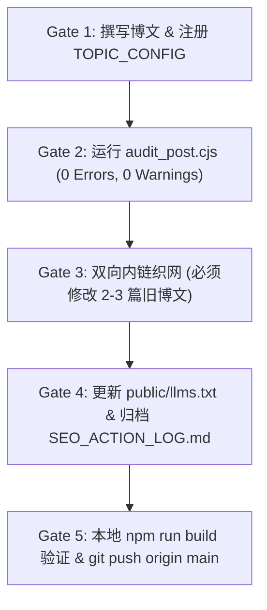

# APIVALE 技术博客端到端立项、撰写与发布规范 (Master Publishing Skill)

本文档是 APIVALE (`apivel.com` / `apivale.com`) 技术博客与 SEO/GEO 增长体系的**标准化作业规范 (SOP Skill)**。它沉淀自百度文心 5.5 Flash、DeepSeek V4、Qwen 4、AI Coding 架构调查等多篇 98+ A 级高分实战经验，涵盖从**“SERP 截图意图采掘 $\rightarrow$ 3C 诊断与 4 项工程增益 $\rightarrow$ 规避介词截断错位 $\rightarrow$ 消除 Doorway Page 扣分 $\rightarrow$ 双向内链织网 $\rightarrow$ 5-Gate 原子发布”**的全生命周期。

---

## 目录
1. [核心铁律与商业意图隔离 (Non-Negotiable Directives)](#一核心铁律与商业意图隔离)
2. [Phase 1: 立项与搜索意图 3C 诊断 (Google 截图三层意图采掘)](#二phase-1-立项与搜索意图-3c-诊断)
3. [Phase 2: 标题与元数据设计 (ABC 公式与防截断错位法则)](#三phase-2-标题与元数据设计)
4. [Phase 3: 正文创作与 4 项真实工程增益 (AST 纯净度与 GEO 友好)](#四phase-3-正文创作与-4-项真实工程增益)
5. [Phase 4: 页面侧承接微工具与钱包转化闭环 (消除 4.5 分扣分)](#五phase-4-页面侧承接微工具与钱包转化闭环)
6. [Phase 5: 5-Gate 原子发布与双向织网门禁](#六phase-5-5-gate-原子发布与双向织网门禁)

---

## 一、核心铁律与商业意图隔离

### 1. 商业意图纯净度防线 (P0 核心防呆)
* **唯一使命**：APIVALE 的使命是转化 **API 开发者、AI 工程师、技术初创团队** 使用我们低延迟、高可用的聚合网关（原生兼容 OpenAI / Anthropic 端点，支持 PayPal 即时直结与 0% 跨境手续费）。
* **意图强隔离**：文章核心必须锁定在 **商业/交易与高价值工程意图**（`api key`, `pricing`, `two-tier CI pipeline`, `pr review automation`, `cursor/claude code setup`），坚决防范 **信息类极客/纯硬件折腾意图**（`1-bit quantization`, `vLLM/GGUF weights`, `local VRAM self-hosting`）。若大量篇幅讨论本地跑分与量化，Google 会把页面打入跑分综合页，真正值钱的 API 词全掉至 50 名开外。

### 2. 官方支付与钱包权益严密对齐
* **官方支持支付方式**：主流推荐 **PayPal（PayPal 即时结账 / Pay with PayPal）**，支持全球国际信用卡（Visa, MasterCard, Amex）与支付宝（0 额外跨境手续费，免 KYC 认证）。**严禁提及 Stripe 或 Crypto/加密货币**。
* **钱包优惠三件套（必须 100% 准确写入 CTA）**：
  1. **+50% 首充特权**：充 $5 得 $7.50，充 $29 得 $43.50，充 $99 得 $148.50；
  2. **$29 开发者专享礼包**：直降 56%、4000万 Token、永久有效；
  3. **新用户 $0.20 免卡起步金**：注册即用，零门槛沙盒。

### 3. 作者轮换机制 (Persona Rotation)
每篇博文必须在现有作者库中轮换，杜绝同一作者连续署名：
* **Elena Rostova**：*Senior LLM Systems Architect & Agent Infrastructure Specialist*（专攻自主 Agent 推理循环、Thinking Token 预算控制与高并发路由）。
* **Kenji Tanaka**：*AI Developer Relations Engineer*（专攻终端工作流、Claude Code CLI、多智能体调试与开发者生态）。
* **Sofia Costa**：*Senior Cloud & API Gateway Architect*（专攻跨国低延迟网关、容灾转移与计费透明度）。
* **Alex Rivera**：*Lead AI Systems Architect*（专攻企业级模型选型、分布式缓存与安全沙盒）。
* **Priya Sharma**：*AI Performance & Distributed Computing Engineer*（专攻基准评测、SWE-bench 复现与吞吐优化）。

---

## 二、Phase 1: 立项与搜索意图 3C 诊断

坚决反对凭空脑补题目。必须通过 Google SERP 真实截图标靶化逆向出用户的三层核心意图：

```
┌────────────────────────────────────────────────────────────────────────┐
│ 搜索意图 3 层漏斗模型                                                   │
├────────────────────────────────────────────────────────────────────────┤
│ 1. 利益与焦虑层 (Financial/Career Anxiety):                           │
│    - Google 下拉首词（如 engineers salary）、PAA 薪资提问                 │
│    - 关注点：钱、成本、降薪危机、API 消耗、ROI                           │
├────────────────────────────────────────────────────────────────────────┤
│ 2. 行业与供需层 (Hiring Paradox / Industry Dynamics):                 │
│    - 相关搜索（如 Companies only hiring seniors Reddit）                │
│    - 关注点：行业怪象、为什么只招 Senior、Vibe Coding 狂欢后的代价       │
├────────────────────────────────────────────────────────────────────────┤
│ 3. 工程与技术痛点层 (Engineering Pain Points):                         │
│    - SERP 原生 Snippet 高亮原声（如 juniors who use it as a crutch）   │
│    - 关注点：PR 审查堵塞、内存泄露、上下文溢出、CI 故障转移               │
└────────────────────────────────────────────────────────────────────────┘
```

### 3C 诊断清单
1. **Content Type (内容类型)**：以权威技术调查与生产实操指南（Technical Deep-Dive & Engineering Guide）为主。
2. **Content Format (内容格式)**：结构化 AST（Definition Box $\rightarrow$ 社区原声 $\rightarrow$ 薪资/成本对比表 $\rightarrow$ 两层架构方案 $\rightarrow$ 可交互微工具 $\rightarrow$ 15+行代码 $\rightarrow$ FAQ Schema）。
3. **Content Angle (切入视角)**：从“吐槽与焦虑”迅速升华至“工程自动化解法”，自然引申至 APIVALE 的双层大模型（轻量初筛 + 深度推理）网关方案。

---

## 三、Phase 2: 标题与元数据设计

### 1. ABC 标题黄金公式
```text
[核心主词/场景] + [痛点利益/次要 LSI] | [APIVALE 品牌钩子]
```
* **字符数硬指标**：**50–60 字符（max 600px）**，必须以 `| APIVALE` 结尾。
* **H1 标题**：$\le 80$ 字符，直击核心痛点，且主词短语与 Title 保持 100% 对称。
* **Meta Description**：**140–160 字符**，高 CTR 承诺，必须完整包含自然语言核心词句。

### 2. ⭐ 重大实战血泪教训：防 4 词截断与介词挤出法则 (The "on" Bug Fix)
* **算法底层原理**：搜索引擎分词与 SEO 军师算法强制提取 **2~4 词组合** 作为推断词候选。
* **介词挤出陷阱**：
  若写作 `AI coding impact ON senior engineers`（5 词），算法向后滑 4 个词切片：
  `coding` (1) `impact` (2) `on` (3) `senior` (4) —— **最核心的技术定语 `engineers` 被挤出去了！**
  在英文中，`coding impact on senior` 失去 `engineer` 后，会被 Google 算法判定为 **“老年人 / 退休长者（Senior Citizens）学编程的影响”**，导致 SERP 结果全变成 *“Can elderly people learn coding?”*，直接触发**致命的“赛道错位”扣分**！
* **避坑铁律**：
  * Title、H1、URL 与正文高频锚点中，**核心词组坚决去除无意义介词**（如用 `AI Coding Impact Senior Engineers` 或冒号 `AI Coding Impact: Senior Engineers` 代替 `on`）；
  * 确保 4 词组合 100% 包含行业核心词（`engineers`）；
  * Title、H1、URL 必须保持 100% 词群一致。

---

## 四、Phase 3: 正文创作与 4 项真实工程增益

### 1. 严格 AST 树纯净度红线 (Strict AST Widget Cleanliness)
* **P0 扣分红线**：所有自定义嵌入 HTML 组件（Definition Box、社区原声卡片、Playground、ROI 计算器、CTA 卡片）中，**严禁使用原生 `<h1>`-`<h4>` 标签**！
* **统一规范**：全部使用 `<div class="font-bold text-white ...">` 或 `<span>` 加 CSS 类名，确保文章只有一条纯粹的 `H1 -> H2 -> H3` 语义树，彻底杜绝“标题跳级”扣分。

### 2. 独特性“4 项工程增益”标准
每篇博文必须落实以下 4 项硬核内容，构筑无法被 AI 仿造的内容护城河：
1. **架构可验证性证明 (Verifiable Architecture Proof)**：
   * 必须包含清晰的 Mermaid 拓扑图（如展示两层审查架构或故障转移流水线）。
2. **客观中立对比表 (Honesty Architecture Table)**：
   * 必须包含客观的“适合场景 (Best For... / Honesty Column)”列，诚实列举官方直签的合规优势与 APIVALE 的高性价比优势。
3. **真实社区原声卡片 (Primary-Source Community Voice)**：
   * 引用真实 Reddit 或 GitHub Issues 原话（如 `r/ExperiencedDevs`），附带真实用户 handle 和可点击的外部链接。
4. **15+ 行开箱即用生产代码 (Production Code / Config)**：
   * 必须提供完整、可直接粘贴运行的配置（如 GitHub Actions yml、Python 异步客户端、Cursor API 切换脚本），标注 BaseURL 为 `https://apivel.com/v1`。

### 3. GEO 大模型友好规范 (BLUF & FAQ Schema)
* **BLUF 原则 (Bottom Line Up Front)**：前 100 词内以加粗字体、明确主谓宾直接作答核心结论，便于大模型爬虫（SearchGPT, Perplexity）进行语义分块（Chunking）与直接引用。
* **FAQPage JSON-LD 注入**：正文底部必须嵌入完整的 Schema 微数据，1:1 回应 Google 截图中的 4 大 PAA 问题，争夺 Google AI Overviews 零位引用。

---

## 五、Phase 4: 页面侧承接微工具与钱包转化闭环

### 1. 消除 4.5 分致命跳出扣分 (In-Article Live Playground)
* **SEO 引擎红线**：凡在正文、标题或 CTA 提及“试用/测试/体验/计算”等字样，必须内嵌原生交互体验区（包含实际可交互的 `<input>` / `<select>` / `<button>` 原生表单元素）。
* **零 Alert 规则**：严禁在 Markdown 中手写 `onclick="alert(...)"`，所有表单交互必须通过轻量内联 JS 实现纯前端 DOM 状态更新。
* **落地实践**：内嵌专属计算器（如 `Senior Engineering PR Review & ROI Calculator`），用户滑动滑块即可原地测算节省工时与 API 成本，原地满足意图，锁死停留时间（Dwell Time）。

### 2. 结尾转化卡片 (`.cta-card`) 规范
结尾卡片必须严格包含以下要素：
```html
<div class="cta-card">
  <!-- 标题与副标题直击痛点 -->
  <!-- 钱包三权益：+50% 首充、 $29 开发者包、 $0.20 免费额度 -->
  <!-- 双按钮：/pricing 与 /sign-up，必须动态携带 redirect=/blog/<slug> -->
  <!-- 支付背书：PayPal 官方即时结账、全球信用卡、0% 外汇手续费 -->
</div>
```

---

## 六、Phase 5: 5-Gate 原子发布与双向织网门禁

执行发布时，必须在一个完整事务中原子化完成 5 大门禁闭环，严禁留存半成品：



### Gate 1: 动态话题注册 (`src/pages/[slug].astro`)
若文章涉及新的场景或模型（如 `ai-coding`, `ernie`, `deepseek`），必须在 `src/pages/[slug].astro` 的 `TOPIC_CONFIG` 中注册专属中英文转化卡片文案（包含 `badge`、`title`、`desc`、`btnText`、`utmCampaign`）。

### Gate 2: 前置体检校验 (`audit_post.cjs`)
运行校验脚本：
```bash
node scratch/audit_post.cjs src/content/blog/<article-slug>.md
```
必须达成：
* `0 Errors, 0 Warnings`；
* Title 长度 $\le 80$ 字符；MetaTitle 50–60 字符；Meta Description 140–160 字符；
* 正文可见词数严格在 **1,200 ~ 1,800 词**；
* 必须包含 `<input>` / `<select>` 与 `.cta-card`；
* 严禁出现 Stripe 或 Crypto。

### Gate 3: 双向内链织网 (Bi-directional Mesh Weaving)
* **严禁发布孤岛文章**：必须在同集群中搜索 2–3 篇已有高权重博文（如 `ernie-5-5-flash-preview-api-reddit.md`, `ponytail-github-skill-install-review.md`, `gemini-4-argon-coding-test-review.md`）。
* **立即打开并编辑旧博文**：在相关段落注入指向新博文的精准上下文锚文本链接，同时新博文必须出链至旧博文，形成互为支撑的网状拓扑。

### Gate 4: 知识库与动作日志归档
1. **GEO 知识库更新**：在 `public/llms.txt` 的 `## Core Model & Persistent Agent Guides` 下登记新文章的权威大模型检索摘要。
2. **动作日志归档**：在 `SEO_ACTION_LOG.md` 记录立项背景、主攻词、优化动作与 14 天因果响应假设。

### Gate 5: 编译测试与远程推送
1. 执行本地全量编译：
   ```bash
   npm run build
   ```
   必须确认 0 报错，静态页面全量生成成功。
2. 暂存所有涉及修改的文件（新博文 + 旧博文 + `[slug].astro` + `llms.txt` + `SEO_ACTION_LOG.md`），执行单一规范 Git Commit，并推送到远程仓库：
   ```bash
   git push origin main
   ```
3. 等待远程构建完成后，在哥飞军师复测，确保 On Page 得分达标（98+ A级）且无赛道错位。
