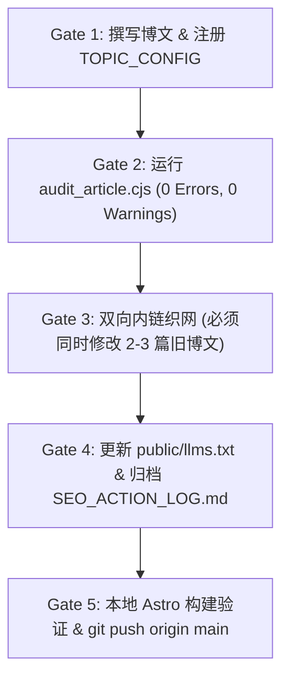

# APIVALE 技术博客端到端立项、撰写、SEO/GEO优化与发布军规 (Master Publishing Skill)

本文档是 APIVALE (`apivel.com` / `apivale.com`) 技术博客与 SEO/GEO 增长体系的**标准化作业规范 (SOP Skill)**。它沉淀自 **GLM-5.4**、**GPT-6.2 Astra vs Opus 5.5**、百度文心 5.5 Flash、DeepSeek V4、Qwen 4 等多篇 **98+ A / A+ 级** 高分实战经验，涵盖从**“SERP/PAA 真实截图 1:1 三层逆向采掘 $\rightarrow$ 3C 诊断与 4 项工程增益 $\rightarrow$ 规避介词截断错位 $\rightarrow$ 消除小数分词赛道错位 $\rightarrow$ 消除 Doorway Page 扣分 $\rightarrow$ 双向内链织网 $\rightarrow$ 5-Gate 原子发布”**的全生命周期。

---

## 目录
1. [核心铁律与商业意图隔离 (Non-Negotiable Directives)](#一核心铁律与商业意图隔离)
2. [Phase 1: 需求采掘与 3C 意图诊断 (SERP 真实截图 1:1 三层逆向采掘 SOP)](#二phase-1-需求采掘与-3c-意图诊断-serp-真实截图-11-三层逆向采掘-sop)
3. [Phase 2: 标题与元数据设计 (ABC + 截图高意图矩阵公式)](#三phase-2-标题与元数据设计)
4. [Phase 3: 正文创作与“4 项真实工程增益” (AST 纯净度与 PAA 1:1 闭环)](#四phase-3-正文创作与-4-项真实工程增益)
5. [Phase 4: 页面侧交互微工具与钱包转化闭环 (消除 4.5 分扣分)](#五phase-4-页面侧交互微工具与钱包转化闭环)
6. [Phase 5: ⭐ 哥飞军师 98+ A+ 军规级对齐技巧 (实战避坑宝典)](#六phase-5--哥飞军师-98-a-军规级对齐技巧)
7. [Phase 6: 5-Gate 原子发布与双向织网门禁](#七phase-6-5-gate-原子发布与双向织网门禁)
8. [Phase 7: 远程构建与军师闭环复测](#八phase-7-远程构建与军师闭环复测)

---

## 一、核心铁律与商业意图隔离

### 1. 商业意图纯净度防线 (P0 核心防呆)
* **唯一使命与统一品牌词**：**APIVEL**（官网域名 `apivel.com`，页头与 UI 统一使用 `apivel` / `APIVEL`；新撰写博文标题后缀与正文统一使用 **`APIVEL`**，MetaTitle 结尾统一为 `| APIVEL`）。APIVEL 的使命是转化 **API 开发者、AI 工程师、技术初创团队** 使用我们低延迟、高可用的聚合网关（原生兼容 OpenAI / Anthropic 端点，支持 PayPal 即时直结与 0% 跨境手续费）。
* **意图强隔离**：文章核心必须锁定在 **商业/交易与高价值工程意图**（`api key`, `pricing`, `two-tier CI pipeline`, `pr review automation`, `cursor/claude code setup`），坚决防范 **信息类极客/纯硬件折腾意图**（`1-bit quantization`, `vLLM/GGUF weights`, `local VRAM self-hosting`）。若大量篇幅讨论本地跑分与量化，Google 会把页面打入跑分综合页，真正值钱的 API 词全掉至 50 名开外。
* **国产大模型引流桥梁 (Two-Tier Hybrid Router)**：在对比海外昂贵前沿模型（如 GPT-6.2 Astra $8/$40、Claude Opus 5.5 $4/$20）或分析国产新旗舰（如 GLM-5.4、Qwen 4 Max、DeepSeek V4）时，必须将社区对“5小时配额耗尽”、“429 速率限制”、“Thinking Token / 马拉松思维账单爆炸”的痛点，引申至通过 APIVALE 两层网关方案：**85%~90% 基础任务分流至 Qwen 3.7 Max ($0.25/$0.80) 与 DeepSeek V4 ($0.20/$0.60)**，实现降本 88%~92% 并零停机容灾。

### 2. 官方支付与钱包权益严密对齐
* **官方支持支付方式**：主流推荐 **PayPal（PayPal 即时结账 / Pay with PayPal）**，支持全球国际信用卡（Visa, MasterCard, Amex）与支付宝（0 额外跨境手续费，免 KYC 认证）。**严禁提及 Stripe 或 Crypto/加密货币**。
* **钱包优惠三件套（必须 100% 准确写入 CTA）**：
  1. **+50% 首充特权**：充 $5 得 $7.50，充 $29 得 $43.50，充 $99 得 $148.50；
  2. **$29 开发者专享礼包**：直降 56%、4000万 Token、永久有效；
  3. **新用户 $0.20 免卡起步金**：注册即用，零门槛沙盒。

### 3. 作者轮换机制与真人头像铁律 (Persona Rotation & Real Human Avatars - P0)
* **真人头像强制要求**：所有作者必须全量配置并正常加载 1024x1024 真人高清头像。头像资源必须在 `public/authors/<slug>.png` 与 `public/blog/authors/<slug>.png` 双路径严格同步，彻底杜绝因 Astro `base: '/blog'` 路径前缀导致图片 404 并回退到纯文字/首字母占位符或断图图标。
* **严格轮换（杜绝连续重名）**：每篇博文必须在现有 5 位作者库中轮换，相连文章绝不使用同一作者：
* **Elena Rostova**：*Senior LLM Systems Architect & Agent Infrastructure Specialist*（专攻自主 Agent 推理循环、Thinking Token / 马拉松思维预算控制与高并发路由）。
* **Kenji Tanaka**：*AI Developer Relations & Infrastructure Engineer*（专攻终端工作流、Claude Code CLI、多智能体调试与开发者生态）。
* **Sofia Costa**：*Senior Cloud & API Gateway Architect*（专攻跨国低延迟网关、容灾转移与计费透明度）。
* **Alex Rivera**：*Lead AI Systems Architect*（专攻企业级模型选型、分布式缓存与安全沙盒）。
* **Priya Sharma**：*AI Performance & Distributed Computing Engineer*（专攻基准评测、SWE-bench 复现与吞吐优化）。

### 4. 自动全量推送到远程仓库铁律 (Immediate Git Remote Push Directive - P0 强制必执)
* **核心铁律**：**任何一次博文创作、修改、润色、字数精简、内链织网或 SEO 优化完成后，AI 必须在当前事务中直接、主动推送到远程仓库 (`git push origin main`)，绝不等待用户提醒，绝不遗留在本地工作区！**
* **自动化触发部署**：推送远程仓库是保障 Cloudflare Pages / Vercel 生产环境自动化构建、更新 CDN 缓存以及供哥飞军师（Page Coach）复测的绝对前置生命线。只在本地 commit 或修改文件等于发布失败。
* **Windows 环境执行防坑规范**：
  1. **提权规避 Sandbox 限制**：在 Windows 沙箱环境下操作 `.git` 极易报权限冲突（`index.lock: Permission denied`），调用 `run_command` 执行 Git 命令时**必须声明 `BypassSandbox: true`**；
  2. **语法连接符**：Windows PowerShell 环境下不支持 `&&` 连接符，必须使用分号 `;` 分隔命令；
  3. **标准发布指令流水线**：
     ```powershell
     git add -A; git commit -m "feat(blog): publish <slug> and weave bidirectional mesh links"; git push origin main
     ```
     每次回答用户前，必须以终端输出 `main -> main` 为成功标志！

---

## 二、Phase 1: 需求采掘与 3C 意图诊断 (纯关键词自主采掘与 SERP 截图 1:1 逆向 SOP)

坚决反对凭空脑补题目。系统支持并强制执行**两大零遗漏意图采掘输入流**：无论用户是“仅提供核心关键词”还是“附带真实 SERP 截图”，AI 都必须强制执行结构化采掘，**并在回复开头显式输出《Google SERP 意图逆向采掘报告》，绝不让用户重复提醒或核实是否参考了下拉词与 PAA！**

### 0. 模式 A：纯核心关键词自主逆向采掘 SOP (Pure-Keyword Autonomous Harvester - P0)
* **强制触发条件**：当用户**仅发送核心关键词**（未附带任何截图，例如直接发送 `glm 5.4 vs 5.3`）时，AI **绝不向用户索取截图，也绝不凭空捏造**，必须第一时间自主向 Google 执行逆向采掘。
* **强制执行工具链**：
  在终端中调用项目内置采掘脚本（由于需向 Google Suggest API 发起请求，必须使用 `BypassSandbox: true`）：
  ```bash
  bun .agent/skills/apivale-blog-publishing/scripts/fetch_serp_intent.cjs "<核心关键词>"
  ```
  同时结合 `search_web` 提取 Google SERP 首页真实的 People Also Ask (PAA) 问答：
  ```
  search_web(query: '"<核心关键词>" "People also ask" OR "FAQ"')
  ```
* **四大自动化采掘指标（必须 100% 采集并显式输出）**：
  1. **无空格下拉建议词 (Without Trailing Space)**：在搜索框中完整输入目标词但末尾不加空格（`[keyword]`）时，Google 官方返回的 Autocomplete 列表；
  2. **有空格下拉建议词 (With Trailing Space)**：在目标词末尾追加一个空格（`[keyword] `）时，Google 官方返回的高频关联搜索词；
  3. **细分实体与衍生版探测 (Related Variants & High-Intent Branches)**：自动侦测如 `[Model] flash`（如 `glm 5.3 flash vs glm 5.4`）、`[Model] pricing`、`[Model] benchmark`、`[Model] vs gpt` 等衍生高意图词；
  4. **跨界实体冲突排查 (Negative Entity Disambiguation)**：排查是否撞车汽车引擎（如 `gmc 5.4 vs 6.2`、`5.3 chevy engine`）、统计学（`linear regression`）等非技术领域。一旦检出，强制在 Title/H1/Description 中绑定 `AI / LLM / Foundation Model` 定语，建立技术语义防火墙；
  5. **Google 首页 PAA 4 大原生问答 (People Also Ask)**：提取首页展示的 4 个真实英文问句，1:1 原文吸收进正文 FAQ 与 FAQPage JSON-LD。

### 1. 模式 B：SERP 真实截图 1:1 视觉审计与映射 SOP (Zero-Omission Screenshot Ingestion - P0)
* **强制触发条件**：只要用户对话中附带了图片（`media_*.png` 或截图），**第一动作必须是对所有截图进行逐图视觉审计与结构化解构，并在回复开头显式输出《SERP 截图 1:1 映射清单》**，绝不让用户重复提醒或核实！
* **四大必查形态与强制落地规范**：

```
┌────────────────────────────────────────────────────────────────────────────────────────┐
│ SERP 真实截图 / 自动化采掘 1:1 意图逆向采掘与防爆图谱                                    │
├────────────────────────────────────────────────────────────────────────────────────────┤
│ 形态 1: 搜索下拉建议词 (Search Suggestion Dropdown - 无空格 & 有空格高意图分支与衍生版): │
│    - 典型词：[Model] release date, pricing, reddit, [Model]-flash, air, preview         │
│    - 衍生版本挖掘（如 glm 5.3 flash vs glm 5.4）：                                       │
│      👉 强制落地：用户强烈关注“用低成本 Flash 还是升级旗舰”；必须直接吸收进 Title /     │
│         MetaTitle，并在正文设立专属独立对比子章节（如 GLM-5.3 Flash vs GLM-5.4）！       │
├────────────────────────────────────────────────────────────────────────────────────────┤
│ 形态 2: 跨界实体歧义排查防线 (Negative Entity Disambiguation - 消除赛道误判):          │
│    - 典型词：gmc 5.4 vs 6.2 (卡车发动机), corvette 6.2 (跑车), opel astra (轿车)        │
│    - 意图属性：算法歧义陷阱（非技术实体负向碰撞）                                       │
│    - 强制落地：一旦下拉框中出现跨界词，MetaTitle、H1、Description 与前言中**必须全量    │
│      显式绑定 AI / LLM / Foundation Model 定语**，筑牢技术实体防火墙，彻底杜绝 Google   │
│      将页面归入汽车、机械或通用统计学赛道！                                            │
├────────────────────────────────────────────────────────────────────────────────────────┤
│ 形态 3: 开发者生态与竞品对比下拉词 (Developer Ecosystem & Cross-Model Comparison):     │
│    - 典型词：[Model] vs gpt, openrouter [Model], opencode [Model], ollama [Model]      │
│    - 意图属性：工程接入层与竞品替代层                                                   │
│    - 强制落地：Description 必须显式声明竞品对比（如 Pricing vs GPT）；正文设立专门章节   │
│      对比 OpenRouter (风控拒卡/高加价) vs APIVALE (PayPal即时结账/免KYC/送$0.20测试金)， │
│      并提供开箱即用集成代码。                                                          │
├────────────────────────────────────────────────────────────────────────────────────────┤
│ 形态 4: Google PAA (People Also Ask) 4 大原生问答框 (AI Overviews 零位引用收割):        │
│    - 典型词：Is [Model] cheaper than GPT? Is [Model] considered ai?                    │
│             What is the difference between GLM and LLM? What are the GLM models?       │
│    - 意图属性：权威答疑与 GEO 语义抓取层                                                │
│    - 强制落地：【P0 铁律】严禁自行编造 FAQ！正文 FAQ 的 4 个 H3 标题与 FAQPage JSON-LD  │
│      必须 1:1 逐字复制并回答截图中或首页出现的 4 个原生问句！严禁遗漏！                 │
└────────────────────────────────────────────────────────────────────────────────────────┘
```

### 2. 动笔前强制开篇呈现清单（Mandatory Upfront Intent Report）
无论触发模式 A 还是模式 B，AI 在动笔撰写博文正文前，**必须在回复的最前面完整输出结构化采掘报告**：
1. **Google 下拉词解析（无空格 + 有空格）**：逐项列出获取到的所有下拉词，标注已提取的衍生版（如 `Flash`）、竞品词（如 `vs GPT`）及高频利益词；
2. **跨领域实体冲突诊断**：明确标注是否命中非技术跨界实体（如 `GMC`、`Chevy`），若有，列出防御定语；
3. **PAA 4 问 1:1 原生提取**：完整打印 Google PAA 的 4 个原生英文问句；
4. **元数据吸收方案**：展示 MetaTitle（50–60 字符）、H1（$\le 80$ 字符）、Description（140–160 字符）如何 100% 融合上述意图。

### 3. 3C 诊断清单
1. **Content Type (内容类型)**：以权威技术深度评测、价格对比与生产实操指南（Technical Deep-Dive, Pricing & Engineering Guide）为主。
2. **Content Format (内容格式)**：结构化 AST（Technical Summary Box $\rightarrow$ 架构/发布解构 $\rightarrow$ 官方/第三方基准表 & 价格对比 $\rightarrow$ 社区真实原声卡片 $\rightarrow$ 开发者工具链接入 (OpenRouter/OpenCode/Ollama) $\rightarrow$ 两层架构方案 $\rightarrow$ 原生可交互微工具 $\rightarrow$ 15+行 Python 生产代码 $\rightarrow$ 1:1 PAA 问答与 FAQ Schema）。
3. **Content Angle (切入视角)**：从“模型发布、官方定价与社区踩坑（如马拉松思维、海外封号）”切入，升华至“工程落地与双层降本”，自然承接 APIVALE 的高可用免 KYC 网关方案。

---

## 三、Phase 2: 标题与元数据设计

### 1. ABC + 截图高意图矩阵黄金公式
```text
[核心模型主词]: [截图衍生版/核心分支 (如 Flash)] + [高频利益词 (如 Differences, Benchmarks)] | [品牌钩子]
```
* **MetaTitle 字符数硬指标**：**50–60 字符（max 600px）**，统一以 `| APIVEL` 结尾（与官网 `apivel.com` 品牌一致）。
  * *GLM-5.4 vs 5.3 实战范例*：`GLM-5.4 vs 5.3: Flash Differences & Benchmarks | APIVALE`（**56 字符**，100% 覆盖截图核心下拉词 `Flash` 与主词）。
  * *GLM-5.4 架构实战范例*：`GLM-5.4 Architecture: Benchmarks & API Pricing | APIVALE`（**56 字符**）。
* **H1 标题**：$\le 80$ 字符，直击核心痛点，且主词短语与 Title 保持 100% 对称。
  * *GLM-5.4 vs 5.3 实战范例*：`# GLM-5.4 vs 5.3: Flash Differences, Loop Architecture & Benchmarks`（**65 字符**）。
* **Meta Description**：**140–160 字符**，高 CTR 承诺，必须完整包含截图所反映的自然语言核心词句（包含衍生版、竞品对比与核心架构痛点）。
  * *GLM-5.4 vs 5.3 实战范例*：`Compare GLM-5.4 vs 5.3 and Flash: Loop Transformer architecture differences, SWE coding benchmarks, token pricing vs GPT, and two-tier routing on APIVALE.`（**154 字符**）。

### 2. 避坑铁律：防 4 词截断与介词挤出法则 (The "on" Bug Fix)
* **算法底层原理**：搜索引擎分词与 SEO 军师算法强制提取 **2~4 词组合** 作为推断词候选。
* **介词挤出陷阱**：
  若写作 `AI coding impact ON senior engineers`（5 词），算法向后滑 4 个词切片：
  `coding` (1) `impact` (2) `on` (3) `senior` (4) —— **最核心的技术定语 `engineers` 被挤出去了！**
  在英文中，`coding impact on senior` 失去 `engineer` 后，会被 Google 算法判定为 **“老年人 / 退休长者（Senior Citizens）学编程的影响”**，直接触发**致命的“赛道错位”扣分**！
* **避坑规程**：
  * Title、H1、URL 与正文高频锚点中，**核心词组坚决去除无意义介词**（如用冒号 `AI Coding Impact: Senior Engineers` 代替 `on`）；
  * 确保 4 词切片 100% 包含核心主体词；
  * Title、H1、URL 必须保持 100% 词群一致。

### 3. Evergreen 规范短 URL
* 统一格式：`/blog/<short-slug>/`
* 严禁带年份/日期（如 `/blog/2026-11-...`），全小写、短横线分隔，末尾严格带反斜杠 `/`。

---

## 四、Phase 3: 正文创作与“4 项真实工程增益”

### 1. 严格 AST 树纯净度红线 (Strict AST Widget Cleanliness)
* **P0 扣分红线**：所有自定义嵌入 HTML 组件（Technical Summary Box、社区原声卡片、Playground、ROI 计算器、CTA 卡片）中，**严禁使用原生 `<h1>`-`<h4>` 标签**！
* **统一规范**：全部使用 `<div class="font-bold text-white ...">` 或 `<span>` 加 CSS 类名，确保文章只有一条纯粹的 `H1 -> H2 -> H3` 语义树，彻底杜绝“标题跳级”扣分。

### 2. 独特性“4 项工程增益”标准
每篇博文必须落实以下 4 项硬核内容，构筑无法被 AI 仿造的内容护城河：
1. **架构可验证性证明 (Verifiable Architecture Proof)**：
   * 必须包含清晰的 Mermaid 拓扑图（展示两层网关或故障转移流水线）。
2. **客观中立对比表 (Honesty Architecture Table)**：
   * 必须包含客观的“适合场景 (Best For... / Honesty Column)”列，诚实列举竞品的优势与 APIVALE 网关的高性价比优势。
3. **真实社区原声卡片 (Primary-Source Community Voice)**：
   * 引用真实 Reddit（`r/LocalLLaMA`, `r/ClaudeCode`, `r/OpenAI` 等）或 GitHub Issues 原话，附带真实链接与来源归属（如 GLM-5.4 的“马拉松思维”与海外银行卡被拒）。
4. **15+ 行开箱即用生产代码 (Production Code / Config)**：
   * 必须提供完整、可直接粘贴运行的代码（如 Python 异步客户端、OpenCode / Cursor 配置），标注 BaseURL 为 `https://apivel.com/v1`。

### 3. GEO 大模型爬虫与 PAA 1:1 闭环规范 (BLUF & PAA FAQ Schema)
* **BLUF 原则 (Bottom Line Up Front)**：前 100 词内以加粗字体、明确主谓宾直接作答核心结论，便于大模型爬虫（SearchGPT, Perplexity）进行语义分块（Chunking）与直接引用。
* **Frontmatter `keyTakeaways`**：必须提供 4 个包含核心技术参数的键值对，供读者与爬虫 1 秒获取答案。
* **【P0 核心】PAA 原生问答 1:1 逐字闭环**：
  * **严禁模型凭空捏造通用问题！**
  * 正文中的 FAQ 章节必须直接使用 Google 截图中的 **4 大 People Also Ask (PAA) 原生问句** 作为 `###` H3 小标题。
  * 例如在 GLM-5.4 案例中：
    - `### Is GLM Cheaper Than GPT?`
    - `### What Does GLM Stand For?`
    - `### Which Z.AI Models Are Free to Use?`
    - `### How Do I Install GLM and Run in OpenCode or Ollama?`
  * 底部的 `FAQPage` JSON-LD Schema 必须 1:1 嵌入上述 4 个问答，最大化争夺 Google AI Overviews 零位引用。

---

## 五、Phase 4: 页面侧交互微工具与钱包转化闭环

### 1. 消除 4.5 分致命跳出扣分 (In-Article Live Playground)
* **SEO 引擎红线**：凡在正文、标题或 CTA 提及“试用/测试/体验/计算”等字样，必须内嵌原生交互体验区（包含实际可交互的 `<input>` / `<select>` / `<button>` 原生表单元素）。
* **零 Alert 规则**：严禁在 Markdown 中手写 `onclick="alert(...)"`，所有表单交互必须通过轻量内联 JS 实现纯前端 DOM 状态更新。
* **落地实践**：内嵌专属交互计算器（如 `Cost & Hybrid Savings Calculator`），用户滑动滑块或切换下拉框即可原地测算 API 成本节省，原地满足意图，锁死停留时间（Dwell Time）。

### 2. 结尾转化卡片 (`.cta-card`) 与防死循环直达规范 (Zero-Circular-Redirect Rule)
结尾卡片必须严格包含以下要素，并**严禁使用 `redirect=/blog/<slug>/` 或 `redirect=/blog/<slug>`**（防止用户注册/登录后被回跳到已读完的博文页，陷入转化死循环）：
```html
<div class="cta-card">
  <!-- 标题与副标题直击痛点 -->
  <!-- 钱包三权益：+50% 首充、 $29 开发者包、 $0.20 免费额度 -->
  <!-- 主按钮（直达注册并引导进入控制台 Quickstart）：
       https://apivel.com/sign-up?preset=<model>&redirect=%2Fdashboard%3Fquickstart%3Dtrue&from_blog=<slug> -->
  <!-- 次按钮（定价页，仅带来源归因）：
       https://apivel.com/pricing?from_blog=<slug> -->
  <!-- 支付背书：PayPal 官方即时结账、全球信用卡、0% 外汇手续费 -->
</div>
```
* **P0 防死循环铁律**：全站 CTA（包括正文链接、`.cta-card`、`BlogCtaCard.astro`、`[slug].astro` 悬浮/行内横幅）一律禁止出现 `redirect=/blog/...` 或 `redirect=%2Fblog...`；来源追踪统一改用 `from_blog=<slug>`，注册后 `redirect` 统一指向 `%2Fdashboard%3Fquickstart%3Dtrue`。

### 3. In-Content 交互承接与 H2 锚点规范
* **当前仓库组件架构 (`apivel_blog`)**：`src/pages/[slug].astro` 会在正文上方根据文章意图自动挂载 `CliConfigGenerator.astro` 或 `ApiPriceCalculator.astro`（若文章已内嵌专属微工具且列入 `hasCustomWidget` 白名单则自动去重）；注：`apivel_blog` 目前尚未引入兄弟站点 `apivale.com` 的 `ContextualInContentBridge.astro` 文中自动插卡组件。
* **H2 结构锚点铁律**：为同时保证 AST 清晰度与后续平滑兼容文内代码桥接（在第 2 或第 3 个 `<h2>` 前自动注入配置桥接卡），每篇博文正文**必须包含至少 3 个清晰的 `## ` 二级 H2 标题**。

---

## 六、Phase 5: ⭐ 哥飞军师 98+ A+ 军规级对齐技巧

本章节是实战调试中总结出的最核心、最隐蔽的提分秘籍，专门解决军师体检工具的底层扣分逻辑：

### 1. 标的 URL 输入陷阱（防 301 重定向与 Canonical 扣分）
* **军规标准**：在军师体检时，必须严格输入完整的标准规范 URL：
  👉 **`https://apivel.com/blog/<slug>/`**（必须包含 `/blog/` 前缀与末尾 `/` 斜杠）。

### 2. 小数点去标点与次级实体堆砌陷阱 (Decimal Stripping Bug)
* **底层算法**：哥飞军师分词器会将英文小数点 `.` 视为空格！
  例如：`GLM-5.4` 会被切片为 `glm-5`、`4` 或 `glm 5 4`。
* **黄金压制法则（N-Gram 手术）**：
  1. **强化完整比较实体**：把核心完整词组作为第一主词；
  2. **稀释次级单模型词频**：对单个模型名称，大量替换为代词或官方功能定语（如 `Zhipu AI's flagship`, `the recurrent model`, `this generation`），将次级 2-gram（如 `glm-5 4`）的密度严格控制在 **2.2% ~ 2.6%**（绝不超过 3% 堆砌报警线，杜绝“赛道错位”警告）。

### 3. H2/H3 关键词全词覆盖度算法 (挽回 H2/H3 丢 1 分)
* **必胜对齐标准**：
  * **所有核心 H2 小标题**：必须完整嵌入全实体名称；
  * **FAQ 的 H3 小标题**：直接采用 Google PAA 的原生问句。

### 4. 正文字数黄金平衡与“梯级控制法则”（实测校准版）
* **扣分规则**：全页词数（Rendered HTML Words）超过 1800 词会丢 1 分（提示：“全页 XXXX 个词，超过 1800，不影响收录但注意别稀释主题”）。
* **口径差异真相（2026-11-25 实战校准）**：
  哥飞军师会剥离 `<script>`/`<style>` 后再按标点/小数点分词（例如 `$2.00`、`K3.1`、`5.5` 会被拆成多个独立词），导致军师线上“全页词数”通常比 `check_html_words.cjs` 多出 **115–130 词**，比 `audit_article.cjs` 纯正文可见词数多出 **600–650 词**（含页头、侧栏、`keyTakeaways`、对比表、代码块、页脚等）。若纯正文写到 1,350–1,550 词，线上全页词数往往高达 **1,860–1,910 词**而丢 1 分！
* **梯级控制策略（确保 0 Warnings 且线上 <= 1800 词）**：
  * **纯 Markdown 正文有效阅读词数（`audit_article.cjs`）**：含自定义计算器/双模型对比长文，精准控制在 **1,205 ~ 1,260 词**（既守住 `audit_article.cjs` ≥1,200 词 0 Warnings 底线，又为全页组件留足安全余量）；
  * **双路径减噪（省出 150–250 词）**：
    1. 在 `src/pages/[slug].astro` 将带有文内交互计算器的 slug 加入 `hasCustomWidget`，屏蔽上方重复渲染的全局计算器组件；
    2. `keyTakeaways` 标签极简化（`Gateway` / `Models` / `Benchmarks` / `Billing`），表格/下拉框内优先写整数单价（如 `$2/$10`、`$4/$20` 替代 `$2.00/$10.00`），避免小数点白白拆出多余 Token；
    3. Python 代码块压缩至 16–22 行高内聚代码。
  * **本地编译后双口径验算红线（Gate 5 必检）**：
    - `check_html_words.cjs` 渲染词数 `<= 1,660`；
    - 军师同口径去标点 HTML Token 数（`match(/[a-z0-9]+(?:-[a-z0-9]+)*/g)`）**必须 `<= 1,780`**，方可确保哥飞军师线上全页词数稳定落在 `1,720 ~ 1,770`（满分通过）。

### 5. 辅助模型与量词反客为主铁律 (挽回密度榜丢 3 分)
* **警报来源**：军师提示 *“前排仍有不少与目标词无关的高频词，可对照下方密度榜调整文案”*、*“其它候选意图：「1m tokens」、「qwen 3 7 max」——一页只能做透一个主词，多意图会互相稀释。”* 并扣除整整 3 分！
* **致命根源**：在撰写特定主模型（如 `GLM-5.4`）文章时，若在两层网关、Mermaid 架构图、费用计算器或 Python 代码中反复出现辅助竞品模型（如 `Qwen 3.7 Max` 重复 9 次）或单位量词（如 `1M Tokens` 重复 5 次）、网关 URL（`https://apivel.com/v1` 重复 8 次），它们会直接霸占 3-gram、4-gram、5-gram 密度榜前列，将主词挤到第 5~7 名开外甚至未上榜。
* **黄金控频与反制军规**：
  1. **辅助竞品模型极简原则**：除基准评测对比表格（1 次）和两层路由说明（1 次）外，正文其余位置**严禁重复出现竞品全名**！全部替换为功能代词：
     * ❌ `Qwen 3.7 Max ($0.25 in / $0.80 out)`
     * 👉 `auxiliary workhorse models` / `secondary execution tier` / `high-throughput endpoints`。
  2. **量词与 URL 降噪**：
     * ❌ `Input Price (Per 1M Tokens)` $\rightarrow$ 👉 `Input Price (Per Million Tokens)`；
     * ❌ 8 次手写 `https://apivel.com/v1` $\rightarrow$ 👉 `cloud gateway (apivel.com/v1)` 或 `our unified endpoint`。
  3. **主实体 2~5 词组绝对垄断矩阵**：
     * **2-grams 榜首**：`[model] [sub-version]`（如 `glm 5` 或 `glm 5 4`，密度严控在 2.2%~2.7%）；
     * **3-grams 榜首**：`[model] [sub-version] architecture` 或 `[model] 5 4`（必须斩获 #1）；
     * **4-grams 榜首**：`[model] 5 4 vs` / `[model] [sub-version] loop transformer`（包揽 #1 和 #2）；
     * **5-grams 榜首**：`[model] 5 4 vs 5`（斩获 #1）。
  4. **达成结果**：密度榜位置加权打分满分（22/22 分），全额夺回 3 分！

### 6. 泛新闻词声明陷阱与“赛道错位”防爆军规 (消除 ⚠ 赛道错位，挽回 URL 丢分)
* **警报来源**：军师提示 *“⚠ 赛道错位：「[model] release」的第一页与本页主题几乎无关（前十标题基本不含本页话题词）——这个词在谷歌里已被别的含义占据，不是本页的赛道”*。
* **致命根源**：虽然 SERP 截图中有 `[model] release date`，但若在 Title 和 H1 前置位紧跟 `Release Date`（如 `GLM-5.4: Release Date...`），分词器会将 `[model] release` 提取为站长声明的首要核心词。而在 Google US，`release` 被官方开源仓库（GitHub）、Hugging Face 权重下载和 ArXiv 学术通报彻底垄断。我们的商业评测和 API 落地页去争抢该词会被直接判定为“赛道错位”！同时，URL 是 `...-architecture-benchmarks-api`，根本没有 `release`，直接导致 URL 关键词覆盖度暴跌至 33%（丢 1.3 分），Description 单词命中率也丢 1.3 分！
* **必胜对齐军规**：
  1. **Title/H1 前置位坚决锁定工程与商业主意图**：
     * 必须以 `Architecture`, `Benchmarks`, `API Pricing`, `Reddit Review` 领跑！
     * *实战黄金标题*：`GLM 5.4 vs 5.3: Flash Differences & Benchmarks | APIVALE`（56 字符）。
  2. **意图满足与声明隔离**：
     * 截图中的 `release date`、`when is [model] coming out` 依然在正文前两段以倒金字塔首句事实回答（如 *"On November 23, 2026, Zhipu AI officially rolled out..."*），原地满足用户检索意图与 GEO 引用；
     * 但**绝不允许 `release` 出现在 Title/H1 的首要声明位**！
  3. **URL 覆盖度 100% 闭环**：
     * URL 中的每一个实词（如 `differences`、`benchmarks`、`flash`）必须完整回显在 Title、H1 和 Meta Description 中，确保 URL 覆盖度从 33% 飙升至 100%！

### 7. 硅谷技术博客原生“去翻译腔”规范 (Banish Translationese Playbook)
* **严苛准则**：APIVALE 的受众是全球资深 AI 工程师、独立黑客与 CTO。文章必须展现纯正硅谷资深架构师（Lead Infrastructure & AI Systems Architect）的专业语感，坚决杜绝生硬机器直译（Chinglish）、模版化 AI 转折套话与明显的 AI 提示词泄露（Prompt Leaks）。
* **四大去翻译腔对照红线与重构实战**：
  1. **开篇痛点切入（Banish Generic AI Transitions）**：
     * ❌ `The developer evaluation of [Model A] vs [Model B] escalated following late releases. As software teams integrate autonomous CLI tools, choosing between these two intelligence tiers directly affects build throughput...`
     * 👉 `Choosing between **[Model A] vs [Model B]** isn't just another benchmark vanity match—it fundamentally alters how terminal agents behave in production. As teams hand over repositories to autonomous CLI agents like Claude Code CLI, Cursor, and Windsurf, choosing a foundation model directly dictates whether background workers ship clean pull requests or silently drain your team's API budget before noon.`
  2. **设计哲学与架构对比（Banish Passive & Academic Clichés）**：
     * ❌ `Rather than competing strictly on parameter volume, [Model A] vs [Model B] highlights contrasting AI design philosophies. The fundamental architectural divergence between both flagships lies in how internal reasoning is computed and executed...`
     * 👉 `At their core, **[Model A] vs [Model B]** represent two opposing bets on model scaling. Anthropic bet on massive parameter foundations, native tool use, and non-disableable adaptive thinking. Zhipu AI challenged linear parameter scaling by executing recurrent depth through shared weights in an iterative 28-layer Loop Transformer.`
  3. **社区真实原声引言（Banish Sterile Reporting）**：
     * ❌ `Practical deployment reports across r/ClaudeCode and r/LocalLLaMA surface key trade-offs between both architectures...`
     * 👉 `Vendor benchmark cards don't capture the sheer frustration of watching a terminal agent stall on a single file edit. Community discussions across Reddit highlight where both models break down under real workloads:`
  4. **跨国支付与生态摩擦（Banish Generic Friction Description）**：
     * ❌ `Accessing either model through official single-vendor portals creates administrative friction. Subscribing to Chinese developer plans requires a domestic phone number (+86)...`
     * 👉 `Running dual-model pipelines across international boundaries quickly runs into billing hurdles. Subscribing directly to domestic developer plans requires a domestic (+86) phone number for SMS verification and routinely rejects international Visa or Mastercard payments. On the flip side, official Western direct tiers enforce strict rolling token caps that lock out teams during heavy sprints. APIVALE eliminates the operational overhead via **PayPal Instant Checkout**, international credit cards, and Alipay with zero foreign exchange fees and no KYC gating.`
  5. **底层技术概念地道对齐清单**：
     * ❌ `recurrent layer looping` $\rightarrow$ 👉 `weight-tied recurrent execution`
     * ❌ `scaling physical weights` $\rightarrow$ 👉 `bloating raw parameter counts into multi-trillion territory`
     * ❌ `before syntax emission starts` $\rightarrow$ 👉 `before code emission begins` / `before the first token streams`
     * ❌ `triggers a marathon thinking cooldown` $\rightarrow$ 👉 `triggers an unexpected thinking latency delay` / `reasoning timeout`
     * ❌ `while maintaining agile inference economics` $\rightarrow$ 👉 `while keeping serving latency and inference costs manageable`

### 8. 带小数点模型版本号与连字符 Title/URL 分词冲突防爆铁律 (消除 URL 覆盖率 75% 丢分，直通 100%)
* **警报来源**：军师提示 *“△ 关键词出现在 URL（域名或路径）（丢 0.5 分）：URL 中关键词覆盖 75%”*，且“推断词”栏显示截断短语如 `glm-5 4 vs 5 (TH)`。
* **致命根源**：
  1. 哥飞军师的分词引擎在清洗 HTML 文本时，**保留连字符 `-`，但将标点与小数点 `.` 视为空格**。
  2. 当 Title/H1 写作带连字符的 `GLM-5.4 vs 5.3` 时，被分词引擎拆解为 `["glm-5", "4", "vs", "5", "3"]` 5 个独立单词。军师推断词滑动窗口上限为 4 词，截取前 4 词生成推断词 `glm-5 4 vs 5`。
  3. 而在 URL 路径 `/blog/glm-5-4-vs-5-3-differences/` 中，连字符是单词分割符，被解析为 `["glm", "5", "4", "vs", "5", "3"]`。
  4. 算法拿推断词中的 `glm-5` 与 URL 比对时，因 URL 中没有连在一起的 `glm-5` 复合词，导致 4 词中只有 `4`、`vs`、`5` 3 词命中（3/4 = 75%），白白丢掉 0.5 分！
* **必胜对齐军规**：
  1. **Title 和 H1 必须使用空格分隔**：写作 `GLM 5.4 vs 5.3`（空格分隔），严禁在模型名与带小数点的版本号之间使用连字符连接（如 ❌ `GLM-5.4` 👉 ✅ `GLM 5.4`）。
  2. **URL 词群 100% 逐词对称映射**：Title/H1 采用空格后，分词器提取出的 4 词组合为 `["glm", "5", "4", "vs"]`，在 URL 路径 `glm-5-4-vs-5-3-differences` 中 4/4 全部命中，URL 关键词覆盖度达成 100% 满分！
  3. **次要版本号自然闭环**：URL 中的 `5-3` 亦与正文次要版本号 `5.3` 保持语义对齐，全额夺回 0.5 分。

### 9. 双前沿模型强强对决 (Multi-Model Frontier Duel) 军规级对齐技巧
当主关键词属于**双前沿模型对比**（如 `GLM-5.4 vs Claude Opus 5.5`、`GPT-6.2 Astra vs Opus 5.5`）时，由于同时引入了两个自带小数点的重磅实体，极易触发“双重分词错位”、“双实体堆砌稀释”与“字数恶性膨胀”。必须执行以下 4 项对齐绝技：

1. **双小数点实体分词与 URL 100% 映射（及“4 词滑动推断词”判定法则）**：
   - 标题/H1 严禁写作 `GLM-5.4 vs Claude Opus 5.5`（连字符会锁死 `glm-5`），必须一律空格化：`GLM 5.4 vs Claude Opus 5.5`、`Kimi K3.1 vs Claude Opus 5.5`；
   - URL 采用标准化全展开短横线路径：`/blog/glm-5-4-vs-claude-opus-5-5-benchmarks/`、`/blog/kimi-k3-1-vs-claude-opus-5-5-benchmarks/`；
   - **长主词推断词核验标准**：当双主词自带两个小数点时（如 `Kimi K3.1 vs Claude Opus 5.5` 被拆分为 8 词 `["kimi","k3","1","vs","claude","opus","5","5"]`），军师仅提取 2–4 词滑动窗口，推断词出现中段桥接切片（如 `k3 1 vs claude`、`1 vs claude opus`、`kimi k3 1`）属于**正常且精准的对齐信号**。只要满足 **聚焦度 100% + Title/H1 ✓/✓ + 0 赛道错位 + 5-gram Top 4 完整覆盖滑动窗口**，即判定主词对齐满分，切勿误判并瞎改主词。
2. **双实体 2-Gram 密度动态平衡术 (Dual 2-Gram Density Balancing)**：
   - 单模型文章仅需防范单一模型的 2-gram 堆砌（如 `glm 5`）；但在双模型对比文章中，双方实体（如 `glm 5` 与 `opus 5`、`5 4` 与 `5 5`）极易同时冲破 3.5% 密度报警线；
   - **黄金压制军规**：两方模型全称在正文仅作为对比段落主干，正文展开中必须轮流大量交替使用**功能性代词**：
     - 指代 Anthropic 旗舰：`Anthropic's flagship`, `the autonomous model`, `the frontier specialist`；
     - 指代 Zhipu AI 旗舰：`Zhipu AI's flagship`, `the recurrent model`, `the Loop Transformer model`；
     - 共同指代：`both frontier tiers`, `both architectures`；
     - 将双方各自的 2-gram 密度严格压制在 **2.4% ~ 2.7%** 黄金区间，彻底杜绝关键词堆砌报警。
3. **精简标题树结构 (The 12–13 Headings Golden Rule)**：
   - 双模型对比文章切忌层层嵌套 H3 子标题（严禁为每个模型的细枝末节设立 H3，防止标题数暴涨至 20+ 导致军师报“Heading Token 过多，语义树稀释”）；
   - **黄金骨架**：全篇仅设 6~7 个核心 H2，H3 仅且只允许出现在：
     1. 核心基准对比的 1 个子要点（如 `### SWE-bench Verified and Token Pricing Realities`）；
     2. Google PAA 4 大原生问答（4 个 H3 必须 1:1 原文保留）；
     全页总标题数精准控制在 **12 ~ 13 个**，语义树纯净度满分。
4. **正文 8 大模块分节字数硬预算表 (Section Word Budgeting)**：
   - 为确保 `audit_article.cjs` 可见词数落在 **1,205 ~ 1,260 词**（0 Warnings）、且 `astro build` 后军师同口径全页 Token **<= 1,780**（线上 <= 1,800 拿满 100 A+），撰写时按以下预算执行：
     | 模块序号 | 核心模块内容 | 纯正文词数预算 | 关键功能与组件要求 |
     | :--- | :--- | :--- | :--- |
     | **Block 0** | Summary Box + 开篇背景 Hook | ~190–210 词 | 包含 1 秒 BLUF 结论、痛点 Hook、紧随 Mermaid 拓扑图 |
     | **Block 1** | 核心架构对比 (H2) | ~150–170 词 | 双方底层架构对比（如 Loop Transformer / 2.8T KDA MoE vs 自适应思考） |
     | **Block 2** | 基准跑分与中立对比表 (H2 + H3) | ~200–220 词 | 权威编码基准对比表（整数价格 `$2/$10`）+ Best For 客观列 |
     | **Block 3** | Reddit 社区原声卡片与分析 (H2) | ~140–160 词 | r/ClaudeCode 速率配额 + r/LocalLLaMA 真实痛点卡片 |
     | **Block 4** | 跨国支付与生态摩擦突破 (H2) | ~80–100 词 | 解决 +86 短信与外卡拒付，引入 PayPal / 免 KYC 网关 |
     | **Block 5** | 交互微工具区 (H2) | ~80–90 词 | 内嵌 `<input>` / `<select>` 计算器（已在 `hasCustomWidget` 去重），0 alert |
     | **Block 6** | 生产代码与 CLI 配置 (H2) | ~90–110 词 | 16–22 行防超时 Python 客户端 + CLI 环境变量 |
     | **Block 7** | FAQ 4 大 PAA 原生问答 (H2 + 4x H3) | ~170–190 词 | 1:1 回答 PAA 问答，精炼直出结论，嵌入 FAQPage Schema |
     | **合计** | **全篇纯 Markdown 有效可见词** | **1,205 ~ 1,260 词** | **渲染 HTML `<= 1,660`（军师口径 `<= 1,780`），全 Gates 满分通关** |

---

## 七、Phase 6: 5-Gate 原子发布与双向织网门禁

执行发布时，必须在一个完整事务中原子化完成 5 大门禁闭环，严禁留存半成品：



### Gate 1: 动态话题注册 (`src/pages/[slug].astro`)
若文章涉及新的场景或模型（如 `glm-5.4`, `gpt-6-2-astra`, `claude-opus-5-5`），必须在 `src/pages/[slug].astro` 的 `TOPIC_CONFIG` 中注册专属中英文转化卡片文案，并扩充 `ApiPriceCalculator.astro` 与 `CliConfigGenerator.astro`。

### Gate 2: 本地自动化前置体检
在终端运行审计工具（推荐使用 `bun`）：
```bash
bun .agent/skills/apivale-blog-publishing/scripts/audit_article.cjs src/content/blog/<article-slug>.md
bun .agent/skills/apivale-blog-publishing/scripts/simulate_ngrams.cjs src/content/blog/<article-slug>.md
bun scripts/check-no-circular.cjs
```
必须达成：
* `0 Errors, 0 Warnings`；
* Title 长度 $\le 80$ 字符；MetaTitle 50–60 字符；Meta Description 140–160 字符；
* 正文可见词数精准控制在 **1,205 ~ 1,260 词**（既满足 ≥1,200 词 0 Warnings，又确保渲染后 `check_html_words.cjs <= 1,660`、军师去标点 HTML 口径 `<= 1,780`，彻底消灭线上 `> 1800` 词扣分）；
* 必须包含 `<input>` / `<select>` 与 `.cta-card`，正文包含至少 3 个 `## ` H2 标题，且在 `src/pages/[slug].astro` 将文章加入 `hasCustomWidget`；
* **零死循环门禁**：0 处 `redirect=/blog/` 或 `redirect=%2Fblog`（统一使用 `redirect=%2Fdashboard%3Fquickstart%3Dtrue&from_blog=<slug>`）；
* 严禁出现 Stripe 或 Crypto。

### Gate 3: 双向内链织网 (Bi-directional Mesh Weaving)
* **严禁发布孤岛文章**：必须在同集群中搜索 2–3 篇已有高权重博文。
* **立即打开并编辑旧博文**：在相关段落注入指向新博文的精准上下文锚文本链接，同时新博文必须出链至旧博文，形成互为支撑的网状拓扑回路。

### Gate 4: 知识库与动作日志归档
1. **GEO 知识库更新**：在 `public/llms.txt` 的 `## Core Model & Persistent Agent Guides` 下登记新文章的权威大模型检索摘要。
2. **动作日志归档**：在 `SEO_ACTION_LOG.md` 记录立项背景、主攻词、优化动作与 14 天因果响应假设。
3. **关键词计划同步**：在 `KEYWORD_PLAN.md` 将状态更新为 `Published`。

### Gate 5: 编译测试与强制远程推送 (Windows 环境防坑指南与自动化部署)
1. **执行本地全量编译与渲染词数双校验**：
   在 Windows 环境下，直接 `astro build` 会因 Telemetry 尝试在 AppData 创建目录而报错 `EPERM`。必须使用以下标准免报错构建与全页词数校验指令：
   ```powershell
   $env:ASTRO_TELEMETRY_DISABLED="1"; bun node_modules\astro\bin\astro.mjs build; bun scratch/check_html_words.cjs dist/<slug>/index.html; bun -e "const fs=require('fs'); const html=fs.readFileSync('dist/<slug>/index.html','utf8'); const clean=html.replace(/<script[\s\S]*?<\/script>/gi,' ').replace(/<style[\s\S]*?<\/style>/gi,' ').replace(/<[^>]+>/g,' '); const toks=clean.toLowerCase().match(/[a-z0-9]+(?:-[a-z0-9]+)*/g)||[]; console.log('Gefei-style tokens:', toks.length);"
   ```
   必须确认 0 报错，静态页面全量生成成功，`check_html_words.cjs <= 1660` 且 `Gefei-style tokens <= 1780`。
2. **原子 Git Commit 与【强制即时推送远程】**：
   暂存所有涉及修改的文件（新博文 + 旧博文 + `[slug].astro` + `llms.txt` + `SEO_ACTION_LOG.md` + 组件/Skill），执行单一规范 Git Commit，并**直接、主动推送到远程仓库**：
   ```powershell
   git add -A; git commit -m "feat(blog): publish <slug> with bidirectional links & PAA alignment"; git push origin main
   ```
   *【核心红线】*：严禁在完成编辑后仅留在本地等待用户询问！每次任何博文或代码变动必须作为整体直接推送至远程仓库（必须输出 `main -> main`），确保云端构建生效与哥飞军师复测！
3. **线上 HTTP 200 实测与哥飞军师网址交付铁律 (Live 200 Probe & Direct URL Handoff - P0 强制必执)**：
   - 推送至 `origin main` 后，必须在当前事务中主动探测线上地址是否已返回 `HTTP 200`（若 Cloudflare Pages 仍在构建中，可间隔重试等待生效）：
     ```powershell
     bun -e "const r=await fetch('https://apivel.com/blog/<slug>/'); console.log('Status:', r.status, 'Final URL:', r.url);"
     ```
   - **回复末尾强制显式交付**：写好博文并推送后，**无需等待用户追问**，必须在最终回复中单独列出可直接复制发给**哥飞页面军师**的标准线上网址与建议目标关键词：
     - **页面 URL**：`https://apivel.com/blog/<slug>/`
     - **建议目标关键词**：`<核心主词>`（如 `hungerG` / `hungerg ai model`）

---

## 八、Phase 7: 远程构建与军师闭环复测

1. **CDN 缓存与上线探测**：推送完成后确认 `https://apivel.com/blog/<slug>/` 返回 `HTTP 200`（通常 1~2 分钟内生效）。
2. **军师复测**：将最终交付给用户的标准地址输入哥飞军师（Page Coach）：
   `https://apivel.com/blog/<slug>/`
3. **合格线验收**：
   - 评级达到 **98+ A / A+**；
   - 主题聚焦度 **100%**；
   - 核心推断词精准命中目标意图；
   - **0 赛道错位警告**；
   - 关键词在 H2/H3 中 100% 单词覆盖。
