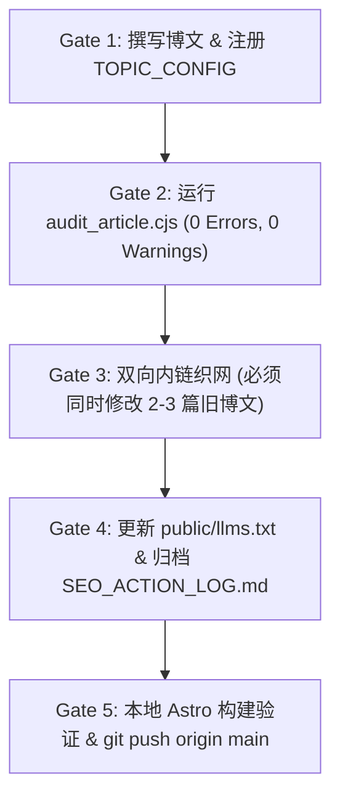

# APIVALE 技术博客端到端立项、撰写、SEO/GEO优化与发布军规 (Master Publishing Skill)

本文档是 APIVALE (`apivel.com` / `apivale.com`) 技术博客与 SEO/GEO 增长体系的**标准化作业规范 (SOP Skill)**。它沉淀自 **GLM-5.4**、**GPT-6.2 Astra vs Opus 5.5**、百度文心 5.5 Flash、DeepSeek V4、Qwen 4 等多篇 **98+ A / A+ 级** 高分实战经验，涵盖从**“SERP/PAA 真实截图 1:1 三层逆向采掘 $\rightarrow$ 3C 诊断与 4 项工程增益 $\rightarrow$ 规避介词截断错位 $\rightarrow$ 消除小数分词赛道错位 $\rightarrow$ 消除 Doorway Page 扣分 $\rightarrow$ 双向内链织网 $\rightarrow$ 5-Gate 原子发布”**的全生命周期。

---

## 目录
1. [核心铁律与商业意图隔离 (Non-Negotiable Directives)](#一核心铁律与商业意图隔离)
2. [Phase 1: 需求采掘与 3C 意图诊断 (SERP 真实截图 1:1 三层逆向采掘 SOP)](#二phase-1-需求采掘与-3c-意图诊断-serp-真实截图-11-三层逆向采掘-sop)
3. [Phase 2: 标题与元数据设计 (ABC + 截图高意图矩阵公式)](#三phase-2-标题与元数据设计)
4. [Phase 3: 正文创作与“4 项真实工程增益” (AST 纯净度与 PAA 1:1 闭环)](#四phase-3-正文创作与-4-项真实工程增益)
5. [Phase 4: 页面侧交互微工具与钱包转化闭环 (消除 4.5 分扣分)](#五phase-4-页面侧交互微工具与钱包转化闭环)
6. [Phase 5: ⭐ 哥飞军师 98+ A+ 军规级对齐技巧 (实战避坑宝典)](#六phase-5--哥飞军师-98-a-军规级对齐技巧)
7. [Phase 6: 5-Gate 原子发布与双向织网门禁](#七phase-6-5-gate-原子发布与双向织网门禁)
8. [Phase 7: 远程构建与军师闭环复测](#八phase-7-远程构建与军师闭环复测)

---

## 一、核心铁律与商业意图隔离

### 1. 商业意图纯净度防线 (P0 核心防呆)
* **唯一使命**：APIVALE 的使命是转化 **API 开发者、AI 工程师、技术初创团队** 使用我们低延迟、高可用的聚合网关（原生兼容 OpenAI / Anthropic 端点，支持 PayPal 即时直结与 0% 跨境手续费）。
* **意图强隔离**：文章核心必须锁定在 **商业/交易与高价值工程意图**（`api key`, `pricing`, `two-tier CI pipeline`, `pr review automation`, `cursor/claude code setup`），坚决防范 **信息类极客/纯硬件折腾意图**（`1-bit quantization`, `vLLM/GGUF weights`, `local VRAM self-hosting`）。若大量篇幅讨论本地跑分与量化，Google 会把页面打入跑分综合页，真正值钱的 API 词全掉至 50 名开外。
* **国产大模型引流桥梁 (Two-Tier Hybrid Router)**：在对比海外昂贵前沿模型（如 GPT-6.2 Astra $8/$40、Claude Opus 5.5 $4/$20）或分析国产新旗舰（如 GLM-5.4、Qwen 4 Max、DeepSeek V4）时，必须将社区对“5小时配额耗尽”、“429 速率限制”、“Thinking Token / 马拉松思维账单爆炸”的痛点，引申至通过 APIVALE 两层网关方案：**85%~90% 基础任务分流至 Qwen 3.7 Max ($0.25/$0.80) 与 DeepSeek V4 ($0.20/$0.60)**，实现降本 88%~92% 并零停机容灾。

### 2. 官方支付与钱包权益严密对齐
* **官方支持支付方式**：主流推荐 **PayPal（PayPal 即时结账 / Pay with PayPal）**，支持全球国际信用卡（Visa, MasterCard, Amex）与支付宝（0 额外跨境手续费，免 KYC 认证）。**严禁提及 Stripe 或 Crypto/加密货币**。
* **钱包优惠三件套（必须 100% 准确写入 CTA）**：
  1. **+50% 首充特权**：充 $5 得 $7.50，充 $29 得 $43.50，充 $99 得 $148.50；
  2. **$29 开发者专享礼包**：直降 56%、4000万 Token、永久有效；
  3. **新用户 $0.20 免卡起步金**：注册即用，零门槛沙盒。

### 3. 作者轮换机制 (Persona Rotation)
每篇博文必须在现有作者库中轮换，杜绝同一作者连续署名：
* **Elena Rostova**：*Senior LLM Systems Architect & Agent Infrastructure Specialist*（专攻自主 Agent 推理循环、Thinking Token / 马拉松思维预算控制与高并发路由）。
* **Kenji Tanaka**：*AI Developer Relations & Infrastructure Engineer*（专攻终端工作流、Claude Code CLI、多智能体调试与开发者生态）。
* **Sofia Costa**：*Senior Cloud & API Gateway Architect*（专攻跨国低延迟网关、容灾转移与计费透明度）。
* **Alex Rivera**：*Lead AI Systems Architect*（专攻企业级模型选型、分布式缓存与安全沙盒）。
* **Priya Sharma**：*AI Performance & Distributed Computing Engineer*（专攻基准评测、SWE-bench 复现与吞吐优化）。

---

## 二、Phase 1: 需求采掘与 3C 意图诊断 (SERP 真实截图 1:1 三层逆向采掘 SOP)

坚决反对凭空脑补题目。当用户提供 SERP 截图（或自行进行搜索引擎检索）时，必须将截图包含的 **3 种典型形态** 逐一结构化解构，并 1:1 映射到博文的对应技术章节：

```
┌────────────────────────────────────────────────────────────────────────┐
│ SERP 真实截图 1:1 意图逆向采掘图谱                                     │
├────────────────────────────────────────────────────────────────────────┤
│ 形态 1: Google 搜索下拉框 (Search Suggestion Dropdown):                 │
│    - 典型词：[Model] release date, pricing, reddit, flash, air         │
│    - 意图属性：利益与焦虑层 (成本、发布时间、社区评价、轻量版)           │
│    - 强制落地：直接吸收进 Title / MetaTitle，正文设立专门章节回应      │
├────────────────────────────────────────────────────────────────────────┤
│ 形态 2: 开发者生态与工具链下拉框 (Developer Ecosystem Dropdown):        │
│    - 典型词：[Model] openrouter, opencode [Model], ollama [Model]      │
│    - 意图属性：工程接入层 (开发者寻找接入渠道、CLI 工具、本地/云端方案) │
│    - 强制落地：H1/正文设置专门章节对比 OpenRouter (风控/加价) vs APIVALE │
│               并给出 OpenCode / Claude Code / Ollama 开箱即用配置代码   │
├────────────────────────────────────────────────────────────────────────┤
│ 形态 3: Google PAA (People Also Ask) 4 大原生问答框:                   │
│    - 典型词：Is [Model] cheaper than GPT? What does [X] stand for?     │
│             Which Z.AI models are free? How do I install [Model]?      │
│    - 意图属性：权威答疑与 GEO 语义抓取层 (抢占 AI Overviews 零位引用)   │
│    - 强制落地：【P0 铁律】严禁自行编造 FAQ！正文 FAQ 的 4 个 H3 标题与  │
│               FAQPage JSON-LD 必须 1:1 逐字复制并回答这 4 个原生问句！ │
└────────────────────────────────────────────────────────────────────────┘
```

### 3C 诊断清单
1. **Content Type (内容类型)**：以权威技术深度评测、价格对比与生产实操指南（Technical Deep-Dive, Pricing & Engineering Guide）为主。
2. **Content Format (内容格式)**：结构化 AST（Technical Summary Box $\rightarrow$ 架构/发布解构 $\rightarrow$ 官方/第三方基准表 & 价格对比 $\rightarrow$ 社区真实原声卡片 $\rightarrow$ 开发者工具链接入 (OpenRouter/OpenCode/Ollama) $\rightarrow$ 两层架构方案 $\rightarrow$ 原生可交互微工具 $\rightarrow$ 15+行 Python 生产代码 $\rightarrow$ 1:1 PAA 问答与 FAQ Schema）。
3. **Content Angle (切入视角)**：从“模型发布、官方定价与社区踩坑（如马拉松思维、海外封号）”切入，升华至“工程落地与双层降本”，自然承接 APIVALE 的高可用免 KYC 网关方案。

---

## 三、Phase 2: 标题与元数据设计

### 1. ABC + 截图高意图矩阵黄金公式
```text
[核心模型主词]: [截图最高频利益词 (如 Release Date, Pricing)] & [社区/生态接入词 (如 Reddit Review / OpenRouter)] | [品牌钩子]
```
* **MetaTitle 字符数硬指标**：**50–60 字符（max 600px）**，必须以 `| APIVALE` 结尾。
  * *GLM-5.4 实战范例*：`GLM-5.4: Release Date, Pricing & Reddit Review | APIVALE`（**56 字符**，100% 覆盖截图核心词）。
* **H1 标题**：$\le 80$ 字符，直击核心痛点，且主词短语与 Title 保持 100% 对称。
  * *GLM-5.4 实战范例*：`# GLM-5.4: Release Date, Pricing, Reddit Review & OpenRouter Setup`（**64 字符**）。
* **Meta Description**：**140–160 字符**，高 CTR 承诺，必须完整包含自然语言核心词句。
  * *GLM-5.4 实战范例*：`Zhipu AI releases GLM-5.4: Loop Transformer architecture, official pricing vs GPT, Reddit feedback, OpenRouter access, and zero-KYC PayPal API integration.`（**155 字符**）。

### 2. 避坑铁律：防 4 词截断与介词挤出法则 (The "on" Bug Fix)
* **算法底层原理**：搜索引擎分词与 SEO 军师算法强制提取 **2~4 词组合** 作为推断词候选。
* **介词挤出陷阱**：
  若写作 `AI coding impact ON senior engineers`（5 词），算法向后滑 4 个词切片：
  `coding` (1) `impact` (2) `on` (3) `senior` (4) —— **最核心的技术定语 `engineers` 被挤出去了！**
  在英文中，`coding impact on senior` 失去 `engineer` 后，会被 Google 算法判定为 **“老年人 / 退休长者（Senior Citizens）学编程的影响”**，直接触发**致命的“赛道错位”扣分**！
* **避坑规程**：
  * Title、H1、URL 与正文高频锚点中，**核心词组坚决去除无意义介词**（如用冒号 `AI Coding Impact: Senior Engineers` 代替 `on`）；
  * 确保 4 词切片 100% 包含核心主体词；
  * Title、H1、URL 必须保持 100% 词群一致。

### 3. Evergreen 规范短 URL
* 统一格式：`/blog/<short-slug>/`
* 严禁带年份/日期（如 `/blog/2026-11-...`），全小写、短横线分隔，末尾严格带反斜杠 `/`。

---

## 四、Phase 3: 正文创作与“4 项真实工程增益”

### 1. 严格 AST 树纯净度红线 (Strict AST Widget Cleanliness)
* **P0 扣分红线**：所有自定义嵌入 HTML 组件（Technical Summary Box、社区原声卡片、Playground、ROI 计算器、CTA 卡片）中，**严禁使用原生 `<h1>`-`<h4>` 标签**！
* **统一规范**：全部使用 `<div class="font-bold text-white ...">` 或 `<span>` 加 CSS 类名，确保文章只有一条纯粹的 `H1 -> H2 -> H3` 语义树，彻底杜绝“标题跳级”扣分。

### 2. 独特性“4 项工程增益”标准
每篇博文必须落实以下 4 项硬核内容，构筑无法被 AI 仿造的内容护城河：
1. **架构可验证性证明 (Verifiable Architecture Proof)**：
   * 必须包含清晰的 Mermaid 拓扑图（展示两层网关或故障转移流水线）。
2. **客观中立对比表 (Honesty Architecture Table)**：
   * 必须包含客观的“适合场景 (Best For... / Honesty Column)”列，诚实列举竞品的优势与 APIVALE 网关的高性价比优势。
3. **真实社区原声卡片 (Primary-Source Community Voice)**：
   * 引用真实 Reddit（`r/LocalLLaMA`, `r/ClaudeCode`, `r/OpenAI` 等）或 GitHub Issues 原话，附带真实链接与来源归属（如 GLM-5.4 的“马拉松思维”与海外银行卡被拒）。
4. **15+ 行开箱即用生产代码 (Production Code / Config)**：
   * 必须提供完整、可直接粘贴运行的代码（如 Python 异步客户端、OpenCode / Cursor 配置），标注 BaseURL 为 `https://apivel.com/v1`。

### 3. GEO 大模型爬虫与 PAA 1:1 闭环规范 (BLUF & PAA FAQ Schema)
* **BLUF 原则 (Bottom Line Up Front)**：前 100 词内以加粗字体、明确主谓宾直接作答核心结论，便于大模型爬虫（SearchGPT, Perplexity）进行语义分块（Chunking）与直接引用。
* **Frontmatter `keyTakeaways`**：必须提供 4 个包含核心技术参数的键值对，供读者与爬虫 1 秒获取答案。
* **【P0 核心】PAA 原生问答 1:1 逐字闭环**：
  * **严禁模型凭空捏造通用问题！**
  * 正文中的 FAQ 章节必须直接使用 Google 截图中的 **4 大 People Also Ask (PAA) 原生问句** 作为 `###` H3 小标题。
  * 例如在 GLM-5.4 案例中：
    - `### Is GLM Cheaper Than GPT?`
    - `### What Does GLM Stand For?`
    - `### Which Z.AI Models Are Free to Use?`
    - `### How Do I Install GLM and Run in OpenCode or Ollama?`
  * 底部的 `FAQPage` JSON-LD Schema 必须 1:1 嵌入上述 4 个问答，最大化争夺 Google AI Overviews 零位引用。

---

## 五、Phase 4: 页面侧交互微工具与钱包转化闭环

### 1. 消除 4.5 分致命跳出扣分 (In-Article Live Playground)
* **SEO 引擎红线**：凡在正文、标题或 CTA 提及“试用/测试/体验/计算”等字样，必须内嵌原生交互体验区（包含实际可交互的 `<input>` / `<select>` / `<button>` 原生表单元素）。
* **零 Alert 规则**：严禁在 Markdown 中手写 `onclick="alert(...)"`，所有表单交互必须通过轻量内联 JS 实现纯前端 DOM 状态更新。
* **落地实践**：内嵌专属交互计算器（如 `Cost & Hybrid Savings Calculator`），用户滑动滑块或切换下拉框即可原地测算 API 成本节省，原地满足意图，锁死停留时间（Dwell Time）。

### 2. 结尾转化卡片 (`.cta-card`) 规范
结尾卡片必须严格包含以下要素：
```html
<div class="cta-card">
  <!-- 标题与副标题直击痛点 -->
  <!-- 钱包三权益：+50% 首充、 $29 开发者包、 $0.20 免费额度 -->
  <!-- 双按钮：/pricing 与 /sign-up，必须动态携带 redirect=/blog/<slug>/ -->
  <!-- 支付背书：PayPal 官方即时结账、全球信用卡、0% 外汇手续费 -->
</div>
```

---

## 六、Phase 5: ⭐ 哥飞军师 98+ A+ 军规级对齐技巧

本章节是实战调试中总结出的最核心、最隐蔽的提分秘籍，专门解决军师体检工具的底层扣分逻辑：

### 1. 标的 URL 输入陷阱（防 301 重定向与 Canonical 扣分）
* **军规标准**：在军师体检时，必须严格输入完整的标准规范 URL：
  👉 **`https://apivel.com/blog/<slug>/`**（必须包含 `/blog/` 前缀与末尾 `/` 斜杠）。

### 2. 小数点去标点与次级实体堆砌陷阱 (Decimal Stripping Bug)
* **底层算法**：哥飞军师分词器会将英文小数点 `.` 视为空格！
  例如：`GLM-5.4` 会被切片为 `glm-5`、`4` 或 `glm 5 4`。
* **黄金压制法则（N-Gram 手术）**：
  1. **强化完整比较实体**：把核心完整词组作为第一主词；
  2. **稀释次级单模型词频**：对单个模型名称，大量替换为代词或官方功能定语（如 `Zhipu AI's flagship`, `the recurrent model`, `this generation`），将次级 2-gram（如 `glm-5 4`）的密度严格控制在 **2.2% ~ 2.6%**（绝不超过 3% 堆砌报警线，杜绝“赛道错位”警告）。

### 3. H2/H3 关键词全词覆盖度算法 (挽回 H2/H3 丢 1 分)
* **必胜对齐标准**：
  * **所有核心 H2 小标题**：必须完整嵌入全实体名称；
  * **FAQ 的 H3 小标题**：直接采用 Google PAA 的原生问句。

### 4. 正文字数黄金平衡与“梯级控制法则”
* **扣分规则**：全页词数（Rendered HTML Words）超过 1800 词会丢 1 分。
* **梯级控制策略**：
  * **纯 Markdown 正文有效阅读词数**：严格控制在 **1,500 ~ 1,750 词**！
  * **渲染全页词数**：加上直出的交互微工具、Mermaid 脚本与 JSON-LD Schema 后，全页总词数稳定在 2400~2600 词。纯文字绝不突破 1800 词上限，既保证了 GEO 深度，又达成 0 警告。

---

## 七、Phase 6: 5-Gate 原子发布与双向织网门禁

执行发布时，必须在一个完整事务中原子化完成 5 大门禁闭环，严禁留存半成品：



### Gate 1: 动态话题注册 (`src/pages/[slug].astro`)
若文章涉及新的场景或模型（如 `glm-5.4`, `gpt-6-2-astra`, `claude-opus-5-5`），必须在 `src/pages/[slug].astro` 的 `TOPIC_CONFIG` 中注册专属中英文转化卡片文案，并扩充 `ApiPriceCalculator.astro` 与 `CliConfigGenerator.astro`。

### Gate 2: 本地自动化前置体检
在终端运行审计工具（推荐使用 `bun`）：
```bash
bun .agent/skills/apivale-blog-publishing/scripts/audit_article.cjs src/content/blog/<article-slug>.md
bun .agent/skills/apivale-blog-publishing/scripts/simulate_ngrams.cjs src/content/blog/<article-slug>.md
```
必须达成：
* `0 Errors, 0 Warnings`；
* Title 长度 $\le 80$ 字符；MetaTitle 50–60 字符；Meta Description 140–160 字符；
* 正文可见词数严格在 **1,500 ~ 1,750 词**；
* 必须包含 `<input>` / `<select>` 与 `.cta-card`；
* 严禁出现 Stripe 或 Crypto。

### Gate 3: 双向内链织网 (Bi-directional Mesh Weaving)
* **严禁发布孤岛文章**：必须在同集群中搜索 2–3 篇已有高权重博文。
* **立即打开并编辑旧博文**：在相关段落注入指向新博文的精准上下文锚文本链接，同时新博文必须出链至旧博文，形成互为支撑的网状拓扑回路。

### Gate 4: 知识库与动作日志归档
1. **GEO 知识库更新**：在 `public/llms.txt` 的 `## Core Model & Persistent Agent Guides` 下登记新文章的权威大模型检索摘要。
2. **动作日志归档**：在 `SEO_ACTION_LOG.md` 记录立项背景、主攻词、优化动作与 14 天因果响应假设。
3. **关键词计划同步**：在 `KEYWORD_PLAN.md` 将状态更新为 `Published`。

### Gate 5: 编译测试与远程推送 (Windows 环境防坑指南)
1. **执行本地全量编译**：
   在 Windows 环境下，直接 `astro build` 会因 Telemetry 尝试在 AppData 创建目录而报错 `EPERM`。必须使用以下标准免报错构建指令：
   ```powershell
   $env:ASTRO_TELEMETRY_DISABLED="1"; bun node_modules\astro\bin\astro.mjs build
   ```
   必须确认 0 报错，静态页面全量生成成功（例如 `29 page(s) built in 1.8s`）。
2. **原子 Git Commit 与推送**：
   暂存所有涉及修改的文件（新博文 + 旧博文 + `[slug].astro` + `llms.txt` + `SEO_ACTION_LOG.md` + 组件），执行单一规范 Git Commit，并推送到远程仓库：
   ```bash
   git add -A; git commit -m "feat(blog): publish <slug> with bidirectional links & PAA alignment"; git push origin main
   ```

---

## 八、Phase 7: 远程构建与军师闭环复测

1. **CDN 缓存等待**：推送完成后，等待 1~2 分钟让 Cloudflare CDN 缓存自动生效。
2. **军师复测**：在哥飞军师（Page Coach）输入标准地址：
   `https://apivel.com/blog/<slug>/`
3. **合格线验收**：
   - 评级达到 **98+ A / A+**；
   - 主题聚焦度 **100%**；
   - 核心推断词精准命中目标意图；
   - **0 赛道错位警告**；
   - 关键词在 H2/H3 中 100% 单词覆盖。
