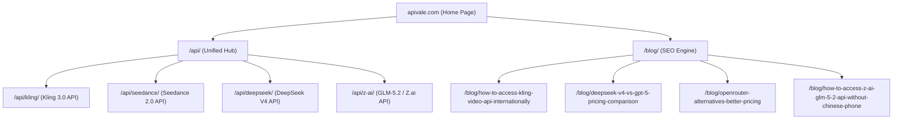

# apivale.com 博客建设与流量引流策略指南

本文件记录了基于 Similarweb Pro 竞品反查与关键词验证的研究成果，旨在指导 `apivale.com` 后续博客与落地页的建设，通过精准获取海外开发者流量实现业务转化。

---

## 一、 核心验证数据与流量发现

基于对纯文本及多模态大模型 API 竞品（`deepseekapi.io`、`piapi.ai`、`deepseek-2026.com`、`requesty.ai`）的 Similarweb 流量审计，我们发现了三个高价值的流量切入点：

### 1. 聚合与切换流量极高（OpenRouter 替代方案）
*   **数据发现**：多模型聚合器竞品 `requesty.ai` 的流量大部分来自于寻找 OpenRouter 替代方案的开发者。
*   **精准商业词**：
    *   `llm aggregator routers with better pricing`（高意图商业购买词）
    *   `openrouter alternatives` / `openrouter alternative`
    *   `free ai api` / `free llm api`
*   **痛点定位**：开发者在使用 OpenRouter 时，往往会面临特定区域延迟高、高并发限制（Rate Limit）以及海外信用卡（Stripe）拒付风控等问题。

### 2. 智谱全新全球品牌（z.ai）热度初显
*   **数据发现**：海外极客已经开始高频检索 `z ai` 这一智谱 AI 的最新出海域名，对最强开源模型 GLM-5.2 的调用需求非常旺盛。
*   **痛点定位**：海外开发者没有中国手机号（+86）或中国企业实名认证，无法直接接入和充值智谱官方平台。

### 3. 多模态视频/图像 API 需求暴涨（Kling & Seedance）
*   **数据发现**：竞品 `piapi.ai` 凭借 Kling API、Seedance API（字节跳动 Doubao 出海品牌）、Hailuo AI（Minimax）等词获取了海量全球流量。
*   **痛点定位**：视频生成大模型接入难度极大，官方没有对海外普通开发者开放低门槛 API 或 Stripe 充值通道。

### 4. “服务宕机/故障”时的拦截流量
*   **数据发现**：在 DeepSeek 等官方 API 拥堵或故障时，`deepseek api平台现在能登录吗` 这一类故障状态词拥有极高的即时搜索量。

---

## 二、 站点结构设计 (Sitemap)

我们采用 **落地页 (Landing Pages) + 博客文章 (Blog Posts)** 双引流引擎的设计：

### 1. Landing Pages (高意图转化落地页)
*   **`/api/kling/`**：主打可灵 3.0 视频生成 API，提供英文文档、Stripe 支付、多语言 SDK 示例。
*   **`/api/seedance/`**：主打 Seedance 2.0 (Dreamina/即梦) 视频与文本 API。
*   **`/api/deepseek/`**：主打低成本、高并发的 DeepSeek V4 API 接入。
*   **`/api/z-ai/`**：主打无需 +86 手机号验证的 Zhipu GLM-5.2 统一网关。

### 2. Blog Posts (第一期重点内容)
*   **文章一**：《Top 5 OpenRouter Alternatives for Cheaper Multi-LLM API Routing in 2026》
    *   *定位*：面向准备切换聚合器的“高净值”开发者。
    *   *核心要点*：对比价格、并发上限、低延迟路由、多语言大模型支持，将 APIVALE 作为首选替代方案进行转化推荐。
*   **文章二**：《How to Get Zhipu AI (Z.ai) GLM-5.2 API Key Internationally (No +86 Phone Needed)》
    *   *定位*：面向受限于注册门槛的海外极客和企业开发者。
    *   *核心要点*：提供免去 +86 手机号验证和实名认证的详细接入教程，通过 APIVALE 提供的官方同质统一 Key 进行开发集成。

---

## 三、 后续落地执行路径 (Roadmap)

### 阶段 1：博客与技术栈搭建（当前阶段）
- [ ] 确定博客及官网的技术选型（如 Next.js、Astro 或 Remix/Vite 方案）。
- [ ] 在本项目中初始化前端基础框架。
- [ ] 配置 SEO 基础结构（包括自动生成 `sitemap.xml`、Metadata 动态注入及 Schema markup）。

### 阶段 2：内容撰写与排版
- [ ] 撰写第一期两篇核心引流博客，确保包含以下要素：
    - 精美的代码高亮模块（提供 Python/Node.js/Curl 的 API 调用示例）。
    - 价格与功能对比表格。
    - 明显的 Call to Action (CTA) 引导按钮，直通 APIVALE 注册页面。
- [ ] 设计并上线对应的核心 API 落地页（`/api/kling/` 等），突出“即插即用”和“Stripe 支付”卖点。

### 阶段 3：敏捷 SEO 监控与响应
- [ ] 预先储备“DeepSeek API 宕机备用网关”的紧急博客草稿。
- [ ] 接入 Search Console 监控关键词点击和排名走势，根据实际展现量（Impressions）微调博客 Title 及 Meta Description。
