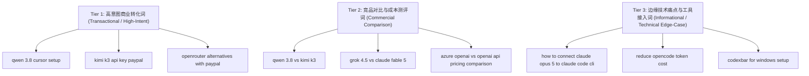

# APIVALE Long-Tail Keyword Matrix & Search Intent Map (长尾关键词矩阵与意图分布图)

> 本文档针对 `apivale.com` 聚合网关服务，结合 Similarweb 竞品审计、Google Search Console 实时展现数据以及海外开发者搜索习惯，系统化梳理了 3 层关键词架构、搜索意图分类与落地页映射关系。

---

## 🎯 核心定位与流量转化钩子 (Value Proposition Hooks)

在挑选与拓展长尾关键词时，所有选题与词组必须能够自然承接 APIVALE 的四大核心差异化优势：
1. 💳 **支持 PayPal 全球结算 (PayPal Billing)**：解决海外开发者或特定区域没有 Stripe / 信用卡被风控拒付的燃眉之急。
2. 🔓 **免 KYC / 免中国手机号 (+86 Verification Bypass)**：免去使用 Qwen 3.7 Max, Kimi K3, DeepSeek V4, GLM-5.2 等顶尖国产大模型时繁琐的实名认证。
3. ⚡ **原生 API 协议兼容 (Native OpenAI & Anthropic Endpoint Proxy)**：零代码修改，直接填入 `https://apivel.com/v1` 即可在 Claude Code CLI、Cursor、Windsurf、OpenCode、CodexBar 中无缝运行。
4. 💰 **AI Agent 极致降本 85%–90%**：针对多轮循环工具调用的 Token 消耗痛点，提供高性价比路由。

---

## 📐 3 层关键词架构 (3-Tier Keyword Architecture)

---

## 📊 APIVALE 长尾关键词主矩阵 (Master Long-Tail Keyword Inventory)

| 关键词 (Keyword) | 搜索意图 (Search Intent) | 关键词层级 (Tier) | 关联模型/工具 (Model / Tool) | 对应文章 Slug / 落地页 (Target URL) | 状态 (Status) | 优先级 (Priority) | 核心转化钩子 (Conversion Hook) |
| :--- | :--- | :--- | :--- | :--- | :---: | :---: | :--- |
| `how to connect qwen 3.8 to claude code` | High Intent / Commercial | Tier 1 | Qwen 3.8 / Claude Code CLI | `/blog/how-to-connect-qwen-3-8-to-claude-code-cli` | ✅ 已上线 | P0 | Zero-KYC + PayPal + OpenAI Base URL |
| `qwen 3.8 cursor setup` | High Intent / Commercial | Tier 1 | Qwen 3.8 / Cursor | `/blog/how-to-connect-qwen-3-8-to-claude-code-cli` | ✅ 已上线 | P0 | 1 分钟一键填入 API Key 教程 |
| `qwen 3.8 27b ollama` | Technical / Commercial | Tier 1 | Qwen 3.8 27B / Ollama | `/blog/how-to-connect-qwen-3-8-to-claude-code-cli` | ✅ 已优化 | P0 | 本地 Ollama 部署与 APIVALE 云端托管对比 |
| `qwen 3.8 27b benchmarks` | Commercial / Benchmark | Tier 2 | Qwen 3.8 27B / Max | `/blog/qwen-3-8-max-benchmarks-preview-guide` | ✅ 已优化 | P0 | 覆盖 27B 模型 SWE-bench 跑分与对比 |
| `is qwen 3.8 free` | Informational / PAA | Tier 3 | Qwen 3.8 FAQ | `/blog/qwen-3-8-max-benchmarks-preview-guide` | ✅ 已优化 | P1 | PAA 拦截与免费试用赠金引导 |
| `kimi k3 api key paypal` | Transactional | Tier 1 | Kimi K3 | `/blog/how-to-connect-kimi-k3-to-claude-code-cli` | ✅ 已上线 | P0 | 独家支持 PayPal 购买 Kimi K3 |
| `how to connect kimi k3 to codex cli` | High Intent / Commercial | Tier 1 | Kimi K3 / OpenAI Codex CLI | `/blog/how-to-connect-kimi-k3-to-codex-cli` | ✅ 已上线 | P0 | 填补 Codex CLI 接入国产模型空白 |
| `openrouter alternatives with paypal` | Transactional | Tier 1 | OpenRouter Alternative | `/blog/openrouter-alternatives` | ✅ 已上线 | P0 | 解决了 OpenRouter 无法使用 PayPal 的痛点 |
| `codexbar for windows` | Technical / High Intent | Tier 1 | CodexBar / Windows | `/blog/codexbar-windows-setup-safety-guide` | ✅ 已上线 | P0 | 首发 Windows 平台 CodexBar 配置与限流修复 |
| `claude code cli custom base url` | Technical / Informational | Tier 1 | Claude Code CLI | `/blog/how-to-set-up-claude-code-cli-with-custom-base-url` | ✅ 已上线 | P0 | 官方文档未细化的 Endpoint 替换教程 |
| `reduce llm api costs for ai agents` | Commercial / Cost | Tier 2 | AI Agent Routing | `/blog/how-to-reduce-llm-api-costs-for-ai-agents` | ⏳ 待上线 | P1 | 多轮 Agent 循环 Token 降本 90% |
| `qwen 3.8 vs kimi k3` | Commercial / Benchmark | Tier 2 | Qwen 3.8 vs Kimi K3 | `/blog/qwen-3-8-vs-kimi-k3-coding-agent-api` | ✅ 已上线 | P1 | SWE-bench 编程跑分与 Token 价格对比 |
| `grok 4.5 vs claude fable 5` | Commercial / Benchmark | Tier 2 | Grok 4.5 vs Claude Fable 5 | `/blog/grok-4-5-vs-claude-fable-5-coding-agent-api` | ✅ 已上线 | P1 | 旗舰 AI Coding 评测与成本计算器 |
| `azure openai vs openai api pricing comparison 2026` | Commercial / Comparison | Tier 2 | Azure OpenAI Gateway | `/blog/azure-openai-vs-apivale-pricing-comparison` | ⏳ 计划中 | P1 | 企业包月与 APIVALE 按量付对比 |
| `how to connect claude opus 5 to claude code cli` | Technical / High Intent | Tier 3 | Claude Opus 5 / Claude Code | `/blog/how-to-connect-claude-opus-5-to-claude-code-cli` | ✅ 已上线 | P0 | Anthropic 官方限流解决替代方案 |
| `reduce opencode token cost` | Commercial / Cost | Tier 3 | OpenCode / OpenCodeX | `/blog/how-to-reduce-opencode-token-costs` | ✅ 已上线 | P1 | OpenCodeX 网关自建与 APIVALE 代理对比 |
| `minimax h3 api pricing` | High Intent / Commercial | Tier 3 | MiniMax H3 (Hailuo 3.0) | `/blog/minimax-h3-api-pricing-guide` | ✅ 已上线 | P1 | 包含 Open Weights 与 HuggingFace 接入 |
| `is codexbar safe` | Informational / Trust | Tier 3 | CodexBar Tool | `/blog/codexbar-windows-setup-safety-guide` | ✅ 已上线 | P2 | 安全隐私审计 + 开源源码排查 |
| `how to access z-ai glm-5-2 without chinese phone` | High Intent / Edge-Case | Tier 3 | Zhipu GLM-5.2 (Z.ai) | `/blog/how-to-access-z-ai-glm-5-2` | ✅ 已上线 | P1 | 免除 +86 手机验证码与实名认证 |
| `deepseek v4 flash api` | High Intent / Commercial | Tier 3 | DeepSeek V4 | `/blog/deepseek-v4-flash-api-guide` | ✅ 已上线 | P0 | 极速版推理网关与超低延迟体验 |
| `deepseek v4.1 flash 1017 api` | High Intent / Commercial | Tier 1 | DeepSeek V4.1 Flash | `/blog/deepseek-v4-1-flash-1017-api-setup` | ✅ 已上线 | P0 | 1017 权重首发测评、125k上下文漂移修复与低成本路由 |
| `open-source alternatives to deepgram voice agent api` | Technical / Niche | Tier 3 | Voice Agent LLM Gateway | `/blog/voice-agent-api-cost-optimization` | ⏳ 计划中 | P2 | 替换高昂语音 API，搭建低成本管道 |

---

## 🔍 长尾关键词挖掘与拓展方法论 (Keyword Expansion Playbook)

为持续扩充 APIVALE 的长尾关键词储备，建议定期采取以下 4 步挖掘法：

### 1. SERP Search Suggestions & People Also Ask (PAA) 抓取
当针对 `qwen 3.8 api` 进行搜索时，收集 Google 下方的长尾拓展词：
* `qwen 3.8 max api pricing`
* `qwen 3.8-max api key paypal`
* `how to use qwen 3.8 in windsurf`
* `qwen 3.8-max token limits`

### 2. GSC 隐形长尾词提取 (High Impression / Low CTR Queries)
每周从 Google Search Console 导出 Impressions 排名在第 8–20 位的查询词：
* 筛选展现量大于 100 但点击量少于 5 次的长尾疑问句（如 `can i pay openrouter with paypal`）。
* 将该疑问句补充到对应文章的 FAQ 结构化数据 (FAQ Schema) 或专门新增 H3 小节进行精准拦截。

### 3. Developer Tool Integration Pillars (开发者工具综合集成支柱)
针对新的模型，将所有主流 IDE 与 CLI 工具（Claude Code, Cursor, Windsurf, OpenCode）聚合为单一权威旗舰指南（Pillar Guide），在 H2/H3 中分别覆盖，严禁按 IDE 拆分成单薄的碎片化页面：
* `[Model Name] Complete Integration Guide (Claude Code, Cursor & Windsurf)`
* *例子*：`deepseek v4 complete ide setup`, `kimi k3 developer integration guide`

### 4. Zero-KYC / Alternative Payment Long-Tails (风控避险长尾词)
针对全球限制或支付痛点组合词：
* `how to buy [Model Name] api key without credit card`
* `[Model Name] api paypal billing`
* `[Chinese Model Name] api key without Chinese phone number`

---

## 🔗 相关文档与 SOP 索引

* 👉 **[SEO 优化动作日志](file:///e:/kaifa/APIVALE_blog/SEO_ACTION_LOG.md)** — 记录每日优化动作并建立因果模型。
* 👉 **[Master SEO/GEO Writing Standard](file:///e:/kaifa/APIVALE_blog/BLOG_WRITING_STANDARD.md)** — APIVALE 博客撰写规范与真实工程信息增益要求。
* 👉 **[Keyword Editorial Plan](file:///f:/旅行携带资料/kaifa/APIVALE_blog/KEYWORD_PLAN.md)** — 选题追踪与文章发布状态。
