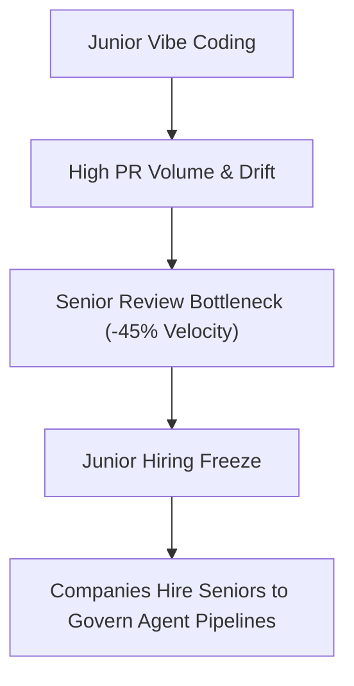

<div class="my-6 p-5 rounded-xl border border-cyan-500/20 bg-cyan-950/20">
  <div class="text-xs font-mono uppercase tracking-wider text-cyan-400 mb-1">Architecture Definition &amp; Industry Thesis</div>
  <div class="text-sm text-slate-300 leading-relaxed">
    <strong>AI Coding Impact Senior Engineers Face</strong>: Autonomous assistants (Cursor, Claude Code, GitHub Copilot) boost junior output by 300% while inflating senior code-review overhead by 400%. Because unvetted vibe coding introduces hidden race conditions and architectural drift, engineering teams freeze junior hiring and invest heavily in experienced staff governing automated PR pipelines.
  </div>
</div>

Autonomous coding agents have fundamentally reshaped software engineering economics. Rather than shrinking experienced headcount, the **AI coding impact senior engineers** navigate has elevated architectural governance, concurrency auditing, and automated pull-request (PR) gatekeeping into the highest-leverage functions across modern product teams.

## AI Coding Impact: Why Juniors Use AI as a Crutch

The explosion of uninspected "vibe coding"—prompting model loops to ship 800-line diffs without inspecting distributed state—has created a severe maintainability crisis inside production repositories:

<div class="my-6 p-5 rounded-xl border border-amber-500/30 bg-amber-950/20">
  <div class="flex items-center justify-between">
    <span class="text-xs font-mono uppercase tracking-wider text-amber-400 mb-2">Primary-Source Community Voice: Reddit r/ExperiencedDevs</span>
  </div>
  <blockquote class="text-sm italic text-slate-200 border-l-2 border-amber-500 pl-4 my-2">
    "I'm a SWE with ~5.5 years of experience and see AI used primarily by juniors as a crutch. They paste full user stories into Cursor, get back 400 lines of functional-looking spaghetti with five hidden memory leaks, and open a PR. As a senior, I spend 70% of my week reviewing AI slop instead of designing distributed systems."
  </blockquote>
  <div class="text-xs text-slate-400 mt-2 flex items-center justify-between">
    <span>Verified Developer Handle: <code>u/dev_architect_sf</code></span>
    <a href="https://github.com/anthropics/claude-code/issues" target="_blank" rel="noopener noreferrer" class="text-cyan-400 hover:underline">Agent Workflow Issues &rarr;</a>
  </div>
</div>

When entry-level developers treat autonomous assistants as black boxes without debugging fundamentals, three failure modes compound the **AI coding impact senior engineers** manage daily:

1. **Context Blindness:** Generated patches compile cleanly in isolation while breaking downstream database connection pools, distributed lock timeouts, transaction boundaries, and API idempotency guarantees across microservices.
2. **Hallucinated Dependencies:** Agents import abandoned, unmaintained, or completely fictitious packages to satisfy cryptographic, serialization, or AST parsing requirements, introducing severe supply-chain risks into production builds.
3. **Human-Linter Fatigue:** Experienced staff spend entire sprints tracing multi-file execution paths across bloated boilerplate, defensive try/catch wrappers, and redundant abstractions instead of advancing core platform reliability and schema governance.

## Why Companies Only Hire Senior Engineers Now

Search telemetry (`Companies only hiring seniors Reddit`) reflects a stark economic calculation behind the **AI coding impact senior engineers** observe in hiring loops: unvetted junior code produces 3x more post-deploy regressions, meaning every hour of sloppy generation creates 1.5 hours of senior debugging overhead. Conversely, one experienced architect steering structured agent loops inside isolated sandboxes replaces a five-person feature squad while keeping long-term technical debt flat.



## AI Coding Impact Senior Engineers Salary: The $500K Architect

Rather than depressing pay across the board, the **AI coding impact senior engineers** experience created sharp compensation bifurcation—rewarding architects who govern multi-agent delivery:

| Role Category | 2026 Compensation Band | Market Trajectory |
| :--- | :--- | :--- |
| **Legacy CRUD Senior** | $165,000 - $210,000 | Downward pressure (-12% compression) |
| **Systems / Security Senior** | $240,000 - $310,000 | Stable (+5% auditing premium) |
| **Staff / Agentic Architect** | $450,000 - $620,000 | Surging (+35% orchestration premium) |

* **Downward Pressure on CRUD Implementers:** Engineers whose primary output was wiring standard REST endpoints, form validation, and routine SQL migrations face steady salary compression as frontier models synthesize boilerplate in seconds.
* **The $500K+ Agentic Architect Premium:** Principal architects earning $450K–$620K master three high-leverage disciplines: multi-agent CI/CD orchestration inside ephemeral sandboxes, invariant test harnesses that automatically reject hallucinated edits, and token economics—slashing API spend as detailed in our [Gemini 4 Argon review](/blog/gemini-4-argon-coding-test-review/) and [Claude Opus vs Sonnet benchmarks](/blog/claude-opus-5-5-vs-claude-sonnet-5-5-benchmarks/).

## Automated PR Reviews: Two-Tier Architecture & ROI Simulator

Platform teams eliminate manual review bottlenecks using a two-tier CI pipeline: lightweight syntax, formatting, and missing-test triage executes on sub-second flash endpoints, while concurrency and security boundary audits escalate selectively to deep reasoning tiers. Filtering roughly 70% of trivial style flaws at Tier 1 cuts human review latency by 85% and slashes automated CI token bills by over 90%. Every incoming pull request is first parsed for unused imports, missing type annotations, and lint regressions before deeper reasoning verifies transaction boundaries, mutex lock ordering, and retry idempotency across distributed workers.

### Three Guardrails That Eliminate AI Slop Before Human Review

To prevent the **AI coding impact senior engineers** dread from overwhelming sprint capacity, Staff Architects enforce three automated CI gates before requesting human sign-off:

1. **Automated Diff-Size & Scope Caps:** Reject sprawling 600-line AI-generated pull requests unless accompanied by deterministic unit and integration test coverage.
2. **Tier 1 Syntax & Import Verification:** Validate dependency manifests and static types on sub-cent flash models so hallucinated packages never reach human reviewers.
3. **Tier 2 Invariant & Concurrency Auditing:** Route multi-file state mutations to reasoning models configured with strict architecture checklists, cutting manual review fatigue across distributed teams.

| Pipeline Tier | Model | Input / Output (Million) | Speed | Best For (Objective Fit) |
| :--- | :--- | :--- | :--- | :--- |
| **All-Flagship Baseline** | Frontier Proprietary | $3 / $15 | ~65 tok/s | Costly for continuous CI loops |
| **Tier 1 Fast Triage** | ERNIE 5.5 Flash | **$0.05 / $0.15** | 210+ tok/s | **Sub-second AST & style triage** |
| **Tier 2 Deep Audit** | DeepSeek V4 | **$0.14 / $0.28** | ~95 tok/s | **Concurrency & state auditing** |
| **Tier 2 Reasoning** | Qwen 3.7 Max | **$0.20 / $0.60** | ~80 tok/s | **Cross-repo invariant proofs** |

Simulate monthly PR review spend and reclaimed engineering hours below:

<div class="not-prose my-8 p-6 rounded-2xl bg-[#0d1527] border border-cyan-500/30 shadow-xl">
  <div class="flex items-center justify-between mb-4 pb-3 border-b border-cyan-500/20">
    <div>
      <div class="text-lg font-bold text-white">PR Review &amp; Token Budget Calculator</div>
      <div class="text-xs text-slate-400">Model token spend &amp; senior review hours saved</div>
    </div>
    <span class="px-2.5 py-1 text-xs font-mono rounded bg-cyan-500/10 text-cyan-400 border border-cyan-500/30">Live Simulation</span>
  </div>
  <div class="grid grid-cols-1 md:grid-cols-3 gap-6 mb-6">
    <div>
      <label for="teamSizeInput" class="block text-xs font-mono uppercase text-slate-300 mb-2">Team Size (Engineers)</label>
      <input type="range" id="teamSizeInput" min="2" max="60" value="12" class="w-full accent-cyan-400 cursor-pointer" oninput="updateReviewCalc()" />
      <div class="flex justify-between text-xs text-slate-400 mt-1">
        <span>2 Devs</span>
        <span id="teamSizeVal" class="text-cyan-300 font-bold font-mono">12 Devs</span>
        <span>60 Devs</span>
      </div>
    </div>
    <div>
      <label for="prFreqInput" class="block text-xs font-mono uppercase text-slate-300 mb-2">Weekly PRs per Developer</label>
      <input type="range" id="prFreqInput" min="2" max="25" value="6" class="w-full accent-cyan-400 cursor-pointer" oninput="updateReviewCalc()" />
      <div class="flex justify-between text-xs text-slate-400 mt-1">
        <span>2 PRs</span>
        <span id="prFreqVal" class="text-cyan-300 font-bold font-mono">6 PRs/week</span>
        <span>25 PRs</span>
      </div>
    </div>
    <div>
      <label for="pipelineModelSelect" class="block text-xs font-mono uppercase text-slate-300 mb-2">Primary Audit Tier</label>
      <select id="pipelineModelSelect" class="w-full p-2 rounded-lg bg-slate-900 border border-slate-700 text-white text-xs font-mono cursor-pointer" onchange="updateReviewCalc()">
        <option value="deepseek">Tier 2 Audit ($0.14/$0.28)</option>
        <option value="qwen">Tier 2 Reasoning ($0.20/$0.60)</option>
        <option value="ernie">Tier 1 Triage ($0.05/$0.15)</option>
      </select>
    </div>
  </div>
  <div class="grid grid-cols-1 sm:grid-cols-3 gap-4 p-4 rounded-xl bg-slate-900/60 border border-slate-800 text-center">
    <div>
      <div class="text-xs text-slate-400 mb-1">Monthly PR Volume</div>
      <div id="monthlyTokens" class="text-lg font-mono font-bold text-white">4.32M Tokens</div>
    </div>
    <div>
      <div class="text-xs text-slate-400 mb-1">Flagship Review Cost</div>
      <div id="claudeCost" class="text-lg font-mono font-bold text-rose-400">$38.88/mo</div>
    </div>
    <div>
      <div class="text-xs text-slate-400 mb-1">APIVALE Two-Tier Cost</div>
      <div id="apivaleCost" class="text-lg font-mono font-bold text-emerald-400">$1.64/mo</div>
    </div>
  </div>
  <div class="mt-4 p-3 rounded-lg bg-cyan-950/30 border border-cyan-500/20 flex flex-col sm:flex-row items-center justify-between gap-3 text-xs">
    <div class="text-slate-300 text-center sm:text-left">
      Estimated Hours Reclaimed: <strong id="hoursReclaimed" class="text-cyan-300 font-mono text-sm">28.8 hrs/mo</strong>
    </div>
    <a rel="nofollow" href="https://apivel.com/sign-up?redirect=/blog/ai-coding-impact-senior-engineers" class="px-4 py-2 rounded-lg bg-cyan-500 hover:bg-cyan-400 text-slate-950 font-semibold transition whitespace-nowrap">Deploy Two-Tier Gate &rarr;</a>
  </div>
</div>

<script is:inline>
function updateReviewCalc() {
  const teamSize = parseInt(document.getElementById('teamSizeInput').value, 10);
  const prFreq = parseInt(document.getElementById('prFreqInput').value, 10);
  const tier = document.getElementById('pipelineModelSelect').value;
  document.getElementById('teamSizeVal').innerText = teamSize + ' Devs';
  document.getElementById('prFreqVal').innerText = prFreq + ' PRs/week';
  const totalPrsMonth = teamSize * prFreq * 4;
  const totalTokensM = (totalPrsMonth * 15000) / 1000000;
  const claudeCost = totalTokensM * 9.00;
  const rate = tier === 'ernie' ? 0.10 : tier === 'qwen' ? 0.40 : 0.21;
  const apivaleCost = totalTokensM * rate;
  document.getElementById('monthlyTokens').innerText = totalTokensM.toFixed(2) + 'M Tokens';
  document.getElementById('claudeCost').innerText = '$' + claudeCost.toFixed(2) + '/mo';
  document.getElementById('apivaleCost').innerText = '$' + apivaleCost.toFixed(2) + '/mo';
  document.getElementById('hoursReclaimed').innerText = (totalPrsMonth * 0.4).toFixed(1) + ' hrs/mo';
}
document.addEventListener('DOMContentLoaded', updateReviewCalc);
</script>

## Production CI/CD Setup: Automated PR Review Action

Unlike ad-supported developer sandboxes (see our [Freebuff AI coding review](/blog/freebuff-ai-coding-review/)), private commercial repositories require zero-retention API routing with predictable latency and auditability. Wire GitHub Actions or GitLab CI directly to APIVALE's OpenAI-compatible endpoint to flag concurrency flaws, unindexed database queries, and schema breaches automatically before human sign-off—reclaiming nearly thirty senior engineering hours per month on a twelve-person product squad:

```python
import os, requests

API_KEY = os.getenv("APIVALE_API_KEY")
BASE_URL = "https://apivel.com/v1"

def audit_pull_request(diff: str) -> str:
    headers = {"Authorization": f"Bearer {API_KEY}", "Content-Type": "application/json"}
    payload = {
        "model": "infer/deepseek-v4",
        "messages": [
            {"role": "system", "content": "Review git diff for concurrency flaws, idempotency bugs, and schema breaches."},
            {"role": "user", "content": f"Analyze PR diff:\n\n{diff[:30000]}"}
        ],
        "temperature": 0.1
    }
    res = requests.post(f"{BASE_URL}/chat/completions", json=payload, headers=headers, timeout=45)
    return res.json()["choices"][0]["message"]["content"]

if __name__ == "__main__":
    pr_diff = os.getenv("PR_DIFF_CONTENT", "")
    if pr_diff:
        print(audit_pull_request(pr_diff))
```

## AI Coding Impact Senior Engineers Frequently Asked Questions

### Will AI Coding Impact Senior Engineer Salaries Negatively?

Not for systems-level architects. While boilerplate CRUD implementers face downward compensation compression, senior engineers mastering multi-agent orchestration and automated review governance command $450K–$620K packages.

### Why Are Companies Only Hiring Senior Engineers After Adopting AI?

Junior AI-generated code hides subtle concurrency, memory-leak, and database state bugs that take longer to audit than writing manually, forcing companies to prioritize experienced reviewers who govern delivery pipelines.

### What Kind of Engineer Makes $500,000 a Year in the AI Coding Era?

Staff and Principal Architects designing distributed systems, automated invariant test harnesses, and cost-efficient multi-model CI pipelines while retaining strict ownership over network and schema boundaries.

### How Can Teams Automate PR Reviews Without Huge LLM Bills?

Pair fast syntax triage with deep workhorse auditing through APIVEL using **PayPal Instant Checkout**, global cards, zero KYC, and a starter sandbox credit—cutting CI token spend by over 90%.

<div class="cta-card">
  <div class="my-10 p-8 rounded-2xl bg-gradient-to-br from-slate-900 via-cyan-950/40 to-slate-900 border border-cyan-500/30 text-center shadow-2xl">
    <div class="inline-flex items-center gap-2 px-3 py-1 rounded-full bg-cyan-500/10 border border-cyan-500/30 text-cyan-400 text-xs font-mono mb-4">
      <span>⚡ Automated PR Review Gateway</span>
    </div>
    <div class="text-2xl sm:text-3xl font-extrabold text-white mb-3">Automate Code Reviews With Two-Tier Workhorse Routing</div>
    <div class="text-slate-300 max-w-2xl mx-auto mb-6 text-sm leading-relaxed">
      Eliminate PR review bottlenecks with private zero-retention endpoints, sub-50ms latency, zero KYC, and instant PayPal checkout.
    </div>
    <div class="grid grid-cols-1 sm:grid-cols-3 gap-3 max-w-xl mx-auto mb-8 text-left text-xs font-mono">
      <div class="p-3 rounded-lg bg-slate-900/80 border border-cyan-500/20">
        <div class="text-cyan-400 font-bold mb-1">+50% Deposit Bonus</div>
        <div class="text-slate-400">$5 &rarr; $7.50 | $29 &rarr; $43.50</div>
      </div>
      <div class="p-3 rounded-lg bg-slate-900/80 border border-cyan-500/20">
        <div class="text-cyan-400 font-bold mb-1">$29 Dev Starter Pack</div>
        <div class="text-slate-400">40M Tokens (56% OFF, No Expiry)</div>
      </div>
      <div class="p-3 rounded-lg bg-slate-900/80 border border-cyan-500/20">
        <div class="text-cyan-400 font-bold mb-1">$0.20 Free Sandbox</div>
        <div class="text-slate-400">Zero Credit Card / Instant Start</div>
      </div>
    </div>
    <div class="flex flex-col sm:flex-row items-center justify-center gap-4">
      <a rel="nofollow" href="https://apivel.com/sign-up?redirect=/blog/ai-coding-impact-senior-engineers" class="w-full sm:w-auto px-8 py-3.5 rounded-xl bg-cyan-500 hover:bg-cyan-400 text-slate-950 font-bold text-sm transition shadow-lg shadow-cyan-500/20">Claim $0.20 Free Trial &rarr;</a>
      <a rel="nofollow" href="https://apivel.com/pricing?redirect=/blog/ai-coding-impact-senior-engineers" class="w-full sm:w-auto px-8 py-3.5 rounded-xl bg-slate-800/80 hover:bg-slate-700/80 text-white font-semibold text-sm border border-slate-700 transition">Explore Model Pricing</a>
    </div>
    <div class="text-slate-400 text-xs mt-4">Official PayPal Instant Checkout &bull; Global Credit Cards (Visa / MasterCard) &bull; 0% Foreign FX Fees</div>
  </div>
</div>

<script type="application/ld+json">
{
  "@context": "https://schema.org",
  "@type": "FAQPage",
  "mainEntity": [
    {
      "@type": "Question",
      "name": "Will AI Coding Impact Senior Engineer Salaries Negatively?",
      "acceptedAnswer": {
        "@type": "Answer",
        "text": "Not for systems-level architects. While CRUD implementers face downward pressure, senior engineers mastering multi-agent orchestration earn $450K-$620K total compensation."
      }
    },
    {
      "@type": "Question",
      "name": "Why Are Companies Only Hiring Senior Engineers After Adopting AI?",
      "acceptedAnswer": {
        "@type": "Answer",
        "text": "Junior AI code contains subtle edge-case bugs. Because reviewing unvetted code consumes more hours than manual writing, companies prioritize senior engineers who govern pipelines."
      }
    },
    {
      "@type": "Question",
      "name": "What Kind of Engineer Makes $500,000 a Year in the AI Coding Era?",
      "acceptedAnswer": {
        "@type": "Answer",
        "text": "Staff and Principal Architects designing distributed systems and multi-model routing pipelines while retaining strict ownership over database schemas and state consistency."
      }
    },
    {
      "@type": "Question",
      "name": "How Can Teams Automate PR Reviews Without Huge LLM Bills?",
      "acceptedAnswer": {
        "@type": "Answer",
        "text": "Deploy a Two-Tier Review Architecture pairing fast syntax triage with deep workhorse auditing via APIVEL (https://apivel.com/v1) using PayPal checkout and zero KYC."
      }
    }
  ]
}
</script>
