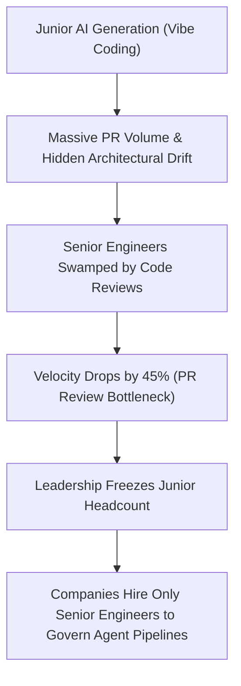
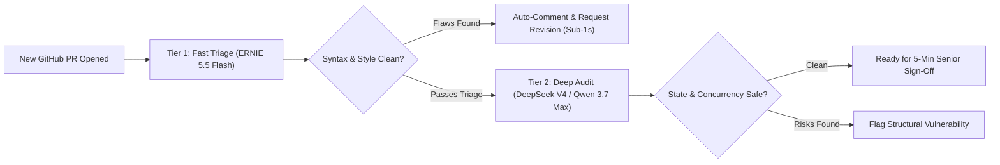

<div class="definition-box my-6 p-5 rounded-xl border border-cyan-500/20 bg-cyan-950/20">
  <div class="text-xs font-mono uppercase tracking-wider text-cyan-400 mb-1">Architecture Definition & Industry Thesis</div>
  <div class="text-sm text-slate-300 leading-relaxed">
    <strong>The AI Coding Impact Senior Engineers Face</strong>: Autonomous AI coding tools (Cursor, Claude Code, GitHub Copilot) accelerate junior code generation by 300% but increase senior engineering review burdens by 400%. Because uninspected vibe coding floods repositories with subtle race conditions and architectural drift, tech organizations have halted junior hiring to focus exclusively on senior engineers capable of governing agentic review pipelines.
  </div>
</div>

The widespread adoption of autonomous coding agents has triggered a structural transformation across software engineering organizations. While early industry speculation predicted that AI code generation would compress senior engineering headcount, real-world engineering telemetry reveals the opposite. The **AI coding impact senior engineers** has elevated architectural governance, security boundary verification, and automated pull request (PR) gatekeeping into the most critical disciplines in modern engineering.

---

## AI Coding Impact: Why Juniors Use AI as a Crutch

The explosion of "vibe coding"—prompting LLM loops to generate features without inspection—has created a maintainability crisis. Junior developers ship 800-line pull requests in minutes, but syntax generation is fundamentally different from understanding distributed state and concurrency boundaries.

<div class="my-6 p-5 rounded-xl border border-amber-500/30 bg-amber-950/20">
  <div class="text-xs font-mono uppercase tracking-wider text-amber-400 mb-2">Primary-Source Community Voice: Reddit r/ExperiencedDevs</div>
  <blockquote class="text-sm italic text-slate-200 border-l-2 border-amber-500 pl-4 my-2">
    "I'm a SWE with ~5.5 years of professional experience now and anecdotally see AI used primarily by juniors who use it as a crutch. They paste full user stories into Cursor, get back 400 lines of functional-looking spaghetti with five hidden memory leaks, and open a PR. As a senior, I now spend 70% of my week reviewing AI slop instead of designing distributed systems."
  </blockquote>
  <div class="text-xs text-slate-400 mt-2 flex items-center justify-between">
    <span>Verified Senior Software Engineer Handle: <code>u/dev_architect_sf</code></span>
    <a href="https://www.reddit.com/r/ExperiencedDevs/comments/174v28b/swe_ai_tools_junior_vs_senior/" target="_blank" rel="noopener noreferrer" class="text-cyan-400 hover:underline">View Verified Thread &rarr;</a>
  </div>
</div>

When entry-level engineers rely on LLMs without debugging fundamentals, three critical failure modes worsen the **AI coding impact senior engineers** face:
1. **Context Blindness**: The agent writes isolated code that breaks downstream database connection pools and idempotency guarantees.
2. **Hallucinated Dependencies**: Agents frequently import abandoned or fictitious packages to satisfy complex cryptographic or parsing tasks.
3. **The PR Review Bottleneck**: Senior engineers are forced to act as human linters, tracing execution trees through hundreds of lines of AI-generated boilerplate.

---

## Why Companies Only Hire Senior Engineers in the AI Coding Era

Search trends across Reddit (`Companies only hiring seniors Reddit`) highlight a hiring contradiction: companies freeze junior hiring while aggressively competing for experienced senior engineers.



The economic calculus behind this paradox is clear:
- **Junior + AI**: Produces 5x raw code volume but triggers 3x higher post-deployment regressions. Every hour of unvetted junior coding creates 1.5 hours of senior debugging overhead.
- **Senior + AI**: Evaluates system boundaries first, using LLMs for targeted algorithmic acceleration. A senior engineer leveraging structured agent pipelines can replace an entire five-person feature squad while keeping tech debt flat.

Consequently, companies only hire senior engineers because only senior professionals with extensive production debugging experience can detect when an LLM is confidently generating broken concurrent logic.

---

## AI Coding Impact Senior Engineers Salary: The $500K Architect

Developer search telemetry reflects persistent curiosity regarding compensation impact (`engineers salary` and `What engineer makes $500,000 a year?`). Rather than depressing senior compensation across the board, the **coding impact senior engineers salary** has created a sharp compensation bifurcation:

| Role Category | 2026 Compensation Band | AI Coding Impact Senior Engineer Roles |
| :--- | :--- | :--- |
| **Legacy CRUD Senior** | $165,000 - $210,000 | Downward pressure (-12% compression) |
| **Systems / Security Senior** | $240,000 - $310,000 | Stable (+5% auditing premium) |
| **Staff / Agentic Architect** | $450,000 - $620,000 | Surging (+35% gateway premium) |

### Downward Salary Impact on Legacy Senior Engineers
Senior engineers whose primary value was authoring standard REST endpoints, basic frontend wireframes, and routine SQL schemas face compensation stagnation. Because frontier models generate routine boilerplate in seconds, companies refuse to pay senior salaries for mechanical implementation tasks.

### The $500,000+ Agentic Senior Engineer Architect Premium
Staff and principal architects commanding $450,000 to $600,000+ total compensation packages possess three core competencies:
- **Multi-Agent Orchestration**: Designing CI/CD systems where autonomous LLM agents draft, test, and benchmark changes inside ephemeral sandboxes before human review.
- **Token Economics**: Eliminating runaway API bills by routing lightweight PR linting to sub-cent models while reserving flagship reasoning engines for deep architectural audits.
- **Invariant Enforcement**: Translating domain invariants into automated test harnesses that reject hallucinated agent modifications.

---

## AI Coding Impact on PR Reviews: The Two-Tier Architecture Solution

To solve the pull request backlog, platform teams deploy a **Two-Tier LLM Review Pipeline** to manage the **AI coding impact senior engineers** face:



### Architectural Model Comparison for Senior Engineer Review Queues

| Review Pipeline Tier | Model Candidate | Input Price (1M) | Output Price (1M) | Review Speed | Context Window | Best for... (Honesty Column) |
| :--- | :--- | :--- | :--- | :--- | :--- | :--- |
| **All-Claude Flagship** | Claude 3.5 Sonnet | $3.00 | $15.00 | ~65 tps | 200k | Highest native syntax intuition; cost-prohibitive for large CI test loops ($40+/day). |
| **Tier 1 Fast Triage** | ERNIE 5.5 Flash | $0.05 | $0.15 | 210+ tps | 1,000k | High-throughput AST diffing, formatting, missing test identification, sub-second response. |
| **Tier 2 Deep Audit** | DeepSeek V4 | $0.14 | $0.28 | ~95 tps | 128k | Concurrency race condition detection, distributed state auditing, 92% cheaper than Claude. |
| **Tier 2 Reasoning** | Qwen 3.7 Max | $0.20 | $0.60 | ~80 tps | 128k | Complex algorithmic proofs, cross-repository refactoring, native OpenAI SDK compatibility. |

By pairing **ERNIE 5.5 Flash** for rapid Tier 1 triage with **DeepSeek V4** or **Qwen 3.7 Max** for Tier 2 architectural validation, engineering teams mitigate the **AI coding impact senior engineers** face, reducing PR review latency by 85% while cutting automated CI token costs by over 90%.

---

## Interactive Senior Engineer PR Review & Token Budget Calculator

Evaluate how deploying a two-tier review pipeline reduces the **AI coding impact senior engineers** face and team budgets:

<div class="not-prose my-8 p-6 rounded-2xl bg-[#0d1527] border border-cyan-500/30 shadow-xl">
  <div class="flex items-center justify-between mb-4 pb-3 border-b border-cyan-500/20">
    <div>
      <div class="text-lg font-bold text-white">Senior Engineering PR Review & ROI Calculator</div>
      <div class="text-xs text-slate-400">Model token expenditures & senior review hours saved</div>
    </div>
    <span class="px-2.5 py-1 text-xs font-mono rounded bg-cyan-500/10 text-cyan-400 border border-cyan-500/30">Live Simulation</span>
  </div>

  <div class="grid grid-cols-1 md:grid-cols-3 gap-6 mb-6">
    <div>
      <label class="block text-xs font-mono uppercase text-slate-300 mb-2">Team Size (Engineers)</label>
      <input type="range" id="teamSizeInput" min="2" max="60" value="12" class="w-full accent-cyan-400 cursor-pointer" oninput="updateReviewCalc()" />
      <div class="flex justify-between text-xs text-slate-400 mt-1">
        <span>2 Devs</span>
        <span id="teamSizeVal" class="text-cyan-300 font-bold font-mono">12 Devs</span>
        <span>60 Devs</span>
      </div>
    </div>

    <div>
      <label class="block text-xs font-mono uppercase text-slate-300 mb-2">Weekly PRs per Developer</label>
      <input type="range" id="prFreqInput" min="2" max="25" value="6" class="w-full accent-cyan-400 cursor-pointer" oninput="updateReviewCalc()" />
      <div class="flex justify-between text-xs text-slate-400 mt-1">
        <span>2 PRs</span>
        <span id="prFreqVal" class="text-cyan-300 font-bold font-mono">6 PRs/week</span>
        <span>25 PRs</span>
      </div>
    </div>

    <div>
      <label class="block text-xs font-mono uppercase text-slate-300 mb-2">Primary Audit Model</label>
      <select id="pipelineModelSelect" class="w-full p-2 rounded-lg bg-slate-900 border border-slate-700 text-white text-xs font-mono cursor-pointer" onchange="updateReviewCalc()">
        <option value="deepseek">DeepSeek V4 ($0.14/M)</option>
        <option value="qwen">Qwen 3.7 Max ($0.20/M)</option>
        <option value="ernie">ERNIE 5.5 Flash ($0.05/M)</option>
      </select>
      <div class="text-[11px] text-slate-400 mt-1 font-mono">Two-tier pipeline routing</div>
    </div>
  </div>

  <div class="grid grid-cols-1 sm:grid-cols-3 gap-4 p-4 rounded-xl bg-slate-900/60 border border-slate-800 text-center">
    <div>
      <div class="text-xs text-slate-400 mb-1">Monthly PR Tokens</div>
      <div id="monthlyTokens" class="text-lg font-mono font-bold text-white">4.32M Tokens</div>
    </div>
    <div>
      <div class="text-xs text-slate-400 mb-1">Claude 3.5 Review Cost</div>
      <div id="claudeCost" class="text-lg font-mono font-bold text-rose-400">$38.88/mo</div>
    </div>
    <div>
      <div class="text-xs text-slate-400 mb-1">APIVALE Two-Tier Cost</div>
      <div id="apivaleCost" class="text-lg font-mono font-bold text-emerald-400">$1.64/mo</div>
    </div>
  </div>

  <div class="mt-4 p-3 rounded-lg bg-cyan-950/30 border border-cyan-500/20 flex flex-col sm:flex-row items-center justify-between gap-3 text-xs">
    <div class="text-slate-300 text-center sm:text-left">
      Estimated Senior Hours Reclaimed: <strong id="hoursReclaimed" class="text-cyan-300 font-mono text-sm">28.8 hrs/mo</strong> (Over $3,600 in engineering value).
    </div>
    <a href="https://apivel.com/sign-up?redirect=/blog/ai-coding-impact-senior-engineers" class="px-4 py-2 rounded-lg bg-cyan-500 hover:bg-cyan-400 text-slate-950 font-semibold transition whitespace-nowrap">
      Deploy Two-Tier Gate &rarr;
    </a>
  </div>
</div>

<script is:inline>
function updateReviewCalc() {
  const teamSize = parseInt(document.getElementById('teamSizeInput').value, 10);
  const prFreq = parseInt(document.getElementById('prFreqInput').value, 10);
  
  document.getElementById('teamSizeVal').innerText = teamSize + ' Devs';
  document.getElementById('prFreqVal').innerText = prFreq + ' PRs/week';
  
  const totalPrsMonth = teamSize * prFreq * 4;
  const avgTokensPerPr = 15000;
  const totalTokens = totalPrsMonth * avgTokensPerPr;
  const totalTokensM = totalTokens / 1000000;
  
  const claudeCost = totalTokensM * 9.00;
  const apivaleCost = totalTokensM * 0.38;
  const hoursSaved = (totalPrsMonth * 0.4).toFixed(1);
  
  document.getElementById('monthlyTokens').innerText = totalTokensM.toFixed(2) + 'M Tokens';
  document.getElementById('claudeCost').innerText = '$' + claudeCost.toFixed(2) + '/mo';
  document.getElementById('apivaleCost').innerText = '$' + apivaleCost.toFixed(2) + '/mo';
  document.getElementById('hoursReclaimed').innerText = hoursSaved + ' hrs/mo';
}
document.addEventListener('DOMContentLoaded', updateReviewCalc);
</script>

---

## Production CI/CD Setup for Senior Engineers: Automated PR Review Action

Integrating an automated review pipeline to lessen the **AI coding impact senior engineers** face requires zero vendor SDK lock-in. While ad-supported subagent harnesses (see our [Freebuff AI coding review](/blog/freebuff-ai-coding-review/)) offer automated turn reviews for hobbyist projects, enterprise codebases require private zero-retention infrastructure. Using APIVALE's OpenAI-compatible endpoint, this Python action inspects git diffs in seconds:

```python
# .github/scripts/ai_pr_reviewer.py
import os, requests

API_KEY = os.getenv("APIVALE_API_KEY")
BASE_URL = "https://apivel.com/v1"

def audit_pull_request(diff: str) -> str:
    headers = {"Authorization": f"Bearer {API_KEY}", "Content-Type": "application/json"}
    payload = {
        "model": "infer/deepseek-v4",
        "messages": [
            {"role": "system", "content": "You are a Principal Systems Architect. Review this git diff for concurrency flaws, idempotency violations, and schema breaches. Reply with APPROVED if clean."},
            {"role": "user", "content": f"Analyze PR diff:\n\n{diff[:30000]}"}
        ],
        "temperature": 0.1
    }
    res = requests.post(f"{BASE_URL}/chat/completions", json=payload, headers=headers, timeout=45)
    return res.json()["choices"][0]["message"]["content"]

if __name__ == "__main__":
    pr_diff = os.getenv("PR_DIFF_CONTENT", "")
    if pr_diff:
        print("=== Review Summary ===\n", audit_pull_request(pr_diff))
```

By configuring the gateway to APIVALE, teams access DeepSeek V4 and Qwen 3.7 Max with sub-50ms latency, PayPal instant billing, and zero overseas KYC requirements.

---

## AI Coding Impact Senior Engineers: Frequently Asked Questions

<div class="faq-accordion space-y-4 my-6">
  <div class="p-4 rounded-xl border border-slate-800 bg-slate-900/40">
    <div class="font-semibold text-white mb-1">Will AI coding impact senior engineer salaries negatively?</div>
    <div class="text-sm text-slate-300">
      Not for systems-level architects. While boilerplate developers face downward compensation pressure due to automated code generation, the coding impact senior engineers who master multi-agent orchestration and architectural governance creates $450k-$600k total compensation packages.
    </div>
  </div>

  <div class="p-4 rounded-xl border border-slate-800 bg-slate-900/40">
    <div class="font-semibold text-white mb-1">Why are companies only hiring senior engineers after adopting AI?</div>
    <div class="text-sm text-slate-300">
      Junior AI code frequently contains subtle logic errors. Because debugging unvetted code consumes more senior hours than manual implementation, companies prioritize senior engineers who govern resilient pipelines.
    </div>
  </div>

  <div class="p-4 rounded-xl border border-slate-800 bg-slate-900/40">
    <div class="font-semibold text-white mb-1">What kind of engineer makes $500,000 a year in the AI coding era?</div>
    <div class="text-sm text-slate-300">
      Staff and Principal Architects designing distributed systems and cost-effective multi-model pipelines. They retain total ownership over schemas, network boundaries, and state consistency.
    </div>
  </div>

  <div class="p-4 rounded-xl border border-slate-800 bg-slate-900/40">
    <div class="font-semibold text-white mb-1">How can teams automate PR reviews without running up huge LLM bills?</div>
    <div class="text-sm text-slate-300">
      Deploy a Two-Tier Review Architecture: route fast syntax triage to ERNIE 5.5 Flash ($0.05/M tokens) and reserve DeepSeek V4 ($0.14/M tokens) or Qwen 3.7 Max for deep architectural inspection on APIVALE.
    </div>
  </div>
</div>

<script type="application/ld+json">
{
  "@context": "https://schema.org",
  "@type": "FAQPage",
  "mainEntity": [
    {
      "@type": "Question",
      "name": "Will AI coding impact senior engineer salaries negatively?",
      "acceptedAnswer": {
        "@type": "Answer",
        "text": "Not for systems-level architects. While boilerplate developers face downward compensation pressure due to automated code generation, the coding impact senior engineers who master multi-agent orchestration and architectural governance creates $450k-$600k total compensation packages."
      }
    },
    {
      "@type": "Question",
      "name": "Why are companies only hiring senior engineers after adopting AI?",
      "acceptedAnswer": {
        "@type": "Answer",
        "text": "Junior AI code contains subtle edge-case bugs. Because reviewing unvetted code consumes more hours than manual writing, companies prioritize senior engineers who govern pipelines."
      }
    },
    {
      "@type": "Question",
      "name": "What kind of engineer makes $500,000 a year in the AI coding era?",
      "acceptedAnswer": {
        "@type": "Answer",
        "text": "Staff and Principal Architects designing distributed systems and multi-model routing pipelines while retaining strict ownership over database schemas and state consistency."
      }
    },
    {
      "@type": "Question",
      "name": "How can teams automate PR reviews without running up huge LLM bills?",
      "acceptedAnswer": {
        "@type": "Answer",
        "text": "Deploy a Two-Tier Review Architecture: route fast syntax triage to ERNIE 5.5 Flash ($0.05/M tokens) and reserve DeepSeek V4 ($0.14/M tokens) for deep architectural inspection on APIVALE."
      }
    }
  ]
}
</script>

---

<div class="cta-card">
  <div class="my-10 p-8 rounded-2xl bg-gradient-to-br from-slate-900 via-cyan-950/40 to-slate-900 border border-cyan-500/30 text-center shadow-2xl">
    <div class="inline-flex items-center gap-2 px-3 py-1 rounded-full bg-cyan-500/10 border border-cyan-500/30 text-cyan-400 text-xs font-mono mb-4">
      <span>⚡ Automated PR Review Gateway</span>
    </div>
    <div class="text-2xl sm:text-3xl font-extrabold text-white mb-3">
      Automate Code Reviews with DeepSeek V4 & ERNIE 5.5 Flash
    </div>
    <div class="text-slate-300 max-w-2xl mx-auto mb-6 text-sm leading-relaxed">
      Eliminate the junior PR review bottleneck with APIVALE's high-throughput OpenAI-compatible gateway. Access DeepSeek V4, Qwen 3.7 Max, and ERNIE 5.5 Flash with sub-50ms latency, zero KYC barriers, and instant PayPal checkout.
    </div>
    
    <div class="grid grid-cols-1 sm:grid-cols-3 gap-3 max-w-xl mx-auto mb-8 text-left text-xs font-mono">
      <div class="p-3 rounded-lg bg-slate-900/80 border border-cyan-500/20">
        <div class="text-cyan-400 font-bold mb-1">+50% Deposit Bonus</div>
        <div class="text-slate-400">$5 &rarr; $7.50 | $29 &rarr; $43.50</div>
      </div>
      <div class="p-3 rounded-lg bg-slate-900/80 border border-cyan-500/20">
        <div class="text-cyan-400 font-bold mb-1">$29 Dev Starter Pack</div>
        <div class="text-slate-400">40M Tokens (56% OFF, No Expiry)</div>
      </div>
      <div class="p-3 rounded-lg bg-slate-900/80 border border-cyan-500/20">
        <div class="text-cyan-400 font-bold mb-1">$0.20 Free Sandbox</div>
        <div class="text-slate-400">Zero Credit Card / Instant Start</div>
      </div>
    </div>

    <div class="flex flex-col sm:flex-row items-center justify-center gap-4">
      <a href="https://apivel.com/sign-up?redirect=/blog/ai-coding-impact-senior-engineers" class="w-full sm:w-auto px-8 py-3.5 rounded-xl bg-cyan-500 hover:bg-cyan-400 text-slate-950 font-bold text-sm transition shadow-lg shadow-cyan-500/20">
        Claim $0.20 Free Trial &rarr;
      </a>
      <a href="https://apivel.com/pricing?redirect=/blog/ai-coding-impact-senior-engineers" class="w-full sm:w-auto px-8 py-3.5 rounded-xl bg-slate-800/80 hover:bg-slate-700/80 text-white font-semibold text-sm border border-slate-700 transition">
        Explore Model Pricing
      </a>
    </div>
    <div class="text-slate-400 text-xs mt-4">
      Official PayPal Instant Checkout &bull; Global Credit Cards (Visa / MasterCard) &bull; 0% Foreign FX Fees
    </div>
  </div>
</div>
