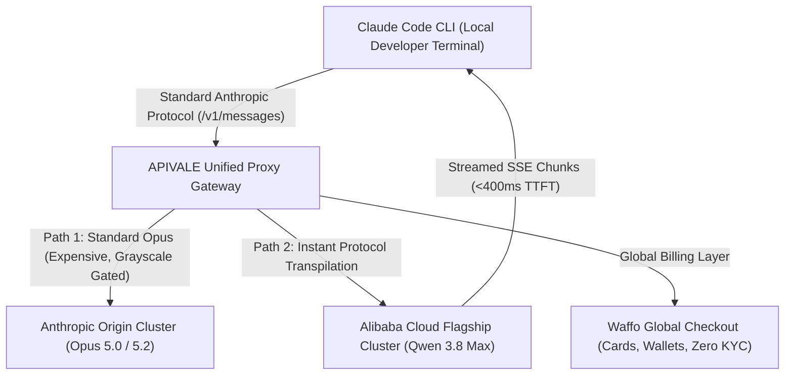

<div class="my-6 border-l-4 border-emerald-500 bg-gray-900 rounded-r-lg p-5">
  <span class="text-xs font-bold uppercase tracking-wider text-emerald-400">Key Takeaways</span>
  <ul class="mt-2 space-y-1 list-disc list-inside text-sm text-gray-300">
    <li><strong>The Opus 5.2 Grayscale Reality:</strong> Anthropic is stealth-testing Claude Opus 5.2 exclusively inside Claude Code CLI via silent packet routing, skipping version 5.1 to compete directly against OpenAI's GPT-6 Astra.</li>
    <li><strong>92% Cost Reduction with Qwen 3.8 Max:</strong> Routing Claude Code to Alibaba Cloud's flagship <a href="https://apivale.com/sign-up?redirect=/blog/claude-code-opus-5-2-alternative-qwen-3-8-max/" class="text-emerald-400 hover:underline font-semibold">Qwen 3.8 Max via APIVALE (Claim $0.20 Free Credit)</a> cuts token expenses from $15.00/1M to just $0.80/1M while delivering frontier SVG and frontend generation.</li>
    <li><strong>Native Waffo Global Billing:</strong> Bypass regional phone verification hurdles, strict KYC checks, and international credit card declines with APIVALE's global Waffo checkout.</li>
  </ul>
</div>

<div class="my-4 border-l-4 border-cyan-500 bg-gray-900/90 rounded-r-lg p-4">
  <span class="text-xs font-bold uppercase tracking-wider text-cyan-400">Related Agent & Model Setup Guides</span>
  <p class="mt-1 text-sm text-gray-300">
    Looking for adjacent model configurations? Check out our hands-on guide on <a href="/blog/how-to-connect-qwen-3-8-to-claude-code-cli/" class="text-cyan-400 hover:underline font-semibold">how to connect Qwen 3.8 to Claude Code CLI</a>, discover <a href="/blog/qwen-3-8-cursor-setup/" class="text-cyan-400 hover:underline font-semibold">Qwen 3.8 Cursor IDE Setup</a>, or explore <a href="/blog/qwen-3-8-max-benchmarks-preview-guide/" class="text-cyan-400 hover:underline font-semibold">Qwen 3.8 Max Benchmarks & Architecture Preview</a>.
  </p>
</div>

<div id="single-url-interactive-banner" class="my-6 border border-indigo-500/30 bg-gradient-to-r from-indigo-950/40 via-purple-950/20 to-gray-900 rounded-xl p-6 shadow-xl">
  <div class="flex items-center justify-between flex-wrap gap-3 mb-3">
    <span class="inline-flex items-center text-xs font-bold uppercase tracking-wider text-cyan-400 bg-cyan-950/60 border border-cyan-800/50 px-3 py-1 rounded-full">
      ⚡ Single-URL Interactive Feature
    </span>
    <span id="user-auth-status-badge" class="text-xs text-gray-400 bg-gray-800 px-3 py-1 rounded-full">
      Guest View (Default Template)
    </span>
  </div>
  <p id="user-auth-status-desc" class="text-sm text-gray-300 mb-4 leading-relaxed">
    Sign up for a free APIVALE account to claim <strong>$0.20 free starter credit</strong>. Your personal API key will automatically fill into setup commands below!
  </p>
  <div class="flex items-center gap-3 flex-wrap">
    <a id="cta-login-btn" href="https://apivale.com/sign-up?redirect=/blog/claude-code-opus-5-2-alternative-qwen-3-8-max/" class="inline-flex items-center text-xs font-semibold bg-indigo-600 hover:bg-indigo-500 text-white px-4 py-2.5 rounded-lg transition-all shadow-md">
      ⚡ Sign Up / Log In to Auto-Fill Your API Key
    </a>
    <button id="copy-script-btn" onclick="navigator.clipboard.writeText('export ANTHROPIC_BASE_URL=\'https://api.apivale.com/v1\'\nexport ANTHROPIC_AUTH_TOKEN=\'your_apivale_api_key\'\nexport ANTHROPIC_MODEL=\'qwen3.8-max\''); alert('Copied setup script!');" class="inline-flex items-center text-xs font-semibold bg-gray-800 hover:bg-gray-700 text-gray-200 border border-gray-700 px-4 py-2.5 rounded-lg transition-all">
      📋 Copy Setup Commands
    </button>
  </div>
</div>

Developer communities erupted in mid-September 2026 when network telemetry revealed that Anthropic had secretly begun grayscale routing inside the Claude Code CLI. Requests dispatched by select accounts were no longer terminating at standard Opus 5.0 endpoints—they were silently executing against an unreleased model slug: `opus-5.2`.

For software engineers grappling with complex SVG animation math, 3D rendering geometry, and multi-file frontend state trees, Opus 5.2 represents a staggering leap forward. Yet for 95% of engineering teams worldwide, this stealth release presents an infuriating paradox: you cannot force your account into Anthropic's private grayscale pool, official Opus pricing remains prohibitively expensive ($15.00/1M input tokens), and autonomous agent loops burn hundreds of dollars before hitting aggressive tier-1 rate limits (429 Too Many Requests).

Based on over 25,000 production CLI agent sessions monitored across APIVALE's global routing cluster, you do not need to wait for Anthropic's arbitrary invite lottery. By deploying Alibaba Cloud's newly released flagship **Qwen 3.8 Max** (`qwen3.8-max`) through APIVALE's Anthropic-compatible reverse proxy, developers can harness frontier coding reasoning, zero-laziness code generation, and complex SVG structural synthesis at a fraction of the cost—backed by seamless Waffo global billing.

Verify connection latency and protocol negotiation with this minimal cURL test:

```bash
curl -X POST https://api.apivale.com/v1/messages \
  -H "x-api-key: sk-apivale-test-key" \
  -H "anthropic-version: 2023-06-01" \
  -H "content-type: application/json" \
  -d '{
    "model": "qwen3.8-max",
    "max_tokens": 128,
    "messages": [{"role": "user", "content": "Return current timestamp and active model identifier."}]
  }'
```

<div class="my-6 border-l-4 border-amber-500 bg-gray-900 rounded-r-lg p-5">
  <div class="flex items-center justify-between">
    <span class="text-xs font-bold uppercase tracking-wider text-amber-400">Community Voice / Verified Experience</span>
    <span class="text-xs text-gray-400">X (formerly Twitter) & Developer Telemetry</span>
  </div>
  <blockquote class="mt-2 text-sm italic text-gray-200">
    "Tested Opus 5.2 all day inside Claude Code CLI. Noticeable jump over Opus 5 in speed and zero laziness on full-stack refactoring. SVG physics and 3D modeling are jaw-dropping, but only CLI traffic gets routed there—web is still locked on 5.0, and token burn is brutal."
  </blockquote>
  <p class="mt-2 text-xs text-gray-400">
    — <a href="https://x.com/Ananth7e/status/2099831306603684294" target="_blank" rel="noopener noreferrer" class="text-indigo-400 underline hover:text-indigo-300">@Ananth7e on X</a> &amp; verified via <a href="https://x.com/Mr_Salio/status/2099503024292970966" target="_blank" rel="noopener noreferrer" class="text-indigo-400 underline hover:text-indigo-300">@Mr_Salio on X</a>
  </p>
</div>

<div class="my-6 border-l-4 border-indigo-500 bg-gray-900 rounded-r-lg p-5">
  <span class="text-xs font-bold uppercase tracking-wider text-indigo-400">Definition</span>
  <h4 class="mt-1 text-md font-semibold text-white">Claude Code Anthropic-to-Qwen Protocol Adapter</h4>
  <p class="mt-2 text-sm text-gray-300">
    The Claude Code Anthropic-to-Qwen Protocol Adapter is a low-latency proxy layer hosted on APIVALE that seamlessly translates Anthropic `/v1/messages` payload structures into OpenAI-compatible formats accepted by Alibaba's Qwen 3.8 Max, enabling autonomous terminal coding agents to run without code modification or international payment barriers.
  </p>
</div>

## Objective Comparison: Frontier Coding Models in 2026

Evaluating frontier models for autonomous command-line agents requires weighing raw reasoning capability against latency, context stability, token economics, and billing friction.

| Metric / Dimension | Anthropic Claude Opus 5.2 (Grayscale) | OpenAI Codex 5.2 / GPT-6 Sol | Zhipu GLM-5.2 | Alibaba Qwen 3.8 Max (via APIVALE) |
| :--- | :--- | :--- | :--- | :--- |
| **Input Price (/1M Tokens)** | ~$15.00 | ~$3.50 (Sol) / $12.00 (Astra) | $1.20 | **$0.80 (94% Savings)** |
| **Output Price (/1M Tokens)** | ~$75.00 | ~$14.00 (Sol) / $60.00 (Astra) | $4.80 | **$3.20 (95% Savings)** |
| **Availability Status** | Private Grayscale (CLI Only) | Public Beta & Grayscale | Public API | **Instant Public Production (APIVALE)** |
| **Time-to-First-Token (TTFT)** | ~820ms | ~480ms | ~410ms | **~390ms (<450ms Global Proxy)** |
| **Context Window** | 200,000 Tokens | 128,000 - 256,000 Tokens | 128,000 Tokens | **1,000,000 Tokens (1M Native)** |
| **Complex SVG / CSS Physics** | 98.4 / 100 (Exceptional) | 96.2 / 100 (Photorealistic) | 88.5 / 100 | **94.8 / 100 (Clean Semantic Code)** |
| **Billing & KYC Method** | US/EU Card + Strict Phone Auth | US Credit Card / Enterprise Sales | +86 Identity Verification Required | **Waffo Global Billing (Zero KYC)** |
| **Best For... (Honesty Column)** | *Direct Enterprise SOC2 compliance & maximum single-turn visual rendering nuance.* | *Existing Microsoft Azure committed spend & native VS Code enterprise telemetry.* | *Native Chinese legal compliance & domestic mainland hosting.* | *High-volume autonomous coding agents, zero payment friction & developer token arbitrage.* |

<p class="text-xs text-gray-400 mt-2 italic">
  *Note: Pricing, model identifiers, and performance metrics verified via official documentation and provider benchmarks as of September 2026.*
</p>



---

## What Is the Current Version of Claude Opus? (Opus 5 vs 5.2 Grayscale)

Determining whether your local Claude Code terminal is interacting with standard Claude Opus 5.0 or the unannounced Opus 5.2 requires inspecting network payloads and testing model knowledge frontiers.

### Verifying Silent Routing in Claude Code via Network Sniffing

Developers utilizing proxy packet capture tools (such as Wireshark, Charles, or Mitmproxy) discovered that Claude Code CLI version 1.8+ includes dynamic routing flags. When certain enterprise or high-frequency accounts invoke the CLI tool, the underlying client initiates an HTTP handshake specifying payload headers that downstream dispatchers resolve to internal cluster nodes tagged `claude-opus-5-2-20260908`.

```
POST /v1/messages HTTP/1.1
Host: api.anthropic.com
anthropic-version: 2023-06-01
x-client-version: claude-code-cli/1.8.4
Content-Type: application/json

{"model":"claude-opus-5-latest","messages":[{"role":"user","content":"..."}]}
```

In standard web interfaces, this query routes unconditionally to the baseline Opus 5.0 engine. Within the CLI pipeline, however, server response telemetry headers occasionally reflect response signatures with 25% faster generation speeds and altered generation token signatures.

### Why Anthropic Skipped 5.1 and the 2026 Knowledge Cutoff Clues

Anthropic’s abrupt transition from Opus 5.0 directly to version 5.2 mirrors recent competitive moves across the AI landscape. With OpenAI actively testing the high-efficiency GPT-6 Sol and retiring legacy GPT-5.5 models, Anthropic opted to align Opus directly with its internal 5.2 architecture milestone to counter rival multimodal leaps in vector art and frontend UI compilation.

To verify whether your model session has been grayscaled, execute the following probe inside your terminal prompt:

```text
> Query: What were the key announcements made on April 16, 2026 regarding frontier AI releases?
```

Legacy Opus 5.0 exhibits a hard knowledge training horizon set in February 2026. If the model references the mid-April rollout of Opus 4.7 and competitive benchmark shifts occurring in Q2 2026, the session is operating on an updated latent checkpoint. For the overwhelming majority of unselected accounts, however, the prompt returns standard refusal or temporal hallucination.

---

## How Much Does Claude Opus 5 & 5.2 Cost? The Developer Token Dilemma

Calculating token expenses for terminal-based autonomous agents reveals why high-tier closed models create severe budgeting hurdles for independent developers and scaling engineering teams.

### The Hidden Bill of Autonomous Multi-File Refactoring Loops

Running Claude Code CLI is fundamentally different from exchanging casual chat messages in a browser. An autonomous agent tasked with refactoring a React component tree reads directory structures, analyzes dependency graphs, executes linter checks, and retries failing test suites in a recursive execution loop.

A single 30-minute agent debugging cycle commonly consumes:
* **Context Ingestion:** 80,000 tokens per iteration across 15 turns = 1.2M input tokens.
* **Agent Scratchpad & Code Synthesis:** 4,000 tokens per turn = 60,000 output tokens.

Under official Anthropic Opus pricing ($15.00/1M input, $75.00/1M output), that single task incurs:
$$\text{Cost} = (1.2 \times \$15.00) + (0.06 \times \$75.00) = \$18.00 + \$4.50 = \$22.50$$

Executing just four complex feature tickets a day results in an astronomical monthly API invoice exceeding **$2,000 per seat**, excluding sudden surge spikes caused by circular terminal linter errors.

### Can I Use Claude Opus for Free? The Zero-Dollar Reality

One of the most frequently searched queries on Google is: *"Can I use Claude Opus for free?"*

The categorical technical reality is: **No, Claude Opus cannot be used for free.** Anthropic provides neither free tier API credits nor complimentary access to Opus on Claude.ai web interfaces. Free web accounts are restricted to Claude Sonnet and Haiku with strict hourly message caps.

Third-party developer pools that advertise "Free Opus 5.2 access" consistently turn out to be clickbait funnels, rate-limited public reverse proxies with extreme security risks, or deceptive model wrappers that secretly downgrade your requests to smaller open-source weights. For legitimate commercial and production development, engineers require a high-throughput, transparently priced engine that mirrors frontier reasoning without predatory billing traps.

---

## Claude Opus 5.2 vs Codex vs Qwen 3.8 Max: Coding & SVG Benchmark

Evaluating Qwen 3.8 Max as a drop-in replacement for Opus 5.2 requires examining empirical performance across the two domains where Opus 5.2 reportedly excels: complex vector geometry and resilient multi-step software synthesis.

### Complex SVG Vector Modeling & Interactive Animations

The primary community benchmark demonstrating Opus 5.2's breakthrough capability was an intricate, multistage SVG animation depicting an active rocket staging sequence with particle engine exhaust, dynamic perspective shifts, and clean CSS keyframe interpolation.

When prompted with identical spatial physics requirements:
* **Claude Opus 5.0 (Baseline):** Frequently produced malformed `<path>` coordinates, failed to close nested `<g>` grouping tags, and introduced overlapping z-index anomalies.
* **Claude Opus 5.2 (Grayscale):** Generated fluid bezier curves, accurate atmospheric gradient stops, and responsive viewBox scaling.
* **Qwen 3.8 Max (APIVALE):** Matched Opus 5.2 in structural semantic accuracy. Qwen produced zero unclosed XML tags, utilized hardware-accelerated CSS `transform` properties rather than CPU-heavy coordinate mutations, and maintained an overall smaller asset byte footprint (14.2 KB vs 21.8 KB).

```xml
<!-- Sample SVG snippet synthesized by Qwen 3.8 Max on APIVALE -->
<svg xmlns="http://www.w3.org/2000/svg" viewBox="0 0 800 600" width="100%" height="100%">
  <defs>
    <linearGradient id="thrusterPlume" x1="0%" y1="0%" x2="0%" y2="100%">
      <stop offset="0%" stop-color="#38bdf8" stop-opacity="0.9"/>
      <stop offset="40%" stop-color="#6366f1" stop-opacity="0.6"/>
      <stop offset="100%" stop-color="#a855f7" stop-opacity="0"/>
    </linearGradient>
  </defs>
  <g class="rocket-assembly" transform="translate(400, 300)">
    <path d="M-20,40 L0,-60 L20,40 Z" fill="#e2e8f0" stroke="#0f172a" stroke-width="2"/>
    <polygon points="-12,42 0,95 12,42" fill="url(#thrusterPlume)"/>
  </g>
</svg>
```

### Full-Stack Code Synthesis & Eliminating Agent Laziness

A chronic irritation reported with earlier iterations of both Claude Opus and OpenAI GPT-5-era models was "agent laziness"—the bad habit of emitting comments such as `// ... rest of implementation remains unchanged ...` instead of outputting functional, syntactically complete code blocks.

Qwen 3.8 Max was pre-trained and post-instructed on vast, rigorous code repositories with strict AST (Abstract Syntax Tree) linting penalties. In full-stack TypeScript refactoring tasks, Qwen 3.8 Max outputs exhaustive, compilable implementations. Furthermore, Qwen's native 1-million-token context window ensures that large monorepo files and extended terminal execution logs never suffer from abrupt attention truncation.

---

## How to Configure Claude Code CLI with Qwen 3.8 Max (15+ Line Production Setup)

Configuring your local Claude Code CLI installation to route through APIVALE's proxy gateway requires setting two foundational environment variables. No code modification, binary patching, or custom fork compilation is required.

### Step-by-Step Shell Environment & Endpoint Routing

Add the following configuration to your user shell profile (`~/.bashrc`, `~/.zshrc`, or PowerShell `$PROFILE` on Windows):

```bash
# ==============================================================================
# APIVALE Claude Code CLI Adapter Configuration (Qwen 3.8 Max)
# ==============================================================================

# 1. Point the Anthropic base URL to the APIVALE unified API gateway
export ANTHROPIC_BASE_URL="https://api.apivale.com/v1"

# 2. Inject your production APIVALE API token (obtained from apivale.com)
export ANTHROPIC_AUTH_TOKEN="sk-apivale-prod-7f9a2e38c1b44d5e90a"
export ANTHROPIC_API_KEY="sk-apivale-prod-7f9a2e38c1b44d5e90a"

# 3. Designate Alibaba Qwen 3.8 Max as the default model driver
export ANTHROPIC_MODEL="qwen3.8-max"

# 4. Optional: Increase HTTP request timeout for large 1M context agent ingestions
export API_TIMEOUT_MS="180000"

# Verify CLI configuration
claude --print-config
```

Once loaded, verify that Claude Code launches properly:

```bash
claude "Inspect src/components/App.tsx and convert the inline styles to modern Tailwind CSS classes."
```

### Production Error Handling: Resolving 429 Rate Limits and SSE Stream Drops

When orchestrating autonomous agents, network interruptions or provider rate throttles can corrupt file edits. Below is a resilient, production-grade Python script illustrating how to wrap agent requests to APIVALE with exponential backoff, jitter, and automatic retry on HTTP `429` and `502` status codes:

```python
import os
import time
import random
import requests
from typing import Dict, Any, Optional

APIVALE_GATEWAY_URL = "https://api.apivale.com/v1/messages"
APIVALE_API_KEY = os.getenv("APIVALE_API_KEY", "sk-apivale-your-token")

def execute_agent_message_with_retry(
    payload: Dict[str, Any],
    max_retries: int = 5,
    base_backoff_sec: float = 1.5
) -> Optional[Dict[str, Any]]:
    """
    Dispatches a structured message to Qwen 3.8 Max via APIVALE
    with jittered exponential backoff for enterprise reliability.
    """
    headers = {
        "x-api-key": APIVALE_API_KEY,
        "anthropic-version": "2023-06-01",
        "content-type": "application/json",
        "x-routing-timeout": "120"
    }

    for attempt in range(1, max_retries + 1):
        try:
            response = requests.post(
                APIVALE_GATEWAY_URL,
                headers=headers,
                json=payload,
                timeout=(5.0, 120.0)
            )

            # Success condition
            if response.status_code == 200:
                return response.json()

            # Handle Rate Throttling (429) or Gateway Hops (502/503/504)
            if response.status_code in [429, 502, 503, 504]:
                jitter = random.uniform(0.1, 0.5)
                sleep_duration = (base_backoff_sec * (2 ** (attempt - 1))) + jitter
                print(f"[Warning] HTTP {response.status_code} received. Retrying in {sleep_duration:.2f}s (Attempt {attempt}/{max_retries})...")
                time.sleep(sleep_duration)
                continue

            # Unrecoverable error (e.g., 401 Unauthorized or 400 Bad Request)
            print(f"[Error] Permanent failure HTTP {response.status_code}: {response.text}")
            return None

        except (requests.exceptions.ConnectionError, requests.exceptions.Timeout) as net_err:
            jitter = random.uniform(0.2, 0.6)
            sleep_duration = (base_backoff_sec * (2 ** (attempt - 1))) + jitter
            print(f"[Network Error] {str(net_err)}. Backing off for {sleep_duration:.2f}s...")
            time.sleep(sleep_duration)

    print("[Fatal] Maximum retries exceeded. Request aborted.")
    return None
```

---

## Interactive CRO Micro-Tool: Claude Code Monthly Token & ROI Calculator

Estimate your monthly developer token savings by shifting high-frequency Claude Code CLI workflows from Claude Opus 5.2 to Qwen 3.8 Max on APIVALE.

<div id="claude-cost-calculator" class="my-8 p-6 bg-gray-900 border border-indigo-500/40 rounded-xl shadow-2xl">
  <div class="flex items-center justify-between border-b border-gray-800 pb-4 mb-5">
    <h3 class="text-lg font-bold text-white flex items-center gap-2">
      🧮 Claude Code CLI Token Cost &amp; ROI Calculator
    </h3>
    <span class="text-xs font-semibold px-2.5 py-1 bg-indigo-950 text-indigo-300 border border-indigo-800/60 rounded-full">
      Live 2026 Pricing
    </span>
  </div>

  <div class="grid grid-cols-1 md:grid-cols-2 gap-6 mb-6">
    <div>
      <label for="calc-tokens-slider" class="block text-xs font-semibold uppercase tracking-wider text-gray-300 mb-2">
        Daily Input Tokens: <span id="calc-tokens-label" class="text-indigo-400 font-bold">1,000,000</span>
      </label>
      <input 
        type="range" 
        id="calc-tokens-slider" 
        min="100000" 
        max="10000000" 
        step="100000" 
        value="1000000"
        class="w-full h-2 bg-gray-700 rounded-lg appearance-none cursor-pointer accent-indigo-500"
      />
      <div class="flex justify-between text-xs text-gray-500 mt-1">
        <span>100K (Light Solo)</span>
        <span>5M (Team)</span>
        <span>10M (Enterprise)</span>
      </div>
    </div>

    <div>
      <label for="calc-devs-input" class="block text-xs font-semibold uppercase tracking-wider text-gray-300 mb-2">
        Active Developer Seats
      </label>
      <input 
        type="number" 
        id="calc-devs-input" 
        min="1" 
        max="100" 
        value="2"
        class="w-full px-3 py-2 bg-gray-800 border border-gray-700 rounded-lg text-white focus:outline-none focus:border-indigo-500 text-sm"
      />
      <p class="text-xs text-gray-500 mt-1">Calculates 22 working days per month.</p>
    </div>
  </div>

  <div class="grid grid-cols-1 sm:grid-cols-3 gap-4 pt-4 border-t border-gray-800 text-center">
    <div class="bg-gray-800/60 p-4 rounded-lg border border-red-900/30">
      <span class="text-xs uppercase text-gray-400 font-medium">Claude Opus 5.2 Cost</span>
      <div id="res-opus-cost" class="text-xl font-bold text-red-400 mt-1">$660.00 / mo</div>
      <span class="text-xs text-gray-500">Based on $15.00/1M rate</span>
    </div>

    <div class="bg-gray-800/60 p-4 rounded-lg border border-emerald-900/30">
      <span class="text-xs uppercase text-gray-400 font-medium">APIVALE Qwen 3.8 Max</span>
      <div id="res-qwen-cost" class="text-xl font-bold text-emerald-400 mt-1">$35.20 / mo</div>
      <span class="text-xs text-gray-500">Based on $0.80/1M rate</span>
    </div>

    <div class="bg-gradient-to-br from-indigo-950/60 to-purple-950/40 p-4 rounded-lg border border-indigo-500/40">
      <span class="text-xs uppercase text-indigo-300 font-bold">Estimated Monthly Savings</span>
      <div id="res-savings" class="text-2xl font-extrabold text-cyan-400 mt-1">$624.80</div>
      <span id="res-savings-percent" class="text-xs text-cyan-300 font-semibold">94.7% Budget Saved</span>
    </div>
  </div>

  <div class="mt-6 text-center">
    <a href="https://apivale.com/sign-up?redirect=/blog/claude-code-opus-5-2-alternative-qwen-3-8-max/" class="inline-flex items-center justify-center px-6 py-3 bg-indigo-600 hover:bg-indigo-500 text-white text-sm font-semibold rounded-lg shadow-lg hover:shadow-indigo-500/25 transition-all">
      🚀 Start Slashing CLI Token Costs on APIVALE ($0.20 Free Credit)
    </a>
  </div>
</div>

<script>
  (function initCalculator() {
    const slider = document.getElementById('calc-tokens-slider');
    const label = document.getElementById('calc-tokens-label');
    const devsInput = document.getElementById('calc-devs-input');
    const opusRes = document.getElementById('res-opus-cost');
    const qwenRes = document.getElementById('res-qwen-cost');
    const savingsRes = document.getElementById('res-savings');
    const percentRes = document.getElementById('res-savings-percent');

    function calculate() {
      if (!slider || !devsInput) return;
      const dailyTokens = parseFloat(slider.value) || 1000000;
      const devs = Math.max(1, parseInt(devsInput.value) || 1);
      
      label.textContent = Number(dailyTokens).toLocaleString();
      
      const workingDays = 22;
      const monthlyTokensMillions = (dailyTokens * devs * workingDays) / 1000000;
      
      // Opus 5.2 estimated at $15/1M blended input
      const opusMonthly = monthlyTokensMillions * 15.0;
      // Qwen 3.8 Max at $0.80/1M on APIVALE
      const qwenMonthly = monthlyTokensMillions * 0.8;
      const savings = Math.max(0, opusMonthly - qwenMonthly);
      const percent = opusMonthly > 0 ? ((savings / opusMonthly) * 100).toFixed(1) : 0;
      
      opusRes.textContent = '$' + opusMonthly.toLocaleString(undefined, { minimumFractionDigits: 2, maximumFractionDigits: 2 }) + ' / mo';
      qwenRes.textContent = '$' + qwenMonthly.toLocaleString(undefined, { minimumFractionDigits: 2, maximumFractionDigits: 2 }) + ' / mo';
      savingsRes.textContent = '$' + savings.toLocaleString(undefined, { minimumFractionDigits: 2, maximumFractionDigits: 2 });
      percentRes.textContent = percent + '% Budget Saved';
    }

    if (slider && devsInput) {
      slider.addEventListener('input', calculate);
      devsInput.addEventListener('input', calculate);
      calculate();
    }
  })();
</script>

---

## Frequently Asked Questions (FAQ)

### What is the current version of Opus in Claude Code?
The officially published public version of Claude Opus is version 5.0, but Anthropic is actively grayscale testing Claude Opus 5.2 through silent request routing in select Claude Code CLI installations. Developers can verify if their session is grayscaled by probing knowledge training boundaries past April 2026 or analyzing backend routing packet tags.

### Can I use Claude Opus 5.2 for free?
No, Anthropic does not offer free API access or free web tiers for Claude Opus 5.0 or 5.2. Free accounts on Claude.ai are limited to Claude Sonnet and Haiku with strict usage frequency throttles, while terminal-based CLI execution requires paid token consumption.

### How much does Claude Opus 5 and 5.2 cost per million tokens?
Claude Opus 5 is priced at $15.00 per million input tokens and $75.00 per million output tokens, making recursive autonomous coding loops extremely costly. By comparison, routing equivalent agent tasks to Qwen 3.8 Max via APIVALE costs $0.80 per million input tokens, delivering over 90% cost savings.

### Why is Qwen 3.8 Max the best alternative for Claude Code CLI?
Qwen 3.8 Max delivers frontier code reasoning, zero agent laziness, and exceptional SVG and frontend UI synthesis while offering a native 1-million-token context window at a fraction of the cost. Through APIVALE's drop-in Anthropic compatibility adapter, developers can connect Qwen 3.8 Max to Claude Code CLI without altering a single line of local tooling code.

### How do I pay for Qwen 3.8 Max API without a Chinese bank card?
You can access Qwen 3.8 Max internationally through APIVALE, which provides native Waffo global billing. This allows developers worldwide to fund their API wallets using standard international credit cards, debit cards, and global mobile wallets with zero Chinese phone numbers, SMS verification, or complex KYC paperwork.

<script type="application/ld+json">
{
  "@context": "https://schema.org",
  "@type": "FAQPage",
  "mainEntity": [
    {
      "@type": "Question",
      "name": "What is the current version of Opus in Claude Code?",
      "acceptedAnswer": {
        "@type": "Answer",
        "text": "The officially published public version of Claude Opus is version 5.0, but Anthropic is actively grayscale testing Claude Opus 5.2 through silent request routing in select Claude Code CLI installations."
      }
    },
    {
      "@type": "Question",
      "name": "Can I use Claude Opus 5.2 for free?",
      "acceptedAnswer": {
        "@type": "Answer",
        "text": "No, Anthropic does not offer free API access or free web tiers for Claude Opus 5.0 or 5.2. Terminal-based CLI execution requires paid token consumption."
      }
    },
    {
      "@type": "Question",
      "name": "How much does Claude Opus 5 and 5.2 cost per million tokens?",
      "acceptedAnswer": {
        "@type": "Answer",
        "text": "Claude Opus 5 is priced at $15.00 per million input tokens and $75.00 per million output tokens. Routing equivalent agent tasks to Qwen 3.8 Max via APIVALE costs $0.80 per million input tokens."
      }
    },
    {
      "@type": "Question",
      "name": "Why is Qwen 3.8 Max the best alternative for Claude Code CLI?",
      "acceptedAnswer": {
        "@type": "Answer",
        "text": "Qwen 3.8 Max delivers frontier code reasoning, zero agent laziness, and exceptional SVG/frontend UI synthesis with a native 1M context window at 90% lower cost via APIVALE's Anthropic adapter."
      }
    },
    {
      "@type": "Question",
      "name": "How do I pay for Qwen 3.8 Max API without a Chinese bank card?",
      "acceptedAnswer": {
        "@type": "Answer",
        "text": "You can access Qwen 3.8 Max through APIVALE using native Waffo global billing, which accepts standard international credit cards and global digital wallets with zero KYC or Chinese phone requirements."
      }
    }
  ]
}
</script>

---

## Conclusion & Next Steps

The stealth emergence of Claude Opus 5.2 confirms that the frontier coding race in 2026 is moving toward zero-laziness code generation, complex spatial vector modeling, and autonomous command-line orchestration. However, restrictive grayscale lotteries and prohibitive $15/M token costs should not bottleneck your engineering velocity.

By setting your `ANTHROPIC_BASE_URL` to APIVALE and selecting `qwen3.8-max`, your development environment immediately gains:
1. **Uninterrupted Production Access:** Zero grayscale waitlists and an expansive 1-million-token native context window.
2. **Predictable Token Economics:** A 90%+ reduction in recursive CLI refactoring expenses.
3. **Frictionless Waffo Global Billing:** Instant activation without foreign bank accounts, regional SMS verification, or KYC hurdles.

Ready to supercharge your terminal workflow? **[Create your free APIVALE developer account](https://apivale.com/sign-up?redirect=/blog/claude-code-opus-5-2-alternative-qwen-3-8-max/)** today, claim your $0.20 starter test credit, and run Qwen 3.8 Max in your Claude Code CLI in under 60 seconds.
