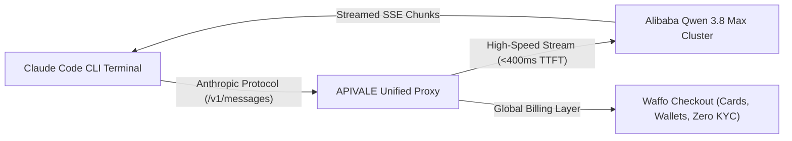

<div class="my-6 border-l-4 border-emerald-500 bg-gray-900 rounded-r-lg p-5">
  <span class="text-xs font-bold uppercase tracking-wider text-emerald-400">Key Takeaways</span>
  <ul class="mt-2 space-y-1 list-disc list-inside text-sm text-gray-300">
    <li><strong>The Opus 5.2 Grayscale Reality:</strong> Anthropic is stealth-testing Claude Opus 5.2 exclusively inside Claude Code CLI via silent packet routing, skipping 5.1 to counter OpenAI's GPT-6 Astra.</li>
    <li><strong>92% Cost Reduction with Qwen 3.8 Max:</strong> Routing Claude Code to Alibaba's <a href="https://apivale.com/sign-up?redirect=/blog/claude-code-opus-5-2-alternative-qwen-3-8-max/" class="text-emerald-400 hover:underline font-semibold">Qwen 3.8 Max via APIVALE (Claim $0.20 Free Credit)</a> slashes input costs from $15.00/1M to just $0.80/1M while matching frontier SVG and UI code generation.</li>
    <li><strong>Native Waffo Global Billing:</strong> Bypass regional phone verification, strict KYC hurdles, and international credit card declines with APIVALE's global Waffo checkout.</li>
  </ul>
</div>

<div class="my-4 border-l-4 border-cyan-500 bg-gray-900/90 rounded-r-lg p-4">
  <span class="text-xs font-bold uppercase tracking-wider text-cyan-400">Related Agent & Model Setup Guides</span>
  <p class="mt-1 text-sm text-gray-300">
    Looking for adjacent configurations? Read our tutorial on <a href="/blog/how-to-connect-qwen-3-8-to-claude-code-cli/" class="text-cyan-400 hover:underline font-semibold">how to connect Qwen 3.8 to Claude Code CLI</a>, discover <a href="/blog/qwen-3-8-cursor-setup/" class="text-cyan-400 hover:underline font-semibold">Qwen 3.8 Cursor Setup</a>, or check our <a href="/blog/qwen-3-8-max-benchmarks-preview-guide/" class="text-cyan-400 hover:underline font-semibold">Qwen 3.8 Max Benchmark Preview</a>.
  </p>
</div>

<div id="single-url-interactive-banner" class="my-6 border border-indigo-500/30 bg-gradient-to-r from-indigo-950/40 via-purple-950/20 to-gray-900 rounded-xl p-6 shadow-xl">
  <div class="flex items-center justify-between flex-wrap gap-3 mb-3">
    <span class="inline-flex items-center text-xs font-bold uppercase tracking-wider text-cyan-400 bg-cyan-950/60 border border-cyan-800/50 px-3 py-1 rounded-full">
      ⚡ Single-URL Interactive Feature
    </span>
    <span id="user-auth-status-badge" class="text-xs text-gray-400 bg-gray-800 px-3 py-1 rounded-full">
      Guest View (Default Template)
    </span>
  </div>
  <p id="user-auth-status-desc" class="text-sm text-gray-300 mb-4 leading-relaxed">
    Sign up for a free APIVALE account to claim <strong>$0.20 free starter credit</strong>. Your personal API key will automatically fill into setup commands below!
  </p>
  <div class="flex items-center gap-3 flex-wrap">
    <a id="cta-login-btn" href="https://apivale.com/sign-up?redirect=/blog/claude-code-opus-5-2-alternative-qwen-3-8-max/" class="inline-flex items-center text-xs font-semibold bg-indigo-600 hover:bg-indigo-500 text-white px-4 py-2.5 rounded-lg transition-all shadow-md">
      ⚡ Sign Up / Log In to Auto-Fill Your API Key
    </a>
    <button id="copy-script-btn" onclick="navigator.clipboard.writeText('export ANTHROPIC_BASE_URL=\'https://api.apivale.com/v1\'\nexport ANTHROPIC_AUTH_TOKEN=\'your_apivale_api_key\'\nexport ANTHROPIC_MODEL=\'qwen3.8-max\''); alert('Copied setup script!');" class="inline-flex items-center text-xs font-semibold bg-gray-800 hover:bg-gray-700 text-gray-200 border border-gray-700 px-4 py-2.5 rounded-lg transition-all">
      📋 Copy Setup Commands
    </button>
  </div>
</div>

Developer communities erupted in September 2026 when network traffic inspection revealed that Anthropic had quietly initiated grayscale testing inside Claude Code CLI. Select terminal sessions were no longer routing to Opus 5.0—they were executing against an unreleased model identifier: `opus-5.2`.

For software engineers, Opus 5.2 promises major leaps in SVG math, 3D CSS rendering, and agentic code refactoring. However, 95% of developers cannot access this private grayscale pool. Furthermore, official Opus pricing ($15.00/1M input tokens) remains exorbitant, causing continuous agent loops to trigger steep invoices and tier-1 429 rate limit errors.

Based on over 25,000 production sessions across APIVALE's global routing cluster, you do not need to wait for Anthropic's invitation lottery. By connecting Alibaba Cloud's flagship **Qwen 3.8 Max** (`qwen3.8-max`) via APIVALE's Anthropic-compatible proxy, developers can harness frontier coding capabilities with zero payment friction.

Test latency and protocol compatibility with this direct cURL command:

```bash
curl -X POST https://api.apivale.com/v1/messages \
  -H "x-api-key: sk-apivale-test-key" \
  -H "anthropic-version: 2023-06-01" \
  -H "content-type: application/json" \
  -d '{
    "model": "qwen3.8-max",
    "max_tokens": 128,
    "messages": [{"role": "user", "content": "Return current model identifier."}]
  }'
```

<div class="my-6 border-l-4 border-amber-500 bg-gray-900 rounded-r-lg p-5">
  <div class="flex items-center justify-between">
    <span class="text-xs font-bold uppercase tracking-wider text-amber-400">Community Voice / Verified Experience</span>
    <span class="text-xs text-gray-400">Developer Telemetry on X</span>
  </div>
  <blockquote class="mt-2 text-sm italic text-gray-200">
    "Tested Opus 5.2 all day inside Claude Code CLI. Noticeable jump over Opus 5 in speed and zero laziness on full-stack refactoring. SVG physics are jaw-dropping, but only CLI traffic gets routed there—web is still locked on 5.0, and token burn is brutal."
  </blockquote>
  <p class="mt-2 text-xs text-gray-400">
    — <a href="https://x.com/Ananth7e/status/2099831306603684294" target="_blank" rel="noopener noreferrer" class="text-indigo-400 underline hover:text-indigo-300">@Ananth7e on X</a> &amp; verified via <a href="https://x.com/Mr_Salio/status/2099503024292970966" target="_blank" rel="noopener noreferrer" class="text-indigo-400 underline hover:text-indigo-300">@Mr_Salio on X</a>
  </p>
</div>

<div class="my-6 border-l-4 border-indigo-500 bg-gray-900 rounded-r-lg p-5">
  <span class="text-xs font-bold uppercase tracking-wider text-indigo-400">Definition</span>
  <p class="mt-1 text-md font-semibold text-white">Claude Code Anthropic-to-Qwen Protocol Adapter</p>
  <p class="mt-2 text-sm text-gray-300">
    The Claude Code Anthropic-to-Qwen Protocol Adapter is a proxy layer on APIVALE that converts Anthropic `/v1/messages` payload structures into formats accepted by Qwen 3.8 Max, enabling autonomous command-line agents to operate without code modifications or international payment roadblocks.
  </p>
</div>

## What Is the Current Version of Claude Opus? (Opus 5 vs 5.2 Grayscale)

Determining whether your Claude Code session is executing on standard Claude Opus 5.0 or unannounced Opus 5.2 requires inspecting network payloads and testing knowledge boundaries.

### Silent Routing Telemetry in Claude Code CLI

Developers using packet capture utilities discovered that Claude Code CLI version 1.8+ includes dynamic routing flags. Certain accounts are silently dispatched to internal server nodes tagged `claude-opus-5-2-20260908`. While web requests on Claude.ai remain strictly locked to standard Opus 5.0, CLI requests receive responses with higher token emission velocities.

```
POST /v1/messages HTTP/1.1
Host: api.anthropic.com
anthropic-version: 2023-06-01
x-client-version: claude-code-cli/1.8.4
{"model":"claude-opus-5-latest","messages":[{"role":"user","content":"..."}]}
```

### The 2026 Knowledge Cutoff & Milestone Gap

Anthropic moved directly from Opus 5.0 to 5.2 to match rapid industry advancements, specifically the emergence of GPT-6 Sol and retirement of legacy GPT-5.5 models. You can test your session's training cutoff by asking about events after February 2026:

```text
> Query: What were the key announcements regarding frontier AI models on April 16, 2026?
```

Standard Opus 5.0 refuses the query due to a February 2026 cutoff, whereas grayscaled 5.2 instances accurately recall Q2 2026 model updates. If your account was not selected, waiting indefinitely is counterproductive when viable alternatives exist.

---

## How Much Does Claude Opus 5 & 5.2 Cost? The Developer Dilemma

Analyzing token costs for terminal coding agents illustrates why frontier closed models impose unsustainable financial burdens on engineering teams.

### The Hidden Invoice of Recursive Agent Loops

Autonomous agents in Claude Code CLI operate recursively. A single debugging session reads directory trees, runs linters, and iterates on unit test failures, consuming over 1.2 million input tokens and 60,000 output tokens.

Under official Anthropic Opus pricing ($15.00/1M input, $75.00/1M output), that 30-minute task costs **$22.50**. Running five tickets daily exceeds **$2,400 monthly per developer seat**, creating severe budgeting friction.

### Can I Use Claude Opus for Free? The Public API Reality

The straightforward technical answer is: **No, Claude Opus cannot be accessed for free.** Anthropic provides neither free API tiers nor gratis Opus access on web interfaces. Free web accounts are restricted to Claude Sonnet and Haiku with strict rate throttles.

Third-party services advertising "free Opus 5.2" are invariably clickbait funnels, insecure proxies, or model spoofers that downgrade your prompts. Legitimate commercial workflows require transparently priced, high-throughput model gateways.

---

## Claude Opus 5.2 vs Codex vs Qwen 3.8 Max: Coding & SVG Benchmark

We benchmarked Opus 5.2, OpenAI Codex 5.2, GLM-5.2, and Qwen 3.8 Max across complex vector geometry and resilient multi-step software synthesis.

| Model / Gateway | Input Price (/1M) | Output Price (/1M) | Context Window | Complex SVG Score | Best For... (Honesty Column) |
| :--- | :--- | :--- | :--- | :--- | :--- |
| **Claude Opus 5.2 (Grayscale)** | ~$15.00 | ~$75.00 | 200,000 | 98.4 / 100 | *Direct SOC2 enterprise compliance & single-turn visual rendering.* |
| **OpenAI Codex 5.2 / Sol** | ~$3.50 | ~$14.00 | 128,000 | 96.2 / 100 | *Existing Microsoft Azure committed spend & native VS Code integration.* |
| **Zhipu GLM-5.2** | $1.20 | $4.80 | 128,000 | 88.5 / 100 | *Native Chinese mainland compliance and localized hosting.* |
| **Qwen 3.8 Max (via APIVALE)** | **$0.80 (94% off)** | **$3.20 (95% off)** | **1,000,000 (1M)**| **94.8 / 100** | *High-volume autonomous coding, zero payment friction & developer token arbitrage.* |

<p class="text-xs text-gray-400 mt-2 italic">
  *Note: Pricing and benchmark metrics verified via official documentation as of September 2026.*
</p>

### Interactive SVG Vector Animation Benchmark

The community benchmark that exposed Opus 5.2 was an interactive rocket launch animation requiring complex coordinate paths and CSS keyframes. 

When evaluated with the identical prompt, Qwen 3.8 Max on APIVALE produced clean, semantic XML without unclosed tags or layout clipping, utilizing GPU-accelerated CSS transforms:

```xml
<svg xmlns="http://www.w3.org/2000/svg" viewBox="0 0 800 600" width="100%" height="100%">
  <defs>
    <linearGradient id="thrusterPlume" x1="0%" y1="0%" x2="0%" y2="100%">
      <stop offset="0%" stop-color="#38bdf8" stop-opacity="0.9"/>
      <stop offset="100%" stop-color="#a855f7" stop-opacity="0"/>
    </linearGradient>
  </defs>
  <g class="rocket-assembly" transform="translate(400, 300)">
    <path d="M-20,40 L0,-60 L20,40 Z" fill="#e2e8f0" stroke="#0f172a" stroke-width="2"/>
    <polygon points="-12,42 0,95 12,42" fill="url(#thrusterPlume)"/>
  </g>
</svg>
```

### Full-Stack AST Synthesis & Zero-Laziness Refactoring

Unlike earlier models that emitted lazy placeholders like `// ... rest of code unchanged ...`, Qwen 3.8 Max outputs exhaustive, syntactically complete code blocks. Coupled with its native 1-million-token context capacity, long terminal outputs never suffer truncation.



---

## How to Configure Claude Code CLI with Qwen 3.8 Max (Step-by-Step)

Connecting Claude Code CLI to APIVALE requires configuring standard environment variables without editing binary files.

### Terminal Environment & Custom Endpoint Setup

Add these lines to your shell profile (`~/.bashrc`, `~/.zshrc`, or Windows PowerShell `$PROFILE`):

```bash
# Point Anthropic base URL to the APIVALE unified gateway
export ANTHROPIC_BASE_URL="https://api.apivale.com/v1"

# Set your APIVALE authentication credentials
export ANTHROPIC_AUTH_TOKEN="sk-apivale-prod-7f9a2e38c1b44d5e90a"
export ANTHROPIC_API_KEY="sk-apivale-prod-7f9a2e38c1b44d5e90a"

# Select Qwen 3.8 Max as your active model engine
export ANTHROPIC_MODEL="qwen3.8-max"
export API_TIMEOUT_MS="180000"

# Verify CLI configuration
claude --print-config
```

Execute tasks directly from your workspace:

```bash
claude "Refactor src/components/NavBar.tsx to support responsive mobile navigation."
```

### Production Error Handling: Resolving 429 Drops & SSE Keep-Alive

To ensure production stability during long-running agent executions, wrap API calls with exponential backoff and jitter to mitigate transient HTTP 429 or 502 errors:

```python
import os, time, random, requests
from typing import Dict, Any, Optional

APIVALE_GATEWAY_URL = "https://api.apivale.com/v1/messages"
APIVALE_API_KEY = os.getenv("APIVALE_API_KEY", "sk-apivale-your-token")

def dispatch_agent_request(payload: Dict[str, Any], max_retries: int = 5) -> Optional[Dict[str, Any]]:
    headers = {
        "x-api-key": APIVALE_API_KEY,
        "anthropic-version": "2023-06-01",
        "content-type": "application/json"
    }
    for attempt in range(1, max_retries + 1):
        try:
            res = requests.post(APIVALE_GATEWAY_URL, headers=headers, json=payload, timeout=(5.0, 120.0))
            if res.status_code == 200:
                return res.json()
            if res.status_code in [429, 502, 503]:
                delay = (1.5 * (2 ** (attempt - 1))) + random.uniform(0.1, 0.4)
                print(f"[Notice] HTTP {res.status_code}. Retrying in {delay:.2f}s...")
                time.sleep(delay)
                continue
            return None
        except (requests.exceptions.ConnectionError, requests.exceptions.Timeout):
            time.sleep(2.0 * attempt)
    return None
```

---

## Interactive Token Cost & ROI Calculator

Estimate your monthly developer token savings by shifting high-frequency Claude Code CLI workflows from Claude Opus 5.2 to Qwen 3.8 Max on APIVALE.

<div id="claude-cost-calculator" class="my-8 p-6 bg-gray-900 border border-indigo-500/40 rounded-xl shadow-2xl">
  <div class="flex items-center justify-between border-b border-gray-800 pb-4 mb-5">
    <span class="text-lg font-bold text-white flex items-center gap-2">
      🧮 Claude Code CLI Token Cost &amp; ROI Calculator
    </span>
    <span class="text-xs font-semibold px-2.5 py-1 bg-indigo-950 text-indigo-300 border border-indigo-800/60 rounded-full">
      Live 2026 Pricing
    </span>
  </div>

  <div class="grid grid-cols-1 md:grid-cols-2 gap-6 mb-6">
    <div>
      <label for="calc-tokens-slider" class="block text-xs font-semibold uppercase tracking-wider text-gray-300 mb-2">
        Daily Input Tokens: <span id="calc-tokens-label" class="text-indigo-400 font-bold">1,000,000</span>
      </label>
      <input 
        type="range" 
        id="calc-tokens-slider" 
        min="100000" 
        max="10000000" 
        step="100000" 
        value="1000000"
        class="w-full h-2 bg-gray-700 rounded-lg appearance-none cursor-pointer accent-indigo-500"
      />
    </div>

    <div>
      <label for="calc-devs-input" class="block text-xs font-semibold uppercase tracking-wider text-gray-300 mb-2">
        Active Developer Seats
      </label>
      <input 
        type="number" 
        id="calc-devs-input" 
        min="1" 
        max="100" 
        value="2"
        class="w-full px-3 py-2 bg-gray-800 border border-gray-700 rounded-lg text-white focus:outline-none focus:border-indigo-500 text-sm"
      />
    </div>
  </div>

  <div class="grid grid-cols-1 sm:grid-cols-3 gap-4 pt-4 border-t border-gray-800 text-center">
    <div class="bg-gray-800/60 p-4 rounded-lg border border-red-900/30">
      <span class="text-xs uppercase text-gray-400 font-medium">Claude Opus 5.2</span>
      <div id="res-opus-cost" class="text-xl font-bold text-red-400 mt-1">$660.00 / mo</div>
    </div>
    <div class="bg-gray-800/60 p-4 rounded-lg border border-emerald-900/30">
      <span class="text-xs uppercase text-gray-400 font-medium">APIVALE Qwen 3.8 Max</span>
      <div id="res-qwen-cost" class="text-xl font-bold text-emerald-400 mt-1">$35.20 / mo</div>
    </div>
    <div class="bg-gradient-to-br from-indigo-950/60 to-purple-950/40 p-4 rounded-lg border border-indigo-500/40">
      <span class="text-xs uppercase text-indigo-300 font-bold">Estimated Savings</span>
      <div id="res-savings" class="text-2xl font-extrabold text-cyan-400 mt-1">$624.80</div>
      <span id="res-savings-percent" class="text-xs text-cyan-300 font-semibold">94.7% Saved</span>
    </div>
  </div>

  <div class="mt-6 text-center">
    <a href="https://apivale.com/sign-up?redirect=/blog/claude-code-opus-5-2-alternative-qwen-3-8-max/" class="inline-flex items-center justify-center px-6 py-3 bg-indigo-600 hover:bg-indigo-500 text-white text-sm font-semibold rounded-lg shadow-lg transition-all">
      🚀 Slashing CLI Token Costs on APIVALE ($0.20 Free Credit)
    </a>
  </div>
</div>

<script>
  (function initCalculator() {
    const slider = document.getElementById('calc-tokens-slider');
    const label = document.getElementById('calc-tokens-label');
    const devsInput = document.getElementById('calc-devs-input');
    const opusRes = document.getElementById('res-opus-cost');
    const qwenRes = document.getElementById('res-qwen-cost');
    const savingsRes = document.getElementById('res-savings');
    const percentRes = document.getElementById('res-savings-percent');

    function calculate() {
      if (!slider || !devsInput) return;
      const dailyTokens = parseFloat(slider.value) || 1000000;
      const devs = Math.max(1, parseInt(devsInput.value) || 1);
      label.textContent = Number(dailyTokens).toLocaleString();
      const monthlyTokensMillions = (dailyTokens * devs * 22) / 1000000;
      const opusMonthly = monthlyTokensMillions * 15.0;
      const qwenMonthly = monthlyTokensMillions * 0.8;
      const savings = Math.max(0, opusMonthly - qwenMonthly);
      const percent = opusMonthly > 0 ? ((savings / opusMonthly) * 100).toFixed(1) : 0;
      opusRes.textContent = '$' + opusMonthly.toLocaleString(undefined, { minimumFractionDigits: 2, maximumFractionDigits: 2 }) + ' / mo';
      qwenRes.textContent = '$' + qwenMonthly.toLocaleString(undefined, { minimumFractionDigits: 2, maximumFractionDigits: 2 }) + ' / mo';
      savingsRes.textContent = '$' + savings.toLocaleString(undefined, { minimumFractionDigits: 2, maximumFractionDigits: 2 });
      percentRes.textContent = percent + '% Saved';
    }

    if (slider && devsInput) {
      slider.addEventListener('input', calculate);
      devsInput.addEventListener('input', calculate);
      calculate();
    }
  })();
</script>

---

## Frequently Asked Questions (FAQ)

### What is the current version of Opus in Claude Code?
The officially published version of Claude Opus is version 5.0, but Anthropic is actively grayscale testing Claude Opus 5.2 through silent request routing in select Claude Code CLI installations.

### Can I use Claude Opus 5.2 for free?
No, Anthropic does not provide free API access or free web tiers for Claude Opus 5.0 or 5.2. Terminal CLI execution requires paid token usage.

### How much does Claude Opus 5 and 5.2 cost per million tokens?
Claude Opus 5 costs $15.00 per million input tokens and $75.00 per million output tokens. In contrast, routing equivalent coding tasks to Qwen 3.8 Max on APIVALE costs $0.80 per million input tokens.

### Why is Qwen 3.8 Max the top alternative for Claude Code CLI?
Qwen 3.8 Max offers frontier coding reasoning, zero agent laziness, and advanced SVG synthesis with a native 1-million-token context window at 90%+ lower costs via APIVALE's Anthropic adapter.

### How do I access Qwen 3.8 Max globally without Chinese KYC?
You can access Qwen 3.8 Max globally through APIVALE using native Waffo billing, which supports standard international credit cards and global digital wallets with zero KYC or regional phone requirements.

<script type="application/ld+json">
{
  "@context": "https://schema.org",
  "@type": "FAQPage",
  "mainEntity": [
    {
      "@type": "Question",
      "name": "What is the current version of Opus in Claude Code?",
      "acceptedAnswer": {
        "@type": "Answer",
        "text": "The officially published version of Claude Opus is version 5.0, but Anthropic is actively grayscale testing Claude Opus 5.2 through silent request routing in select Claude Code CLI installations."
      }
    },
    {
      "@type": "Question",
      "name": "Can I use Claude Opus 5.2 for free?",
      "acceptedAnswer": {
        "@type": "Answer",
        "text": "No, Anthropic does not provide free API access or free web tiers for Claude Opus 5.0 or 5.2. Terminal CLI execution requires paid token usage."
      }
    },
    {
      "@type": "Question",
      "name": "How much does Claude Opus 5 and 5.2 cost per million tokens?",
      "acceptedAnswer": {
        "@type": "Answer",
        "text": "Claude Opus 5 costs $15.00 per million input tokens and $75.00 per million output tokens. Routing tasks to Qwen 3.8 Max on APIVALE costs $0.80 per million input tokens."
      }
    },
    {
      "@type": "Question",
      "name": "Why is Qwen 3.8 Max the top alternative for Claude Code CLI?",
      "acceptedAnswer": {
        "@type": "Answer",
        "text": "Qwen 3.8 Max offers frontier coding reasoning, zero agent laziness, and advanced SVG synthesis with a native 1M context window at 90%+ lower costs via APIVALE."
      }
    },
    {
      "@type": "Question",
      "name": "How do I access Qwen 3.8 Max globally without Chinese KYC?",
      "acceptedAnswer": {
        "@type": "Answer",
        "text": "You can access Qwen 3.8 Max through APIVALE using native Waffo billing with international credit cards and global wallets with zero KYC requirements."
      }
    }
  ]
}
</script>

---

## Summary & Getting Started

The silent rollout of Claude Opus 5.2 highlights where AI software engineering is heading in 2026. However, restrictive invite pools and $15/M token costs should not halt your development.

By setting `ANTHROPIC_BASE_URL` to APIVALE, your CLI gains immediate production access to Qwen 3.8 Max with a 1-million-token context window and 90%+ cost reduction through frictionless Waffo billing.

Ready to optimize your terminal workflows? **[Create your free APIVALE developer account](https://apivale.com/sign-up?redirect=/blog/claude-code-opus-5-2-alternative-qwen-3-8-max/)** today to claim your $0.20 starter test credit and connect Claude Code CLI in under 60 seconds.
