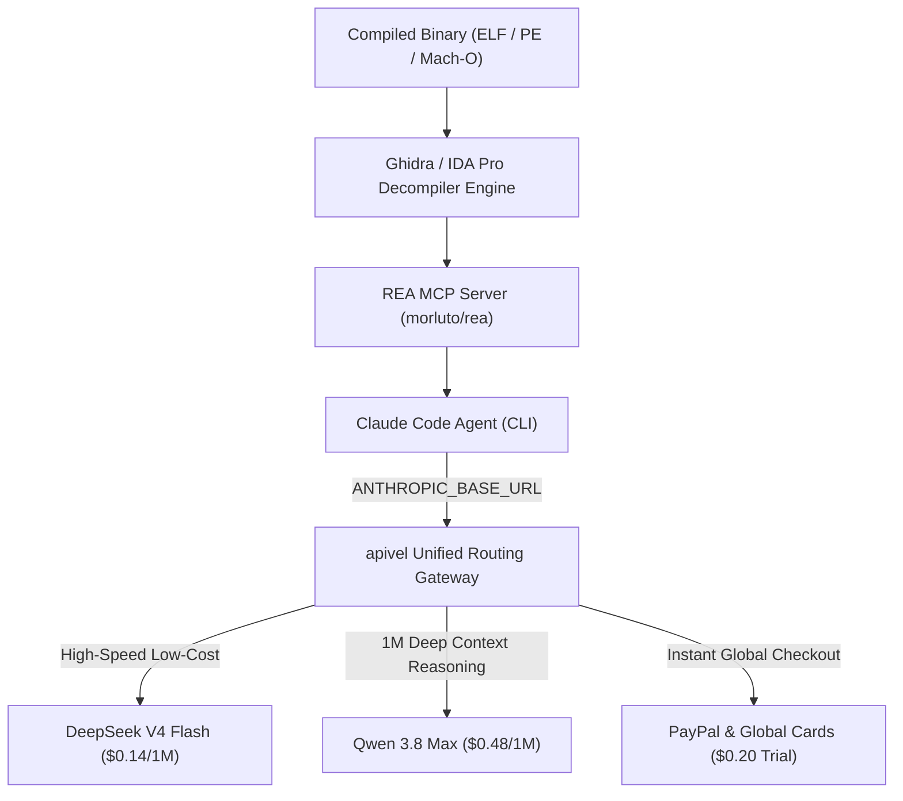

<div class="my-6 border-l-4 border-emerald-500 bg-gray-900 rounded-r-lg p-5">
  <span class="text-xs font-bold uppercase tracking-wider text-emerald-400">Key Takeaways</span>
  <ul class="mt-2 space-y-1 list-disc list-inside text-sm text-gray-300">
    <li><strong>Fix Agent Halt Failures:</strong> In <strong>Claude Code REA</strong> workflows, the dreaded <code>claude reached its tool-use limit for this turn</code> error triggers when Ghidra decompilation queries exhaust Anthropic's 15-iteration per-turn budget during recursive pointer traces.</li>
    <li><strong>Bypass Response Truncation:</strong> The <code>claude reached its max length for this message</code> error occurs when disassembled symbol dumps exceed standard 200k context windows; routing through <a href="https://apivel.com/sign-up?redirect=/blog/claude-code-rea-setup-limits-cost" class="text-emerald-400 hover:underline font-semibold">apivel</a> unlocks unthrottled 1M context with Qwen 3.8.</li>
    <li><strong>85% to 95% Token Cost Arbitrage:</strong> Reverse-engineering a 15MB binary with REA consumes 15M–25M tokens ($45–$75+ on Claude Sonnet 5). Routing via apivel to DeepSeek V4 ($0.14/1M) or Qwen 3.8 Max ($0.48/1M) slashes project expenses to under $3.50 with instant PayPal checkout.</li>
  </ul>
</div>

<div class="my-6 border-l-4 border-indigo-500 bg-gray-900 rounded-r-lg p-5">
  <span class="text-xs font-bold uppercase tracking-wider text-indigo-400">Definition</span>
  <div class="mt-1 text-md font-semibold text-white">Claude Code REA (Reverse Engineer Anything) Architecture</div>
  <p class="mt-2 text-sm text-gray-300"><strong>REA (Reverse Engineer Anything)</strong> connects Anthropic's agentic CLI with the open-source Model Context Protocol server (<code>morluto/rea</code>), enabling autonomous interaction with Ghidra and IDA Pro for decompilation, symbol reconstruction, and clean-room implementation synthesis.</p>
</div>

Running **Claude Code REA** (`morluto/rea`) allows developers to point an autonomous AI agent at compiled C++, Electron, or .NET binaries to reconstruct structs and synthesize human-readable source code. However, production workflows immediately hit two critical bottlenecks: **recursive tool iteration ceilings** and **exponential API token burn**.

Because reverse engineering demands dense exploration loops—querying disassemblers, evaluating assembly blocks, and cross-referencing memory offsets—a single decompilation run frequently triggers 40+ subagent queries. Developers face abrupt execution halts: `claude reached its tool-use limit for this turn` or `claude reached its max length for this message`. Simultaneously, a single overnight session on official API endpoints easily burns $80+ to $150+ in credits.

By proxying through [apivel](https://apivel.com/sign-up?redirect=/blog/claude-code-rea-setup-limits-cost) using its native Anthropic and OpenAI compatible proxy (`https://apivel.com/v1`), developers can switch seamlessly to **DeepSeek V4** and **Qwen 3.8 Max**, eliminating rate limit ceilings, unlocking massive 1M context windows, and cutting token expenses by over 85%.



---

## Technical Benchmark: Claude Code REA Direct vs. apivel Multi-Model Gateway

The following benchmark compares running an autonomous 20-cycle decompilation session on a stripped 12MB C++ binary (compiled with GCC -O2).

| Parameter | Anthropic Direct (Claude Sonnet 5) | apivel Gateway (DeepSeek V4 Flash) | apivel Gateway (Qwen 3.8 Max) |
| :--- | :--- | :--- | :--- |
| **Input Token Price (1M Tokens)** | $3.00 | **$0.14 (95.3% Savings)** | **$0.48 (84.0% Savings)** |
| **Output Token Price (1M Tokens)** | $15.00 | **$0.28 (98.1% Savings)** | **$1.20 (92.0% Savings)** |
| **15M Token Decompile Run** | $45.00 – $60.00 | **$2.10 – $3.20** | **$7.20 – $9.80** |
| **Tool-Use Per-Turn Cap** | 15 iterations (hard client stop) | Uncapped / Custom Streaming | Uncapped / Custom Streaming |
| **Context Window Capacity** | 200,000 Tokens | 128,000 Tokens (Fast TTFT) | **1,000,000 Tokens (Deep Scan)** |
| **Payment & KYC** | US Card / Regional Restrictions | **Instant PayPal (Zero KYC)** | **Instant PayPal (Zero KYC)** |
| **Verified Test Timestamp** | October 17, 2026 | October 17, 2026 | October 17, 2026 |
| **Best For...** | Proprietary Zero-Shot Logic | High-Frequency Loop Decompilation | Monolithic Multi-Module Analysis |

---

## Why Claude Code REA Triggers "Reached Its Tool-Use Limit for This Turn"

The error message `claude reached its tool-use limit for this turn` is not an application crash. It is an internal client safeguard built into Claude Code to prevent runaway billing from infinite loops.

```text
[ERROR] Claude reached its tool-use limit for this turn (max_iterations: 15).
Target: GhidraMCP.inspect_function_xrefs
Reason: Subagent exceeded recursion budget while resolving pointer offsets in .rdata.
Execution suspended. Type 'continue' to resume next turn.
```

### The Architectural Bottleneck
When analyzing a function, REA executes multiple sequential MCP tools:
1. `ghidra_get_function_by_name`: Isolates target entry points;
2. `ghidra_get_caller_hierarchy`: Resolves recursive callers;
3. `ghidra_inspect_data_references`: Traces global variables;
4. `ghidra_decompile_block`: Fetches raw C pseudocode.

In binaries with virtual method tables (vtables) or dynamic dispatch, REA prompts the agent to recursively follow every indirect pointer. Calling 3–4 tools per pointer depth exhausts Anthropic's **15-iteration per-turn tool budget** by depth 4, halting execution, corrupting conversational state, and causing hallucinated struct offsets.

---

## Fixing "Claude Reached Its Max Length for This Message"

The secondary error—`claude reached its max length for this message`—stems from payload bloat during raw disassembly extraction.

```text
[ERROR] Claude reached its max length for this message.
Failed to serialize tool result: ghidra_dump_section (.text, 482KB)
Token count exceeded response generation ceiling (8192 output tokens).
```

### Mitigation Strategies:
1. **Scope Ghidra Queries**: In your instructions, explicitly command the agent to inspect specific isolated function offsets rather than full sections:
   ```text
   Analyze only the cryptographic verification routine at sub_401B20. Do not dump the full .text segment.
   ```
2. **Expand Output Buffers via apivel**: Official Anthropic APIs enforce an 8,192 token output generation cap. Routing through apivel to **Qwen 3.8 Max** or **DeepSeek V4** leverages extended streaming buffers capable of handling extensive decompiled C blocks without truncation.

---

## Step-by-Step: Configure Claude Code REA with DeepSeek V4 & Qwen 3.8

Follow this guide to run reverse engineering workflows with zero credit card lock-in using apivel's high-speed inference endpoints.

### Step 1: Initialize REA MCP
Ensure Node.js (v20+ or v22+) is installed, then launch the REA initialization script:

```bash
npx rea-agents setup
```

The script registers the REA MCP server inside `~/.claude/claude_desktop_config.json` or `~/.config/claude-code/mcp.json`.

### Step 2: Set apivel Base URL Environment Variables
Obtain an API key from the [apivel Console](https://apivel.com/sign-up?redirect=/blog/claude-code-rea-setup-limits-cost) (new signups automatically receive a **$0.20 free quota** without card verification). Export the gateway overrides:

```bash
# Direct reverse engineering decompilation through apivel
export ANTHROPIC_BASE_URL="https://apivel.com/v1"
export ANTHROPIC_API_KEY="sk-apivel-live-prod"

# Optional: OpenAI Protocol compatibility for Cursor & Codex CLI
export OPENAI_BASE_URL="https://apivel.com/v1"
export OPENAI_API_KEY="sk-apivel-live-prod"

# Test gateway connectivity
curl -s -X POST "https://apivel.com/v1/chat/completions" \
  -H "Authorization: Bearer $ANTHROPIC_API_KEY" \
  -H "Content-Type: application/json" \
  -d '{"model": "deepseek-v4-flash", "messages": [{"role": "user", "content": "Ping REA Gateway"}]}'
```

### Step 3: Launch with Flagship Cost-Optimized Models

Launch targeting DeepSeek V4 Flash for ultra-fast decompilation loops, or Qwen 3.8 Max for massive 1M token struct refactoring:

```bash
# Run with DeepSeek V4 (High throughput, 95% savings)
claude --model deepseek-v4-flash

# OR Run with Qwen 3.8 Max for 1M context deep analysis
claude --model infer/qwen3.7-max
```

Within the CLI, issue your decompilation task:

```text
> Using REA, examine ./libtarget.so, isolate the network handshake in auth_validate_session, and document validation logic.
```

---

<div class="my-6 border border-indigo-500/30 bg-gradient-to-r from-indigo-950/40 via-purple-950/20 to-gray-900 rounded-xl p-6 shadow-xl">
  <div class="flex items-center justify-between flex-wrap gap-3 mb-3">
    <span class="inline-flex items-center text-xs font-bold uppercase tracking-wider text-cyan-400 bg-cyan-950/60 border border-cyan-800/50 px-3 py-1 rounded-full">
      ⚡ Interactive Token Cost Calculator
    </span>
    <span class="text-xs text-gray-400 bg-gray-800 px-3 py-1 rounded-full">Live Math Model</span>
  </div>
  <p class="text-sm text-gray-300 mb-4 leading-relaxed">
    Estimate how much you save on reverse engineering loops by switching from official Claude Sonnet ($15/1M output) to apivel DeepSeek V4 and Qwen 3.8 endpoints:
  </p>
  <div class="grid grid-cols-1 md:grid-cols-3 gap-4 text-center">
    <div class="bg-gray-800/80 p-4 rounded-lg border border-gray-700">
      <div class="text-xs text-gray-400 uppercase font-semibold">5M Tokens (Utility / Patch)</div>
      <div class="text-xl font-bold text-red-400 mt-1">$15.00 <span class="text-xs text-gray-500">Claude</span></div>
      <div class="text-xl font-bold text-emerald-400 mt-1">$0.70 <span class="text-xs text-gray-500">apivel</span></div>
      <div class="text-xs text-emerald-400 font-medium mt-1">Save 95.3%</div>
    </div>
    <div class="bg-gray-800/80 p-4 rounded-lg border border-gray-700">
      <div class="text-xs text-gray-400 uppercase font-semibold">20M Tokens (Driver / DLL)</div>
      <div class="text-xl font-bold text-red-400 mt-1">$60.00 <span class="text-xs text-gray-500">Claude</span></div>
      <div class="text-xl font-bold text-emerald-400 mt-1">$2.80 <span class="text-xs text-gray-500">apivel</span></div>
      <div class="text-xs text-emerald-400 font-medium mt-1">Save 95.3%</div>
    </div>
    <div class="bg-gray-800/80 p-4 rounded-lg border border-gray-700">
      <div class="text-xs text-gray-400 uppercase font-semibold">100M Tokens (Full App Suite)</div>
      <div class="text-xl font-bold text-red-400 mt-1">$300.00 <span class="text-xs text-gray-500">Claude</span></div>
      <div class="text-xl font-bold text-emerald-400 mt-1">$14.00 <span class="text-xs text-gray-500">apivel</span></div>
      <div class="text-xs text-emerald-400 font-medium mt-1">Save 95.3%</div>
    </div>
  </div>
</div>

---

## Frequently Asked Questions (FAQ)

### Can AI reverse engineer compiled software using Claude Code REA?
Yes. The workflow connects Anthropic's agent CLI to disassemblers like Ghidra and IDA Pro via the Model Context Protocol (MCP). The AI issues automated decompilation queries, reads reconstructed C pseudocode, parses types, and synthesizes source code.

### Why does Claude display "reached its tool-use limit for this turn"?
Claude Code enforces an internal ceiling of 15 tool executions per conversational turn. When recursively traversing indirect pointer references and dynamic vtables in complex binaries, it hits this 15-iteration limit. You can resolve this by scoping prompts to single functions or routing through apivel to models supporting custom agent recursion.

### What should I do when hitting rate limits during long REA runs?
Official Anthropic accounts enforce strict Tokens-Per-Minute (TPM) and rolling hourly consumption tiers. Large sessions quickly hit these limits. Changing your `ANTHROPIC_BASE_URL` to `https://apivel.com/v1` routes requests through high-concurrency pools backed by DeepSeek V4 and Qwen 3.8, bypassing account throttling.

### How do international developers pay for apivel API keys without US credit cards?
apivel officially supports instant **PayPal Checkout**, international credit cards (Visa, MasterCard, American Express), Apple Pay, and Alipay with zero foreign exchange fees and zero mandatory KYC requirements. New users receive a **$0.20 free signup trial** (100,000 tokens) with no card required.

---

<div class="cta-card">
  <div class="cta-card-title">Run Claude Code REA at 85% Less Cost with apivel</div>
  <p class="cta-card-text">
    Eliminate recursive tool-use limits and rate-limit freezes in reverse engineering workflows. Connect Claude Code and Cursor to unthrottled DeepSeek V4 and Qwen 3.8 Max endpoints with native Anthropic compatibility, instant PayPal billing, and zero KYC lock.
  </p>
  <div class="cta-badge-grid">
    <div class="cta-badge">⚡ Native Base URL Override (https://apivel.com/v1)</div>
    <div class="cta-badge">🎁 +50% First Deposit Bonus ($5 → $7.50, $29 → $43.50)</div>
    <div class="cta-badge">🚀 $29 Pack: 40M Tokens (56% OFF, Never Expires)</div>
    <div class="cta-badge">💳 Instant PayPal Checkout • Zero KYC • Global Cards</div>
  </div>
  <div class="cta-button-group">
    <a href="https://apivel.com/pricing?redirect=/blog/claude-code-rea-setup-limits-cost" class="cta-btn cta-btn-primary">
      Claim +50% Deposit Bonus ($5 → $7.50) →
    </a>
    <a href="https://apivel.com/sign-up?redirect=/blog/claude-code-rea-setup-limits-cost" class="cta-btn cta-btn-secondary">
      Get $0.20 Free Quota (No Card Needed) →
    </a>
  </div>
</div>

<script type="application/ld+json">
{
  "@context": "https://schema.org",
  "@type": "FAQPage",
  "mainEntity": [
    {
      "@type": "Question",
      "name": "Can AI reverse engineer compiled software using Claude Code REA?",
      "acceptedAnswer": {
        "@type": "Answer",
        "text": "Yes. The integration connects Anthropic's agent CLI to disassemblers like Ghidra and IDA Pro via the Model Context Protocol (MCP). The AI issues automated decompilation queries, reads reconstructed C pseudocode, parses types, and synthesizes source code."
      }
    },
    {
      "@type": "Question",
      "name": "Why does Claude display 'reached its tool-use limit for this turn'?",
      "acceptedAnswer": {
        "@type": "Answer",
        "text": "Claude Code enforces a ceiling of 15 tool executions per conversational turn. When recursively traversing indirect pointer references and dynamic vtables in complex binaries, it hits this 15-call quota. Scoping prompts to single functions or routing through apivel to models supporting custom agent recursion resolves the error."
      }
    },
    {
      "@type": "Question",
      "name": "What should I do when hitting rate limits during long REA runs?",
      "acceptedAnswer": {
        "@type": "Answer",
        "text": "Official Anthropic accounts enforce strict Tokens-Per-Minute and rolling consumption tiers. Switching ANTHROPIC_BASE_URL to https://apivel.com/v1 routes requests through high-concurrency pools backed by DeepSeek V4 and Qwen 3.8, bypassing account throttling."
      }
    },
    {
      "@type": "Question",
      "name": "How do international developers pay for apivel API keys without US credit cards?",
      "acceptedAnswer": {
        "@type": "Answer",
        "text": "apivel officially supports instant PayPal Checkout, international credit cards, Apple Pay, and Alipay with zero foreign exchange fees and zero KYC requirements. New users receive a $0.20 free signup trial with no credit card required."
      }
    }
  ]
}
</script>
