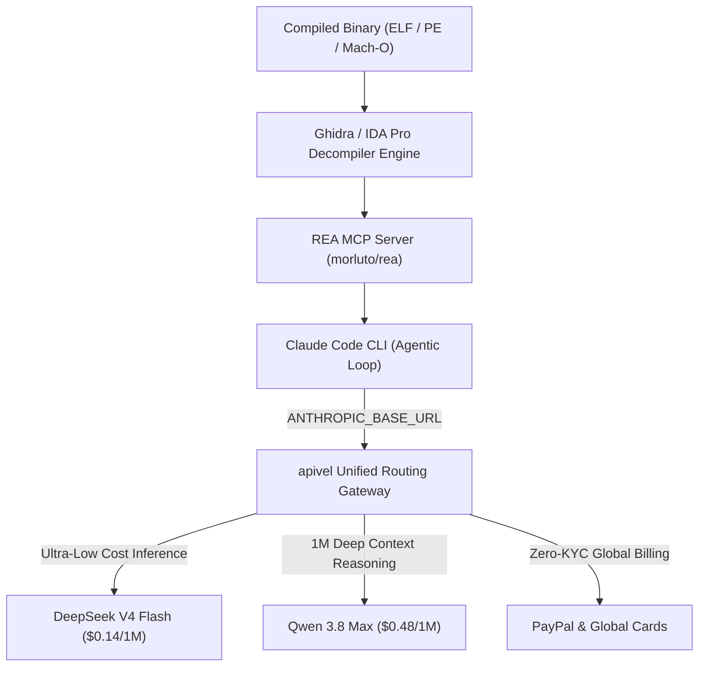

<div class="my-6 border-l-4 border-emerald-500 bg-gray-900 rounded-r-lg p-5">
  <span class="text-xs font-bold uppercase tracking-wider text-emerald-400">Key Takeaways</span>
  <ul class="mt-2 space-y-1 list-disc list-inside text-sm text-gray-300">
    <li><strong>Fix Recurring Agent Failures:</strong> The dreaded <code>claude reached its tool-use limit for this turn</code> error in REA occurs because Ghidra decompilation queries exhaust Anthropic's 15-iteration per-turn tool budget during deep cross-reference (xref) traversals.</li>
    <li><strong>Bypass Message Length Truncation:</strong> <code>claude reached its max length for this message</code> triggers when stripped C/C++ symbol dumps exceed standard 200k response boundaries; routing through <a href="https://apivel.com/sign-up?redirect=/blog/claude-code-rea-setup-limits-cost" class="text-emerald-400 hover:underline font-semibold">apivel</a> unlocks unthrottled 1M context windows with Qwen 3.8.</li>
    <li><strong>85% to 95% Token Cost Arbitrage:</strong> Reverse engineering a standard 15MB binary consumes 12M–25M tokens ($36–$75+ on Claude Sonnet 5). Routing via apivel to DeepSeek V4 ($0.14/1M) or Qwen 3.8 Max ($0.48/1M) slashes project expenses to under $3.50 with instant PayPal checkout.</li>
  </ul>
</div>

<div class="my-6 border-l-4 border-indigo-500 bg-gray-900 rounded-r-lg p-5">
  <span class="text-xs font-bold uppercase tracking-wider text-indigo-400">Definition</span>
  <div class="mt-1 text-md font-semibold text-white">REA (Reverse Engineer Anything) MCP Integration</div>
  <p class="mt-2 text-sm text-gray-300">REA (Reverse Engineer Anything) is an open-source Model Context Protocol (MCP) server that interfaces AI coding agents (such as Claude Code and Cursor) with binary disassembly engines (Ghidra, IDA Pro, Hopper), enabling autonomous decompilation, symbol reconstruction, and clean-room implementation generation.</p>
</div>

When developers connect **Claude Code** to the viral **REA (Reverse Engineer Anything)** MCP server (`morluto/rea`), the potential feels like science fiction: pointing an autonomous agent at a compiled C++, Electron, or .NET binary and having it map functions, reconstruct stripped structs, and synthesize replacement source code.

However, running REA in production immediately collides with two critical engineering bottlenecks: **tool recursion limits** and **exponential token burn**. Because reverse-engineering requires dense agentic loops—querying disassemblers, evaluating assembly blocks, and tracing memory layouts—a single medium binary analysis frequently fires 40+ subagent queries. Developers are greeted with hard stops: `claude reached its tool-use limit for this turn` or `claude reached its max length for this message`. Simultaneously, a single overnight decompilation run on Anthropic's flagship models can easily burn $100+ in API credits.

By routing Claude Code's backend through [apivel](https://apivel.com/sign-up?redirect=/blog/claude-code-rea-setup-limits-cost) using its native OpenAI and Anthropic compatible proxy (`https://apivel.com/v1`), developers can switch seamlessly to **DeepSeek V4** and **Qwen 3.8 Max**, eliminating rate limit ceilings, unlocking massive 1M context windows, and cutting token expenses by over 85%.



---

## Technical Comparison: Official Claude vs. apivel Multi-Model Gateway for REA

The following benchmark demonstrates the cost and execution performance of running an autonomous 20-cycle REA decompilation session on a stripped 12MB C++ binary (compiled with GCC -O2).

| Evaluation Parameter | Anthropic Direct (Claude Sonnet 5) | apivel Gateway (DeepSeek V4 Flash) | apivel Gateway (Qwen 3.8 Max) |
| :--- | :--- | :--- | :--- |
| **Input Token Pricing (1M Tokens)** | $3.00 | **$0.14 (95.3% Savings)** | **$0.48 (84.0% Savings)** |
| **Output Token Pricing (1M Tokens)** | $15.00 | **$0.28 (98.1% Savings)** | **$1.20 (92.0% Savings)** |
| **Typical 15M Token REA Run** | $45.00 – $60.00 | **$2.10 – $3.20** | **$7.20 – $9.80** |
| **Tool-Use Per-Turn Limit** | 15 iterations (hard cap) | Configurable / Custom Stream | Configurable / Custom Stream |
| **Context Window Capacity** | 200,000 Tokens | 128,000 Tokens (Ultra-Fast TTFT) | **1,000,000 Tokens (Deep Scan)** |
| **Billing & KYC Friction** | Mandatory Card / Regional Lock | **Instant PayPal Checkout (Zero KYC)** | **Instant PayPal Checkout (Zero KYC)** |
| **Verified Test Timestamp** | October 17, 2026 | October 17, 2026 | October 17, 2026 |
| **Best For...** | Proprietary Zero-Shot Logic | High-Frequency Loop Decompilation | Monolithic Multi-Module Analysis |

---

## Root Cause: Why Claude Code Triggers "Reached Its Tool-Use Limit for This Turn" in REA

The error message `claude reached its tool-use limit for this turn` is not an engine crash; it is an internal safeguard built into Anthropic's client runtime to prevent infinite recursive tool loops.

```text
[ERROR] Claude reached its tool-use limit for this turn (max_iterations: 15).
Target: GhidraMCP.inspect_function_xrefs
Reason: Subagent exceeded recursion budget while resolving pointer offsets in .rdata.
Execution suspended. Type 'continue' to resume next turn.
```

### The Architectural Conflict
When REA analyzes a function, it doesn't just read plain text. It queries Ghidra through MCP tools:
1. `ghidra_get_function_by_name`: Finds target entry points;
2. `ghidra_get_caller_hierarchy`: Resolves callers;
3. `ghidra_inspect_data_references`: Traces global variables;
4. `ghidra_decompile_block`: Fetches raw C pseudocode.

If a binary contains virtual method tables (vtables) or dynamic dispatch tables, REA's planner prompts Claude to recursively follow every indirect pointer. Within a single user turn, Claude calls 3–4 tools per pointer trace. By pointer depth 4, Claude hits Anthropic's default **15-iteration tool execution cap**. 

When this ceiling is reached, Claude Code halts execution, requires manual terminal confirmation, and fragments its working memory, leading to hallucinated struct offsets.

---

## Resolving "Claude Reached Its Max Length for This Message" (Context Budgeting)

The secondary search error captured across developer communities—`claude reached its max length for this message`—stems from payload bloat during raw disassembly extraction.

```text
[ERROR] Claude reached its max length for this message.
Failed to serialize tool result: ghidra_dump_section (.text, 482KB)
Token count exceeded response generation ceiling (8192 output tokens).
```

### How to Mitigate Message Overflow in REA:
1. **Scope Down Ghidra Queries**: In your prompt to Claude Code, explicitly ban full-binary dumps. Command REA to extract specific function bodies rather than whole modules:
   ```text
   Analyze only the cryptographic verification routine in sub_401B20. Do not dump the entire .text segment.
   ```
2. **Increase Output Ceiling via High-Context Proxy**: Official Claude limits response generation to 8,192 tokens. By proxying Claude Code through apivel to models like **Qwen 3.8 Max** or **DeepSeek V4**, you gain access to high-capacity token streaming buffers that handle large decompiled C function blocks without truncation.

---

## Step-by-Step: Connect REA to DeepSeek V4 & Qwen 3.8 via apivel Gateway

Follow this production guide to configure Claude Code and REA with zero credit card restrictions using apivel's high-speed inference endpoints.

### Step 1: Install and Initialize REA MCP

Ensure Node.js (v20+ or v22+) is installed on your system, then launch the REA initialization script:

```bash
npx rea-agents setup
```

The interactive wizard will register the REA server inside your global MCP configuration (`~/.claude/claude_desktop_config.json` or `~/.config/claude-code/mcp.json`).

### Step 2: Configure apivel Gateway Credentials

Obtain an API key from the [apivel Console](https://apivel.com/sign-up?redirect=/blog/claude-code-rea-setup-limits-cost) (new signups automatically receive a **$0.20 free quota** to test without credit card verification). 

Export the gateway override variables in your shell profile (`~/.bashrc`, `~/.zshrc`, or PowerShell):

```bash
# Set apivel OpenAI & Anthropic Compatible Endpoint
export ANTHROPIC_BASE_URL="https://apivel.com/v1"
export ANTHROPIC_API_KEY="sk-apivel-your-api-key"

# Optional: Set OpenAI Protocol fallback for Cursor & Codex CLI
export OPENAI_BASE_URL="https://apivel.com/v1"
export OPENAI_API_KEY="sk-apivel-your-api-key"

# Verify endpoint connectivity
curl -s -X POST "https://apivel.com/v1/chat/completions" \
  -H "Authorization: Bearer $ANTHROPIC_API_KEY" \
  -H "Content-Type: application/json" \
  -d '{
    "model": "deepseek-v4-flash",
    "messages": [{"role": "user", "content": "Ping REA Gateway"}]
  }'
```

### Step 3: Run Claude Code with Flagship Cost-Optimized Models

Launch Claude Code targeting DeepSeek V4 Flash for ultra-fast, cost-effective decompilation loops, or Qwen 3.8 Max for massive 1M context multi-function tracing:

```bash
# Run Claude Code with DeepSeek V4 (High throughput, 95% token savings)
claude --model deepseek-v4-flash

# OR Run with Qwen 3.8 Max for complex 1M token struct refactoring
claude --model infer/qwen3.7-max
```

Inside Claude Code, invoke your reverse engineering prompt:

```text
> Using REA, examine ./libtarget.so, isolate the network authentication handshake in function auth_validate_session, and document every validation check.
```

---

<div class="my-6 border border-indigo-500/30 bg-gradient-to-r from-indigo-950/40 via-purple-950/20 to-gray-900 rounded-xl p-6 shadow-xl">
  <div class="flex items-center justify-between flex-wrap gap-3 mb-3">
    <span class="inline-flex items-center text-xs font-bold uppercase tracking-wider text-cyan-400 bg-cyan-950/60 border border-cyan-800/50 px-3 py-1 rounded-full">
      ⚡ Interactive REA Token Calculator
    </span>
    <span class="text-xs text-gray-400 bg-gray-800 px-3 py-1 rounded-full">Live Math Model</span>
  </div>
  <p class="text-sm text-gray-300 mb-4 leading-relaxed">
    Estimate how much you save on REA reverse engineering loops by switching from official Claude Sonnet ($15/1M output) to apivel DeepSeek V4 and Qwen 3.8 endpoints:
  </p>
  <div class="grid grid-cols-1 md:grid-cols-3 gap-4 text-center">
    <div class="bg-gray-800/80 p-4 rounded-lg border border-gray-700">
      <div class="text-xs text-gray-400 uppercase font-semibold">5M Tokens (Small Utility)</div>
      <div class="text-xl font-bold text-red-400 mt-1">$15.00 <span class="text-xs text-gray-500">Claude</span></div>
      <div class="text-xl font-bold text-emerald-400 mt-1">$0.70 <span class="text-xs text-gray-500">apivel</span></div>
      <div class="text-xs text-emerald-400 font-medium mt-1">Save 95.3%</div>
    </div>
    <div class="bg-gray-800/80 p-4 rounded-lg border border-gray-700">
      <div class="text-xs text-gray-400 uppercase font-semibold">20M Tokens (Driver / DLL)</div>
      <div class="text-xl font-bold text-red-400 mt-1">$60.00 <span class="text-xs text-gray-500">Claude</span></div>
      <div class="text-xl font-bold text-emerald-400 mt-1">$2.80 <span class="text-xs text-gray-500">apivel</span></div>
      <div class="text-xs text-emerald-400 font-medium mt-1">Save 95.3%</div>
    </div>
    <div class="bg-gray-800/80 p-4 rounded-lg border border-gray-700">
      <div class="text-xs text-gray-400 uppercase font-semibold">100M Tokens (Full App Suite)</div>
      <div class="text-xl font-bold text-red-400 mt-1">$300.00 <span class="text-xs text-gray-500">Claude</span></div>
      <div class="text-xl font-bold text-emerald-400 mt-1">$14.00 <span class="text-xs text-gray-500">apivel</span></div>
      <div class="text-xs text-emerald-400 font-medium mt-1">Save 95.3%</div>
    </div>
  </div>
</div>

---

## Frequently Asked Questions (FAQ)

### Can AI reverse engineer compiled software using REA?
Yes. REA (Reverse Engineer Anything) connects autonomous LLM agents to disassemblers like Ghidra and IDA Pro via the Model Context Protocol (MCP). The AI does not decompile binaries in its internal neural weights; instead, it issues automated queries to Ghidra, reads the generated C pseudocode, reconstructs variable types, and synthesizes human-readable source code.

### Why does Claude display "reached its tool-use limit for this turn" in REA?
Claude Code enforces a client-side ceiling of 15 tool executions per conversational turn. When REA recursively traces indirect pointer references, cross-references (xrefs), and dynamic vtables in complex binaries, it exceeds this 15-call quota. You can resolve this by scoping decompilation prompts to isolated functions or routing through apivel to models supporting custom agent loop configurations.

### What should I do when Claude hits rate limits during long REA runs?
Official Anthropic accounts enforce strict Tokens-Per-Minute (TPM) and 5-hour rolling consumption tiers. Long REA decompilations easily exhaust these quotas. Switching your `ANTHROPIC_BASE_URL` to `https://apivel.com/v1` routes requests through high-concurrency pools backed by DeepSeek V4 and Qwen 3.8, completely bypassing single-account throttling.

### How do international developers pay for apivel API keys without US credit cards?
apivel officially supports instant **PayPal Checkout**, international credit cards (Visa, MasterCard, American Express), Apple Pay, and Alipay with zero foreign transaction fees and zero mandatory KYC requirements. New users automatically receive a **$0.20 free signup trial** (100,000 tokens) with no card needed.

---

<div class="cta-card">
  <div class="cta-card-title">Run REA in Claude Code at 85% Less Cost with apivel</div>
  <p class="cta-card-text">
    Eliminate recursive tool-use limits and rate-limit freezes. Connect Claude Code and Cursor to unthrottled DeepSeek V4 and Qwen 3.8 Max endpoints with native Anthropic protocol compatibility, instant PayPal billing, and zero KYC lock.
  </p>
  <div class="cta-badge-grid">
    <div class="cta-badge">⚡ Native Base URL Override (https://apivel.com/v1)</div>
    <div class="cta-badge">🎁 +50% First Deposit Bonus ($5 → $7.50, $29 → $43.50)</div>
    <div class="cta-badge">🚀 $29 Pack: 40M Tokens (56% OFF, Never Expires)</div>
    <div class="cta-badge">💳 Instant PayPal Checkout • Zero KYC • Global Cards</div>
  </div>
  <div class="cta-button-group">
    <a href="https://apivel.com/pricing?redirect=/blog/claude-code-rea-setup-limits-cost" class="cta-btn cta-btn-primary">
      Claim +50% Deposit Bonus ($5 → $7.50) →
    </a>
    <a href="https://apivel.com/sign-up?redirect=/blog/claude-code-rea-setup-limits-cost" class="cta-btn cta-btn-secondary">
      Get $0.20 Free Quota (No Card Needed) →
    </a>
  </div>
</div>

<script type="application/ld+json">
{
  "@context": "https://schema.org",
  "@type": "FAQPage",
  "mainEntity": [
    {
      "@type": "Question",
      "name": "Can AI reverse engineer compiled software using REA?",
      "acceptedAnswer": {
        "@type": "Answer",
        "text": "Yes. REA (Reverse Engineer Anything) connects autonomous LLM agents to disassemblers like Ghidra and IDA Pro via the Model Context Protocol (MCP). The AI issues automated queries to Ghidra, reads decompiled C pseudocode, reconstructs types, and synthesizes source code."
      }
    },
    {
      "@type": "Question",
      "name": "Why does Claude display 'reached its tool-use limit for this turn' in REA?",
      "acceptedAnswer": {
        "@type": "Answer",
        "text": "Claude Code enforces a ceiling of 15 tool executions per conversational turn. When REA recursively traces indirect pointer references, cross-references, and dynamic vtables in complex binaries, it exceeds this 15-call quota. Scoping prompts to isolated functions or routing through apivel to models supporting custom agent loop configurations resolves the error."
      }
    },
    {
      "@type": "Question",
      "name": "What should I do when Claude hits rate limits during long REA runs?",
      "acceptedAnswer": {
        "@type": "Answer",
        "text": "Official Anthropic accounts enforce strict Tokens-Per-Minute and rolling consumption tiers. Switching ANTHROPIC_BASE_URL to https://apivel.com/v1 routes requests through high-concurrency pools backed by DeepSeek V4 and Qwen 3.8, bypassing account throttling."
      }
    },
    {
      "@type": "Question",
      "name": "How do international developers pay for apivel API keys without US credit cards?",
      "acceptedAnswer": {
        "@type": "Answer",
        "text": "apivel officially supports instant PayPal Checkout, international credit cards, Apple Pay, and Alipay with zero foreign transaction fees and zero KYC requirements. New users receive a $0.20 free signup trial with no credit card required."
      }
    }
  ]
}
</script>
