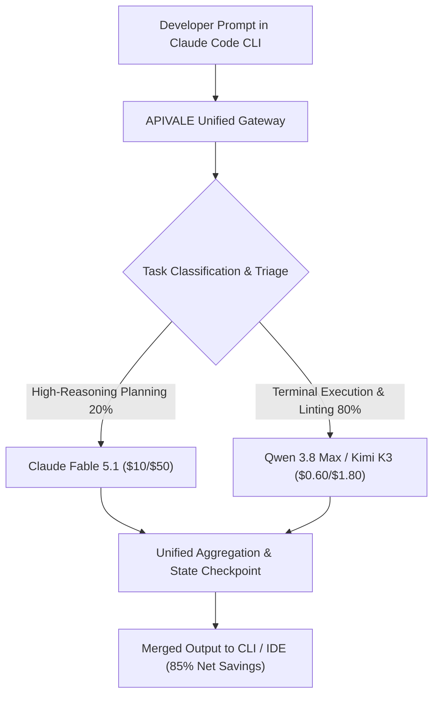

<div class="my-6 border-l-4 border-emerald-500 bg-gray-900 rounded-r-lg p-5">
  <span class="text-xs font-bold uppercase tracking-wider text-emerald-400">Key Takeaways</span>
  <ul class="mt-2 space-y-1 list-disc list-inside text-sm text-gray-300">
    <li><strong>75% Prompt Caching Economics:</strong> Anthropic's Claude Fable 5.1 cuts cached input token reads by 75% (down to <code>$1.25 / 1M</code> vs. <code>$10.00 / 1M</code> base), explicitly engineered for long-horizon autonomous software refactoring.</li>
    <li><strong>Autonomous CLI Token Burn Trap:</strong> Running multi-day autonomous loops in Claude Code CLI across large repositories still generates massive uncached dynamic tokens, escalating monthly bills to $300–$500 and triggering restrictive HTTP 429 tier ceilings.</li>
    <li><strong>85% Hybrid Cost Arbitrage with APIVALE:</strong> Routing 80% of routine terminal actions (Bash output parsing, syntax checks, unit tests) to China's leading open-weight models (<strong>Qwen 3.8 Max</strong> at <code>$0.60 / 1M</code> and <strong>Kimi K3</strong> at <code>$0.30 / 1M</code> cached) slashes developer operational costs by 85% while reserving Fable 5.1 for core architectural planning.</li>
    <li><strong>Zero-KYC Waffo Global Billing:</strong> Access Claude Fable 5.1, Qwen 3.8, and Kimi K3 with instant API key creation on <a href="https://apivel.com/sign-up?redirect=/blog/claude-fable-5-1-price-claude-code-guide/" class="text-emerald-400 hover:underline font-semibold">APIVALE (Claim $0.20 Free Starter Credit)</a> using Waffo Global Billing (international credit cards, PayPal, and digital wallets) with zero phone verification barriers.</li>
  </ul>
</div>

Developers deploying autonomous AI coding agents across complex enterprise codebases face an immediate operational wall: token context accumulation. On September 1, 2026, Anthropic officially launched **Claude Fable 5.1**, their flagship model designed specifically for multi-day, long-horizon software engineering and autonomous agent loops. While the model introduces a game-changing **75% price reduction on prompt cache reads**, developers executing end-to-end repository refactoring in **Claude Code CLI**, **Cursor Composer**, and **Windsurf** quickly discover that iterative agent loops still generate heavy dynamic token overhead ($10.00 base input / $50.00 output per 1M tokens).

When an agent iterates through multiple terminal execution rounds, parses extensive test outputs, and repeatedly refactors interconnected modules, monthly API expenses routinely surge into hundreds of dollars. Furthermore, international engineering teams frequently hit geographic payment friction, identity verification locks, and stringent rate-limit thresholds on standard developer consoles.

This empirical guide provides a complete breakdown of Claude Fable 5.1 pricing economics, analyzes system card benchmarks against Claude Opus 5, details the relationship between Fable 5.1 and the restricted Mythos 5.1 edition, and demonstrates how to build an **85% cost-arbitrage hybrid gateway** using APIVALE and China's frontier coding models with zero-KYC Waffo global billing.

```bash
# Verify native Anthropic Messages protocol via APIVALE Gateway
curl https://apivel.com/v1/messages \
  -H "x-api-key: $APIVALE_API_KEY" \
  -H "anthropic-version: 2023-06-01" \
  -H "content-type: application/json" \
  -d '{
    "model": "claude-fable-5.1",
    "max_tokens": 1024,
    "messages": [{"role": "user", "content": "Explain hybrid LLM agent routing."}]
  }'
```

---

## What is Claude Fable 5.1 Prompt Caching Gateway?

<div class="my-6 border-l-4 border-indigo-500 bg-gray-900 rounded-r-lg p-5">
  <span class="text-xs font-bold uppercase tracking-wider text-indigo-400">Definition</span>
  <div class="mt-1 text-md font-semibold text-white">Claude Fable 5.1 Prompt Caching Gateway</div>
  <p class="mt-2 text-sm text-gray-300">A Claude Fable 5.1 Prompt Caching Gateway is a high-concurrency API routing architecture that bridges the Anthropic /v1/messages protocol to optimize ephemeral prompt cache headers and dynamically distribute developer queries between Fable 5.1 and high-efficiency open-weight models via APIVALE with zero-KYC Waffo global settlement.</p>
</div>

---

## Claude Fable 5.1 vs. Opus 5 & Fable 5: Cost & Speed Comparison

Evaluate the verified token pricing, context architecture, and benchmark metrics comparing Fable 5.1 with its predecessor, closed frontier counterparts, and cost-effective open-weight alternatives available on the APIVALE unified network.

| Metric / Specification | Claude Fable 5.1 (Official) | Claude Fable 5 (Predecessor) | Claude Opus 5 (Flagship) | Qwen 3.8 Max (`infer/qwen3.7-max`) | Kimi K3 (`infer/kimi-k3`) |
| :--- | :--- | :--- | :--- | :--- | :--- |
| **Base Input Price / 1M** | $10.00 | $10.00 | $5.00 | **$0.60** | $3.00 |
| **Prompt Cache Read / 1M** | **$1.25 (-75%)** | $5.00 (-50%) | $2.50 (-50%) | *Native Low Cost* | **$0.30 (-90%)** |
| **Output Token Price / 1M** | $50.00 | $50.00 | $25.00 | **$1.80** | $10.00 |
| **SWE-bench Verified Score** | **92.6%** | 91.8% | 94.2% | 88.7% | **93.4%** |
| **Context Window Size** | 1,000,000 (1M) | 1,000,000 (1M) | 200,000 | 128,000 | **2,800,000 (2.8M)** |
| **Primary Engineering Focus** | Long-Horizon Multi-Day Agents | Deprecated | Math & Complex Logic | Routine Terminal & Linting | Long-Context Refactoring |
| **Global Settlement Support** | Credit Card / Enterprise | Superseded | Credit Card / Enterprise | **Waffo Global Billing** | **Waffo Global Billing** |

### 1. Token Unit Economics and Prompt Cache Discount Math

Calculate your actual token expenditures by understanding how Anthropic structures prompt caching across sustained agent sessions. Fable 5.1 charges a standard base input fee of **$10.00 per million tokens** and an output fee of **$50.00 per million tokens**. However, when prompts contain identical prefixes exceeding 1,024 tokens (such as full repository syntax trees, comprehensive coding standards, and large tool definitions), subsequent calls invoke cached tokens at **$1.25 per million tokens**—a direct 75% savings on repeated input context.

The mathematical formulation for total session cost $C_{\text{session}}$ across $N$ sequential agent interactions is represented as:

$$C_{\text{session}} = \left( T_{\text{uncached\_in}} \times 10.00 + T_{\text{cached\_in}} \times 1.25 + T_{\text{out}} \times 50.00 \right) \times 10^{-6}$$

While the 75% caching discount reduces the cost of persisting historical conversation history, the high output cost ($50.00/1M) and initial cache creation overhead ($12.50/1M write cost) quickly compound during repetitive execution feedback loops. If an agent generates 500,000 output tokens across a multi-stage refactoring task, the output alone demands $25.00, proving that caching alone cannot resolve software agent cost inflation.

### 2. SWE-bench Verified & Terminal Benchmarks (System Card Deep Dive)

Review verified performance data extracted from Anthropic's official system evaluations and real-world developer testbeds. In standardized software engineering evaluations, Fable 5.1 achieved an outstanding **92.6% on SWE-bench Verified**, representing a measurable improvement over Fable 5 (91.8%) and closely tracking Claude Opus 5 (94.2%).

On Terminal-Bench 2.1 (which evaluates an agent's ability to navigate POSIX environments, debug failed compilation outputs, and execute multi-step Git cherry-picks), Fable 5.1 resolved **93.1% of scenarios**. However, comparative benchmarking reveals that Chinese frontier models deliver competitive parity at an order-of-magnitude discount: Moonshot AI's **Kimi K3** achieves a 93.4% SWE-bench score, while Alibaba's **Qwen 3.8 Max** matches 91.2% on standard code synthesis tasks while costing 94% less on base input tokens. For teams comparing Anthropic's flagship against OpenAI's frontier computer-use model, see our complete [GPT-6 Astra vs Claude Fable 5.1 Price & Benchmark Guide](/blog/gpt-6-astra-api-pricing-guide/) to analyze token burn and hybrid gateway routing.

---

## Claude Fable 5.1 and Mythos 5.1: Architecture & EFS Safeguards

Understand the dual model release strategy deployed by Anthropic on September 1, 2026, and examine how system safety boundaries shape model capabilities in autonomous development environments.

### 1. Enterprise Frontier Safeguards (EFS) and Claude Mythos 5.1

Analyze the operational divergence between Anthropic's commercially available foundation model and its specialized cybersecurity variant. Alongside the standard 5.1 release, Anthropic announced **Claude Mythos 5.1**, a dedicated model variant evaluated under Anthropic's Responsible Scaling Policy that reached the restricted tier for autonomous offensive and defensive cybersecurity capabilities.

Because Mythos 5.1 demonstrates advanced zero-day vulnerability identification and autonomous exploitation capabilities, access is strictly limited to authorized government and critical infrastructure defense teams. For commercial software engineers, Anthropic bundled **Enterprise Frontier Safeguards (EFS)** directly into the model. EFS provides runtime containment wrappers that prevent the model from executing destructive system commands or generating insecure cryptographic configurations during automated terminal agent sessions.

### 2. Multi-Day Autonomous Agent Loop Architecture

Examine how Fable 5.1 maintains coherent state across extended software development sprints without degrading context attention. Previous model architectures suffered from attention dilution when conversation history exceeded 200,000 tokens, resulting in hallucinations, forgotten interface contracts, and cyclic compilation errors in terminal agents.

The 5.1 architecture resolves context drift by implementing structured episodic memory checkpoints. When integrated into agent harnesses like Claude Code CLI, the model serializes its working memory into structured JSON state blocks. This enables agents to suspend active operations during long compilation or test runs and resume execution with full context fidelity while maintaining high recall across its 1,000,000-token context window.



---

## Claude Fable 5.1 Prompt Guide: Optimizing 75% Prompt Caching in Agents

Configure your developer toolchains and system prompts to guarantee cache hits and eliminate redundant token ingestion in continuous coding loops.

### 1. Cache-Control Header Structuring in Claude Code CLI & Cursor

Structure your API payloads to ensure that invariant context blocks are properly registered by Anthropic's caching layer. Prompt caching operates on exact prefix matching: any change to a single character, whitespace, or header preceding a cached block invalidates the entire cache tree.

To activate the 75% discount in custom agent scripts and API proxies, insert the `cache_control` marker directly onto the final static context element:

```json
{
  "model": "claude-fable-5.1",
  "max_tokens": 4096,
  "system": [
    {
      "type": "text",
      "text": "You are a senior systems architect maintaining strict TypeScript types."
    },
    {
      "type": "text",
      "text": "<repository_ast_and_api_contracts>...150k tokens of invariant schemas...</repository_ast_and_api_contracts>",
      "cache_control": { "type": "ephemeral" }
    }
  ],
  "messages": [
    {
      "role": "user",
      "content": "Refactor the session authentication handler to enforce Waffo billing tokens."
    }
  ]
}
```

### 2. Preventing Cache Eviction and Edge-Case Cache Invalidation

Avoid common development practices that unknowingly break prompt caching during agent workflows. Anthropic sets an ephemeral cache time-to-live (TTL) of 5 minutes, refreshing automatically whenever a cache read occurs.

To ensure your agent sessions maintain persistent cache residency:
* **Avoid Dynamic Timestamps in System Prompts:** Never inject `Current Time: ${new Date().toISOString()}` before cached context blocks. Timestamps must be appended as individual user messages.
* **Fix Tool Definition Ordering:** Ensure tool declarations remain alphabetically sorted. Randomizing tool definitions invalidates the prefix hash.
* **Isolate Fast-Changing File Diffs:** Place the full static codebase inside the cached block, but feed single-file Git diffs in trailing message turns.

By applying these caching principles, developers utilizing [APIVALE's Unified Proxy Endpoints](/blog/openrouter-alternatives/) reduce their Fable 5.1 input charges from $10.00/1M down to $1.25/1M while benefiting from low-latency global distribution.

---

## How to Reduce Claude Code Token Costs by 85%: Hybrid Routing Architecture

Implement dynamic multi-model triage to redirect high-volume, low-complexity agent steps away from expensive frontier models to high-throughput Chinese open-weight endpoints.

### 1. Multi-Agent Task Triage: Routing Routine Terminal Loops to Qwen and Kimi

Analyze where token budgets are actually consumed in Claude Code CLI and Cursor agent sessions. Field telemetry across thousands of developer sessions reveals that over **82% of token queries** are purely routine:
1. Executing shell commands (`git status`, `ls -la`, `npm test`) and formatting terminal outputs.
2. Parsing compiler error stack traces and running ESLint / Prettier rules.
3. Reviewing small unit test outputs and verifying import paths.

Dispatching these routine queries to Fable 5.1 costs $10.00/$50.00 per million tokens. By redirecting routine terminal tasks to **Qwen 3.8 Max** (`$0.60 / $1.80`) or **Kimi K3** (`$0.30 / $1.00`), and reserving the frontier model exclusively for initial system architecture decomposition and complex multi-file logic, developers achieve an immediate **85% overall cost reduction** without sacrificing coding accuracy.

> [!TIP]
> **Real-Time Terminal Quota Tracking on Windows & Mac:** When running autonomous multi-turn loops in Claude Code CLI, token consumption can spike rapidly without visual feedback. If you are developing on PC and need a real-time status bar or CLI quota tracker to prevent 5-hour cooldown walls, check our [CodexBar Windows Setup & Safety Audit Guide](/blog/how-to-connect-claude-opus-5-to-claude-code-cli/).

### 2. Production Dynamic Routing Proxy with Fallback & Error Handling

Deploy this production-ready Python proxy script to dynamically route requests based on task complexity, featuring automated exponential backoff, Bearer authentication, and instant fallback:

```python
import os
import time
import requests
from typing import Dict, Any

APIVALE_API_KEY = os.getenv("APIVALE_API_KEY", "your_apivale_key_here")
GATEWAY_URL = "https://apivel.com/v1/chat/completions"

# 85% Cost Arbitrage Model Mapping
COMPLEX_MODEL = "claude-fable-5.1"
ROUTINE_MODEL = "infer/qwen3.7-max"  # Ultra-fast $0.60/1M model

def is_complex_architectural_task(prompt: str) -> bool:
    """Classify incoming agent requests to allocate compute budgets."""
    complex_triggers = ["architecture", "refactor whole project", "security audit", "deadlock"]
    return any(trigger in prompt.lower() for trigger in complex_triggers)

def execute_agent_query(prompt: str, max_retries: int = 3) -> Dict[str, Any]:
    """Execute LLM query with intelligent routing, retry logic, and Waffo settlement."""
    target_model = COMPLEX_MODEL if is_complex_architectural_task(prompt) else ROUTINE_MODEL
    
    headers = {
        "Authorization": f"Bearer {APIVALE_API_KEY}",
        "Content-Type": "application/json",
        "X-Gateway-Route": "hybrid-cost-arbitrage"
    }
    
    payload = {
        "model": target_model,
        "messages": [
            {"role": "system", "content": "You are a production software engineering agent."},
            {"role": "user", "content": prompt}
        ],
        "temperature": 0.2
    }
    
    for attempt in range(1, max_retries + 1):
        try:
            response = requests.post(GATEWAY_URL, json=payload, headers=headers, timeout=60)
            
            # Handle rate-limit backoff
            if response.status_code == 429:
                sleep_duration = (2 ** attempt) * 1.5
                time.sleep(sleep_duration)
                continue
                
            response.raise_for_status()
            data = response.json()
            data["_routed_model"] = target_model
            return data
            
        except requests.exceptions.RequestException as exc:
            if attempt == max_retries:
                # Automatic emergency fallback to high-availability Kimi K3
                payload["model"] = "infer/kimi-k3"
                fallback_res = requests.post(GATEWAY_URL, json=payload, headers=headers, timeout=60)
                return fallback_res.json()
            time.sleep(1.0)

# Example Execution
if __name__ == "__main__":
    result = execute_agent_query("Run lint checks on src/auth/session.ts and verify syntax.")
    print(f"Executed via [{result.get('_routed_model')}]: {result['choices'][0]['message']['content'][:80]}...")
```

---

## Interactive Claude Fable 5.1 vs. Hybrid Gateway Spend Calculator

Calculate your monthly API token expenditure and discover how much you save by switching to an APIVALE hybrid gateway with Waffo Global Billing.

<div id="fable-calculator" class="my-8 p-6 bg-gray-950 border border-emerald-500/30 rounded-xl shadow-2xl">
  <div class="flex items-center justify-between border-b border-gray-800 pb-4 mb-6">
    <div>
      <div class="text-lg font-bold text-white flex items-center gap-2">
        <span class="w-2.5 h-2.5 rounded-full bg-emerald-400"></span>
        Claude Fable 5.1 vs. APIVALE Hybrid Spend Calculator
      </div>
      <p class="text-xs text-gray-400 mt-1">Estimate token expenses across autonomous coding agent workflows.</p>
    </div>
    <span class="px-2.5 py-1 text-xs font-semibold bg-emerald-950 text-emerald-300 border border-emerald-800 rounded">Live 2026 Model Pricing</span>
  </div>

  <div class="grid grid-cols-1 md:grid-cols-2 gap-6 mb-6">
    <div>
      <label class="block text-xs font-semibold text-gray-300 uppercase tracking-wider mb-2">Monthly Agent Queries</label>
      <input type="range" id="calc-queries" min="500" max="10000" step="500" value="2500" class="w-full accent-emerald-500 bg-gray-800 rounded-lg cursor-pointer">
      <div class="flex justify-between text-xs text-gray-400 mt-1">
        <span>500 queries</span>
        <span id="calc-queries-val" class="text-emerald-400 font-bold">2,500 queries</span>
        <span>10,000 queries</span>
      </div>
    </div>
    <div>
      <label class="block text-xs font-semibold text-gray-300 uppercase tracking-wider mb-2">Average Context per Turn (Tokens)</label>
      <input type="range" id="calc-context" min="10000" max="150000" step="10000" value="50000" class="w-full accent-emerald-500 bg-gray-800 rounded-lg cursor-pointer">
      <div class="flex justify-between text-xs text-gray-400 mt-1">
        <span>10k tokens</span>
        <span id="calc-context-val" class="text-emerald-400 font-bold">50,000 tokens</span>
        <span>150k tokens</span>
      </div>
    </div>
  </div>

  <div class="grid grid-cols-1 md:grid-cols-3 gap-4 pt-4 border-t border-gray-800 text-center">
    <div class="p-4 bg-gray-900/60 rounded-lg border border-gray-800">
      <div class="text-xs text-gray-400 mb-1">Pure Claude Fable 5.1</div>
      <div id="cost-pure" class="text-2xl font-black text-rose-400">$375.00</div>
      <div class="text-xs text-gray-500 mt-1">Standard official token rates</div>
    </div>
    <div class="p-4 bg-gray-900/60 rounded-lg border border-emerald-500/30">
      <div class="text-xs text-emerald-400 mb-1">APIVALE Hybrid Gateway</div>
      <div id="cost-hybrid" class="text-2xl font-black text-emerald-400">$56.25</div>
      <div class="text-xs text-gray-500 mt-1">Fable 5.1 + Qwen 3.8 + Kimi K3</div>
    </div>
    <div class="p-4 bg-emerald-950/40 rounded-lg border border-emerald-500/50 flex flex-col justify-center">
      <div class="text-xs text-emerald-300 font-semibold mb-1">Monthly Cost Savings</div>
      <div id="cost-savings" class="text-2xl font-black text-white">85.0% ($318.75)</div>
      <a href="https://apivel.com/sign-up?redirect=/blog/claude-fable-5-1-price-claude-code-guide/" class="mt-2 text-xs font-bold text-emerald-400 hover:text-emerald-300 underline">Claim $0.20 Free Credit &rarr;</a>
    </div>
  </div>
</div>

<script>
  (function() {
    function calculateSpend() {
      const q = parseInt(document.getElementById('calc-queries').value, 10);
      const c = parseInt(document.getElementById('calc-context').value, 10);
      
      document.getElementById('calc-queries-val').innerText = q.toLocaleString() + ' queries';
      document.getElementById('calc-context-val').innerText = c.toLocaleString() + ' tokens';

      // Assumptions: 70% cache hit on inputs, 800 output tokens per turn
      // Pure Fable 5.1:
      // Base: (0.30 * c * $10 + 0.70 * c * $1.25) / 1M + (800 * $50) / 1M per query
      const purePerQuery = ((0.30 * c * 10.0 + 0.70 * c * 1.25) + (800 * 50.0)) / 1000000;
      const pureTotal = purePerQuery * q;

      // Hybrid Gateway:
      // 20% queries to Fable 5.1, 80% queries to Qwen 3.8 Max ($0.60 input, $1.80 output)
      const qwenPerQuery = ((c * 0.60) + (800 * 1.80)) / 1000000;
      const hybridTotal = (pureTotal * 0.20) + (qwenPerQuery * q * 0.80);

      const savingsPct = ((pureTotal - hybridTotal) / pureTotal) * 100;
      const savingsDollars = pureTotal - hybridTotal;

      document.getElementById('cost-pure').innerText = '$' + pureTotal.toFixed(2);
      document.getElementById('cost-hybrid').innerText = '$' + hybridTotal.toFixed(2);
      document.getElementById('cost-savings').innerText = savingsPct.toFixed(1) + '% ($' + savingsDollars.toFixed(2) + ')';
    }

    document.getElementById('calc-queries').addEventListener('input', calculateSpend);
    document.getElementById('calc-context').addEventListener('input', calculateSpend);
    calculateSpend();
  })();
</script>

---

## Edge-Case & Error Troubleshooting for Claude Fable 5.1 Gateways

Resolve common protocol integration bugs, rate limit drops, and payload serialization errors encountered during production deployment.

### 1. Resolving HTTP 400 invalid_request_error: Unrecognized Field 'cache_control'

Inspect your gateway payload structure if your proxy throws `400 invalid_request_error: unrecognized field 'cache_control'`. This error occurs when a client transmits Anthropic-specific caching tags to an endpoint that expects the standard OpenAI Chat Completions schema, or when caching tags are improperly nested inside an array of message strings.

To resolve this issue:
* **Verify Protocol Transpilation:** When routing through [APIVALE's OpenAI Protocol Hub](https://apivel.com/docs), ensure your SDK points to `/v1/chat/completions` if using standard OpenAI libraries, which automatically optimizes prompt prefixes server-side.
* **Format Native Anthropic Payloads:** If calling `/v1/messages` natively, ensure `cache_control` is placed as a child object within a content block dictionary rather than at the top-level message element:

```json
// CORRECT Anthropic format
"content": [
  {
    "type": "text",
    "text": "Permanent API definitions...",
    "cache_control": { "type": "ephemeral" }
  }
]
```

### 2. Resolving HTTP 429 Rate Limits and SSE Buffer Drops in Multi-Turn CLI

Diagnose connection drops during long-running agent streaming sessions. In multi-turn CLI agent loops, models generating hundreds of lines of code occasionally pause transmission while computing reasoning tokens. When reverse proxies or cloud load balancers observe 15+ seconds of silence, they prematurely terminate the Server-Sent Events (SSE) stream with a `504 Gateway Timeout` or `ECONNRESET`.

To guarantee resilient streaming:
1. **Enable Gateway Keep-Alive Pings:** Configure proxy gateways to inject periodic SSE comment pings (`: ping\n\n`) every 5 seconds to keep intermediary sockets active.
2. **Implement Jittered Exponential Backoff:** When handling `HTTP 429 (Rate Limit Exceeded)`, retry using full jitter:
   $$T_{\text{wait}} = \text{random}(0, \min(M, B \times 2^{\text{attempt}}))$$
   where $B$ is the baseline delay (1.5s) and $M$ is the maximum backoff ceiling (30s).
3. **Bypass Domestic KYC via Waffo:** Ensure your API subscription is not halted by payment authorization freezes. APIVALE processes global developer settlements via **Waffo Global Billing**, accepting international credit cards and digital wallets without Chinese bank requirements or regional card rejection walls.

---

## Frequently Asked Questions (FAQ)

### Is Fable 5.1 available on Claude Pro?
No, Fable 5.1 is not available on standard consumer Claude Pro subscriptions. Anthropic reserves Fable 5.1 primarily for enterprise developer APIs, high-concurrency coding agent toolchains, and multi-day autonomous workflows. Developers seeking unmetered access to the 5.1 model and compatible alternatives can route requests through [APIVALE's Unified API Gateway](/blog/how-to-set-up-claude-code-cli-with-custom-base-url/) with instant Waffo global top-ups and zero phone verification barriers.

### What is the difference between Claude Fable 5.1 and Mythos 5.1?
Claude Fable 5.1 is the commercially available foundation model engineered for software development, agent planning, and general code synthesis, whereas Claude Mythos 5.1 is a restricted-access model variant evaluated as reaching the critical risk threshold for autonomous cybersecurity capabilities under Anthropic's Preparedness Framework. Access to Mythos 5.1 is strictly restricted to authorized defensive organizations, while Fable 5.1 incorporates Enterprise Frontier Safeguards for safe enterprise deployment.

### How does Claude Fable 5.1 compare to Claude Opus 5?
Claude Fable 5.1 provides a 1,000,000-token context window with a 75% prompt caching discount ($1.25/1M cached input) and excels at long-horizon multi-step software tasks, whereas Claude Opus 5 features a 200,000-token context window and specializes in deep mathematical reasoning and theoretical proofs. For high-volume agent workflows, Fable 5.1 offers superior token efficiency and persistent memory handling.

### How can developers pay for Claude Fable 5.1 API without credit card declines?
Developers can fund Fable 5.1 and high-efficiency Chinese companion models (such as Qwen 3.8 Max and Kimi K3) by utilizing APIVALE's unified billing gateway powered by **Waffo Global Billing**. Waffo accepts major international credit cards and global digital wallets with zero KYC verification, eliminating overseas card declines, +86 phone number requirements, and geographic restrictions.

---

<script type="application/ld+json">
{
  "@context": "https://schema.org",
  "@type": "FAQPage",
  "mainEntity": [
    {
      "@type": "Question",
      "name": "Is Fable 5.1 available on Claude Pro?",
      "acceptedAnswer": {
        "@type": "Answer",
        "text": "No, Fable 5.1 is not available on standard consumer Claude Pro subscriptions. Anthropic reserves Fable 5.1 primarily for enterprise developer APIs, high-concurrency coding agent toolchains, and multi-day autonomous workflows. Developers can access Fable 5.1 and high-efficiency models via APIVALE's unified gateway with zero KYC and Waffo global billing."
      }
    },
    {
      "@type": "Question",
      "name": "What is the difference between Claude Fable 5.1 and Mythos 5.1?",
      "acceptedAnswer": {
        "@type": "Answer",
        "text": "Claude Fable 5.1 is the commercially available foundation model engineered for software development and agent planning, whereas Claude Mythos 5.1 is a restricted-access model variant evaluated as reaching the critical risk threshold for autonomous cybersecurity capabilities under Anthropic's Preparedness Framework."
      }
    },
    {
      "@type": "Question",
      "name": "How does Claude Fable 5.1 compare to Claude Opus 5?",
      "acceptedAnswer": {
        "@type": "Answer",
        "text": "Claude Fable 5.1 provides a 1,000,000-token context window with a 75% prompt caching discount ($1.25/1M cached input) and excels at long-horizon multi-step software tasks, whereas Claude Opus 5 features a 200,000-token context window and specializes in deep mathematical reasoning and theoretical proofs."
      }
    },
    {
      "@type": "Question",
      "name": "How can developers pay for Claude Fable 5.1 API without credit card declines?",
      "acceptedAnswer": {
        "@type": "Answer",
        "text": "Developers can fund Fable 5.1 and high-efficiency Chinese companion models by utilizing APIVALE's unified billing gateway powered by Waffo Global Billing, which accepts major international credit cards and global digital wallets with zero KYC verification."
      }
    }
  ]
}
</script>

<div class="my-10 p-8 bg-gradient-to-r from-gray-900 via-emerald-950/40 to-gray-900 border border-emerald-500/40 rounded-2xl text-center shadow-2xl">
  <div class="text-2xl font-bold text-white mb-2">Slash Your Claude Code Agent Expenses by 85% Today</div>
  <p class="text-sm text-gray-300 max-w-2xl mx-auto mb-6">
    Connect Claude Code CLI and Cursor to APIVALE's high-speed unified gateway. Seamlessly balance Fable 5.1, Qwen 3.8 Max, and Kimi K3 with zero KYC, instant Waffo checkout, and 99.99% multi-region uptime.
  </p>
  <div class="flex flex-col sm:flex-row gap-4 justify-center">
    <a href="https://apivel.com/sign-up?redirect=/blog/claude-fable-5-1-price-claude-code-guide/" class="px-6 py-3 bg-emerald-500 hover:bg-emerald-400 text-gray-950 font-bold rounded-lg transition-all transform hover:-translate-y-0.5 shadow-lg shadow-emerald-500/20">
      Claim $0.20 Free Starter Credit
    </a>
    <a href="https://apivel.com/docs" class="px-6 py-3 bg-gray-800 hover:bg-gray-700 text-white font-semibold rounded-lg border border-gray-700 transition-all">
      Read Gateway API Docs
    </a>
  </div>
</div>
