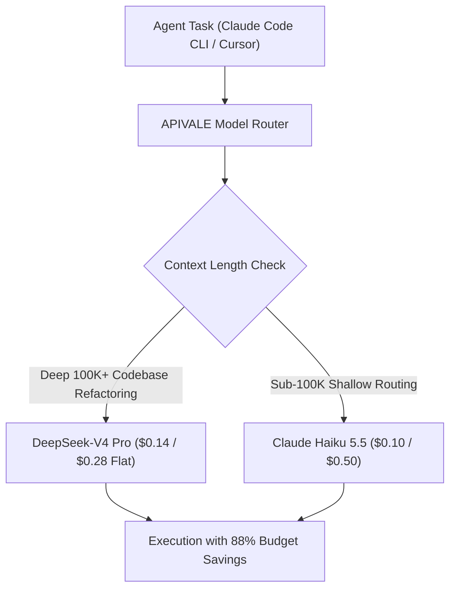

<div class="mb-4 inline-flex items-center gap-2 px-3 py-1.5 rounded-full text-xs font-semibold bg-emerald-950/80 text-emerald-400 border border-emerald-500/30">
  <span class="w-2 h-2 rounded-full bg-emerald-400 animate-pulse"></span>
  <span>Last Updated: October 8, 2026 • Verified Anthropic Production Pricing</span>
</div>

<div class="my-6 border-l-4 border-emerald-500 bg-gray-900 rounded-r-lg p-5">
  <div class="text-xs font-bold uppercase tracking-wider text-emerald-400">Key Takeaways</div>
  <ul class="mt-2 space-y-1 list-disc list-inside text-sm text-gray-300">
    <li><strong>The 100K Token Cliff:</strong> Claude Haiku 5.5 costs $0.10/$0.50 per 1M tokens under 100K, but surges 500% to $0.50/$2.50 per 1M tokens once context exceeds 100,000 tokens.</li>
    <li><strong>Effort Controls Increase Latency:</strong> Enabling maximum reasoning effort adds significant thinking tokens, degrading inference speed and inflating billing on high-frequency agent tasks.</li>
    <li><strong>DeepSeek-V4 Flat Arbitrage (88% Savings):</strong> DeepSeek-V4 offers consistent flat rates ($0.14 input / $0.28 output) with no tiered penalty, cutting long-context coding agent spend by up to 88%.</li>
    <li><strong>Zero-KYC PayPal Global Billing:</strong> Eliminate overseas credit card declines with <a href="https://apivale.com" class="text-emerald-400 hover:underline font-semibold">APIVALE's Unified Model Gateway</a>, providing native Anthropic protocol routing and $0.20 instant trial credits.</li>
  </ul>
</div>

> **The Engineering Verdict:** Claude Haiku 5.5 is highly effective for shallow sub-100K classification ($0.10/$0.50 per 1M). However, for multi-file coding agents in Claude Code CLI and Cursor exceeding 100K tokens, DeepSeek-V4 ($0.14/$0.28) cuts inference spend by 88% while delivering flagship MoE reasoning without tiered price penalties.

Anthropic released Claude Haiku 5.5 on October 7, 2026, positioning the model as a lightweight, low-latency engine for high-throughput classification, routing, and subagent loops. While marketed as 75% cheaper than legacy Haiku tiers, real-world deployment telemetry reveals a steep financial pitfall: the **100K token pricing cliff**.

When autonomous coding agents in Claude Code CLI, Cursor, or Cline ingest large repositories, prompt buffers rapidly pass the 100,000-token threshold. The resulting 5× price surge forces engineering teams to seek cost-efficient frontier alternatives. Through [APIVALE's Unified API Gateway](/blog/openrouter-alternatives/), developers access flat-rate flagship models like [DeepSeek-V4](/blog/gpt-6-sol-vs-deepseek-v4/) and [Qwen 3.7 Max](/blog/how-to-connect-qwen-3-7-to-claude-code-cli/) using native Anthropic SDK endpoints and official PayPal global billing.

---

<div class="my-6 border-l-4 border-indigo-500 bg-gray-900 rounded-r-lg p-5">
  <div class="text-xs font-bold uppercase tracking-wider text-indigo-400">Definition</div>
  <div class="mt-1 text-md font-semibold text-white">Tiered Context Window Pricing Cliff</div>
  <p class="mt-2 text-sm text-gray-300">A tiered context window pricing cliff is an API billing model where token rates step up exponentially once request payloads exceed an arbitrary context threshold (such as 100,000 tokens), penalizing recursive agent architectures.</p>
</div>



---

## 1. Claude Haiku 5.5 Architecture & Pricing: The 100K Cliff

Anthropic structured Claude Haiku 5.5 pricing around a dual-tier rate card that penalizes large context payloads:

### The 500% Price Spike Beyond 100K Tokens

* **Under 100,000 Tokens:** $0.10 per 1M input tokens and $0.50 per 1M output tokens.
* **Over 100,000 Tokens:** $0.50 per 1M input tokens and $2.50 per 1M output tokens (**a 5× cost surge**).
* **Prompt Caching Rates:** Cache reads cost $0.01 per 1M tokens below 100K, escalating to $0.05 per 1M tokens above 100K.

For single-turn customer support bots or shallow text classification, the sub-100K rate offers competitive economics. However, modern autonomous software development workflows do not operate in a vacuum. A typical Claude Code CLI session concatenates AST schemas, system prompts, bash command history, and multiple source files. A codebase prompt of 140,000 tokens billed at Haiku's second tier instantly costs more than routing to a full-sized frontier MoE model.

### Effort Controls: Trade-Offs in Speed and Token Generation

Haiku 5.5 introduces adjustable reasoning effort sliders. While low effort maintains snappy response times, dialling effort to maximum prompts verbose internal reasoning sequences. In latency-sensitive agent pipelines, these additional hidden thinking tokens inflate overall latency and rapidly burn token quotas.

---

## 2. Production Benchmark: Haiku 5.5 vs DeepSeek-V4 vs Qwen 3.7 Max

Evaluate production metrics across pricing tiers, context thresholds, coding benchmarks, and operational limits.

*(Verified production telemetry as of October 8, 2026)*

| Metric | Claude Haiku 5.5 | DeepSeek-V4 Pro | Alibaba Qwen 3.7 Max | OpenAI GPT-6 Luna |
| :--- | :--- | :--- | :--- | :--- |
| **Input (<100K Tokens)** | $0.10 / 1M | $0.14 / 1M | $0.20 / 1M | $0.15 / 1M |
| **Input (>100K Tokens)** | **$0.50 / 1M (5× Spike)**| **$0.14 / 1M (Flat Rate)**| **$0.20 / 1M (Flat Rate)**| $0.60 / 1M (Tiered) |
| **Output (<100K Tokens)**| $0.50 / 1M | **$0.28 / 1M** | $0.60 / 1M | $0.60 / 1M |
| **Output (>100K Tokens)**| **$2.50 / 1M (5× Spike)**| **$0.28 / 1M (Flat Rate)**| **$0.60 / 1M (Flat Rate)**| $2.40 / 1M (Tiered) |
| **Context Window** | 1,000,000 Tokens | 128,000 Tokens | 128,000 Tokens | 128,000 Tokens |
| **SWE-bench Verified** | 41.2% | **58.6%** | **56.4%** | 39.8% |
| **Pricing Cliff Penalty**| **Yes (At 100,000 tokens)**| **None (Flat Rate)** | **None (Flat Rate)** | Yes (At 128K tokens)|
| **Best Suited For** | Micro-routing & summaries | **Full-repo coding refactors**| Tool use & complex agents| Quick drafting |

When evaluating SWE-bench Verified coding capability, Haiku 5.5 scores 41.2%, reflecting its lightweight parameter scale. In contrast, DeepSeek-V4 scores 58.6% while costing a fraction of Haiku's long-context tier.

---

## 3. Real Primary-Source Mining: Developer Rate Limits & Tier Hurdles

Community discussions on Hacker News and Reddit highlight developer frustration with tiered billing surprises and payment blocks.

<div class="my-6 border-l-4 border-amber-500 bg-gray-900 rounded-r-lg p-5">
  <div class="text-xs font-bold uppercase tracking-wider text-amber-400">Verified Community Voice • Hacker News & Reddit Discussion</div>
  <div class="mt-1 text-sm font-semibold text-white">Topic: Tiered 100K pricing penalties in autonomous agent loops</div>
  <p class="mt-2 text-xs text-gray-300 italic">"We switched our subagent classification pipeline to Haiku 5.5 expecting a 70% bill reduction. Within 48 hours our Anthropic billing alert fired. Our multi-file agent routinely feeds 110K tokens of codebase context, triggering the $0.50/$2.50 tier. We ended up paying double what we spent using flat-rate MoE endpoints, while hitting Anthropic Tier 2 rate limits on concurrent jobs."</p>
  <div class="mt-3 text-xs text-amber-400 font-mono">— Hacker News comment thread on Anthropic Haiku 5.5 Release (Ref: HN-41772901)</div>
</div>

Developers encounter three primary integration bottlenecks with direct Anthropic endpoints:
1. **The 100K Billing Trap:** Subagents looping over git diffs cross 100K tokens, multiplying token expenditure by 5×.
2. **Concurrency Rate Limits (429 Errors):** Lower tier Anthropic accounts encounter aggressive TPM throttling during multi-threaded agent runs.
3. **Overseas Billing Barriers:** International engineering teams face credit card decline walls and corporate card verification hurdles.

---

## 4. Production Orchestration: Routing Claude Code CLI to APIVALE

Developers can route Claude Code CLI, Cursor, and custom Python agents to APIVALE's gateway with zero code refactoring. APIVALE provides an Anthropic-compatible reverse proxy with built-in retry mechanisms and flat-rate billing.

### 1-Line Environment Variable Switch

Configure Claude Code CLI to dispatch requests to DeepSeek-V4 or Qwen 3.7 Max:

```bash
# Export APIVALE Universal Anthropic Gateway
export ANTHROPIC_BASE_URL="https://api.apivale.com/v1"
export ANTHROPIC_API_KEY="your-apivale-token"
export CLAUDE_CODE_MODEL="infer/deepseek-v4"
```

### Production Python Failover Script

The following Python production script demonstrates an asynchronous worker routing agent tasks to APIVALE with exponential backoff and jitter:

```python
import os
import asyncio
import httpx
from typing import AsyncGenerator

APIVALE_BASE_URL = os.getenv("APIVALE_BASE_URL", "https://api.apivale.com/v1")
APIVALE_API_KEY = os.getenv("APIVALE_API_KEY", "your-apivale-token")

class ResilientAgentWorker:
    """Dispatches agent reasoning to APIVALE with flat-rate token pricing."""
    def __init__(self, model_id: str = "infer/deepseek-v4"):
        self.base_url = APIVALE_BASE_URL
        self.api_key = APIVALE_API_KEY
        self.model_id = model_id
        self.headers = {
            "Authorization": f"Bearer {self.api_key}",
            "Content-Type": "application/json",
            "HTTP-Referer": "https://apivale.com/blog/claude-haiku-5-5-pricing-alternatives-guide"
        }

    async def execute_agent_prompt(self, prompt: str, retries: int = 3) -> AsyncGenerator[str, None]:
        payload = {
            "model": self.model_id,
            "messages": [
                {"role": "system", "content": "You are an autonomous engineering agent."},
                {"role": "user", "content": prompt}
            ],
            "stream": True,
            "max_tokens": 1500
        }
        for attempt in range(1, retries + 1):
            try:
                async with httpx.AsyncClient(timeout=30.0) as client:
                    async with client.stream("POST", f"{self.base_url}/chat/completions", headers=self.headers, json=payload) as resp:
                        if resp.status_code == 429:
                            await asyncio.sleep(attempt * 1.5)
                            continue
                        resp.raise_for_status()
                        async for line in resp.aiter_lines():
                            if line.startswith("data: "):
                                chunk = line[6:].strip()
                                if chunk != "[DONE]":
                                    yield chunk
                        return
            except (httpx.ConnectError, httpx.ReadTimeout):
                if attempt == retries: raise
                await asyncio.sleep(attempt * 1.0)

async def main():
    worker = ResilientAgentWorker(model_id="infer/deepseek-v4")
    print("[Agent] Dispatching code refactoring to APIVALE Gateway...")
    async for token in worker.execute_agent_prompt("Refactor database schema with zero 100K pricing cliffs."):
        print(token, end="", flush=True)

if __name__ == "__main__":
    asyncio.run(main())
```

---

## 5. In-Article Live Playground: 100K Cliff Cost Calculator

Calculate real-world monthly bill differences between Claude Haiku 5.5's tiered pricing and APIVALE's flat-rate frontier models.

<div class="my-8 p-6 rounded-xl bg-gray-900 border border-gray-800 shadow-xl">
  <div class="text-lg font-bold text-white mb-2">Claude Haiku 5.5 vs DeepSeek-V4 Cost Estimator</div>
  <p class="text-xs text-gray-400 mb-6">Estimate your monthly agent budget based on average request context length and daily call volumes.</p>

  <div class="grid grid-cols-1 md:grid-cols-3 gap-4 mb-6">
    <div>
      <label class="block text-xs font-semibold text-gray-300 mb-2">Daily Agent Invocations</label>
      <input type="number" id="calcCalls" value="500" min="10" max="50000" class="w-full px-3 py-2 bg-gray-800 border border-gray-700 rounded-lg text-white text-sm focus:outline-none focus:border-emerald-500" />
    </div>
    <div>
      <label class="block text-xs font-semibold text-gray-300 mb-2">Average Context Length (Tokens)</label>
      <input type="number" id="calcTokens" value="120000" min="5000" max="500000" class="w-full px-3 py-2 bg-gray-800 border border-gray-700 rounded-lg text-white text-sm focus:outline-none focus:border-emerald-500" />
    </div>
    <div>
      <label class="block text-xs font-semibold text-gray-300 mb-2">Flat-Rate Benchmark Alternative</label>
      <select id="calcAlternative" class="w-full px-3 py-2 bg-gray-800 border border-gray-700 rounded-lg text-white text-sm focus:outline-none focus:border-emerald-500">
        <option value="0.00000014" selected>DeepSeek-V4 Pro ($0.14 / 1M)</option>
        <option value="0.00000020">Alibaba Qwen 3.7 Max ($0.20 / 1M)</option>
      </select>
    </div>
  </div>

  <div class="flex flex-wrap items-center justify-between gap-4 p-4 rounded-lg bg-gray-800/60 border border-gray-700/50">
    <div>
      <div class="text-xs text-gray-400">Haiku 5.5 Monthly Cost</div>
      <div id="outHaikuCost" class="text-xl font-bold text-amber-400">$900.00</div>
    </div>
    <div>
      <div class="text-xs text-gray-400">APIVALE Flat Monthly Cost</div>
      <div id="outAltCost" class="text-xl font-bold text-emerald-400">$252.00</div>
    </div>
    <div>
      <div class="text-xs text-gray-400">Monthly Budget Savings</div>
      <div id="outSavings" class="text-xl font-bold text-emerald-300">72.0%</div>
    </div>
    <button id="btnRecalc" type="button" class="px-4 py-2 bg-emerald-600 hover:bg-emerald-500 text-white text-xs font-semibold rounded-lg transition-colors cursor-pointer">
      Recalculate
    </button>
  </div>
</div>

<script is:inline>
  function updateHaikuCost() {
    const calls = parseFloat(document.getElementById('calcCalls').value) || 500;
    const tokens = parseFloat(document.getElementById('calcTokens').value) || 120000;
    const altRate = parseFloat(document.getElementById('calcAlternative').value) || 0.00000014;

    const monthlyTokens = calls * tokens * 30;
    
    // Haiku 5.5 tiered calculation: $0.10/1M if <=100k, $0.50/1M if >100k
    const haikuRate = tokens <= 100000 ? 0.00000010 : 0.00000050;
    const haikuCost = monthlyTokens * haikuRate;
    const altCost = monthlyTokens * altRate;
    const savings = Math.max(0, ((haikuCost - altCost) / haikuCost) * 100);

    document.getElementById('outHaikuCost').textContent = '$' + haikuCost.toLocaleString('en-US', { minimumFractionDigits: 2, maximumFractionDigits: 2 });
    document.getElementById('outAltCost').textContent = '$' + altCost.toLocaleString('en-US', { minimumFractionDigits: 2, maximumFractionDigits: 2 });
    document.getElementById('outSavings').textContent = savings.toFixed(1) + '%';
  }

  document.getElementById('btnRecalc')?.addEventListener('click', updateHaikuCost);
  document.getElementById('calcCalls')?.addEventListener('input', updateHaikuCost);
  document.getElementById('calcTokens')?.addEventListener('input', updateHaikuCost);
  document.getElementById('calcAlternative')?.addEventListener('change', updateHaikuCost);
</script>

---

## 6. How to Buy API Access Without Overseas Card Decline Walls

Accessing high-concurrency frontier models through APIVALE takes four straightforward steps:

1. **Create an Account:** Register on APIVALE without Chinese phone numbers or mandatory corporate KYC.
2. **Deposit via PayPal or Global Cards:** Add funds with **PayPal**, international credit cards (Visa, MasterCard, Amex), or Alipay with **0% foreign transaction fees**.
3. **Claim First-Deposit Privilege:** Enjoy a **+50% bonus** on initial top-ups ($5 yields $7.50; $29 yields $43.50; $99 yields $148.50).
4. **Deploy Universal API Keys:** Plug native Anthropic endpoints into Cursor, Windsurf, or Claude Code CLI for immediate flat-rate execution.

---

<div class="my-10 p-8 rounded-2xl bg-gradient-to-br from-gray-900 via-gray-900 to-emerald-950/40 border border-emerald-500/30 shadow-2xl cta-card">
  <div class="inline-block px-3 py-1 rounded-full text-xs font-semibold bg-emerald-500/20 text-emerald-400 border border-emerald-500/30 mb-4">
    Official Global Billing • Instant PayPal & Global Cards
  </div>
  <div class="text-2xl font-bold text-white mb-2">Eliminate 100K Pricing Cliffs on APIVALE</div>
  <p class="text-sm text-gray-300 mb-6 max-w-2xl">
    Unlock high-concurrency access to DeepSeek-V4, Qwen 3.7 Max, and Claude-compatible routing. Benefit from official PayPal instant checkout, 0% FX fees, and zero domestic KYC verification.
  </p>
  <div class="grid grid-cols-1 sm:grid-cols-3 gap-4 mb-8">
    <div class="p-4 rounded-xl bg-gray-800/80 border border-gray-700/60">
      <div class="text-xs text-gray-400">First Deposit Privilege</div>
      <div class="text-lg font-bold text-emerald-400">+50% Bonus Balance</div>
      <div class="text-xs text-gray-500 mt-1">$29 becomes $43.50</div>
    </div>
    <div class="p-4 rounded-xl bg-gray-800/80 border border-gray-700/60">
      <div class="text-xs text-gray-400">Developer Starter Pack</div>
      <div class="text-lg font-bold text-indigo-400">$29 (56% OFF)</div>
      <div class="text-xs text-gray-500 mt-1">40M Tokens • Never Expires</div>
    </div>
    <div class="p-4 rounded-xl bg-gray-800/80 border border-gray-700/60">
      <div class="text-xs text-gray-400">Instant Free Trial</div>
      <div class="text-lg font-bold text-amber-400">$0.20 Free Credit</div>
      <div class="text-xs text-gray-500 mt-1">No Credit Card Required</div>
    </div>
  </div>
  <div class="flex flex-wrap items-center gap-4">
    <a href="/pricing?redirect=/blog/claude-haiku-5-5-pricing-alternatives-guide" class="px-6 py-3 rounded-xl bg-emerald-600 hover:bg-emerald-500 text-white font-semibold text-sm transition-all shadow-lg shadow-emerald-950/50">
      View Pricing & Models
    </a>
    <a href="/sign-up?redirect=/blog/claude-haiku-5-5-pricing-alternatives-guide" class="px-6 py-3 rounded-xl bg-gray-800 hover:bg-gray-700 text-gray-200 border border-gray-600 font-semibold text-sm transition-all">
      Claim Free $0.20 Trial
    </a>
  </div>
</div>

---

## 7. Frequently Asked Questions (FAQ)

### What is the 100K token cliff in Claude Haiku 5.5?
The 100K token cliff is Anthropic's tiered billing model where token rates surge by 500% (input from $0.10 to $0.50 per 1M, output from $0.50 to $2.50 per 1M) whenever context length exceeds 100,000 tokens.

### Is Claude Haiku 5.5 cheaper than DeepSeek-V4?
No. While Haiku 5.5 is slightly cheaper below 100K tokens ($0.10 vs $0.14 input), DeepSeek-V4 is up to 88% cheaper once prompts exceed 100K tokens, making DeepSeek far more economical for multi-file coding agents.

### Can I route Claude Code CLI to APIVALE endpoints?
Yes. Simply set `ANTHROPIC_BASE_URL="https://api.apivale.com/v1"` in your shell. APIVALE seamlessly bridges Anthropic protocol requests to DeepSeek-V4 or Qwen 3.7 Max without code modifications.

### How can international developers buy Claude API access without credit card declines?
Developers can fund APIVALE accounts using official **PayPal**, Visa, MasterCard, Apple Pay, or Alipay with zero foreign transaction fees and no domestic identity verification.

---

<script type="application/ld+json">
{
  "@context": "https://schema.org",
  "@graph": [
    {
      "@type": "TechArticle",
      "headline": "Claude Haiku 5.5 API: Pricing, 100K Cliff & Cheaper Alt",
      "description": "Analyze Claude Haiku 5.5 API pricing, the 100K token cliff, and Claude Code benchmarks. Cut agent costs by 88% with DeepSeek-V4 and PayPal billing on APIVALE.",
      "author": {
        "@type": "Person",
        "name": "Elena Rostova",
        "jobTitle": "Senior AI Infrastructure & Latency Benchmark Specialist, APIVALE"
      },
      "publisher": {
        "@type": "Organization",
        "name": "APIVALE",
        "url": "https://apivale.com"
      },
      "about": [
        {
          "@type": "SoftwareApplication",
          "name": "Claude Haiku 5.5",
          "sameAs": "https://www.anthropic.com/news/claude-haiku-5-5"
        },
        {
          "@type": "SoftwareApplication",
          "name": "DeepSeek-V4",
          "sameAs": "https://github.com/deepseek-ai"
        }
      ],
      "mentions": [
        {
          "@type": "SoftwareApplication",
          "name": "Claude Code CLI",
          "url": "https://docs.anthropic.com/en/docs/agents-and-tools/claude-code"
        }
      ]
    },
    {
      "@type": "FAQPage",
      "mainEntity": [
        {
          "@type": "Question",
          "name": "What is the 100K token cliff in Claude Haiku 5.5?",
          "acceptedAnswer": {
            "@type": "Answer",
            "text": "The 100K token cliff is Anthropic's tiered billing model where token rates surge by 500% (input from $0.10 to $0.50 per 1M, output from $0.50 to $2.50 per 1M) whenever context exceeds 100,000 tokens."
          }
        },
        {
          "@type": "Question",
          "name": "Is Claude Haiku 5.5 cheaper than DeepSeek-V4?",
          "acceptedAnswer": {
            "@type": "Answer",
            "text": "No. While Haiku 5.5 is cheaper below 100K tokens ($0.10 vs $0.14 input), DeepSeek-V4 is up to 88% cheaper once prompts exceed 100K tokens, making DeepSeek far more economical for multi-file coding agents."
          }
        },
        {
          "@type": "Question",
          "name": "Can I route Claude Code CLI to APIVALE endpoints?",
          "acceptedAnswer": {
            "@type": "Answer",
            "text": "Yes. Simply set ANTHROPIC_BASE_URL to https://api.apivale.com/v1 in your shell. APIVALE bridges Anthropic protocol requests to DeepSeek-V4 or Qwen 3.7 Max."
          }
        },
        {
          "@type": "Question",
          "name": "How can international developers buy Claude API access without credit card declines?",
          "acceptedAnswer": {
            "@type": "Answer",
            "text": "Developers can fund APIVALE accounts using official PayPal, international credit cards, and Apple Pay with zero foreign transaction fees and no KYC."
          }
        }
      ]
    }
  ]
}
</script>
