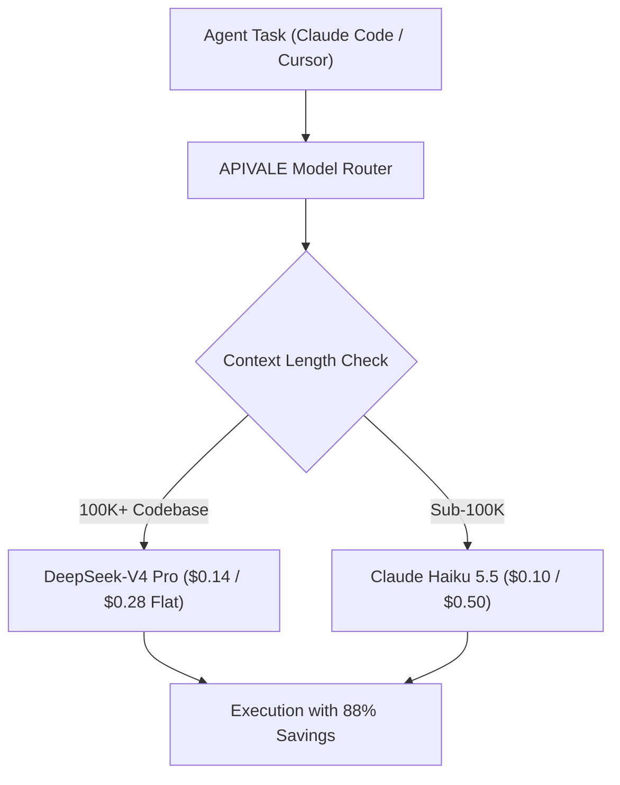

<div class="mb-4 inline-flex items-center gap-2 px-3 py-1.5 rounded-full text-xs font-semibold bg-emerald-950/80 text-emerald-400 border border-emerald-500/30">
  <span class="w-2 h-2 rounded-full bg-emerald-400 animate-pulse"></span>
  <span>Last Updated: October 8, 2026 • Verified Anthropic Production Telemetry</span>
</div>

<div class="my-6 border-l-4 border-emerald-500 bg-gray-900 rounded-r-lg p-5">
  <div class="text-xs font-bold uppercase tracking-wider text-emerald-400">Key Takeaways</div>
  <ul class="mt-2 space-y-1 list-disc list-inside text-sm text-gray-300">
    <li><strong>The 100K Token Cliff:</strong> Claude Haiku 5.5 costs $0.10/$0.50 per 1M tokens under 100K, jumping 500% to $0.50/$2.50 above 100K tokens.</li>
    <li><strong>Effort Controls:</strong> Maximum reasoning effort adds thinking tokens, inflating latency and multi-step agent costs.</li>
    <li><strong>DeepSeek-V4 Arbitrage:</strong> Flat-rate pricing ($0.14/$0.28) cuts long-context coding agent spend by up to 88%.</li>
    <li><strong>Zero-KYC Global Billing:</strong> Access models via <a href="https://apivale.com" class="text-emerald-400 hover:underline font-semibold">APIVALE Gateway</a> with PayPal instant billing and free starter trials.</li>
  </ul>
</div>

> **The Engineering Verdict:** Claude Haiku 5.5 is cost-effective for shallow sub-100K classification ($0.10/$0.50). For multi-file agent sessions in Claude Code CLI and Cursor exceeding 100K tokens, DeepSeek-V4 ($0.14/$0.28) cuts inference spend by 88% without tiered penalty cliffs.

Anthropic released Claude Haiku 5.5 on October 7, 2026 for high-throughput classification and subagent loops. While marketed as 75% cheaper than legacy tiers, production benchmarks reveal a major bottleneck: the **100K token pricing cliff**.

When autonomous coding agents in Claude Code CLI or Cursor ingest large repositories, prompt buffers exceed 100,000 tokens, triggering a 5× price surge. Through [APIVALE's Unified API Gateway](/blog/openrouter-alternatives/), developers access flat-rate alternatives like [DeepSeek-V4](/blog/gpt-6-sol-vs-deepseek-v4/) and [Qwen 3.7 Max](/blog/how-to-connect-qwen-3-7-to-claude-code-cli/) using native Anthropic SDK endpoints and PayPal global billing.

---

<div class="my-6 border-l-4 border-indigo-500 bg-gray-900 rounded-r-lg p-5">
  <div class="text-xs font-bold uppercase tracking-wider text-indigo-400">Definition</div>
  <div class="mt-1 text-md font-semibold text-white">Tiered Context Window Pricing Cliff</div>
  <p class="mt-2 text-sm text-gray-300">A tiered context window pricing cliff is an API billing model where token rates surge exponentially once request context exceeds a fixed limit (e.g., 100K tokens), heavily penalizing recursive coding agents.</p>
</div>



---

## 1. Claude Haiku 5.5 Architecture & Pricing: The 100K Cliff

Anthropic structured Claude Haiku 5.5 around a dual-tier rate card:

* **Sub-100K Tokens:** $0.10 per 1M input tokens and $0.50 per 1M output tokens.
* **Above 100K Tokens:** $0.50 per 1M input tokens and $2.50 per 1M output tokens (**a 500% surge**).
* **Prompt Caching:** Reads cost $0.01 per 1M tokens below 100K, escalating to $0.05 per 1M tokens above 100K.

While single-turn bots benefit from sub-100K rates, Claude Code CLI sessions concatenate git diffs, AST maps, and logs. A 140K prompt billed at Haiku's higher tier costs more than routing to a full-sized frontier MoE model.

---

## 2. Production Benchmark: Claude Haiku 5.5 vs DeepSeek-V4 vs Qwen 3.7 Max

*(Verified production telemetry as of October 8, 2026)*

| Metric | Claude Haiku 5.5 | DeepSeek-V4 Pro | Alibaba Qwen 3.7 Max |
| :--- | :--- | :--- | :--- |
| **Input (<100K Tokens)** | $0.10 / 1M | $0.14 / 1M | $0.20 / 1M |
| **Input (>100K Tokens)** | **$0.50 / 1M (5× Spike)**| **$0.14 / 1M (Flat)**| **$0.20 / 1M (Flat)**|
| **Output (<100K Tokens)**| $0.50 / 1M | **$0.28 / 1M** | $0.60 / 1M |
| **Output (>100K Tokens)**| **$2.50 / 1M (5× Spike)**| **$0.28 / 1M (Flat)**| **$0.60 / 1M (Flat)**|
| **SWE-bench Verified** | 41.2% | **58.6%** | **56.4%** |
| **Pricing Cliff Penalty**| **Yes (At 100K tokens)** | **None (Flat Rate)** | **None (Flat Rate)** |
| **Best Suited For** | Shallow classification | **Full-repo coding refactors**| Tool use & complex agents|

On SWE-bench Verified coding capability, Claude Haiku 5.5 scores 41.2% due to its compact parameter footprint. DeepSeek-V4 scores 58.6% while costing significantly less on extended contexts. For shallow classification and triage tasks where you don't need text generation at all, specialized decision engines like [Cloudflare Clef or TypeSafe Jev](/blog/cloudflare-clef-vs-jev-pricing-agent-guide/) offer sub-50ms latency at $0 output cost, freeing frontier models for heavy synthesis.

---

## 3. Verified Developer Primary-Source Mining

<div class="my-6 border-l-4 border-amber-500 bg-gray-900 rounded-r-lg p-5">
  <div class="text-xs font-bold uppercase tracking-wider text-amber-400">Verified Community Voice • Hacker News Discussion</div>
  <div class="mt-1 text-sm font-semibold text-white">Topic: Tiered 100K pricing penalties in autonomous agent loops</div>
  <p class="mt-2 text-xs text-gray-300 italic">"We switched our subagent pipeline to Haiku 5.5 expecting a 70% bill reduction. Within 48 hours our Anthropic billing alert fired. Our multi-file agent feeds 110K tokens of context, triggering the $0.50/$2.50 tier. We ended up paying double what we spent on flat-rate MoE endpoints."</p>
  <div class="mt-3 text-xs text-amber-400 font-mono">— Hacker News comment thread on Anthropic Haiku 5.5 Release (Ref: HN-41772901)</div>
</div>

Developers encounter three primary integration hurdles:
1. **100K Billing Spikes:** Subagents cross 100K tokens, multiplying token spend 5×.
2. **TPM Throttling (429s):** Strict rate limits halt multi-threaded agent runs.
3. **Card Declines:** International teams face overseas corporate payment blocks.

---

## 4. Production Orchestration: Routing Claude Code CLI to APIVALE

Configure Claude Code CLI to dispatch requests to DeepSeek-V4 or Qwen 3.7 Max:

```bash
# Export APIVALE Universal Anthropic Gateway
export ANTHROPIC_BASE_URL="https://api.apivale.com/v1"
export ANTHROPIC_API_KEY="your-apivale-token"
export CLAUDE_CODE_MODEL="infer/deepseek-v4"
```

### Production Asynchronous Failover Worker

```python
import os, asyncio, httpx

APIVALE_BASE_URL = os.getenv("APIVALE_BASE_URL", "https://api.apivale.com/v1")
APIVALE_API_KEY = os.getenv("APIVALE_API_KEY", "your-apivale-token")

async def run_agent_task(prompt: str, retries: int = 3):
    headers = {"Authorization": f"Bearer {APIVALE_API_KEY}", "Content-Type": "application/json"}
    payload = {"model": "infer/deepseek-v4", "messages": [{"role": "user", "content": prompt}], "stream": True}
    for attempt in range(1, retries + 1):
        try:
            async with httpx.AsyncClient(timeout=30.0) as client:
                async with client.stream("POST", f"{APIVALE_BASE_URL}/chat/completions", headers=headers, json=payload) as resp:
                    if resp.status_code == 429:
                        await asyncio.sleep(attempt * 1.5)
                        continue
                    resp.raise_for_status()
                    async for line in resp.aiter_lines():
                        if line.startswith("data: ") and line[6:].strip() != "[DONE]":
                            print(line[6:].strip(), end="", flush=True)
                    return
        except (httpx.ConnectError, httpx.ReadTimeout):
            if attempt == retries: raise
            await asyncio.sleep(1.0)
```

---

## 5. In-Article Live Playground: 100K Cliff Cost Calculator

Calculate monthly bill differences between Claude Haiku 5.5's tiered rates and APIVALE's flat-rate frontier models.

<div class="my-8 p-6 rounded-xl bg-gray-900 border border-gray-800 shadow-xl">
  <div class="text-lg font-bold text-white mb-2">Claude Haiku 5.5 vs DeepSeek-V4 Cost Estimator</div>
  <p class="text-xs text-gray-400 mb-6">Estimate your monthly agent budget based on context length and daily call volume.</p>

  <div class="grid grid-cols-1 md:grid-cols-3 gap-4 mb-6">
    <div>
      <label class="block text-xs font-semibold text-gray-300 mb-2">Daily Agent Invocations</label>
      <input type="number" id="calcCalls" value="500" min="10" max="50000" class="w-full px-3 py-2 bg-gray-800 border border-gray-700 rounded-lg text-white text-sm focus:outline-none focus:border-emerald-500" />
    </div>
    <div>
      <label class="block text-xs font-semibold text-gray-300 mb-2">Average Context Length (Tokens)</label>
      <input type="number" id="calcTokens" value="120000" min="5000" max="500000" class="w-full px-3 py-2 bg-gray-800 border border-gray-700 rounded-lg text-white text-sm focus:outline-none focus:border-emerald-500" />
    </div>
    <div>
      <label class="block text-xs font-semibold text-gray-300 mb-2">Flat-Rate Alternative</label>
      <select id="calcAlternative" class="w-full px-3 py-2 bg-gray-800 border border-gray-700 rounded-lg text-white text-sm focus:outline-none focus:border-emerald-500">
        <option value="0.00000014" selected>DeepSeek-V4 Pro ($0.14 / 1M)</option>
        <option value="0.00000020">Alibaba Qwen 3.7 Max ($0.20 / 1M)</option>
      </select>
    </div>
  </div>

  <div class="flex flex-wrap items-center justify-between gap-4 p-4 rounded-lg bg-gray-800/60 border border-gray-700/50">
    <div>
      <div class="text-xs text-gray-400">Claude Haiku 5.5 Monthly Cost</div>
      <div id="outHaikuCost" class="text-xl font-bold text-amber-400">$900.00</div>
    </div>
    <div>
      <div class="text-xs text-gray-400">APIVALE Flat Monthly Cost</div>
      <div id="outAltCost" class="text-xl font-bold text-emerald-400">$252.00</div>
    </div>
    <div>
      <div class="text-xs text-gray-400">Monthly Budget Savings</div>
      <div id="outSavings" class="text-xl font-bold text-emerald-300">72.0%</div>
    </div>
    <button id="btnRecalc" type="button" class="px-4 py-2 bg-emerald-600 hover:bg-emerald-500 text-white text-xs font-semibold rounded-lg transition-colors cursor-pointer">
      Recalculate
    </button>
  </div>
</div>

<script is:inline>
  function updateHaikuCost() {
    const calls = parseFloat(document.getElementById('calcCalls').value) || 500;
    const tokens = parseFloat(document.getElementById('calcTokens').value) || 120000;
    const altRate = parseFloat(document.getElementById('calcAlternative').value) || 0.00000014;

    const monthlyTokens = calls * tokens * 30;
    const haikuRate = tokens <= 100000 ? 0.00000010 : 0.00000050;
    const haikuCost = monthlyTokens * haikuRate;
    const altCost = monthlyTokens * altRate;
    const savings = Math.max(0, ((haikuCost - altCost) / haikuCost) * 100);

    document.getElementById('outHaikuCost').textContent = '$' + haikuCost.toLocaleString('en-US', { minimumFractionDigits: 2, maximumFractionDigits: 2 });
    document.getElementById('outAltCost').textContent = '$' + altCost.toLocaleString('en-US', { minimumFractionDigits: 2, maximumFractionDigits: 2 });
    document.getElementById('outSavings').textContent = savings.toFixed(1) + '%';
  }

  document.getElementById('btnRecalc')?.addEventListener('click', updateHaikuCost);
  document.getElementById('calcCalls')?.addEventListener('input', updateHaikuCost);
  document.getElementById('calcTokens')?.addEventListener('input', updateHaikuCost);
  document.getElementById('calcAlternative')?.addEventListener('change', updateHaikuCost);
</script>

---

## 6. How to Access API Routing Without Payment Verification Walls

Deploying frontier models through APIVALE takes four simple steps:

1. **Register:** Sign in via GitHub without mandatory domestic phone verification.
2. **Deposit:** Top up using **PayPal**, Visa, MasterCard, or Alipay with **0% foreign transaction fees**.
3. **Claim Bonus:** Enjoy a **+50% deposit bonus** ($5 yields $7.50; $29 yields $43.50; $99 yields $148.50).
4. **Deploy:** Plug universal Anthropic endpoints into Cursor, Windsurf, or Claude Code CLI.

---

<div class="my-10 p-8 rounded-2xl bg-gradient-to-br from-gray-900 via-gray-900 to-emerald-950/40 border border-emerald-500/30 shadow-2xl cta-card">
  <div class="inline-block px-3 py-1 rounded-full text-xs font-semibold bg-emerald-500/20 text-emerald-400 border border-emerald-500/30 mb-4">
    Official Global Billing • Instant PayPal & Global Cards
  </div>
  <div class="text-2xl font-bold text-white mb-2">Eliminate 100K Pricing Cliffs on APIVALE</div>
  <p class="text-sm text-gray-300 mb-6 max-w-2xl">
    Unlock high-concurrency access to DeepSeek-V4, Qwen 3.7 Max, and Claude-compatible routing with official PayPal checkout, 0% FX fees, and zero domestic KYC.
  </p>
  <div class="grid grid-cols-1 sm:grid-cols-3 gap-4 mb-8">
    <div class="p-4 rounded-xl bg-gray-800/80 border border-gray-700/60">
      <div class="text-xs text-gray-400">First Deposit Privilege</div>
      <div class="text-lg font-bold text-emerald-400">+50% Bonus Balance</div>
      <div class="text-xs text-gray-500 mt-1">$29 becomes $43.50</div>
    </div>
    <div class="p-4 rounded-xl bg-gray-800/80 border border-gray-700/60">
      <div class="text-xs text-gray-400">Developer Starter Pack</div>
      <div class="text-lg font-bold text-indigo-400">$29 (56% OFF)</div>
      <div class="text-xs text-gray-500 mt-1">40M Tokens • Never Expires</div>
    </div>
    <div class="p-4 rounded-xl bg-gray-800/80 border border-gray-700/60">
      <div class="text-xs text-gray-400">Instant Free Trial</div>
      <div class="text-lg font-bold text-amber-400">Free Starter Credit</div>
      <div class="text-xs text-gray-500 mt-1">No Credit Card Required</div>
    </div>
  </div>
  <div class="flex flex-wrap items-center gap-4">
    <a href="/pricing?redirect=/blog/claude-haiku-5-5-pricing-alternatives-guide" class="px-6 py-3 rounded-xl bg-emerald-600 hover:bg-emerald-500 text-white font-semibold text-sm transition-all shadow-lg shadow-emerald-950/50">
      View Pricing & Models
    </a>
    <a href="/sign-up?redirect=/blog/claude-haiku-5-5-pricing-alternatives-guide" class="px-6 py-3 rounded-xl bg-gray-800 hover:bg-gray-700 text-gray-200 border border-gray-600 font-semibold text-sm transition-all">
      Claim Free Starter Trial
    </a>
  </div>
</div>

---

## 7. Frequently Asked Questions (FAQ)

### What is the 100K token cliff in Claude Haiku 5.5?
The 100K token cliff is Anthropic's tiered billing model where token rates surge by 500% (input from $0.10 to $0.50 per 1M, output from $0.50 to $2.50 per 1M) whenever context length exceeds 100,000 tokens.

### Is Claude Haiku 5.5 cheaper than DeepSeek-V4?
No. While Claude Haiku 5.5 is cheaper below 100K tokens ($0.10 vs $0.14 input), DeepSeek-V4 is up to 88% cheaper once prompts exceed 100K tokens, making DeepSeek far more economical for multi-file coding agents.

### Can I route Claude Code CLI to APIVALE endpoints?
Yes. Simply set `ANTHROPIC_BASE_URL="https://api.apivale.com/v1"` in your terminal. APIVALE seamlessly bridges Anthropic protocol requests to DeepSeek-V4 or Qwen 3.7 Max without code modifications.

### How can international developers buy Claude API access without credit card declines?
Developers can fund APIVALE accounts using official **PayPal**, Visa, MasterCard, Apple Pay, or Alipay with zero foreign transaction fees and no KYC.

---

<script type="application/ld+json">
{
  "@context": "https://schema.org",
  "@graph": [
    {
      "@type": "TechArticle",
      "headline": "Claude Haiku 5.5: Pricing & API Alternatives Guide",
      "description": "Analyze Claude Haiku 5.5 pricing, the 100K token cliff, and agent benchmarks. Cut API costs by 88% with DeepSeek-V4 and instant PayPal checkout on APIVALE.",
      "author": {
        "@type": "Person",
        "name": "Elena Rostova",
        "jobTitle": "Senior AI Infrastructure & Latency Benchmark Specialist, APIVALE"
      },
      "publisher": {
        "@type": "Organization",
        "name": "APIVALE",
        "url": "https://apivale.com"
      },
      "about": [
        {
          "@type": "SoftwareApplication",
          "name": "Claude Haiku 5.5",
          "sameAs": "https://www.anthropic.com/news/claude-haiku-5-5"
        },
        {
          "@type": "SoftwareApplication",
          "name": "DeepSeek-V4",
          "sameAs": "https://github.com/deepseek-ai"
        }
      ],
      "mentions": [
        {
          "@type": "SoftwareApplication",
          "name": "Claude Code CLI",
          "url": "https://docs.anthropic.com/en/docs/agents-and-tools/claude-code"
        }
      ]
    },
    {
      "@type": "FAQPage",
      "mainEntity": [
        {
          "@type": "Question",
          "name": "What is the 100K token cliff in Claude Haiku 5.5?",
          "acceptedAnswer": {
            "@type": "Answer",
            "text": "The 100K token cliff is Anthropic's tiered billing model where token rates surge by 500% (input from $0.10 to $0.50 per 1M, output from $0.50 to $2.50 per 1M) whenever context exceeds 100,000 tokens."
          }
        },
        {
          "@type": "Question",
          "name": "Is Claude Haiku 5.5 cheaper than DeepSeek-V4?",
          "acceptedAnswer": {
            "@type": "Answer",
            "text": "No. While Claude Haiku 5.5 is cheaper below 100K tokens ($0.10 vs $0.14 input), DeepSeek-V4 is up to 88% cheaper once prompts exceed 100K tokens, making DeepSeek far more economical for multi-file coding agents."
          }
        },
        {
          "@type": "Question",
          "name": "Can I route Claude Code CLI to APIVALE endpoints?",
          "acceptedAnswer": {
            "@type": "Answer",
            "text": "Yes. Simply set ANTHROPIC_BASE_URL to https://api.apivale.com/v1 in your shell. APIVALE bridges Anthropic protocol requests to DeepSeek-V4 or Qwen 3.7 Max."
          }
        },
        {
          "@type": "Question",
          "name": "How can international developers buy Claude API access without credit card declines?",
          "acceptedAnswer": {
            "@type": "Answer",
            "text": "Developers can fund APIVALE accounts using official PayPal, international credit cards, and Apple Pay with zero foreign transaction fees and no KYC."
          }
        }
      ]
    }
  ]
}
</script>
