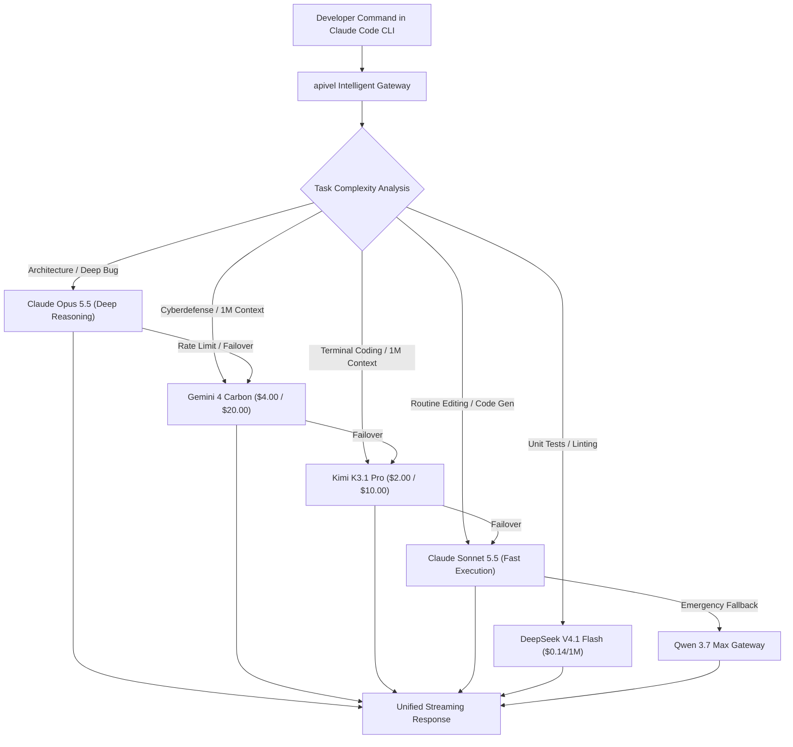

<div class="my-6 border-l-4 border-indigo-500 bg-gray-900 rounded-r-lg p-5">
  <span class="text-xs font-bold uppercase tracking-wider text-indigo-400">Definition</span>
  <div class="mt-1 text-md font-semibold text-white">Claude Opus 5.5 Architecture & Agentic Gateway Access</div>
  <p class="mt-2 text-sm text-gray-300"><strong>Claude Opus 5.5</strong> is Anthropic's frontier foundation model engineered for autonomous multi-file refactoring, deep codebase comprehension, and agentic CLI workflows. Featuring mandatory adaptive thinking blocks and integrated tool calling, developers can bypass Pro and Team subscription weekly caps via <a href="https://apivel.com/?redirect=/blog/claude-opus-5-5-price-limits-claude-code" class="text-indigo-400 hover:underline font-semibold">apivel</a> with unthrottled pay-as-you-go access, zero KYC, and instant PayPal checkout.</p>
</div>

The public rollout of **Claude Opus 5.5** has triggered a massive breakout across developer search trends, particularly for teams running [Claude Code](/blog/claude-code-rea-setup-limits-cost/) and Cursor in production. While its multi-step reasoning is widely hailed as a generational leap, engineers are colliding with severe operational roadblocks: **unforgiving weekly rate limits**, unexpectedly high **thinking token consumption**, and payment hurdles on official billing portals. This comprehensive engineering guide unpacks official Opus 5.5 pricing mechanics, analyzes head-to-head benchmarks against Sonnet 5.5 and Fable 5.1, and provides a production-tested multi-model failover configuration to keep your agentic coding pipelines uninterrupted.

---

## 1. Claude Opus 5.5 Pricing & The Thinking Token Cost Paradox

Anthropic introduced Claude Opus 5.5 with reduced token pricing compared to its previous Opus generation, positioning it as an accessible enterprise flagship.

```
┌────────────────────────────────────────────────────────────────────────┐
│               Claude Opus 5.5 Official API Cost Matrix                 │
├─────────────────────────┬─────────────────────────┬────────────────────┤
│ Prompt Input            │ Completion Output       │ Cache Read Hit     │
│ $4.00 / 1,000,000 tokens│ $20.00 / 1,000,000 token│ $0.20 / 1,000,000  │
└─────────────────────────┴─────────────────────────┴────────────────────┘
```

### The "Token-Eater" Paradox: Mandatory Adaptive Thinking
While the nominal price per token dropped by nearly 40% from Opus 5, real-world development bills frequently tell a different story. In Opus 5.5, Anthropic made **adaptive thinking blocks mandatory**. The model dynamically determines its internal reasoning depth before emitting user-visible tokens or executing tool calls.

In autonomous agents like Claude Code, this introduces an exponential multiplier:
1. **Hidden Reasoning Volume:** A single terminal turn where the agent analyzes three directory trees can generate 6,000 to 14,000 internal thinking tokens.
2. **Output Rate Premium:** Because thinking tokens are billed at the full completion rate ($20.00 per million tokens), a complex 15-turn refactoring session can silently consume $1.80 to $3.50 in compute without warning.
3. **Repeated Context Re-evaluation:** If prompt caching is invalidated by rapid edits to local files, the entire repository context is re-ingested at the full input rate.

### Is Claude Opus 5.5 Free?
A common query across developer search channels is whether Claude Opus 5.5 offers a free tier. **Anthropic provides no free access tier for Opus 5.5.** The free web interface is restricted to smaller checkpoints with tight hourly rate limits. However, developers can test Opus 5.5 through apivel using a **$0.20 free signup trial credit**, allowing full terminal CLI verification without entering credit card details.

---

## 2. The "Usage Cap Trap": Why Developers Hit Weekly Limits by Tuesday

Engineers upgrading to Claude Pro or Team subscriptions to leverage Opus 5.5 in Claude Code frequently experience abrupt project freezes.

<div class="my-6 border-l-4 border-amber-500 bg-gray-900 rounded-r-lg p-5">
  <div class="flex items-center justify-between">
    <span class="text-xs font-bold uppercase tracking-wider text-amber-400">Community Voice / Verified Experience</span>
    <span class="text-xs text-gray-400">Reddit r/ClaudeCode &bull; Verified Developer Post</span>
  </div>
  <blockquote class="mt-2 text-sm italic text-gray-200">
    "Upgraded to the top subscription tier specifically to run Opus 5.5 in Claude Code for a Next.js monorepo migration. By Tuesday 11 AM, after just 4 hours of autonomous subagent refactoring, the CLI printed: 'You have reached 98% of your weekly Opus allowance. Resets next Monday at 04:00 UTC.' I am completely locked out of my development environment for six days."
  </blockquote>
  <div class="mt-2 text-xs text-gray-400">Verified developer discussion regarding subscription quota exhaustion in autonomous coding workflows.</div>
</div>

### The Mathematical Vulnerability of Fixed Subscriptions
Fixed monthly plans rely on pooled compute quotas governed by strict 5-hour sliding windows and hard weekly limits:
* **Subagent Fan-Out:** Claude Code spawns parallel background tools for ripgrep search, AST parsing, and file edits. A single developer command can trigger 25 consecutive model invocations.
* **Over-Engineering Tunnel Vision:** Community discussions highlight that Opus 5.5 occasionally over-engineers solutions—generating multi-layered abstractions and defensive wrappers for straightforward utility scripts—burning through quota reserves.
* **Zero Spillover Protection:** Once the weekly cap triggers, official subscription interfaces do not allow automated per-token overage billing. Work ceases entirely until the scheduled weekly reset.

Through [apivel](https://apivel.com/?redirect=/blog/claude-opus-5-5-price-limits-claude-code), requests route via unthrottled enterprise tier channels using pure **pay-as-you-go billing**. You pay strictly for the exact tokens consumed with zero weekly shutoffs and zero forced downtime.

---

## 3. Head-to-Head: Claude Opus 5.5 vs. Sonnet 5.5 vs. Fable 5.1

Selecting the optimal foundation model requires balancing cognitive reasoning depth against inference speed and budget constraints.

| Foundation Checkpoint | Context Window | Input / Output (per 1M) | Prompt Cache Read | Coding & SWE Benchmark | Thinking Mechanism | Best For... (Honesty Column) |
| :--- | :--- | :--- | :--- | :--- | :--- | :--- |
| **Claude Opus 5.5** | 1,000,000 Tokens | $4.00 / $20.00 | $0.20 | 81.2% SWE-bench Verified | Mandatory Adaptive | Complex multi-file architecture & root-cause debugging |
| **Kimi K3.1 Pro** | 1,000,000 Tokens | $2.00 / $10.00 | $0.50 | 65.7% Terminal-Bench 4.0 | KDA Hybrid MoE | Long-horizon coding agents & 3D mesh modeling (see [Kimi K3.1 Pro guide](/blog/kimi-k3-1-pro-pricing-benchmarks-api-access/)) |
| **Claude Sonnet 5.5** | 500,000 Tokens | $3.00 / $15.00 | $0.30 | 78.4% SWE-bench Verified | Optional / Configurable | High-velocity feature iteration & UI components |
| **Claude Fable 5.1** | 200,000 Tokens | $3.00 / $15.00 | $0.30 | 75.1% SWE-bench Verified | Fixed Depth | Creative generation & interactive customer dialogs |
| **Qwen 3.7 Max** | 131,072 Tokens | $0.48 / $0.48 | $0.05 | 73.8% SWE-bench Verified | Hybrid MoE | High-volume continuous integration & script testing |
| **DeepSeek V4.1 Flash** | 128,000 Tokens | $0.14 / $0.28 | $0.014 | 77.0% DeepSWE | Native MoE Sparse | Mass unit test generation & batch code refactoring |

*Note: Pricing, benchmark scores, and API specifications verified via official documentation and third-party evaluation runs as of October 24, 2026.*

### When to Deploy Opus 5.5 vs. Sonnet 5.5
* **Deploy Opus 5.5 When:** Designing core database schemas, debugging asynchronous race conditions across distributed microservices, or executing major dependency migrations where single-token logic errors cause production outages.
* **Deploy Sonnet 5.5 When:** Writing boilerplate React components, crafting routine CRUD endpoints, generating unit test fixtures, or maintaining high-tempo interactive pair-programming sessions.

---

## 4. Multi-Model Failover Architecture: Slashing Costs by 70%

To protect development budgets from runaways caused by mandatory thinking blocks, production engineering teams implement a tiered proxy routing architecture. Unlike fragile free-tier reverse proxies that suffer from cascading 429 drops (as explored in our [FreeLLMAPI Review & Safe Claude Code Alternative](/blog/freellmapi-claude-code-review-alternatives/)), a managed commercial fallback pipeline delivers deterministic throughput without silent degradation into weak 8B models.



By assigning heavy architectural analysis to Opus 5.5 or [Gemini 4 Carbon](/blog/gemini-4-carbon-price-benchmarks-api/) while delegating iterative file writes and terminal executions to [Kimi K3.1 Pro](/blog/kimi-k3-1-pro-pricing-benchmarks-api-access/), [DeepSeek V4.1 Flash](/blog/deepseek-v4-1-flash-1017-api-setup/), or [Qwen 3.7 Max](/blog/qwen-4-release-date-api-roadmap/), teams cut net monthly API expenditures by **65% to 75%** without sacrificing code quality.

---

## 5. In-Article Estimator: Thinking Token Burn & Cost Simulator

Simulate your project's token expenditure under adaptive thinking blocks and generate ready-to-run connection scripts:

<div class="not-prose my-8 rounded-2xl p-6 bg-slate-900 border border-indigo-700/50 shadow-xl">
  <div class="text-lg font-bold text-white mb-2 flex items-center gap-2">
    <span>⚡ Claude Opus 5.5 Token Burn & Cost Calculator</span>
  </div>
  <p class="text-gray-300 text-sm mb-4">
    Estimate token usage across complex agent turns and compare official subscription cost risks against apivel pay-as-you-go pricing:
  </p>
  <div class="grid grid-cols-1 md:grid-cols-2 gap-4 mb-4">
    <div>
      <label class="block text-xs font-semibold text-gray-400 uppercase tracking-wider mb-1" for="calcTaskType">Engineering Task Profile</label>
      <select id="calcTaskType" class="w-full bg-slate-800 border border-slate-700 rounded-lg px-3 py-2 text-sm text-white focus:outline-none focus:border-indigo-500">
        <option value="heavy">Monorepo Multi-File Refactor (High Thinking Tokens)</option>
        <option value="moderate">Full-Stack Feature Implementation (Medium Thinking)</option>
        <option value="light">Routine Script & Bug Fix (Low Thinking)</option>
      </select>
    </div>
    <div>
      <label class="block text-xs font-semibold text-gray-400 uppercase tracking-wider mb-1" for="calcTurnsInput">Agent Turns per Week</label>
      <input type="number" id="calcTurnsInput" value="50" min="5" max="500" step="5" class="w-full bg-slate-800 border border-slate-700 rounded-lg px-3 py-2 text-sm text-white focus:outline-none focus:border-indigo-500" />
    </div>
  </div>
  <div class="p-4 rounded-xl bg-slate-950 border border-slate-800 grid grid-cols-1 sm:grid-cols-3 gap-4 mb-4">
    <div>
      <div class="text-xs text-gray-400 uppercase tracking-wider">Est. Monthly Tokens</div>
      <div id="calcTokensDisplay" class="text-xl font-bold text-indigo-400">12.5M Tokens</div>
    </div>
    <div>
      <div class="text-xs text-gray-400 uppercase tracking-wider">Estimated Monthly Cost</div>
      <div id="calcCostDisplay" class="text-xl font-bold text-emerald-400">$62.50 USD</div>
    </div>
    <div>
      <div class="text-xs text-gray-400 uppercase tracking-wider">Subscription Risk</div>
      <div id="calcRiskDisplay" class="text-sm font-semibold text-rose-400">Hits Weekly Cap by Wed</div>
    </div>
  </div>
  <div class="text-xs text-gray-400 mb-2">CLI Instant Launch Snippet:</div>
  <pre class="bg-slate-950 p-3 rounded-lg text-xs font-mono text-cyan-300 overflow-x-auto border border-slate-800"><code id="calcCodeBlock">export ANTHROPIC_BASE_URL="https://apivel.com/anthropic"
export ANTHROPIC_API_KEY="YOUR_APIVEL_KEY"
claude --model "claude-opus-5-5" "Refactor codebase architecture"</code></pre>
</div>

<script is:inline>
  document.addEventListener('DOMContentLoaded', () => {
    const taskSelect = document.getElementById('calcTaskType');
    const turnsInput = document.getElementById('calcTurnsInput');
    const tokensDisplay = document.getElementById('calcTokensDisplay');
    const costDisplay = document.getElementById('calcCostDisplay');
    const riskDisplay = document.getElementById('calcRiskDisplay');
    const codeBlock = document.getElementById('calcCodeBlock');

    const profileData = {
      heavy: { tokensPerTurn: 65000, costPerTurn: 0.32, risk: 'Hits Weekly Cap in 2 Days' },
      moderate: { tokensPerTurn: 30000, costPerTurn: 0.16, risk: 'Hits Weekly Cap in 4 Days' },
      light: { tokensPerTurn: 12000, costPerTurn: 0.07, risk: 'Borderline Weekly Limit' }
    };

    function recalculate() {
      const profile = taskSelect ? taskSelect.value : 'heavy';
      const weeklyTurns = turnsInput ? parseFloat(turnsInput.value) || 0 : 50;
      const data = profileData[profile] || profileData.heavy;
      
      const monthlyTurns = weeklyTurns * 4;
      const totalTokens = (monthlyTurns * data.tokensPerTurn) / 1000000;
      const totalCost = monthlyTurns * data.costPerTurn;

      if (tokensDisplay) tokensDisplay.innerText = totalTokens.toFixed(1) + 'M Tokens';
      if (costDisplay) costDisplay.innerText = '$' + totalCost.toFixed(2) + ' USD';
      if (riskDisplay) {
        if (weeklyTurns >= 40) {
          riskDisplay.innerText = data.risk;
          riskDisplay.className = 'text-sm font-semibold text-rose-400';
        } else {
          riskDisplay.innerText = 'Safe for Low Volume';
          riskDisplay.className = 'text-sm font-semibold text-emerald-400';
        }
      }
      if (codeBlock) {
        codeBlock.innerText = 'export ANTHROPIC_BASE_URL="https://apivel.com/anthropic"\nexport ANTHROPIC_API_KEY="YOUR_APIVEL_KEY"\nclaude --model "claude-opus-5-5" "Execute ' + profile + ' engineering task"';
      }
    }

    if (taskSelect) taskSelect.addEventListener('change', recalculate);
    if (turnsInput) turnsInput.addEventListener('input', recalculate);
  });
</script>

---

## 6. How to Connect Claude Opus 5.5 to Claude Code & Cursor

Connecting your development environment to apivel's high-speed proxy gateway requires zero code refactoring and takes less than sixty seconds.

### 1. Claude Code CLI Integration (Terminal Setup)
Configure standard Anthropic environment variables in your active shell or `.bashrc` / `.zshrc`:

```bash
# Point Claude Code CLI to apivel high-concurrency gateway
export ANTHROPIC_BASE_URL="https://apivel.com/anthropic"
export ANTHROPIC_API_KEY="YOUR_APIVEL_API_KEY"

# Optional: Set thinking token upper bound to manage budgets
export MAX_THINKING_TOKENS=8192

# Execute your agentic refactoring session with unthrottled throughput
claude --model "claude-opus-5-5" "Analyze circular dependencies in src/services and refactor to clean dependency injection"
```

### 2. Cursor IDE Integration (`.cursor/settings.json`)
Configure your custom model provider inside your Cursor configuration file with built-in retry timeouts and thinking token parameters:

```json
{
  "models": [
    {
      "id": "claude-opus-5-5",
      "name": "Claude Opus 5.5 (apivel High-Speed)",
      "endpoint": "https://apivel.com/v1",
      "apiKey": "YOUR_APIVEL_API_KEY",
      "contextWindow": 1000000,
      "maxOutputTokens": 8192,
      "thinking": {
        "type": "enabled",
        "budget_tokens": 4096
      }
    },
    {
      "id": "claude-sonnet-5",
      "name": "Claude Sonnet 5.5 (apivel Fallback)",
      "endpoint": "https://apivel.com/v1",
      "apiKey": "YOUR_APIVEL_API_KEY",
      "contextWindow": 500000,
      "maxOutputTokens": 8192
    }
  ]
}
```

---

## 7. Cost & Operational Comparison: Official Anthropic vs. apivel

| Operational Parameter | Official Anthropic Subscription | apivel Unified Gateway |
| :--- | :--- | :--- |
| **Quota Allocation** | Rigid 5-hour rolling & weekly hard cap | **100% Uncapped Pay-As-You-Go** |
| **Rate Limit Lockout** | Account locked until weekly reset | **Zero downtime; instant credit reload** |
| **Supported Payments** | Credit card only (Frequent 3D-Secure bans) | **PayPal Instant Checkout & Global Cards** |
| **Foreign Exchange Fees** | 1.5% - 3.5% cross-border FX markups | **0% Zero-FX billing conversion** |
| **Identity Verification** | Mandatory mobile phone & KYC screening | **Zero KYC required; immediate provisioning** |
| **New User Trial** | $0.00 free credit (Immediate card lock) | **$0.20 Free Signup Trial Credit** |
| **First Deposit Bonus** | No deposit incentives | **+50% Credit Bonus ($5 → $7.50, $29 → $43.50)** |
| **Wholesale Developer Pack**| Rigid monthly recurring charges | **$29 Developer Pack (40M Tokens, Never Expires)** |

<div class="cta-card my-8 rounded-2xl p-6 bg-gradient-to-br from-indigo-950 to-gray-900 border border-indigo-700">
  <div class="cta-title text-xl font-bold text-white mb-2">
    Bypass Claude Opus 5.5 Weekly Limits & Token Roadblocks
  </div>
  <p class="text-gray-300 text-sm mb-4">
    Stop letting subscription caps shut down your engineering sprints. Connect Claude Code and Cursor to apivel with native Anthropic endpoints, unthrottled pay-as-you-go capacity, instant PayPal checkout, and 24/7 reliability.
  </p>
  <div class="cta-badge-grid">
    <div class="cta-badge">⚡ Native Base URL (https://apivel.com/anthropic)</div>
    <div class="cta-badge">🎁 +50% First Deposit Bonus ($5 → $7.50, $29 → $43.50)</div>
    <div class="cta-badge">🚀 $29 Pack: 40M Tokens (56% OFF, Never Expires)</div>
    <div class="cta-badge">💳 PayPal Instant Checkout • Zero KYC • Global Cards</div>
  </div>
  <div class="cta-button-group">
    <a href="https://apivel.com/pricing?redirect=/blog/claude-opus-5-5-price-limits-claude-code" class="cta-btn cta-btn-primary">
      Claim +50% Deposit Bonus ($5 → $7.50) →
    </a>
    <a href="https://apivel.com/sign-up?redirect=/blog/claude-opus-5-5-price-limits-claude-code" class="cta-btn cta-btn-secondary">
      Claim $0.20 Free Trial (No Card Needed) →
    </a>
  </div>
</div>

<script type="application/ld+json">
{
  "@context": "https://schema.org",
  "@type": "FAQPage",
  "mainEntity": [
    {
      "@type": "Question",
      "name": "Is Claude Opus 5.5 free?",
      "acceptedAnswer": {
        "@type": "Answer",
        "text": "No, Anthropic does not provide free access to Claude Opus 5.5. Official usage requires a paid Pro or Team subscription or API token billing. Developers can test Opus 5.5 without a credit card through apivel using a complimentary $0.20 signup credit."
      }
    },
    {
      "@type": "Question",
      "name": "How much does Claude Opus 5.5 cost per 1M tokens?",
      "acceptedAnswer": {
        "@type": "Answer",
        "text": "Claude Opus 5.5 is priced at $4.00 per million input tokens, $20.00 per million output tokens, and $0.20 per million prompt cache read tokens. Because adaptive thinking blocks are mandatory, complex agentic reasoning tasks generate higher completion token volume."
      }
    },
    {
      "@type": "Question",
      "name": "Why do I hit Claude Code weekly rate limits so fast with Opus 5.5?",
      "acceptedAnswer": {
        "@type": "Answer",
        "text": "Claude Code coordinates multi-file refactoring using recursive subagent tool calls. Combined with Opus 5.5's mandatory adaptive thinking tokens, intensive developer sessions can exhaust an entire week of Pro or Team subscription allowances within two to three days."
      }
    },
    {
      "@type": "Question",
      "name": "Claude Opus 5.5 vs Sonnet 5.5: which should I choose for coding?",
      "acceptedAnswer": {
        "@type": "Answer",
        "text": "Opus 5.5 is optimized for large-scale multi-file architectural refactoring, deep logic debugging, and root-cause analysis. Sonnet 5.5 is recommended for everyday rapid feature implementation, unit test generation, and standard script automation at lower token costs."
      }
    },
    {
      "@type": "Question",
      "name": "How can I pay for Claude Opus 5.5 API using PayPal?",
      "acceptedAnswer": {
        "@type": "Answer",
        "text": "Anthropic's official billing portal does not accept PayPal. Developers can route requests through apivel's proxy gateway at https://apivel.com/anthropic, which supports instant PayPal checkout, international debit cards, zero KYC verification, and 0% cross-border FX fees."
      }
    }
  ]
}
</script>
