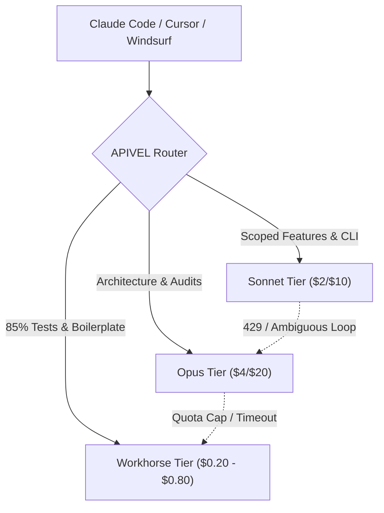

<div class="my-8 rounded-xl border border-primary/20 bg-primary/5 p-6 backdrop-blur-sm">
  <div class="flex items-center gap-2 text-primary font-semibold text-lg mb-2">
    <span>Technical Summary: Anthropic Flagship vs Mid-Tier AI Models</span>
  </div>
  <p class="text-base text-gray-200 leading-relaxed m-0">
    Choosing between <strong>Claude Opus 5.5 vs Claude Sonnet 5.5</strong> balances deep open-ended reasoning against high-velocity coding economics. Released September 22, 2026, Anthropic's flagship Opus tier costs $4 input and $20 output per million tokens ($0.20 cache reads), leading SWE-bench Pro (89.9%) and multi-file refactoring. Launched September 28, the mid-tier Sonnet sibling halves API rates to $2 input and $10 output ($0.10 cache reads), runs over 30% faster (~139 tok/s), and reaches 70.6% on Terminal-Bench 4.0 versus 66.4% for Opus. Because max-effort adaptive thinking burns tokens rapidly, routing 85% of routine diffs to workhorse endpoints through APIVEL cuts monthly spend by up to 88% with PayPal Instant Checkout and zero KYC.
  </p>
</div>

Debating **Claude Opus 5.5 vs Claude Sonnet 5.5** is no longer a simple speed-versus-intelligence trade-off. When teams hand production repositories to Claude Code CLI, Cursor, and Windsurf, choosing the wrong default AI model stalls multi-file migrations or exhausts five-hour subscription quotas before noon.

Both September 2026 checkpoints share a 1,000,000-token context window, 128K output ceiling, and mandatory adaptive thinking. Yet their pricing, reasoning verbosity, and effort scaling produce sharply different monthly invoices.



## Architecture & Effort Tiers: Adaptive Thinking Mechanics

Understanding how Anthropic structured these late-2026 checkpoints explains why nominal token rates mislead engineering budgets:

* **Deep Horizon & Ambiguity Handling (Opus Tier)**: Detailed in our [Claude Opus Pricing & Limits Guide](/blog/claude-opus-5-5-price-limits-claude-code/) and [GPT 6.2 Astra Comparison](/blog/gpt-6-2-astra-vs-opus-5-5-differences/), Anthropic's flagship allocates wider internal reasoning trajectories before emitting diffs. It excels when specifications are vague, legacy dependencies span dozens of modules, or concurrency bugs require multi-step verification.
* **High-Throughput Scoped Execution (Sonnet Tier)**: Built for rapid iteration, the mid-tier sibling generates outputs at ~139 tokens per second versus ~105 tok/s on the flagship tier. When prompts define clear file targets and acceptance criteria, it finishes discrete pull requests over 30% faster with tight tool-calling precision.

Both AI models expose four effort tiers (`low`, `medium`, `high`, `max`). Because adaptive thinking cannot be disabled, effort selection directly governs latency and completion spend.

## Claude Opus 5.5 vs Claude Sonnet 5.5 Benchmarks: Coding & Pricing

The matrix below compares verified coding benchmarks, knowledge-work Elo ratings, token pricing, and secondary workhorse alternatives:

| Specification | Anthropic Opus Tier | Anthropic Sonnet Tier | Alibaba Qwen 3.7 Max | DeepSeek V4 |
| :--- | :--- | :--- | :--- | :--- |
| **Release Date** | September 22, 2026 | September 28, 2026 | Production Cloud | Open Weights |
| **Context / Output** | 1,000K / 128K | 1,000K / 128K | 1,000K / 64K | 1,000K / 64K |
| **Input / Million** | **$4** *(Cached $0.20)* | **$2** *(Cached $0.10)* | **$0.25 (94% OFF)** | **$0.20 (95% OFF)** |
| **Output / Million** | **$20** *(Batch $10)* | **$10** *(Batch $5)* | **$0.80 (96% OFF)** | **$0.60 (97% OFF)** |
| **Terminal-Bench 4.0** | 66.4% | **70.6%** *(Max Effort)* | — | — |
| **SWE-bench Pro** | **89.9%** | 81.3% | — | — |
| **OSWorld 2.1 (Partial)** | **81.8%** | 80.1% | — | — |
| **GDPval-AA Elo** | **1846** | 1844 | — | — |
| **Best For (Objective Fit)** | **Ambiguous refactors & audits** | **Scoped coding & fast CLI** | **High-volume PR triage** | **Unit tests & failover** |

*Note: Metrics compiled from Anthropic system cards and independent evaluations (November 2026).*

### Effort-Level Cost Trap: Medium vs High Paradox

Halving token rates ($2/$10 versus $4/$20) makes the mid-tier model look universally cheaper, yet two terminal dynamics complicate the math:

1. **Sonnet High vs Opus Medium**: Pushing the cheaper tier to `high` or `max` effort triggers verbose verification chains. On vague tasks, extra completion tokens can push per-task cost above running the flagship at `medium` effort, which resolves ambiguity in fewer turns.
2. **Prompt Cache Multiplier**: Both tiers discount cached input reads by 95% (ten cents and twenty cents per million cached tokens). Keeping repository context stable matters more than trimming prompt prose, whether deploying Anthropic endpoints or alternatives analyzed in our [GLM 5.4 Benchmark Comparison](/blog/glm-5-4-vs-claude-opus-5-5-benchmarks/) and [Kimi K3.1 Pro Showdown](/blog/kimi-k3-1-vs-claude-opus-5-5-benchmarks/).

## Reddit Consensus: Medium vs High Effort & Quota Lockouts

Developer threads across `r/ClaudeCode` and `r/ClaudeAI`—alongside telemetry tracked in [Claude Code GitHub issues](https://github.com/anthropics/claude-code/issues) and [Anthropic model documentation](https://docs.anthropic.com/en/docs/about-claude/models/overview)—highlight real trade-offs missed by vendor charts:

<div class="my-8 rounded-xl border border-amber-500/30 bg-amber-500/5 p-6 backdrop-blur-sm">
  <div class="flex items-center gap-2 text-amber-400 font-semibold text-lg mb-3">
    <span>Verified Developer Voices: r/ClaudeCode &amp; r/ClaudeAI Telemetry</span>
  </div>
  <blockquote class="border-l-4 border-amber-400 pl-4 my-3 italic text-gray-300">
    "Running the flagship at medium effort is the set-it-and-forget-it sweet spot for multi-file refactors, whereas pushing the mid-tier model to max effort on messy prompts burns extra thinking tokens without catching subtle architectural bugs."
  </blockquote>
  <blockquote class="border-l-4 border-amber-400 pl-4 my-3 italic text-gray-300">
    "We switched 80% of daily bug fixes and React scaffolding to the Sonnet tier and kept the Opus tier exclusively as our PR reviewer and planner—slashing weekly quota lockouts while keeping code quality intact."
  </blockquote>
  <div class="text-xs text-gray-400 mt-2">
    — Compiled from r/ClaudeCode, r/ClaudeAI, and <a href="https://docs.anthropic.com/en/docs/about-claude/models/overview" target="_blank" rel="noopener noreferrer" class="text-amber-300 hover:underline">Anthropic official model specs</a> (November 2026).
  </div>
</div>

Separating architectural planning from routine file edits prevents Tuesday quota freezes without sacrificing review rigor.

## Global API Access & Failover: OpenRouter vs APIVEL

Direct Anthropic subscriptions enforce five-hour rolling caps that freeze heavy sprints, while card declines and OpenRouter markups complicate team billing. APIVEL unifies both checkpoints and high-throughput workhorse tiers behind one OpenAI- and Anthropic-compatible gateway (`apivel.com/v1`) via **PayPal Instant Checkout**, Visa/MasterCard/Amex, and Alipay at **0% FX fees**, zero KYC, and a free starter sandbox credit.

## Interactive Cost Simulator: Opus vs Sonnet Hybrid Savings

Estimate monthly developer spend across single-tier routing versus an APIVEL pipeline offloading 85% of routine tasks:

<div class="my-8 rounded-xl border border-primary/20 bg-card p-6 shadow-lg">
  <div class="flex items-center justify-between border-b border-border pb-4 mb-6">
    <div>
      <div class="font-bold text-lg text-white">Anthropic Hybrid Token Cost Simulator</div>
      <div class="text-xs text-gray-400">75% input / 25% output mix with 85% workhorse offloading</div>
    </div>
    <span class="rounded bg-primary/20 px-2.5 py-1 text-xs font-semibold text-primary">Live Estimator</span>
  </div>

  <div class="grid grid-cols-1 md:grid-cols-2 gap-6 mb-6">
    <div>
      <label for="cs-tokens" class="block text-sm font-medium text-gray-300 mb-2">
        Monthly Volume: <span id="cs-token-val" class="text-primary font-bold">25M Tokens</span>
      </label>
      <input type="range" id="cs-tokens" min="5" max="100" step="5" value="25" class="w-full h-2 bg-gray-700 rounded-lg appearance-none cursor-pointer accent-primary" />
    </div>

    <div>
      <label for="cs-model" class="block text-sm font-medium text-gray-300 mb-2">Primary Anthropic Tier</label>
      <select id="cs-model" class="w-full rounded-lg border border-border bg-gray-800 px-3 py-2 text-sm text-gray-200 focus:border-primary focus:outline-none">
        <option value="opus" selected>Opus Tier ($4 in / $20 out)</option>
        <option value="sonnet">Sonnet Tier ($2 in / $10 out)</option>
        <option value="opus-batch">Opus Batch 50% Off ($2 in / $10 out)</option>
      </select>
    </div>
  </div>

  <div class="grid grid-cols-1 md:grid-cols-3 gap-4 pt-4 border-t border-border">
    <div class="rounded-lg bg-gray-900/60 p-4 text-center border border-gray-800">
      <div class="text-xs text-gray-400 mb-1">Single-Tier Spend</div>
      <div id="cs-pure-cost" class="text-2xl font-bold text-red-400">$200.00</div>
    </div>
    <div class="rounded-lg bg-gray-900/60 p-4 text-center border border-gray-800">
      <div class="text-xs text-gray-400 mb-1">APIVEL Hybrid Spend</div>
      <div id="cs-hybrid-cost" class="text-2xl font-bold text-green-400">$37.25</div>
    </div>
    <div class="rounded-lg bg-primary/10 p-4 text-center border border-primary/30">
      <div class="text-xs text-primary mb-1">Monthly Savings</div>
      <div id="cs-savings-pct" class="text-2xl font-extrabold text-primary">81.4%</div>
      <div id="cs-savings-amt" class="text-xs text-gray-300 mt-1">Save $162.75 / Month</div>
    </div>
  </div>

  <div class="mt-6 flex justify-end">
    <button type="button" id="cs-calc-btn" class="rounded-lg bg-primary px-4 py-2 text-xs font-semibold text-white shadow-md hover:bg-primary/90 transition-colors">
      Recalculate Savings
    </button>
  </div>
</div>

<script>
  (function() {
    const slider = document.getElementById('cs-tokens');
    const valEl = document.getElementById('cs-token-val');
    const selectEl = document.getElementById('cs-model');
    const pureEl = document.getElementById('cs-pure-cost');
    const hybridEl = document.getElementById('cs-hybrid-cost');
    const pctEl = document.getElementById('cs-savings-pct');
    const amtEl = document.getElementById('cs-savings-amt');
    const btn = document.getElementById('cs-calc-btn');

    function updateCalc() {
      const vol = parseFloat(slider.value);
      valEl.textContent = vol + 'M Tokens';
      const inM = vol * 0.75;
      const outM = vol * 0.25;

      let rateIn = 4.0, rateOut = 20.0;
      if (selectEl.value === 'sonnet' || selectEl.value === 'opus-batch') {
        rateIn = 2.0; rateOut = 10.0;
      }

      const pure = (inM * rateIn) + (outM * rateOut);
      const hybridFrontier = ((inM * 0.15) * rateIn) + ((outM * 0.15) * rateOut);
      const hybridWork = ((inM * 0.85) * 0.25) + ((outM * 0.85) * 0.80);
      const totalHybrid = hybridFrontier + hybridWork;
      const saved = pure - totalHybrid;

      pureEl.textContent = '$' + pure.toFixed(2);
      hybridEl.textContent = '$' + totalHybrid.toFixed(2);
      pctEl.textContent = ((saved / pure) * 100).toFixed(1) + '%';
      amtEl.textContent = 'Save $' + saved.toFixed(2) + ' / Month';
    }

    slider.addEventListener('input', updateCalc);
    selectEl.addEventListener('change', updateCalc);
    btn.addEventListener('click', updateCalc);
    updateCalc();
  })();
</script>

## Production Setup: Hybrid Routing & Claude Code CLI

Route architectural audits to `claude-opus-5-5`, scoped features to `claude-sonnet-5-5`, and routine tests to workhorse fallbacks:

```python
import os, httpx
from openai import OpenAI

client = OpenAI(api_key=os.environ.get("APIVEL_API_KEY"), base_url="https://apivel.com/v1")

def route_coding(prompt: str, scope: str = "scoped") -> str:
    routes = {
        "architecture": ("claude-opus-5-5", "claude-sonnet-5-5"),
        "scoped": ("claude-sonnet-5-5", "infer/qwen3.7-max"),
        "routine": ("infer/qwen3.7-max", "infer/deepseek-v4"),
    }
    primary, fallback = routes.get(scope, routes["scoped"])
    try:
        res = client.chat.completions.create(model=primary, messages=[{"role":"user","content":prompt}], timeout=90.0)
        return res.choices[0].message.content
    except (httpx.TimeoutException, httpx.HTTPStatusError):
        res = client.chat.completions.create(model=fallback, messages=[{"role":"user","content":prompt}], timeout=60.0)
        return res.choices[0].message.content
```

Export unified gateway variables for Claude Code CLI or Cursor:

```bash
export ANTHROPIC_BASE_URL="https://apivel.com/v1"
export ANTHROPIC_API_KEY="sk-apivel-key"
export CLAUDE_CODE_MODEL="claude-sonnet-5-5"
```

## Claude Opus 5.5 vs Claude Sonnet 5.5 Frequently Asked Questions

### What Is the Difference Between Claude Opus 5.5 and Sonnet 5.5?

The Opus tier targets ambiguous, multi-file engineering and deep code audits at $4/$20 per million tokens, leading SWE-bench Pro (89.9%). The Sonnet tier runs 30%+ faster at half the price ($2/$10) and excels at scoped coding, hitting 70.6% on Terminal-Bench 4.0.

### Which Should I Use for Coding: Claude Opus 5.5 or Sonnet 5.5?

Use the Sonnet tier for roughly 80% of daily feature builds, bug fixes, and CLI loops with clear specs. Reserve the Opus tier for sprawling legacy refactors, architecture planning, and complex pull-request reviews.

### Is Claude Sonnet 5.5 Cheaper Than Claude Opus 5.5?

Yes. Standard API rates drop 50% ($2/$10 versus $4/$20, with $0.10 versus $0.20 cached reads). Still, pushing the mid-tier model to `max` effort on vague prompts can match the flagship's `medium` effort cost.

### Can Claude Sonnet 5.5 Replace Claude Opus 5.5?

For well-scoped coding, document synthesis, and routine terminal tasks, yes. For ambiguous multi-service debugging, pairing both models via APIVEL's unified router with PayPal Instant Checkout and a **$0.20 free trial** delivers optimal reliability.

<script type="application/ld+json">
{
  "@context": "https://schema.org",
  "@type": "TechArticle",
  "headline": "Claude Opus 5.5 vs Claude Sonnet 5.5: Benchmarks, Coding & API Pricing",
  "description": "Compare Claude Opus 5.5 vs Claude Sonnet 5.5 AI models: Terminal-Bench coding scores, $4/$20 vs $2/$10 pricing, effort levels, and APIVEL routing.",
  "author": {
    "@type": "Person",
    "name": "Elena Rostova",
    "jobTitle": "Senior LLM Systems Architect & Agent Infrastructure Specialist",
    "worksFor": {
      "@type": "Organization",
      "name": "APIVEL"
    }
  },
  "publisher": {
    "@type": "Organization",
    "name": "APIVEL",
    "url": "https://apivel.com"
  },
  "datePublished": "2026-11-26",
  "mainEntityOfPage": "https://apivel.com/blog/claude-opus-5-5-vs-claude-sonnet-5-5-benchmarks/"
}
</script>

<script type="application/ld+json">
{
  "@context": "https://schema.org",
  "@type": "FAQPage",
  "mainEntity": [
    {
      "@type": "Question",
      "name": "What Is the Difference Between Claude Opus 5.5 and Sonnet 5.5?",
      "acceptedAnswer": {
        "@type": "Answer",
        "text": "Claude Opus 5.5 targets complex, open-ended architecture and multi-file refactoring ($4/$20 per million tokens, 89.9% SWE-bench Pro). Claude Sonnet 5.5 runs 30%+ faster at half the cost ($2/$10) and excels at well-scoped coding and Terminal-Bench 4.0 workflows (70.6%)."
      }
    },
    {
      "@type": "Question",
      "name": "Which Should I Use for Coding: Claude Opus 5.5 or Sonnet 5.5?",
      "acceptedAnswer": {
        "@type": "Answer",
        "text": "Use Claude Sonnet 5.5 for daily feature implementation, bug fixes, and well-scoped CLI commands. Reserve Claude Opus 5.5 for ambiguous requirements, large legacy codebase overhauls, and deep pull-request reviews."
      }
    },
    {
      "@type": "Question",
      "name": "Is Claude Sonnet 5.5 Cheaper Than Claude Opus 5.5?",
      "acceptedAnswer": {
        "@type": "Answer",
        "text": "Yes. Claude Sonnet 5.5 costs $2 input and $10 output per million tokens ($0.10 cache read), half of Claude Opus 5.5 ($4/$20, $0.20 cache read). Avoid running Sonnet at max effort on vague prompts, which inflates thinking token spend."
      }
    },
    {
      "@type": "Question",
      "name": "Can Claude Sonnet 5.5 Replace Claude Opus 5.5?",
      "acceptedAnswer": {
        "@type": "Answer",
        "text": "Claude Sonnet 5.5 covers roughly 80% of everyday coding and knowledge work, while Claude Opus 5.5 leads ambiguous multi-step reasoning and subtle bug audits. Routing both through APIVEL (https://apivel.com/v1) with PayPal Instant Checkout and a $0.20 free trial removes weekly quota lockouts."
      }
    }
  ]
}
</script>

<div class="cta-card">
  <div class="my-10 p-8 rounded-2xl bg-gradient-to-br from-slate-900 via-primary/10 to-slate-900 border border-primary/30 text-center shadow-2xl backdrop-blur-md">
    <div class="inline-flex items-center gap-2 px-3 py-1 rounded-full bg-primary/10 border border-primary/30 text-primary text-xs font-mono mb-4">
      <span>⚡ Unified AI Gateway</span>
    </div>
    <div class="text-2xl font-extrabold text-white tracking-tight mb-3">Route Anthropic Flagship &amp; Mid-Tier Models Without Caps</div>
    <p class="text-sm text-gray-300 max-w-xl mx-auto leading-relaxed mb-6">
      Stop five-hour subscription lockouts. Connect Claude Code and Cursor with automatic failover across Anthropic's flagship, mid-tier, and high-speed workhorse endpoints.
    </p>
    <div class="flex flex-wrap justify-center gap-4 text-xs text-gray-400 mb-6">
      <span><strong class="text-white">+50% First Deposit Bonus:</strong> $5→$7.50, $29→$43.50, $99→$148.50</span>
      <span><strong class="text-white">$29 Developer Pack:</strong> 56% OFF, 40M Tokens, Never Expires</span>
      <span><strong class="text-white">$0.20 Free Trial:</strong> Zero KYC</span>
    </div>
    <div class="flex flex-col sm:flex-row justify-center gap-4 mb-6">
      <a rel="nofollow" href="/pricing?redirect=/blog/claude-opus-5-5-vs-claude-sonnet-5-5-benchmarks" class="inline-flex items-center justify-center rounded-xl bg-primary px-6 py-3 text-sm font-semibold text-white shadow-lg shadow-primary/25 hover:bg-primary/90 transition-all text-center">
        View Gateway Pricing
      </a>
      <a rel="nofollow" href="/sign-up?redirect=/blog/claude-opus-5-5-vs-claude-sonnet-5-5-benchmarks" class="inline-flex items-center justify-center rounded-xl border border-border bg-gray-800/80 px-6 py-3 text-sm font-semibold text-gray-200 hover:bg-gray-700/80 transition-all text-center">
        Claim $0.20 Free Credit
      </a>
    </div>
    <div class="pt-4 border-t border-gray-800/80 flex flex-wrap items-center justify-center gap-4 text-xs text-gray-400">
      <div><strong>PayPal Instant Checkout</strong> • Global Cards • Alipay • 0% FX Fees</div>
    </div>
  </div>
</div>
