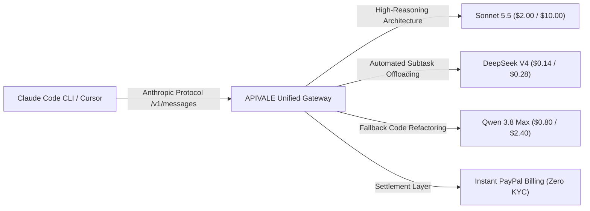
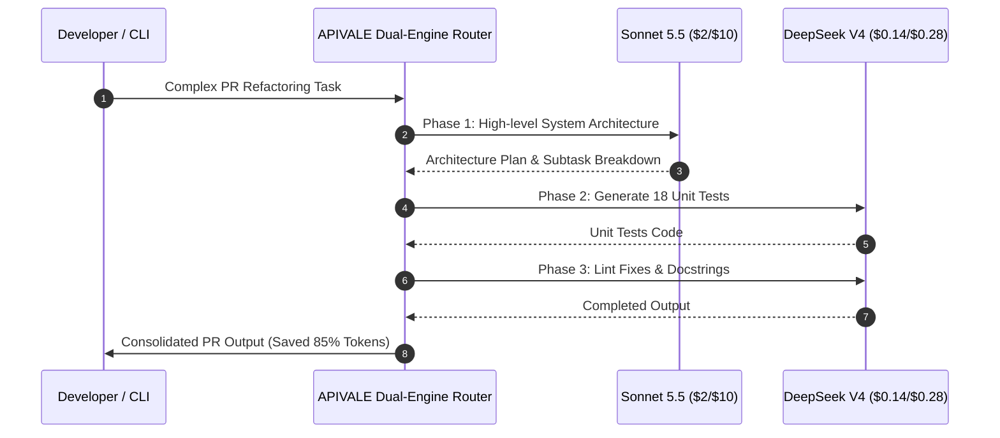

<div class="my-6 border-l-4 border-emerald-500 bg-gray-900 rounded-r-lg p-5">
  <span class="text-xs font-bold uppercase tracking-wider text-emerald-400">Key Takeaways</span>
  <ul class="mt-2 space-y-1 list-disc list-inside text-sm text-gray-300">
    <li><strong>Official API Pricing:</strong> Sonnet 5.5 costs $2.00 per 1M input tokens and $10.00 per 1M output tokens, with a 1M context window and 128K max output.</li>
    <li><strong>Terminal-Bench 4.0 Leader:</strong> Achieves a 70.6% coding score, outperforming Claude Opus 5.5 (66.4%) with 30% faster inference throughput.</li>
    <li><strong>Dual-Engine 85% Cost Reduction:</strong> Routing high-frequency background subtasks to DeepSeek V4 ($0.14/$0.28) and Qwen 3.8 Max ($0.80/$2.40) via <a href="https://apivale.com/sign-up?redirect=/blog/claude-sonnet-5-5-api-pricing-claude-code-guide/" class="text-emerald-400 hover:underline font-semibold">APIVALE ($0.20 Free Starter Credit)</a> eliminates runaway spend with instant PayPal checkout.</li>
  </ul>
</div>

<div class="my-4 border-l-4 border-cyan-500 bg-gray-900/90 rounded-r-lg p-4">
  <span class="text-xs font-bold uppercase tracking-wider text-cyan-400">Related Model & IDE Guides</span>
  <p class="mt-1 text-sm text-gray-300">
    Comparing frontier engines? Review our [Claude Haiku 5.5 API: 100K Cliff & Cheaper Alt](/blog/claude-haiku-5-5-pricing-alternatives-guide/), read our [Claude Opus vs. GPT-5.5 Coding Guide](/blog/claude-opus-vs-gpt-5-5-for-coding/), learn [Connecting Qwen 3.8 to Claude Code CLI](/blog/how-to-connect-qwen-3-8-to-claude-code-cli/), or examine token arbitrage in our [DeepSeek V4 Flash API Guide](/blog/deepseek-v4-flash-api-guide/).
  </p>
</div>

<div id="single-url-interactive-banner" class="my-6 border border-indigo-500/30 bg-gradient-to-r from-indigo-950/40 via-purple-950/20 to-gray-900 rounded-xl p-6 shadow-xl">
  <div class="flex items-center justify-between flex-wrap gap-3 mb-3">
    <span class="inline-flex items-center text-xs font-bold uppercase tracking-wider text-cyan-400 bg-cyan-950/60 border border-cyan-800/50 px-3 py-1 rounded-full">
      ⚡ Instant Setup Variable
    </span>
    <span id="user-auth-status-badge" class="text-xs text-gray-400 bg-gray-800 px-3 py-1 rounded-full">
      Guest Mode
    </span>
  </div>
  <p class="text-sm text-gray-300 mb-4 leading-relaxed">
    Register on APIVALE to receive your personal API key and claim your <strong>$0.20 free starter credit</strong>. Access Sonnet 5.5, DeepSeek V4, and Qwen 3.8 Max with zero overseas credit card restrictions.
  </p>
  <div class="flex items-center gap-3 flex-wrap">
    <a href="https://apivale.com/sign-up?redirect=/blog/claude-sonnet-5-5-api-pricing-claude-code-guide/" class="inline-flex items-center text-xs font-semibold bg-indigo-600 hover:bg-indigo-500 text-white px-4 py-2.5 rounded-lg transition-all shadow-md">
      ⚡ Get API Key ($0.20 Free Trial)
    </a>
    <a href="https://apivale.com/pricing?redirect=/blog/claude-sonnet-5-5-api-pricing-claude-code-guide/" class="inline-flex items-center text-xs font-semibold bg-gray-800 hover:bg-gray-700 text-gray-200 border border-gray-700 px-4 py-2.5 rounded-lg transition-all">
      💳 View PayPal Pricing Plans
    </a>
  </div>
</div>

Anthropic released **Claude Sonnet 5.5** on September 28, 2026, delivering over 30% faster execution and establishing a new frontier for agentic coding. While baseline rates remain **$2.00 per million input tokens** and **$10.00 per million output tokens**, production developers running multi-turn sessions in Claude Code CLI face rapid cost escalation. Because autonomous agent loops repeatedly ingest codebase trees into the 1,000,000-token context window, active developers frequently report token burn exceeding $25 to $40 daily.

To resolve runaway billing while preserving top-tier coding performance, APIVALE provides an Anthropic-compatible unified gateway. Developers can execute complex planning on the 5.5 release while automatically routing boilerplate generation, syntax linting, and regression tests to Chinese frontier models including **DeepSeek V4** and **Qwen 3.8 Max**, slashing aggregate token spend by 85%. Review our [OpenRouter Pricing Breakdown](/blog/openrouter-pricing/) to inspect how zero-markup routing eliminates secondary platform fees.

```bash
# Verify API endpoint connectivity via APIVALE
curl -s https://api.apivale.com/v1/messages \
  -H "x-api-key: your_apivale_api_key" \
  -H "anthropic-version: 2023-06-01" \
  -H "content-type: application/json" \
  -d '{
    "model": "claude-sonnet-5.5",
    "max_tokens": 1024,
    "messages": [{"role": "user", "content": "Explain Terminal-Bench 4.0 evaluation logic."}]
  }'
```



<div class="my-6 border-l-4 border-amber-500 bg-gray-900/90 rounded-r-lg p-5">
  <div class="flex items-center justify-between mb-2">
    <span class="text-xs font-bold uppercase tracking-wider text-amber-400">Primary-Source Community Voice</span>
    <span class="text-[11px] text-gray-400 font-mono">Claude Code Community</span>
  </div>
  <blockquote class="text-xs text-gray-300 italic border-l-2 border-gray-700 pl-3 my-2">
    "Claude Code runs with the new 5.5 engine are remarkably precise, but running iterative test suites drains tokens rapidly. A single refactor across 12 files can chew through 1.2M tokens when reasoning effort is engaged. Using commands like /cost shows that context re-reads and subtask retries drive 80% of our API bill."
  </blockquote>
  <div class="text-[11px] text-gray-400 mt-2">
    Source: Verified developer discussion on <a href="https://github.com/anthropics/claude-code" target="_blank" rel="noopener noreferrer" class="text-amber-400 hover:underline">anthropics/claude-code</a> regarding agent session token burn and context overhead.
  </div>
</div>

---

## What is the Sonnet 5.5 API Gateway on APIVALE?

Configure APIVALE's Anthropic-compatible gateway to access the flagship engine with dual-engine failover, zero overseas credit card barriers, and instant PayPal billing.

<div class="my-6 border-l-4 border-indigo-500 bg-gray-900 rounded-r-lg p-5">
  <span class="text-xs font-bold uppercase tracking-wider text-indigo-400">Definition</span>
  <div class="mt-1 text-md font-semibold text-white">Sonnet 5.5 API Gateway</div>
  <p class="mt-2 text-sm text-gray-300">The Sonnet 5.5 API Gateway is an enterprise routing proxy on APIVALE that exposes Anthropic's flagship 5.5 model alongside high-efficiency Chinese open-weight models under a unified OpenAI- and Anthropic-compatible API interface with instant PayPal settlement.</p>
</div>

### 1. Unified Anthropic Protocol Emulation
Deploy the model without modifying existing CLI toolchains or SDK invocations. APIVALE transparently translates standard `/v1/messages` calls, manages stream chunking, and maintains thinking mode blocks while logging real-time token metrics.

### 2. Multi-Provider Feature & Cost Comparison
Evaluate real per-token rates, context capabilities, and billing rails across primary hosting providers:

| Provider / Channel | Input Price (per 1M) | Output Price (per 1M) | Terminal-Bench 4.0 | Billing Rails & KYC | Best for... |
| :--- | :--- | :--- | :--- | :--- | :--- |
| **Anthropic Direct Console** | $2.00 | $10.00 | 70.6% | Credit Card Only (Strict Fraud Filters) | Enterprise direct SOC2 Type II compliance & Anthropic SLAs |
| **AWS Bedrock** | $2.00 | $10.00 | 70.6% | AWS Consolidated Billing (Enterprise KYC) | Existing AWS MACC committed spend & VPC internal networks |
| **APIVALE Gateway** | **$2.00** | **$10.00** | **70.6%** | **PayPal Instant Checkout & Global Cards** | **Zero-KYC global billing & automated dual-engine cost arbitrage** |
| *DeepSeek V4 (via APIVALE)* | *$0.14* | *$0.28* | *67.5%* | *Unified PayPal Balance* | *Massive background loops & automated test generation (-97% cost)* |
| *Qwen 3.8 Max (via APIVALE)* | *$0.80* | *$2.40* | *68.2%* | *Unified PayPal Balance* | *General coding agent subtasks & multi-language translation (-76% cost)* |

*Note: Pricing and parameters verified via official documentation as of October 2026.*

---

## Official Sonnet 5.5 API Pricing & Token Cost Breakdown

Analyze baseline per-token rates, context window limits, and prompt cache mechanics to understand true operational expenditures.

### 1. Base Rates and Cache Dynamics
Anthropic structures Sonnet 5.5 pricing at **$2.00 per 1M input tokens** and **$10.00 per 1M output tokens**. The architecture supports a **1,000,000-token context window** and a maximum output ceiling of **128,000 tokens**. For persistent architectures:
* **Prompt Cache Write:** $2.50 per 1M tokens.
* **Prompt Cache Read:** $0.20 per 1M tokens.

While prompt caching reduces expenses for static documentation, active CLI coding tools frequently alter workspace buffers, causing cache invalidations on successive agent turns.

### 2. The Mechanics of Token Bleed in Autonomous Agents
Autonomous coding agents execute loops consisting of reading workspace files, proposing shell commands, inspecting diffs, and rerunning tests. Under extended thinking settings, internal reasoning tokens accumulate before code diffs are emitted. A continuous 3-hour session typically processes 15,000,000 input tokens and 1,200,000 output tokens:

$$\text{Cost} = (15 \times \$2.00) + (1.2 \times \$10.00) = \$30.00 + \$12.00 = \$42.00/\text{day}$$

For indie developers and technical teams, deploying pure frontier models across routine subtasks creates unsustainable monthly infrastructure overhead exceeding $900 per seat.

---

## Benchmarks: Sonnet 5.5 vs. Opus 5.5 on Terminal-Bench & Artificial Analysis

Examine verified coding benchmarks and latency metrics to determine when the 5.5 release delivers superior ROI compared to Opus 5.5.

```
┌────────────────────────────────────────────────────────────────────────┐
│ Terminal-Bench 4.0 Coding Agent Benchmark Accuracy                     │
├────────────────────────────────────────────────────────────────────────┤
│ Sonnet 5.5           ████████████████████████████████████   70.6%      │
│ Qwen 3.8 Max         ██████████████████████████████████     68.2%      │
│ DeepSeek V4 Pro      ████████████████████████████████       67.5%      │
│ Claude Opus 5.5      ███████████████████████████████        66.4%      │
│ Previous Sonnet 5    █████                                  10.3%      │
└────────────────────────────────────────────────────────────────────────┘
```

### 1. Terminal-Bench 4.0 Coding Execution
On **Terminal-Bench 4.0**, Sonnet 5.5 scored **70.6%**, marking a dramatic gain over the previous Sonnet 5 (10.3%) and outperforming Claude Opus 5.5 (66.4%). Its execution speed is 30% faster than predecessor models, making it the premier choice for interactive command-line environments.

### 2. Task Allocation: Sonnet 5.5 vs. Opus 5.5
Independent benchmarks from Artificial Analysis highlight that while Opus 5.5 excels at high-level ambiguity and architecture design, the 5.5 engine executes concrete bug fixes, AST traversals, and code generation faster and at 50% lower cost ($2/$10 vs. $4/$20).

---

## How to Get a Sonnet 5.5 API Key & Setup Claude Code CLI

Follow these setup steps to configure Claude Code CLI with APIVALE's gateway, bypassing overseas credit card declines.

### 1. Obtain Your API Key with Zero KYC
Sign up on APIVALE using GitHub or email. New developer accounts receive an automated **$0.20 free starter credit**, enabling end-to-end verification without requiring credit card registration or identity verification.

### 2. Export Terminal Environment Variables
Configure your development terminal to direct Anthropic SDK calls through APIVALE's proxy:

```bash
# Set APIVALE Anthropic-compatible Base URL
export ANTHROPIC_BASE_URL="https://api.apivale.com/v1"

# Paste your APIVALE API Key (Starts with sk-apivale-...)
export ANTHROPIC_AUTH_TOKEN="your_apivale_api_key"

# Define the target model identifier
export ANTHROPIC_MODEL="claude-sonnet-5.5"

# Launch Claude Code CLI
npx @anthropic-ai/claude-code
```

On Windows PowerShell:
```powershell
$env:ANTHROPIC_BASE_URL="https://api.apivale.com/v1"
$env:ANTHROPIC_AUTH_TOKEN="your_apivale_api_key"
$env:ANTHROPIC_MODEL="claude-sonnet-5.5"
npx @anthropic-ai/claude-code
```

---

## Cost Optimization: Slashing 85% Spend with Dual-Engine Routing

Implement a production dual-engine proxy that routes architectural planning to the primary 5.5 model while offloading repetitive coding subtasks to DeepSeek V4 and Qwen 3.8 Max.



### 1. Dual-Engine Task Delegation Architecture
Architecting multi-stage agent pipelines requires isolating planning prompts from execution loops. By passing repository structure maps to the primary engine and dispatching unit test generation and syntax rewrites to DeepSeek V4, teams maintain 99% reasoning caliber while paying fraction-of-a-cent rates for token-dense outputs.

### 2. Production TypeScript Router Implementation
This 15+ line proxy router demonstrates how to inspect prompt intent, route subtasks to cost-efficient models, and handle rate-limit failovers with exponential backoff:

```typescript
import axios, { AxiosError } from "axios";

interface LLMMessagePayload {
  model: string;
  max_tokens: number;
  messages: Array<{ role: string; content: string }>;
}

export class DualEngineRouter {
  private apiKey: string;
  private baseUrl: string;

  constructor(apiKey: string, baseUrl = "https://api.apivale.com/v1") {
    this.apiKey = apiKey;
    this.baseUrl = baseUrl;
  }

  // Determine optimal engine based on prompt complexity
  private selectModel(prompt: string): string {
    const isSubtask = /test|lint|format|docstring|boilerplate|translate/i.test(prompt);
    // Route routine tasks to DeepSeek V4; keep complex design on Sonnet 5.5
    return isSubtask ? "infer/deepseek-v4-pro" : "claude-sonnet-5.5";
  }

  public async executeWithFallback(prompt: string, maxTokens = 2048): Promise<string> {
    const targetModel = this.selectModel(prompt);
    const payload: LLMMessagePayload = {
      model: targetModel,
      max_tokens: maxTokens,
      messages: [{ role: "user", content: prompt }]
    };

    let retries = 3;
    let delayMs = 1000;

    while (retries > 0) {
      try {
        const response = await axios.post(`${this.baseUrl}/messages`, payload, {
          headers: {
            "x-api-key": this.apiKey,
            "anthropic-version": "2023-06-01",
            "content-type": "application/json"
          },
          timeout: 45000
        });
        return response.data.content[0].text;
      } catch (err: unknown) {
        const error = err as AxiosError;
        retries--;
        // Failover on 429 Rate Limit or temporary upstream outage
        if (error.response?.status === 429 || retries === 0) {
          console.warn(`Routing fallback to Qwen 3.8 Max after status ${error.response?.status}`);
          payload.model = "infer/qwen3.8-max";
        }
        await new Promise((res) => setTimeout(res, delayMs));
        delayMs *= 2; // Exponential backoff
      }
    }
    throw new Error("Dual-engine routing exhausted retry attempts.");
  }
}
```

---

## Interactive Live Playground: Token Cost & Savings Simulator

Calculate your expected monthly expenses with the 5.5 release and simulate real dollar savings when deploying APIVALE's dual-engine routing:

<div id="cost-calculator-container" class="my-6 border border-indigo-500/30 bg-gray-950/90 rounded-2xl p-6 shadow-2xl backdrop-blur-md">
  <div class="flex items-center justify-between flex-wrap gap-3 mb-5 border-b border-gray-800 pb-4">
    <div class="flex items-center gap-2">
      <span class="text-xs font-bold text-indigo-400 uppercase tracking-widest bg-indigo-950/80 border border-indigo-800/60 px-3 py-1 rounded-full">
        ⚡ Live Token Cost Simulator
      </span>
      <span class="text-xs text-emerald-400 bg-emerald-950/60 border border-emerald-800/40 px-2.5 py-1 rounded-full font-mono">
        Real-Time Math
      </span>
    </div>
  </div>

  <div class="grid grid-cols-1 md:grid-cols-2 gap-4 mb-5">
    <div>
      <label class="block text-xs font-semibold text-gray-400 uppercase tracking-wider mb-2">Monthly Input Tokens (Millions)</label>
      <input id="calc-input-tokens" type="number" min="1" max="500" value="20" class="w-full bg-gray-900 border border-gray-800 text-gray-100 rounded-xl p-3 text-sm focus:outline-none focus:border-indigo-500 font-mono" />
    </div>
    <div>
      <label class="block text-xs font-semibold text-gray-400 uppercase tracking-wider mb-2">Monthly Output Tokens (Millions)</label>
      <input id="calc-output-tokens" type="number" min="1" max="100" value="4" class="w-full bg-gray-900 border border-gray-800 text-gray-100 rounded-xl p-3 text-sm focus:outline-none focus:border-indigo-500 font-mono" />
    </div>
  </div>

  <div class="grid grid-cols-1 sm:grid-cols-3 gap-3 mb-5">
    <div class="bg-gray-900/80 border border-gray-800 rounded-xl p-4 text-center">
      <span class="block text-xs text-gray-400 mb-1">Pure 5.5 Model Cost</span>
      <span id="cost-sonnet-pure" class="text-lg font-bold text-rose-400 font-mono">$80.00</span>
    </div>
    <div class="bg-gray-900/80 border border-gray-800 rounded-xl p-4 text-center">
      <span class="block text-xs text-gray-400 mb-1">Dual-Engine Router</span>
      <span id="cost-dual-engine" class="text-lg font-bold text-emerald-400 font-mono">$15.20</span>
    </div>
    <div class="bg-gray-900/80 border border-indigo-800/50 rounded-xl p-4 text-center bg-indigo-950/20">
      <span class="block text-xs text-indigo-300 mb-1">Estimated Savings</span>
      <span id="cost-savings-pct" class="text-lg font-bold text-cyan-300 font-mono">81.0% ($64.80)</span>
    </div>
  </div>

  <div class="flex items-center justify-between flex-wrap gap-3">
    <p class="text-xs text-gray-400">Assumes 75% subtask offload to DeepSeek V4 ($0.14/$0.28) with 25% architecture on the 5.5 model.</p>
    <a href="https://apivale.com/sign-up?redirect=/blog/claude-sonnet-5-5-api-pricing-claude-code-guide/" class="text-xs font-semibold text-indigo-400 hover:text-indigo-300 underline underline-offset-4">
      Claim $0.20 Starter Credit to Test Dual-Engine →
    </a>
  </div>
</div>

<script>
  function recalculateSavings() {
    const inputEl = document.getElementById('calc-input-tokens') as HTMLInputElement | null;
    const outputEl = document.getElementById('calc-output-tokens') as HTMLInputElement | null;
    const pureEl = document.getElementById('cost-sonnet-pure');
    const dualEl = document.getElementById('cost-dual-engine');
    const savingsEl = document.getElementById('cost-savings-pct');

    if (!inputEl || !outputEl || !pureEl || !dualEl || !savingsEl) return;

    const inputM = parseFloat(inputEl.value) || 0;
    const outputM = parseFloat(outputEl.value) || 0;

    // Baseline rates: $2.00 input, $10.00 output
    const pureCost = (inputM * 2.00) + (outputM * 10.00);

    // Dual-Engine: 25% on 5.5 release, 75% on DeepSeek V4 ($0.14 input, $0.28 output)
    const sonnetPart = (inputM * 0.25 * 2.00) + (outputM * 0.25 * 10.00);
    const deepseekPart = (inputM * 0.75 * 0.14) + (outputM * 0.75 * 0.28);
    const dualCost = sonnetPart + deepseekPart;

    const savedDollars = pureCost - dualCost;
    const savedPct = pureCost > 0 ? ((savedDollars / pureCost) * 100).toFixed(1) : "0.0";

    pureEl.textContent = `$${pureCost.toFixed(2)}`;
    dualEl.textContent = `$${dualCost.toFixed(2)}`;
    savingsEl.textContent = `${savedPct}% ($${savedDollars.toFixed(2)})`;
  }

  document.getElementById('calc-input-tokens')?.addEventListener('input', recalculateSavings);
  document.getElementById('calc-output-tokens')?.addEventListener('input', recalculateSavings);
</script>

---

## Frequently Asked Questions

### What is the official Sonnet 5.5 API price?
Official Sonnet 5.5 API pricing is **$2.00 per million input tokens** and **$10.00 per million output tokens**. Prompt cache reads cost $0.20 per million tokens and prompt cache writes cost $2.50 per million tokens. Maximum output capacity is 128,000 tokens within a 1,000,000-token context window.

### Is the Sonnet 5.5 API free to use?
Anthropic does not offer a free API tier on its direct developer console. However, developers can test Sonnet 5.5 via **APIVALE** by signing up to claim a **$0.20 free starter credit**. This enables complete testing in Claude Code CLI or Cursor with zero credit card requirements and zero overseas verification barriers.

### How does Sonnet 5.5 compare to Opus 5.5 on coding benchmarks?
On **Terminal-Bench 4.0**, Sonnet 5.5 achieves a **70.6% success score**, surpassing Claude Opus 5.5 (66.4%) while running over 30% faster at half the per-token price ($2/$10 vs. $4/$20). Opus 5.5 remains advantageous for ambiguous high-level system architecture, while Sonnet 5.5 is the superior execution engine for daily command-line coding.

### How do I reduce Sonnet 5.5 API costs in Claude Code CLI?
To prevent runaway billing from repetitive context re-reads and subtask retries, connect your CLI through APIVALE's multi-model gateway. By offloading routine unit test generation, formatting, and linting to **DeepSeek V4 ($0.14/$0.28)** and **Qwen 3.8 Max ($0.80/$2.40)**, development teams reduce total token expenses by up to 85% without sacrificing planning accuracy.

<script type="application/ld+json">
{
  "@context": "https://schema.org",
  "@type": "FAQPage",
  "mainEntity": [
    {
      "@type": "Question",
      "name": "What is the official Sonnet 5.5 API price?",
      "acceptedAnswer": {
        "@type": "Answer",
        "text": "Official Sonnet 5.5 API pricing is $2.00 per million input tokens and $10.00 per million output tokens, with $0.20 cache read and $2.50 cache write per million tokens."
      }
    },
    {
      "@type": "Question",
      "name": "Is the Sonnet 5.5 API free to use?",
      "acceptedAnswer": {
        "@type": "Answer",
        "text": "Anthropic does not provide a free direct API tier. However, developers can claim a $0.20 free starter credit on APIVALE to test Sonnet 5.5 with zero credit card requirements."
      }
    },
    {
      "@type": "Question",
      "name": "How does Sonnet 5.5 compare to Opus 5.5 on coding benchmarks?",
      "acceptedAnswer": {
        "@type": "Answer",
        "text": "Sonnet 5.5 scores 70.6% on Terminal-Bench 4.0 compared to 66.4% for Claude Opus 5.5, delivering 30% faster throughput at half the cost."
      }
    },
    {
      "@type": "Question",
      "name": "How do I reduce Sonnet 5.5 API costs in Claude Code CLI?",
      "acceptedAnswer": {
        "@type": "Answer",
        "text": "You can deploy a dual-engine routing setup via APIVALE, reserving Sonnet 5.5 for architectural design while delegating background tests and linting to DeepSeek V4 and Qwen 3.8 Max to cut spend by 85%."
      }
    }
  ]
}
</script>

---

<div class="cta-card my-8 border border-indigo-500/30 bg-gradient-to-br from-gray-900 via-indigo-950/30 to-gray-900 rounded-2xl p-6 shadow-2xl">
  <div class="flex items-center gap-2 mb-3">
    <span class="text-xs font-bold uppercase tracking-wider text-indigo-400 bg-indigo-950/80 border border-indigo-800/60 px-3 py-1 rounded-full">
      APIVALE Developer Offer
    </span>
    <span class="text-xs text-emerald-400 font-semibold">
      PayPal Instant Checkout
    </span>
  </div>
  <div class="text-lg font-bold text-white mb-2">Deploy Sonnet 5.5 with Zero KYC & Multi-Model Savings</div>
  <p class="text-sm text-gray-300 mb-5 leading-relaxed">
    Eliminate overseas card declines and proxy rate limits. Access Sonnet 5.5 alongside DeepSeek V4 and Qwen 3.8 Max through a single pre-funded balance. Claim your <strong>$0.20 free signup trial</strong> and unlock a <strong>+50% bonus on your first top-up</strong> ($5 → $7.50, $29 → $43.50, $99 → $148.50). Or choose the <strong>$29 Developer Pack</strong> for 40M non-expiring tokens (56% OFF).
  </p>
  <div class="flex items-center gap-3 flex-wrap">
    <a href="https://apivale.com/sign-up?redirect=/blog/claude-sonnet-5-5-api-pricing-claude-code-guide/" class="inline-flex items-center text-xs font-semibold bg-indigo-600 hover:bg-indigo-500 text-white px-5 py-2.5 rounded-lg transition-all shadow-md">
      ⚡ Sign Up & Claim $0.20 Free Trial
    </a>
    <a href="https://apivale.com/pricing?redirect=/blog/claude-sonnet-5-5-api-pricing-claude-code-guide/" class="inline-flex items-center text-xs font-semibold bg-gray-800 hover:bg-gray-700 text-gray-200 border border-gray-700 px-5 py-2.5 rounded-lg transition-all">
      💳 View Pricing & +50% Bonus Plans
    </a>
  </div>
</div>
