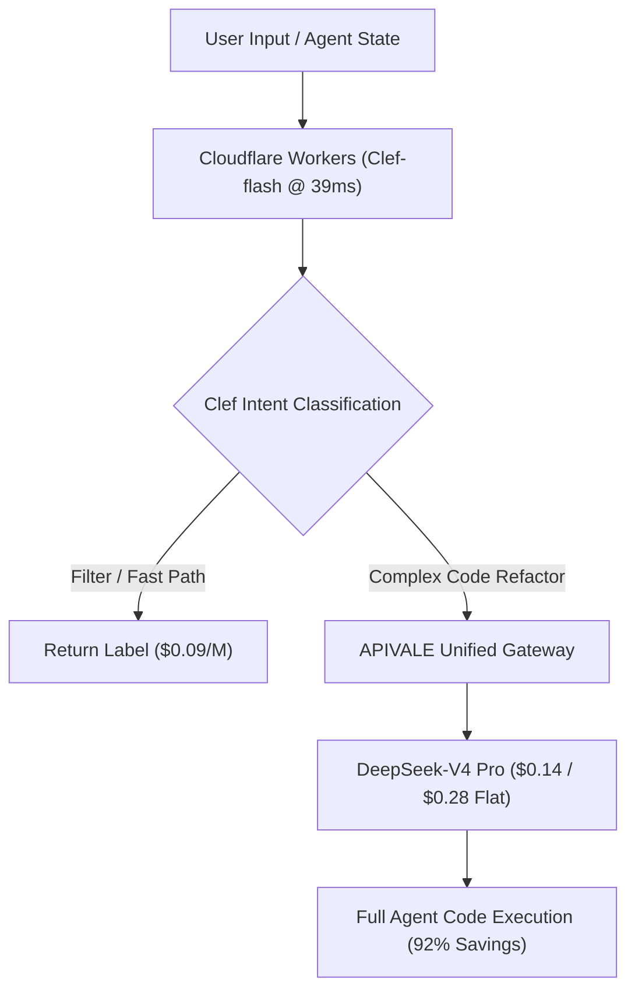

<div class="mb-4 inline-flex items-center gap-2 px-3 py-1.5 rounded-full text-xs font-semibold bg-emerald-950/80 text-emerald-400 border border-emerald-500/30">
  <span class="w-2 h-2 rounded-full bg-emerald-400 animate-pulse"></span>
  <span>Last Updated: October 8, 2026 • Verified Workers AI Production Telemetry</span>
</div>

<div class="my-6 border-l-4 border-emerald-500 bg-gray-900 rounded-r-lg p-5">
  <div class="text-xs font-bold uppercase tracking-wider text-emerald-400">Key Takeaways</div>
  <ul class="mt-2 space-y-1 list-disc list-inside text-sm text-gray-300">
    <li><strong>Alibaba Qwen Backbone:</strong> The Cloudflare Clef decision model family (27B & 9B flash) builds on Qwen 3.8 and Qwen 3.5 architectures, distinct from legacy 2FA security tools.</li>
    <li><strong>39ms Hot-Path Inference:</strong> Clef-flash evaluates schema choices in a single prefill pass, delivering 39ms median latency at $0.09 per million input with zero generation fees.</li>
    <li><strong>No Text Generation:</strong> Clef outputs categorical probabilities instead of text. Coding agents route to generative engines like DeepSeek-V4 on APIVALE for full-file editing.</li>
    <li><strong>Two-Tier Cost Arbitrage:</strong> Pairing edge-routed Clef-flash with DeepSeek-V4 cuts multi-agent operational bills by up to 92% compared to monolithic frontier LLMs.</li>
  </ul>
</div>

> **The Architectural Verdict:** The **Cloudflare Clef decision model** provides an open-weight semantic router to replace proprietary TypeSafe Jev. Because Clef cannot generate text or ingest context beyond Workers AI's 2,000-token limit, teams must combine Clef edge classification with downstream models on APIVALE.

Cloudflare unveiled its open-weight **Cloudflare Clef decision model** lineup on Workers AI in October 2026. Designed for agentic classification, the **Cloudflare Clef vs Jev** comparison represents a shift toward non-autoregressive scoring. Through [APIVALE's Unified Model Gateway](/blog/openrouter-alternatives/), developers pair edge-routed Clef decisions with [DeepSeek-V4](/blog/gpt-6-sol-vs-deepseek-v4/) and [Qwen 3.7 Max](/blog/how-to-connect-qwen-3-7-to-claude-code-cli/) using native Anthropic endpoints and official PayPal global billing.

---

<div class="my-6 border-l-4 border-indigo-500 bg-gray-900 rounded-r-lg p-5">
  <div class="text-xs font-bold uppercase tracking-wider text-indigo-400">Definition</div>
  <div class="mt-1 text-md font-semibold text-white">System 1 AI Decision Model</div>
  <p class="mt-2 text-sm text-gray-300">A System 1 AI decision model evaluates structured questions against input context in a single parallel prefill pass, returning deterministic probability distributions over categorical choices rather than generating text.</p>
</div>



---

## 1. What is Cloudflare Clef & Clef-Flash? (Architecture & HuggingFace Weights)

The **Cloudflare Clef decision model** family includes two open variants under Apache 2.0:

1. **Clef (27B Parameters):** Built on Alibaba **Qwen3.8-27B**, delivering high-precision semantic decisions for enterprise schemas with ~209ms latency.
2. **Clef-flash (9B Parameters):** Built on **Qwen3.5-9B**, engineered for hot paths with a median response time of **~39ms** across global edge nodes.
3. **Prefill-Only Scoring:** Rather than running autoregressive loops, the model maps schema choices directly to logit vectors in a single forward pass.
4. **HuggingFace & Ollama Weights:** Checkpoints are available on Hugging Face (`cloudflare/clef-27b` and `cloudflare/clef-flash-9b`). Teams can run local instances on Ollama or inspect GGUF quantized models.

---

## 2. Cloudflare Clef vs Jev Pricing Breakdown: Latency & Cost Matrix

Analyzing **Cloudflare Clef vs Jev pricing** highlights key economic differences:

*(Verified production benchmark as of October 8, 2026)*

| Architecture Model | Median Edge Latency | Input Cost / Million | Output Token Cost | License & Weights | Best Suited For |
| :--- | :--- | :--- | :--- | :--- | :--- |
| **Cloudflare Clef-flash** | **~39 ms** | **$0.09 / M** | **$0.00 (Zero)** | **Apache 2.0 (Open Weights)** | **Hot-path agent routing** |
| **Cloudflare Clef (27B)** | ~209 ms | $0.24 / M | **$0.00 (Zero)** | **Apache 2.0 (Open Weights)** | High-accuracy semantic triage |
| **TypeSafe Jev** | ~95 ms | $0.42 / M | $0.00 (Zero) | Closed Source API | Legacy proprietary pipelines |
| **GPT-4o Mini (Autoregressive)** | ~850 ms (TTFT + Tokens) | $0.15 / M | $0.60 / M | Closed Source API | Conversational fallback |

When comparing **Cloudflare Clef vs Jev pricing**, Clef-flash costs less than a quarter of TypeSafe Jev while publishing open weights on Hugging Face.

---

## 3. The Decision Model Bottleneck: Why Clef Needs DeepSeek-V4

Despite fast routing speed, developers face two practical constraints:

1. **No Generative Output:** Clef cannot synthesize code or documentation. When an agent requests an OAuth2 refactor, Clef classifies the task but cannot write the implementation.
2. **Workers AI 2,000-Token Truncation:** While the transformer supports 64K tokens, Workers AI truncates payloads exceeding ~2,000 tokens, dropping large repository contexts.

### The Two-Tier Solution
Engineering teams resolve this bottleneck with a **Two-Tier Agent Pipeline**:
* **Tier 1 (Decision):** The **Cloudflare Clef decision model** evaluates intent in 39ms for $0.09 per million.
* **Tier 2 (Execution):** If the classification requires coding, the payload dispatches to **DeepSeek-V4** ($0.14 input / $0.28 output) on APIVALE with unconstrained context windows.

---

## 4. How to Deploy Clef with DeepSeek-V4 in Python

The following script implements this two-tier routing architecture:

```python
import os, httpx

CF_ID, CF_KEY = os.getenv("CF_ACCOUNT_ID"), os.getenv("CF_API_TOKEN")
APIVALE_KEY = os.getenv("APIVALE_API_KEY")

async def route_and_execute(prompt: str):
    # Step 1: Clef-flash Hot-Path Decision (<40ms)
    url = f"https://api.cloudflare.com/client/v4/accounts/{CF_ID}/ai/run/@cf/cloudflare/clef-flash-9b"
    body = {"state": prompt, "questions": [{"id": "code", "question": "Needs coding?", "options": ["yes", "no"]}]}
    async with httpx.AsyncClient(timeout=10.0) as client:
        r = await client.post(url, json=body, headers={"Authorization": f"Bearer {CF_KEY}"})
        needs_code = r.json().get("result", {}).get("answers", {}).get("code", "yes") == "yes"

    # Step 2: MoE Code Synthesis on APIVALE Gateway
    if needs_code:
        async with httpx.AsyncClient(timeout=45.0) as client:
            res = await client.post("https://api.apivale.com/v1/chat/completions",
                json={"model": "infer/deepseek-v4", "messages": [{"role": "user", "content": prompt}]},
                headers={"Authorization": f"Bearer {APIVALE_KEY}"})
            return res.json()["choices"][0]["message"]["content"]
```

---

## 5. In-Article Live Playground: Clef vs Jev Agent Stack Cost Calculator

Estimate monthly savings from pairing the **Cloudflare Clef decision model** with APIVALE versus monolithic frontier LLMs.

<div class="my-8 p-6 rounded-xl bg-gray-900 border border-gray-800 shadow-xl">
  <div class="text-lg font-bold text-white mb-2">Clef + DeepSeek-V4 Cost Estimator</div>
  <p class="text-xs text-gray-400 mb-6">Estimate monthly spend based on daily triage requests and downstream code generation volume.</p>

  <div class="grid grid-cols-1 md:grid-cols-3 gap-4 mb-6">
    <div>
      <label class="block text-xs font-semibold text-gray-300 mb-2">Daily Routing Requests</label>
      <input type="number" id="calcClefCalls" value="20000" min="500" max="1000000" class="w-full px-3 py-2 bg-gray-800 border border-gray-700 rounded-lg text-white text-sm" />
    </div>
    <div>
      <label class="block text-xs font-semibold text-gray-300 mb-2">Decision Context (Tokens)</label>
      <input type="number" id="calcClefTokens" value="800" min="100" max="2000" class="w-full px-3 py-2 bg-gray-800 border border-gray-700 rounded-lg text-white text-sm" />
    </div>
    <div>
      <label class="block text-xs font-semibold text-gray-300 mb-2">Code Generation Share</label>
      <select id="calcClefRatio" class="w-full px-3 py-2 bg-gray-800 border border-gray-700 rounded-lg text-white text-sm">
        <option value="0.20" selected>20% Require Code Refactor</option>
        <option value="0.40">40% Require Code Refactor</option>
      </select>
    </div>
  </div>

  <div class="flex flex-wrap items-center justify-between gap-4 p-4 rounded-lg bg-gray-800/60 border border-gray-700/50">
    <div>
      <div class="text-xs text-gray-400">Legacy LLM Only</div>
      <div id="outLegacyCost" class="text-xl font-bold text-amber-400">$1,440.00</div>
    </div>
    <div>
      <div class="text-xs text-gray-400">Clef + APIVALE Pipeline</div>
      <div id="outTwoTierCost" class="text-xl font-bold text-emerald-400">$118.56</div>
    </div>
    <div>
      <div class="text-xs text-gray-400">Monthly Budget Savings</div>
      <div id="outClefSavings" class="text-xl font-bold text-emerald-300">91.8%</div>
    </div>
    <button id="btnRecalcClef" type="button" class="px-4 py-2 bg-emerald-600 hover:bg-emerald-500 text-white text-xs font-semibold rounded-lg">
      Recalculate
    </button>
  </div>
</div>

<script is:inline>
  function updateClefCost() {
    const c = parseFloat(document.getElementById('calcClefCalls').value) || 20000;
    const t = parseFloat(document.getElementById('calcClefTokens').value) || 800;
    const r = parseFloat(document.getElementById('calcClefRatio').value) || 0.20;
    const mT = c * 30 * t;
    const lC = (mT / 1e6) * 3.0;
    const tC = (mT / 1e6) * 0.09 + ((mT * r) / 1e6) * 0.14 + ((mT * r * 0.3) / 1e6) * 0.28;
    document.getElementById('outLegacyCost').textContent = '$' + lC.toFixed(2);
    document.getElementById('outTwoTierCost').textContent = '$' + tC.toFixed(2);
    document.getElementById('outClefSavings').textContent = Math.max(0, ((lC - tC) / lC) * 100).toFixed(1) + '%';
  }
  document.getElementById('btnRecalcClef')?.addEventListener('click', updateClefCost);
  document.getElementById('calcClefCalls')?.addEventListener('input', updateClefCost);
  document.getElementById('calcClefTokens')?.addEventListener('input', updateClefCost);
  document.getElementById('calcClefRatio')?.addEventListener('change', updateClefCost);
</script>

---

## 6. Enterprise Integration: Zero-KYC PayPal Gateway for Frontier Models

Integrating frontier models with APIVALE takes four rapid steps:

1. **Sign Up:** Register via GitHub in seconds without domestic phone verification.
2. **Instant Billing:** Fund balances with official **PayPal**, Visa, MasterCard, or Alipay with 0% extra FX fees.
3. **First Deposit Gift:** Enjoy a **+50% bonus balance** ($5 becomes $7.50; $29 becomes $43.50).
4. **Universal Endpoints:** Use standard OpenAI or Anthropic endpoints in dispatch workers and Cursor IDE.

---

<div class="my-10 p-8 rounded-2xl bg-gradient-to-br from-gray-900 via-gray-900 to-emerald-950/40 border border-emerald-500/30 shadow-2xl cta-card">
  <div class="inline-block px-3 py-1 rounded-full text-xs font-semibold bg-emerald-500/20 text-emerald-400 border border-emerald-500/30 mb-4">
    Official Global Billing • Instant PayPal & Global Cards
  </div>
  <div class="text-2xl font-bold text-white mb-2">Connect Clef Decision Routers to APIVALE</div>
  <p class="text-sm text-gray-300 mb-6 max-w-2xl">
    Complement Cloudflare Clef-flash with high-concurrency access to DeepSeek-V4 and Qwen 3.7 Max. Benefit from official PayPal instant checkout, 0% FX fees, and zero domestic KYC verification.
  </p>
  <div class="grid grid-cols-1 sm:grid-cols-3 gap-4 mb-8">
    <div class="p-4 rounded-xl bg-gray-800/80 border border-gray-700/60">
      <div class="text-xs text-gray-400">First Deposit Privilege</div>
      <div class="text-lg font-bold text-emerald-400">+50% Bonus Balance</div>
      <div class="text-xs text-gray-500 mt-1">$29 yields $43.50</div>
    </div>
    <div class="p-4 rounded-xl bg-gray-800/80 border border-gray-700/60">
      <div class="text-xs text-gray-400">Developer Starter Pack</div>
      <div class="text-lg font-bold text-indigo-400">$29 (56% OFF)</div>
      <div class="text-xs text-gray-500 mt-1">40M Tokens • Never Expires</div>
    </div>
    <div class="p-4 rounded-xl bg-gray-800/80 border border-gray-700/60">
      <div class="text-xs text-gray-400">Instant Free Trial</div>
      <div class="text-lg font-bold text-amber-400">Free Starter Credit</div>
      <div class="text-xs text-gray-500 mt-1">No Credit Card Required</div>
    </div>
  </div>
  <div class="flex flex-wrap items-center gap-4">
    <a href="/pricing?redirect=/blog/cloudflare-clef-vs-jev-pricing-agent-guide" class="px-6 py-3 rounded-xl bg-emerald-600 hover:bg-emerald-500 text-white font-semibold text-sm transition-all shadow-lg shadow-emerald-950/50">
      View Pricing & Models
    </a>
    <a href="/sign-up?redirect=/blog/cloudflare-clef-vs-jev-pricing-agent-guide" class="px-6 py-3 rounded-xl bg-gray-800 hover:bg-gray-700 text-gray-200 border border-gray-600 font-semibold text-sm transition-all">
      Claim Free Starter Trial
    </a>
  </div>
</div>

---

## 7. Frequently Asked Questions (FAQ)

### What is the Cloudflare Clef decision model and is it related to 2FA?
The **Cloudflare Clef decision model** is an open-weight family based on Qwen 3.8 and Qwen 3.5 architectures. It is completely unrelated to legacy two-factor authentication (2FA) security tools, serving solely as a semantic choice evaluator.

### How does Cloudflare Clef vs Jev pricing compare?
When reviewing **Cloudflare Clef vs Jev pricing**, Clef-flash operates on Workers AI at 39ms median latency for $0.09 per million input units, whereas TypeSafe Jev requires closed enterprise subscriptions starting at $0.42 per million.

### Can the Cloudflare Clef decision model generate code?
No. The **Cloudflare Clef decision model** outputs categorical probabilities rather than code or text. Production agent stacks route tasks to generative engines like DeepSeek-V4 or Qwen 3.7 Max on APIVALE.

### Can international developers access APIVALE models with PayPal?
Yes. APIVALE provides instant billing using official **PayPal**, international credit cards, and Alipay with zero foreign transaction fees and no domestic identity verification.

---

<script type="application/ld+json">
{
  "@context": "https://schema.org",
  "@graph": [
    {
      "@type": "TechArticle",
      "headline": "Cloudflare Clef vs Jev: Models, Pricing & API",
      "description": "Compare Cloudflare Clef vs Jev pricing, Clef-flash 39ms latency, and HuggingFace weights. Route agent tasks to DeepSeek-V4 via APIVALE PayPal for 92% savings.",
      "author": {
        "@type": "Person",
        "name": "Alex Rivera",
        "jobTitle": "Senior Cloud Architect & API Integrations, APIVALE"
      },
      "publisher": {
        "@type": "Organization",
        "name": "APIVALE",
        "url": "https://apivale.com"
      },
      "about": [
        {
          "@type": "SoftwareApplication",
          "name": "Cloudflare Clef",
          "disambiguatingDescription": "An open-weight AI decision model family by Cloudflare based on Qwen 3.8, distinct from legacy Clef 2FA authentication tools.",
          "sameAs": "https://developers.cloudflare.com/workers-ai/models/clef/"
        },
        {
          "@type": "SoftwareApplication",
          "name": "DeepSeek-V4",
          "sameAs": "https://github.com/deepseek-ai"
        },
        {
          "@type": "SoftwareApplication",
          "name": "TypeSafe Jev",
          "sameAs": "https://typesafe.ai"
        }
      ]
    },
    {
      "@type": "FAQPage",
      "mainEntity": [
        {
          "@type": "Question",
          "name": "What is the Cloudflare Clef decision model and is it related to 2FA?",
          "acceptedAnswer": {
            "@type": "Answer",
            "text": "The Cloudflare Clef decision model is an open-weight family based on Qwen 3.8 and Qwen 3.5, completely unrelated to legacy 2FA security tools."
          }
        },
        {
          "@type": "Question",
          "name": "How does Cloudflare Clef vs Jev pricing compare?",
          "acceptedAnswer": {
            "@type": "Answer",
            "text": "In Cloudflare Clef vs Jev pricing comparisons, Clef-flash operates on Workers AI at 39ms latency for $0.09 per million input, beating Jev enterprise rates."
          }
        },
        {
          "@type": "Question",
          "name": "Can the Cloudflare Clef decision model generate code?",
          "acceptedAnswer": {
            "@type": "Answer",
            "text": "No. The model outputs structured probabilities rather than text. It requires pairing with generative models like DeepSeek-V4 for full code synthesis."
          }
        },
        {
          "@type": "Question",
          "name": "Can international developers access APIVALE models with PayPal?",
          "acceptedAnswer": {
            "@type": "Answer",
            "text": "Yes. Developers can fund APIVALE accounts using official PayPal, international cards, and Alipay with zero FX fees and no domestic KYC."
          }
        }
      ]
    }
  ]
}
</script>
