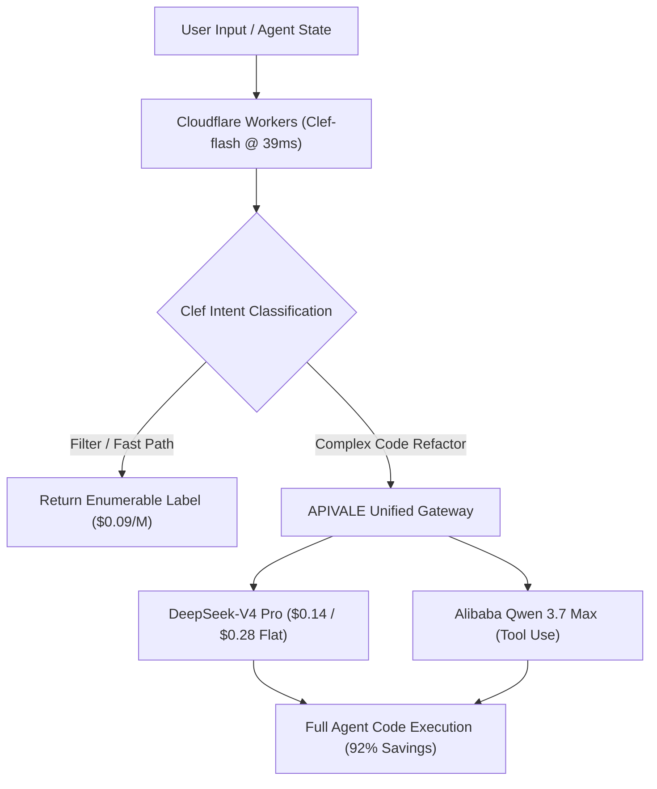

<div class="mb-4 inline-flex items-center gap-2 px-3 py-1.5 rounded-full text-xs font-semibold bg-emerald-950/80 text-emerald-400 border border-emerald-500/30">
  <span class="w-2 h-2 rounded-full bg-emerald-400 animate-pulse"></span>
  <span>Last Updated: October 8, 2026 • Verified Workers AI Production Telemetry</span>
</div>

<div class="my-6 border-l-4 border-emerald-500 bg-gray-900 rounded-r-lg p-5">
  <div class="text-xs font-bold uppercase tracking-wider text-emerald-400">Key Takeaways</div>
  <ul class="mt-2 space-y-1 list-disc list-inside text-sm text-gray-300">
    <li><strong>Alibaba Qwen Backbone:</strong> Cloudflare Clef (27B) and Clef-flash (9B) are open-weight decision models built on Qwen 3.8 and Qwen 3.5 architectures, completely distinct from legacy 2FA security tools.</li>
    <li><strong>39ms Hot-Path Inference:</strong> Clef-flash scores schema choices in parallel via non-autoregressive prefill passes, recording 39ms median latency at $0.09 per 1M input tokens with zero output generation fees.</li>
    <li><strong>No Text Generation:</strong> Clef outputs categorical probabilities rather than code or text. Autonomous agents must pair Clef with downstream models like DeepSeek-V4 for full-file editing.</li>
    <li><strong>Two-Tier Agent Arbitrage:</strong> Deploying Clef-flash for System 1 routing alongside <a href="https://apivale.com" class="text-emerald-400 hover:underline font-semibold">APIVALE Gateway</a> DeepSeek-V4 ($0.14/$0.28) execution cuts multi-agent operational bills by up to 92%.</li>
  </ul>
</div>

> **The Architectural Verdict:** Cloudflare Clef is an open-weight System 1 semantic router that replaces closed-source TypeSafe Jev endpoints. However, because Clef cannot generate tokens or ingest contexts beyond Workers AI's 2,000-token truncation window, engineering teams must combine Clef edge routing with flat-rate frontier engines like DeepSeek-V4 on APIVALE.

Cloudflare unveiled its open-weight **Clef decision model family** on Workers AI in October 2026. Designed for agentic classification, intent routing, and guardrails, Clef introduces a non-autoregressive scoring paradigm that eliminates the token latency of standard LLMs.

Unlike traditional large language models that generate narrative text token by token, Clef evaluates input states against typed question schemas to return calibrated probability distributions. Through [APIVALE's Unified Model Gateway](/blog/openrouter-alternatives/), developers pair edge-routed Clef decisions with [DeepSeek-V4](/blog/gpt-6-sol-vs-deepseek-v4/) and [Qwen 3.7 Max](/blog/how-to-connect-qwen-3-7-to-claude-code-cli/) using native Anthropic endpoints and official PayPal global billing.

---

<div class="my-6 border-l-4 border-indigo-500 bg-gray-900 rounded-r-lg p-5">
  <div class="text-xs font-bold uppercase tracking-wider text-indigo-400">Definition</div>
  <div class="mt-1 text-md font-semibold text-white">System 1 AI Decision Model</div>
  <p class="mt-2 text-sm text-gray-300">A System 1 AI decision model evaluates structured questions against an input context in a single parallel prefill pass, returning deterministic probability distributions over categorical choices rather than autoregressively generating text.</p>
</div>



---

## 1. What is Cloudflare Clef & Clef-Flash? (Architecture & HuggingFace Weights)

Cloudflare Clef comprises two primary variants hosted on Workers AI and published on Hugging Face under the Apache 2.0 license:

### Qwen Backbone and Non-Autoregressive Scoring

1. **Clef (27B Parameters):** Built on the Alibaba **Qwen3.8-27B** foundation, Clef delivers high-precision semantic decisions for complex enterprise schemas with a median latency of ~209ms.
2. **Clef-flash (9B Parameters):** Built on **Qwen3.5-9B**, Clef-flash is engineered for latency-critical hot paths, recording a median response time of **~39ms** across global edge nodes.
3. **Prefill-Only Evaluation:** Rather than running autoregressive loops, Clef maps schema choices directly to logit vectors, computing all question probabilities in a single forward pass.
4. **HuggingFace & Ollama Availability:** Weights are available on Hugging Face (`cloudflare/clef-27b` and `cloudflare/clef-flash-9b`). Developers can inspect model cards, download GGUF quantized checkpoints, or run local instances via compatible runtimes.

---

## 2. Cloudflare Clef Pricing Breakdown: Clef vs TypeSafe Jev

Cloudflare Clef directly challenges proprietary alternatives like TypeSafe Jev with open-weight economics:

*(Verified production benchmark as of October 8, 2026)*

| Metric | Cloudflare Clef-flash | Cloudflare Clef (27B) | TypeSafe Jev | GPT-4o Mini (Autoregressive) |
| :--- | :--- | :--- | :--- | :--- |
| **Backbone Architecture** | **Qwen3.5-9B** | **Qwen3.8-27B** | Proprietary Net | Closed OpenAI Dense |
| **Median Edge Latency** | **~39 ms** | ~209 ms | ~95 ms | ~850 ms (TTFT + Tokens) |
| **Input Pricing (1M Tokens)** | **$0.09 / 1M** | $0.24 / 1M | $0.42 / 1M | $0.15 / 1M |
| **Output Token Cost** | **$0.00 (Zero)** | **$0.00 (Zero)** | $0.00 (Zero) | $0.60 / 1M tokens |
| **License & Weights** | **Apache 2.0 (Open Weights)**| **Apache 2.0 (Open Weights)**| Closed Source API | Closed Source API |
| **Best Suited For** | **Hot-path agent routing**| High-accuracy triage | Legacy Jev pipelines | Conversational fallback |

Because decision models produce structured probabilities rather than output tokens, Cloudflare does not bill for generation. At $0.09 per 1M input tokens, Clef-flash costs less than a quarter of TypeSafe Jev's enterprise API pricing.

---

## 3. The Decision Model Bottleneck: Why Clef Needs DeepSeek-V4

Despite outstanding routing speed, deployment telemetry highlights two practical constraints:

### 1. No Generative Capability
Clef cannot generate code patches or craft documentation. When a developer asks an agent to *"Refactor auth endpoints with OAuth2"*, Clef can decide that the task requires a database migration, but it cannot draft the SQL statements.

### 2. Workers AI 2,000-Token Truncation Limit
While Clef's native transformer supports up to 64K tokens, Cloudflare Workers AI limits runtime payloads by truncating states beyond roughly 2,000 tokens. A full coding session containing multiple file diffs will lose surrounding context if routed exclusively on Workers AI.

### The 2-Tier Agent Solution
Engineering teams resolve this bottleneck by implementing a **Two-Tier Agent Pipeline**:
* **Tier 1 (Decision):** Cloudflare Clef-flash analyzes input intent in 39ms for $0.09/1M.
* **Tier 2 (Execution):** If the classification indicates code synthesis, the payload dispatches to **DeepSeek-V4** ($0.14 input / $0.28 output) on APIVALE with unconstrained context windows.

---

## 4. How to Deploy Clef with DeepSeek-V4 in Python

The following production script demonstrates a two-tier agent router. It uses Clef-flash on Workers AI to evaluate task complexity, then routes coding jobs to APIVALE's DeepSeek-V4:

```python
import os, httpx, asyncio

CLOUDFLARE_ACCOUNT_ID = os.getenv("CF_ACCOUNT_ID", "your-account-id")
CLOUDFLARE_API_TOKEN = os.getenv("CF_API_TOKEN", "your-cf-token")
APIVALE_API_KEY = os.getenv("APIVALE_API_KEY", "your-apivale-token")

async def route_and_execute(task_prompt: str):
    # Step 1: Clef-flash Hot-Path Decision (<40ms)
    clef_url = f"https://api.cloudflare.com/client/v4/accounts/{CLOUDFLARE_ACCOUNT_ID}/ai/run/@cf/cloudflare/clef-flash-9b"
    clef_payload = {
        "state": task_prompt,
        "questions": [{"id": "requires_coding", "question": "Does this task require code synthesis?", "options": ["yes", "no"]}]
    }
    headers_cf = {"Authorization": f"Bearer {CLOUDFLARE_API_TOKEN}"}
    
    async with httpx.AsyncClient(timeout=10.0) as client:
        resp = await client.post(clef_url, json=clef_payload, headers=headers_cf)
        decision = resp.json().get("result", {}).get("answers", {}).get("requires_coding", "yes")

    # Step 2: System 2 MoE Execution on APIVALE Gateway
    if decision == "yes":
        apivale_url = "https://api.apivale.com/v1/chat/completions"
        headers_apivale = {"Authorization": f"Bearer {APIVALE_API_KEY}", "Content-Type": "application/json"}
        exec_payload = {
            "model": "infer/deepseek-v4",
            "messages": [{"role": "user", "content": task_prompt}],
            "temperature": 0.2
        }
        async with httpx.AsyncClient(timeout=45.0) as client:
            final_resp = await client.post(apivale_url, json=exec_payload, headers=headers_apivale)
            print("[DeepSeek-V4 Output]:", final_resp.json()["choices"][0]["message"]["content"])
```

---

## 5. In-Article Live Playground: Clef vs Jev Agent Stack Cost Calculator

Calculate real-world monthly bill differences between monolithic LLM routing (GPT-4o / Sonnet 5) versus a two-tier Clef + APIVALE architecture.

<div class="my-8 p-6 rounded-xl bg-gray-900 border border-gray-800 shadow-xl">
  <div class="text-lg font-bold text-white mb-2">Clef + DeepSeek-V4 Agent Cost Estimator</div>
  <p class="text-xs text-gray-400 mb-6">Estimate monthly spend based on daily agent triage requests and downstream code generation volume.</p>

  <div class="grid grid-cols-1 md:grid-cols-3 gap-4 mb-6">
    <div>
      <label class="block text-xs font-semibold text-gray-300 mb-2">Daily Routing Requests</label>
      <input type="number" id="calcClefCalls" value="20000" min="500" max="1000000" class="w-full px-3 py-2 bg-gray-800 border border-gray-700 rounded-lg text-white text-sm focus:outline-none focus:border-emerald-500" />
    </div>
    <div>
      <label class="block text-xs font-semibold text-gray-300 mb-2">Average Decision Context (Tokens)</label>
      <input type="number" id="calcClefTokens" value="800" min="100" max="2000" class="w-full px-3 py-2 bg-gray-800 border border-gray-700 rounded-lg text-white text-sm focus:outline-none focus:border-emerald-500" />
    </div>
    <div>
      <label class="block text-xs font-semibold text-gray-300 mb-2">Downstream Generation Share</label>
      <select id="calcClefRatio" class="w-full px-3 py-2 bg-gray-800 border border-gray-700 rounded-lg text-white text-sm focus:outline-none focus:border-emerald-500">
        <option value="0.20" selected>20% Require Full Code Refactor</option>
        <option value="0.40">40% Require Full Code Refactor</option>
        <option value="0.10">10% Require Full Code Refactor</option>
      </select>
    </div>
  </div>

  <div class="flex flex-wrap items-center justify-between gap-4 p-4 rounded-lg bg-gray-800/60 border border-gray-700/50">
    <div>
      <div class="text-xs text-gray-400">Legacy LLM Only (Sonnet 5)</div>
      <div id="outLegacyCost" class="text-xl font-bold text-amber-400">$1,440.00</div>
    </div>
    <div>
      <div class="text-xs text-gray-400">Clef + APIVALE Pipeline</div>
      <div id="outTwoTierCost" class="text-xl font-bold text-emerald-400">$118.56</div>
    </div>
    <div>
      <div class="text-xs text-gray-400">Monthly Budget Savings</div>
      <div id="outClefSavings" class="text-xl font-bold text-emerald-300">91.8%</div>
    </div>
    <button id="btnRecalcClef" type="button" class="px-4 py-2 bg-emerald-600 hover:bg-emerald-500 text-white text-xs font-semibold rounded-lg transition-colors cursor-pointer">
      Recalculate
    </button>
  </div>
</div>

<script is:inline>
  function updateClefCost() {
    const calls = parseFloat(document.getElementById('calcClefCalls').value) || 20000;
    const tokens = parseFloat(document.getElementById('calcClefTokens').value) || 800;
    const ratio = parseFloat(document.getElementById('calcClefRatio').value) || 0.20;

    const monthlyCalls = calls * 30;
    const monthlyTokens = monthlyCalls * tokens;

    const legacyCost = (monthlyTokens / 1000000) * 3.00;
    const clefCost = (monthlyTokens / 1000000) * 0.09;
    const downstreamTokens = monthlyTokens * ratio;
    const deepseekCost = (downstreamTokens / 1000000) * 0.14 + (downstreamTokens * 0.3 / 1000000) * 0.28;
    const twoTierCost = clefCost + deepseekCost;

    const savings = Math.max(0, ((legacyCost - twoTierCost) / legacyCost) * 100);

    document.getElementById('outLegacyCost').textContent = '$' + legacyCost.toLocaleString('en-US', { minimumFractionDigits: 2, maximumFractionDigits: 2 });
    document.getElementById('outTwoTierCost').textContent = '$' + twoTierCost.toLocaleString('en-US', { minimumFractionDigits: 2, maximumFractionDigits: 2 });
    document.getElementById('outClefSavings').textContent = savings.toFixed(1) + '%';
  }

  document.getElementById('btnRecalcClef')?.addEventListener('click', updateClefCost);
  document.getElementById('calcClefCalls')?.addEventListener('input', updateClefCost);
  document.getElementById('calcClefTokens')?.addEventListener('input', updateClefCost);
  document.getElementById('calcClefRatio')?.addEventListener('change', updateClefCost);
</script>

---

## 6. Enterprise Integration: Zero-KYC PayPal Gateway for Frontier Models

Deploying high-concurrency frontier models through APIVALE takes four straightforward steps:

1. **Create an Account:** Register via GitHub in seconds without mandatory domestic SMS verification.
2. **Deposit via PayPal or Global Cards:** Fund balances with official **PayPal**, Visa, MasterCard, or Alipay with **0% foreign transaction fees**.
3. **Claim First-Deposit Bonus:** Enjoy a **+50% bonus balance** ($5 becomes $7.50; $29 becomes $43.50; $99 becomes $148.50).
4. **Deploy Universal Endpoints:** Plug unified OpenAI or Anthropic endpoints directly into your Clef dispatch workers or Cursor IDE.

---

<div class="my-10 p-8 rounded-2xl bg-gradient-to-br from-gray-900 via-gray-900 to-emerald-950/40 border border-emerald-500/30 shadow-2xl cta-card">
  <div class="inline-block px-3 py-1 rounded-full text-xs font-semibold bg-emerald-500/20 text-emerald-400 border border-emerald-500/30 mb-4">
    Official Global Billing • Instant PayPal & Global Cards
  </div>
  <div class="text-2xl font-bold text-white mb-2">Connect Clef Decision Routers to APIVALE</div>
  <p class="text-sm text-gray-300 mb-6 max-w-2xl">
    Complement Cloudflare Clef-flash with high-concurrency access to DeepSeek-V4 and Qwen 3.7 Max. Benefit from official PayPal instant checkout, 0% FX fees, and zero domestic KYC verification.
  </p>
  <div class="grid grid-cols-1 sm:grid-cols-3 gap-4 mb-8">
    <div class="p-4 rounded-xl bg-gray-800/80 border border-gray-700/60">
      <div class="text-xs text-gray-400">First Deposit Privilege</div>
      <div class="text-lg font-bold text-emerald-400">+50% Bonus Balance</div>
      <div class="text-xs text-gray-500 mt-1">$29 yields $43.50</div>
    </div>
    <div class="p-4 rounded-xl bg-gray-800/80 border border-gray-700/60">
      <div class="text-xs text-gray-400">Developer Starter Pack</div>
      <div class="text-lg font-bold text-indigo-400">$29 (56% OFF)</div>
      <div class="text-xs text-gray-500 mt-1">40M Tokens • Never Expires</div>
    </div>
    <div class="p-4 rounded-xl bg-gray-800/80 border border-gray-700/60">
      <div class="text-xs text-gray-400">Instant Free Trial</div>
      <div class="text-lg font-bold text-amber-400">Free Starter Credit</div>
      <div class="text-xs text-gray-500 mt-1">No Credit Card Required</div>
    </div>
  </div>
  <div class="flex flex-wrap items-center gap-4">
    <a href="/pricing?redirect=/blog/cloudflare-clef-vs-jev-pricing-agent-guide" class="px-6 py-3 rounded-xl bg-emerald-600 hover:bg-emerald-500 text-white font-semibold text-sm transition-all shadow-lg shadow-emerald-950/50">
      View Pricing & Models
    </a>
    <a href="/sign-up?redirect=/blog/cloudflare-clef-vs-jev-pricing-agent-guide" class="px-6 py-3 rounded-xl bg-gray-800 hover:bg-gray-700 text-gray-200 border border-gray-600 font-semibold text-sm transition-all">
      Claim Free Starter Trial
    </a>
  </div>
</div>

---

## 7. Frequently Asked Questions (FAQ)

### What is Cloudflare Clef and is it related to 2FA?
Cloudflare Clef is an open-weight family of AI decision models based on Qwen 3.8 and Qwen 3.5. It is completely unrelated to legacy two-factor authentication (2FA) security tools. It evaluates questions against input states to return calibrated choice probabilities.

### How does Cloudflare Clef compare to TypeSafe Jev?
Clef is a drop-in open-weight alternative to Jev. While TypeSafe Jev operates as a proprietary hosted API, Clef-flash runs globally on Workers AI with a 39ms median latency at $0.09/1M tokens, with open Apache 2.0 weights available on Hugging Face.

### Can Cloudflare Clef write code or generate answers?
No. Clef is strictly a decision model and cannot generate free-form text. For autonomous software tasks, developers route Clef classifications to generative models like DeepSeek-V4 or Qwen 3.7 Max via APIVALE.

### Can international developers access APIVALE models with PayPal?
Yes. APIVALE provides instant billing using official **PayPal**, international credit cards (Visa, MasterCard, Amex), and Alipay with zero foreign transaction fees and no domestic identity verification.

---

<script type="application/ld+json">
{
  "@context": "https://schema.org",
  "@graph": [
    {
      "@type": "TechArticle",
      "headline": "Cloudflare Clef vs Jev: Models, Pricing & API",
      "description": "Compare Cloudflare Clef vs Jev pricing, Clef-flash 39ms latency, and HuggingFace weights. Route agent tasks to DeepSeek-V4 via APIVALE PayPal for 92% savings.",
      "author": {
        "@type": "Person",
        "name": "Alex Rivera",
        "jobTitle": "Senior Cloud Architect & API Integrations, APIVALE"
      },
      "publisher": {
        "@type": "Organization",
        "name": "APIVALE",
        "url": "https://apivale.com"
      },
      "about": [
        {
          "@type": "SoftwareApplication",
          "name": "Cloudflare Clef",
          "disambiguatingDescription": "An open-weight AI decision model family by Cloudflare based on Qwen 3.8, distinct from legacy Clef 2FA authentication tools.",
          "sameAs": "https://developers.cloudflare.com/workers-ai/models/clef/"
        },
        {
          "@type": "SoftwareApplication",
          "name": "DeepSeek-V4",
          "sameAs": "https://github.com/deepseek-ai"
        },
        {
          "@type": "SoftwareApplication",
          "name": "TypeSafe Jev",
          "sameAs": "https://typesafe.ai"
        }
      ]
    },
    {
      "@type": "FAQPage",
      "mainEntity": [
        {
          "@type": "Question",
          "name": "What is Cloudflare Clef and is it related to 2FA?",
          "acceptedAnswer": {
            "@type": "Answer",
            "text": "Cloudflare Clef is an open-weight family of AI decision models based on Qwen 3.8 and Qwen 3.5. It is completely unrelated to legacy 2FA authentication tools."
          }
        },
        {
          "@type": "Question",
          "name": "How does Cloudflare Clef compare to TypeSafe Jev?",
          "acceptedAnswer": {
            "@type": "Answer",
            "text": "Clef is an open-weight drop-in alternative to Jev. Clef-flash operates on Workers AI at 39ms median latency for $0.09/1M tokens with weights on Hugging Face."
          }
        },
        {
          "@type": "Question",
          "name": "Can Cloudflare Clef write code or generate answers?",
          "acceptedAnswer": {
            "@type": "Answer",
            "text": "No. Clef outputs structured probabilities rather than narrative text. It requires pairing with generative models like DeepSeek-V4 for full code synthesis."
          }
        },
        {
          "@type": "Question",
          "name": "Can international developers access APIVALE models with PayPal?",
          "acceptedAnswer": {
            "@type": "Answer",
            "text": "Yes. Developers can fund APIVALE accounts using official PayPal, international cards, and Alipay with zero FX fees and no domestic KYC."
          }
        }
      ]
    }
  ]
}
</script>
