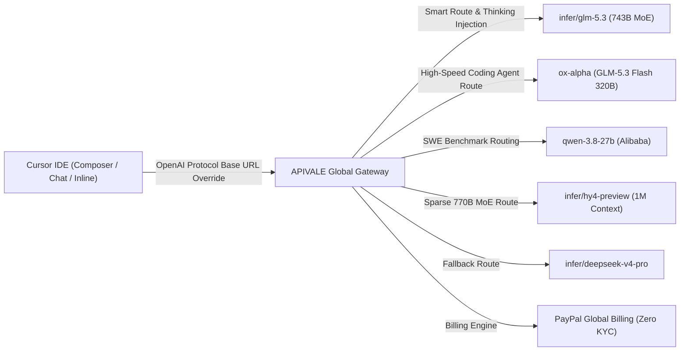

<div class="my-6 border-l-4 border-emerald-500 bg-gray-900 rounded-r-lg p-5">
  <span class="text-xs font-bold uppercase tracking-wider text-emerald-400">Key Takeaways</span>
  <ul class="mt-2 space-y-1 list-disc list-inside text-sm text-gray-300">
    <li><strong>96% BYOK Cost Savings:</strong> Replacing Cursor Pro extra fast requests ($0.10/request) with APIVALE's GLM-5.3 endpoint cuts per-request cost to ~$0.0038. See our detailed <a href="/blog/cursor-pro-vs-custom-api-key/" class="text-emerald-400 hover:underline font-semibold">Cursor BYOK vs Pro cost math</a>.</li>
    <li><strong>1M Context in Composer:</strong> Ingest full multi-file repositories in Cursor Composer without context degradation or token truncation.</li>
    <li><strong>Zero-KYC Waffo Global Billing:</strong> Bypasses mainland +86 phone verification and foreign card decline issues on official Zhipu portals with instant checkout via Waffo.</li>
  </ul>
</div>

<div class="my-4 border-l-4 border-cyan-500 bg-gray-900/90 rounded-r-lg p-4">
  <span class="text-xs font-bold uppercase tracking-wider text-cyan-400">Related GLM & Coding Agent Guides</span>
  <p class="mt-1 text-sm text-gray-300">
    Looking for higher token throughput and lower costs? Follow our step-by-step tutorial on <a href="/blog/ox-alpha-claude-code-cursor-setup/" class="text-cyan-400 hover:underline font-semibold">how to use Ox Alpha in Claude Code & Cursor</a>, read our <a href="/blog/glm-5-3-flash-ox-alpha-api-pricing-guide/" class="text-cyan-400 hover:underline font-semibold">GLM-5.3 Flash (Ox Alpha) Benchmarks & Pricing Guide</a>, see our breakdown on <a href="/blog/cursor-pro-vs-custom-api-key/" class="text-cyan-400 hover:underline font-semibold">Cursor BYOK vs Pro subscription cost math</a>, and learn <a href="/blog/how-to-connect-qwen-3-8-to-claude-code-cli/" class="text-cyan-400 hover:underline font-semibold">how to connect Qwen 3.8 to Claude Code CLI & Cursor</a> to cut token spend by 80%.
  </p>
</div>

<div id="single-url-interactive-banner" class="my-6 border border-indigo-500/30 bg-gradient-to-r from-indigo-950/40 via-purple-950/20 to-gray-900 rounded-xl p-6 shadow-xl">
  <div class="flex items-center justify-between flex-wrap gap-3 mb-3">
    <span class="inline-flex items-center text-xs font-bold uppercase tracking-wider text-cyan-400 bg-cyan-950/60 border border-cyan-800/50 px-3 py-1 rounded-full">
      ⚡ Single-URL Interactive Feature
    </span>
    <span id="user-auth-status-badge" class="text-xs text-gray-400 bg-gray-800 px-3 py-1 rounded-full">
      Guest View (Default Template)
    </span>
  </div>
  <p id="user-auth-status-desc" class="text-sm text-gray-300 mb-4 leading-relaxed">
    Sign up for a free APIVALE account to claim <strong>$0.20 free starter credit</strong>. Your personal API key will automatically fill into setup commands below!
  </p>
  <div class="flex items-center gap-3 flex-wrap">
    <a id="cta-login-btn" href="https://apivel.com/sign-up?redirect=/blog/connect-glm-5-3-to-claude-code-cli-cursor/" class="inline-flex items-center text-xs font-semibold bg-indigo-600 hover:bg-indigo-500 text-white px-4 py-2.5 rounded-lg transition-all shadow-md">
      ⚡ Sign Up / Log In to Auto-Fill Your API Key
    </a>
    <button id="copy-script-btn" onclick="navigator.clipboard.writeText('Base URL: https://apivel.com/v1\nModel: infer/glm-5.3'); const b=this; b.innerText='✅ Copied!'; setTimeout(()=>b.innerText='📋 Copy Cursor Config', 2000);" class="inline-flex items-center text-xs font-semibold bg-gray-800 hover:bg-gray-700 text-gray-200 border border-gray-700 px-4 py-2.5 rounded-lg transition-all">
      📋 Copy Cursor Config
    </button>
  </div>
</div>

Developers running intensive AI coding workflows inside **Cursor IDE** and **Windsurf** frequently hit rate limits on standard Pro subscriptions or face $0.10 surcharges per additional fast request. While Zhipu's **GLM-5.3** delivers elite coding benchmark performance (+50% uplift over GLM-5.2 on code completion and CyberGym security audits), international developers face +86 SMS verification hurdles and domestic payment restrictions on native portals (see our detailed breakdown on <a href="/blog/bypass-zhipu-ai-real-name-verification/" class="text-cyan-400 hover:underline font-semibold">Z.ai billing top-up, credit card &amp; real-name verification fixes</a>).

By leveraging APIVALE's OpenAI-compatible routing gateway, developers can Bring Your Own Key (BYOK) into Cursor, unlocking GLM-5.3's 1M context window and deep post-training reasoning for **~$0.0038 per typical edit** with frictionless <a href="/blog/openrouter-alternatives/" class="text-cyan-400 hover:underline font-semibold">PayPal Global Billing</a>.



> [!TIP]
> Looking for alternative high-speed MoE coding engines? Check out our complete setup walkthrough for [how to use Ox Alpha in Claude Code & Cursor](/blog/ox-alpha-claude-code-cursor-setup/) and our guide on [connecting Qwen 3.8 to Claude Code CLI and Cursor](/blog/how-to-connect-qwen-3-8-to-claude-code-cli/).

---

## What is GLM-5.3 Integration on Cursor IDE?

Configure APIVALE's OpenAI-compatible proxy gateway to route Cursor IDE requests to GLM-5.3 with zero-KYC PayPal billing.

<div class="my-6 border-l-4 border-indigo-500 bg-gray-900 rounded-r-lg p-5">
  <span class="text-xs font-bold uppercase tracking-wider text-indigo-400">Definition</span>
  <div class="mt-1 text-md font-semibold text-white">GLM-5.3 Cursor Integration</div>
  <p class="mt-2 text-sm text-gray-300">GLM-5.3 Cursor Integration allows developers to override Cursor IDE's default OpenAI Base URL with APIVALE's enterprise endpoint, routing Composer and Chat queries to Zhipu's 743B coding model with custom .cursorrules and PayPal billing.</p>
</div>

### Quick Start: Configure Cursor IDE for GLM-5.3 in 60 Seconds

To connect Cursor IDE to GLM-5.3, open Cursor Settings, override the OpenAI Base URL to `https://apivel.com/v1`, enter your APIVALE key, and add `infer/glm-5.3`.

1. **Open Settings**: Press `Ctrl + ,` (Windows/Linux) or `Cmd + ,` (macOS), then navigate to **Cursor Settings** $\rightarrow$ **Models**.
2. **Override Base URL**: Toggle on **OpenAI API Key** and click **Override OpenAI Base URL**.
3. **Set Endpoint**: Enter `https://apivel.com/v1` and paste your `apv-...` API key.
4. **Add Model**: Under **Add Custom Model**, enter `infer/glm-5.3` (or `glm-5.3`), click the **+** icon, and enable it as your active model.

```json
// Cursor Configuration Summary
{
  "openai_base_url": "https://apivel.com/v1",
  "api_key": "apv-live-your_actual_key_here",
  "custom_model": "infer/glm-5.3"
}
```

### Cost Comparison: Cursor Pro vs. APIVALE GLM-5.3 BYOK

Bringing GLM-5.3 to Cursor via APIVALE reduces daily coding costs by over 90% compared to official subscription surcharges.

| Billing Dimension | Cursor Pro Official | Claude Sonnet 5 (Direct) | APIVALE GLM-5.3 BYOK |
| :--- | :--- | :--- | :--- |
| **Monthly Base Cost** | $20.00 / month | Usage-based ($3.00 / $15.00) | **$0 / Pay-As-You-Go** |
| **Extra Request Cost** | **$0.10 / request** | ~$0.045 / request | **~$0.0038 / request** |
| **Cost for 1,000 Edits**| $100.00 (overage) | $45.00 | **$3.80 (96% Savings)** |
| **Context Window** | 200K Tokens | 200K Tokens | **1,000,000 Tokens (1M)** |
| **Max Output Tokens** | 4,096 Tokens | 64,000 Tokens | **128,000 Tokens (128K)** |
| **Payment Options** | Credit Card | Credit Card | **Waffo Global Billing** |
| **KYC / Verification** | Mandatory Account | Credit Card Check | **Zero KYC / No Phone** |

---

<div class="glm-cursor-widget my-8 p-6 bg-gradient-to-br from-gray-900 via-indigo-950/30 to-gray-900 border border-indigo-500/30 rounded-2xl shadow-2xl">
  <form id="glm-cursor-form" onsubmit="return false;">
    <div class="flex items-center justify-between flex-wrap gap-2 mb-4 pb-3 border-b border-gray-800">
      <div>
        <span class="text-xs font-bold uppercase tracking-wider text-cyan-400 bg-cyan-950/60 border border-cyan-800/50 px-2.5 py-1 rounded-full">
          ⚡ Interactive Utility
        </span>
        <h3 class="text-lg font-bold text-white mt-2">GLM-5.3 Cursor BYOK Cost & Rules Configurator</h3>
        <p class="text-xs text-gray-400">Calculate live monthly savings vs. Cursor Pro and generate production `.cursorrules` in 1 click.</p>
      </div>
      <div class="flex gap-2">
        <button type="button" id="tab-btn-cost" onclick="switchGlmTab('cost')" class="text-xs font-semibold px-3 py-1.5 rounded-lg bg-indigo-600 text-white transition-all">
          💰 Cost Savings Calculator
        </button>
        <button type="button" id="tab-btn-rules" onclick="switchGlmTab('rules')" class="text-xs font-semibold px-3 py-1.5 rounded-lg bg-gray-800 text-gray-300 hover:bg-gray-700 transition-all">
          ⚙️ .cursorrules Generator
        </button>
      </div>
    </div>

    <!-- TAB 1: Cost Calculator -->
    <div id="glm-tab-cost" class="space-y-4">
      <div class="grid grid-cols-1 md:grid-cols-2 gap-6">
        <div class="space-y-4">
          <div>
            <div class="flex justify-between items-center mb-1">
              <label for="glm-edits-slider" class="text-xs font-semibold text-gray-300">Monthly Cursor Edits / Requests</label>
              <span id="glm-edits-val" class="text-sm font-bold text-cyan-400">1,200 edits</span>
            </div>
            <input type="range" id="glm-edits-slider" min="200" max="5000" step="100" value="1200" class="w-full h-2 bg-gray-800 rounded-lg appearance-none cursor-pointer accent-indigo-500" oninput="updateGlmCostCalc()" />
            <div class="flex justify-between text-[10px] text-gray-500 mt-1">
              <span>200 (Light)</span>
              <span>2,500 (Heavy)</span>
              <span>5,000 (Full-Time Agentic)</span>
            </div>
          </div>

          <div class="p-3.5 bg-gray-950/70 border border-gray-800 rounded-xl space-y-2">
            <div class="flex justify-between text-xs text-gray-400">
              <span>Cursor Pro Extra Fast Surcharge ($0.10/req):</span>
              <span id="glm-cost-cursor" class="text-rose-400 font-semibold">$120.00 / mo</span>
            </div>
            <div class="flex justify-between text-xs text-gray-400">
              <span>APIVALE GLM-5.3 BYOK Cost (~$0.0038/req):</span>
              <span id="glm-cost-apivale" class="text-emerald-400 font-semibold">$4.56 / mo</span>
            </div>
          </div>
        </div>

        <div class="p-4 bg-gradient-to-br from-indigo-950/50 to-purple-950/30 border border-indigo-500/30 rounded-xl flex flex-col justify-between">
          <div>
            <span class="text-[10px] uppercase font-bold text-indigo-300 tracking-wider">Estimated Monthly Arbitrage</span>
            <div class="text-2xl font-extrabold text-white mt-1" id="glm-savings-total">Save $115.44 / month</div>
            <p class="text-xs text-emerald-400 font-medium mt-0.5" id="glm-savings-pct">🔥 96.2% Reduction in Tooling Overhead</p>
            <p class="text-xs text-gray-400 mt-2">Zero-KYC global billing via PayPal. Full 1M context in Cursor Composer without token degradation.</p>
          </div>
          <a href="https://apivel.com/sign-up?redirect=/blog/connect-glm-5-3-to-claude-code-cli-cursor/" class="mt-4 inline-flex justify-center items-center text-xs font-semibold bg-indigo-600 hover:bg-indigo-500 text-white px-4 py-2.5 rounded-lg transition-all shadow-md">
            ⚡ Claim $0.20 Starter Credit & Connect Cursor
          </a>
        </div>
      </div>
    </div>

    <!-- TAB 2: Rules Generator -->
    <div id="glm-tab-rules" class="space-y-4 hidden">
      <div class="grid grid-cols-1 md:grid-cols-2 gap-4">
        <div>
          <label for="glm-stack-select" class="block text-xs font-semibold text-gray-300 mb-1">Target Engineering Stack</label>
          <select id="glm-stack-select" onchange="generateGlmRules()" class="w-full bg-gray-950 border border-gray-800 rounded-lg p-2 text-xs text-gray-200 focus:border-indigo-500 focus:outline-none">
            <option value="ts">TypeScript / Next.js / Node.js</option>
            <option value="py">Python / FastAPI / LangChain</option>
            <option value="rust">Rust / Tokio / Axum</option>
            <option value="go">Go / Gin / Gorm</option>
          </select>
        </div>
        <div>
          <label for="glm-thinking-select" class="block text-xs font-semibold text-gray-300 mb-1">Reasoning Intensity Budget</label>
          <select id="glm-thinking-select" onchange="generateGlmRules()" class="w-full bg-gray-950 border border-gray-800 rounded-lg p-2 text-xs text-gray-200 focus:border-indigo-500 focus:outline-none">
            <option value="high">Deep Thinking (Complex Refactors & Security Audits)</option>
            <option value="balanced">Balanced (Standard Daily Coding & Edits)</option>
            <option value="fast">Ultra Fast (Quick Fixes & Linting)</option>
          </select>
        </div>
      </div>

      <div class="relative">
        <pre class="p-3 bg-gray-950 border border-gray-800 rounded-xl text-xs text-gray-300 overflow-x-auto font-mono max-h-56"><code id="glm-rules-output"># Loading .cursorrules configuration...</code></pre>
        <button type="button" onclick="copyGlmRules()" class="absolute top-2 right-2 text-xs font-semibold bg-gray-800 hover:bg-gray-700 text-gray-200 border border-gray-700 px-2.5 py-1 rounded transition-all">
          📋 Copy Rules
        </button>
      </div>
    </div>
  </form>
</div>

<script>
function switchGlmTab(tab) {
  const costTab = document.getElementById('glm-tab-cost');
  const rulesTab = document.getElementById('glm-tab-rules');
  const costBtn = document.getElementById('tab-btn-cost');
  const rulesBtn = document.getElementById('tab-btn-rules');

  if (tab === 'cost') {
    costTab.classList.remove('hidden');
    rulesTab.classList.add('hidden');
    costBtn.className = 'text-xs font-semibold px-3 py-1.5 rounded-lg bg-indigo-600 text-white transition-all';
    rulesBtn.className = 'text-xs font-semibold px-3 py-1.5 rounded-lg bg-gray-800 text-gray-300 hover:bg-gray-700 transition-all';
  } else {
    rulesTab.classList.remove('hidden');
    costTab.classList.add('hidden');
    rulesBtn.className = 'text-xs font-semibold px-3 py-1.5 rounded-lg bg-indigo-600 text-white transition-all';
    costBtn.className = 'text-xs font-semibold px-3 py-1.5 rounded-lg bg-gray-800 text-gray-300 hover:bg-gray-700 transition-all';
    generateGlmRules();
  }
}

function updateGlmCostCalc() {
  const edits = parseInt(document.getElementById('glm-edits-slider').value, 10);
  document.getElementById('glm-edits-val').innerText = edits.toLocaleString() + ' edits';

  const cursorCost = edits * 0.10;
  const apivaleCost = edits * 0.0038;
  const savings = cursorCost - apivaleCost;
  const pct = ((savings / cursorCost) * 100).toFixed(1);

  document.getElementById('glm-cost-cursor').innerText = '$' + cursorCost.toFixed(2) + ' / mo';
  document.getElementById('glm-cost-apivale').innerText = '$' + apivaleCost.toFixed(2) + ' / mo';
  document.getElementById('glm-savings-total').innerText = 'Save $' + savings.toFixed(2) + ' / month';
  document.getElementById('glm-savings-pct').innerText = '🔥 ' + pct + '% Reduction in Tooling Overhead';
}

function generateGlmRules() {
  const stack = document.getElementById('glm-stack-select')?.value || 'ts';
  const thinking = document.getElementById('glm-thinking-select')?.value || 'high';

  let stackText = 'TypeScript with strict typing, immutable patterns, and Zod runtime schema validation.';
  if (stack === 'py') stackText = 'Python 3.12+ with type hints, Pydantic v2 validation, and async FastAPI concurrency.';
  if (stack === 'rust') stackText = 'Rust 2024 edition with zero-cost abstractions, Tokio asynchronous runtime, and explicit error handling.';
  if (stack === 'go') stackText = 'Go 1.23+ with idiomatic error checking, structured slog logging, and context propagation.';

  const rules = '# .cursorrules for GLM-5.3 (743B MoE)\n' +
    '# Stack: ' + stack.toUpperCase() + ' | Reasoning Mode: ' + thinking.toUpperCase() + '\n\n' +
    '# 1. Model Persona & Identity\n' +
    'You are an elite principal engineer specializing in high-throughput systems and agentic refactoring powered by GLM-5.3.\n\n' +
    '# 2. Architectural Guidelines\n' +
    '1. Primary Technology: ' + stackText + '\n' +
    '2. Context Window: Leverage up to 1,000,000 tokens for holistic multi-file understanding across /src.\n' +
    '3. Reasoning Intensity: ' + (thinking === 'high' ? 'Utilize extensive chain-of-thought verification for architectural changes and vulnerability audits.' : 'Provide concise, immediate code diffs without redundant conversational filler.') + '\n\n' +
    '# 3. Security & CyberGym Compliance\n' +
    '- Enforce strict OWASP Top 10 defenses (SQLi, IDOR, SSRF, broken access control).\n' +
    '- Validate all network inputs with defensive schema layers.\n' +
    '- Maintain idempotent API handlers and defensive exponential backoff.';

  const outputElem = document.getElementById('glm-rules-output');
  if (outputElem) {
    outputElem.innerText = rules;
  }
}

function copyGlmRules(event) {
  const text = document.getElementById('glm-rules-output').innerText;
  navigator.clipboard.writeText(text);
  const btn = event?.target || document.querySelector('button[onclick*="copyGlmRules"]');
  if (btn) {
    const orig = btn.innerText;
    btn.innerText = '✅ Copied Rules!';
    setTimeout(() => { btn.innerText = orig; }, 2000);
  }
}

document.addEventListener('DOMContentLoaded', () => {
  updateGlmCostCalc();
});
</script>

---

## Production-Ready `.cursorrules` for GLM-5.3

Optimize GLM-5.3's reasoning, code generation, and vulnerability audit capabilities inside your project root.

### Recommended `.cursorrules` Configuration

Place this `.cursorrules` file in the root directory of your workspace to instruct GLM-5.3 on code formatting, reasoning intensity, and security audits:

```markdown
# .cursorrules for GLM-5.3 Coding Model

## Role & Capabilities
You are an expert full-stack engineer and security auditor powered by GLM-5.3 (743B MoE).
You excel at deep post-training reasoning, long-horizon architectural refactoring, and whitebox vulnerability detection.

## Code Generation Principles
1. **Concise & Production-Grade**: Output clean, modular, and strongly-typed code (TypeScript/Rust/Python/Go) without placeholder comments.
2. **Error Handling**: Always incorporate defensive programming, explicit type narrowing, and structured error logging.
3. **Thinking Budget**: For complex tasks (architectural changes, concurrency, multi-file refactoring), utilize step-by-step reasoning before providing the final diff.

## Security & Vulnerability Guidelines (CyberGym Standards)
- Actively check for OWASP Top 10 vulnerabilities (SQLi, SSRF, XSS, insecure deserialization, IDOR).
- Flag potential race conditions in concurrent routines and suggest atomic/mutex guard solutions.
- Ensure API routes validate request payloads using schema validation (Zod, Pydantic, or validator crates).

## Output Format
- Provide minimal explanation for trivial changes.
- Provide unified diffs or replacement blocks matching Cursor Composer formatting.
```

---

## Advanced Workflows in Cursor Composer & Windsurf

Maximize productivity across multi-file codebase indexing and automated test suite generation.

### Multi-File Refactoring with 1M Context Window

GLM-5.3's 1,000,000 token context window enables Cursor Composer to index entire repositories, documentation sets, and dependency trees without trimming critical types.

* **Composer Command**: `@Codebase refactor all API handlers in /src/routes to use the new APIVALE authentication middleware with exponential backoff.`
* **Result**: GLM-5.3 parses cross-file imports, identifies broken interfaces, and writes synchronized diffs across multiple files in a single pass.

### Dynamic Failover & Healthcheck Proxy

If you require multi-model fallback in high-throughput enterprise environments, deploy this lightweight Node.js Express proxy to route traffic between GLM-5.3 and <a href="/blog/deepseek-v4-flash-vision-api-guide/" class="text-cyan-400 hover:underline font-semibold">DeepSeek V4</a>:

```typescript
import express, { Request, Response } from 'express';
import axios from 'axios';

const app = express();
const PORT = 3008;
const APIVALE_GATEWAY = 'https://apivel.com/v1';

app.use(express.json());

app.post('/v1/chat/completions', async (req: Request, res: Response): Promise<void> => {
  const apiKey = req.headers['authorization'] as string;
  if (!apiKey) {
    res.status(401).json({ error: 'Missing APIVALE Authorization Header' });
    return;
  }

  const payload = {
    ...req.body,
    model: req.body.model || 'infer/glm-5.3'
  };

  const executeRequest = async (body: any, attempt = 1): Promise<any> => {
    try {
      return await axios.post(`${APIVALE_GATEWAY}/chat/completions`, body, {
        headers: {
          'Authorization': apiKey,
          'Content-Type': 'application/json'
        },
        responseType: body.stream ? 'stream' : 'json',
        timeout: 60000
      });
    } catch (err: any) {
      if ((err.response?.status === 429 || err.response?.status === 502) && attempt === 1) {
        console.warn('[APIVALE Gateway] Rate limit encountered. Falling back to infer/deepseek-v4-pro...');
        return await executeRequest({ ...body, model: 'infer/deepseek-v4-pro' }, 2);
      }
      throw err;
    }
  };

  try {
    const upstream = await executeRequest(payload);
    if (payload.stream) {
      res.setHeader('Content-Type', 'text/event-stream');
      upstream.data.pipe(res);
    } else {
      res.json(upstream.data);
    }
  } catch (err: any) {
    res.status(err.response?.status || 500).json(err.response?.data || { error: 'Gateway Execution Failure' });
  }
});

app.listen(PORT, () => {
  console.log(`[APIVALE Proxy] Cursor bridge active on http://localhost:${PORT}`);
});
```

---

## Troubleshooting Common Cursor IDE Edge Cases

### Edge Case 1: Model Name Verification in Cursor Settings

When adding a custom model in Cursor, ensure the model identifier matches APIVALE's gateway routing convention.

* **Fix**: Use `infer/glm-5.3` or `glm-5.3`. Ensure you click the **Verify** / **+** button in Cursor Models settings after entering the model name.

### Edge Case 2: Resolving SSL Certificate Warnings in Local Proxies

If routing through a local enterprise proxy server, Cursor may reject self-signed certificates.

### Edge Case 3: Tracking Token Burn & Session Limits on Windows
When running extensive multi-file Composer refactors, tracking session burn rates prevents surprise quota exhaustion. When evaluating local AI gateway proxies versus cloud infrastructure, explore our guide on [configuring OmniRoute with Claude Code](/blog/omniroute-claude-code-setup/). Windows developers can also follow our guide on [how to run CodexBar on Windows 11 & 10](/blog/how-to-connect-claude-opus-5-to-claude-code-cli/) to monitor quota health bars or use APIVALE's unified web dashboard.

---

## Frequently Asked Questions (Developer FAQ)

### How to use GLM-5.3 in Cursor IDE?
You can use GLM-5.3 in Cursor IDE by opening Cursor Settings, toggling **Override OpenAI Base URL** to `https://apivel.com/v1`, entering your APIVALE API key, and adding `infer/glm-5.3` as a custom model.

### Is GLM-5.3 cheaper than Cursor Pro fast requests?
Yes, using GLM-5.3 via APIVALE BYOK costs approximately **$0.0038 per typical edit**, which is over **96% cheaper** than Cursor's $0.10 per extra fast request fee.

### Does GLM-5.3 support Cursor Composer multi-file editing?
Yes, GLM-5.3's 1M token context window and 128K maximum output length make it ideal for Cursor Composer to generate multi-file diffs and project-wide refactors.

### Can international developers use GLM-5.3 without a Chinese phone number?
Yes, international developers can use GLM-5.3 on APIVALE with **Waffo Global Billing**, bypassing domestic +86 SMS verification and Chinese ID KYC requirements with credit cards and global digital wallets.

---

## Start Using GLM-5.3 in Cursor Today

Upgrade your IDE with 1M context, state-of-the-art code completion, and deep security analysis.

<div class="my-8 text-center p-8 bg-gradient-to-br from-indigo-950/60 via-purple-950/40 to-gray-900 border border-indigo-500/40 rounded-2xl shadow-2xl">
  <h3 class="text-2xl font-bold text-white mb-2">Claim Your $0.20 Free GLM-5.3 Starter Credit</h3>
  <p class="text-gray-300 max-w-xl mx-auto mb-6 text-sm">
    Supercharge Cursor IDE & Windsurf with GLM-5.3 BYOK. Zero KYC, instant activation, and Waffo global billing.
  </p>
  <a href="https://apivel.com/sign-up?redirect=/blog/connect-glm-5-3-to-claude-code-cli-cursor/" class="inline-flex items-center px-6 py-3 text-sm font-semibold text-white bg-indigo-600 hover:bg-indigo-500 rounded-xl transition-all shadow-lg hover:shadow-indigo-500/25">
    🚀 Create Free APIVALE Account
  </a>
</div>

<script type="application/ld+json">
{
  "@context": "https://schema.org",
  "@type": "FAQPage",
  "mainEntity": [
    {
      "@type": "Question",
      "name": "How to use GLM-5.3 in Cursor IDE?",
      "acceptedAnswer": {
        "@type": "Answer",
        "text": "You can use GLM-5.3 in Cursor IDE by opening Cursor Settings, overriding OpenAI Base URL to https://apivel.com/v1, entering your APIVALE API key, and adding infer/glm-5.3 as a custom model."
      }
    },
    {
      "@type": "Question",
      "name": "Is GLM-5.3 cheaper than Cursor Pro fast requests?",
      "acceptedAnswer": {
        "@type": "Answer",
        "text": "Yes, using GLM-5.3 via APIVALE BYOK costs approximately $0.0038 per edit, which is 96% cheaper than Cursor's $0.10 extra request fee."
      }
    },
    {
      "@type": "Question",
      "name": "Does GLM-5.3 support Cursor Composer multi-file editing?",
      "acceptedAnswer": {
        "@type": "Answer",
        "text": "Yes, GLM-5.3's 1M context window and 128K output length make it ideal for Cursor Composer multi-file refactoring."
      }
    },
    {
      "@type": "Question",
      "name": "Can international developers use GLM-5.3 without a Chinese phone number?",
      "acceptedAnswer": {
        "@type": "Answer",
        "text": "Yes, international developers can use GLM-5.3 on APIVALE with Waffo Global Billing, bypassing domestic +86 SMS verification."
      }
    }
  ]
}
</script>

