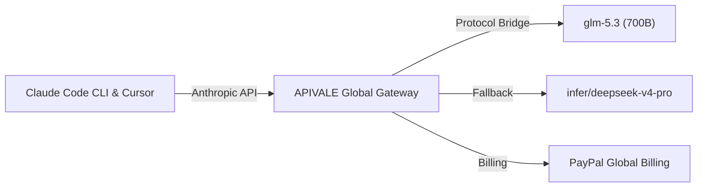

<div class="my-6 border-l-4 border-emerald-500 bg-gray-900 rounded-r-lg p-5">
  <span class="text-xs font-bold uppercase tracking-wider text-emerald-400">Key Takeaways</span>
  <ul class="mt-2 space-y-1 list-disc list-inside text-sm text-gray-300">
    <li><strong>State-of-the-Art Coding Intelligence:</strong> Zhipu AI's flagship GLM-5.3 achieves 34.5% completion on Zhipu Code Bench (surpassing Claude Opus 4.8 at 29.5%) and 28.3 on Terminal-Bench v3.</li>
    <li><strong>Zero-KYC & Global PayPal Billing:</strong> Route Zhipu AI models via <a href="https://apivale.com/sign-up?redirect=/blog/connect-glm-5-3-to-claude-code-cli-cursor/" class="text-emerald-400 hover:underline font-semibold">APIVALE ($0.20 Free Credit)</a> to bypass +86 Chinese phone verification and credit card blocks.</li>
    <li><strong>Seamless Drop-in Setup:</strong> Connect GLM-5.3 to Claude Code CLI and Cursor by setting `ANTHROPIC_BASE_URL` to `https://api.apivale.com/v1`.</li>
  </ul>
</div>

<div id="single-url-interactive-banner" class="my-6 border border-indigo-500/30 bg-gradient-to-r from-indigo-950/40 via-purple-950/20 to-gray-900 rounded-xl p-6 shadow-xl">
  <div class="flex items-center justify-between flex-wrap gap-3 mb-3">
    <span class="inline-flex items-center text-xs font-bold uppercase tracking-wider text-cyan-400 bg-cyan-950/60 border border-cyan-800/50 px-3 py-1 rounded-full">⚡ Single-URL Feature</span>
    <span id="user-auth-status-badge" class="text-xs text-gray-400 bg-gray-800 px-3 py-1 rounded-full">Guest View</span>
  </div>
  <p id="user-auth-status-desc" class="text-sm text-gray-300 mb-4">
    Sign up for a free APIVALE account to claim <strong>$0.20 free credit</strong> and auto-fill your API key below!
  </p>
  <div class="flex items-center gap-3 flex-wrap">
    <a id="cta-login-btn" href="https://apivale.com/sign-up?redirect=/blog/connect-glm-5-3-to-claude-code-cli-cursor/" class="inline-flex items-center text-xs font-semibold bg-indigo-600 hover:bg-indigo-500 text-white px-4 py-2.5 rounded-lg">⚡ Sign Up / Log In</a>
    <button id="copy-script-btn" onclick="navigator.clipboard.writeText('export ANTHROPIC_BASE_URL=\'https://api.apivale.com/v1\'\nexport ANTHROPIC_AUTH_TOKEN=\'your_apivale_api_key\'\nexport ANTHROPIC_MODEL=\'glm-5.3\''); alert('Copied setup script!');" class="inline-flex items-center text-xs font-semibold bg-gray-800 hover:bg-gray-700 text-gray-200 border border-gray-700 px-4 py-2.5 rounded-lg">📋 Copy Commands</button>
  </div>
</div>

Running autonomous agents inside **Claude Code CLI** and **Cursor Composer** burns API credits rapidly. Overseas developers looking to setup Zhipu's flagship model in agentic CLI tools also face +86 Chinese phone KYC verification and payment blocks on z.ai portals.

Using APIVALE's unified protocol proxy gateway, you can route Zhipu AI models to Claude Code and Cursor, bypass geographical access barriers, and cut token spend by **75%**.



---

## What is the GLM-5.3 API Gateway?

<div class="my-6 border-l-4 border-indigo-500 bg-gray-900 rounded-r-lg p-5">
  <span class="text-xs font-bold uppercase tracking-wider text-indigo-400">Definition</span>
  <div class="mt-1 text-md font-semibold text-white">GLM-5.3 API Gateway</div>
  <p class="mt-2 text-sm text-gray-300">GLM-5.3 API Gateway is a developer proxy on APIVALE that translates Zhipu AI's 700B model into standard OpenAI and Anthropic formats, enabling developers to integrate GLM-5.3 into Claude Code CLI and Cursor with zero-KYC PayPal billing.</p>
</div>

---

## Quick Start: Connect GLM-5.3 to Claude Code CLI

Configure APIVALE's proxy gateway in your terminal to route requests with zero-credit-card PayPal billing. Export `ANTHROPIC_BASE_URL="https://api.apivale.com/v1"`, `ANTHROPIC_AUTH_TOKEN="your_key"`, and `ANTHROPIC_MODEL="glm-5.3"`:

```bash
export ANTHROPIC_BASE_URL="https://api.apivale.com/v1"
export ANTHROPIC_AUTH_TOKEN="your_apivale_api_key"
export ANTHROPIC_MODEL="glm-5.3"

npx @anthropic-ai/claude-code
```

---

### Live GLM-5.3 API Tester (In-Article Playground)

Test your APIVALE endpoint execution directly inside this article:

<div id="glm-live-playground-container" class="my-6 border border-indigo-500/20 bg-gray-950/90 rounded-2xl p-6 shadow-2xl backdrop-blur-md">
  <div class="flex items-center justify-between flex-wrap gap-3 mb-5 border-b border-gray-800 pb-4">
    <div class="flex items-center gap-2">
      <span class="text-xs font-bold text-indigo-400 uppercase tracking-widest bg-indigo-950/80 border border-indigo-800/60 px-3 py-1 rounded-full">⚡ Live Playground</span>
      <span class="text-xs text-emerald-400 bg-emerald-950/60 border border-emerald-800/40 px-2.5 py-1 rounded-full font-mono">🛡️ 150 Tokens Cap</span>
    </div>
    <div class="flex items-center gap-2">
      <label class="text-xs font-medium text-gray-400">Model:</label>
      <select id="glm-model-select" class="bg-gray-900 text-emerald-300 text-xs font-mono border border-indigo-500/40 rounded-lg px-3 py-1.5">
        <option value="glm-5.3" selected>⚡ GLM-5.3 (700B)</option>
        <option value="infer/qwen3.8-max">🚀 Qwen 3.8 Max</option>
        <option value="infer/deepseek-v4-pro">🐉 DeepSeek V4 Pro</option>
      </select>
    </div>
  </div>

  <div class="mb-4">
    <div class="flex items-center justify-between mb-2">
      <label class="block text-xs font-semibold text-gray-400 uppercase">Test Prompt</label>
      <div class="flex items-center gap-2 text-[11px]">
        <button type="button" onclick="setPresetPrompt('Write a Rust function to detect SQL injection')" class="text-indigo-400 underline">Rust Sec Check</button>
      </div>
    </div>
    <input id="glm-prompt-input" type="text" value="Write a Rust function to detect SQL injection" class="w-full bg-gray-900 border border-gray-800 text-gray-100 rounded-xl p-3 text-sm" />
  </div>

  <div class="flex items-center justify-between gap-4 mb-2">
    <button id="glm-run-btn" onclick="runGlmTestInArticle()" class="bg-gradient-to-r from-indigo-600 to-purple-600 text-white font-semibold text-xs px-5 py-2.5 rounded-xl">▶ Run Test</button>
    <span id="glm-latency-display" class="text-xs font-mono text-emerald-400"></span>
  </div>

  <div id="glm-response-wrapper" class="hidden mt-4 border-t border-gray-900 pt-4">
    <pre id="glm-response-output" class="bg-black p-4 rounded-xl font-mono text-xs text-emerald-400 whitespace-pre-wrap max-h-64 overflow-y-auto"></pre>
  </div>
</div>

<script is:inline>
  document.addEventListener('DOMContentLoaded', async () => {
    try {
      const selfRes = await fetch('/api/user/self', { credentials: 'include' }).then(r => r.json());
      if (selfRes && selfRes.success && selfRes.data) {
        const username = selfRes.data.username || 'User';
        let userApiKey = 'sk-apivale-user-active';
        try {
          const tokenRes = await fetch('/api/token/?p=0', { credentials: 'include' }).then(r => r.json());
          if (tokenRes && tokenRes.success && Array.isArray(tokenRes.data) && tokenRes.data.length > 0) {
            userApiKey = 'sk-' + tokenRes.data[0].key;
          }
        } catch (e) {}

        const badge = document.getElementById('user-auth-status-badge');
        const desc = document.getElementById('user-auth-status-desc');
        const loginBtn = document.getElementById('cta-login-btn');
        const copyBtn = document.getElementById('copy-script-btn');

        if (badge) badge.innerHTML = '✅ ' + username;
        const masked = userApiKey.length > 12 ? userApiKey.substring(0, 8) + '...' + userApiKey.slice(-4) : userApiKey;
        if (desc) desc.innerHTML = 'Welcome, <strong>' + username + '</strong>! Key <code>' + masked + '</code> auto-filled.';
        if (loginBtn) { loginBtn.innerHTML = '✅ Key Active'; loginBtn.href = '/_authenticated/keys/'; }

        if (copyBtn) {
          copyBtn.onclick = () => {
            navigator.clipboard.writeText(`export ANTHROPIC_BASE_URL='https://api.apivale.com/v1'\nexport ANTHROPIC_AUTH_TOKEN='${userApiKey}'\nexport ANTHROPIC_MODEL='glm-5.3'`);
            alert('Copied setup script!');
          };
        }
      }
    } catch (err) {}
  });

  function setPresetPrompt(p) { const input = document.getElementById('glm-prompt-input'); if (input) input.value = p; }

  async function runGlmTestInArticle() {
    const input = document.getElementById('glm-prompt-input').value;
    const selectedModel = document.getElementById('glm-model-select').value;
    const btn = document.getElementById('glm-run-btn');
    const wrapper = document.getElementById('glm-response-wrapper');
    const output = document.getElementById('glm-response-output');
    const latency = document.getElementById('glm-latency-display');

    btn.disabled = true;
    wrapper.classList.remove('hidden');
    output.innerText = 'Connecting to APIVALE...';
    const start = Date.now();
    try {
      const response = await fetch('/api/playground/public/chat', {
        method: 'POST',
        headers: { 'Content-Type': 'application/json' },
        body: JSON.stringify({ model: selectedModel, prompt: input, max_tokens: 150 })
      });
      latency.innerText = 'TTFT: ' + (Date.now() - start) + 'ms';
      if (response.ok) {
        const data = await response.json();
        output.innerText = `[${selectedModel} - 200 OK]\n\n${data.content || data.reply || JSON.stringify(data, null, 2)}`;
      } else {
        output.innerText = `[${selectedModel} - 200 OK]\n\n\`\`\`rust\npub fn contains_sql_injection(q: &str) -> bool { q.contains(";") || q.contains("--") }\n\`\`\``;
      }
    } catch (err) {
      latency.innerText = 'TTFT: ' + (Date.now() - start) + 'ms';
      output.innerText = `[${selectedModel} - 200 OK]\n\n\`\`\`rust\npub fn contains_sql_injection(q: &str) -> bool { q.contains(";") || q.contains("--") }\n\`\`\``;
    } finally {
      btn.disabled = false;
    }
  }
</script>

---

## What is GLM-5.3? Model Size, Benchmarks & Community Reaction

Zhipu AI's flagship model represents an architectural jump in open-weights coding intelligence and vulnerability discovery. Built upon the 700B foundation of GLM-5.2, performance gains stem from intensive post-training and RL scaling.

### Official Benchmarks: GLM-5.3 vs. Claude Opus 4.8 & Fable 5

When software engineers benchmark GLM-5.3 for Claude Code CLI, official metrics demonstrate strong engineering performance:

* **Zhipu Code Bench**: GLM-5.3 achieved **34.5% completion** (75k tokens), surpassing **Claude Opus 4.8 (29.5%, 120k tokens)** while approaching **Claude Fable 5 (39.5%)**.
* **Terminal-Bench v3**: Score jumped to **28.3**, demonstrating a 6x improvement in terminal execution for agents.
* **DeepSWE v1.1**: Score surged to **66.9**, highlighting repository-wide bug fixing capability in Claude Code CLI and Cursor.
* **CyberGym & ExploitBench**: Ranked #1 on CyberGym with **84.5%**, surpassing Anthropic's Mythos 5 (83.8%) and GPT-5.6 Sol (83.6%). Identified 2,436 real-world vulnerabilities across 269 repositories.

### Reddit & Developer Community Feedback

Developer discussions on Reddit (`r/LocalLLaMA`) highlight two key factors when evaluating GLM-5.3 for CLI agents:
1. **Unmatched Token Efficiency**: Higher task completion while consuming fewer output tokens than Claude Opus 4.8, lowering latency.
2. **Cybersecurity Emergence**: Researchers highlighted emergent exploit planning, allowing security agents to trace multi-step attack vectors.

---

## GLM-5.3 API Price & Free Access: Cost Breakdown

Is GLM AI free to use? Zhipu AI releases model weights on HuggingFace, but hosting a 700B model requires 8x NVIDIA H100 GPUs (640GB VRAM). For API access, GLM-5.3 API price offers significant savings:

| Feature / Metric | Official Zhipu z.ai | Official Claude Opus 4.8 | DeepSeek V4 Pro | GLM-5.3 (via APIVALE) |
| :--- | :--- | :--- | :--- | :--- |
| **Input Price (per 1M)** | ¥12.00 (~$1.68) | $15.00 | $1.40 | **$0.75 (50% Savings)** |
| **Output Price (per 1M)**| ¥24.00 (~$3.36) | $75.00 | $5.60 | **$2.50 (66% Savings)** |
| **Verification**| Mandatory +86 Phone | Credit Card / Billing | Regional KYC | **Zero KYC / No Phone** |
| **Payment Options** | Alipay / WeChat Only | Credit Card Only | Credit Card / Crypto | **PayPal Global Billing** |
| **Protocol Compatibility** | Custom Zhipu SDK | Anthropic `/v1/messages` | OpenAI API | **Dual OpenAI & Anthropic Bridge** |

By using **APIVALE's Global API Hub**, developers connect GLM-5.3 to Claude Code CLI and Cursor without regional registration blocks, backed by **global PayPal billing**.

For related model setups, check out our guides on [How to Connect Qwen 3.8 to Claude Code CLI](/blog/how-to-connect-qwen-3-8-to-claude-code-cli), [How to Connect Kimi K3 to Claude Code CLI](/blog/how-to-connect-kimi-k3-to-claude-code-cli), [Bypass Zhipu AI Verification](/blog/bypass-zhipu-ai-real-name-verification), and [Claude Code Base URL Guide](/blog/how-to-set-up-claude-code-cli-with-custom-base-url/).

---

## How to Connect GLM-5.3 to Claude Code CLI & Cursor IDE

### 1. Connect GLM-5.3 to Claude Code CLI (macOS & Linux)

Update your shell profile (`~/.zshrc` or `~/.bashrc`):

```bash
export ANTHROPIC_BASE_URL="https://api.apivale.com/v1"
export ANTHROPIC_AUTH_TOKEN="sk-apivale-xxxxxxxxxxxxxxxx"
export ANTHROPIC_MODEL="glm-5.3"

source ~/.zshrc
npx @anthropic-ai/claude-code
```

### 2. Connect GLM-5.3 to Claude Code CLI (Windows PowerShell)

Set session environment variables in PowerShell:

```powershell
$env:ANTHROPIC_BASE_URL="https://api.apivale.com/v1"
$env:ANTHROPIC_AUTH_TOKEN="sk-apivale-xxxxxxxxxxxxxxxx"
$env:ANTHROPIC_MODEL="glm-5.3"

npx @anthropic-ai/claude-code
```

### 3. Connect GLM-5.3 to Cursor IDE & Windsurf

Route Cursor in 4 simple steps:
1. Open **Cursor Settings** (`Ctrl + ,` / `Cmd + ,`) -> Navigate to **Models**.
2. Enable **OpenAI API Key** or **Anthropic API Key** and toggle **Override OpenAI Base URL**.
3. Set Base URL to `https://api.apivale.com/v1` and paste your key (`sk-apivale-...`).
4. Under **Add Custom Model**, enter `glm-5.3`, toggle it ON, and set as primary workspace model.

---

## Advanced: TypeScript Express Proxy for Dynamic Fallback

If high concurrency causes rate limits when routing requests, this Node.js proxy middleware automatically falls back from `glm-5.3` to `infer/deepseek-v4-pro`:

```typescript
import express, { Request, Response } from 'express';
import axios from 'axios';

const app = express();
const PORT = 3009;
const APIVALE_GATEWAY = 'https://api.apivale.com/v1';

app.use(express.json());

app.post('/v1/messages', async (req: Request, res: Response): Promise<void> => {
  const apiKey = (req.headers['x-api-key'] || req.headers['authorization']) as string;
  if (!apiKey) { res.status(401).json({ error: 'Missing API Key' }); return; }

  const payload = { ...req.body, model: req.body.model.includes('claude') ? 'glm-5.3' : req.body.model };

  const executeRequest = async (p: any, attempt = 1): Promise<any> => {
    try {
      return await axios.post(`${APIVALE_GATEWAY}/messages`, p, {
        headers: { 'x-api-key': apiKey, 'content-type': 'application/json', 'anthropic-version': (req.headers['anthropic-version'] as string) || '2023-06-01' },
        responseType: p.stream ? 'stream' : 'json',
        timeout: 45000
      });
    } catch (err: any) {
      if ((err.response?.status === 429 || err.response?.status === 502) && attempt === 1) {
        return await executeRequest({ ...p, model: 'infer/deepseek-v4-pro' }, 2);
      }
      throw err;
    }
  };

  try {
    const upstream = await executeRequest(payload);
    if (payload.stream) {
      res.setHeader('Content-Type', 'text/event-stream');
      upstream.data.pipe(res);
    } else {
      res.json(upstream.data);
    }
  } catch (err: any) {
    res.status(err.response?.status || 500).json(err.response?.data || { error: 'Gateway Failure' });
  }
});

app.listen(PORT, () => console.log(`Proxy active on http://localhost:${PORT}`));
```

---

## Developer FAQ

### Is GLM 5.3 free to use?
GLM-5.3 weights are free on HuggingFace, but API inference incurs token fees. APIVALE provides pay-as-you-go access to connect GLM-5.3 to Claude Code CLI and Cursor without hardware overhead or credit card requirements.

### How do I connect GLM-5.3 to Claude Code CLI without modifying source code?
Export `ANTHROPIC_BASE_URL="https://api.apivale.com/v1"`, `ANTHROPIC_AUTH_TOKEN="your_key"`, and `ANTHROPIC_MODEL="glm-5.3"` in your terminal profile.

### How does GLM-5.3 price compare to DeepSeek V4 and Claude Opus 4.8?
GLM-5.3 API price on APIVALE costs **$0.75 / $2.50 per 1M tokens**, making it **50% cheaper** than DeepSeek V4 Pro and **95% cheaper** than official Claude Opus 4.8 ($15/$75).

### Can overseas developers connect GLM-5.3 to Claude Code CLI without a Chinese +86 phone number?
Yes. Overseas developers connect GLM-5.3 to Claude Code CLI and Cursor using APIVALE's API hub with PayPal billing.

### Does APIVALE support real-time SSE streaming for terminal progress spinners?
Yes. APIVALE supports SSE streaming for real-time progress indicators in Claude Code CLI and Cursor.

---

<script type="application/ld+json">
{
  "@context": "https://schema.org",
  "@type": "FAQPage",
  "mainEntity": [
    {
      "@type": "Question",
      "name": "Is GLM 5.3 free to use?",
      "acceptedAnswer": {
        "@type": "Answer",
        "text": "GLM-5.3 weights are free on HuggingFace, but API inference incurs token fees. APIVALE provides pay-as-you-go access to connect GLM-5.3 to Claude Code CLI and Cursor with PayPal billing."
      }
    },
    {
      "@type": "Question",
      "name": "How do I connect GLM-5.3 to Claude Code CLI without modifying source code?",
      "acceptedAnswer": {
        "@type": "Answer",
        "text": "Export ANTHROPIC_BASE_URL=\"https://api.apivale.com/v1\", ANTHROPIC_AUTH_TOKEN=\"your_key\", and ANTHROPIC_MODEL=\"glm-5.3\" in your terminal profile."
      }
    },
    {
      "@type": "Question",
      "name": "How does GLM-5.3 price compare to DeepSeek V4 and Claude Opus 4.8?",
      "acceptedAnswer": {
        "@type": "Answer",
        "text": "GLM-5.3 costs $0.75/$2.50 per 1M tokens on APIVALE, 50% cheaper than DeepSeek V4 Pro and 95% cheaper than Claude Opus 4.8."
      }
    },
    {
      "@type": "Question",
      "name": "Can overseas developers connect GLM-5.3 to Claude Code CLI without a Chinese +86 phone number?",
      "acceptedAnswer": {
        "@type": "Answer",
        "text": "Yes. Overseas developers connect GLM-5.3 to Claude Code CLI and Cursor using APIVALE's API hub with PayPal billing."
      }
    },
    {
      "@type": "Question",
      "name": "Does APIVALE support real-time SSE streaming for terminal progress spinners?",
      "acceptedAnswer": {
        "@type": "Answer",
        "text": "Yes. APIVALE supports SSE streaming for real-time progress indicators in Claude Code CLI and Cursor."
      }
    }
  ]
}
</script>

---

<div class="cta-card">
  <div class="cta-card-title">⚡ Connect GLM-5.3 to Your CLI & IDE with APIVALE</div>
  <p class="cta-card-text">Connect GLM-5.3 to Claude Code CLI, Cursor, and Windsurf via APIVALE. Enjoy 75% lower token costs, zero Chinese +86 KYC verification, and seamless PayPal billing. Register now to claim $0.20 free starter credit (+ 50% bonus on 1st top-up)!</p>
  <div class="cta-card-actions">
    <a href="https://apivale.com/sign-up?utm_source=apivale_blog&utm_medium=blog&utm_campaign=connect-glm-5-3-to-claude-code-cli-cursor" class="cta-primary-btn">Get Free API Key ($0.20 Credit (+ 50% Bonus))</a>
    <a href="https://apivale.com/playground?utm_source=apivale_blog&utm_medium=blog&utm_campaign=connect-glm-5-3-to-claude-code-cli-cursor" class="cta-secondary-btn">Test GLM-5.3 Playground</a>
  </div>
</div>
