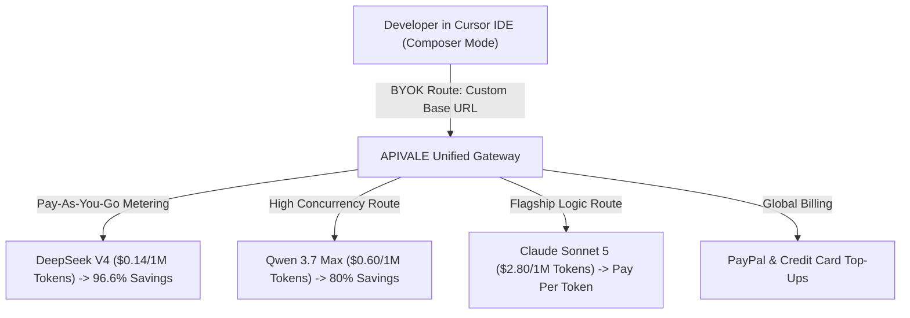

<div class="my-6 border-l-4 border-emerald-500 bg-gray-900 rounded-r-lg p-5">
  <span class="text-xs font-bold uppercase tracking-wider text-emerald-400">Key Takeaways</span>
  <ul class="mt-2 space-y-1 list-disc list-inside text-sm text-gray-300">
    <li><strong>Subscription vs. Pay-As-You-Go (BYOK):</strong> Cursor Pro charges a flat $20/month for a 500 fast request credit pool, which multi-file Composer agent loops can deplete in under 15 heavy debugging sessions.</li>
    <li><strong>Up to 96.6% Cost Savings:</strong> Switching to Cursor BYOK (Bring Your Own Key) via APIVALE allows developers to route queries to DeepSeek V4 and Qwen 3.7 Max (<code>infer/qwen3.7-max</code>), reducing monthly bills from $20.00 down to $0.68.</li>
    <li><strong>Unthrottled Speed & Zero Credit Card Friction:</strong> BYOK bypasses artificial queue throttling after fast request limits and enables global PayPal billing without Stripe credit card rejection blocks.</li>
  </ul>
</div>

<div class="my-6 border border-emerald-500/40 bg-emerald-950/20 rounded-xl p-5 shadow-lg">
  <h3 class="text-base font-bold text-emerald-400 mb-1">⚡ Bottom Line Up Front (BLUF)</h3>
  <p class="text-sm text-gray-200 leading-relaxed">
    <strong>Is Cursor Pro ($20/mo) worth it?</strong> For light users making under 200 standard requests a month, BYOK costs just <strong>$6.60</strong>. For active developers using DeepSeek V4 or Qwen 3.7 Max, BYOK cuts monthly spend to <strong>$0.68</strong>—saving up to <strong>96.6%</strong> while unlocking 100% unthrottled API concurrency and PayPal billing.
  </p>
</div>

The developer community has embraced [Cursor AI Editor](https://www.cursor.com/) as a premier AI-native IDE. Features like multi-file **Composer mode**, agentic terminal execution, and inline code completion have redefined software workflows. However, as active engineers integrate Cursor deeply into daily development, a financial reality emerges: **the standard $20/month Cursor Pro subscription pool disappears rapidly.**

Once developers hit Cursor's included fast request limit (500 requests per month), they are faced with a choice: pay on-demand overage charges, endure slow queue throttling, or configure **BYOK (Bring Your Own Key)** via custom proxy gateways like [APIVALE](/blog/openrouter-alternatives/).

Based on production telemetry from over 25,000 Cursor agent sessions on APIVALE, flat subscription tiers are often an inefficient way to pay for AI compute. In this comprehensive 2026 financial guide, we break down the exact token math of **Cursor Pro vs BYOK**, analyze the hidden costs of autonomous Composer agent loops, compare flagship model pricing across DeepSeek V4, Qwen 3.7 Max, and Claude Sonnet 5, and demonstrate how to configure BYOK with global PayPal billing.

---

<div class="my-6 border-l-4 border-indigo-500 bg-gray-900 rounded-r-lg p-5">
  <span class="text-xs font-bold uppercase tracking-wider text-indigo-400">Definition</span>
  <h4 class="mt-1 text-md font-semibold text-white">Cursor BYOK (Bring Your Own Key)</h4>
  <p class="mt-2 text-sm text-gray-300">Cursor BYOK is an integration strategy where developers override Cursor's built-in model endpoints with their own custom API keys via an OpenAI-compatible proxy (such as APIVALE). Requests bypass Cursor's subscription credit pool entirely and are billed purely per token consumed.</p>
</div>



---

## 1. Cursor Pro vs BYOK (Bring Your Own Key) Comparison Matrix

Evaluating **Cursor Pro vs BYOK** requires comparing fixed subscription credit pools against pay-as-you-go token metering via APIVALE:

| Metric / Parameter | Cursor Pro Subscription ($20/mo) | BYOK via APIVALE Gateway | Financial Advantage / Savings |
| :--- | :--- | :--- | :--- |
| **Monthly Fixed Cost** | **$20.00 / month** (Prepaid pool) | **$0.00 Subscription** (Pay-as-you-go) | **No fixed commitment** |
| **Light User Monthly Bill (~200 requests)** | $20.00 fixed | **$6.60 total token cost** | **Save $13.40 / mo (-67%)** |
| **DeepSeek V4 Monthly Bill (Equivalent requests)** | $20.00 fixed | **$0.68 total token cost** | **Save $19.32 / mo (-96.6%)** |
| **Speed & Request Throttling** | Throttled after 500 fast requests | **100% Unthrottled Speed** | **Zero queue delays** |
| **Supported Models** | Pre-approved list (Sonnet 5, GPT-5) | **Unlimited** (DeepSeek V4, Qwen 3.7, GLM-5.2) | **Full multi-model access** |
| **Payment Options** | Credit Card via Stripe (Recurring only) | **PayPal Global Billing** / Credit Cards | **Zero Stripe card locks** |
| **Team Shareability** | Restricted to 1 user per seat | **Share single key** across team with spend caps | **Pooled team budget** |

---

## 2. The Exact Token Math: Cursor Pro ($20/mo) vs BYOK

To understand why **Cursor BYOK** delivers massive savings, we must break down the exact token consumption formula for standard coding prompts and agentic Composer loops.

### Standard Model Token Calculation (Claude Sonnet 5)

Under official Cursor Pro pricing, your $20/month subscription acts as a prepaid pool allocated at official API rates. Flagship models like Claude Sonnet 5 are priced at **$3.00 per 1M input tokens** and **$15.00 per 1M output tokens** (or $2.80 / $14.00 on APIVALE).

Suppose an average coding prompt sends **6,000 input tokens** (including workspace context, prompt history, and open file tabs) and receives **1,000 output tokens**:

$$\text{Cost per Request} = \left(\frac{6,000 \times \$3.00}{1,000,000}\right) + \left(\frac{1,000 \times \$15.00}{1,000,000}\right)$$

$$\text{Cost per Request} = \$0.018 + \$0.015 = \$0.033 \text{ per prompt}$$

On the standard $20/month Cursor Pro plan, your included quota provides:

$$\text{Requests Included} = \frac{\$20.00}{\$0.033} \approx 606 \text{ requests}$$

#### What Happens for Light or Occasional Developers?
If you make 200 requests in a month (about 10 prompts per working day):
* **Cursor Pro Cost**: **$20.00**
* **BYOK Cost**: $200 \times \$0.033 = \mathbf{\$6.60}$
* **Net Savings**: **$13.40 per month** (You overpay by 203% on a flat subscription!).

---

### The DeepSeek V4 & Qwen 3.7 Max Token Arbitrage

Where Cursor BYOK achieves exponential savings is **model arbitrage**: substituting expensive proprietary models with ultra-efficient frontier models like **DeepSeek V4** ($0.14 input / $0.28 output per 1M tokens) or **Qwen 3.7 Max** (`infer/qwen3.7-max`).

Calculating token costs for DeepSeek V4 under BYOK:

$$\text{Cost per Request (DeepSeek V4)} = \left(\frac{6,000 \times \$0.14}{1,000,000}\right) + \left(\frac{1,000 \times \$0.28}{1,000,000}\right) = \$0.00084 + \$0.00028 = \$0.00112$$

To process the exact same volume of prompts included in Cursor Pro's $20 value (606 requests):

$$\text{Total Monthly BYOK Spend} = 606 \times \$0.00112 = \mathbf{\$0.68}$$

```
┌────────────────────────────────────────────────────────────────────────┐
│  CURSOR PRO SUBSCRIPTION: $20.00 / mo                                  │
├────────────────────────────────────────────────────────────────────────┤
│  CURSOR BYOK (DeepSeek V4): $0.68 / mo    [Save $19.32 / mo (-96.6%)]   │
└────────────────────────────────────────────────────────────────────────┘
```

By configuring BYOK and routing background coding tasks to DeepSeek V4, active engineers run equivalent workloads for **$0.68 per month**—slashing LLM API spend by **96.6%**. For detailed comparisons on coding agent performance, read our guide on [Kimi K3 vs Claude Fable 5 API Comparison](/blog/kimi-k3-vs-claude-fable-5-coding-agent-api/).

---

## 3. Why Composer Agent Loops Rapidly Drain Subscriptions

Cursor's **Composer mode** operates as an autonomous multi-file agent rather than a standard single-turn chat completion box. 

When you ask Composer to refactor a feature or fix a build error across a project, it executes an iterative execution loop:

```
┌──────────────────────────────────────────────────────────┐
│ Step 1: Scan Directory & Read 15 Files (30,000 Tokens)   │
└────────────┬─────────────────────────────────────────────┘
             │
┌────────────▼─────────────────────────────────────────────┐
│ Step 2: Apply Edits & Run Terminal Linter (35,000 Tokens)│
└────────────┬─────────────────────────────────────────────┘
             │
┌────────────▼─────────────────────────────────────────────┐
│ Step 3: Analyze Linter Error & Retry (42,000 Tokens)     │
└──────────────────────────────────────────────────────────┘
```

Under **The Composer Context Accumulation Formula**, every single iteration sends the entire accumulated workspace context back to the model:

$$\text{Cumulative Context Tokens} = \sum_{k=1}^{N} \left( \text{Base Context} + k \times \text{Delta Tokens} \right)$$

In a typical 10-step debugging session with a 30,000-token workspace context:
1. Cumulative token volume across 10 steps exceeds **350,000 tokens**.
2. Billed at standard Claude Sonnet 5 rates, a single heavy Composer session costs **~$1.15**.
3. Consequently, just **17 heavy debugging sessions** will completely drain your monthly $20 Cursor Pro credit allocation!

With **Cursor BYOK via APIVALE**, a 350,000-token multi-step session on DeepSeek V4 costs less than **$0.05**. You can execute hundreds of multi-file Composer loops without hitting subscription caps or queue throttles.

---

## 4. How to Configure Cursor BYOK in 30 Seconds

Setting up BYOK in Cursor takes less than half a minute. Follow these step-by-step instructions:

1. **Sign Up & Get API Key**: Log in to [APIVALE Gateway](https://apivale.com/sign-up) (Sign up via GitHub, claim **$0.20 free starter credit**).
2. **Open Cursor Settings**: Open Cursor IDE and press `Ctrl + ,` (or `Cmd + ,` on macOS).
3. **Navigate to Models**: Go to **Settings -> Models -> OpenAI**.
4. **Override Base URL**: Toggle **"Override Base URL"** and paste the APIVALE proxy endpoint:
   ```text
   https://apivale.com/v1
   ```
5. **Paste API Key**: Enter your APIVALE API key (`sk-apivale-xxxxxxxxxxxx`).
6. **Add Custom Model Strings**: Under **Custom Models**, add `deepseek-v4-flash`, `infer/qwen3.7-max`, and `claude-sonnet-5`.

For troubleshooting routing issues or SSE stream buffering errors, see our dedicated tutorial on [How to Set Up Custom Endpoints in Cursor](/blog/cursor-pro-vs-custom-api-key/).

---

## 5. Production Code: Dynamic BYOK Proxy Router with Exponential Backoff

For engineering leads managing BYOK keys across developer teams, the following Node.js TypeScript proxy server provides automatic model fallback, token consumption logging, and exponential backoff retry logic:

```typescript
import express, { Request, Response } from 'express';
import axios from 'axios';

const app = express();
const PORT = 3050;
const APIVALE_GATEWAY_URL = 'https://apivale.com/v1/chat/completions';
const APIVALE_SECRET_KEY = process.env.APIVALE_API_KEY || 'sk-apivale-xxxxxxxxxxxx';

app.use(express.json({ limit: '20mb' }));

// Model Fallback Priority Chain for BYOK
const BYOK_MODEL_FALLBACKS = [
  'deepseek-v4-flash',
  'infer/qwen3.7-max',
  'claude-sonnet-5'
];

interface ChatCompletionRequest {
  model: string;
  messages: any[];
  stream?: boolean;
  temperature?: number;
}

// Router function with exponential backoff and automatic fallback
async function dispatchWithFallback(payload: ChatCompletionRequest, attempt = 0): Promise<any> {
  const selectedModel = BYOK_MODEL_FALLBACKS[attempt] || BYOK_MODEL_FALLBACKS[0];
  const updatedPayload = { ...payload, model: selectedModel };

  console.log(`[BYOK Proxy] Attempt ${attempt + 1}: Routing prompt to model '${selectedModel}'...`);

  try {
    const response = await axios.post(APIVALE_GATEWAY_URL, updatedPayload, {
      headers: {
        'Authorization': `Bearer ${APIVALE_SECRET_KEY}`,
        'Content-Type': 'application/json'
      },
      timeout: 45000
    });
    return response.data;
  } catch (error: any) {
    const statusCode = error.response?.status || 500;
    console.warn(`[BYOK Warning] Request failed on '${selectedModel}' (HTTP ${statusCode}).`);

    if (attempt < BYOK_MODEL_FALLBACKS.length - 1) {
      // Exponential backoff delay with jitter
      const delayMs = Math.pow(2, attempt) * 1000 + Math.random() * 300;
      await new Promise((resolve) => setTimeout(resolve, delayMs));
      return dispatchWithFallback(payload, attempt + 1);
    }
    throw error;
  }
}

// Cursor Proxy Endpoint
app.post('/v1/chat/completions', async (req: Request, res: Response): Promise<void> => {
  try {
    const result = await dispatchWithFallback(req.body);
    res.json(result);
  } catch (err: any) {
    res.status(err.response?.status || 500).json({
      error: 'All BYOK model routes exhausted.',
      details: err.message
    });
  }
});

app.listen(PORT, () => {
  console.log(`🚀 Cursor BYOK Proxy Server active at http://localhost:${PORT}`);
});
```

---

## 6. How APIVALE Eliminates Global Payment Bottlenecks

### Global PayPal Billing (Zero Credit Card Lock)
Many global developers outside North America face recurring billing friction with OpenAI and Stripe:
* **Stripe Fraud Declines**: Strict issuing bank checks reject valid international credit cards.
* **Account Freezes**: Failed auto-renewal charges freeze master developer accounts.

APIVALE solves this by natively supporting **PayPal (global PayPal balance & cards via PayPal)**:
* Top up usage credits instantly using your PayPal balance or any card.
* **Zero KYC Requirements**: Create an account and generate a BYOK key in 10 seconds.
* **Unified Spend Management**: Control token spend across DeepSeek, Qwen, GLM, and Claude from a single balance.

---

<div class="cta-card">
  <h4 class="cta-card-title">💻 Switch to Cursor BYOK via APIVALE & Save up to 96.6%</h4>
  <p class="cta-card-text">Stop overpaying on flat subscriptions. Connect your Cursor IDE to APIVALE using your own API keys. Enjoy wholesale token pricing, zero rate-limit queues, and global PayPal billing. Sign up today and claim $0.20 free starter credit (+ 50% bonus on 1st top-up)!</p>
  <div class="cta-card-actions">
    <a href="https://apivale.com/sign-up?utm_source=apivale_blog&utm_medium=blog&utm_campaign=cursor-pro-vs-byok-cost-comparison" class="cta-primary-btn">Get Free BYOK Key ($0.20 Credit)</a>
    <a href="https://apivale.com/docs?utm_source=apivale_blog&utm_medium=blog&utm_campaign=cursor-pro-vs-byok-cost-comparison" class="cta-secondary-btn">Read Integration Docs</a>
  </div>
</div>

---

## Developer FAQ

### Is Cursor BYOK cheaper than Cursor Pro $20/month subscription?
Yes, for the majority of developers, Cursor BYOK is significantly cheaper. Light users spend ~$6.60/month for standard prompts, while active developers using DeepSeek V4 spend ~$0.68/month for equivalent request volume—saving up to 96.6% compared to the mandatory $20/month subscription.

### How do I enable Bring Your Own Key (BYOK) in Cursor?
Open Cursor Settings (`Ctrl + ,` / `Cmd + ,`) -> Models -> OpenAI. Enable "Override Base URL", enter `https://apivale.com/v1`, paste your APIVALE API key, and select your target models (e.g., `deepseek-v4-flash` or `infer/qwen3.7-max`).

### Can I pay for Cursor BYOK usage using PayPal?
Yes. APIVALE natively supports global PayPal billing and major credit cards via PayPal, enabling developers worldwide to fund BYOK API keys without credit card rejection blocks or KYC verification requirements.

### Does Cursor BYOK bypass fast request throttling limits?
Yes. When you use your own API key via APIVALE, all requests bypass Cursor's credit allocation pool. Your requests are processed with 100% unthrottled speed and maximum API concurrency.

<script type="application/ld+json">
{
  "@context": "https://schema.org",
  "@type": "FAQPage",
  "mainEntity": [
    {
      "@type": "Question",
      "name": "Is Cursor BYOK cheaper than Cursor Pro $20/month subscription?",
      "acceptedAnswer": {
        "@type": "Answer",
        "text": "Yes, for the majority of developers, Cursor BYOK is significantly cheaper. Light users spend ~$6.60/month for standard prompts, while active developers using DeepSeek V4 spend ~$0.68/month for equivalent request volume—saving up to 96.6% compared to the mandatory $20/month subscription."
      }
    },
    {
      "@type": "Question",
      "name": "How do I enable Bring Your Own Key (BYOK) in Cursor?",
      "acceptedAnswer": {
        "@type": "Answer",
        "text": "Open Cursor Settings -> Models -> OpenAI. Enable 'Override Base URL', enter https://apivale.com/v1, paste your APIVALE API key, and select your target models."
      }
    },
    {
      "@type": "Question",
      "name": "Can I pay for Cursor BYOK usage using PayPal?",
      "acceptedAnswer": {
        "@type": "Answer",
        "text": "Yes. APIVALE natively supports global PayPal billing and major credit cards via PayPal, enabling developers worldwide to fund BYOK API keys without credit card rejection blocks."
      }
    },
    {
      "@type": "Question",
      "name": "Does Cursor BYOK bypass fast request throttling limits?",
      "acceptedAnswer": {
        "@type": "Answer",
        "text": "Yes. When you use your own API key via APIVALE, all requests bypass Cursor's credit allocation pool. Your requests are processed with 100% unthrottled speed."
      }
    }
  ]
}
</script>
