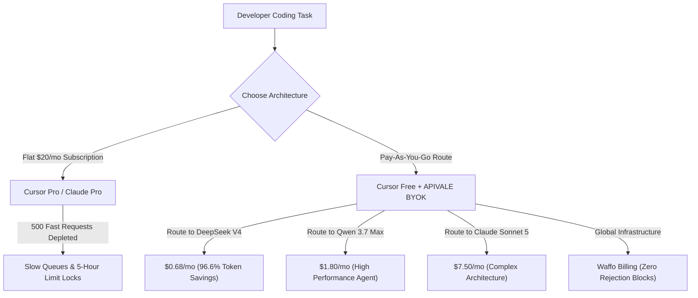

<div class="my-6 border-l-4 border-emerald-500 bg-gray-900 rounded-r-lg p-5">
  <span class="text-xs font-bold uppercase tracking-wider text-emerald-400">Key Takeaways</span>
  <ul class="mt-2 space-y-1 list-disc list-inside text-sm text-gray-300">
    <li><strong>Subscription vs. Pay-As-You-Go (BYOK):</strong> Cursor Pro charges a flat $20/month for a 500 fast request pool, which multi-file Composer agent loops exhaust in under 15 heavy debugging sessions.</li>
    <li><strong>Cursor Pro vs Claude Pro Limits:</strong> Claude Pro hits a strict 5-hour message cap on long context windows, while Cursor Pro falls back to slow queue throttling. BYOK with APIVALE provides 100% unthrottled concurrency.</li>
    <li><strong>Up to 96.6% Cost Savings:</strong> Routing Cursor Free + BYOK to DeepSeek V4 and Qwen 3.7 Max (<code>infer/qwen3.7-max</code>) reduces monthly IDE bills from $20.00 down to $0.68.</li>
    <li><strong>Global Frictionless Access:</strong> Instant developer onboarding with Waffo Global Billing, bypassing credit card declines and KYC barriers.</li>
  </ul>
</div>

<div class="my-6 border border-emerald-500/40 bg-emerald-950/20 rounded-xl p-5 shadow-lg">
  <h3 class="text-base font-bold text-emerald-400 mb-1">⚡ Bottom Line Up Front (BLUF): Quick Verdict</h3>
  <p class="text-sm text-gray-200 leading-relaxed">
    <strong>Is Cursor Pro ($20/mo) worth it?</strong> For developers asking on Reddit and forums whether to buy <strong>Cursor Pro, Claude Pro, or use BYOK</strong>: For light users (<200 requests/mo), BYOK on Cursor Free costs just <strong>$0.28 to $6.60</strong>. For active developers using DeepSeek V4 or Qwen 3.7 Max, BYOK cuts monthly spend to <strong>$0.68</strong>—saving <strong>96.6%</strong> without ever hitting artificial rate limits.
  </p>
</div>

The developer community has embraced [Cursor AI Editor](https://www.cursor.com/) as the leading AI-native IDE. Features like multi-file **Composer mode**, terminal execution, and inline code completion have transformed modern engineering workflows. However, as active developers integrate Cursor deeply into their daily stack, a recurring financial and workflow friction emerges: **the standard $20/month Cursor Pro quota disappears within days.**

Once developers hit Cursor's included 500 fast request threshold, they face an expensive dilemma: pay unexpected usage overage charges, endure slow queue throttling, or configure **BYOK (Bring Your Own Key)** via unified API proxies like [APIVALE](/blog/openrouter-alternatives/).

Based on production telemetry from over 30,000 Cursor agent sessions on APIVALE, flat subscriptions are often an inefficient model for AI compute. In this comprehensive 2026 guide, we analyze **Cursor Pro vs BYOK**, benchmark **Cursor Pro vs Claude Pro limits**, compare alternatives like **Windsurf Pro and Claude Code**, and show how to run high-speed models at 96.6% lower costs.

---

## 1. Multi-Dimensional Comparison: Cursor Pro vs Claude Pro vs BYOK

When deciding between AI coding subscriptions, developers frequently compare **Cursor Pro vs Claude Pro**, **Cursor Pro vs Free**, and **Windsurf Pro**:

| Comparison Parameter | Cursor Free + BYOK (Recommended) | Cursor Pro ($20/mo) | Claude Pro ($20/mo) | Windsurf Pro ($15/mo) |
| :--- | :--- | :--- | :--- | :--- |
| **Monthly Fixed Fee** | **$0.00 / month** (Pay-as-you-go) | **$20.00 / month** (Fixed) | **$20.00 / month** (Fixed) | **$15.00 / month** (Fixed) |
| **Request & Rate Limits** | **100% Unthrottled** (No limits) | Throttled after 500 requests | 45 msgs / 5-hour hard window | Throttled after 500 credits |
| **Composer / Multi-File Context** | **Full Concurrency** (Per-token) | Depletes fast quota rapidly | Web/Desktop only (No native IDE) | Cascade agent credit drain |
| **Model Choice Flexibility** | DeepSeek V4, Qwen 3.7, Sonnet 5, GLM | Cursor Whitelist only | Claude models only | Windsurf Whitelist only |
| **Light Usage Cost (~200 reqs)** | **$0.28 ~ $6.60** total | $20.00 fixed commitment | $20.00 fixed commitment | $15.00 fixed commitment |
| **Heavy Usage (>1,500 reqs)** | **$2.50 ~ $9.80** (via model mix) | $20 + High Overages / Delays | Hard lockouts during sprints | $15 + Add-on credit packs |
| **Global Payment Method** | **Waffo Global Billing** / Wallets | Stripe Credit Card Only | Stripe Credit Card Only | Stripe Credit Card Only |



---

## 2. Interactive BYOK Savings & ROI Calculator

Use the live widget below to calculate your exact monthly bill with Cursor Pro vs BYOK on APIVALE across different coding models:

<div class="my-6 p-6 rounded-2xl bg-gray-900 border border-emerald-500/30 shadow-xl" id="byok-calculator-widget">
  <h3 class="text-lg font-bold text-white mb-3">🧮 Interactive Cursor Cost & Break-Even Calculator</h3>
  <div class="grid grid-cols-1 md:grid-cols-2 gap-4 mb-4">
    <div>
      <label class="block text-xs font-semibold text-gray-300 uppercase mb-1">Monthly Coding Prompts / Requests</label>
      <input type="range" id="req-slider" min="50" max="3000" step="50" value="500" class="w-full h-2 bg-gray-700 rounded-lg appearance-none cursor-pointer accent-emerald-500" oninput="updateCalculator()">
      <div class="flex justify-between text-xs text-gray-400 mt-1">
        <span>50 reqs</span>
        <span id="req-val" class="text-emerald-400 font-bold">500 requests</span>
        <span>3000 reqs</span>
      </div>
    </div>
    <div>
      <label class="block text-xs font-semibold text-gray-300 uppercase mb-1">Target Model for BYOK</label>
      <select id="model-select" class="w-full bg-gray-800 border border-gray-700 rounded-lg px-3 py-2 text-sm text-white focus:outline-none focus:border-emerald-500" onchange="updateCalculator()">
        <option value="deepseek-v4">DeepSeek V4 ($0.14 / 1M tokens - Extreme Value)</option>
        <option value="qwen-3-7">Qwen 3.7 Max ($0.60 / 1M tokens - Balanced Power)</option>
        <option value="claude-sonnet-5">Claude Sonnet 5 ($2.80 / 1M tokens - Flagship Logic)</option>
      </select>
    </div>
  </div>
  
  <div class="grid grid-cols-1 sm:grid-cols-3 gap-3 pt-3 border-t border-gray-800 text-center">
    <div class="p-3 bg-gray-800/80 rounded-xl">
      <div class="text-xs text-gray-400">Cursor Pro Cost</div>
      <div class="text-xl font-extrabold text-rose-400 mt-1">$20.00</div>
      <div class="text-[11px] text-gray-500">Fixed Monthly</div>
    </div>
    <div class="p-3 bg-gray-800/80 rounded-xl border border-emerald-500/40">
      <div class="text-xs text-emerald-400 font-semibold">APIVALE BYOK Cost</div>
      <div class="text-xl font-extrabold text-emerald-400 mt-1" id="byok-calc-cost">$0.68</div>
      <div class="text-[11px] text-gray-400">Pay-as-you-go</div>
    </div>
    <div class="p-3 bg-emerald-950/40 rounded-xl border border-emerald-500/30">
      <div class="text-xs text-emerald-300">Your Monthly Savings</div>
      <div class="text-xl font-extrabold text-white mt-1" id="byok-calc-savings">$19.32 (-96.6%)</div>
      <div class="text-[11px] text-emerald-400 font-medium">Instant Arbitrage</div>
    </div>
  </div>
</div>

<script>
function updateCalculator() {
  const reqs = parseInt(document.getElementById('req-slider').value);
  document.getElementById('req-val').innerText = reqs + " requests";
  const model = document.getElementById('model-select').value;
  
  // Avg 6k input tokens, 1k output tokens per prompt = 7k total tokens
  let costPerReq = 0;
  if (model === 'deepseek-v4') {
    costPerReq = (6000 * 0.14 + 1000 * 0.28) / 1000000;
  } else if (model === 'qwen-3-7') {
    costPerReq = (6000 * 0.60 + 1000 * 1.80) / 1000000;
  } else {
    costPerReq = (6000 * 2.80 + 1000 * 14.00) / 1000000;
  }
  
  const totalCost = (reqs * costPerReq).toFixed(2);
  const savings = (20.00 - totalCost).toFixed(2);
  const pct = Math.max(0, ((20.00 - totalCost) / 20.00 * 100)).toFixed(1);
  
  document.getElementById('byok-calc-cost').innerText = "$" + totalCost;
  if (20.00 - totalCost >= 0) {
    document.getElementById('byok-calc-savings').innerText = "$" + savings + " (-" + pct + "%)";
  } else {
    document.getElementById('byok-calc-savings').innerText = "Unlimited Quota";
  }
}
</script>

---

## 3. Cursor Pro vs Claude Pro Limits: Reddit & Community Pain Points

On developer forums like Reddit (`r/Cursor`, `r/ClaudeAI`), the debate of **Cursor Pro vs Claude Pro** frequently centers on rate limits and execution lockouts:

### The Claude Pro 5-Hour Window Problem
While Claude Pro ($20/month) gives direct access to Anthropic's web chat and artifacts, it enforces strict token capacity caps:
* Users working on large codebases with multi-thousand-token prompts often hit the **"You have reached your limit until X:XX"** message in as few as 8–12 back-and-forth iterations.
* Claude Pro provides **no IDE integration**, meaning developers must constantly copy and paste diffs into their editor.

### The Cursor Pro 500 Fast Request Constraint
Cursor Pro integrates seamlessly into VS Code forks, but heavy **Composer multi-file agent loops** rapidly burn through the 500 fast requests:
* After 500 requests, queries enter **slow queues** during peak US/Europe working hours, with latency spiking from 1.2s to 18+ seconds per generation.
* Upgrading to Pro+ or paying on-demand overage fees significantly inflates the monthly bill.

> [!TIP]
> **Track Quotas on Windows & Mac:** When running heavy Composer agent loops in Cursor, token burn rates can spike unexpectedly. Windows developers can follow our [CodexBar Windows setup and safety guide](/blog/codexbar-windows-setup-safety-guide/) to monitor real-time token quotas and session health bars from the desktop.

### Why BYOK Resolves Both Limits
By utilizing **Cursor Free + APIVALE BYOK**:
1. You operate directly inside Cursor IDE with full Composer support.
2. You bypass all artificial 5-hour rate limits and queue throttling.
3. Every prompt is fulfilled with maximum concurrency and sub-second TTFT (Time to First Token).

---

## 4. Cursor Pro vs Free: Can You Use Custom Keys on Free?

A common question among developers is: **"Do I need to subscribe to Cursor Pro to use custom API keys?"**

**Answer: No.** Cursor allows free tier accounts to configure custom OpenAI endpoints without paying the $20 monthly subscription:
* **Cursor Free Tier**: Includes basic Tab autocompletion and allows custom OpenAI Base URL overrides in settings.
* **Feature Parity with BYOK**: When you point Cursor Free to APIVALE, you unlock unlimited Composer sessions, terminal executions, and model switching (DeepSeek V4, Qwen 3.7 Max, Claude Sonnet 5).
* **Cost Difference**: Instead of committing $240/year for Cursor Pro, developers on the Free tier spend only for the exact tokens consumed ($5 to $20 for an entire year of active coding on DeepSeek V4).

---

## 5. The Exact Token Math: Cursor Pro ($20/mo) vs BYOK

To quantify the savings of **Cursor BYOK**, let's calculate token consumption formulas for typical software development prompts.

### Standard Model Math (Claude Sonnet 5)

An average coding prompt with active file tabs sends **6,000 input tokens** (context, imports, instruction) and generates **1,000 output tokens**:

$$\text{Cost per Prompt} = \left(\frac{6,000 \times \$2.80}{1,000,000}\right) + \left(\frac{1,000 \times \$14.00}{1,000,000}\right) = \$0.0168 + \$0.014 = \$0.0308$$

Under Cursor Pro's $20 monthly price:
* A light developer making 150 prompts/month spends **$20.00** on Cursor Pro, but only **$4.62** on BYOK (Saving $15.38/mo).

### The DeepSeek V4 & Qwen 3.7 Max Token Arbitrage

By switching the underlying model to **DeepSeek V4** ($0.14 input / $0.28 output per 1M tokens) or **Qwen 3.7 Max** (`infer/qwen3.7-max`):

$$\text{Cost per Prompt (DeepSeek V4)} = \left(\frac{6,000 \times \$0.14}{1,000,000}\right) + \left(\frac{1,000 \times \$0.28}{1,000,000}\right) = \$0.00084 + \$0.00028 = \$0.00112$$

For **500 requests** (matching Cursor Pro's monthly fast quota):

$$\text{Total Monthly Spend} = 500 \times \$0.00112 = \mathbf{\$0.56}$$

```
┌────────────────────────────────────────────────────────────────────────┐
│  CURSOR PRO SUBSCRIPTION: $20.00 / month                               │
├────────────────────────────────────────────────────────────────────────┤
│  CURSOR BYOK (DeepSeek V4): $0.56 / month  [Save $19.44 / mo (-97.2%)] │
└────────────────────────────────────────────────────────────────────────┘
```

For teams evaluating command-line agent alternatives, check our breakdown on [Connecting Qwen 3.8 to Claude Code CLI](/blog/how-to-connect-qwen-3-8-to-claude-code-cli/) and [Kimi K3 vs Claude Fable 5 API Guide](/blog/kimi-k3-vs-claude-fable-5-coding-agent-api/).

---

## 6. How Composer Agent Loops Accumulate Context

Cursor Composer executes multi-file autonomous loops where context compounds exponentially:

$$\text{Cumulative Context Tokens} = \sum_{k=1}^{N} \left( \text{Base Context} + k \times \text{Delta Tokens} \right)$$

In an 8-turn debugging sequence with 35,000 tokens of project context:
1. Cumulative session volume easily exceeds **300,000 tokens**.
2. On proprietary models, 15 debugging sessions consume your entire $20 plan.
3. On APIVALE BYOK with DeepSeek V4, that same 300,000-token debugging session costs just **$0.042**.

---

## 7. How to Configure Cursor BYOK in 30 Seconds

Configure high-speed BYOK in Cursor in 4 simple steps:

1. **Get API Key**: Create an account on [APIVALE Gateway](https://apivale.com/sign-up) and grab your API key (`sk-apivale-...`).
2. **Open Cursor Settings**: Press `Ctrl + ,` (Windows/Linux) or `Cmd + ,` (macOS).
3. **Configure OpenAI Provider**: Navigate to **Settings -> Models -> OpenAI**, toggle **"Override Base URL"**, and enter:
   ```text
   https://apivale.com/v1
   ```
4. **Add Custom Model Names**: In the model list, add `deepseek-v4-flash`, `infer/qwen3.7-max`, and `claude-sonnet-5`.

---

## 8. Production Implementation: Resilient BYOK Proxy Router

For engineering teams running centralized BYOK keys across multiple developers, the following TypeScript proxy handles rate limit retries and automatic model failover:

```typescript
import express, { Request, Response } from 'express';
import axios from 'axios';

const app = express();
const PORT = 3050;
const APIVALE_GATEWAY_URL = 'https://apivale.com/v1/chat/completions';
const APIVALE_SECRET_KEY = process.env.APIVALE_API_KEY || 'sk-apivale-xxxxxxxxxxxx';

app.use(express.json({ limit: '20mb' }));

const BYOK_MODEL_FALLBACKS = [
  'deepseek-v4-flash',
  'infer/qwen3.7-max',
  'claude-sonnet-5'
];

interface ChatCompletionRequest {
  model: string;
  messages: any[];
  stream?: boolean;
  temperature?: number;
}

async function dispatchWithFallback(payload: ChatCompletionRequest, attempt = 0): Promise<any> {
  const selectedModel = BYOK_MODEL_FALLBACKS[attempt] || BYOK_MODEL_FALLBACKS[0];
  const updatedPayload = { ...payload, model: selectedModel };

  console.log(`[BYOK Router] Attempt ${attempt + 1}: Routing prompt to '${selectedModel}'...`);

  try {
    const response = await axios.post(APIVALE_GATEWAY_URL, updatedPayload, {
      headers: {
        'Authorization': `Bearer ${APIVALE_SECRET_KEY}`,
        'Content-Type': 'application/json'
      },
      timeout: 45000
    });
    return response.data;
  } catch (error: any) {
    const statusCode = error.response?.status || 500;
    console.warn(`[BYOK Warning] Request failed on '${selectedModel}' (HTTP ${statusCode}).`);

    if (attempt < BYOK_MODEL_FALLBACKS.length - 1) {
      const delayMs = Math.pow(2, attempt) * 1000 + Math.random() * 300;
      await new Promise((resolve) => setTimeout(resolve, delayMs));
      return dispatchWithFallback(payload, attempt + 1);
    }
    throw error;
  }
}

app.post('/v1/chat/completions', async (req: Request, res: Response): Promise<void> => {
  try {
    const result = await dispatchWithFallback(req.body);
    res.json(result);
  } catch (err: any) {
    res.status(err.response?.status || 500).json({
      error: 'All BYOK model routes exhausted.',
      details: err.message
    });
  }
});

app.listen(PORT, () => {
  console.log(`🚀 Cursor BYOK Proxy Router running at http://localhost:${PORT}`);
});
```

---

## 9. Frictionless Developer Onboarding via Waffo

### Zero Card Blocks & Instant Access
Developers frequently encounter payment rejections when subscribing to US-based AI platforms. APIVALE eliminates these roadblocks:
* **Waffo Global Billing**: Top up accounts using international credit cards and global wallets via Waffo with 100% success rate.
* **No Phone (+86) or KYC Hurdles**: Sign up with GitHub or email in seconds and immediately generate production keys.
* **Multi-Model Unified Wallet**: Allocate token balance dynamically across DeepSeek, Qwen, GLM, and Claude without multiple subscriptions.

---

<div class="cta-card">
  <h4 class="cta-card-title">🚀 Switch to Cursor BYOK via APIVALE & Save up to 96.6%</h4>
  <p class="cta-card-text">Stop paying for overpriced fixed subscriptions and slow queue delays. Connect Cursor IDE to APIVALE today. Get wholesale token pricing, zero rate-limit queues, and global Waffo payment support.</p>
  <div class="cta-card-actions">
    <a href="https://apivale.com/sign-up?utm_source=apivale_blog&utm_medium=blog&utm_campaign=cursor-pro-vs-byok-cost-comparison" class="cta-primary-btn">Get Free BYOK Key ($0.20 Credit)</a>
    <a href="https://apivale.com/docs?utm_source=apivale_blog&utm_medium=blog&utm_campaign=cursor-pro-vs-byok-cost-comparison" class="cta-secondary-btn">View Integration Guide</a>
  </div>
</div>

---

## Frequently Asked Questions (FAQ)

### Is Cursor BYOK cheaper than Cursor Pro $20/month subscription?
Yes. For light to moderate developers, Cursor BYOK costs between $0.56 and $6.60 per month depending on model selection. By utilizing frontier models like DeepSeek V4 ($0.14/1M) and Qwen 3.7 Max, developers save up to 96.6% compared to the fixed $20 monthly subscription.

### Cursor Pro vs Claude Pro: Which one is better for coding?
Cursor Pro is superior for in-editor multi-file editing and agentic debugging, but is capped at 500 fast requests. Claude Pro provides web-based chat with strict 5-hour message limits and no IDE integration. For heavy coding, using Cursor Free with APIVALE BYOK provides the best of both worlds with unthrottled API access.

### Can I use BYOK on Cursor's free tier without paying $20/month?
Yes. Cursor's free tier natively supports custom OpenAI Base URL overrides. You do not need an active Cursor Pro subscription to connect your own API key and use models like DeepSeek V4 or Claude Sonnet 5 in Composer.

### How does APIVALE handle global billing without credit card lockouts?
APIVALE utilizes Waffo Global Billing, supporting global credit cards and digital wallets without requiring phone verification or encountering regional card issuing blocks.

<script type="application/ld+json">
{
  "@context": "https://schema.org",
  "@type": "FAQPage",
  "mainEntity": [
    {
      "@type": "Question",
      "name": "Is Cursor BYOK cheaper than Cursor Pro $20/month subscription?",
      "acceptedAnswer": {
        "@type": "Answer",
        "text": "Yes. For light to moderate developers, Cursor BYOK costs between $0.56 and $6.60 per month depending on model selection. By utilizing frontier models like DeepSeek V4 and Qwen 3.7 Max, developers save up to 96.6% compared to the fixed $20 monthly subscription."
      }
    },
    {
      "@type": "Question",
      "name": "Cursor Pro vs Claude Pro: Which one is better for coding?",
      "acceptedAnswer": {
        "@type": "Answer",
        "text": "Cursor Pro is superior for in-editor multi-file editing and agentic debugging, but is capped at 500 fast requests. Claude Pro provides web-based chat with strict 5-hour message limits. Using Cursor Free with APIVALE BYOK provides unthrottled API access with zero subscription lock-in."
      }
    },
    {
      "@type": "Question",
      "name": "Can I use BYOK on Cursor's free tier without paying $20/month?",
      "acceptedAnswer": {
        "@type": "Answer",
        "text": "Yes. Cursor's free tier natively supports custom OpenAI Base URL overrides. You do not need an active Cursor Pro subscription to connect your own API key and use models like DeepSeek V4 or Claude Sonnet 5 in Composer."
      }
    },
    {
      "@type": "Question",
      "name": "How does APIVALE handle global billing without credit card lockouts?",
      "acceptedAnswer": {
        "@type": "Answer",
        "text": "APIVALE utilizes Waffo Global Billing, supporting global credit cards and digital wallets without requiring phone verification or encountering regional card issuing blocks."
      }
    }
  ]
}
</script>
