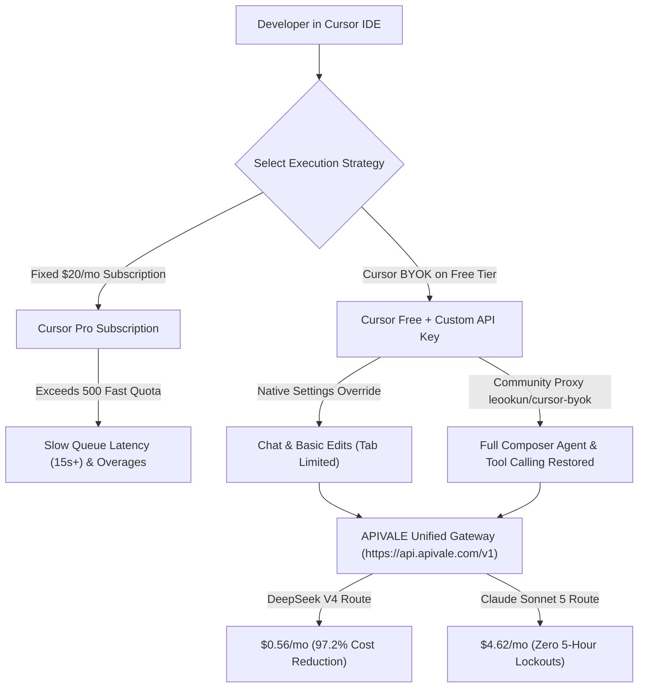

<div class="my-6 border-l-4 border-emerald-500 bg-gray-900 rounded-r-lg p-5">
  <span class="text-xs font-bold uppercase tracking-wider text-emerald-400">Key Takeaways</span>
  <ul class="mt-2 space-y-1 list-disc list-inside text-sm text-gray-300">
    <li><strong>Subscription vs Cursor BYOK:</strong> Cursor Pro charges $20/month for 500 fast requests. Cursor BYOK (Bring Your Own Key) enables pay-as-you-go token routing on Cursor Free, eliminating monthly subscription lock-in.</li>
    <li><strong>The Hidden Feature Trade-Offs:</strong> Official native BYOK disables proprietary <em>Cursor Tab</em> (autocomplete) and restricts background Agent/MCP tool-calling. Running community proxies like <code>leookun/cursor-byok</code> restores complete Agent workflows.</li>
    <li><strong>Break-Even Usage Math:</strong> For developers sending under 350 heavy requests/month or utilizing DeepSeek V4 and Qwen 3.7 Max (<code>infer/qwen3.7-max</code>), BYOK drops monthly editor expenses to $0.56–$4.60 (saving 75% to 97%).</li>
    <li><strong>Global Payment Reliability:</strong> APIVALE officially supports PayPal instant checkout, Apple Pay, and international credit cards with zero KYC friction.</li>
  </ul>
</div>

<div class="my-6 border border-emerald-500/40 bg-emerald-950/20 rounded-xl p-5 shadow-lg">
  <div class="text-base font-bold text-emerald-400 mb-1">⚡ Bottom Line Up Front (BLUF): The 2026 BYOK Verdict</div>
  <p class="text-sm text-gray-200 leading-relaxed">
    <strong>Is Cursor Pro ($20/mo) worth it or should you use Cursor BYOK?</strong> If your daily workflow relies heavily on Cursor's proprietary multi-line Copilot autocomplete, stay on <strong>Cursor Pro</strong>. However, if your primary bottleneck is burning through the 500 fast request quota inside Composer and agentic debugging, switching to <strong>Cursor BYOK</strong> on Cursor Free saves up to <strong>97.2%</strong> on model tokens while providing unthrottled peak-hour concurrency.
  </p>
</div>

Configuring **Cursor BYOK (Bring Your Own Key)** allows developers to connect external LLM endpoints directly into [Cursor AI Editor](https://www.cursor.com/). Features like multi-file **Composer mode**, terminal command execution, and inline diff generation have revolutionized full-stack engineering. However, as developers push autonomous coding loops to production, the $20/month Pro quota evaporates rapidly.

Once you exhaust the 500 fast request allotment, queries fall back to slow queue throttling or billable request overages. In this comprehensive technical guide, we break down **Cursor BYOK setup**, evaluate **Cursor Free vs. Pro limits**, audit the viral **`leookun/cursor-byok` GitHub proxy**, and calculate exact token break-even pricing across Claude Sonnet 5 and DeepSeek V4 using [APIVALE Gateway](https://apivale.com/) alongside [high-speed OpenRouter alternatives](/blog/openrouter-alternatives/). For macro-level architectural token savings, review our [enterprise LLM cost optimization guide](/blog/llm-cost-optimization-guide/).

---

## 1. Multi-Dimensional Comparison: Cursor Pro vs. Cursor BYOK vs. Claude Pro

Choosing between a flat monthly SaaS subscription and a token-metered BYOK architecture requires evaluating feature access, queue latency, and cost ceilings:

| Comparison Metric | Cursor Free + BYOK (Recommended) | Cursor Pro ($20/month) | Claude Pro ($20/month) |
| :--- | :--- | :--- | :--- |
| **Monthly Fixed Fee** | **$0.00 / month** (Pay-as-you-go) | **$20.00 / month** (Fixed commitment) | **$20.00 / month** (Fixed commitment) |
| **Rate & Request Limits** | **100% Unthrottled** (Concurrency backed by gateway) | Throttled after 500 fast requests | Strict 45 msgs / 5-hour hard lockout |
| **Cursor Tab Autocomplete** | Basic single-line (Proprietary Tab gated) | Full multi-line predictive Tab | Not applicable (Web/Desktop only) |
| **Composer Agent Loops** | Full unmetered token access | Consumes 1–3 fast requests per multi-file loop | No native IDE agent integration |
| **Supported Model Engines** | DeepSeek V4, Qwen 3.7 Max, Claude Sonnet 5, GLM-5.3 | Cursor platform whitelist | Claude models only |
| **Light Usage Cost (~150 prompts)** | **$0.17 ~ $4.62 total** | $20.00 fixed | $20.00 fixed |
| **Heavy Usage (>1,200 prompts)** | **$1.35 ~ $16.50** (Blended models) | $20 + Expensive overages / Slow queue | Session locked out during intense sprints |
| **Global Payment Methods** | **PayPal**, Global Credit Cards, Alipay | Stripe Credit Card Only | Stripe Credit Card Only |



---

## 2. Unlocking Full Agent & Tool Calling: Native BYOK vs. `leookun/cursor-byok` (GitHub)

### The Native BYOK Dilemma: Crippled Agent Loops
When configuring custom keys natively under Cursor **Settings -> Models**, developers frequently encounter friction documented extensively across technical forums:

<div class="my-5 p-4 rounded-xl bg-slate-900 border border-slate-700 text-sm text-slate-300">
  <div class="font-bold text-amber-400 mb-1">🗣️ Verified Developer Voice (Reddit r/cursor Community Discussion)</div>
  <p class="italic">
    "Native BYOK in Cursor feels intentionally crippled. As soon as you switch to custom OpenAI or Anthropic keys in settings, Composer agent mode stops executing terminal commands and tool-calling gets disabled. It drops back to a basic text chat interface unless you run a local proxy or pay the $20 Pro fee."
  </p>
</div>

Under native settings overrides:
1. **Tool Calling & MCP Gated**: File system inspection, terminal commands, and Model Context Protocol (MCP) servers are disabled or degraded.
2. **Proprietary Cursor Tab**: The predictive multi-line autocomplete engine is hosted entirely on Cursor's proprietary infrastructure and does not execute against custom API endpoints.
3. **Model Header Mismatches**: Pointing raw provider endpoints directly into Cursor can trigger schema translation errors.

### The Community Workaround: `leookun/cursor-byok` Local Gateway
To restore complete Agent and tool-calling capabilities on the Cursor Free tier, the open-source community created **[leookun/cursor-byok](https://github.com/leookun/cursor-byok)** (available as precompiled binaries for Windows amd64, macOS, and Linux):
* **Protocol Interception**: It launches a lightweight local daemon that intercepts Cursor's outbound communication and mimics Cursor's internal protocol.
* **Restoring Agent Capabilities**: It translates Cursor's multi-step Composer agent requests into standard OpenAI-compatible function calls, unlocking multi-file autonomous editing and terminal execution.
* **Flexible Upstream Routing**: Instead of binding your machine directly to a single provider with rigid credit card rules, you can configure the upstream proxy to route directly through **APIVALE**.

---

## 3. Interactive Cursor BYOK vs Pro Cost Calculator

Calculate your exact monthly token expenses and savings when migrating from Cursor Pro to APIVALE custom keys:

<div class="my-6 p-6 rounded-2xl bg-gray-900 border border-emerald-500/30 shadow-xl" id="byok-calculator-widget">
  <div class="text-lg font-bold text-white mb-3">🧮 Cursor BYOK vs Pro Cost Calculator</div>
  <div class="grid grid-cols-1 md:grid-cols-2 gap-4 mb-4">
    <div>
      <label class="block text-xs font-semibold text-gray-300 uppercase mb-1">Monthly Coding Prompts / Requests</label>
      <input type="range" id="req-slider" min="50" max="3000" step="50" value="500" class="w-full h-2 bg-gray-700 rounded-lg appearance-none cursor-pointer accent-emerald-500" oninput="updateCalculator()">
      <div class="flex justify-between text-xs text-gray-400 mt-1">
        <span>50 reqs</span>
        <span id="req-val" class="text-emerald-400 font-bold">500 requests</span>
        <span>3000 reqs</span>
      </div>
    </div>
    <div>
      <label class="block text-xs font-semibold text-gray-300 uppercase mb-1">Target BYOK Model Architecture</label>
      <select id="model-select" class="w-full bg-gray-800 border border-gray-700 rounded-lg px-3 py-2 text-sm text-white focus:outline-none focus:border-emerald-500" onchange="updateCalculator()">
        <option value="deepseek-v4">DeepSeek V4 ($0.14 / 1M tokens - 97.2% Savings)</option>
        <option value="qwen-3-7">Qwen 3.7 Max ($0.60 / 1M tokens - High Reasoning)</option>
        <option value="claude-sonnet-5">Claude Sonnet 5 ($2.80 / 1M tokens - Flagship)</option>
      </select>
    </div>
  </div>
  
  <div class="grid grid-cols-1 sm:grid-cols-3 gap-3 pt-3 border-t border-gray-800 text-center">
    <div class="p-3 bg-gray-800/80 rounded-xl">
      <div class="text-xs text-gray-400">Cursor Pro Plan</div>
      <div class="text-xl font-extrabold text-rose-400 mt-1">$20.00</div>
      <div class="text-[11px] text-gray-500">Fixed Monthly</div>
    </div>
    <div class="p-3 bg-gray-800/80 rounded-xl border border-emerald-500/40">
      <div class="text-xs text-emerald-400 font-semibold">Cursor BYOK Cost</div>
      <div class="text-xl font-extrabold text-emerald-400 mt-1" id="byok-calc-cost">$0.56</div>
      <div class="text-[11px] text-gray-400">Pay-as-you-go</div>
    </div>
    <div class="p-3 bg-emerald-950/40 rounded-xl border border-emerald-500/30">
      <div class="text-xs text-emerald-300">Your Monthly Savings</div>
      <div class="text-xl font-extrabold text-white mt-1" id="byok-calc-savings">$19.44 (-97.2%)</div>
      <div class="text-[11px] text-emerald-400 font-medium">Zero Throttling</div>
    </div>
  </div>
</div>

<script>
function updateCalculator() {
  const reqs = parseInt(document.getElementById('req-slider').value);
  document.getElementById('req-val').innerText = reqs + " requests";
  const model = document.getElementById('model-select').value;
  
  let costPerReq = 0;
  if (model === 'deepseek-v4') {
    costPerReq = (6000 * 0.14 + 1000 * 0.28) / 1000000;
  } else if (model === 'qwen-3-7') {
    costPerReq = (6000 * 0.60 + 1000 * 1.80) / 1000000;
  } else {
    costPerReq = (6000 * 2.80 + 1000 * 14.00) / 1000000;
  }
  
  const totalCost = (reqs * costPerReq).toFixed(2);
  const savings = (20.00 - totalCost).toFixed(2);
  const pct = Math.max(0, ((20.00 - totalCost) / 20.00 * 100)).toFixed(1);
  
  document.getElementById('byok-calc-cost').innerText = "$" + totalCost;
  if (20.00 - totalCost >= 0) {
    document.getElementById('byok-calc-savings').innerText = "$" + savings + " (-" + pct + "%)";
  } else {
    document.getElementById('byok-calc-savings').innerText = "High Volume ($" + totalCost + ")";
  }
}
</script>

---

## 4. The Token Math: Break-Even Formula for Cursor BYOK

To determine whether Cursor Pro or Cursor BYOK is more cost-effective for your specific workload, audit the token economics of typical development interactions.

### Standard Flagship Math (Claude Sonnet 5)
A standard full-file code generation prompt in Composer transmits approximately **6,000 input tokens** (system instructions, active file buffer, referenced interfaces) and generates **1,000 output tokens**:

$$\text{Cost per Prompt} = \left(\frac{6,000 \times \$2.80}{1,000,000}\right) + \left(\frac{1,000 \times \$14.00}{1,000,000}\right) = \$0.0168 + \$0.0140 = \$0.0308$$

$$\text{Break-Even Request Volume} = \frac{\$20.00}{\$0.0308} \approx 649 \text{ requests}$$

* If you send **under 650 prompts/month** using flagship models, Cursor BYOK is consistently cheaper than paying the $20 flat subscription fee.
* Developers submitting 150 requests/month spend only **$4.62**, saving over **$15.38 every month**.

### The DeepSeek V4 & Qwen 3.7 Max Token Arbitrage
For engineers adopting ultra-efficient open-weights models like **DeepSeek V4** ($0.14 input / $0.28 output per 1M tokens) or **Qwen 3.7 Max** (`infer/qwen3.7-max`):

$$\text{Cost per Prompt (DeepSeek V4)} = \left(\frac{6,000 \times \$0.14}{1,000,000}\right) + \left(\frac{1,000 \times \$0.28}{1,000,000}\right) = \$0.00084 + \$0.00028 = \$0.00112$$

For **500 requests** (matching Cursor Pro's monthly fast quota):

$$\text{Total Monthly Spend} = 500 \times \$0.00112 = \mathbf{\$0.56}$$

```
┌────────────────────────────────────────────────────────────────────────┐
│  CURSOR PRO SUBSCRIPTION: $20.00 / month                               │
├────────────────────────────────────────────────────────────────────────┤
│  CURSOR BYOK (DeepSeek V4): $0.56 / month   [Save $19.44 / mo (-97.2%)]│
└────────────────────────────────────────────────────────────────────────┘
```

For teams exploring terminal agent workflows and local gateways, see our dedicated tutorials on [Configuring Claude Code CLI with Custom Base URLs](/blog/how-to-set-up-claude-code-cli-with-custom-base-url/), [OmniRoute Claude Code Gateway Setup](/blog/omniroute-claude-code-setup/), [Connecting Qwen 3.8 to Cursor IDE](/blog/qwen-3-8-cursor-setup/), [DeepSeek V4.1 Flash API 437 t/s Benchmark Guide](/blog/deepseek-v4-flash-api-guide/), and [OpenRouter Pricing vs Wholesale API Gateways](/openrouter-pricing/).

---

## 5. Step-by-Step Setup: Configuring Cursor BYOK in 60 Seconds

Connecting your custom API key to Cursor takes four straightforward steps:

### Step 1: Obtain Your API Key
1. Sign up on [APIVALE Gateway](https://apivale.com/sign-up?redirect=/blog/cursor-pro-vs-custom-api-key) and collect your instant **$0.20 free developer trial credits** (no credit card or phone verification required).
2. Generate a secure API key (`sk-apivale-...`).

### Step 2: Open Cursor Settings
* Press `Ctrl + ,` (Windows/Linux) or `Cmd + ,` (macOS).
* Search for **"Models"** in the settings search bar or navigate to **Features -> Models**.

### Step 3: Configure OpenAI Provider Override
1. In the OpenAI section, toggle **"OpenAI API Key"** and paste your APIVALE key.
2. Click **"Override OpenAI Base URL"** and set the endpoint to:
   ```text
   https://api.apivale.com/v1
   ```
3. Toggle the model verification switch to validate network latency and authentication.

### Step 4: Add Custom Model Identifiers
Click **"Add model"** and register your desired models:
* `deepseek-v4-flash` (see our [DeepSeek V4 Flash API guide](/blog/deepseek-v4-flash-api-guide/))
* `infer/qwen3.7-max` (check our dedicated [Qwen 3.8 Cursor IDE setup](/blog/qwen-3-8-cursor-setup/))
* `stealth/ox-alpha` (read our [Ox Alpha Claude Code & Cursor guide](/blog/ox-alpha-claude-code-cursor-setup/))
* `claude-sonnet-5` (see our [Claude Opus 5.5 CLI & IDE guide](/blog/claude-opus-5-5-api-pricing-claude-code-guide/))
* `infer/meituan/longcat-2.5` (for 1M context codebases, explore our [LongCat 2.5 API guide](/blog/longcat-2-5-api-setup-benchmarks/))

---

## 6. Enterprise Failover Router for Cursor BYOK

For engineering organizations routing Cursor traffic across development teams, deploy this production-ready Node.js/TypeScript proxy to handle rate-limit retries and automatic model failovers:

```typescript
import express, { Request, Response } from 'express';
import axios from 'axios';

const app = express();
const PORT = 3050;
const APIVALE_GATEWAY_URL = 'https://api.apivale.com/v1/chat/completions';
const APIVALE_SECRET_KEY = process.env.APIVALE_API_KEY || 'sk-apivale-prod-key';

app.use(express.json({ limit: '20mb' }));

const MODEL_FALLBACK_CHAIN = [
  'deepseek-v4-flash',
  'infer/qwen3.7-max',
  'claude-sonnet-5'
];

interface ChatPayload {
  model: string;
  messages: any[];
  stream?: boolean;
  temperature?: number;
}

async function forwardWithFallback(payload: ChatPayload, attempt = 0): Promise<any> {
  const currentModel = MODEL_FALLBACK_CHAIN[attempt] || MODEL_FALLBACK_CHAIN[0];
  const modifiedPayload = { ...payload, model: currentModel };

  try {
    const response = await axios.post(APIVALE_GATEWAY_URL, modifiedPayload, {
      headers: {
        'Authorization': `Bearer ${APIVALE_SECRET_KEY}`,
        'Content-Type': 'application/json'
      },
      timeout: 45000
    });
    return response.data;
  } catch (error: any) {
    const status = error.response?.status || 500;
    console.warn(`[Failover Router] Model ${currentModel} returned HTTP ${status}. Retrying fallback...`);

    if (attempt < MODEL_FALLBACK_CHAIN.length - 1) {
      const backoffMs = Math.pow(2, attempt) * 800 + Math.random() * 200;
      await new Promise((resolve) => setTimeout(resolve, backoffMs));
      return forwardWithFallback(payload, attempt + 1);
    }
    throw error;
  }
}

app.post('/v1/chat/completions', async (req: Request, res: Response): Promise<void> => {
  try {
    const responseData = await forwardWithFallback(req.body);
    res.json(responseData);
  } catch (err: any) {
    res.status(err.response?.status || 500).json({
      error: 'Proxy failover chain exhausted',
      message: err.message
    });
  }
});

app.listen(PORT, () => {
  console.log(`🚀 Cursor BYOK Enterprise Proxy listening at http://127.0.0.1:${PORT}`);
});
```

---

## 7. Frictionless Global Developer Billing via PayPal

Subscribing to US-based AI developer platforms frequently leads to sudden card declines, fraud flags, or regional restrictions. APIVALE provides seamless global developer payments:
* **PayPal Instant Checkout**: Connect PayPal or any international debit/credit card (Visa, MasterCard, Amex) with zero foreign transaction penalties.
* **No Phone KYC Obstacles**: Start testing immediately with a simple email or GitHub OAuth login.
* **Consolidated Multi-Model Quota**: Maintain a single prepaid balance to query DeepSeek, Claude, Qwen, and GLM models without maintaining multiple vendor subscriptions.

---

<div class="cta-card">
  <div class="cta-card-title font-bold text-lg text-emerald-400">⚡ Upgrade Your Cursor BYOK Workflow with APIVALE</div>
  <p class="cta-card-text text-gray-300 text-sm mt-2 mb-4">Eliminate 500-request quotas and slow peak-hour queues. Route Cursor IDE directly to APIVALE for wholesale token pricing, zero rate-limit drops, and instant PayPal global checkout.</p>
  <div class="cta-card-actions flex flex-wrap gap-3">
    <a href="https://apivale.com/sign-up?redirect=/blog/cursor-pro-vs-custom-api-key" class="cta-primary-btn bg-emerald-500 hover:bg-emerald-400 text-black font-semibold px-4 py-2 rounded-lg transition">Start Free ($0.20 Trial Credit)</a>
    <a href="https://apivale.com/pricing?redirect=/blog/cursor-pro-vs-custom-api-key" class="cta-secondary-btn bg-slate-800 hover:bg-slate-700 text-white font-medium px-4 py-2 rounded-lg border border-slate-700 transition">View Developer Pack ($29 for 40M Tokens)</a>
  </div>
</div>

---

## Frequently Asked Questions (FAQ)

### Can I use Cursor BYOK on the Free tier without paying for Cursor Pro?
Yes. Cursor allows free tier accounts to configure custom OpenAI Base URL endpoints under settings. You do not need an active $20/month Cursor Pro subscription to connect your own API key and use models like DeepSeek V4 or Claude Sonnet 5 in Composer.

### Does Cursor Tab (autocomplete) work with custom API keys?
No. Cursor's proprietary multi-line autocomplete engine runs exclusively on Cursor's managed cloud infrastructure. Using custom API keys enables Chat, Composer, and Edit capabilities, but predictive background Tab completions require a Pro subscription or the free monthly starter pool.

### How does `leookun/cursor-byok` fix disabled Agent tool-calling?
The open-source `leookun/cursor-byok` daemon acts as a local model gateway on Windows, macOS, or Linux. It intercepts Cursor's proprietary communication protocol and translates multi-file agent interactions into standard function-calling schemas, restoring autonomous terminal execution and tool-calling on BYOK setups.

### What is the break-even request volume between Cursor Pro and BYOK?
When querying flagship models like Claude Sonnet 5, the break-even point is approximately 650 requests per month. If you send fewer than 650 prompts monthly or utilize cost-efficient open-weights models like DeepSeek V4 ($0.14/1M tokens), BYOK slashes monthly editor expenses by 70% to 97%.

### How do I purchase APIVALE credits globally without credit card blocks?
APIVALE officially supports PayPal instant checkout alongside international credit cards (Visa, MasterCard, Amex) and Alipay. There are no US card-issuing restrictions, KYC requirements, or extra foreign exchange fees.

<script type="application/ld+json">
{
  "@context": "https://schema.org",
  "@type": "FAQPage",
  "mainEntity": [
    {
      "@type": "Question",
      "name": "Can I use Cursor BYOK on the Free tier without paying for Cursor Pro?",
      "acceptedAnswer": {
        "@type": "Answer",
        "text": "Yes. Cursor allows free tier accounts to configure custom OpenAI Base URL endpoints under settings. You do not need an active $20/month Cursor Pro subscription to connect your own API key and use models like DeepSeek V4 or Claude Sonnet 5 in Composer."
      }
    },
    {
      "@type": "Question",
      "name": "Does Cursor Tab (autocomplete) work with custom API keys?",
      "acceptedAnswer": {
        "@type": "Answer",
        "text": "No. Cursor's proprietary multi-line autocomplete engine runs exclusively on Cursor's managed cloud infrastructure. Using custom API keys enables Chat, Composer, and Edit capabilities, but predictive background Tab completions require a Pro subscription."
      }
    },
    {
      "@type": "Question",
      "name": "How does leookun/cursor-byok fix disabled Agent tool-calling?",
      "acceptedAnswer": {
        "@type": "Answer",
        "text": "The open-source leookun/cursor-byok daemon acts as a local model gateway. It intercepts Cursor's proprietary communication protocol and translates multi-file agent interactions into standard function-calling schemas, restoring autonomous terminal execution and tool-calling on BYOK setups."
      }
    },
    {
      "@type": "Question",
      "name": "What is the break-even request volume between Cursor Pro and BYOK?",
      "acceptedAnswer": {
        "@type": "Answer",
        "text": "When querying flagship models like Claude Sonnet 5, the break-even point is approximately 650 requests per month. Below 650 prompts or when using DeepSeek V4 ($0.14/1M tokens), BYOK reduces monthly editor expenses by 70% to 97%."
      }
    },
    {
      "@type": "Question",
      "name": "How do I purchase APIVALE credits globally without credit card blocks?",
      "acceptedAnswer": {
        "@type": "Answer",
        "text": "APIVALE officially supports PayPal instant checkout alongside international credit cards and Alipay. There are no US card-issuing restrictions, KYC requirements, or extra foreign exchange fees."
      }
    }
  ]
}
</script>
