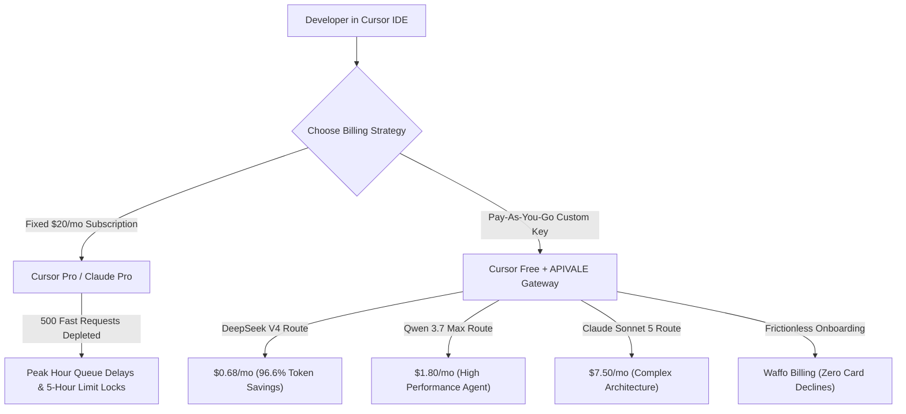

<div class="my-6 border-l-4 border-emerald-500 bg-gray-900 rounded-r-lg p-5">
  <span class="text-xs font-bold uppercase tracking-wider text-emerald-400">Key Takeaways</span>
  <ul class="mt-2 space-y-1 list-disc list-inside text-sm text-gray-300">
    <li><strong>Subscription vs Custom API Keys:</strong> Cursor Pro charges a flat $20/month for 500 fast requests. Heavy Composer agent loops deplete this limit in under 15 debugging sessions.</li>
    <li><strong>Cursor Pro vs Claude Pro Limits:</strong> Claude Pro hits a strict 5-hour message limit on long context windows, while Cursor Pro falls back to slow queue throttling. Custom keys via APIVALE provide 100% unthrottled concurrency.</li>
    <li><strong>96.6% Token Arbitrage:</strong> Routing Cursor Free + custom API key to DeepSeek V4 and Qwen 3.7 Max (<code>infer/qwen3.7-max</code>) reduces monthly spend from $20.00 down to $0.68.</li>
    <li><strong>Zero Card Blocks & Frictionless Billing:</strong> Top up API usage globally via Waffo Global Billing with zero KYC or phone verification obstacles.</li>
  </ul>
</div>

<div class="my-6 border border-emerald-500/40 bg-emerald-950/20 rounded-xl p-5 shadow-lg">
  <h3 class="text-base font-bold text-emerald-400 mb-1">⚡ Bottom Line Up Front (BLUF): Quick Verdict</h3>
  <p class="text-sm text-gray-200 leading-relaxed">
    <strong>Is Cursor Pro ($20/mo) worth it?</strong> For developers comparing <strong>Cursor Pro vs custom API key, Claude Pro, or Cursor Free</strong>: For light users (<200 requests/mo), using a custom key on Cursor Free costs just <strong>$0.28 to $6.60</strong>. For active developers using DeepSeek V4 or Qwen 3.7 Max, custom keys slash monthly IDE bills to <strong>$0.68</strong>—saving <strong>96.6%</strong> with zero queue throttling.
  </p>
</div>

Comparing **Cursor Pro vs custom API keys** is essential for engineers building with [Cursor AI Editor](https://www.cursor.com/). Features like multi-file **Composer mode**, terminal execution, and inline tab completion have transformed coding workflows. However, as developers push agentic workflows to production, a common bottleneck appears: **the $20/month Cursor Pro quota exhausts rapidly.**

Once you hit the 500 fast request limit, you face unexpected overage charges or peak-hour queue delays. In this 2026 guide, we break down the exact token math of **Cursor Pro vs Custom API Key**, benchmark **Cursor Pro vs Claude Pro limits**, and demonstrate how to configure high-speed custom endpoints with global [APIVALE Gateway](/blog/openrouter-alternatives/).

---

## 1. Multi-Dimensional Comparison: Cursor Pro vs Custom API Key vs Claude Pro

Evaluating AI developer tools requires comparing fixed monthly subscriptions against pay-as-you-go token metering:

| Comparison Parameter | Cursor Free + Custom Key (Recommended) | Cursor Pro ($20/mo) | Claude Pro ($20/mo) | Windsurf Pro ($15/mo) |
| :--- | :--- | :--- | :--- | :--- |
| **Monthly Fixed Fee** | **$0.00 / month** (Pay-as-you-go) | **$20.00 / month** (Fixed) | **$20.00 / month** (Fixed) | **$15.00 / month** (Fixed) |
| **Request & Rate Limits** | **100% Unthrottled** (No limits) | Throttled after 500 requests | 45 msgs / 5-hour hard limit | Throttled after 500 credits |
| **Composer / Multi-File Context** | **Full Concurrency** (Per-token) | Depletes fast quota rapidly | Web/Desktop only (No native IDE) | Cascade agent credit drain |
| **Model Choice Flexibility** | DeepSeek V4, Qwen 3.7, Sonnet 5, GLM | Cursor Whitelist only | Claude models only | Windsurf Whitelist only |
| **Light Usage Cost (~200 reqs)** | **$0.28 ~ $6.60** total | $20.00 fixed commitment | $20.00 fixed commitment | $15.00 fixed commitment |
| **Heavy Usage (>1,500 reqs)** | **$2.50 ~ $9.80** (via model mix) | $20 + High Overages / Delays | Hard lockouts during sprints | $15 + Add-on credit packs |
| **Global Payment Method** | **Waffo Global Billing** / Wallets | Stripe Credit Card Only | Stripe Credit Card Only | Stripe Credit Card Only |



---

## 2. Interactive Custom API Key Savings Calculator

Calculate your exact monthly savings when switching from Cursor Pro to custom API keys via APIVALE:

<div class="my-6 p-6 rounded-2xl bg-gray-900 border border-emerald-500/30 shadow-xl" id="byok-calculator-widget">
  <h3 class="text-lg font-bold text-white mb-3">🧮 Cursor Pro vs Custom API Key Cost Calculator</h3>
  <div class="grid grid-cols-1 md:grid-cols-2 gap-4 mb-4">
    <div>
      <label class="block text-xs font-semibold text-gray-300 uppercase mb-1">Monthly Coding Prompts / Requests</label>
      <input type="range" id="req-slider" min="50" max="3000" step="50" value="500" class="w-full h-2 bg-gray-700 rounded-lg appearance-none cursor-pointer accent-emerald-500" oninput="updateCalculator()">
      <div class="flex justify-between text-xs text-gray-400 mt-1">
        <span>50 reqs</span>
        <span id="req-val" class="text-emerald-400 font-bold">500 requests</span>
        <span>3000 reqs</span>
      </div>
    </div>
    <div>
      <label class="block text-xs font-semibold text-gray-300 uppercase mb-1">Target Model for Custom Key</label>
      <select id="model-select" class="w-full bg-gray-800 border border-gray-700 rounded-lg px-3 py-2 text-sm text-white focus:outline-none focus:border-emerald-500" onchange="updateCalculator()">
        <option value="deepseek-v4">DeepSeek V4 ($0.14 / 1M tokens - 96.6% Savings)</option>
        <option value="qwen-3-7">Qwen 3.7 Max ($0.60 / 1M tokens - High Accuracy)</option>
        <option value="claude-sonnet-5">Claude Sonnet 5 ($2.80 / 1M tokens - Flagship)</option>
      </select>
    </div>
  </div>
  
  <div class="grid grid-cols-1 sm:grid-cols-3 gap-3 pt-3 border-t border-gray-800 text-center">
    <div class="p-3 bg-gray-800/80 rounded-xl">
      <div class="text-xs text-gray-400">Cursor Pro Cost</div>
      <div class="text-xl font-extrabold text-rose-400 mt-1">$20.00</div>
      <div class="text-[11px] text-gray-500">Fixed Monthly</div>
    </div>
    <div class="p-3 bg-gray-800/80 rounded-xl border border-emerald-500/40">
      <div class="text-xs text-emerald-400 font-semibold">Custom Key Cost</div>
      <div class="text-xl font-extrabold text-emerald-400 mt-1" id="byok-calc-cost">$0.68</div>
      <div class="text-[11px] text-gray-400">Pay-as-you-go</div>
    </div>
    <div class="p-3 bg-emerald-950/40 rounded-xl border border-emerald-500/30">
      <div class="text-xs text-emerald-300">Your Monthly Savings</div>
      <div class="text-xl font-extrabold text-white mt-1" id="byok-calc-savings">$19.32 (-96.6%)</div>
      <div class="text-[11px] text-emerald-400 font-medium">Instant Arbitrage</div>
    </div>
  </div>
</div>

<script>
function updateCalculator() {
  const reqs = parseInt(document.getElementById('req-slider').value);
  document.getElementById('req-val').innerText = reqs + " requests";
  const model = document.getElementById('model-select').value;
  
  let costPerReq = 0;
  if (model === 'deepseek-v4') {
    costPerReq = (6000 * 0.14 + 1000 * 0.28) / 1000000;
  } else if (model === 'qwen-3-7') {
    costPerReq = (6000 * 0.60 + 1000 * 1.80) / 1000000;
  } else {
    costPerReq = (6000 * 2.80 + 1000 * 14.00) / 1000000;
  }
  
  const totalCost = (reqs * costPerReq).toFixed(2);
  const savings = (20.00 - totalCost).toFixed(2);
  const pct = Math.max(0, ((20.00 - totalCost) / 20.00 * 100)).toFixed(1);
  
  document.getElementById('byok-calc-cost').innerText = "$" + totalCost;
  if (20.00 - totalCost >= 0) {
    document.getElementById('byok-calc-savings').innerText = "$" + savings + " (-" + pct + "%)";
  } else {
    document.getElementById('byok-calc-savings').innerText = "Unlimited Quota";
  }
}
</script>

---

## 3. Cursor Pro vs Claude Pro Limits: Reddit & Community Pain Points

On developer forums like Reddit (`r/Cursor`, `r/ClaudeAI`), the debate of **Cursor Pro vs Claude Pro** frequently highlights rate limits:

### The Claude Pro 5-Hour Window Problem
While Claude Pro ($20/month) gives direct access to Anthropic's web chat and artifacts, it enforces strict token capacity caps:
* Users working on large codebases with multi-thousand-token prompts hit the **"You have reached your limit until X:XX"** message in as few as 8–12 iterations.
* Claude Pro provides **no IDE integration**, requiring developers to manually copy diffs.

### The Cursor Pro 500 Fast Request Constraint
Cursor Pro integrates into your editor, but heavy **Composer multi-file agent loops** rapidly burn through the 500 fast requests:
* After 500 requests, queries enter **slow queues** during peak working hours, with latency spiking from 1.2s to 18+ seconds per generation.
* Upgrading to Pro+ or paying on-demand overages significantly inflates development costs.

### Why Custom API Keys Resolve Both Limits
By utilizing **Cursor Free + APIVALE custom keys**:
1. You operate directly inside Cursor IDE with full Composer support.
2. You bypass all artificial 5-hour rate limits and queue throttling.
3. Every prompt is fulfilled with maximum concurrency and sub-second TTFT.

---

## 4. Cursor Pro vs Free: Can You Use Custom Keys on Free Tier?

A common question among developers is: **"Do I need to subscribe to Cursor Pro to use custom API keys?"**

**Answer: No.** Cursor allows free tier accounts to configure custom OpenAI endpoints without paying the $20 monthly subscription:
* **Cursor Free Tier**: Includes basic Tab autocompletion and allows custom OpenAI Base URL overrides in settings.
* **Feature Parity with Custom Keys**: When you point Cursor Free to APIVALE, you unlock unlimited Composer sessions, terminal executions, and model switching (DeepSeek V4, Qwen 3.7 Max, Claude Sonnet 5).
* **Cost Difference**: Instead of committing $240/year for Cursor Pro, developers on the Free tier spend only for the exact tokens consumed ($5 to $20 for an entire year on DeepSeek V4).

---

## 5. The Exact Token Math: Cursor Pro ($20/mo) vs Custom API Key

To quantify the savings of **custom API keys**, let's calculate token consumption formulas for typical software development prompts.

### Standard Model Math (Claude Sonnet 5)

An average coding prompt with active file context sends **6,000 input tokens** and receives **1,000 output tokens**:

$$\text{Cost per Prompt} = \left(\frac{6,000 \times \$2.80}{1,000,000}\right) + \left(\frac{1,000 \times \$14.00}{1,000,000}\right) = \$0.0168 + \$0.014 = \$0.0308$$

Under Cursor Pro's $20 monthly price:
* A developer making 150 prompts/month spends **$20.00** on Cursor Pro, but only **$4.62** on custom keys (Saving $15.38/mo).

### The DeepSeek V4 & Qwen 3.7 Max Token Arbitrage

By switching the underlying model to **DeepSeek V4** ($0.14 input / $0.28 output per 1M tokens) or **Qwen 3.7 Max** (`infer/qwen3.7-max`):

$$\text{Cost per Prompt (DeepSeek V4)} = \left(\frac{6,000 \times \$0.14}{1,000,000}\right) + \left(\frac{1,000 \times \$0.28}{1,000,000}\right) = \$0.00084 + \$0.00028 = \$0.00112$$

For **500 requests** (matching Cursor Pro's monthly fast quota):

$$\text{Total Monthly Spend} = 500 \times \$0.00112 = \mathbf{\$0.56}$$

```
┌────────────────────────────────────────────────────────────────────────┐
│  CURSOR PRO SUBSCRIPTION: $20.00 / month                               │
├────────────────────────────────────────────────────────────────────────┤
│  CUSTOM KEY (DeepSeek V4): $0.56 / month   [Save $19.44 / mo (-97.2%)] │
└────────────────────────────────────────────────────────────────────────┘
```

For teams evaluating command-line agent alternatives, check our breakdown on [Connecting Qwen 3.8 to Claude Code CLI](/blog/how-to-connect-qwen-3-8-to-claude-code-cli/) and [Grok 4.5 vs Claude Fable 5 API Comparison](/blog/grok-4-5-vs-claude-fable-5-coding-agent-api/).

---

## 6. How Composer Agent Loops Accumulate Context

Cursor Composer executes multi-file autonomous loops where context compounds exponentially:

$$\text{Cumulative Context Tokens} = \sum_{k=1}^{N} \left( \text{Base Context} + k \times \text{Delta Tokens} \right)$$

In an 8-turn debugging sequence with 35,000 tokens of project context:
1. Cumulative session volume easily exceeds **300,000 tokens**.
2. On proprietary models, 15 debugging sessions consume your entire $20 plan.
3. On APIVALE custom keys with DeepSeek V4, that same 300,000-token debugging session costs just **$0.042**.

---

## 7. Quick Start: Configure Custom API Keys in Cursor in 30 Seconds

Configure high-speed custom endpoints in Cursor in 4 simple steps:

1. **Get API Key**: Create an account on [APIVALE Gateway](https://apivale.com/sign-up) and grab your API key (`sk-apivale-...`).
2. **Open Cursor Settings**: Press `Ctrl + ,` (Windows/Linux) or `Cmd + ,` (macOS).
3. **Configure OpenAI Provider**: Navigate to **Settings -> Models -> OpenAI**, toggle **"Override Base URL"**, and enter:
   ```text
   https://apivale.com/v1
   ```
4. **Add Custom Model Names**: In the model list, add `deepseek-v4-flash`, `infer/qwen3.7-max`, and `claude-sonnet-5`.

---

## 8. Production Implementation: Resilient Proxy Router

For engineering teams running centralized custom keys across multiple developers, the following TypeScript proxy handles rate limit retries and automatic model failover:

```typescript
import express, { Request, Response } from 'express';
import axios from 'axios';

const app = express();
const PORT = 3050;
const APIVALE_GATEWAY_URL = 'https://apivale.com/v1/chat/completions';
const APIVALE_SECRET_KEY = process.env.APIVALE_API_KEY || 'sk-apivale-xxxxxxxxxxxx';

app.use(express.json({ limit: '20mb' }));

const MODEL_FALLBACKS = [
  'deepseek-v4-flash',
  'infer/qwen3.7-max',
  'claude-sonnet-5'
];

interface ChatCompletionRequest {
  model: string;
  messages: any[];
  stream?: boolean;
  temperature?: number;
}

async function dispatchWithFallback(payload: ChatCompletionRequest, attempt = 0): Promise<any> {
  const selectedModel = MODEL_FALLBACKS[attempt] || MODEL_FALLBACKS[0];
  const updatedPayload = { ...payload, model: selectedModel };

  console.log(`[Router] Attempt ${attempt + 1}: Routing prompt to '${selectedModel}'...`);

  try {
    const response = await axios.post(APIVALE_GATEWAY_URL, updatedPayload, {
      headers: {
        'Authorization': `Bearer ${APIVALE_SECRET_KEY}`,
        'Content-Type': 'application/json'
      },
      timeout: 45000
    });
    return response.data;
  } catch (error: any) {
    const statusCode = error.response?.status || 500;
    console.warn(`[Router Warning] Request failed on '${selectedModel}' (HTTP ${statusCode}).`);

    if (attempt < MODEL_FALLBACKS.length - 1) {
      const delayMs = Math.pow(2, attempt) * 1000 + Math.random() * 300;
      await new Promise((resolve) => setTimeout(resolve, delayMs));
      return dispatchWithFallback(payload, attempt + 1);
    }
    throw error;
  }
}

app.post('/v1/chat/completions', async (req: Request, res: Response): Promise<void> => {
  try {
    const result = await dispatchWithFallback(req.body);
    res.json(result);
  } catch (err: any) {
    res.status(err.response?.status || 500).json({
      error: 'All model routes exhausted.',
      details: err.message
    });
  }
});

app.listen(PORT, () => {
  console.log(`🚀 Cursor Custom Key Proxy Router running at http://localhost:${PORT}`);
});
```

---

## 9. Frictionless Developer Onboarding via Waffo

### Zero Card Declines & Global Billing
Developers worldwide frequently encounter billing rejections when subscribing to US-based AI platforms. APIVALE eliminates these roadblocks:
* **Waffo Global Billing**: Top up accounts using international credit cards and global digital wallets with maximum transaction success rates.
* **No KYC or Phone Verification**: Sign up via GitHub or email in seconds and immediately generate production keys.
* **Multi-Model Unified Balance**: Manage token spend across DeepSeek, Qwen, GLM, and Claude from a single account without multiple subscriptions.

---

<div class="cta-card">
  <h4 class="cta-card-title">🚀 Switch to Custom API Keys via APIVALE & Save up to 96.6%</h4>
  <p class="cta-card-text">Stop paying for overpriced fixed subscriptions and slow queue delays. Connect Cursor IDE to APIVALE today. Get wholesale token pricing, zero rate-limit queues, and global Waffo payment support.</p>
  <div class="cta-card-actions">
    <a href="https://apivale.com/sign-up?utm_source=apivale_blog&utm_medium=blog&utm_campaign=cursor-pro-vs-custom-api-key" class="cta-primary-btn">Get Free API Key ($0.20 Credit)</a>
    <a href="https://apivale.com/docs?utm_source=apivale_blog&utm_medium=blog&utm_campaign=cursor-pro-vs-custom-api-key" class="cta-secondary-btn">View Integration Guide</a>
  </div>
</div>

---

## Frequently Asked Questions (FAQ)

### Is using a custom API key cheaper than Cursor Pro $20/month subscription?
Yes. For light to moderate developers, custom API keys cost between $0.56 and $6.60 per month depending on model selection. By utilizing models like DeepSeek V4 ($0.14/1M) and Qwen 3.7 Max, developers save up to 96.6% compared to the fixed $20 monthly subscription.

### Cursor Pro vs Claude Pro: Which one is better for coding?
Cursor Pro is superior for in-editor multi-file editing and agentic debugging, but is capped at 500 fast requests. Claude Pro provides web-based chat with strict 5-hour message limits and no IDE integration. For heavy coding, using Cursor Free with APIVALE custom keys provides unthrottled API access with zero subscription lock-in.

### Can I use custom API keys on Cursor's free tier without paying $20/month?
Yes. Cursor's free tier natively supports custom OpenAI Base URL overrides. You do not need an active Cursor Pro subscription to connect your own API key and use models like DeepSeek V4 or Claude Sonnet 5 in Composer.

### How does APIVALE handle global billing without credit card lockouts?
APIVALE utilizes Waffo Global Billing, supporting global credit cards and digital wallets without requiring phone verification or encountering regional card issuing blocks.

<script type="application/ld+json">
{
  "@context": "https://schema.org",
  "@type": "FAQPage",
  "mainEntity": [
    {
      "@type": "Question",
      "name": "Is using a custom API key cheaper than Cursor Pro $20/month subscription?",
      "acceptedAnswer": {
        "@type": "Answer",
        "text": "Yes. For light to moderate developers, custom API keys cost between $0.56 and $6.60 per month depending on model selection. By utilizing frontier models like DeepSeek V4 and Qwen 3.7 Max, developers save up to 96.6% compared to the fixed $20 monthly subscription."
      }
    },
    {
      "@type": "Question",
      "name": "Cursor Pro vs Claude Pro: Which one is better for coding?",
      "acceptedAnswer": {
        "@type": "Answer",
        "text": "Cursor Pro is superior for in-editor multi-file editing and agentic debugging, but is capped at 500 fast requests. Claude Pro provides web-based chat with strict 5-hour message limits. Using Cursor Free with APIVALE custom keys provides unthrottled API access with zero subscription lock-in."
      }
    },
    {
      "@type": "Question",
      "name": "Can I use custom API keys on Cursor's free tier without paying $20/month?",
      "acceptedAnswer": {
        "@type": "Answer",
        "text": "Yes. Cursor's free tier natively supports custom OpenAI Base URL overrides. You do not need an active Cursor Pro subscription to connect your own API key and use models like DeepSeek V4 or Claude Sonnet 5 in Composer."
      }
    },
    {
      "@type": "Question",
      "name": "How does APIVALE handle global billing without credit card lockouts?",
      "acceptedAnswer": {
        "@type": "Answer",
        "text": "APIVALE utilizes Waffo Global Billing, supporting global credit cards and digital wallets without requiring phone verification or encountering regional card issuing blocks."
      }
    }
  ]
}
</script>
