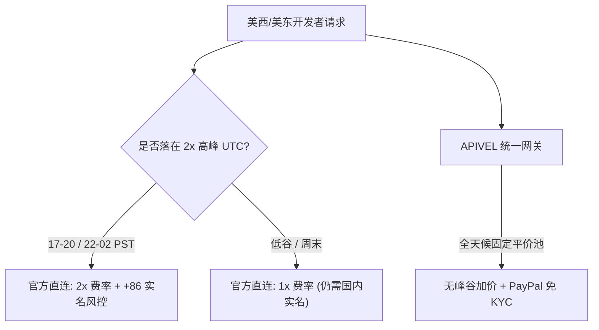

<div class="my-6 border-l-4 border-indigo-500 bg-gray-900 rounded-r-lg p-5">
  <div class="text-xs font-bold uppercase tracking-wider text-indigo-400">核心结论</div>
  <div class="mt-1 text-md font-semibold text-white">DeepSeek 调整 API 定价核心变化</div>
  <p class="mt-2 text-sm text-gray-300">本轮 <strong>DeepSeek 调整 API 定价</strong> 取消单一固定低价，转为「峰谷分时（高峰 2 倍费率）」与「11 月 18 日搜索并入上下文 Token」计费。在美华人开发者不想紧盯 UTC 时钟或受限于 +86 实名风控，可通过 <a rel="nofollow" href="https://apivel.com/sign-up?redirect=%2Fdashboard%3Fquickstart%3Dtrue&from_blog=deepseek-api-pricing-adjustment-zh" class="text-indigo-400 hover:underline font-semibold">APIVEL</a> 走固定平价通道，支持 PayPal 即时结账与免 KYC 接入。</p>
</div>

在美华人开发者近期频搜 **DeepSeek 调整 API 定价**，核心原因在于账单上涨却未见并发暴增：2026 年 8 月上线峰谷分时、9 月调整 Flash 阶梯、11 月 18 日将搜索工具并入上下文计费后，直连成本高度取决于请求时段与缓存命中率。

下文拆解 **DeepSeek 调整 API 定价** 细则、**美西 PST / 美东 EST 时区换算**、**V4.1 Flash 与 V4 Pro 对比**及固定低价接入方案（英文团队可参阅 [DeepSeek API Pricing Change 英文指南](/blog/deepseek-api-pricing-change-peak-off-peak-guide/)）。

<div class="my-6 border-l-4 border-amber-500 bg-gray-900 rounded-r-lg p-5">
  <div class="flex items-center justify-between">
    <span class="text-xs font-bold uppercase tracking-wider text-amber-400">开发者实测反馈</span>
    <span class="text-xs text-gray-400">北美开发者社区 &bull; 账单复盘</span>
  </div>
  <blockquote class="mt-2 text-sm italic text-gray-200">
    “加州傍晚 5 点到晚上 10 点用 Cursor 重构代码，正好撞上北京上午高峰。未命中缓存的 Token 单价直接翻倍，503 重试还多算一遍上下文。”
  </blockquote>
  <div class="mt-2 text-xs text-gray-400">美西傍晚至深夜与 DeepSeek 官方 2 倍高峰窗口高度重叠。</div>
</div>

## DeepSeek 调整 API 定价：美区峰谷时段对照

2026 年 8 月 16 日起，DeepSeek 工作日（中国法定节假日除外）执行峰谷分时，高峰费率为低谷期的 **2 倍**：

| 时段类型 | UTC 时间 | 北京时间 | 美西时间 (PST) | 美东时间 (EST) | 倍率 |
| :--- | :--- | :--- | :--- | :--- | :--- |
| **高峰 A** | `01:00–04:00` | `09:00–12:00` | 前一日 `17:00–20:00` | 前一日 `20:00–23:00` | **2x** |
| **高峰 B** | `06:00–10:00` | `14:00–18:00` | 前一日 `22:00–02:00` | `01:00–05:00` | **2x** |
| **低谷** | 其余及周末假日 | 其余及周末假日 | `02:00–17:00` | `05:00–20:00` | **1x** |

Claude Code 与 Codex 多文件改写会频繁刷新上下文前缀，实测缓存命中率仅 **30%–50%**。一旦落在美西傍晚高峰，未命中输入与输出同步翻倍，月账单随之暴涨。

## DeepSeek 调整 API 定价：11 月搜索与工具计费

2026 年 11 月中旬应用层计费同步更新：

1. **Search & Fetch（11 月 18 日生效）：** 服务端联网搜索与网页抓取**不再单独按次收费**，抓取内容直接拼入上下文按输入 Token 计费。
2. **OCR 文档解析：** 约 `1.5 元 / 1,000 页`（折合 `$0.225 / 1,000 页`）。
3. **ASR / TTS 语音：** 保持独立刊例价与限时 5 折优惠。



## DeepSeek 调整 API 定价后各通道对比

无论使用 [DeepSeek V4.1 Flash](/blog/deepseek-v4-1-flash-1017-api-setup/) 还是关注 [DeepSeek V5 路线图](/blog/deepseek-v5-release-date-api-leaks-roadmap/)，下表为每百万 Tokens 对比：

| 通道方案 | 未命中输入 | 缓存命中 | 输出 | 支付与实名 | 适用场景 |
| :--- | :--- | :--- | :--- | :--- | :--- |
| **V4.1 Flash (低谷)** | ~$0.14 | ~$0.014 | ~$0.28–$0.55 | +86 实名 / 国内卡 | 夜间批处理 |
| **V4.1 Flash (高峰)** | **~$0.28** | ~$0.028 | **~$0.56–$1.10** | +86 实名 / 国内卡 | 白天突发调用 |
| **V4 Pro (高峰)** | **~$1.25** | ~$0.042 | **~$3.75** | +86 实名 / 国内卡 | 复杂数学推理 |
| **OpenRouter** | 含平台加价 | 视上游 | 含平台加价 | 信用卡 + 手续费 | 多模型比对 |
| **APIVEL 网关** | **$0.14 固定** | **支持** | **$0.28 固定** | **PayPal / 美卡 免 KYC** | **24h Coding Agent** |

## 交互式成本计算器

对比官方高峰直连与 APIVEL 固定费率的月度支出：

<div class="my-6 border border-indigo-500/30 bg-gradient-to-r from-indigo-950/40 via-purple-950/20 to-gray-900 rounded-xl p-6 shadow-xl">
  <div class="flex items-center justify-between flex-wrap gap-3 mb-3">
    <span class="inline-flex items-center text-xs font-bold uppercase tracking-wider text-cyan-400 bg-cyan-950/60 border border-cyan-800/50 px-3 py-1 rounded-full">⚡ DeepSeek 调价成本计算器</span>
    <span class="text-xs text-gray-400 bg-gray-800 px-3 py-1 rounded-full">2026年11月新规</span>
  </div>
  <div class="grid grid-cols-1 md:grid-cols-3 gap-4 mb-4">
    <div>
      <label for="zhDsModel" class="block text-xs font-semibold text-gray-400 uppercase tracking-wider mb-1">模型与时段</label>
      <select id="zhDsModel" class="w-full bg-slate-800 border border-slate-700 rounded-lg px-3 py-2 text-sm text-white focus:outline-none focus:border-indigo-500">
        <option value="flash_peak" selected>V4.1 Flash (美西 2x 高峰)</option>
        <option value="flash_off">V4.1 Flash (低谷时段)</option>
        <option value="pro_peak">V4 Pro (2x 高峰)</option>
        <option value="qwen_alt">Qwen 3.7 Max (备用)</option>
      </select>
    </div>
    <div>
      <label for="zhDsVol" class="block text-xs font-semibold text-gray-400 uppercase tracking-wider mb-1">月用量 (百万 Tokens)</label>
      <input type="number" id="zhDsVol" value="50" min="1" max="5000" class="w-full bg-slate-800 border border-slate-700 rounded-lg px-3 py-2 text-sm text-white focus:outline-none focus:border-indigo-500" />
    </div>
    <div>
      <label for="zhDsCache" class="block text-xs font-semibold text-gray-400 uppercase tracking-wider mb-1">缓存命中率 (%)</label>
      <input type="number" id="zhDsCache" value="40" min="0" max="95" class="w-full bg-slate-800 border border-slate-700 rounded-lg px-3 py-2 text-sm text-white focus:outline-none focus:border-indigo-500" />
    </div>
  </div>
  <div class="grid grid-cols-1 md:grid-cols-3 gap-3 p-4 rounded-xl bg-slate-950 border border-slate-800 mb-4 text-center">
    <div>
      <div class="text-xs text-gray-400 uppercase tracking-wider">官方直连月费</div>
      <div id="zhDirectOut" class="text-xl font-bold text-rose-400">$19.96 / 月</div>
    </div>
    <div>
      <div class="text-xs text-gray-400 uppercase tracking-wider">APIVEL 固定费率</div>
      <div id="zhApivelOut" class="text-xl font-bold text-emerald-400">$10.20 / 月</div>
    </div>
    <div>
      <div class="text-xs text-gray-400 uppercase tracking-wider">节省比例</div>
      <div id="zhSaveOut" class="text-xl font-bold text-indigo-300">省 48.9%</div>
    </div>
  </div>
  <pre class="bg-slate-950 p-3 rounded-lg text-xs font-mono text-cyan-300 overflow-x-auto border border-slate-800"><code id="zhCmdOut">claude --model infer/deepseek-v4.1-flash</code></pre>
</div>

<script is:inline>
  document.addEventListener('DOMContentLoaded', () => {
    const modelSel = document.getElementById('zhDsModel');
    const volIn = document.getElementById('zhDsVol');
    const cacheIn = document.getElementById('zhDsCache');
    const directOut = document.getElementById('zhDirectOut');
    const apivelOut = document.getElementById('zhApivelOut');
    const saveOut = document.getElementById('zhSaveOut');
    const cmdOut = document.getElementById('zhCmdOut');

    function calcZhDeepSeek() {
      if (!modelSel || !volIn || !cacheIn || !directOut || !apivelOut || !saveOut || !cmdOut) return;
      const mode = modelSel.value;
      const vol = Math.max(1, parseFloat(volIn.value) || 50);
      const cachePct = Math.min(95, Math.max(0, parseFloat(cacheIn.value) || 40)) / 100;
      const inTokens = 0.75 * vol;
      const outTokens = 0.25 * vol;

      let dRate = { miss: 0.28, hit: 0.028, out: 0.56 };
      let aRate = { miss: 0.14, hit: 0.014, out: 0.28 };
      let cmd = 'claude --model infer/deepseek-v4.1-flash';

      if (mode === 'flash_off') {
        dRate = { miss: 0.14, hit: 0.014, out: 0.28 };
      } else if (mode === 'pro_peak') {
        dRate = { miss: 1.25, hit: 0.042, out: 3.75 };
        aRate = { miss: 0.27, hit: 0.027, out: 1.10 };
        cmd = 'claude --model infer/deepseek-v4-pro';
      } else if (mode === 'qwen_alt') {
        dRate = { miss: 0.40, hit: 0.10, out: 1.20 };
        aRate = { miss: 0.35, hit: 0.08, out: 1.05 };
        cmd = 'claude --model infer/qwen3.7-max';
      }

      const dCost = inTokens * ((1 - cachePct) * dRate.miss + cachePct * dRate.hit) + outTokens * dRate.out;
      const aCost = inTokens * ((1 - cachePct) * aRate.miss + cachePct * aRate.hit) + outTokens * aRate.out;
      const pct = dCost > 0 ? Math.max(0, ((dCost - aCost) / dCost) * 100) : 0;

      directOut.textContent = `$${dCost.toFixed(2)} / 月`;
      apivelOut.textContent = `$${aCost.toFixed(2)} / 月`;
      saveOut.textContent = pct > 1 ? `省 ${pct.toFixed(1)}%` : '同价 (免实名 KYC)';
      cmdOut.textContent = cmd;
    }

    modelSel.addEventListener('change', calcZhDeepSeek);
    volIn.addEventListener('input', calcZhDeepSeek);
    cacheIn.addEventListener('input', calcZhDeepSeek);
    calcZhDeepSeek();
  });
</script>

## 生产配置：固定费率与自动容灾

将 `baseURL` 指向 APIVEL 并配置 [Qwen 3.7 Max](/blog/qwen-4-release-date-api-roadmap/) 与 `infer/xiaomi-mimo-v2.6-pro` 自动降级：

```typescript
import OpenAI from "openai";

const client = new OpenAI({
  baseURL: "https://apivel.com/v1",
  apiKey: process.env.APIVEL_API_KEY,
  timeout: 45000,
});

export async function runAgent(prompt: string): Promise<string> {
  const models = ["infer/deepseek-v4.1-flash", "infer/qwen3.7-max", "infer/xiaomi-mimo-v2.6-pro"];
  for (const model of models) {
    try {
      const res = await client.chat.completions.create({
        model,
        messages: [{ role: "user", content: prompt }],
      });
      return res.choices[0]?.message?.content ?? "";
    } catch (err: any) {
      if (err?.status === 401) throw err;
    }
  }
  throw new Error("All fallback tiers failed");
}
```

Claude Code CLI 可直接导出环境变量切换：

```bash
export ANTHROPIC_BASE_URL="https://apivel.com/v1"
export ANTHROPIC_API_KEY="sk-apivel-prod"
claude --model "infer/deepseek-v4.1-flash" "Audit async worker race conditions"
```

## 常见问题 (FAQ)

### DeepSeek 调整 API 定价后，美国时间几点最贵？

2 倍高峰为周一至周五 `01:00–04:00` 与 `06:00–10:00 UTC`，对应美西 PST 前一日 `17:00–20:00` 及 `22:00–02:00`，美东 EST 为 `20:00–23:00` 及 `01:00–05:00`。

### 11 月更新后，联网搜索还要单独收费吗？

不需要。2026 年 11 月 18 日起服务端 Search 和 Fetch 不再按次收费，返回文本并入模型上下文按 Token 结算。

### 没有国内手机号怎么调用 DeepSeek API？

通过 APIVEL 可免 KYC 使用 `infer/deepseek-v4.1-flash`，支持 **PayPal 即时结账**、Visa/MasterCard/Amex 与支付宝，注册即送体验额度。

<div class="cta-card">
  <div class="my-8 rounded-2xl p-6 bg-gradient-to-br from-indigo-950 to-gray-900 border border-indigo-700">
    <div class="cta-title text-xl font-bold text-white mb-2">告别 DeepSeek 2 倍加价，锁定 APIVEL 固定费率</div>
    <p class="text-gray-300 text-sm mb-4">
      无需 +86 实名，全天候固定平价直连 DeepSeek V4.1 Flash 与 Qwen 3.7 Max，支持 PayPal 即时结账。
    </p>
    <div class="cta-badge-grid">
      <div class="cta-badge">🎁 首充 +50% 赠送 ($5 → $7.50, $29 → $43.50)</div>
      <div class="cta-badge">🚀 $29 开发者包: 40M Tokens (56% OFF)</div>
      <div class="cta-badge">💳 PayPal 即时结账 • 免 KYC • 免费试用</div>
    </div>
    <div class="cta-button-group">
      <a rel="nofollow" href="https://apivel.com/pricing?from_blog=deepseek-api-pricing-adjustment-zh" class="cta-btn cta-btn-primary">领取首充 +50% 奖励 →</a>
      <a rel="nofollow" href="https://apivel.com/sign-up?redirect=%2Fdashboard%3Fquickstart%3Dtrue&from_blog=deepseek-api-pricing-adjustment-zh" class="cta-btn cta-btn-secondary">免费注册领取试用 →</a>
    </div>
  </div>
</div>

<script type="application/ld+json">
{
  "@context": "https://schema.org",
  "@type": "FAQPage",
  "mainEntity": [
    {
      "@type": "Question",
      "name": "DeepSeek 调整 API 定价后，美国时间几点最贵？",
      "acceptedAnswer": {
        "@type": "Answer",
        "text": "官方 2 倍高峰为周一至周五 01:00-04:00 与 06:00-10:00 UTC，对应美西 PST 17:00-20:00 及 22:00-02:00。"
      }
    },
    {
      "@type": "Question",
      "name": "11 月更新后，联网搜索还要单独收费吗？",
      "acceptedAnswer": {
        "@type": "Answer",
        "text": "不需要。2026 年 11 月 18 日起服务端 Search 和 Fetch 并入上下文按模型 Token 计费。"
      }
    },
    {
      "@type": "Question",
      "name": "没有国内手机号怎么调用 DeepSeek API？",
      "acceptedAnswer": {
        "@type": "Answer",
        "text": "可通过 APIVEL 使用 PayPal 或国际信用卡免 KYC 接入 infer/deepseek-v4.1-flash。"
      }
    }
  ]
}
</script>
