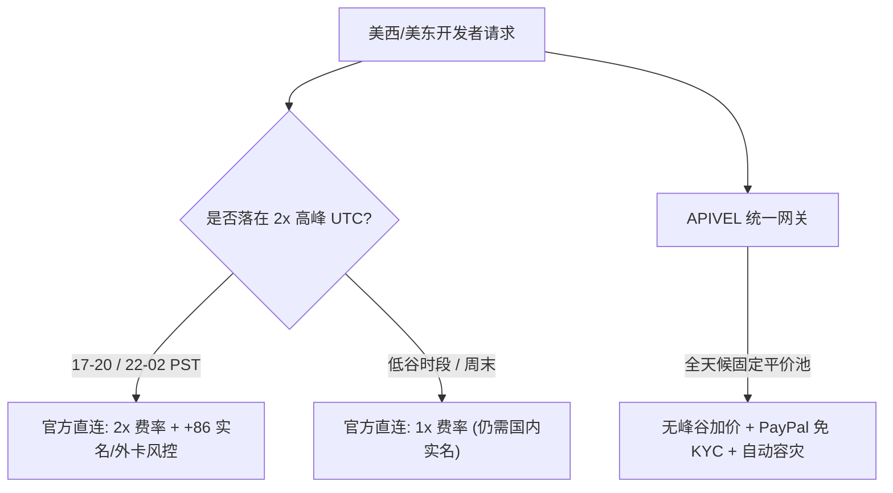

<div class="my-6 border-l-4 border-indigo-500 bg-gray-900 rounded-r-lg p-5">
  <div class="text-xs font-bold uppercase tracking-wider text-indigo-400">核心结论</div>
  <div class="mt-1 text-md font-semibold text-white">2026 年 DeepSeek 调整 API 定价到底改了什么？</div>
  <p class="mt-2 text-sm text-gray-300">本轮 <strong>DeepSeek 调整 API 定价</strong> 标志着官方彻底告别单一固定低价，全面转向「峰谷分时计费（高峰期 2 倍费率）」+「11 月 18 日应用工具并入上下文 Token 计费」机制。对于在美华人开发者或海外团队，若不想紧盯 UTC 时钟或在直连充值时遭遇 +86 实名与外卡风控，可通过 <a rel="nofollow" href="https://apivel.com/sign-up?redirect=%2Fdashboard%3Fquickstart%3Dtrue&from_blog=deepseek-api-pricing-adjustment-zh" class="text-indigo-400 hover:underline font-semibold">APIVEL</a> 直接走固定费率通道，支持 PayPal 即时结账与免 KYC 接入。</p>
</div>

最近在美华人开发者和海外 AI 工程师频繁搜索 **DeepSeek 调整 API 定价**，原因很简单：账单突然变贵了，但调用量并没有暴涨。自 2026 年 8 月中旬上线峰谷分时计费、9 月调整 Flash 阶梯、再到 11 月 18 日更新搜索与解析工具计费规范后，DeepSeek 官方直连的真实调用成本已经高度依赖「你几点钟发请求」以及「Agent 缓存命中率」。

如果你在用 Claude Code、Codex CLI 或 Cursor 跑多文件重构，这篇文章会把 **DeepSeek 调整 API 定价** 的最新规则、**美西 PST / 美东 EST 时区精确对照表**、**V4.1 Flash 与 V4 Pro 真实价格**，以及如何用美元 PayPal 锁定固定低价一次讲透（英文团队成员也可参考对应的 [DeepSeek API Pricing Change 英文深度指南](/blog/deepseek-api-pricing-change-peak-off-peak-guide/)）。

<div class="my-6 border-l-4 border-amber-500 bg-gray-900 rounded-r-lg p-5">
  <div class="flex items-center justify-between">
    <span class="text-xs font-bold uppercase tracking-wider text-amber-400">开发者实测反馈</span>
    <span class="text-xs text-gray-400">北美开发者社区 &bull; 真实账单复盘</span>
  </div>
  <blockquote class="mt-2 text-sm italic text-gray-200">
    “我们在加州下午 5 点到晚上 10 点用 Cursor 跑自动化重构，刚好撞上北京时间上午 9 点到下午 2 点的 DeepSeek 高峰时段。不仅 Token 单价直接翻倍，偶尔触发 503 重试还把上下文又重算了一遍。”
  </blockquote>
  <div class="mt-2 text-xs text-gray-400">美西时间傍晚至深夜正好与 DeepSeek 官方 2 倍高峰窗口高度重叠。</div>
</div>

## 一、DeepSeek 峰谷分时定价与美区时区对照表

自 2026 年 8 月 16 日起，DeepSeek 工作日（周一至周五，中国法定节假日除外）执行严格的峰谷分时定价，**空闲（低谷）时段价格为高峰时段的 50%**，反过来说，高峰时段就是低谷期的 **2 倍费率**：

| 时段类型 | UTC 标准时间 | 北京时间 (UTC+8) | 美西时间 (PST, UTC-8) | 美东时间 (EST, UTC-5) | 费率倍率 |
| :--- | :--- | :--- | :--- | :--- | :--- |
| **高峰时段 A** | `01:00–04:00` | `09:00–12:00` | 前一日 `17:00–20:00` | 前一日 `20:00–23:00` | **2x（全价）** |
| **高峰时段 B** | `06:00–10:00` | `14:00–18:00` | 前一日 `22:00–次日 02:00` | `01:00–05:00` | **2x（全价）** |
| **低谷时段** | 其余时段及周末节假日 | 其余时段及周末节假日 | 白天及凌晨 `02:00–17:00` | 白天及 `05:00–20:00` | **1x（半价）** |

**为什么写代码的 Agent 最容易被“刺客”？**  
在问答场景里，Prompt 缓存命中率可以做到 80%–90%；但在 Claude Code 或 Codex 的多文件改写循环里，每次修改文件、跑完单测把报错栈塞回上下文，Prefix 哈希就会失效。实测自主编码 Agent 的缓存命中率通常只有 **30%–50%**。一旦落在美西傍晚（17:00–20:00 / 22:00–02:00 PST）的高峰窗口，未命中缓存的输入与输出同时按 2 倍计费，月账单会直接翻倍。

## 二、2026 年 11 月新规：搜索、网页抓取与 OCR 怎么算钱？

除了峰谷分时，DeepSeek 在 2026 年 11 月中旬对应用层工具 API 做了重要计费调整：

1. **服务端 Search & Web Fetch（11 月 18 日生效）：** 模型触发的服务端联网搜索与网页抓取工具**不再单独按次收取工具费**，抓取回来的文本片段直接拼入模型上下文，**仅按模型输入 Token 计费**。这意味着如果网页正文很长、且落在高峰时段，单次联网搜索的隐性 Token 成本会明显上升。
2. **文件解析与 OCR：** 单独调用文档解析按页数计费，大约为 `1.5 元 / 1,000 页`（海外折算约 `$0.225 / 1,000 页`）。
3. **语音服务（ASR / TTS）：** 语音识别与合成维持独立刊例价，并配有限时 5 折促销。



## 三、最新模型价格横向对比：官方峰谷 vs OpenRouter vs APIVEL

无论是还在用主力 [DeepSeek V4.1 Flash](/blog/deepseek-v4-1-flash-1017-api-setup/)，还是观望 [DeepSeek V5 架构与发布路线](/blog/deepseek-v5-release-date-api-leaks-roadmap/)，下面的每百万 Tokens（USD 折算）对比能帮你快速做选型：

| 方案 / 通道 | 未命中输入 (1M) | 缓存命中输入 (1M) | 输出 (1M) | 支付与实名门槛 | 最适合场景 |
| :--- | :--- | :--- | :--- | :--- | :--- |
| **DeepSeek V4.1 Flash (低谷)** | ~$0.14 | ~$0.014 | ~$0.28–$0.55 | 需 +86 实名 / 国内支付 | 夜间定时批处理 |
| **DeepSeek V4.1 Flash (高峰)** | **~$0.28** | ~$0.028 | **~$0.56–$1.10** | 需 +86 实名 / 国内支付 | 非固定时间的突发调用 |
| **DeepSeek V4 Pro (高峰)** | **~$1.25** | ~$0.042 | **~$3.75** | 需 +86 实名 / 国内支付 | 重度数学与复杂推理 |
| **OpenRouter (托管中转)** | 含平台加价 | 视上游而定 | 含平台加价 | 信用卡 + 平台手续费 | 多模型快速比对 |
| **APIVEL (`infer/deepseek-v4.1-flash`)** | **$0.14（全天固定）** | **支持** | **$0.28（全天固定）** | **PayPal / 美卡 / 支付宝 免 KYC** | **海外 24 小时 Coding Agent** |

## 四、交互式美区时段与月度成本计算器

输入你每月的 Token 用量与缓存命中率，实时对比官方高峰直连与 APIVEL 固定费率的月度账单差异：

<div class="my-6 border border-indigo-500/30 bg-gradient-to-r from-indigo-950/40 via-purple-950/20 to-gray-900 rounded-xl p-6 shadow-xl">
  <div class="flex items-center justify-between flex-wrap gap-3 mb-3">
    <span class="inline-flex items-center text-xs font-bold uppercase tracking-wider text-cyan-400 bg-cyan-950/60 border border-cyan-800/50 px-3 py-1 rounded-full">⚡ DeepSeek 调价前后成本计算器</span>
    <span class="text-xs text-gray-400 bg-gray-800 px-3 py-1 rounded-full">2026年11月新规</span>
  </div>
  <div class="grid grid-cols-1 md:grid-cols-3 gap-4 mb-4">
    <div>
      <label for="zhDsModel" class="block text-xs font-semibold text-gray-400 uppercase tracking-wider mb-1">模型与调用时段</label>
      <select id="zhDsModel" class="w-full bg-slate-800 border border-slate-700 rounded-lg px-3 py-2 text-sm text-white focus:outline-none focus:border-indigo-500">
        <option value="flash_peak" selected>V4.1 Flash (美西傍晚 2x 高峰)</option>
        <option value="flash_off">V4.1 Flash (低谷时段)</option>
        <option value="pro_peak">V4 Pro (2x 高峰时段)</option>
        <option value="qwen_alt">Qwen 3.7 Max (APIVEL 备用)</option>
      </select>
    </div>
    <div>
      <label for="zhDsVol" class="block text-xs font-semibold text-gray-400 uppercase tracking-wider mb-1">月均用量 (百万 Tokens)</label>
      <input type="number" id="zhDsVol" value="50" min="1" max="5000" class="w-full bg-slate-800 border border-slate-700 rounded-lg px-3 py-2 text-sm text-white focus:outline-none focus:border-indigo-500" />
    </div>
    <div>
      <label for="zhDsCache" class="block text-xs font-semibold text-gray-400 uppercase tracking-wider mb-1">Prompt 缓存命中率 (%)</label>
      <input type="number" id="zhDsCache" value="40" min="0" max="95" class="w-full bg-slate-800 border border-slate-700 rounded-lg px-3 py-2 text-sm text-white focus:outline-none focus:border-indigo-500" />
    </div>
  </div>
  <div class="grid grid-cols-1 md:grid-cols-3 gap-3 p-4 rounded-xl bg-slate-950 border border-slate-800 mb-4 text-center">
    <div>
      <div class="text-xs text-gray-400 uppercase tracking-wider">官方直连预估月费</div>
      <div id="zhDirectOut" class="text-xl font-bold text-rose-400">$19.96 / 月</div>
    </div>
    <div>
      <div class="text-xs text-gray-400 uppercase tracking-wider">APIVEL 全天固定费率</div>
      <div id="zhApivelOut" class="text-xl font-bold text-emerald-400">$10.20 / 月</div>
    </div>
    <div>
      <div class="text-xs text-gray-400 uppercase tracking-wider">月度节省比例</div>
      <div id="zhSaveOut" class="text-xl font-bold text-indigo-300">省 48.9%</div>
    </div>
  </div>
  <pre class="bg-slate-950 p-3 rounded-lg text-xs font-mono text-cyan-300 overflow-x-auto border border-slate-800"><code id="zhCmdOut">claude --model infer/deepseek-v4.1-flash</code></pre>
</div>

<script is:inline>
  document.addEventListener('DOMContentLoaded', () => {
    const modelSel = document.getElementById('zhDsModel');
    const volIn = document.getElementById('zhDsVol');
    const cacheIn = document.getElementById('zhDsCache');
    const directOut = document.getElementById('zhDirectOut');
    const apivelOut = document.getElementById('zhApivelOut');
    const saveOut = document.getElementById('zhSaveOut');
    const cmdOut = document.getElementById('zhCmdOut');

    function calcZhDeepSeek() {
      if (!modelSel || !volIn || !cacheIn || !directOut || !apivelOut || !saveOut || !cmdOut) return;
      const mode = modelSel.value;
      const vol = Math.max(1, parseFloat(volIn.value) || 50);
      const cachePct = Math.min(95, Math.max(0, parseFloat(cacheIn.value) || 40)) / 100;
      const inTokens = 0.75 * vol;
      const outTokens = 0.25 * vol;

      let dRate = { miss: 0.28, hit: 0.028, out: 0.56 };
      let aRate = { miss: 0.14, hit: 0.014, out: 0.28 };
      let cmd = 'claude --model infer/deepseek-v4.1-flash';

      if (mode === 'flash_off') {
        dRate = { miss: 0.14, hit: 0.014, out: 0.28 };
      } else if (mode === 'pro_peak') {
        dRate = { miss: 1.25, hit: 0.042, out: 3.75 };
        aRate = { miss: 0.27, hit: 0.027, out: 1.10 };
        cmd = 'claude --model infer/deepseek-v4-pro';
      } else if (mode === 'qwen_alt') {
        dRate = { miss: 0.40, hit: 0.10, out: 1.20 };
        aRate = { miss: 0.35, hit: 0.08, out: 1.05 };
        cmd = 'claude --model infer/qwen3.7-max';
      }

      const dCost = inTokens * ((1 - cachePct) * dRate.miss + cachePct * dRate.hit) + outTokens * dRate.out;
      const aCost = inTokens * ((1 - cachePct) * aRate.miss + cachePct * aRate.hit) + outTokens * aRate.out;
      const pct = dCost > 0 ? Math.max(0, ((dCost - aCost) / dCost) * 100) : 0;

      directOut.textContent = `$${dCost.toFixed(2)} / 月`;
      apivelOut.textContent = `$${aCost.toFixed(2)} / 月`;
      saveOut.textContent = pct > 1 ? `省 ${pct.toFixed(1)}%` : '同价 (免实名 KYC)';
      cmdOut.textContent = cmd;
    }

    modelSel.addEventListener('change', calcZhDeepSeek);
    volIn.addEventListener('input', calcZhDeepSeek);
    cacheIn.addEventListener('input', calcZhDeepSeek);
    calcZhDeepSeek();
  });
</script>

## 五、生产环境免翻车配置：固定费率 + 自动容灾

不想在美西傍晚被 2x 费率或 `503` 并发限流打断开发，只需要将 `baseURL` 指向 APIVEL，并加上自动降级到 [Qwen 3.7 Max](/blog/qwen-4-release-date-api-roadmap/) 或 `infer/xiaomi-mimo-v2.6-pro` 的容灾链路：

```typescript
import OpenAI from "openai";

const client = new OpenAI({
  baseURL: "https://apivel.com/v1",
  apiKey: process.env.APIVEL_API_KEY,
  timeout: 45000,
});

export async function runAgent(prompt: string): Promise<string> {
  const models = ["infer/deepseek-v4.1-flash", "infer/qwen3.7-max", "infer/xiaomi-mimo-v2.6-pro"];
  for (const model of models) {
    try {
      const res = await client.chat.completions.create({
        model,
        messages: [{ role: "user", content: prompt }],
      });
      return res.choices[0]?.message?.content ?? "";
    } catch (err: any) {
      if (err?.status === 401) throw err;
    }
  }
  throw new Error("所有备用模型通道均已超时");
}
```

如果你平时直接在终端跑 Claude Code 或 Codex CLI，只需导出两行环境变量即可零代码切换：

```bash
export ANTHROPIC_BASE_URL="https://apivel.com/v1"
export ANTHROPIC_API_KEY="sk-apivel-prod"
claude --model "infer/deepseek-v4.1-flash" "排查并发竞态并补全单元测试"
```

## 常见问题解答 (FAQ)

### DeepSeek 调整 API 定价后，美国时间几点最贵？

官方 2 倍高峰时段是周一至周五的 `01:00–04:00` 与 `06:00–10:00 UTC`。换算成美西太平洋时间（PST）是前一天傍晚 `17:00–20:00` 与深夜 `22:00–次日 02:00`；美东时间（EST）则是 `20:00–23:00` 与凌晨 `01:00–05:00`。

### 2026 年 11 月更新后，联网搜索还要单独收费吗？

不需要。从 2026 年 11 月 18 日起，服务端触发的 Search 和 Fetch 工具本身不按次收费，返回内容直接拼进模型上下文，统一按模型 Token 用量结算。

### 没有国内手机号和人民币银行卡，海外怎么调用 DeepSeek API？

可以通过 APIVEL 统一网关直接使用 `infer/deepseek-v4.1-flash`，原生支持 OpenAI 与 Anthropic 协议，提供 **PayPal 即时结账**、Visa/MasterCard/Amex、支付宝，全程免 KYC 并附赠 `$0.20` 免费试用额度。

<div class="cta-card">
  <div class="my-8 rounded-2xl p-6 bg-gradient-to-br from-indigo-950 to-gray-900 border border-indigo-700">
    <div class="cta-title text-xl font-bold text-white mb-2">告别 DeepSeek 高峰 2 倍加价，用 APIVEL 锁定固定低价</div>
    <p class="text-gray-300 text-sm mb-4">
      无需 +86 手机号实名与国内银行卡，全天候固定费率直连 DeepSeek V4.1 Flash、Qwen 3.7 Max 与 Claude Code / Codex，支持 PayPal 即时付款。
    </p>
    <div class="cta-badge-grid">
      <div class="cta-badge">🎁 首充 +50% 赠送 ($5 → $7.50, $29 → $43.50)</div>
      <div class="cta-badge">🚀 $29 开发者包: 40M Tokens (56% OFF 永不过期)</div>
      <div class="cta-badge">💳 PayPal 即时结账 • 免 KYC • 注册送 $0.20 试用</div>
    </div>
    <div class="cta-button-group">
      <a rel="nofollow" href="https://apivel.com/pricing?from_blog=deepseek-api-pricing-adjustment-zh" class="cta-btn cta-btn-primary">领取首充 +50% 奖励 ($5 → $7.50) →</a>
      <a rel="nofollow" href="https://apivel.com/sign-up?redirect=%2Fdashboard%3Fquickstart%3Dtrue&from_blog=deepseek-api-pricing-adjustment-zh" class="cta-btn cta-btn-secondary">免费领取 $0.20 试用额度 →</a>
    </div>
  </div>
</div>

<script type="application/ld+json">
{
  "@context": "https://schema.org",
  "@type": "FAQPage",
  "mainEntity": [
    {
      "@type": "Question",
      "name": "DeepSeek 调整 API 定价后，美国时间几点最贵？",
      "acceptedAnswer": {
        "@type": "Answer",
        "text": "官方 2 倍高峰时段为周一至周五 01:00-04:00 与 06:00-10:00 UTC，对应美西 PST 前一天 17:00-20:00 及 22:00-02:00，美东 EST 20:00-23:00 及 01:00-05:00。"
      }
    },
    {
      "@type": "Question",
      "name": "2026 年 11 月更新后，联网搜索还要单独收费吗？",
      "acceptedAnswer": {
        "@type": "Answer",
        "text": "不需要。2026 年 11 月 18 日起服务端 Search 和 Fetch 不再单独按次收费，检索内容拼入上下文统一按模型 Token 计费。"
      }
    },
    {
      "@type": "Question",
      "name": "没有国内手机号和人民币银行卡，海外怎么调用 DeepSeek API？",
      "acceptedAnswer": {
        "@type": "Answer",
        "text": "可通过 APIVEL 使用 PayPal 即时结账、国际信用卡或支付宝免 KYC 接入 infer/deepseek-v4.1-flash，新注册赠送 $0.20 免费试用。"
      }
    }
  ]
}
</script>
