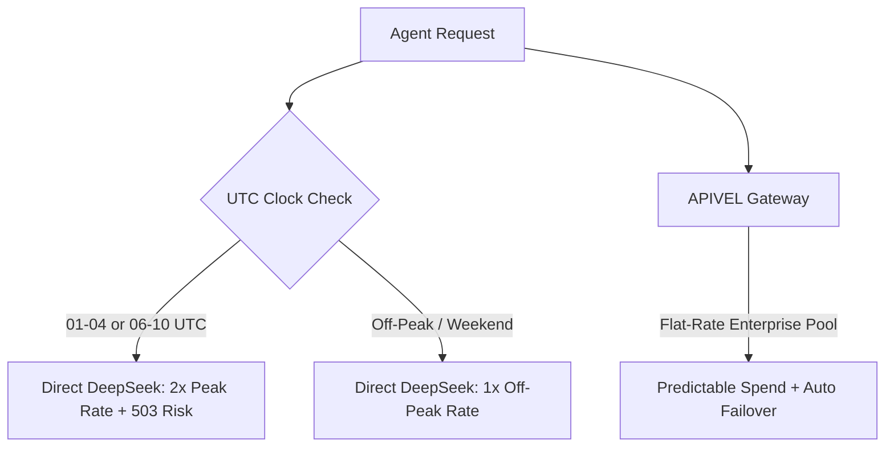

<div class="my-6 border-l-4 border-indigo-500 bg-gray-900 rounded-r-lg p-5">
  <div class="text-xs font-bold uppercase tracking-wider text-indigo-400">Definition</div>
  <div class="mt-1 text-md font-semibold text-white">What Changed in DeepSeek API Pricing in 2026?</div>
  <p class="mt-2 text-sm text-gray-300">The <strong>DeepSeek API pricing change</strong> marks a shift from flat-rate discounts to dynamic <strong>peak and off-peak hourly billing</strong>, paired with updated November 2026 rules that fold server-side web search into model token usage. Developers who want predictable flat-rate billing without UTC clock-watching can route requests through <a rel="nofollow" href="https://apivel.com/sign-up?redirect=%2Fdashboard%3Fquickstart%3Dtrue&from_blog=deepseek-api-pricing-change-peak-off-peak-guide" class="text-indigo-400 hover:underline font-semibold">APIVEL</a> with zero KYC and instant PayPal checkout.</p>
</div>

If your monthly DeepSeek bill jumped without a spike in request volume, you are not imagining things. Between August and November 2026, DeepSeek overhauled its billing structure: flat promotional pricing is gone, **peak UTC windows now cost 2x off-peak rates**, and the November 18 application suite update changed how search, fetch, and OCR tools hit your balance.

For teams running [DeepSeek V4.1 Flash](/blog/deepseek-v4-1-flash-1017-api-setup/) inside Claude Code, Cursor, or CI pipelines, those time-of-day multipliers turn daytime debugging into an unpredictable expense. Below, we break down the exact UTC schedule, compare **DeepSeek V4.1 Flash** against **DeepSeek V4 Pro** and **Qwen 3.7 Max**, and show how to lock in flat-rate routing.

<div class="my-6 border-l-4 border-amber-500 bg-gray-900 rounded-r-lg p-5">
  <div class="flex items-center justify-between">
    <span class="text-xs font-bold uppercase tracking-wider text-amber-400">Community Voice / Verified Experience</span>
    <span class="text-xs text-gray-400">Reddit r/LocalLLaMA &bull; Verified Developer Report</span>
  </div>
  <blockquote class="mt-2 text-sm italic text-gray-200">
    "Our EU team runs Cursor and automated PR reviews between 07:00 and 10:00 UTC. Every single run landed inside DeepSeek's peak window, doubling our uncached token spend while 503 retries burned extra context."
  </blockquote>
  <div class="mt-2 text-xs text-gray-400">Developer feedback on peak-hour multipliers overlapping European and Asian workdays.</div>
</div>

## How the DeepSeek Peak vs. Off-Peak Schedule Works

Effective August 16, 2026, DeepSeek split every weekday into two billing tiers to manage GPU congestion during Asian and European business hours:

* **Peak Hours (2x Base Rate):** `01:00–04:00 UTC` and `06:00–10:00 UTC`, Monday through Friday (excluding Chinese public holidays). In Beijing time (`UTC+8`), that maps directly to `09:00–12:00` and `14:00–18:00`.
* **Off-Peak Hours (50% Discount vs. Peak):** All remaining weekday hours, plus weekends and Chinese public holidays around the clock.
* **Why Coding Agents Feel It Most:** Autonomous loops in Claude Code and Codex rarely hit 100% prompt-cache reuse across multi-file edits. When cache misses overlap peak UTC windows, your effective rate doubles overnight.

### Why Prompt Caching Drops During Multi-File Refactors

Prefix caching works well when you send the same system prompt and read-only repository tree repeatedly. As soon as an autonomous coding agent edits a file early in the context window, runs a test suite, and appends new stack traces, the prefix hash shifts. In practice, active refactoring sessions average **30% to 50% cache hits** rather than the 90% ideal shown in static benchmarks. Paying 2x uncached rates on the remaining 50% to 70% of input tokens—plus peak output multipliers—explains why daytime engineering squads saw bills double after the August overhaul.

## November 2026 Tool Billing: Search, Fetch, OCR & Speech

Alongside hourly multipliers, DeepSeek's mid-November 2026 platform update restructured how non-chat capabilities are metered:

1. **Server-Side Search & Web Fetch (Nov 18 Rule):** Tool invocations triggered during generation are **no longer billed as a separate per-call fee**. Instead, fetched snippets and search results are injected straight into the prompt context and billed as input tokens.
2. **Document Parsing & OCR:** Standalone file parsing is metered by page volume at roughly **$0.225 per 1,000 pages** (`1.5 RMB / 1,000 pages`).
3. **Speech APIs (ASR & TTS):** Audio transcription and synthesis carry separate list rates with rotating 50% promotional discounts.

### Batch Scheduling vs. Real-Time Developer Routing

Nightly documentation indexing, dataset labeling, and static regression suites can easily shift to off-peak UTC hours or weekends via cron jobs to capture the 50% discount. Interactive IDE coding sessions, PR review bots, and live user-facing endpoints cannot wait six hours for a cheaper billing window, making flat-rate routing essential. To model your exact cache-hit ratio and peak-hour spend before switching gateways, run your numbers through our [DeepSeek API pricing & cache calculator](/blog/tools/deepseek-pricing-calculator/).



## DeepSeek API Pricing Comparison: Peak vs. Off-Peak vs. APIVEL

Before committing production workloads—or waiting on [upcoming DeepSeek V5 endpoints](/blog/deepseek-v5-release-date-api-leaks-roadmap/)—compare how the latest rates stack up per 1M tokens:

| Tier / Provider | Uncached Input (1M) | Cache-Hit Input (1M) | Output (1M) | Billing & KYC | Best For... |
| :--- | :--- | :--- | :--- | :--- | :--- |
| **DeepSeek V4.1 Flash (Off-Peak)** | ~$0.14 | ~$0.014 | ~$0.28–$0.55 | Mainland card / KYC | Overnight batch jobs |
| **DeepSeek V4.1 Flash (Peak)** | **~$0.28** | ~$0.028 | **~$0.56–$1.10** | Mainland card / KYC | Unavoidable peak runs |
| **DeepSeek V4 Pro (Peak)** | **~$1.25** | ~$0.042 | **~$3.75** | Mainland card / KYC | Heavy math reasoning |
| **OpenRouter (Managed)** | Retail markup | Pass-through varies | Retail markup | Card + platform fee | Multi-vendor testing |
| **APIVEL (`infer/deepseek-v4.1-flash`)** | **$0.14 (Flat)** | **Supported** | **$0.28 (Flat)** | **PayPal & Zero KYC** | **24/7 coding agents** |

*Note: Official rates verified against DeepSeek API documentation as of November 2026; RMB-to-USD equivalents reflect standard conversion bands.*

## Interactive DeepSeek Peak-Hour & Gateway Cost Calculator

Estimate how UTC peak exposure and cache-hit ratios change your monthly spend for 20M–200M tokens:

<div class="my-6 border border-indigo-500/30 bg-gradient-to-r from-indigo-950/40 via-purple-950/20 to-gray-900 rounded-xl p-6 shadow-xl">
  <div class="flex items-center justify-between flex-wrap gap-3 mb-3">
    <span class="inline-flex items-center text-xs font-bold uppercase tracking-wider text-cyan-400 bg-cyan-950/60 border border-cyan-800/50 px-3 py-1 rounded-full">⚡ DeepSeek Peak vs. Flat-Rate Calculator</span>
    <span class="text-xs text-gray-400 bg-gray-800 px-3 py-1 rounded-full">Nov 2026 Rates</span>
  </div>
  <div class="grid grid-cols-1 md:grid-cols-3 gap-4 mb-4">
    <div>
      <label for="dsModelSelect" class="block text-xs font-semibold text-gray-400 uppercase tracking-wider mb-1">Model &amp; Window</label>
      <select id="dsModelSelect" class="w-full bg-slate-800 border border-slate-700 rounded-lg px-3 py-2 text-sm text-white focus:outline-none focus:border-indigo-500">
        <option value="flash_peak" selected>V4.1 Flash (Direct Peak 2x)</option>
        <option value="flash_off">V4.1 Flash (Direct Off-Peak)</option>
        <option value="pro_peak">V4 Pro (Direct Peak 2x)</option>
        <option value="qwen_alt">Qwen 3.7 Max (APIVEL Backup)</option>
      </select>
    </div>
    <div>
      <label for="dsVolInput" class="block text-xs font-semibold text-gray-400 uppercase tracking-wider mb-1">Monthly Volume (M Tokens)</label>
      <input type="number" id="dsVolInput" value="50" min="1" max="5000" class="w-full bg-slate-800 border border-slate-700 rounded-lg px-3 py-2 text-sm text-white focus:outline-none focus:border-indigo-500" />
    </div>
    <div>
      <label for="dsCacheInput" class="block text-xs font-semibold text-gray-400 uppercase tracking-wider mb-1">Prompt Cache Hit (%)</label>
      <input type="number" id="dsCacheInput" value="40" min="0" max="95" class="w-full bg-slate-800 border border-slate-700 rounded-lg px-3 py-2 text-sm text-white focus:outline-none focus:border-indigo-500" />
    </div>
  </div>
  <div class="grid grid-cols-1 md:grid-cols-3 gap-3 p-4 rounded-xl bg-slate-950 border border-slate-800 mb-4 text-center">
    <div>
      <div class="text-xs text-gray-400 uppercase tracking-wider">Direct DeepSeek Bill</div>
      <div id="dsDirectOut" class="text-xl font-bold text-rose-400">$19.96 / mo</div>
    </div>
    <div>
      <div class="text-xs text-gray-400 uppercase tracking-wider">APIVEL Flat-Rate</div>
      <div id="dsApivelOut" class="text-xl font-bold text-emerald-400">$10.20 / mo</div>
    </div>
    <div>
      <div class="text-xs text-gray-400 uppercase tracking-wider">Monthly Savings</div>
      <div id="dsSavingsOut" class="text-xl font-bold text-indigo-300">48.9% Saved</div>
    </div>
  </div>
  <pre class="bg-slate-950 p-3 rounded-lg text-xs font-mono text-cyan-300 overflow-x-auto border border-slate-800"><code id="dsCmdPreview">claude --model infer/deepseek-v4.1-flash</code></pre>
</div>

<script is:inline>
  document.addEventListener('DOMContentLoaded', () => {
    const modelSel = document.getElementById('dsModelSelect');
    const volIn = document.getElementById('dsVolInput');
    const cacheIn = document.getElementById('dsCacheInput');
    const directOut = document.getElementById('dsDirectOut');
    const apivelOut = document.getElementById('dsApivelOut');
    const savingsOut = document.getElementById('dsSavingsOut');
    const cmdOut = document.getElementById('dsCmdPreview');

    function calcDeepSeek() {
      if (!modelSel || !volIn || !cacheIn || !directOut || !apivelOut || !savingsOut || !cmdOut) return;
      const mode = modelSel.value;
      const vol = Math.max(1, parseFloat(volIn.value) || 50);
      const cachePct = Math.min(95, Math.max(0, parseFloat(cacheIn.value) || 40)) / 100;
      const inputShare = 0.75 * vol;
      const outputShare = 0.25 * vol;

      let directRate = { inMiss: 0.28, inHit: 0.028, out: 0.56 };
      let flatRate = { inMiss: 0.14, inHit: 0.014, out: 0.28 };
      let cmd = 'claude --model infer/deepseek-v4.1-flash';

      if (mode === 'flash_off') {
        directRate = { inMiss: 0.14, inHit: 0.014, out: 0.28 };
      } else if (mode === 'pro_peak') {
        directRate = { inMiss: 1.25, inHit: 0.042, out: 3.75 };
        flatRate = { inMiss: 0.27, inHit: 0.027, out: 1.10 };
        cmd = 'claude --model infer/deepseek-v4-pro';
      } else if (mode === 'qwen_alt') {
        directRate = { inMiss: 0.40, inHit: 0.10, out: 1.20 };
        flatRate = { inMiss: 0.35, inHit: 0.08, out: 1.05 };
        cmd = 'claude --model infer/qwen3.7-max';
      }

      const dCost = inputShare * ((1 - cachePct) * directRate.inMiss + cachePct * directRate.inHit) + outputShare * directRate.out;
      const aCost = inputShare * ((1 - cachePct) * flatRate.inMiss + cachePct * flatRate.inHit) + outputShare * flatRate.out;
      const pct = dCost > 0 ? Math.max(0, ((dCost - aCost) / dCost) * 100) : 0;

      directOut.textContent = `$${dCost.toFixed(2)} / mo`;
      apivelOut.textContent = `$${aCost.toFixed(2)} / mo`;
      savingsOut.textContent = pct > 1 ? `${pct.toFixed(1)}% Saved` : 'Price Parity (Zero KYC)';
      cmdOut.textContent = cmd;
    }

    modelSel.addEventListener('change', calcDeepSeek);
    volIn.addEventListener('input', calcDeepSeek);
    cacheIn.addEventListener('input', calcDeepSeek);
    calcDeepSeek();
  });
</script>

## How to Avoid Peak Multipliers & 503 Congestion

You do not need to rewrite your agent stack to sidestep peak-hour billing spikes or Mainland KYC blocks. Point your OpenAI or Anthropic client to APIVEL's unified endpoint and add an automatic fallback chain to [Qwen 3.7 Max](/blog/qwen-4-release-date-api-roadmap/) or [Xiaomi MiMo-V2.6 Pro](/blog/inkling-2-mini-benchmarks-pricing-api/):

```typescript
import OpenAI from "openai";

const client = new OpenAI({
  baseURL: "https://apivel.com/v1",
  apiKey: process.env.APIVEL_API_KEY,
  timeout: 45000,
});

export async function runWithFailover(prompt: string): Promise<string> {
  const chain = ["infer/deepseek-v4.1-flash", "infer/qwen3.7-max", "infer/xiaomi-mimo-v2.6-pro"];
  for (const model of chain) {
    try {
      const res = await client.chat.completions.create({
        model,
        messages: [{ role: "user", content: prompt }],
      });
      return res.choices[0]?.message?.content ?? "";
    } catch (err: any) {
      if (err?.status === 401) throw err;
    }
  }
  throw new Error("All gateway fallback tiers exhausted");
}
```

### Quick CLI Setup for Claude Code & Codex

If you prefer zero code changes, export the unified gateway variables in your shell before launching Claude Code or an OpenAI-compatible CLI:

```bash
export ANTHROPIC_BASE_URL="https://apivel.com/v1"
export ANTHROPIC_API_KEY="sk-apivel-prod"
claude --model "infer/deepseek-v4.1-flash" "Audit auth middleware for race conditions"
```

This keeps your local workflow unchanged while shielding your team from 2x peak-hour billing spikes and upstream `503` drops during Asian and European business hours.

**Related Model & Gateway Guides:**
- [DeepSeek V4.1 Flash 1017: API Setup & Limits](/blog/deepseek-v4-1-flash-1017-api-setup/)
- [DeepSeek V5: Architecture Leaks & API Roadmap](/blog/deepseek-v5-release-date-api-leaks-roadmap/)
- [FreeLLMAPI.co Review: Models, Codex & 429 Fix](/blog/freellmapi-claude-code-review-alternatives/)
- [DeepSeek 调整 API 定价：美区时段与新规中文指南](/blog/deepseek-api-pricing-adjustment-zh/)

## DeepSeek API Pricing Change FAQ

### When are DeepSeek API peak hours in UTC and US/EU time?

DeepSeek's 2x peak window runs Monday through Friday from `01:00–04:00 UTC` and `06:00–10:00 UTC` (excluding Chinese public holidays). That covers `09:00–12:00` and `14:00–18:00` in Asia (`UTC+8`), and early morning work hours across Europe (`07:00–11:00 CET`).

### Did DeepSeek remove separate fees for web search and fetch?

Yes. Starting November 18, 2026, server-side search and webpage fetch calls no longer carry a standalone per-request fee; returned snippets count strictly toward model context tokens.

### How can overseas developers pay for DeepSeek API without Chinese KYC?

Direct DeepSeek portals often flag international cards and require domestic verification. APIVEL provides instant access to `infer/deepseek-v4.1-flash` with **PayPal Instant Checkout**, global cards, Alipay, zero KYC, and a `$0.20` free trial.

### How does DeepSeek API pricing compare against Claude and OpenRouter?

Even after the peak-hour adjustment, DeepSeek remains roughly 80%–90% cheaper than flagship Claude tiers on standard coding tasks. Compared with OpenRouter, routing directly through APIVEL avoids retail platform markups while preserving zero-KYC PayPal billing and flat-rate predictability.

<div class="cta-card">
  <div class="my-8 rounded-2xl p-6 bg-gradient-to-br from-indigo-950 to-gray-900 border border-indigo-700">
    <div class="cta-title text-xl font-bold text-white mb-2">Lock In Flat-Rate DeepSeek API Pricing on APIVEL</div>
    <p class="text-gray-300 text-sm mb-4">
      Skip 2x UTC peak multipliers, 503 congestion, and Mainland KYC checks. Route Claude Code, Cursor, and Codex through native OpenAI/Anthropic endpoints with PayPal billing.
    </p>
    <div class="cta-badge-grid">
      <div class="cta-badge">🎁 +50% First Deposit Bonus ($5 → $7.50, $29 → $43.50)</div>
      <div class="cta-badge">🚀 $29 Pack: 40M Tokens (56% OFF, Never Expires)</div>
      <div class="cta-badge">💳 Instant PayPal Checkout • Zero KYC • $0.20 Free Trial</div>
    </div>
    <div class="cta-button-group">
      <a rel="nofollow" href="https://apivel.com/pricing?from_blog=deepseek-api-pricing-change-peak-off-peak-guide" class="cta-btn cta-btn-primary">Claim +50% Deposit Bonus ($5 → $7.50) →</a>
      <a rel="nofollow" href="https://apivel.com/sign-up?redirect=%2Fdashboard%3Fquickstart%3Dtrue&from_blog=deepseek-api-pricing-change-peak-off-peak-guide" class="cta-btn cta-btn-secondary">Claim $0.20 Free Trial →</a>
    </div>
  </div>
</div>

<script type="application/ld+json">
{
  "@context": "https://schema.org",
  "@type": "FAQPage",
  "mainEntity": [
    {
      "@type": "Question",
      "name": "When are DeepSeek API peak hours in UTC and US/EU time?",
      "acceptedAnswer": {
        "@type": "Answer",
        "text": "DeepSeek's 2x peak window runs Monday through Friday from 01:00-04:00 UTC and 06:00-10:00 UTC, excluding Chinese public holidays."
      }
    },
    {
      "@type": "Question",
      "name": "Did DeepSeek remove separate fees for web search and fetch?",
      "acceptedAnswer": {
        "@type": "Answer",
        "text": "Yes. Starting November 18, 2026, server-side search and webpage fetch calls are no longer billed per request; retrieved text is billed as model context tokens."
      }
    },
    {
      "@type": "Question",
      "name": "How can overseas developers pay for DeepSeek API without Chinese KYC?",
      "acceptedAnswer": {
        "@type": "Answer",
        "text": "Developers can use APIVEL for instant access to DeepSeek models with PayPal Instant Checkout, global cards, zero KYC, and a $0.20 free trial."
      }
    },
    {
      "@type": "Question",
      "name": "How does DeepSeek API pricing compare against Claude and OpenRouter?",
      "acceptedAnswer": {
        "@type": "Answer",
        "text": "Even with peak-hour adjustments, DeepSeek stays 80%-90% cheaper than flagship Claude tiers. APIVEL also avoids OpenRouter retail markups with flat-rate PayPal billing."
      }
    }
  ]
}
</script>
