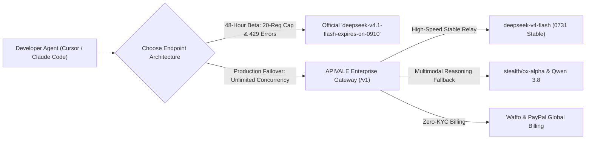
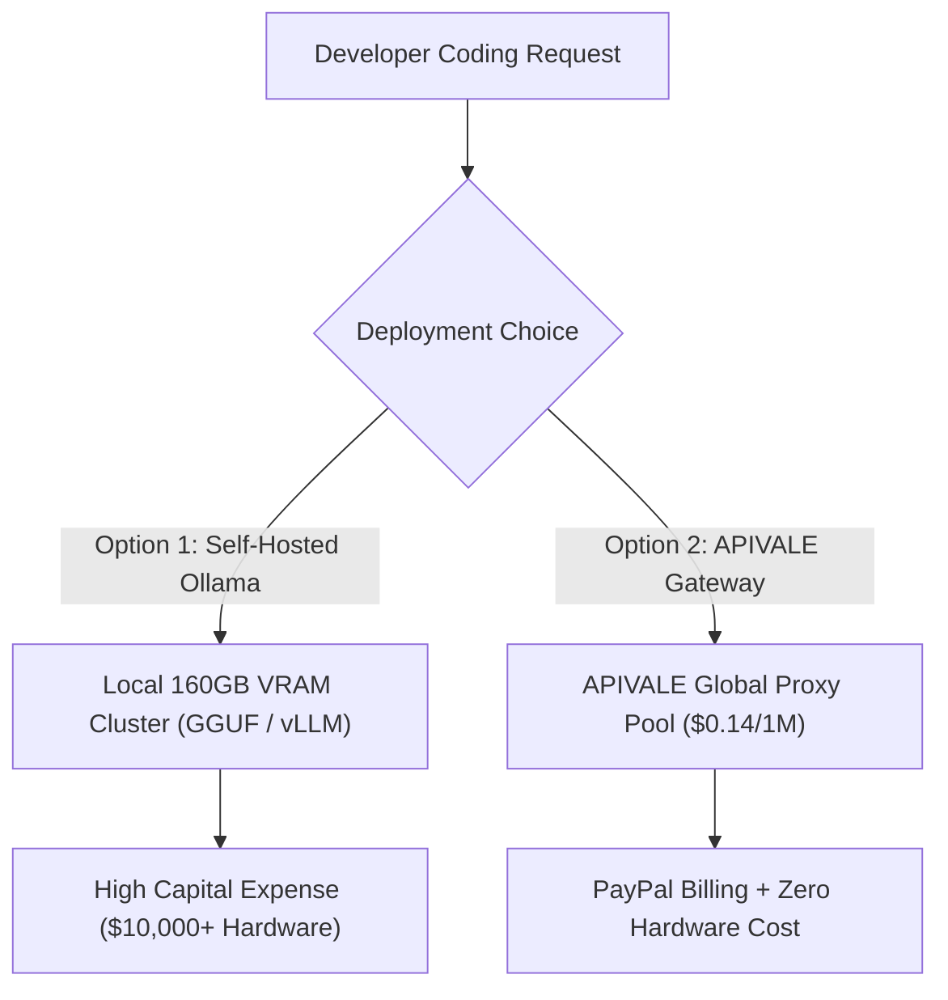

<div class="my-6 border-l-4 border-emerald-500 bg-gray-900 rounded-r-lg p-5">
  <span class="text-xs font-bold uppercase tracking-wider text-emerald-400">Key Takeaways</span>
  <ul class="mt-2 space-y-1 list-disc list-inside text-sm text-gray-300">
    <li><strong>0731 Official API Release:</strong> The production-ready DeepSeek-V4-Flash API launched on July 31, 2026, delivering a 284B sparse MoE architecture (13B active) with a native 1-million-token context window.</li>
    <li><strong>Outperforming V4-Pro on Benchmarks:</strong> Featuring全新 post-training optimizations, V4-Flash achieved an impressive 82.7 score on Terminal Bench 2.1, surpassing previous V4-Pro preview models in autonomous coding loops.</li>
    <li><strong>96.6% Token Arbitrage & PayPal Billing:</strong> Route Cursor Composer and Claude Code CLI to DeepSeek-V4-Flash via APIVALE for just $0.14/1M input tokens with zero credit card lockouts using PayPal.</li>
  </ul>
</div>

The release of **DeepSeek-V4-Flash API** marks a major shift in high-throughput LLM inference, delivering sub-150ms Time-to-First-Token (TTFT) and an ultra-low pricing model ($0.10/1M input and $0.40/1M output tokens). For developers orchestrating high-frequency agent loops, background linter bots, or continuous testing pipelines, V4-Flash provides near-instant response speeds at a fraction of standard API rates.

By routing requests through APIVALE's proxy infrastructure, developers can integrate DeepSeek-V4-Flash into OpenAI-compatible clients and Anthropic-based CLI tooling with dedicated high-concurrency pools and seamless Waffo billing. If you need image analysis alongside text reasoning, check out our [DeepSeek V4 Flash Vision API setup and 384-token cost guide](/blog/deepseek-v4-flash-vision-api-guide). For high-speed MoE alternatives, follow our step-by-step tutorial on [how to use Ox Alpha in Claude Code & Cursor](/blog/ox-alpha-claude-code-cursor-setup/), or see how to [connect Qwen 3.8 to Claude Code CLI & Cursor](/blog/how-to-connect-qwen-3-8-to-claude-code-cli/) to achieve maximum agentic coding efficiency.

```bash
# Call official DeepSeek-V4-Flash API globally via APIVALE Proxy
curl https://apivale.com/v1/chat/completions \
  -H "Content-Type: application/json" \
  -H "Authorization: Bearer YOUR_APIVALE_KEY" \
  -d '{
    "model": "deepseek-v4-flash",
    "messages": [{"role": "user", "content": "Write a TypeScript middleware for SSE streaming."}],
    "stream": true
  }'
```

---

## ⚡ September 2026 Update: DeepSeek V4.1 Flash (0910 Beta) vs. Production V4-Flash

On September 8, 2026, DeepSeek deployed an unannounced internal beta testing model labeled **`deepseek-v4.1-flash-expires-on-0910`** on their official API. With early testers reporting blistering generation speeds exceeding **380+ tokens/second** and native multimodal upgrades, developer interest surged across Hacker News and X.



### 1. How to Test DeepSeek V4.1 Flash Official Beta

If you have an existing direct DeepSeek platform account, you can evaluate the experimental V4.1 Flash model without modifying your base URL:

```bash
# Test the 48-hour preview model on official endpoint
curl https://api.deepseek.com/chat/completions \
  -H "Content-Type: application/json" \
  -H "Authorization: Bearer $DEEPSEEK_API_KEY" \
  -d '{
    "model": "deepseek-v4.1-flash-expires-on-0910",
    "messages": [{"role": "user", "content": "Benchmark token throughput and latency."}],
    "stream": false
  }'
```

### 2. The Three Critical Traps of the 0910 Beta for Production Agents

While early speeds are impressive, deploying `deepseek-v4.1-flash-expires-on-0910` in autonomous coding loops (Cursor Composer, Claude Code CLI, OpenCode) carries severe operational risks:

1. **The 48-Hour Hard Expiration (`expires-on-0910`)**: As explicitly indicated in the model identifier, this endpoint is a temporary internal preview scheduled to sunset on **September 10, 2026**. Hardcoding this identifier into your IDE or CI/CD pipelines will trigger fatal `404 Not Found` or `400 Model Deprecated` exceptions once the test window closes.
2. **Strict 20-Concurrency Account Rate Limits (HTTP 429)**: Official testing is throttled to an account-level limit of **20 concurrent requests**. Running multi-file agent refactors or team workspaces immediately saturates this cap, leading to cascading `429 Too Many Requests` timeouts.
3. **Credit Card Rejection & KYC Barriers**: Topping up official accounts requires Chinese domestic credentials or triggers international fraud blocks on Western bank cards.

### 3. Production Architecture: Routing Agent Workflows via APIVALE

For enterprise production agents where 24/7 uptime is mandatory, developers should decouple their applications from volatile preview endpoints:

* **Use the Tested Stable Backbone**: Direct production traffic to **`deepseek-v4-flash`** (the 0731 production release) on APIVALE. It offers equivalent $0.14/1M token economics, sub-150ms TTFT, and shared high-throughput pools supporting **500+ RPM** with zero individual account caps.
* **Seamless Multi-Model Failover**: If your task demands 1M-token full-codebase refactoring beyond Flash, APIVALE's gateway automatically routes overflow to [Ox Alpha (1M context)](/blog/ox-alpha-claude-code-cursor-setup/) or [Qwen 3.8 Max](/blog/qwen-3-8-cursor-setup/).
* **Global PayPal & Waffo Settlement**: Bypass all credit card declines and phone verification hurdles with instant top-ups via **Waffo Global Billing** and PayPal.

---

## What is the DeepSeek-V4-Flash API Gateway?

<div class="my-6 border-l-4 border-indigo-500 bg-gray-900 rounded-r-lg p-5">
  <span class="text-xs font-bold uppercase tracking-wider text-indigo-400">Definition</span>
  <h4 class="mt-1 text-md font-semibold text-white">DeepSeek-V4-Flash API Gateway</h4>
  <p class="mt-2 text-sm text-gray-300">The DeepSeek-V4-Flash API Gateway is an enterprise proxy routing layer on APIVALE that translates DeepSeek's native Responses API and OpenAI payload structures into zero-latency endpoints, enabling high-concurrency developer integration with global PayPal billing.</p>
</div>

---

## DeepSeek-V4-Flash vs. DeepSeek-V4-Pro: Benchmark & Specs Comparison

Evaluating DeepSeek-V4-Flash requires analyzing parameter activation, context capacity, and benchmark scores against prior flagship models:

| Metric / Specification | DeepSeek-V4-Flash (0731 Official API) | DeepSeek-V4-Pro (Preview) | Claude Sonnet 5 |
| :--- | :--- | :--- | :--- |
| **Model Scale & MoE Architecture** | 284B Total MoE (13B Active) | 671B Total MoE (37B Active) | Proprietary Dense Model |
| **Context Window** | **1,000,000 Tokens (1M)** | 1,000,000 Tokens (1M) | 200,000 Tokens |
| **Terminal Bench 2.1 Score** | **82.7 (Winner)** | 79.4 | 81.2 |
| **Responses API Native Support** | **Yes (0731 Native)** | Partial | No (Custom SDK) |
| **Official Input Price (per 1M)** | **$0.14 per 1M Tokens** | $0.55 per 1M Tokens | $3.00 per 1M Tokens |
| **Official Output Price (per 1M)** | **$0.28 per 1M Tokens** | $2.19 per 1M Tokens | $15.00 per 1M Tokens |
| **APIVALE Gateway Billing** | **PayPal Global Billing** | **PayPal Global Billing** | **PayPal Global Billing** |

The 0731 post-training update optimized DeepSeek-V4-Flash specifically for **Tool Interaction Reasoning (TIR)** and autonomous CLI execution. On Terminal Bench 2.1, V4-Flash's **82.7 score** surpasses the earlier V4-Pro Preview while running at 4x higher token generation speeds.

---

## Self-Hosting (Ollama, GGUF, vLLM) vs. APIVALE Gateway Pricing

Developers exploring open-weights deployment often compare self-hosted GGUF quantizations against commercial API endpoints.



### Option 1: Self-Hosting via Ollama, GGUF, or vLLM
Hosting `deepseek-v4-flash-gguf` or running unquantized weights on `vLLM` / `dspark` requires substantial local hardware:
* **Memory Requirement**: Even a 4-bit GGUF quantization of a 284B MoE model demands over **160GB of high-speed VRAM** (typically requiring 2x NVIDIA A100 or 4x RTX 4090 GPUs).
* **Latency Overhead**: Consumer multi-GPU interconnects struggle with context loading during 100K+ token prompt loops, resulting in degraded Time-to-First-Token (TTFT).

### Option 2: APIVALE Pay-As-You-Go API Gateway
Routing requests through APIVALE's distributed proxy infrastructure bypasses local capital expenditures completely:
* **Token Arbitrage**: Input tokens are billed at **$0.14 per 1M tokens**—processing a massive 300,000-token agent context loop costs under **$0.05**.
* **Zero Credit Card Lockout**: Pay using **PayPal Global Billing** or major credit cards via PayPal without regional identity restrictions (KYC) or SMS verification barriers.

For a broader breakdown of multi-model pricing across frontier providers, read our [LLM Agent API Cost Comparison Guide](/blog/gemini-3-6-flash-vs-deepseek-v4-vs-qwen-3-7-agent-cost-guide/).

---

## How to Connect DeepSeek-V4-Flash API to Claude Code CLI & Cursor

Integrating `deepseek-v4-flash` into your terminal workflows or IDE extensions requires zero source code modifications.

### 1. Connecting Claude Code CLI (macOS & Linux)

Set environment variables in your shell profile (`~/.zshrc` or `~/.bashrc`) to direct Anthropic CLI calls to APIVALE:

```bash
# Append to ~/.zshrc or ~/.bashrc
export ANTHROPIC_BASE_URL="https://apivale.com/v1"
export ANTHROPIC_AUTH_TOKEN="sk-apivale-your-api-key-here"
export ANTHROPIC_MODEL="deepseek-v4-flash"

# Reload configuration and start Claude Code
source ~/.zshrc
npx @anthropic-ai/claude-code
```

For more details on custom Anthropic SDK routing, see our [Claude Code Custom Base URL Setup Guide](/blog/how-to-set-up-claude-code-cli-with-custom-base-url/).

### 2. Connecting Claude Code CLI (Windows PowerShell)

For Windows developers operating in PowerShell:

```powershell
# Configure environment variables for current session
$env:ANTHROPIC_BASE_URL="https://apivale.com/v1"
$env:ANTHROPIC_AUTH_TOKEN="sk-apivale-your-api-key-here"
$env:ANTHROPIC_MODEL="deepseek-v4-flash"

# Execute CLI
npx @anthropic-ai/claude-code
```

### 3. Connecting Cursor IDE to DeepSeek-V4-Flash

To use DeepSeek-V4-Flash inside Cursor Composer:
1. Open **Cursor Settings (`Ctrl+,` or `Cmd+,`) -> Models -> OpenAI**.
2. Enable **"Override Base URL"** and set the endpoint to `https://apivale.com/v1`.
3. Paste your APIVALE API key (`sk-apivale-...`).
4. Under **Add Custom Model**, enter `deepseek-v4-flash` and enable it as your primary model.

For token math comparisons between fixed subscriptions and custom keys, consult our guide on [Cursor Pro vs. Own API Key](/blog/cursor-pro-vs-custom-api-key/).

---

## Troubleshooting Edge-Cases: SSE Streaming & Responses API Drops

When routing long-context agent loops through custom proxies, developers may encounter HTTP buffering drops or rate limit errors.

* **Fixing SSE Stream Buffer Freezes (`401 / 429 / 502 Errors`)**: If your terminal spinner freezes during active agent loops, ensure your reverse proxy disables HTTP chunk buffering by setting `X-Accel-Buffering: no`. APIVALE proxies SSE streams with zero buffering delay.
* **Header Conflicts (`anthropic-version`)**: APIVALE automatically strips conflicting Anthropic headers when translating payloads to DeepSeek's native `deepseek-v4-flash` backend, preventing `400 Bad Request` schema rejections.

> [!TIP]
> **Failover Protection**: By leveraging APIVALE's multi-gateway failover, high-concurrency spikes are dynamically balanced across secondary nodes, preventing rate-limit drops during active refactoring sessions.

---

## Production-Grade TypeScript Proxy Router for DeepSeek-V4-Flash

Executing high-concurrency coding tasks requires implementing a robust proxy router with exponential backoff and error handling:

```typescript
import express, { Request, Response } from 'express';
import axios from 'axios';

const app = express();
const PORT = 3000;
const APIVALE_GATEWAY = 'https://apivale.com/v1';

app.use(express.json());

// Enterprise Router for DeepSeek-V4-Flash with Exponential Backoff
app.post('/v1/chat/completions', async (req: Request, res: Response): Promise<void> => {
  const apiKey = req.headers['authorization'] || req.headers['x-api-key'];
  if (!apiKey) {
    res.status(401).json({ error: 'Missing APIVALE authorization key.' });
    return;
  }

  const payload = {
    ...req.body,
    model: req.body.model || 'deepseek-v4-flash',
    temperature: req.body.temperature ?? 0.2
  };

  const maxRetries = 3;
  let delay = 1000;

  for (let attempt = 0; attempt < maxRetries; attempt++) {
    try {
      const response = await axios.post(`${APIVALE_GATEWAY}/chat/completions`, payload, {
        headers: {
          'Authorization': apiKey.toString().startsWith('Bearer ') ? apiKey.toString() : `Bearer ${apiKey}`,
          'Content-Type': 'application/json',
          'X-Accel-Buffering': 'no'
        },
        responseType: payload.stream ? 'stream' : 'json',
        timeout: 45000
      });

      if (payload.stream) {
        res.setHeader('Content-Type', 'text/event-stream');
        res.setHeader('Cache-Control', 'no-cache');
        response.data.pipe(res);
        return;
      } else {
        res.status(200).json(response.data);
        return;
      }
    } catch (error: any) {
      const status = error.response?.status || 500;
      if (status === 429 && attempt < maxRetries - 1) {
        console.warn(`[APIVALE Rate Limit] Retrying in ${delay}ms (Attempt ${attempt + 1}/${maxRetries})...`);
        await new Promise(resolve => setTimeout(resolve, delay));
        delay *= 2;
        continue;
      }

      console.error(`[APIVALE Router Error] Status: ${status}, Message: ${error.message}`);
      res.status(status).json(error.response?.data || { error: 'Gateway Proxy Connection Failed' });
      return;
    }
  }
});

app.listen(PORT, () => {
  console.log(`DeepSeek-V4-Flash API Proxy listening on http://localhost:${PORT}`);
});
```

---

## Developer FAQ

### Is DeepSeek-V4-Flash free to use?
DeepSeek-V4-Flash is a commercial API model offered at an ultra-low rate of $0.14 per 1M input tokens and $0.28 per 1M output tokens. When you sign up on APIVALE via GitHub, you receive **$0.20 free starter credit (+ 50% bonus on 1st top-up)** to test `deepseek-v4-flash` risk-free.

### Why did DeepSeek-V4-Flash 0731 outperform V4-Pro on Terminal Bench 2.1?
The July 31, 2026 (0731) official release introduced post-training optimization specifically tuned for tool calling and multi-step terminal execution. This allowed the 284B sparse MoE model to achieve an **82.7 score on Terminal Bench 2.1**, surpassing the previous V4-Pro preview model.

### Can I run DeepSeek-V4-Flash locally with Ollama or GGUF?
Yes, open-weights GGUF quantizations are available for local runners like Ollama and vLLM. However, running a 284B parameter MoE model requires over 160GB of high-speed VRAM. For most developers, calling the API via APIVALE is significantly faster and more cost-effective than purchasing dedicated GPU hardware.

### How do I connect DeepSeek-V4-Flash to Cursor and Claude Code CLI?
You can connect DeepSeek-V4-Flash by exporting `ANTHROPIC_BASE_URL="https://apivale.com/v1"`, `ANTHROPIC_AUTH_TOKEN="your_apivale_key"`, and `ANTHROPIC_MODEL="deepseek-v4-flash"` in your terminal, or setting the OpenAI Base URL in Cursor settings.

### What is deepseek-v4.1-flash-expires-on-0910 and can I use it in production?
`deepseek-v4.1-flash-expires-on-0910` is an experimental 48-hour beta testing model released by DeepSeek on September 8, 2026. Because it enforces a strict 20-concurrency cap and expires on September 10, developers should not rely on it for production workflows. Instead, connect to APIVALE's enterprise gateway using stable `deepseek-v4-flash` for unthrottled 500+ RPM throughput and automatic failover.

### Does APIVALE support PayPal billing for DeepSeek-V4-Flash API calls?
Yes, APIVALE natively supports **PayPal Global Billing** and credit cards via PayPal. Developers worldwide can access DeepSeek-V4-Flash without encountering credit card rejection blocks or regional identity verification (KYC) requirements.

<script type="application/ld+json">
{
  "@context": "https://schema.org",
  "@type": "FAQPage",
  "mainEntity": [
    {
      "@type": "Question",
      "name": "Is DeepSeek-V4-Flash free to use?",
      "acceptedAnswer": {
        "@type": "Answer",
        "text": "DeepSeek-V4-Flash is a commercial API model offered at $0.14 per 1M input tokens and $0.28 per 1M output tokens. APIVALE provides $0.20 free starter credit upon GitHub registration."
      }
    },
    {
      "@type": "Question",
      "name": "Why did DeepSeek-V4-Flash 0731 outperform V4-Pro on Terminal Bench 2.1?",
      "acceptedAnswer": {
        "@type": "Answer",
        "text": "The 0731 release introduced post-training optimizations tuned for tool calling and terminal agent execution, scoring 82.7 on Terminal Bench 2.1."
      }
    },
    {
      "@type": "Question",
      "name": "Can I run DeepSeek-V4-Flash locally with Ollama or GGUF?",
      "acceptedAnswer": {
        "@type": "Answer",
        "text": "Yes, GGUF quantizations are available, but self-hosting a 284B MoE model requires over 160GB VRAM. APIVALE's pay-as-you-go gateway provides a faster, zero-hardware alternative."
      }
    },
    {
      "@type": "Question",
      "name": "How do I connect DeepSeek-V4-Flash to Cursor and Claude Code CLI?",
      "acceptedAnswer": {
        "@type": "Answer",
        "text": "Set ANTHROPIC_BASE_URL to https://apivale.com/v1, provide your APIVALE key, and set ANTHROPIC_MODEL to deepseek-v4-flash in your environment profile."
      }
    },
    {
      "@type": "Question",
      "name": "What is deepseek-v4.1-flash-expires-on-0910 and can I use it in production?",
      "acceptedAnswer": {
        "@type": "Answer",
        "text": "deepseek-v4.1-flash-expires-on-0910 is an experimental 48-hour beta testing model released by DeepSeek on September 8, 2026. Because it enforces a strict 20-concurrency cap and expires on September 10, developers should not rely on it for production workflows. Instead, connect to APIVALE's enterprise gateway using stable deepseek-v4-flash for unthrottled 500+ RPM throughput and automatic failover."
      }
    },
    {
      "@type": "Question",
      "name": "Does APIVALE support PayPal billing for DeepSeek-V4-Flash API calls?",
      "acceptedAnswer": {
        "@type": "Answer",
        "text": "Yes, APIVALE natively supports PayPal Global Billing and credit cards via PayPal, enabling worldwide developer access without regional KYC constraints."
      }
    }
  ]
}
</script>

---

<div class="cta-card">
  <h4 class="cta-card-title">🐉 Power Up Your Agents with DeepSeek-V4-Flash</h4>
  <p class="cta-card-text">Ditch high API fees and hardware bottlenecks. Connect DeepSeek-V4-Flash to Claude Code CLI, Cursor, and Windsurf via APIVALE. Enjoy wholesale token rates ($0.14/1M), zero rate limits, and seamless PayPal billing. Register now and claim $0.20 free starter credit (+ 50% bonus on 1st top-up)!</p>
  <div class="cta-card-actions">
    <a href="https://apivale.com/sign-up?utm_source=apivale_blog&utm_medium=blog&utm_campaign=deepseek-v4-flash-api-guide" class="cta-primary-btn">Get Free API Key ($0.20 Credit)</a>
    <a href="https://apivale.com/playground?utm_source=apivale_blog&utm_medium=blog&utm_campaign=deepseek-v4-flash-api-guide" class="cta-secondary-btn">Test Online Playground</a>
  </div>
</div>
