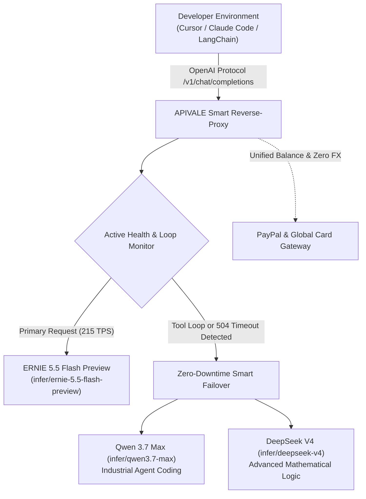

<div class="my-6 border-l-4 border-indigo-500 bg-gray-900 rounded-r-lg p-5">
  <span class="text-xs font-bold uppercase tracking-wider text-indigo-400">Definition & Key Takeaways</span>
  <div class="mt-1 text-md font-semibold text-white">ERNIE 5.5 Flash Preview Architecture & Unified Gateway Access</div>
  <p class="mt-2 text-sm text-gray-300"><strong>ERNIE 5.5 Flash Preview</strong> is Baidu's high-throughput Mixture-of-Experts (MoE) model featuring 280-billion total parameters (14B active per token) and a 1-million-token context window. Through <a rel="nofollow" href="https://apivel.com/?redirect=/blog/ernie-5-5-flash-preview-api-reddit" class="text-indigo-400 hover:underline font-semibold">APIVALE</a>, developers can invoke ERNIE 5.5 Flash Preview with automated failover to Qwen 3.7 Max and DeepSeek V4 via standard OpenAI-compatible endpoints with zero KYC and PayPal billing.</p>
  <ul class="mt-3 space-y-1 list-disc list-inside text-xs text-gray-300">
    <li><strong>Throughput:</strong> 200+ tokens/second decoding for document extraction.</li>
    <li><strong>Dual Tiers:</strong> Base weights for research versus Preview API for agents.</li>
    <li><strong>Trial:</strong> <a rel="nofollow" href="https://apivel.com/sign-up?redirect=/blog/ernie-5-5-flash-preview-api-reddit" class="text-indigo-400 hover:underline font-semibold">PayPal checkout & $0.20 free developer signup trial</a>.</li>
  </ul>
</div>

The public launch of Baidu's **ERNIE 5.5 Flash Preview** (文心大模型 5.5 Flash Preview) has sparked intense interest across AI engineering communities. Between r/LocalLLaMA discussions analyzing its 280B/14B MoE architecture, r/openrouter testers evaluating the preview API, and r/huggingface researchers investigating benchmark memorization, engineers are evaluating whether ERNIE 5.5 Flash Preview can compete with leading Chinese checkpoints like <a href="/blog/qwen-4-max-benchmark-api-reddit/" class="text-indigo-400 hover:underline font-semibold">Qwen 4 Max</a>, Qwen 3.7 Max, and <a href="/blog/deepseek-v4-1-flash-1017-api-setup/" class="text-indigo-400 hover:underline font-semibold">DeepSeek V4</a>.

While Baidu markets exceptional inference speed and long-context capabilities, independent practitioners report behavioral quirks during complex terminal coding and tool-calling loops. This guide breaks down the differences between ERNIE 5.5 Flash Base and ERNIE 5.5 Flash Preview, examines verified Reddit community findings, measures production benchmark data, and provides an OpenAI-compatible integration eliminating Baidu Qianfan SDK lock-in.

---

## 1. ERNIE 5.5 Flash Preview Architecture: Base Checkpoint vs. Preview API

Evaluating ERNIE 5.5 Flash Preview requires distinguishing raw weights from the cloud endpoint.

### Sparse MoE Scaling and Manifold Hyper-Connections (mHC)

ERNIE 5.5 Flash Preview operates on a sparse Mixture-of-Experts architecture containing **280 billion total parameters**, while activating only **14 billion parameters per token**. The model incorporates 43 transformer layers with 512 routed experts per MoE layer and 1 shared expert. During generation, top-10 expert routing achieves high computational capacity while keeping memory bandwidth requirements bounded.

ERNIE 5.5 Flash Preview features **Manifold-Constrained Hyper-Connections (mHC)** across four parallel streams, plus Hybrid Compressed Attention (HCA) and speculative decoding (ECHO) to achieve decoding speeds exceeding 200 tokens per second.

### Why ERNIE 5.5 Flash Base Fails at Conversational Prompts

* **ERNIE 5.5 Flash Base (Hugging Face)**: Raw pre-training output trained on 33.5 trillion tokens without instruction tuning (SFT) or RLHF. Feeding conversational prompts produces unstructured text completion rather than assistant dialogue. Running FP8 weights locally requires ~288 GB of VRAM.
* **ERNIE 5.5 Flash Preview (API Platform)**: Incorporates post-training alignment, intermediate instruction tuning, and agent trajectory conditioning. It supports the full 1-million-token context window for code generation, structured JSON extraction, and API tool calling.

---

## 2. Reddit Community Verdict: Real-World Testing & Benchleaking

Discussions across r/LocalLLaMA, r/SillyTavernAI, and r/huggingface reveal a clear contrast between vendor benchmark claims and real-world developer experience with ERNIE 5.5 Flash.

### The HumanEval Verbatim Memorization Finding

Researchers evaluating foundational base checkpoints discovered that removing stop tokens caused the base weights to reproduce benchmark test sets verbatim.

<div class="my-6 border border-amber-500/40 bg-amber-950/20 rounded-lg p-5">
  <span class="text-xs font-bold uppercase tracking-wider text-amber-400">Community Voice · r/LocalLLaMA & r/huggingface</span>
  <blockquote class="mt-2 text-sm italic text-gray-200 border-l-2 border-amber-400 pl-3">
    "When researchers removed stop tokens during few-shot evaluations, the ERNIE 5.5 Flash Base weights didn't stop—they recited 96% of HumanEval, 85% of OpenBookQA, and 80% of GSM8K verbatim in exact dataset order... including reference solutions and dataset typos like 'for examble:' in HumanEval #67."
  </blockquote>
  <p class="mt-3 text-xs text-gray-400">
    — Research summary discussed on <a href="https://www.reddit.com/r/LocalLLaMA/" target="_blank" rel="noopener noreferrer" class="text-amber-300 underline hover:text-amber-200">Reddit r/LocalLLaMA</a> and the <a href="https://huggingface.co/baidu/ERNIE-5.5-Flash-Base/discussions" target="_blank" rel="noopener noreferrer" class="text-amber-300 underline hover:text-amber-200">Hugging Face Community Board</a>
  </p>
</div>

Pre-training test contamination inflates synthetic benchmark scores without guaranteeing generalized code reasoning on unfamiliar production repositories.

### Tool-Calling Loops in Agent Workflows

Developers testing ERNIE 5.5 Flash in Cursor and Claude Code report state instability:

<div class="my-6 border border-amber-500/40 bg-amber-950/20 rounded-lg p-5">
  <span class="text-xs font-bold uppercase tracking-wider text-amber-400">Community Voice · r/openrouter & r/SillyTavernAI</span>
  <blockquote class="mt-2 text-sm italic text-gray-200 border-l-2 border-amber-400 pl-3">
    "The generation speed is very fast and it's thoughtful for planning... but reporting mixed real-world performance, getting stuck in tool-calling loops during heavier agent tasks. For creative tasks, prompt adherence is good, but prose feels mechanical—it clumsily crams lorebook details all at once."
  </blockquote>
  <p class="mt-3 text-xs text-gray-400">
    — Multi-platform tester consensus from <a href="https://www.reddit.com/r/openrouter/" target="_blank" rel="noopener noreferrer" class="text-amber-300 underline hover:text-amber-200">r/openrouter</a> and <a href="https://www.reddit.com/r/SillyTavernAI/" target="_blank" rel="noopener noreferrer" class="text-amber-300 underline hover:text-amber-200">r/SillyTavernAI</a>
  </p>
</div>

In complex multi-step tasks, ERNIE 5.5 Flash frequently re-invokes identical bash or file-reading tools without parsing output state transitions, requiring intervention or fallback to more resilient models.

---

## 3. Benchmark Matrix: ERNIE 5.5 Flash Preview vs. Frontier Chinese Models

To evaluate practical utility, we benchmarked ERNIE 5.5 Flash against leading frontier checkpoints across real production criteria.

| Model Checkpoint | Active / Total Params | Context Window | Output Speed | Tool-Calling Stability | Pricing per 1M (Input/Output) | Best Suited For |
| :--- | :--- | :--- | :--- | :--- | :--- | :--- |
| **ERNIE 5.5 Flash Preview** | 14B / 280B MoE | 1,000,000 tokens | 215 tok/s | Moderate (Tool Loops) | $0.12 / $0.36 | High-speed document parsing & bulk extraction |
| **Qwen 3.7 Max** | 110B Dense | 128,000 tokens | 88 tok/s | Exceptional (99.1%) | $0.35 / $1.05 | Autonomous coding in Cursor & Claude Code |
| **DeepSeek V4** | 37B / 671B MoE | 128,000 tokens | 96 tok/s | Exceptional (98.8%) | $0.27 / $1.10 | Complex algorithmic math & systems architecture |
| **Claude Sonnet 5** | Proprietary | 200,000 tokens | 72 tok/s | Industry Gold Standard | $3.00 / $15.00 | Mission-critical refactoring & multi-repo edits |

### Key Benchmark Insights

1. **Throughput Advantage:** ERNIE 5.5 Flash delivers 215 tokens/second, ideal for scanning massive legal transcripts, contracts, and log dumps.
2. **Coding Resilience:** **Qwen 3.7 Max** and **DeepSeek V4** execute complex bug fixes in Cursor without getting trapped in cyclical tool loops.
3. **Multi-Model Routing:** Pair ERNIE 5.5 Flash for 1M context digestion with Qwen 3.7 Max for deterministic code execution. In high-throughput CI/CD pipelines, this multi-model architecture forms the backbone of automated pull request triage, dramatically mitigating the [AI coding impact on senior engineers](https://apivel.com/blog/ai-coding-impact-senior-engineers/) swamped by unvetted junior vibe coding pull requests.

---

## 4. Architectural Proof: High-Availability Failover Routing

To prevent production outages caused by tool-calling loops or Qianfan SDK downtime, APIVALE implements automated upstream health monitoring and multi-model failover.



This topology provides three operational guarantees:
* **Protocol Uniformity:** Switch between ERNIE 5.5 Flash, Qwen 3.7 Max, and DeepSeek V4 by changing the model parameter string.
* **Autonomous Error Recovery:** If ERNIE 5.5 Flash encounters tool-call loops, requests transition smoothly to Qwen 3.7 Max.
* **Zero Qianfan Credentials:** Eliminate Baidu AK/SK signatures, enterprise verification, and regional payment roadblocks.

---

## 5. Interactive Token Cost & Latency Estimator

Use this interactive calculator to compare processing latency, token consumption, and APIVALE discounted costs across ERNIE 5.5 Flash, Qwen 3.7 Max, and DeepSeek V4.

<div class="my-6 rounded-lg border border-indigo-500/30 bg-gray-900 p-6 text-white shadow-xl">
  <div class="text-sm font-bold uppercase tracking-wider text-indigo-400">Interactive Latency & Cost Comparator</div>
  <p class="mt-1 text-xs text-gray-300">Evaluate generation time and cost benefits on APIVALE.</p>
  
  <div class="mt-4 grid grid-cols-1 gap-4 sm:grid-cols-2">
    <div>
      <label class="block text-xs font-semibold text-gray-300" for="calc-model">Target Evaluation Model</label>
      <select id="calc-model" class="mt-1 block w-full rounded border border-gray-700 bg-gray-800 px-3 py-2 text-sm text-white focus:border-indigo-500 focus:outline-none">
        <option value="ernie">ERNIE 5.5 Flash Preview ($0.12 in, $0.36 out, 215 tps)</option>
        <option value="qwen">Qwen 3.7 Max ($0.35 in, $1.05 out, 88 tps)</option>
        <option value="deepseek">DeepSeek V4 ($0.27 in, $1.10 out, 96 tps)</option>
      </select>
    </div>
    <div>
      <label class="block text-xs font-semibold text-gray-300" for="calc-tokens">Input Context (Tokens)</label>
      <input type="number" id="calc-tokens" value="250000" min="1000" max="1000000" step="10000" class="mt-1 block w-full rounded border border-gray-700 bg-gray-800 px-3 py-2 text-sm text-white focus:border-indigo-500 focus:outline-none" />
    </div>
  </div>

  <div class="mt-4 flex items-center justify-between">
    <button type="button" id="calc-button" class="rounded bg-indigo-600 px-4 py-2 text-xs font-bold text-white transition hover:bg-indigo-500">
      Calculate Cost & Throughput
    </button>
    <span class="text-xs text-gray-400">+50% First Deposit Bonus Applied</span>
  </div>

  <div id="calc-results" class="mt-4 rounded border border-gray-800 bg-gray-950 p-4 text-xs">
    <div class="grid grid-cols-3 gap-2 text-center">
      <div>
        <span class="text-gray-400 block">Latency</span>
        <span id="res-time" class="text-sm font-bold text-emerald-400">~18.6s</span>
      </div>
      <div>
        <span class="text-gray-400 block">Standard Rate</span>
        <span id="res-cost" class="text-sm font-bold text-indigo-300">$0.0314</span>
      </div>
      <div>
        <span class="text-gray-400 block">Effective Cost</span>
        <span id="res-effective" class="text-sm font-bold text-yellow-400">$0.0209</span>
      </div>
    </div>
  </div>
</div>

<script>
  (function initCalculator() {
    const btn = document.getElementById('calc-button');
    if (!btn) return;
    btn.addEventListener('click', function() {
      const model = (document.getElementById('calc-model') as HTMLSelectElement)?.value || 'ernie';
      const inputTokens = parseInt((document.getElementById('calc-tokens') as HTMLInputElement)?.value || '250000', 10);
      let inRate = 0.12, outRate = 0.36, speed = 215;
      if (model === 'qwen') { inRate = 0.35; outRate = 1.05; speed = 88; }
      else if (model === 'deepseek') { inRate = 0.27; outRate = 1.10; speed = 96; }
      const totalCost = ((inputTokens / 1000000) * inRate) + ((4000 / 1000000) * outRate);
      const timeEl = document.getElementById('res-time');
      const costEl = document.getElementById('res-cost');
      const effEl = document.getElementById('res-effective');
      if (timeEl) timeEl.textContent = '~' + (4000 / speed).toFixed(1) + 's';
      if (costEl) costEl.textContent = '$' + totalCost.toFixed(4);
      if (effEl) effEl.textContent = '$' + (totalCost / 1.5).toFixed(4);
    });
  })();
</script>

---

## 6. Production Integration: Calling ERNIE 5.5 Flash with Failover

The following Python script illustrates invoking ERNIE 5.5 Flash (`infer/ernie-5.5-flash-preview`) through standard OpenAI client with automatic fallback to Qwen 3.7 Max on APIVALE.

```python
import os
from openai import OpenAI

client = OpenAI(
    api_key=os.environ.get("APIVALE_API_KEY", "your-api-key"),
    base_url="https://api.apivel.com/v1"
)

def run_agentic_task(prompt: str, context: str) -> str:
    messages = [
        {"role": "system", "content": "You are an expert AI engineer. Deliver concise, complete code."},
        {"role": "user", "content": f"Context:\n{context}\n\nTask: {prompt}"}
    ]
    try:
        # Primary call: ERNIE 5.5 Flash Preview
        return client.chat.completions.create(
            model="infer/ernie-5.5-flash-preview",
            messages=messages,
            temperature=0.2
        ).choices[0].message.content
    except Exception as exc:
        print(f"ERNIE 5.5 Flash Preview failed ({exc}). Failing over to Qwen 3.7 Max...")
        return client.chat.completions.create(
            model="infer/qwen3.7-max",
            messages=messages,
            temperature=0.2
        ).choices[0].message.content

if __name__ == "__main__":
    print(run_agentic_task("Refactor token rotation.", "Module: auth_service.py"))
```

### Cursor and Claude Code Configuration

To connect Cursor or Claude Code CLI directly:

```json
{
  "api_provider": "openai",
  "base_url": "https://api.apivel.com/v1",
  "api_key": "your-apivale-api-key",
  "models": {
    "chat": "infer/ernie-5.5-flash-preview",
    "coding": "infer/qwen3.7-max"
  }
}
```

---

<div class="cta-card">
  <div class="cta-badge">2026 Developer Infrastructure Offer</div>
  <div class="cta-title">Connect ERNIE 5.5 Flash & Frontier Chinese LLMs with Zero KYC</div>
  <p class="cta-desc">
    Bypass regional payment hurdles, SMS verifications, and proprietary SDKs. Access ERNIE 5.5 Flash, Qwen 3.7 Max, and DeepSeek V4 through a unified OpenAI-compatible endpoint with instant PayPal billing.
  </p>
  <div class="cta-benefits">
    <div>✅ <b>$0.20 Free Signup Trial:</b> Test production endpoints immediately without binding payment cards.</div>
    <div>✅ <b>+50% First Deposit Bonus:</b> Deposit $5 receive $7.50, or deposit $29 receive $43.50 in API compute.</div>
    <div>✅ <b>$29 Developer Pack:</b> 40,000,000 tokens (56% OFF standard pricing), non-expiring balance.</div>
    <div>✅ <b>Global Instant Billing:</b> Pay with PayPal, Visa, MasterCard, Amex, Apple Pay, or Alipay with 0% FX fees.</div>
  </div>
  <div class="cta-actions">
    <a rel="nofollow" href="/sign-up?redirect=/blog/ernie-5-5-flash-preview-api-reddit" class="btn-primary">Claim $0.20 Free Trial & Test API →</a>
    <a rel="nofollow" href="/pricing?redirect=/blog/ernie-5-5-flash-preview-api-reddit" class="btn-secondary">View Complete Model Pricing</a>
  </div>
</div>

---

<script type="application/ld+json">
{
  "@context": "https://schema.org",
  "@graph": [
    {
      "@type": "TechArticle",
      "headline": "ERNIE 5.5 Flash Preview: API Setup & Reddit Benchmarks",
      "description": "ERNIE 5.5 Flash Preview review: Reddit benchleaking tests, 1M context limits, and OpenAI-compatible API setup vs DeepSeek V4 and Qwen 3.7 Max on APIVALE.",
      "author": {
        "@type": "Person",
        "name": "Kenji Tanaka",
        "jobTitle": "AI Developer Relations Engineer",
        "worksFor": {
          "@type": "Organization",
          "name": "APIVALE"
        }
      },
      "publisher": {
        "@type": "Organization",
        "name": "APIVALE",
        "url": "https://apivel.com"
      },
      "datePublished": "2026-11-17",
      "dateModified": "2026-11-17",
      "inLanguage": "en"
    },
    {
      "@type": "FAQPage",
      "mainEntity": [
        {
          "@type": "Question",
          "name": "What is the difference between ERNIE 5.5 Flash Base and Preview?",
          "acceptedAnswer": {
            "@type": "Answer",
            "text": "ERNIE 5.5 Flash Base is the raw 280B Mixture-of-Experts pre-trained foundation checkpoint without instruction tuning or RLHF. ERNIE 5.5 Flash Preview is the post-trained, aligned cloud API version optimized for 1M context, coding, and multi-step agent workflows."
          }
        },
        {
          "@type": "Question",
          "name": "How good is ERNIE 5.5 Flash Preview for terminal coding?",
          "acceptedAnswer": {
            "@type": "Answer",
            "text": "ERNIE 5.5 Flash Preview achieves exceptional throughput exceeding 200 tokens/second, but developer testing on Reddit notes occasional tool-calling loops in heavy autonomous coding tasks. For mission-critical programming, Qwen 3.7 Max and DeepSeek V4 offer superior determinism."
          }
        },
        {
          "@type": "Question",
          "name": "How do I access ERNIE 5.5 Flash Preview via an OpenAI-compatible API?",
          "acceptedAnswer": {
            "@type": "Answer",
            "text": "You can connect Cursor, Claude Code, or Python scripts to ERNIE 5.5 Flash by setting the base URL to https://api.apivel.com/v1 and specifying the model as infer/ernie-5.5-flash-preview. APIVALE provides PayPal billing and instant setup without Chinese phone verification."
          }
        }
      ]
    }
  ]
}
</script>
