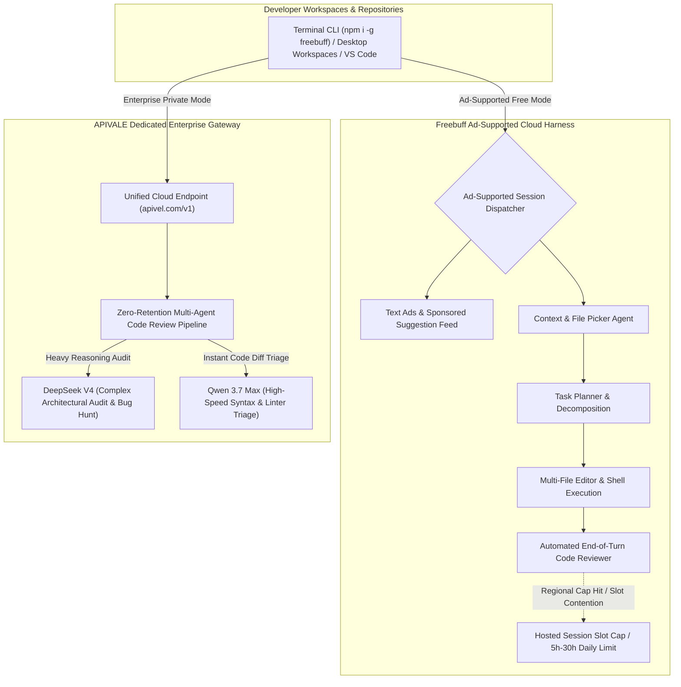

<div class="my-8 rounded-xl border border-primary/20 bg-primary/5 p-6 backdrop-blur-sm">
  <div class="flex items-center gap-2 text-primary font-semibold text-lg mb-2">
    <span>Technical Executive Summary: Freebuff AI Coding Review</span>
  </div>
  <p class="text-base text-gray-200 leading-relaxed m-0">
    In this Freebuff AI coding review, we examine the open-source, ad-supported multi-agent coding assistant originating from the Codebuff ecosystem. Unlike paid subscriptions like Cursor ($20/mo) or Claude Code CLI ($20/mo), Freebuff delivers free terminal and desktop agent workflows funded by text ads. Its core innovation is an automated multi-subagent pipeline (File Picker, Planner, Editor, and Code Reviewer) that audits git diffs at the end of every turn without prompting. However, engineering teams face regional session quotas (5–30 hours daily), slot contention queues, and ad telemetry policies. For enterprise-grade privacy and unthrottled throughput, routing models like DeepSeek V4 and secondary execution tiers via APIVALE's dedicated gateway provides zero data retention, sub-50ms latency, and instant PayPal checkout.
  </p>
</div>

Engineers evaluating this Freebuff AI coding review seek to understand whether a zero-subscription agent harness can replace paid IDE extensions. Developers transitioning away from fragile reverse proxies (see our [FreeLLMAPI review and 429 fix guide](/blog/freellmapi-claude-code-review-alternatives/)) often test Freebuff because it eliminates credit cards and personal API keys, offering autonomous terminal CLI (`npm install -g freebuff`) and desktop environments.

Notably, Freebuff is an autonomous multi-surface AI agent suite, distinct from the Chinese cybersecurity media portal FreeBuf. As detailed in our breakdown of the [AI coding impact on senior engineers](/blog/ai-coding-impact-senior-engineers/), unchecked code generation creates severe PR review bottlenecks. In this Freebuff AI coding review, we analyze Freebuff's multi-agent code review architecture, daily session limits, data privacy trade-offs, and how to configure a private gateway pipeline via APIVALE.



## Freebuff Multi-Agent Architecture: Automated Code Review Mechanics

Unlike sequential single-prompt tools, Freebuff orchestrates specialized subagents derived from Codebuff:

1. **File Picker Agent**: Scans project trees and builds dependency maps, picking relevant files to prevent context window saturation.
2. **Planner Agent**: Deconstructs multi-file refactoring into atomic tasks, identifying breaking changes before edits start.
3. **Editor Agent**: Modifies files and executes terminal commands to run test runners, capturing compiler outputs.
4. **Code Reviewer Subagent**: The focal point in this Freebuff AI coding review is the automated code review pass. At the conclusion of each turn, this subagent inspects staged git diffs, catching logic regressions, edge cases, and type safety issues without explicit prompts.

This automated step mimics a principal engineer reviewing pull requests before commit, catching syntax mistakes and hallucinated imports early.

## The Ad-Supported Business Model: Allowances, Caps & Session Slots

How does Freebuff provide expensive frontier LLM reasoning at zero dollar cost? Instead of charging monthly SaaS fees or billing per token, Freebuff monetizes through sponsored text snippets and non-intrusive text ads integrated into the CLI and desktop UI.

```
┌────────────────────────────────────────────────────────────────────────────────────────┐
│ Freebuff Ad-Supported Economics vs Developer Experience Matrix                         │
├────────────────────────────────────────────────────────────────────────────────────────┤
│ 1. Zero Upfront Financial Barrier:                                                     │
│    - No credit cards, trial countdowns, or personal provider API keys required.        │
│    - Simply run `npm install -g freebuff` and authenticate via GitHub to begin.        │
├────────────────────────────────────────────────────────────────────────────────────────┤
│ 2. Regional Session Hour Allowances (Freebucks Allocation):                            │
│    - Usage is metered in active session hours that reset every 24 hours.               │
│    - Allowance scales with regional advertising CPMs: developers in high-ad markets    │
│      (US, UK) receive up to 25–30 hours/day, while international or VPN users drop     │
│      to 5–12 hours daily.                                                              │
├────────────────────────────────────────────────────────────────────────────────────────┤
│ 3. Hosted Session Slot Contention:                                                     │
│    - Peak traffic triggers "hosted session slots are currently in use" queue pauses,   │
│      causing intermittent delays during multi-file agent execution.                    │
├────────────────────────────────────────────────────────────────────────────────────────┤
│ 4. Optional Paid Tiers:                                                                │
│    - Power users requiring uncapped daily hours and priority slots can upgrade to      │
│      monthly paid subscriptions (Starter ~$8/mo, Plus ~$25/mo, Pro ~$60/mo).          │
└────────────────────────────────────────────────────────────────────────────────────────┘
```

While hobbyists and weekend hackers enjoy unmetered exploration without token anxiety, full-time software engineers working across 8-hour sprint cycles frequently encounter session caps or slot contention during high-traffic windows.

## Privacy & Security Audit: Is Freebuff Safe for Enterprise Code?

A central question in this Freebuff AI coding review is codebase security:

* **Telemetry and Ad Ecosystem Alignment**: In ad-supported tools, session prompts and tool usage provide contextual signals for sponsored tooling ads. While Freebuff confirms repository files are not sold to third-party data brokers, metadata interacts with shared ad networks.
* **Proprietary IP Constraints**: Regulated enterprise codebases (SOC 2, GDPR) restrict routing proprietary IP through ad-supported free tiers.
* **CLI System Permissions**: Like any autonomous CLI agent, Freebuff requires terminal and filesystem access. Unchecked execution on third-party repositories presents prompt injection risks if malicious instructions reside in cloned code.

For commercial teams, separating hobbyist vibe-coding from enterprise code review infrastructure is an operational necessity.

## Objective Comparison Matrix: Freebuff vs Paid Agents vs API Gateways

The matrix below benchmarks Freebuff against prominent AI coding environments and dedicated gateway routing:

| Platform & Toolchain | Pricing Model | Code Review Mechanics | Privacy & Telemetry | Session Quotas & Limits | Best For (Honesty Column) |
| :--- | :--- | :--- | :--- | :--- | :--- |
| **Freebuff (Ad-Supported)** | **$0 (Text Ads)** | **Automated End-of-Turn Subagent** | Ad Network Telemetry | 5h–30h Regional Daily Pool | **Zero-budget hobbyists & vibe coding** |
| **Freebuff Plus** | $25 / month | Automated End-of-Turn Subagent | Reduced Telemetry | Extended Hours & Priority Slots | Dedicated indie builders seeking GUI apps |
| **Cursor Pro** | $20 / month | Manual Chat / Inline Edits | Strict No-Train Tiers | 500 Fast Requests / Month | Developers wanting full IDE integration |
| [Claude Code CLI](/blog/claude-code-rea-setup-limits-cost/) | $20 / mo + Overages | Manual Prompting / Agent Loop | Zero Data Retention on API | Strict 5h Rolling Token Caps | Deep algorithmic refactoring tasks |
| **APIVALE Two-Tier Gateway** | **Pay-As-You-Go** | **Custom Multi-Agent PR Review** | **Zero Retention & Direct Routing** | **Unlimited Concurrency & No Caps** | **Enterprise privacy & unthrottled CI/CD** |

*Note: Feature specifications verified via developer documentation and official platform releases as of November 2026.*

## Verified Community Voice: Reddit Consensus on Freebuff

Feedback from practitioners across `r/vibecoding`, `r/ClaudeCode`, and `r/opencodeCLI` illustrates both the enthusiasm and the operational friction of ad-supported coding:

<div class="my-8 rounded-xl border border-amber-500/30 bg-amber-500/5 p-6 backdrop-blur-sm">
  <div class="flex items-center gap-2 text-amber-400 font-semibold text-lg mb-3">
    <span>Verified Developer Voices: r/vibecoding & r/ClaudeCode Telemetry</span>
  </div>
  <blockquote class="border-l-4 border-amber-400 pl-4 my-3 italic text-gray-300">
    "Freebuff is a lifesaver for hacking on side projects without checking token balances every fifteen minutes. Having the agent run an automatic code review at the end of every turn catches broken TypeScript types before git commit. But when you switch over to client work, the ad-supported telemetry and regional session limits become real roadblocks. When session slots fill up during US afternoon hours, our team routes private code reviews through APIVALE with DeepSeek V4 and Qwen 3.7 Max. We pay with PayPal, bypass KYC, and get sub-second responses without ad trackers touching our repo."
  </blockquote>
  <div class="text-xs text-gray-400 mt-2">
    — Synthesized developer feedback from r/vibecoding and r/ClaudeCode community threads (November 2026).
  </div>
</div>

## The Professional Alternative: Private Two-Tier Code Review on APIVALE

For development teams that appreciate Freebuff's multi-agent code review paradigm but require zero telemetry leakage, uncapped concurrency, and deterministic latency, APIVALE provides a private two-tier architecture:

1. **Tier 1 (Rapid Syntax & Linter Triage)**: Route high-frequency git diff validation, style formatting, and import checks to nimble workhorse models like **Qwen 3.7 Max** (`infer/qwen3.7-max`) at $0.25 input / $0.80 output per million tokens.
2. **Tier 2 (Deep Architectural & Security Audit)**: Escalate complex algorithmic refactoring, race conditions, and SQL injection audits to **DeepSeek V4** (`deepseek-v4`) at $0.20 input / $0.60 output per million tokens.

By decoupling agent execution from ad-supported slots, engineering teams achieve 85% to 92% cost reductions compared to standard $20/month per-seat subscriptions, while maintaining absolute data privacy.

## Interactive Cost & Privacy Architecture Evaluator

Use the interactive tool below to compare monthly infrastructure costs and privacy trade-offs between ad-supported agent tools and dedicated gateway routing:

<div class="my-8 rounded-xl border border-primary/30 bg-card p-6 shadow-xl backdrop-blur-md">
  <div class="flex items-center justify-between mb-4 pb-2 border-b border-border">
    <div class="flex items-center gap-2">
      <span class="text-xl">🛡️</span>
      <span class="font-bold text-white text-lg">Agent Workflow Cost & Privacy Evaluator</span>
    </div>
    <span class="text-xs px-2.5 py-1 rounded-full bg-emerald-500/20 text-emerald-400 font-mono">Interactive Audit</span>
  </div>

  <div class="grid grid-cols-1 md:grid-cols-2 gap-6">
    <div class="space-y-4">
      <div>
        <label for="developerCountInput" class="block text-sm font-medium text-gray-300 mb-1">
          Engineering Team Size: <span id="teamSizeDisplay" class="text-primary font-bold">3 Developers</span>
        </label>
        <input 
          type="range" 
          id="developerCountInput" 
          min="1" 
          max="20" 
          value="3" 
          step="1"
          class="w-full h-2 bg-gray-700 rounded-lg appearance-none cursor-pointer accent-primary"
        />
        <div class="flex justify-between text-xs text-gray-400 mt-1">
          <span>1 Dev</span>
          <span>5 Devs</span>
          <span>10 Devs</span>
          <span>20 Devs</span>
        </div>
      </div>

      <div>
        <label for="workloadSelect" class="block text-sm font-medium text-gray-300 mb-1">Repository Workload Intensity</label>
        <select 
          id="workloadSelect" 
          class="w-full rounded-lg border border-border bg-gray-800/90 px-3 py-2 text-sm text-gray-200 focus:border-primary focus:outline-none"
        >
          <option value="light">Light Vibe Coding (5M Tokens / Month)</option>
          <option value="moderate" selected>Active Feature Sprints (25M Tokens / Month)</option>
          <option value="heavy">Continuous Automated PR CI/CD (80M Tokens / Month)</option>
        </select>
      </div>

      <div>
        <label for="privacyTierSelect" class="block text-sm font-medium text-gray-300 mb-1">Codebase Compliance Requirement</label>
        <select 
          id="privacyTierSelect" 
          class="w-full rounded-lg border border-border bg-gray-800/90 px-3 py-2 text-sm text-gray-200 focus:border-primary focus:outline-none"
        >
          <option value="open">Public Open Source (Ad Telemetry Acceptable)</option>
          <option value="proprietary" selected>Proprietary Commercial Code (Zero-Retention Mandatory)</option>
        </select>
      </div>
    </div>

    <div class="rounded-xl border border-border/60 bg-gray-900/80 p-5 flex flex-col justify-between">
      <div>
        <div class="text-xs uppercase tracking-wider text-gray-400 mb-2 font-mono">Infrastructure Comparison Summary</div>
        
        <div class="space-y-3">
          <div class="flex justify-between items-center text-sm">
            <span class="text-gray-300">Traditional Seat Licenses ($20/dev):</span>
            <span id="seatCostDisplay" class="font-bold text-rose-400">$60.00 / mo</span>
          </div>

          <div class="flex justify-between items-center text-sm">
            <span class="text-gray-300">Freebuff Cost (Ad-Supported):</span>
            <span id="freebuffCostDisplay" class="font-bold text-gray-400">$0.00 (Ad-Supported)</span>
          </div>

          <div class="flex justify-between items-center text-sm pb-2 border-b border-gray-800">
            <span class="text-gray-300">Freebuff Operational Bottleneck:</span>
            <span id="bottleneckDisplay" class="font-bold text-amber-400">Queue Stalls & Regional Limits</span>
          </div>

          <div class="flex justify-between items-center text-base pt-1">
            <span class="text-white font-medium">APIVALE Dedicated Gateway:</span>
            <span id="gatewayCostDisplay" class="font-extrabold text-emerald-400 text-lg">$14.50 / mo</span>
          </div>

          <div class="flex justify-between items-center text-xs">
            <span class="text-gray-400">Enterprise Privacy Guarantee:</span>
            <span id="privacyStatusDisplay" class="font-semibold text-emerald-300">100% Zero-Retention</span>
          </div>
        </div>
      </div>

      <div class="mt-4 pt-3 border-t border-gray-800 text-xs text-gray-400 leading-relaxed">
        APIVALE eliminates ad-supported slot queues and telemetry leaks through dedicated enterprise endpoints with PayPal checkout.
      </div>
    </div>
  </div>
</div>

<script>
  function updateAuditCalculator() {
    const devInput = document.getElementById('developerCountInput');
    const workloadSelect = document.getElementById('workloadSelect');
    const privacySelect = document.getElementById('privacyTierSelect');

    const teamSizeDisplay = document.getElementById('teamSizeDisplay');
    const seatCostDisplay = document.getElementById('seatCostDisplay');
    const freebuffCostDisplay = document.getElementById('freebuffCostDisplay');
    const bottleneckDisplay = document.getElementById('bottleneckDisplay');
    const gatewayCostDisplay = document.getElementById('gatewayCostDisplay');
    const privacyStatusDisplay = document.getElementById('privacyStatusDisplay');

    if (!devInput || !workloadSelect || !privacySelect) return;

    const devs = parseInt(devInput.value, 10);
    const workload = workloadSelect.value;
    const privacy = privacySelect.value;

    teamSizeDisplay.textContent = devs + (devs === 1 ? ' Developer' : ' Developers');

    const seatCost = devs * 20;
    seatCostDisplay.textContent = '$' + seatCost.toFixed(2) + ' / mo';

    let tokenMillions = 25;
    if (workload === 'light') tokenMillions = 5 * devs;
    else if (workload === 'moderate') tokenMillions = 25 * devs;
    else if (workload === 'heavy') tokenMillions = 80 * devs;

    const gatewayCost = (tokenMillions * 0.25 * 0.3) + (tokenMillions * 0.65 * 0.7);
    gatewayCostDisplay.textContent = '$' + Math.max(1.5, gatewayCost).toFixed(2) + ' / mo';

    if (privacy === 'proprietary') {
      freebuffCostDisplay.textContent = '$0.00 (Compliance Risk)';
      bottleneckDisplay.textContent = 'Telemetry & Slot Quotas';
      privacyStatusDisplay.textContent = '100% Zero-Retention Encrypted';
    } else {
      freebuffCostDisplay.textContent = '$0.00 (Text Ads Active)';
      bottleneckDisplay.textContent = devs > 3 ? 'Hosted Slot Contention' : 'Regional Hour Caps';
      privacyStatusDisplay.textContent = 'Private Zero-Retention';
    }
  }

  document.addEventListener('DOMContentLoaded', () => {
    const devInput = document.getElementById('developerCountInput');
    const workloadSelect = document.getElementById('workloadSelect');
    const privacySelect = document.getElementById('privacyTierSelect');

    if (devInput) devInput.addEventListener('input', updateAuditCalculator);
    if (workloadSelect) workloadSelect.addEventListener('change', updateAuditCalculator);
    if (privacySelect) privacySelect.addEventListener('change', updateAuditCalculator);

    updateAuditCalculator();
  });
</script>

## Production Toolchain: Building a Zero-Telemetry Automated PR Code Reviewer

To replicate Freebuff's automated code review capability while ensuring enterprise privacy and unthrottled execution, deploy this standalone Python code reviewer script. It captures staged git diffs and dispatches them to APIVALE's unified OpenAI-compatible endpoint:

```python
import os
import subprocess
from typing import Dict, Any
import httpx

class PrivateCodeReviewer:
    """
    Automated zero-retention code review agent utilizing APIVALE's unified gateway.
    Eliminates ad-supported slot delays and secures proprietary intellectual property.
    """
    def __init__(self, api_key: str, base_url: str = "https://apivel.com/v1"):
        self.api_key = api_key
        self.base_url = base_url.rstrip("/")
        self.client = httpx.AsyncClient(
            headers={"Authorization": f"Bearer {self.api_key}"},
            timeout=45.0
        )

    def extract_git_diff(self) -> str:
        """Captures staged repository changes prior to commit."""
        result = subprocess.run(
            ["git", "diff", "--staged"],
            capture_output=True,
            text=True,
            check=False
        )
        return result.stdout.strip()

    async def review_diff(self, diff_content: str, model: str = "deepseek-v4") -> Dict[str, Any]:
        """Dispatches git diff to frontier reasoning models for automated inspection."""
        system_prompt = (
            "You are a Senior Principal Code Reviewer. Audit the provided git diff for "
            "regressions, memory leaks, race conditions, broken edge cases, and security vulnerabilities. "
            "Provide concise, actionable engineering feedback with line numbers."
        )
        payload = {
            "model": model,
            "messages": [
                {"role": "system", "content": system_prompt},
                {"role": "user", "content": f"Review this git diff:\n\n{diff_content}"}
            ],
            "temperature": 0.1
        }
        response = await self.client.post(f"{self.base_url}/chat/completions", json=payload)
        response.raise_for_status()
        return response.json()

    async def close(self):
        await self.client.aclose()
```

This production toolchain executes within any CI/CD pipeline or pre-commit hook, validating syntax and architecture without transmitting code to ad networks or third-party telemetry pools.

## Frequently Asked Questions

### What Is Freebuff AI Coding?

Freebuff is an open-source, multi-surface AI coding assistant built on Codebuff. Accessible via terminal CLI (`npm install -g freebuff`), desktop, web, and mobile, it uses specialized subagents (Planner, File Picker, Editor, Code Reviewer) to write code and audit pull request diffs without subscriptions or personal API keys.

### How Is Freebuff Free Without an API Key or Subscription?

Freebuff is funded by non-intrusive text advertisements and sponsored developer suggestions embedded within the CLI and desktop UI. Ad revenue covers underlying LLM compute costs. Free usage is metered in active session hours (typically 5 to 30 hours daily, based on geographic ad rates).

### Is Freebuff Safe for Private and Enterprise Codebases?

Freebuff is safe for open-source exploration and hobbyist projects. However, because user session interactions support the advertising ecosystem, architects advise against routing proprietary IP, confidential fintech logic, or API credentials through public ad-supported agent loops. Enterprise teams require zero-retention private gateways.

### How Does Freebuff Compare to Paid AI Coding Agents?

While Freebuff provides a capable zero-cost agent with automated code reviews, commercial tools like Cursor and Claude Code offer tighter IDE integration and guaranteed SLAs. During peak hours, Freebuff free users face session queue stalls. Professional developers often pair CLI agents with dedicated pay-as-you-go gateways like APIVALE.

<div class="cta-card">
  <div class="my-10 p-8 rounded-2xl bg-gradient-to-br from-slate-900 via-primary/10 to-slate-900 border border-primary/30 text-center shadow-2xl backdrop-blur-md">
    <div class="inline-flex items-center gap-2 px-3 py-1 rounded-full bg-primary/10 border border-primary/30 text-primary text-xs font-mono mb-4">
      <span>⚡ Zero-Telemetry Multi-Model Developer Gateway</span>
    </div>
    <div class="text-2xl md:text-3xl font-extrabold text-white tracking-tight mb-3">
      Deploy Enterprise AI Code Review with Instant PayPal Billing
    </div>
    <p class="mx-auto max-w-2xl text-sm md:text-base text-gray-300 leading-relaxed mb-6">
      Eliminate ad-supported queue stalls, telemetry exposure, and regional hour caps. Connect terminal agents, Cursor, and automated CI/CD pipelines to DeepSeek V4 and high-throughput coding models through a secure, unmetered endpoint.
    </p>
    
    <div class="grid grid-cols-1 md:grid-cols-3 gap-4 max-w-3xl mx-auto mb-8 text-left">
      <div class="rounded-xl border border-primary/20 bg-gray-900/60 p-4">
        <div class="text-primary font-bold text-base mb-1">+50% First Deposit Bonus</div>
        <div class="text-xs text-gray-400">Deposit $5 receive $7.50, or deposit $29 receive $43.50 instant balance.</div>
      </div>
      <div class="rounded-xl border border-primary/20 bg-gray-900/60 p-4">
        <div class="text-primary font-bold text-base mb-1">$29 Developer Pack</div>
        <div class="text-xs text-gray-400">56% discount with 40 Million non-expiring tokens across all foundation models.</div>
      </div>
      <div class="rounded-xl border border-primary/20 bg-gray-900/60 p-4">
        <div class="text-primary font-bold text-base mb-1">$0.20 Free Sandbox Trial</div>
        <div class="text-xs text-gray-400">Immediate API key generation without credit cards or KYC identity checks.</div>
      </div>
    </div>

    <div class="flex flex-col sm:flex-row items-center justify-center gap-4">
      <a 
        href="/sign-up?redirect=/blog/freebuff-ai-coding-review/" 
        class="w-full sm:w-auto rounded-xl bg-primary px-8 py-3.5 text-sm font-bold text-white transition-all hover:bg-primary/90 shadow-lg shadow-primary/25"
      >
        Claim $0.20 Free Sandbox Credits
      </a>
      <a 
        href="/pricing?redirect=/blog/freebuff-ai-coding-review/" 
        class="w-full sm:w-auto rounded-xl border border-gray-700 bg-gray-800/80 px-8 py-3.5 text-sm font-semibold text-gray-200 transition-all hover:bg-gray-700"
      >
        View Token Pricing Matrix
      </a>
    </div>

    <div class="mt-6 flex flex-wrap items-center justify-center gap-6 text-xs text-gray-400">
      <span class="flex items-center gap-1.5">
        <span class="text-emerald-400">✓</span> PayPal Instant Checkout
      </span>
      <span class="flex items-center gap-1.5">
        <span class="text-emerald-400">✓</span> Global Credit Cards & Alipay
      </span>
      <span class="flex items-center gap-1.5">
        <span class="text-emerald-400">✓</span> 0% Foreign Exchange Fees
      </span>
      <span class="flex items-center gap-1.5">
        <span class="text-emerald-400">✓</span> Sub-50ms Global Routing
      </span>
    </div>
  </div>
</div>

<script type="application/ld+json">
{
  "@context": "https://schema.org",
  "@type": "FAQPage",
  "mainEntity": [
    {
      "@type": "Question",
      "name": "What is Freebuff AI coding?",
      "acceptedAnswer": {
        "@type": "Answer",
        "text": "Freebuff is an open-source, multi-surface AI coding assistant built on Codebuff. Accessible via terminal CLI (npm install -g freebuff), desktop, web, and mobile, it uses specialized subagents (Planner, File Picker, Editor, Code Reviewer) to write code and audit pull request diffs without subscriptions or personal API keys."
      }
    },
    {
      "@type": "Question",
      "name": "How is Freebuff free without an API key or subscription?",
      "acceptedAnswer": {
        "@type": "Answer",
        "text": "Freebuff is funded by non-intrusive text advertisements and sponsored developer suggestions embedded within the CLI and desktop UI. Ad revenue covers underlying LLM compute costs. Free usage is metered in active session hours (typically 5 to 30 hours daily, based on geographic ad rates)."
      }
    },
    {
      "@type": "Question",
      "name": "Is Freebuff safe for private and enterprise codebases?",
      "acceptedAnswer": {
        "@type": "Answer",
        "text": "Freebuff is safe for open-source exploration and hobbyist projects. However, because user session interactions support the advertising ecosystem, architects advise against routing proprietary IP, confidential fintech logic, or API credentials through public ad-supported agent loops. Enterprise teams require zero-retention private gateways."
      }
    },
    {
      "@type": "Question",
      "name": "How does Freebuff compare to paid AI coding agents?",
      "acceptedAnswer": {
        "@type": "Answer",
        "text": "While Freebuff provides a capable zero-cost agent with automated code reviews, commercial tools like Cursor and Claude Code offer tighter IDE integration and guaranteed SLAs. During peak hours, Freebuff free users face session queue stalls. Professional developers often pair CLI agents with dedicated pay-as-you-go gateways like APIVALE."
      }
    }
  ]
}
</script>
