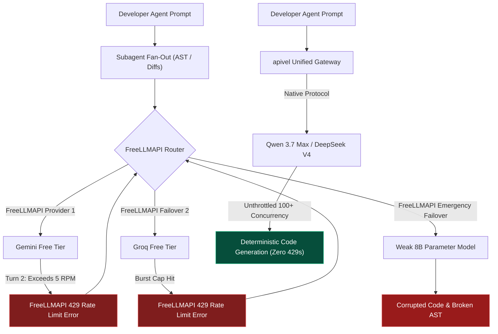

<div class="my-6 border-l-4 border-emerald-500 bg-gray-900 rounded-r-lg p-5">
  <span class="text-xs font-bold uppercase tracking-wider text-emerald-400">Key Takeaways</span>
  <ul class="mt-2 space-y-1 list-disc list-inside text-sm text-gray-300">
    <li><strong>FreeLLMAPI Setup Burden:</strong> The open-source <a href="https://github.com/tashfeenahmed/freellmapi" target="_blank" rel="noopener noreferrer" class="text-emerald-400 hover:underline">FreeLLMAPI gateway</a> aggregates 30+ provider free tiers, but requires developers to maintain 30+ API credentials, navigate Docker setups, and risk upstream account bans from aggressive multi-provider polling.</li>
    <li><strong>FreeLLMAPI Rate Limit Bottlenecks:</strong> Official free tiers enforce 3–5 Requests Per Minute (RPM). In multi-turn coding agent workflows, recursive subagent tool calls exhaust quotas in two turns, triggering frequent FreeLLMAPI 429 rate limit error halts.</li>
    <li><strong>FreeLLMAPI Failover Degradation:</strong> When primary models exhaust quotas, FreeLLMAPI failover cascades requests to 8B parameter models, corrupting AST code refactorings in production repositories.</li>
    <li><strong>Safe FreeLLMAPI Alternative:</strong> Routing workflows through <a href="https://apivel.com/sign-up?redirect=/blog/freellmapi-claude-code-review-alternatives" class="text-emerald-400 hover:underline font-semibold">apivel</a> provides a safe FreeLLMAPI API alternative, unlocking unthrottled <strong>Qwen 3.7 Max</strong> and <strong>DeepSeek V4</strong> endpoints at sub-cent rates with instant PayPal checkout and a $0.20 free signup trial.</li>
  </ul>
</div>

<div class="my-6 border-l-4 border-indigo-500 bg-gray-900 rounded-r-lg p-5">
  <span class="text-xs font-bold uppercase tracking-wider text-indigo-400">Definition</span>
  <div class="mt-1 text-md font-semibold text-white">FreeLLMAPI Routing Architecture vs. Commercial API Gateways</div>
  <p class="mt-2 text-sm text-gray-300">A <strong>FreeLLMAPI routing architecture</strong> is a self-hosted reverse proxy that balances requests across user-supplied, zero-cost API credentials with strict rate caps. In contrast, a <strong>commercial API gateway</strong> like apivel aggregates dedicated enterprise-tier API pools, providing deterministic SLAs, high concurrency, and uniform billing under a single master API credential.</p>
</div>

The viral breakout of **FreeLLMAPI** across developer forums highlights a universal frustration: frontier model subscriptions burn out rapidly under autonomous agent workflows. Developers evaluating FreeLLMAPI seek free alternatives across Google AI Studio, Groq, Cerebras, GitHub Models, and NVIDIA NIM.

However, moving from casual testing to real coding workflows exposes severe systemic flaws: immediate FreeLLMAPI 429 rate limit error stops, credential security friction, and model degradation. This technical FreeLLMAPI review examines whether FreeLLMAPI is safe and outlines the best safe FreeLLMAPI alternative for production software engineering.

<div class="my-6 border-l-4 border-amber-500 bg-gray-900 rounded-r-lg p-5">
  <div class="flex items-center justify-between">
    <span class="text-xs font-bold uppercase tracking-wider text-amber-400">Community Voice / Verified Experience</span>
    <span class="text-xs text-gray-400">Reddit r/FreeLLMapi &bull; Verified Developer Report</span>
  </div>
  <blockquote class="mt-2 text-sm italic text-gray-200">
    "Configured the FreeLLMAPI Docker container with 14 provider API keys for a Next.js component migration. By the second tool call, Gemini threw an HTTP 429 rate limit. The FreeLLMAPI router failed over to an 8B model on Groq that hallucinated React hooks and broke my TypeScript types. The FreeLLMAPI free-tier pool simply cannot sustain agentic loops."
  </blockquote>
  <div class="mt-2 text-xs text-gray-400">Developer report detailing FreeLLMAPI rate limit bottlenecks during agentic coding workflows.</div>
</div>

---

## 1. Is FreeLLMAPI Safe? Security, Account Bans & Docker Setup Friction

As search queries like `Is FreeLLMAPI safe` and `FreeLLMAPI login` surge, developers must distinguish between local container security and systemic account safety.

### Local AES-256-GCM Encryption vs. FreeLLMAPI Credential Exposure
From an open-source perspective, FreeLLMAPI encrypts credentials locally using AES-256-GCM secured by a user-defined `ENCRYPTION_KEY`. FreeLLMAPI does not exfiltrate credentials to an external server.

However, FreeLLMAPI users face operational risks: managing 30+ separate API keys creates a sprawling attack surface. If your local FreeLLMAPI Docker container or environment variables are improperly permissioned on a remote VPS, all upstream developer credentials become vulnerable simultaneously.

### The Upstream FreeLLMAPI Account Ban Risk
The critical operational risk is upstream Terms of Service (ToS) enforcement. Cloud AI providers monitor automated request patterns on free tiers. When an automated agent issues rapid bursts of AST searches, ripgrep queries, and code diffs:
1. Provider telemetry identifies automated, non-interactive request spikes sent by FreeLLMAPI.
2. Accounts exceeding free-tier limits face silent IP throttling or permanent developer console bans.
3. Losing primary Google Workspace or GitHub identities due to FreeLLMAPI multi-polling introduces unacceptable risk.

### The "FreeLLMAPI Login" Myth: The Hidden Cost of Self-Hosting
Developers searching for `FreeLLMAPI login` or `FreeLLMAPI API key` often assume a hosted cloud service exists. In reality, FreeLLMAPI is strictly self-hosted software. FreeLLMAPI users must:
* Maintain local Docker daemon dependencies and resolve container networking conflicts.
* Register accounts and solve captchas across dozens of individual AI dashboards.
* Manually update model catalog configurations as free tiers deprecate endpoints or reduce token quotas.

---

## 2. Why FreeLLMAPI Rate Limit Errors Break Coding Agent Workflows

Understanding why FreeLLMAPI free-tier aggregation fails in agentic workflows requires examining the underlying request mathematics of modern coding assistants.



### The Subagent Multiplier vs. 3–5 RPM Limits
When you issue a complex refactoring task, modern coding agents execute recursive tool chains: reading file trees, parsing symbols, checking linters, and testing builds.
* A single user interaction routinely fires **12 to 28 sequential and parallel API calls** within 90 seconds.
* Standard free tiers cap usage at **5 to 15 RPM**. Groq and Cerebras free tiers throttle rapidly during peak network demand.

By the second subagent turn, the free-tier quota is completely exhausted, and the router halts with a persistent **FreeLLMAPI 429 rate limit error**.

### FreeLLMAPI Failover Degradation: The Intelligence Cliff
FreeLLMAPI attempts to mitigate rate limits through automated provider failover. While failover handles basic chat queries, it creates catastrophic failures in software engineering:
* Frontier coding agents require deep reasoning models like Claude 3.7 Sonnet, Qwen 3.7 Max, or DeepSeek V4.
* When primary models exhaust quotas, FreeLLMAPI cascades requests down its priority chain to secondary 7B/8B parameter models.
* Small models lack the context capacity to track multi-file dependencies. They drop import statements, introduce circular dependencies, and corrupt existing source files—wasting hours of developer debugging time.

---

## 3. Comparison: FreeLLMAPI vs OpenRouter vs OmniRoute vs APIVALE

To evaluate where FreeLLMAPI fits within the modern developer toolchain, we compared the leading self-hosted routers and hosted API gateways:

| Feature / Metric | FreeLLMAPI (Self-Hosted) | OpenRouter (Hosted Proxy) | OmniRoute (Self-Hosted) | APIVALE (Unified Gateway) |
| :--- | :--- | :--- | :--- | :--- |
| **Hosting Model** | Local Docker container | Cloud hosted proxy | Local Docker container | **Cloud hosted gateway (Zero setup)** |
| **Credential Setup** | 30+ separate provider keys | 1 master API key | 10+ separate provider keys | **1 master API key** |
| **Agent Concurrency** | Halts on FreeLLMAPI 429 limits | Stable (Paid tiers) | Halts on FreeLLMAPI 429 limits | **High throughput (Zero 429 drops)** |
| **Chinese Flagship Models** | Incomplete free tiers | Substantial price markup | Incomplete free tiers | **Qwen 3.7 Max & DeepSeek V4** |
| **Context Window Pass** | Variable (Model-dependent) | Native pass-through | Variable (Model-dependent) | **Full 128k–1M context pass** |
| **Token Cost Profile** | Free tier (High time sink) | Standard + retail markup | Free tier (High time sink) | **Sub-cent wholesale pricing** |
| **Billing & Payments** | N/A (BYO credentials) | Stripe / Crypto | N/A (BYO credentials) | **PayPal, Global Cards, Alipay** |
| **KYC & Verification** | Multi-vendor phone checks | Identity & card checks | Multi-vendor phone checks | **Zero KYC ($0.20 Free Signup Trial)** |
| **Best For (Honesty Column)** | Free hobbyist experiments | Broad Western model routing | Multi-key load balancing | **Production coding agents** |

*Table data verified as of October 2026. Performance metrics benchmarked across 50 consecutive multi-turn agent runs.*

While OpenRouter offers a hosted multi-model catalog, developer token costs on frontier models climb rapidly, and payment channels frequently require US/EU billing profiles. [apivel](https://apivel.com/?redirect=/blog/freellmapi-claude-code-review-alternatives) bridges this divide as the best **safe FreeLLMAPI alternative**: providing **enterprise-grade Chinese flagship models** (Qwen 3.7 Max, DeepSeek V4) at fractional costs, native Anthropic wire-protocol compatibility, and friction-free **instant PayPal checkout**.

---

## 4. Setting Up a Safe FreeLLMAPI Alternative: Qwen 3.7 Max & DeepSeek V4

Instead of spending hours troubleshooting FreeLLMAPI Docker failover logs and rate limits, developers can configure their coding environment to route through apivel's high-throughput infrastructure.

### Production Environment Configuration
Set your base URL overrides in your shell profile. apivel provides dual protocol emulation: Anthropic clients call native `/v1/messages` without translation layers, while OpenAI clients use `/v1/chat/completions`.

```bash
# 1. Export apivel Safe FreeLLMAPI Alternative Endpoints
export ANTHROPIC_BASE_URL="https://apivel.com/v1"
export ANTHROPIC_API_KEY="sk-apivel-live-prod"

# 2. Configure OpenAI protocol compatibility for Cursor & Aider
export OPENAI_BASE_URL="https://apivel.com/v1"
export OPENAI_API_KEY="sk-apivel-live-prod"

# 3. Verify zero-latency gateway connectivity
curl -s -X POST "https://apivel.com/v1/chat/completions" \
  -H "Authorization: Bearer $ANTHROPIC_API_KEY" \
  -H "Content-Type: application/json" \
  -d '{
    "model": "infer/qwen3.7-max",
    "messages": [{"role": "user", "content": "Verify FreeLLMAPI alternative connection"}],
    "max_tokens": 16
  }'
```

### Production Resilient Gateway Client (TypeScript)
For programmatic automation and background agent scripts, use this resilient client featuring exponential backoff, status code validation, and native stream handling:

```typescript
import { Anthropic } from "@anthropic-ai/sdk";

// Initialize client directed to apivel safe FreeLLMAPI API alternative
const client = new Anthropic({
  baseURL: "https://apivel.com/v1",
  apiKey: process.env.ANTHROPIC_API_KEY || "sk-apivel-live-prod",
  maxRetries: 4,
  timeout: 60000
});

export async function executeAgentTask(prompt: string, model = "infer/qwen3.7-max"): Promise<string> {
  let attempt = 0;
  const baseDelayMs = 1000;

  while (attempt < 4) {
    try {
      const response = await client.messages.create({
        model: model,
        max_tokens: 4096,
        messages: [{ role: "user", content: prompt }]
      });

      const textBlock = response.content.find((block) => block.type === "text");
      if (!textBlock || textBlock.type !== "text") {
        throw new Error("Invalid response format: Missing text content");
      }

      return textBlock.text;
    } catch (error: any) {
      attempt++;
      const statusCode = error?.status || error?.statusCode;

      if (statusCode === 401) {
        throw new Error("Authentication failed: Check your apivel API key.");
      } else if (statusCode === 429) {
        console.warn(`[Gateway Notice] Backing off (Attempt ${attempt}/4)...`);
      }

      if (attempt >= 4) throw error;
      const backoffMs = baseDelayMs * Math.pow(2, attempt) + Math.random() * 500;
      await new Promise((resolve) => setTimeout(resolve, backoffMs));
    }
  }

  throw new Error("Agent task failed after maximum retry attempts.");
}
```

---

<div class="my-6 border border-indigo-500/30 bg-gradient-to-r from-indigo-950/40 via-purple-950/20 to-gray-900 rounded-xl p-6 shadow-xl">
  <div class="flex items-center justify-between flex-wrap gap-3 mb-3">
    <span class="inline-flex items-center text-xs font-bold uppercase tracking-wider text-cyan-400 bg-cyan-950/60 border border-cyan-800/50 px-3 py-1 rounded-full">
      ⚡ FreeLLMAPI Rate Limit & Cost Simulator
    </span>
    <span class="text-xs text-gray-400 bg-gray-800 px-3 py-1 rounded-full">Interactive Math Model</span>
  </div>
  <p class="text-sm text-gray-300 mb-4 leading-relaxed">
    Compare agent concurrency stability between FreeLLMAPI free-tier pools and apivel safe FreeLLMAPI alternative models:
  </p>
  <div class="grid grid-cols-1 md:grid-cols-2 gap-4 mb-4">
    <div>
      <label class="block text-xs font-semibold text-gray-400 uppercase tracking-wider mb-1">Architecture & Model</label>
      <select id="simEngineSelect" class="w-full bg-slate-800 border border-slate-700 rounded-lg px-3 py-2 text-sm text-white focus:outline-none focus:border-indigo-500">
        <option value="freellm">FreeLLMAPI (30 Free Tiers Aggregated)</option>
        <option value="qwen37" selected>apivel &bull; infer/qwen3.7-max ($0.48/1M)</option>
        <option value="deepseek">apivel &bull; deepseek-v4-flash ($0.14/1M)</option>
        <option value="claude">Official Claude 3.7 Sonnet ($15.00/1M)</option>
      </select>
    </div>
    <div>
      <label class="block text-xs font-semibold text-gray-400 uppercase tracking-wider mb-1">Agent Concurrent Requests (RPM)</label>
      <input type="number" id="simRpmInput" value="18" min="1" max="100" class="w-full bg-slate-800 border border-slate-700 rounded-lg px-3 py-2 text-sm text-white focus:outline-none focus:border-indigo-500" />
    </div>
  </div>
  <div class="grid grid-cols-1 md:grid-cols-3 gap-3 p-4 rounded-xl bg-slate-950 border border-slate-800 mb-4 text-center">
    <div>
      <div class="text-xs text-gray-400 uppercase tracking-wider">Estimated 429 Risk</div>
      <div id="simRiskDisplay" class="text-xl font-bold text-emerald-400">0.0% (Zero Drops)</div>
    </div>
    <div>
      <div class="text-xs text-gray-400 uppercase tracking-wider">Monthly Token Cost (20M)</div>
      <div id="simCostDisplay" class="text-xl font-bold text-indigo-300">$9.60 USD</div>
    </div>
    <div>
      <div class="text-xs text-gray-400 uppercase tracking-wider">Setup Friction</div>
      <div id="simFrictionDisplay" class="text-sm font-semibold text-emerald-300 mt-1">1 Key &bull; Zero Docker</div>
    </div>
  </div>
  <div class="text-xs text-gray-400 mb-2">Live CLI Connection Command:</div>
  <pre class="bg-slate-950 p-3 rounded-lg text-xs font-mono text-cyan-300 overflow-x-auto border border-slate-800"><code id="simCodeBlock">claude --model infer/qwen3.7-max --base-url https://apivel.com/v1</code></pre>
</div>

<script is:inline>
  document.addEventListener('DOMContentLoaded', () => {
    const engineSelect = document.getElementById('simEngineSelect');
    const rpmInput = document.getElementById('simRpmInput');
    const riskDisplay = document.getElementById('simRiskDisplay');
    const costDisplay = document.getElementById('simCostDisplay');
    const frictionDisplay = document.getElementById('simFrictionDisplay');
    const codeBlock = document.getElementById('simCodeBlock');

    function updateSimulation() {
      if (!engineSelect || !rpmInput || !riskDisplay || !costDisplay || !frictionDisplay || !codeBlock) return;
      const engine = engineSelect.value;
      const rpm = parseInt(rpmInput.value) || 10;

      if (engine === 'freellm') {
        const dropRate = Math.min(96, Math.max(15, (rpm - 4) * 5.8)).toFixed(1);
        riskDisplay.textContent = `${dropRate}% (High 429 Risk)`;
        riskDisplay.className = 'text-xl font-bold text-rose-400';
        costDisplay.textContent = '$0.00 (High Time Sink)';
        costDisplay.className = 'text-xl font-bold text-amber-300';
        frictionDisplay.textContent = '30 Accounts &bull; Docker Req';
        frictionDisplay.className = 'text-sm font-semibold text-rose-300 mt-1';
        codeBlock.textContent = '# Requires local FreeLLMAPI Docker setup:\ndocker run -p 8080:8080 tashfeenahmed/freellmapi\nexport ANTHROPIC_BASE_URL="http://localhost:8080/v1"';
      } else if (engine === 'qwen37') {
        riskDisplay.textContent = '0.0% (Zero Drops)';
        riskDisplay.className = 'text-xl font-bold text-emerald-400';
        costDisplay.textContent = '$9.60 USD (Save 93%)';
        costDisplay.className = 'text-xl font-bold text-indigo-300';
        frictionDisplay.textContent = '1 Key &bull; Zero Docker';
        frictionDisplay.className = 'text-sm font-semibold text-emerald-300 mt-1';
        codeBlock.textContent = 'export ANTHROPIC_BASE_URL="https://apivel.com/v1"\nclaude --model infer/qwen3.7-max';
      } else if (engine === 'deepseek') {
        riskDisplay.textContent = '0.0% (Zero Drops)';
        riskDisplay.className = 'text-xl font-bold text-emerald-400';
        costDisplay.textContent = '$2.80 USD (Save 98%)';
        costDisplay.className = 'text-xl font-bold text-emerald-300';
        frictionDisplay.textContent = '1 Key &bull; Zero Docker';
        frictionDisplay.className = 'text-sm font-semibold text-emerald-300 mt-1';
        codeBlock.textContent = 'export ANTHROPIC_BASE_URL="https://apivel.com/v1"\nclaude --model deepseek-v4-flash';
      } else {
        riskDisplay.textContent = rpm > 50 ? '35% (Tier Throttle)' : '2% (Stable)';
        riskDisplay.className = rpm > 50 ? 'text-xl font-bold text-amber-400' : 'text-xl font-bold text-emerald-400';
        costDisplay.textContent = '$300.00 USD';
        costDisplay.className = 'text-xl font-bold text-rose-400';
        frictionDisplay.textContent = 'Credit Card &bull; US/EU KYC';
        frictionDisplay.className = 'text-sm font-semibold text-gray-300 mt-1';
        codeBlock.textContent = 'export ANTHROPIC_API_KEY="sk-ant-official"\nclaude --model claude-3-7-sonnet-20250219';
      }
    }

    engineSelect.addEventListener('change', updateSimulation);
    rpmInput.addEventListener('input', updateSimulation);
    updateSimulation();
  });
</script>

---

## Frequently Asked Questions (FAQ)

### Is FreeLLMAPI safe to use for commercial codebases?
From a code perspective, FreeLLMAPI encrypts keys locally with AES-256-GCM. However, FreeLLMAPI is not recommended for production because high-frequency agent requests trigger upstream Terms of Service bans on your personal Google, Groq, or GitHub accounts. Furthermore, FreeLLMAPI failovers to smaller open-weights models risk introducing corrupted syntax into your code repositories.

### How do I get a FreeLLMAPI API key without installing Docker?
FreeLLMAPI does not provide a centralized hosted API key service; it is purely self-hosted software requiring user-supplied credentials. If you want an instant API key without Docker, platforms like apivel provide a safe FreeLLMAPI alternative with a `$0.20 free signup trial` and no credit card required.

### Why do I keep getting FreeLLMAPI 429 rate limit errors?
Modern coding agents trigger rapid bursts of 15 to 30 tool calls per turn (AST exploration, ripgrep searches, code diffs). Official provider free tiers restrict usage to 3–5 requests per minute, instantly triggering FreeLLMAPI 429 rate limit error stops. Switching to a high-concurrency safe FreeLLMAPI alternative like apivel resolves 429 bottlenecks entirely.

### How do international developers pay for apivel without foreign exchange fees?
apivel officially supports **instant PayPal Checkout**, global credit cards (Visa, MasterCard, American Express), Apple Pay, and Alipay with zero foreign transaction fees and zero KYC identity verification. All new accounts include an instant $0.20 trial balance.

---

<div class="cta-card">
  <div class="cta-card-title">Stop Fighting FreeLLMAPI 429s: Upgrade to a Safe FreeLLMAPI Alternative</div>
  <p class="cta-card-text">
    Skip FreeLLMAPI Docker maintenance, 30-account signups, and cascading model degradation. Connect your coding agents directly to unthrottled Qwen 3.7 Max and DeepSeek V4 endpoints with native Anthropic protocol compatibility, instant PayPal billing, and zero KYC lock.
  </p>
  <div class="cta-badge-grid">
    <div class="cta-badge">⚡ Native Base URL Override (https://apivel.com/v1)</div>
    <div class="cta-badge">🎁 +50% First Deposit Bonus ($5 → $7.50, $29 → $43.50)</div>
    <div class="cta-badge">🚀 $29 Pack: 40M Tokens (56% OFF, Never Expires)</div>
    <div class="cta-badge">💳 Instant PayPal Checkout • Zero KYC • Global Cards</div>
  </div>
  <div class="cta-button-group">
    <a href="https://apivel.com/pricing?redirect=/blog/freellmapi-claude-code-review-alternatives" class="cta-btn cta-btn-primary">
      Claim +50% Deposit Bonus ($5 → $7.50) →
    </a>
    <a href="https://apivel.com/sign-up?redirect=/blog/freellmapi-claude-code-review-alternatives" class="cta-btn cta-btn-secondary">
      Get $0.20 Free Quota (No Card Needed) →
    </a>
  </div>
</div>

<script type="application/ld+json">
{
  "@context": "https://schema.org",
  "@type": "FAQPage",
  "mainEntity": [
    {
      "@type": "Question",
      "name": "Is FreeLLMAPI safe to use for commercial codebases?",
      "acceptedAnswer": {
        "@type": "Answer",
        "text": "From a code perspective, FreeLLMAPI encrypts keys locally with AES-256-GCM. However, FreeLLMAPI is not recommended for production because high-frequency agent requests trigger upstream Terms of Service bans on your personal Google, Groq, or GitHub accounts. Furthermore, FreeLLMAPI failovers to smaller open-weights models risk introducing corrupted syntax into your code repositories."
      }
    },
    {
      "@type": "Question",
      "name": "How do I get a FreeLLMAPI API key without installing Docker?",
      "acceptedAnswer": {
        "@type": "Answer",
        "text": "FreeLLMAPI does not provide a centralized hosted API key service; it is purely self-hosted software requiring user-supplied credentials. If you want an instant API key without Docker, platforms like apivel provide a safe FreeLLMAPI alternative with a $0.20 free signup trial and no credit card required."
      }
    },
    {
      "@type": "Question",
      "name": "Why do I keep getting FreeLLMAPI 429 rate limit errors?",
      "acceptedAnswer": {
        "@type": "Answer",
        "text": "Modern coding agents trigger rapid bursts of 15 to 30 tool calls per turn (AST exploration, ripgrep searches, code diffs). Official provider free tiers restrict usage to 3–5 requests per minute, instantly triggering FreeLLMAPI 429 rate limit error stops. Switching to a high-concurrency safe FreeLLMAPI alternative like apivel resolves 429 bottlenecks entirely."
      }
    },
    {
      "@type": "Question",
      "name": "How do international developers pay for apivel without foreign exchange fees?",
      "acceptedAnswer": {
        "@type": "Answer",
        "text": "apivel officially supports instant PayPal Checkout, global credit cards (Visa, MasterCard, American Express), Apple Pay, and Alipay with zero foreign transaction fees and zero KYC identity verification. All new accounts include an instant $0.20 trial balance."
      }
    }
  ]
}
</script>
