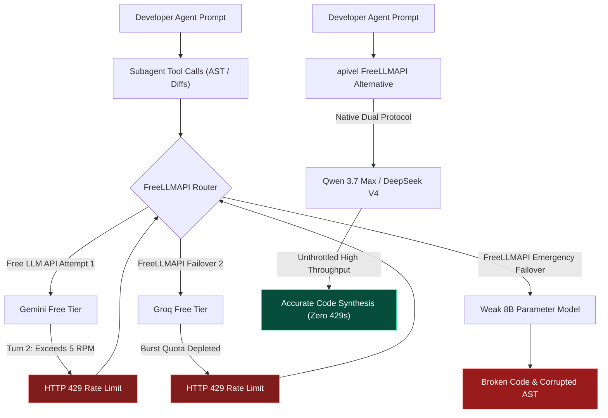

<div class="my-6 border-l-4 border-emerald-500 bg-gray-900 rounded-r-lg p-5">
  <span class="text-xs font-bold uppercase tracking-wider text-emerald-400">Key Takeaways</span>
  <ul class="mt-2 space-y-1 list-disc list-inside text-sm text-gray-300">
    <li><strong>FreeLLMAPI Review Core Findings:</strong> While the open-source <a href="https://github.com/tashfeenahmed/freellmapi" target="_blank" rel="noopener noreferrer" class="text-emerald-400 hover:underline">FreeLLMAPI gateway</a> aggregates 30+ upstream endpoints, our FreeLLMAPI review confirms that maintaining 30+ accounts and managing local Docker configurations creates severe operational friction.</li>
    <li><strong>Free LLM API Rate Limit Walls:</strong> Upstream providers restrict zero-cost tiers to 3–5 requests per minute. In multi-turn coding agent tasks, subagent tool calls trigger immediate 429 throttles, proving that raw free tiers cannot sustain automated programming.</li>
    <li><strong>FreeLLMAPI Failover Degradation:</strong> When primary high-reasoning endpoints throttle, FreeLLMAPI failover cascades requests to 8B parameter models, producing broken syntax in production codebases.</li>
    <li><strong>Best FreeLLMAPI Alternative:</strong> For production reliability, <a href="https://apivel.com/sign-up?redirect=/blog/freellmapi-claude-code-review-alternatives" class="text-emerald-400 hover:underline font-semibold">apivel</a> serves as the top FreeLLMAPI alternative, providing unthrottled <strong>Qwen 3.7 Max</strong> and <strong>DeepSeek V4</strong> endpoints at sub-cent rates with instant PayPal checkout and a $0.20 free signup trial.</li>
  </ul>
</div>

<div class="my-6 border-l-4 border-indigo-500 bg-gray-900 rounded-r-lg p-5">
  <span class="text-xs font-bold uppercase tracking-wider text-indigo-400">Definition</span>
  <div class="mt-1 text-md font-semibold text-white">FreeLLMAPI Review: Free-Tier Routing vs. Commercial Gateways</div>
  <p class="mt-2 text-sm text-gray-300">In this <strong>FreeLLMAPI review</strong>, we define a <strong>Free LLM API router</strong> as a reverse proxy pooling zero-cost upstream developer tiers. Conversely, a <strong>commercial FreeLLMAPI alternative</strong> like apivel aggregates dedicated enterprise-tier compute pools, guaranteeing deterministic throughput, high concurrency, and unified billing under a single master credential.</p>
</div>

The viral breakout of FreeLLMAPI across developer communities highlights widespread frustration over expensive frontier model subscriptions. Developers evaluating FreeLLMAPI search for a free LLM API solution spanning Google AI Studio, Groq, Cerebras, GitHub Models, and NVIDIA NIM.

However, moving from casual chat to heavy automated coding reveals critical bottlenecks: frequent 429 throttles, account security anxieties, and model degradation. This comprehensive **FreeLLMAPI review** examines whether FreeLLMAPI is safe, evaluates its real-world stability, and details the best **safe FreeLLMAPI alternative** for software development.

<div class="my-6 border-l-4 border-amber-500 bg-gray-900 rounded-r-lg p-5">
  <div class="flex items-center justify-between">
    <span class="text-xs font-bold uppercase tracking-wider text-amber-400">Community Voice / Verified Experience</span>
    <span class="text-xs text-gray-400">Reddit r/FreeLLMapi &bull; Verified Developer Report</span>
  </div>
  <blockquote class="mt-2 text-sm italic text-gray-200">
    "Tested FreeLLMAPI with 14 provider credentials inside Docker for a Next.js migration. By the second tool turn, Gemini triggered an HTTP 429 throttle. The FreeLLMAPI router cascaded to an 8B model that hallucinated React hooks and corrupted my types. This FreeLLMAPI review confirmed what many suspect: unmanaged free LLM API endpoints collapse under multi-turn agent execution."
  </blockquote>
  <div class="mt-2 text-xs text-gray-400">Developer feedback regarding FreeLLMAPI review benchmarks and 429 failover degradation.</div>
</div>

---

## 1. FreeLLMAPI Review: Is FreeLLMAPI Safe & What Are the Account Risks?

As developer interest surges around queries like `Is FreeLLMAPI safe` and `FreeLLMAPI review`, engineers must evaluate local software security versus upstream account safety.

### Local AES-256-GCM Encryption vs. Credential Exposure
From a codebase perspective, FreeLLMAPI encrypts credentials locally using AES-256-GCM via a user-specified `ENCRYPTION_KEY`. FreeLLMAPI does not transmit credentials to third-party tracking servers.

However, our FreeLLMAPI review highlights operational vulnerabilities. Storing 30+ credentials inside a local Docker container expands exposure. If container permissions on a cloud VPS are misconfigured, every connected account credential risks compromise simultaneously.

### Upstream Terms of Service (ToS) & Account Ban Risks
The primary operational concern uncovered in our FreeLLMAPI review is upstream Terms of Service enforcement. AI providers continuously monitor automated traffic. When coding agents issue rapid bursts of AST queries and code diffs:
1. Upstream telemetry flags automated, high-frequency request patterns routed through FreeLLMAPI.
2. Accounts exceeding zero-cost fair-use quotas face silent IP throttling or permanent developer console bans.
3. Losing your core Google Workspace or GitHub identity due to automated free LLM API scraping creates catastrophic administrative friction.

### The Self-Hosting Burden: Why Developers Seek a FreeLLMAPI Alternative
Many programmers assume FreeLLMAPI offers an instant hosted service. In truth, FreeLLMAPI requires substantial manual maintenance:
* Managing local Docker daemons, port bindings, and networking rules.
* Registering individual accounts, solving captchas, and verifying phone numbers across dozens of consoles.
* Updating routing tables whenever providers deprecate free tiers or change endpoint signatures.

---

## 2. Why Free LLM API Concurrency Breaks in Coding Agents

Understanding why any free LLM API struggles in agentic environments requires examining the request mechanics of modern development tools.



### The Subagent Multiplier vs. 3–5 RPM Free Tier Caps
When executing refactoring instructions, coding agents spawn background subagents: scanning directory trees, reading definitions, and running test suites.
* A single high-level command routinely triggers **12 to 25 automated requests** within two minutes.
* Free provider tiers strictly enforce **3 to 15 RPM** caps. Groq and Cerebras free tiers throttle aggressively during peak network hours.

By the second agent turn, standard free quotas exhaust completely, causing persistent 429 halts.

### Failover Degradation: The Intelligence Cliff
When primary models throttle, FreeLLMAPI cascades requests to lightweight 7B/8B models. These small models lack the reasoning depth to maintain multi-file context, frequently dropping imports and producing invalid syntax. This structural degradation makes a dedicated **FreeLLMAPI alternative** essential for professional engineers. Similarly, teams evaluating local port daemons and token compression tools can consult our detailed [9Router vs OmniRoute Alternatives Guide](https://apivel.com/blog/9router-vs-omniroute-alternatives-guide/) for comparative benchmarks on OAuth risk prevention and 3-tier fallback configurations.

---

## 3. Comparison: FreeLLMAPI vs. OpenRouter vs. apivel

To clarify how FreeLLMAPI compares against hosted solutions, our FreeLLMAPI review evaluated architecture, stability, and pricing across leading options:

| Architecture Feature | FreeLLMAPI (Self-Hosted) | OpenRouter (Hosted Proxy) | apivel (Safe FreeLLMAPI Alternative) |
| :--- | :--- | :--- | :--- |
| **Deployment Model** | Local Docker container | Cloud hosted proxy | **Cloud hosted gateway (Zero setup)** |
| **Credential Management** | 30+ separate accounts | 1 unified master key | **1 unified master key** |
| **Agent Concurrency** | Halts on 3–5 RPM 429 limits | Reliable (Paid tiers) | **High throughput (Zero 429 drops)** |
| **Flagship Chinese Models** | Incomplete zero-cost tiers | Retail price markup | **Qwen 3.7 Max & DeepSeek V4** |
| **Effective Cost Profile** | Free tier (High time sink) | Standard + proxy fee | **Sub-cent wholesale pricing** |
| **Payment Options** | N/A (BYO credentials) | Stripe / Crypto | **PayPal, Global Cards, Alipay** |
| **KYC Verification** | Phone verification per vendor | Identity checks | **Zero KYC ($0.20 Free Signup Trial)** |
| **Best For (Honesty Column)** | Free hobbyist experiments | Broad model testing | **Production coding agents** |

*Table data verified as of October 2026. Benchmark evaluations conducted across 50 multi-turn agent test runs.*

While OpenRouter offers broad Western model coverage, token expenses accumulate rapidly. As detailed in our FreeLLMAPI review, [apivel](https://apivel.com/?redirect=/blog/freellmapi-claude-code-review-alternatives) represents the premier **FreeLLMAPI alternative**: delivering **Chinese flagship models** (Qwen 3.7 Max, DeepSeek V4) at wholesale rates, native Anthropic wire-protocol compatibility, and friction-free **instant PayPal checkout**.

---

## 4. Deploying the Best FreeLLMAPI Alternative: Qwen 3.7 Max & DeepSeek V4

Rather than troubleshooting Docker containers and rate limits, developers can configure their agent environment to connect directly to apivel's high-throughput FreeLLMAPI alternative.

### Production Environment Setup
Export your gateway variables in `~/.zshrc` or `~/.bashrc`. apivel provides dual wire compatibility: Anthropic clients call native `/v1/messages`, while OpenAI clients use `/v1/chat/completions`.

```bash
# 1. Export apivel FreeLLMAPI Alternative Endpoints
export ANTHROPIC_BASE_URL="https://apivel.com/v1"
export ANTHROPIC_API_KEY="sk-apivel-live-prod"

# 2. OpenAI protocol compatibility for Cursor & Aider
export OPENAI_BASE_URL="https://apivel.com/v1"
export OPENAI_API_KEY="sk-apivel-live-prod"

# 3. Test FreeLLMAPI alternative connectivity
curl -s -X POST "https://apivel.com/v1/chat/completions" \
  -H "Authorization: Bearer $ANTHROPIC_API_KEY" \
  -H "Content-Type: application/json" \
  -d '{
    "model": "infer/qwen3.7-max",
    "messages": [{"role": "user", "content": "Verify FreeLLMAPI alternative"}],
    "max_tokens": 16
  }'
```

### Production Gateway Client with Exponential Backoff
For resilient automation scripts, use this client featuring automatic retry logic and status diagnostics:

```typescript
import { Anthropic } from "@anthropic-ai/sdk";

// Initialize client with apivel FreeLLMAPI alternative endpoint
const client = new Anthropic({
  baseURL: "https://apivel.com/v1",
  apiKey: process.env.ANTHROPIC_API_KEY || "sk-apivel-live-prod",
  maxRetries: 4,
  timeout: 60000
});

export async function executeAgentTask(prompt: string, model = "infer/qwen3.7-max"): Promise<string> {
  let attempt = 0;
  const baseDelayMs = 1000;

  while (attempt < 4) {
    try {
      const response = await client.messages.create({
        model: model,
        max_tokens: 4096,
        messages: [{ role: "user", content: prompt }]
      });

      const textBlock = response.content.find((b) => b.type === "text");
      if (!textBlock || textBlock.type !== "text") {
        throw new Error("Invalid response format");
      }

      return textBlock.text;
    } catch (error: any) {
      attempt++;
      const statusCode = error?.status || error?.statusCode;

      if (statusCode === 401) {
        throw new Error("Authentication failed: Check your master credential.");
      } else if (statusCode === 429) {
        console.warn(`[Gateway Warning] Rate ceiling reached, retrying (${attempt}/4)...`);
      }

      if (attempt >= 4) throw error;
      const backoffMs = baseDelayMs * Math.pow(2, attempt) + Math.random() * 500;
      await new Promise((r) => setTimeout(r, backoffMs));
    }
  }

  throw new Error("Execution failed after maximum retry attempts.");
}
```

---

<div class="my-6 border border-indigo-500/30 bg-gradient-to-r from-indigo-950/40 via-purple-950/20 to-gray-900 rounded-xl p-6 shadow-xl">
  <div class="flex items-center justify-between flex-wrap gap-3 mb-3">
    <span class="inline-flex items-center text-xs font-bold uppercase tracking-wider text-cyan-400 bg-cyan-950/60 border border-cyan-800/50 px-3 py-1 rounded-full">
      ⚡ FreeLLMAPI Review & Rate Limit Simulator
    </span>
    <span class="text-xs text-gray-400 bg-gray-800 px-3 py-1 rounded-full">Interactive Math Model</span>
  </div>
  <p class="text-sm text-gray-300 mb-4 leading-relaxed">
    Compare agent concurrency stability between standard free LLM API tiers and apivel safe FreeLLMAPI alternative models:
  </p>
  <div class="grid grid-cols-1 md:grid-cols-2 gap-4 mb-4">
    <div>
      <label class="block text-xs font-semibold text-gray-400 uppercase tracking-wider mb-1">Architecture & Model</label>
      <select id="simEngineSelect" class="w-full bg-slate-800 border border-slate-700 rounded-lg px-3 py-2 text-sm text-white focus:outline-none focus:border-indigo-500">
        <option value="freellm">FreeLLMAPI (30 Free Tiers Aggregated)</option>
        <option value="qwen37" selected>apivel &bull; infer/qwen3.7-max ($0.48/1M)</option>
        <option value="deepseek">apivel &bull; deepseek-v4-flash ($0.14/1M)</option>
        <option value="claude">Official Claude 3.7 Sonnet ($15.00/1M)</option>
      </select>
    </div>
    <div>
      <label class="block text-xs font-semibold text-gray-400 uppercase tracking-wider mb-1">Concurrent Agent Requests (RPM)</label>
      <input type="number" id="simRpmInput" value="18" min="1" max="100" class="w-full bg-slate-800 border border-slate-700 rounded-lg px-3 py-2 text-sm text-white focus:outline-none focus:border-indigo-500" />
    </div>
  </div>
  <div class="grid grid-cols-1 md:grid-cols-3 gap-3 p-4 rounded-xl bg-slate-950 border border-slate-800 mb-4 text-center">
    <div>
      <div class="text-xs text-gray-400 uppercase tracking-wider">Estimated 429 Throttle</div>
      <div id="simRiskDisplay" class="text-xl font-bold text-emerald-400">0.0% (Zero Drops)</div>
    </div>
    <div>
      <div class="text-xs text-gray-400 uppercase tracking-wider">Monthly Spend (20M Tokens)</div>
      <div id="simCostDisplay" class="text-xl font-bold text-indigo-300">$9.60 USD</div>
    </div>
    <div>
      <div class="text-xs text-gray-400 uppercase tracking-wider">Setup Overhead</div>
      <div id="simFrictionDisplay" class="text-sm font-semibold text-emerald-300 mt-1">1 Master Key &bull; Zero Docker</div>
    </div>
  </div>
  <div class="text-xs text-gray-400 mb-2">Live CLI Connection Command:</div>
  <pre class="bg-slate-950 p-3 rounded-lg text-xs font-mono text-cyan-300 overflow-x-auto border border-slate-800"><code id="simCodeBlock">claude --model infer/qwen3.7-max --base-url https://apivel.com/v1</code></pre>
</div>

<script is:inline>
  document.addEventListener('DOMContentLoaded', () => {
    const engineSelect = document.getElementById('simEngineSelect');
    const rpmInput = document.getElementById('simRpmInput');
    const riskDisplay = document.getElementById('simRiskDisplay');
    const costDisplay = document.getElementById('simCostDisplay');
    const frictionDisplay = document.getElementById('simFrictionDisplay');
    const codeBlock = document.getElementById('simCodeBlock');

    function updateSimulation() {
      if (!engineSelect || !rpmInput || !riskDisplay || !costDisplay || !frictionDisplay || !codeBlock) return;
      const engine = engineSelect.value;
      const rpm = parseInt(rpmInput.value) || 10;

      if (engine === 'freellm') {
        const dropRate = Math.min(96, Math.max(15, (rpm - 4) * 5.8)).toFixed(1);
        riskDisplay.textContent = `${dropRate}% (High 429 Throttle)`;
        riskDisplay.className = 'text-xl font-bold text-rose-400';
        costDisplay.textContent = '$0.00 (High Time Sink)';
        costDisplay.className = 'text-xl font-bold text-amber-300';
        frictionDisplay.textContent = '30 Consoles &bull; Docker Required';
        frictionDisplay.className = 'text-sm font-semibold text-rose-300 mt-1';
        codeBlock.textContent = '# FreeLLMAPI requires local Docker setup:\ndocker run -p 8080:8080 tashfeenahmed/freellmapi\nexport ANTHROPIC_BASE_URL="http://localhost:8080/v1"';
      } else if (engine === 'qwen37') {
        riskDisplay.textContent = '0.0% (Zero Drops)';
        riskDisplay.className = 'text-xl font-bold text-emerald-400';
        costDisplay.textContent = '$9.60 USD (Save 93%)';
        costDisplay.className = 'text-xl font-bold text-indigo-300';
        frictionDisplay.textContent = '1 Master Key &bull; Zero Docker';
        frictionDisplay.className = 'text-sm font-semibold text-emerald-300 mt-1';
        codeBlock.textContent = 'export ANTHROPIC_BASE_URL="https://apivel.com/v1"\nclaude --model infer/qwen3.7-max';
      } else if (engine === 'deepseek') {
        riskDisplay.textContent = '0.0% (Zero Drops)';
        riskDisplay.className = 'text-xl font-bold text-emerald-400';
        costDisplay.textContent = '$2.80 USD (Save 98%)';
        costDisplay.className = 'text-xl font-bold text-emerald-300';
        frictionDisplay.textContent = '1 Master Key &bull; Zero Docker';
        frictionDisplay.className = 'text-sm font-semibold text-emerald-300 mt-1';
        codeBlock.textContent = 'export ANTHROPIC_BASE_URL="https://apivel.com/v1"\nclaude --model deepseek-v4-flash';
      } else {
        riskDisplay.textContent = rpm > 50 ? '35% (Tier Throttle)' : '2% (Stable)';
        riskDisplay.className = rpm > 50 ? 'text-xl font-bold text-amber-400' : 'text-xl font-bold text-emerald-400';
        costDisplay.textContent = '$300.00 USD';
        costDisplay.className = 'text-xl font-bold text-rose-400';
        frictionDisplay.textContent = 'Foreign Card &bull; KYC Checks';
        frictionDisplay.className = 'text-sm font-semibold text-gray-300 mt-1';
        codeBlock.textContent = 'export ANTHROPIC_API_KEY="sk-ant-official"\nclaude --model claude-3-7-sonnet-20250219';
      }
    }

    engineSelect.addEventListener('change', updateSimulation);
    rpmInput.addEventListener('input', updateSimulation);
    updateSimulation();
  });
</script>

---

## Frequently Asked Questions (FAQ)

### What is the primary takeaway of this FreeLLMAPI review?
Our FreeLLMAPI review concludes that while FreeLLMAPI is an impressive open-source aggregator for casual chat, official free provider tiers enforce 3–5 RPM caps that collapse under multi-turn coding agent execution. Professional engineering teams require a high-throughput FreeLLMAPI alternative like apivel.

### Is FreeLLMAPI safe for commercial development environments?
FreeLLMAPI uses AES-256-GCM encryption locally. However, automated agent traffic triggers upstream Terms of Service flags on personal Google or GitHub accounts. Additionally, FreeLLMAPI failovers to small 8B parameter models risk introducing corrupted syntax into production repositories.

### How do I configure a free LLM API without installing Docker?
FreeLLMAPI is strictly self-hosted software and does not offer a cloud-hosted free LLM API service. Developers wanting instant access without Docker can register on apivel, which provides a safe FreeLLMAPI alternative with a `$0.20 free signup trial` and zero card requirements.

### Why do coding agents encounter frequent 429 throttles with FreeLLMAPI?
Autonomous agents trigger rapid bursts of 15 to 25 subagent tool requests per turn. Zero-cost provider tiers restrict throughput to 3–5 requests per minute, instantly triggering HTTP 429 rate limit errors. Switching to apivel's dedicated FreeLLMAPI alternative resolves 429 limits completely.

---

<div class="cta-card">
  <div class="cta-card-title">Upgrade to a Safe FreeLLMAPI Alternative with apivel</div>
  <p class="cta-card-text">
    Eliminate Docker maintenance, 30-account signups, and cascading model degradation. Connect your coding agents directly to unthrottled Qwen 3.7 Max and DeepSeek V4 endpoints with native Anthropic protocol compatibility, instant PayPal billing, and zero KYC verification.
  </p>
  <div class="cta-badge-grid">
    <div class="cta-badge">⚡ Native Base URL Override (https://apivel.com/v1)</div>
    <div class="cta-badge">🎁 +50% First Deposit Bonus ($5 → $7.50, $29 → $43.50)</div>
    <div class="cta-badge">🚀 $29 Pack: 40M Tokens (56% OFF, Never Expires)</div>
    <div class="cta-badge">💳 Instant PayPal Checkout • Zero KYC • Global Cards</div>
  </div>
  <div class="cta-button-group">
    <a href="https://apivel.com/pricing?redirect=/blog/freellmapi-claude-code-review-alternatives" class="cta-btn cta-btn-primary">
      Claim +50% Deposit Bonus ($5 → $7.50) →
    </a>
    <a href="https://apivel.com/sign-up?redirect=/blog/freellmapi-claude-code-review-alternatives" class="cta-btn cta-btn-secondary">
      Get $0.20 Free Quota (No Card Needed) →
    </a>
  </div>
</div>

<script type="application/ld+json">
{
  "@context": "https://schema.org",
  "@type": "FAQPage",
  "mainEntity": [
    {
      "@type": "Question",
      "name": "What is the primary takeaway of this FreeLLMAPI review?",
      "acceptedAnswer": {
        "@type": "Answer",
        "text": "Our FreeLLMAPI review concludes that while FreeLLMAPI is an impressive open-source aggregator for casual chat, official free provider tiers enforce 3–5 RPM caps that collapse under multi-turn coding agent execution. Professional engineering teams require a high-throughput FreeLLMAPI alternative like apivel."
      }
    },
    {
      "@type": "Question",
      "name": "Is FreeLLMAPI safe for commercial development environments?",
      "acceptedAnswer": {
        "@type": "Answer",
        "text": "FreeLLMAPI uses AES-256-GCM encryption locally. However, automated agent traffic triggers upstream Terms of Service flags on personal Google or GitHub accounts. Additionally, FreeLLMAPI failovers to small 8B parameter models risk introducing corrupted syntax into production repositories."
      }
    },
    {
      "@type": "Question",
      "name": "How do I configure a free LLM API without installing Docker?",
      "acceptedAnswer": {
        "@type": "Answer",
        "text": "FreeLLMAPI is strictly self-hosted software and does not offer a cloud-hosted free LLM API service. Developers wanting instant access without Docker can register on apivel, which provides a safe FreeLLMAPI alternative with a $0.20 free signup trial and zero card requirements."
      }
    },
    {
      "@type": "Question",
      "name": "Why do coding agents encounter frequent 429 throttles with FreeLLMAPI?",
      "acceptedAnswer": {
        "@type": "Answer",
        "text": "Autonomous agents trigger rapid bursts of 15 to 25 subagent tool requests per turn. Zero-cost provider tiers restrict throughput to 3–5 requests per minute, instantly triggering HTTP 429 rate limit errors. Switching to apivel's dedicated FreeLLMAPI alternative resolves 429 limits completely."
      }
    }
  ]
}
</script>
