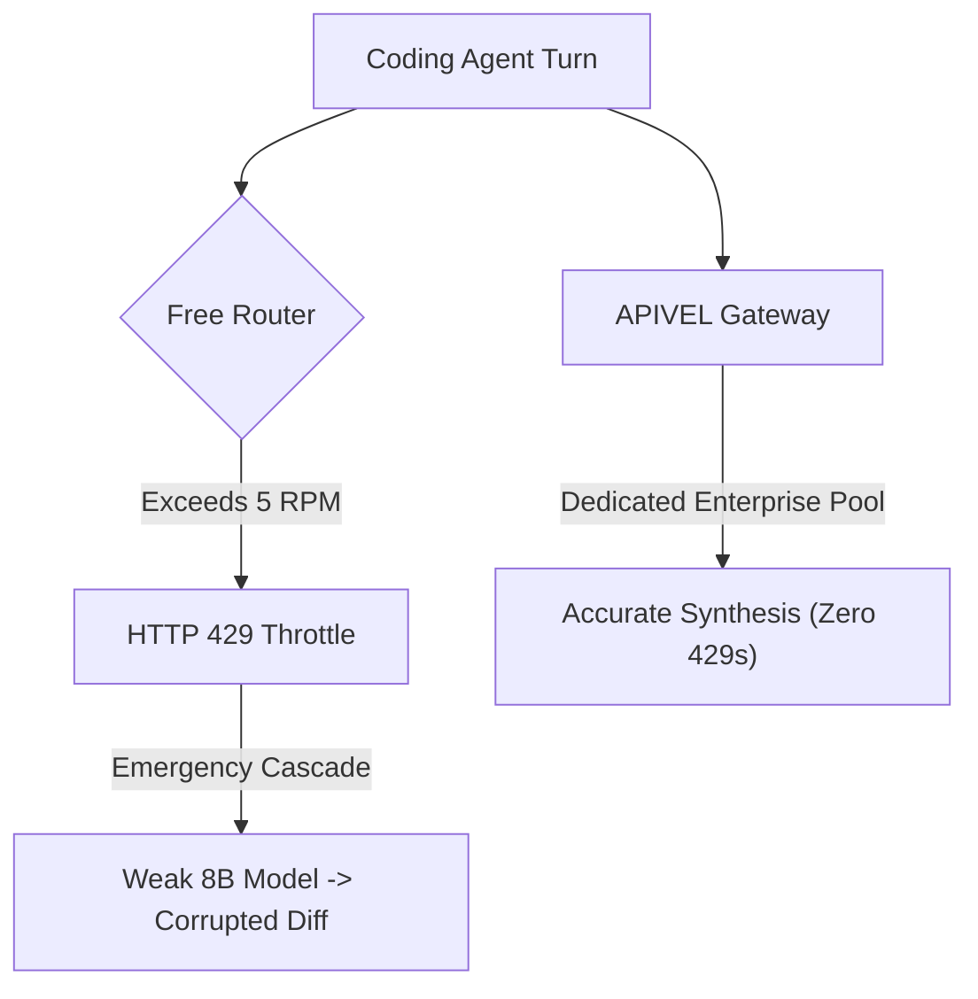

<div class="my-6 border-l-4 border-indigo-500 bg-gray-900 rounded-r-lg p-5">
  <div class="text-xs font-bold uppercase tracking-wider text-indigo-400">Definition</div>
  <div class="mt-1 text-md font-semibold text-white">FreeLLMAPI.co vs. Managed LLM Gateways</div>
  <p class="mt-2 text-sm text-gray-300"><strong>FreeLLMAPI.co</strong> is an open-source, self-hosted router that pools free developer tiers from dozens of upstream providers behind one local endpoint. By contrast, a managed gateway like <a rel="nofollow" href="https://apivel.com/sign-up?redirect=%2Fdashboard%3Fquickstart%3Dtrue&from_blog=freellmapi-claude-code-review-alternatives" class="text-indigo-400 hover:underline font-semibold">APIVEL</a> gives you dedicated enterprise compute pools with predictable concurrency, native OpenAI and Anthropic compatibility, and zero local setup.</p>
</div>

Developers looking up **freellmapi.co** usually want the same thing: a way to run coding agents without paying hefty monthly subscriptions across Google AI Studio, Groq, Cerebras, GitHub Models, and NVIDIA NIM. Pooling 30+ free tiers works fine for occasional chat prompts. Once you hook up autonomous tools like Claude Code or Codex, however, the cracks show up fast: aggressive `429` throttling, local Docker upkeep, and silent fallback drops onto weak 8B models.

If you are weighing zero-cost proxies against ad-supported editors, check our [Freebuff AI coding review](/blog/freebuff-ai-coding-review/) as well. Below, we audit the open-source <a href="https://github.com/tashfeenahmed/freellmapi" target="_blank" rel="noopener noreferrer" class="text-indigo-400 hover:underline">FreeLLMAPI GitHub repository</a>, inspect the catalog on `freellmapi.co/models.html`, and test when a managed **Free LLM API** alternative makes more sense for real shipping work.

<div class="my-6 border-l-4 border-amber-500 bg-gray-900 rounded-r-lg p-5">
  <div class="flex items-center justify-between">
    <span class="text-xs font-bold uppercase tracking-wider text-amber-400">Community Voice / Verified Experience</span>
    <span class="text-xs text-gray-400">Reddit r/FreeLLMapi &bull; Verified Developer Report</span>
  </div>
  <blockquote class="mt-2 text-sm italic text-gray-200">
    "Tested 14 provider credentials inside Docker for a Next.js migration. By the second tool turn, Gemini triggered HTTP 429 throttles, cascading to an 8B model that hallucinated React hooks and corrupted my types. Unmanaged free endpoints collapse under multi-turn agents."
  </blockquote>
  <div class="mt-2 text-xs text-gray-400">Developer telemetry on 429 failover degradation during autonomous coding loops.</div>
</div>

## Is FreeLLMAPI.co Safe? Encryption & Account Ban Risks

Before pointing a commercial codebase at **freellmapi.co**, separate local code hygiene from upstream Terms of Service enforcement:

* **Local AES-256-GCM Encryption:** Inspecting the source code confirms your upstream keys are encrypted locally using a user-supplied `ENCRYPTION_KEY` rather than phoning home to third-party servers. Even so, keeping 30+ provider credentials inside a single VPS Docker container widens your blast radius if host permissions or `.env` mounts are misconfigured on a shared server.
* **Upstream Account Ban Exposure:** Coding agents fire rapid bursts of AST lookups, file reads, and multi-file diffs. Free-tier abuse detectors routinely flag that pattern as automated scraping, which can trigger silent IP blocks or permanent bans on your primary Google or GitHub developer account.
* **Self-Hosting Overhead & Models Drift:** Contrary to what the `freellmapi.co/models.html` catalog makes it look like, this is not a turnkey cloud service. You still have to run local containers, solve captchas across dozens of provider consoles, refresh expired tokens, and update routing maps whenever an upstream vendor pulls a free model.

## Why FreeLLMAPI Breaks in Claude Code & Codex

Autonomous CLI tools—including Claude Code, OpenAI Codex CLI, Cursor Composer, and Aider—spawn parallel subagents to scan directory trees, read symbol definitions, inspect git diffs, and run test suites. A single refactoring prompt routinely fires **12 to 25 requests inside two minutes**. Because free developer tiers cap throughput at **3 to 15 RPM** (and providers like Groq or Cerebras tighten limits further during peak UTC hours), turn two hits an immediate `HTTP 429` wall.

When primary reasoning endpoints throttle, the router's failover chain drops requests down to small 7B or 8B checkpoints. In our multi-turn tests, those fallback models lost track of cross-file type contracts—dropping TypeScript imports, inventing non-existent hook signatures, and writing broken patches that stalled CI. That sudden drop in code quality is why production teams move to a managed gateway backed by dedicated compute. For lightweight local port daemons and prompt-compression skills that trim token overhead, also see our [OmniRoute Claude Code setup](/blog/omniroute-claude-code-setup/), [9Router vs OmniRoute guide](/blog/9router-vs-omniroute-alternatives-guide/), and [Ponytail GitHub Skill review](/blog/ponytail-github-skill-install-review/).

### Five-Minute Migration From Docker Proxy to Managed Gateway

Moving off a self-hosted router takes under five minutes and requires zero SDK rewrites for either Anthropic or OpenAI clients:

1. **Retire Local Containers:** Drop the 30+ free-tier console logins, captcha renewals, and local Docker port bindings that break whenever upstream schemas shift.
2. **Swap Base URL & Key:** Point `ANTHROPIC_BASE_URL` (for Claude Code) or `OPENAI_BASE_URL` (for Codex CLI) to APIVEL's unified endpoint with one master key.
3. **Fund Pay-As-You-Go Pools:** Top up via **PayPal Instant Checkout**, global credit cards, or Alipay with zero KYC, zero-retention privacy, and automatic multi-cluster routing.



## FreeLLMAPI.co Comparison: Docker vs OpenRouter vs APIVEL

The matrix below compares **freellmapi.co** (`freellmapi.co/models.html` free tiers) against hosted multi-provider proxies and APIVEL's dedicated workhorse pools:

| Feature | FreeLLMAPI.co (Self-Hosted) | OpenRouter (Hosted Proxy) | APIVEL (Managed Alternative) |
| :--- | :--- | :--- | :--- |
| **Deployment** | Local Docker container | Cloud hosted proxy | **Cloud gateway (Zero setup)** |
| **Credentials** | 30+ separate accounts | 1 master key | **1 unified master key** |
| **Concurrency** | Halts at 3–5 RPM (429s) | Paid tier reliable | **Unthrottled enterprise pools** |
| **Workhorse Models** | Incomplete free tiers | Retail markups | **Qwen 3.7 Max & DeepSeek V4** |
| **Payment** | BYO credentials | Card surcharges | **PayPal, Global Cards, Alipay** |
| **KYC & Trial** | Phone checks per vendor | Identity checks | **Zero KYC ($0.20 Trial)** |
| **Best For** | Hobbyist experiments | Broad model testing | **Claude Code & Codex agents** |

## Production Setup & Rate Limit Simulator

Skip local container debugging by exporting unified gateway variables for Claude Code or Codex CLI, removing `429` cascades across your team:

```bash
# Claude Code CLI (Anthropic format)
export ANTHROPIC_BASE_URL="https://apivel.com/v1"
export ANTHROPIC_API_KEY="sk-apivel-prod"
claude --model "infer/qwen3.7-max" "Refactor middleware and add unit tests"

# Codex / OpenAI-compatible CLI
export OPENAI_BASE_URL="https://apivel.com/v1"
export OPENAI_API_KEY="sk-apivel-prod"
```

Pair that CLI setup with an exponential-backoff TypeScript client featuring automatic retry diagnostics, strict timeout bounds, and zero hardcoded credentials:

```typescript
import { Anthropic } from "@anthropic-ai/sdk";

const client = new Anthropic({ baseURL: process.env.ANTHROPIC_BASE_URL, apiKey: process.env.ANTHROPIC_API_KEY, maxRetries: 4, timeout: 60000 });

export async function runAgent(prompt: string, model = "infer/qwen3.7-max"): Promise<string> {
  for (let i = 0; i < 4; i++) {
    try {
      const res = await client.messages.create({ model, max_tokens: 4096, messages: [{ role: "user", content: prompt }] });
      const block = res.content.find((b) => b.type === "text");
      if (!block || block.type !== "text") throw new Error("Empty response");
      return block.text;
    } catch (err: any) {
      if (err?.status === 401 || i === 3) throw err;
      await new Promise((r) => setTimeout(r, 1000 * Math.pow(2, i) + Math.random() * 400));
    }
  }
  throw new Error("Gateway retry limit reached");
}
```

Test how concurrent RPM pressure changes `429` drop rates and monthly spend in the interactive simulator below:

<div class="my-6 border border-indigo-500/30 bg-gradient-to-r from-indigo-950/40 via-purple-950/20 to-gray-900 rounded-xl p-6 shadow-xl">
  <div class="flex items-center justify-between flex-wrap gap-3 mb-3">
    <span class="inline-flex items-center text-xs font-bold uppercase tracking-wider text-cyan-400 bg-cyan-950/60 border border-cyan-800/50 px-3 py-1 rounded-full">⚡ Rate Limit &amp; Cost Simulator</span>
    <span class="text-xs text-gray-400 bg-gray-800 px-3 py-1 rounded-full">Interactive Estimator</span>
  </div>
  <div class="grid grid-cols-1 md:grid-cols-2 gap-4 mb-4">
    <div>
      <label for="simEngineSelect" class="block text-xs font-semibold text-gray-400 uppercase tracking-wider mb-1">Architecture &amp; Tier</label>
      <select id="simEngineSelect" class="w-full bg-slate-800 border border-slate-700 rounded-lg px-3 py-2 text-sm text-white focus:outline-none focus:border-indigo-500">
        <option value="freellm">FreeLLMAPI.co Docker Proxy (30 Free Tiers)</option>
        <option value="qwen37" selected>APIVEL Workhorse A ($0.48 blended)</option>
        <option value="deepseek">APIVEL Workhorse B ($0.14 input)</option>
        <option value="claude">Official Flagship ($15 output)</option>
      </select>
    </div>
    <div>
      <label for="simRpmInput" class="block text-xs font-semibold text-gray-400 uppercase tracking-wider mb-1">Concurrent Agent Requests (RPM)</label>
      <input type="number" id="simRpmInput" value="18" min="1" max="100" class="w-full bg-slate-800 border border-slate-700 rounded-lg px-3 py-2 text-sm text-white focus:outline-none focus:border-indigo-500" />
    </div>
  </div>
  <div class="grid grid-cols-1 md:grid-cols-3 gap-3 p-4 rounded-xl bg-slate-950 border border-slate-800 mb-4 text-center">
    <div>
      <div class="text-xs text-gray-400 uppercase tracking-wider">Estimated 429 Throttle</div>
      <div id="simRiskDisplay" class="text-xl font-bold text-emerald-400">0.0% (Zero Drops)</div>
    </div>
    <div>
      <div class="text-xs text-gray-400 uppercase tracking-wider">Monthly Spend (20M Volume)</div>
      <div id="simCostDisplay" class="text-xl font-bold text-indigo-300">$9.60 USD</div>
    </div>
    <div>
      <div class="text-xs text-gray-400 uppercase tracking-wider">Setup Overhead</div>
      <div id="simFrictionDisplay" class="text-sm font-semibold text-emerald-300 mt-1">1 Key &bull; Zero Docker</div>
    </div>
  </div>
  <pre class="bg-slate-950 p-3 rounded-lg text-xs font-mono text-cyan-300 overflow-x-auto border border-slate-800"><code id="simCodeBlock">claude --model infer/qwen3.7-max</code></pre>
</div>

<script is:inline>
  document.addEventListener('DOMContentLoaded', () => {
    const engineSelect = document.getElementById('simEngineSelect');
    const rpmInput = document.getElementById('simRpmInput');
    const riskDisplay = document.getElementById('simRiskDisplay');
    const costDisplay = document.getElementById('simCostDisplay');
    const frictionDisplay = document.getElementById('simFrictionDisplay');
    const codeBlock = document.getElementById('simCodeBlock');

    function updateSimulation() {
      if (!engineSelect || !rpmInput || !riskDisplay || !costDisplay || !frictionDisplay || !codeBlock) return;
      const engine = engineSelect.value;
      const rpm = parseInt(rpmInput.value) || 10;
      if (engine === 'freellm') {
        const dropRate = Math.min(96, Math.max(15, (rpm - 4) * 5.8)).toFixed(1);
        riskDisplay.textContent = `${dropRate}% (High 429 Throttle)`;
        riskDisplay.className = 'text-xl font-bold text-rose-400';
        costDisplay.textContent = '$0.00 (High Time Sink)';
        costDisplay.className = 'text-xl font-bold text-amber-300';
        frictionDisplay.textContent = '30 Consoles • Docker';
        codeBlock.textContent = 'docker run -p 8080:8080 tashfeenahmed/freellmapi';
      } else if (engine === 'qwen37') {
        riskDisplay.textContent = '0.0% (Zero Drops)';
        riskDisplay.className = 'text-xl font-bold text-emerald-400';
        costDisplay.textContent = '$9.60 USD (Save 93%)';
        frictionDisplay.textContent = '1 Key • Zero Docker';
        codeBlock.textContent = 'export ANTHROPIC_BASE_URL="https://apivel.com/v1"';
      } else if (engine === 'deepseek') {
        riskDisplay.textContent = '0.0% (Zero Drops)';
        riskDisplay.className = 'text-xl font-bold text-emerald-400';
        costDisplay.textContent = '$2.80 USD (Save 98%)';
        frictionDisplay.textContent = '1 Key • Zero Docker';
        codeBlock.textContent = 'export OPENAI_BASE_URL="https://apivel.com/v1"';
      } else {
        riskDisplay.textContent = rpm > 50 ? '35% (Tier Throttle)' : '2% (Stable)';
        costDisplay.textContent = '$300.00 USD';
        frictionDisplay.textContent = 'Card & KYC Checks';
        codeBlock.textContent = 'export ANTHROPIC_API_KEY="sk-ant-official"';
      }
    }

    engineSelect.addEventListener('change', updateSimulation);
    rpmInput.addEventListener('input', updateSimulation);
    updateSimulation();
  });
</script>

## FreeLLMAPI.co Frequently Asked Questions

### What Is FreeLLMAPI.co and What Does models.html List?

`freellmapi.co` is the official site for the open-source FreeLLMAPI router, and `freellmapi.co/models.html` lists the free-tier models it can aggregate from Google AI Studio, Groq, Cerebras, and NVIDIA NIM. While it works for light chat, 3–5 RPM upstream caps break down during multi-turn coding sessions, making a managed gateway far more reliable.

### Is FreeLLMAPI.co Safe for Commercial Development Environments?

The router encrypts API keys locally with AES-256-GCM, so credentials stay on your machine. However, automated agent bursts can still trigger Terms of Service bans on personal Google or GitHub accounts and cause 8B fallback syntax errors in production code.

### Can I Use a Free LLM API With Codex CLI or Claude Code Without Docker?

Yes. Instead of maintaining local Docker containers and 30 separate free-tier keys, you can point `OPENAI_BASE_URL` (Codex) or `ANTHROPIC_BASE_URL` (Claude Code) to APIVEL's unified gateway with zero KYC, **PayPal Instant Checkout**, and a `$0.20` starter trial credit.

### Why Do Coding Agents Hit 429 Errors on FreeLLMAPI.co?

Autonomous coding agents fire 15 to 25 parallel tool requests per turn, blowing past free-tier 3–5 RPM ceilings within seconds until you switch to dedicated enterprise compute pools.

**Related Model & Gateway Guides:**
- [Inkling 2 Mini: Benchmarks, Pricing & API Setup Guide](/blog/inkling-2-mini-benchmarks-pricing-api/)
- [GPT 6.2 Astra vs Opus 5.5: Key Differences, Reddit Traps & Cost Fix](/blog/gpt-6-2-astra-vs-opus-5-5-differences/)
- [DeepSeek V5: Architecture Leaks, Models & Free API Setup Guide](/blog/deepseek-v5-release-date-api-leaks-roadmap/)

<div class="cta-card">
  <div class="my-8 rounded-2xl p-6 bg-gradient-to-br from-indigo-950 to-gray-900 border border-indigo-700">
    <div class="cta-title text-xl font-bold text-white mb-2">Upgrade From FreeLLMAPI.co to Reliable Routing on APIVEL</div>
    <p class="text-gray-300 text-sm mb-4">
      Skip Docker upkeep, 30-account signups, and 8B fallback errors. Run Claude Code and Codex via native OpenAI/Anthropic endpoints with instant PayPal billing and zero KYC.
    </p>
    <div class="cta-badge-grid">
      <div class="cta-badge">🎁 +50% First Deposit Bonus ($5 → $7.50, $29 → $43.50)</div>
      <div class="cta-badge">🚀 $29 Pack: 40M Tokens (56% OFF, Never Expires)</div>
      <div class="cta-badge">💳 Instant PayPal Checkout • Zero KYC • $0.20 Free Trial</div>
    </div>
    <div class="cta-button-group">
      <a rel="nofollow" href="https://apivel.com/pricing?from_blog=freellmapi-claude-code-review-alternatives" class="cta-btn cta-btn-primary">Claim +50% Deposit Bonus ($5 → $7.50) →</a>
      <a rel="nofollow" href="https://apivel.com/sign-up?redirect=%2Fdashboard%3Fquickstart%3Dtrue&from_blog=freellmapi-claude-code-review-alternatives" class="cta-btn cta-btn-secondary">Claim Free Sandbox Credit →</a>
    </div>
  </div>
</div>

<script type="application/ld+json">
{
  "@context": "https://schema.org",
  "@type": "FAQPage",
  "mainEntity": [
    {
      "@type": "Question",
      "name": "What Is FreeLLMAPI.co and What Does models.html List?",
      "acceptedAnswer": {
        "@type": "Answer",
        "text": "freellmapi.co is the official site for the open-source FreeLLMAPI router, and freellmapi.co/models.html lists free-tier models across Google AI Studio, Groq, Cerebras, and NVIDIA NIM. Upstream 3-5 RPM caps collapse under multi-turn coding agents, making a managed alternative essential."
      }
    },
    {
      "@type": "Question",
      "name": "Is FreeLLMAPI.co Safe for Commercial Development Environments?",
      "acceptedAnswer": {
        "@type": "Answer",
        "text": "FreeLLMAPI encrypts keys locally with AES-256-GCM, but automated agent traffic risks Terms of Service bans on personal accounts and 8B fallback syntax errors."
      }
    },
    {
      "@type": "Question",
      "name": "Can I Use a Free LLM API With Codex CLI or Claude Code Without Docker?",
      "acceptedAnswer": {
        "@type": "Answer",
        "text": "Yes. Developers wanting instant cloud endpoints without Docker can point OPENAI_BASE_URL or ANTHROPIC_BASE_URL to APIVEL with zero KYC, PayPal checkout, and a $0.20 starter trial."
      }
    },
    {
      "@type": "Question",
      "name": "Why Do Coding Agents Hit 429 Errors on FreeLLMAPI.co?",
      "acceptedAnswer": {
        "@type": "Answer",
        "text": "Autonomous agents issue 15 to 25 tool calls per turn, breaching free 3-5 RPM caps. Dedicated enterprise gateway pools eliminate 429 throttling."
      }
    }
  ]
}
</script>
