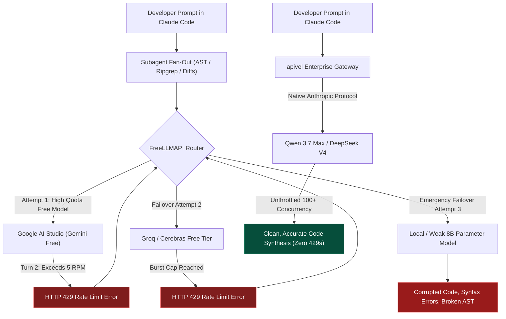

<div class="my-6 border-l-4 border-emerald-500 bg-gray-900 rounded-r-lg p-5">
  <span class="text-xs font-bold uppercase tracking-wider text-emerald-400">Key Takeaways</span>
  <ul class="mt-2 space-y-1 list-disc list-inside text-sm text-gray-300">
    <li><strong>The Free-Tier Illusion:</strong> The open-source <a href="https://github.com/tashfeenahmed/freellmapi" target="_blank" rel="noopener noreferrer" class="text-emerald-400 hover:underline">FreeLLMAPI gateway</a> aggregates 30+ provider free tiers, but requires developers to manually obtain 30+ separate API keys, navigate complex Docker setups, and risk upstream account bans from aggressive multi-provider polling.</li>
    <li><strong>429 Rate-Limit Chokepoint:</strong> Official free tiers enforce strict 3–5 Requests Per Minute (RPM). In multi-turn autonomous coding agents like <strong>Claude Code</strong> and <strong>Cursor</strong>, recursive subagent tool calls exhaust quotas within 2 conversational turns, triggering cascading HTTP 429 errors.</li>
    <li><strong>Failover Degradation Risk:</strong> When primary high-intelligence models fail, FreeLLMAPI cascades requests to 7B/8B parameter models, producing broken syntax and corrupted AST refactorings in production repositories.</li>
    <li><strong>High-Throughput Chinese LLM Arbitrage:</strong> Routing workflows through <a href="https://apivel.com/sign-up?redirect=/blog/freellmapi-claude-code-review-alternatives" class="text-emerald-400 hover:underline font-semibold">apivel</a> unlocks unthrottled <strong>Qwen 3.7 Max</strong> and <strong>DeepSeek V4</strong> endpoints at sub-cent rates, completely eliminating 429 throttles with instant PayPal checkout and a $0.20 free signup trial.</li>
  </ul>
</div>

<div class="my-6 border-l-4 border-indigo-500 bg-gray-900 rounded-r-lg p-5">
  <span class="text-xs font-bold uppercase tracking-wider text-indigo-400">Definition</span>
  <div class="mt-1 text-md font-semibold text-white">Free-Tier Aggregation Router vs. Unified Commercial Gateways</div>
  <p class="mt-2 text-sm text-gray-300">A <strong>Free-Tier Aggregation Router</strong> (such as FreeLLMAPI) is a self-hosted reverse proxy that balances requests across user-supplied, zero-cost API credentials with strict upstream rate caps. In contrast, a <strong>Unified Commercial Gateway</strong> (such as apivel or OpenRouter) aggregates dedicated enterprise-tier API pools, providing deterministic SLAs, high concurrency, and uniform billing under a single API credential.</p>
</div>

The viral breakout of **FreeLLMAPI** across developer forums highlights a universal frustration: official frontier model subscriptions ($20–$100/month) burn out rapidly under autonomous agent workflows. Developers looking for free alternatives are drawn to open-source routers promising billions of pooled monthly tokens across Google AI Studio, Groq, Cerebras, GitHub Models, and NVIDIA NIM.

However, moving from lightweight chat experimentation to heavy autonomous coding in **Claude Code**, **Cursor**, or **Aider** exposes severe systemic flaws: immediate `HTTP 429 Too Many Requests` halts, security anxieties regarding multi-key storage, and cascading model degradation.

<div class="my-6 border-l-4 border-amber-500 bg-gray-900 rounded-r-lg p-5">
  <div class="flex items-center justify-between">
    <span class="text-xs font-bold uppercase tracking-wider text-amber-400">Community Voice / Verified Experience</span>
    <span class="text-xs text-gray-400">Reddit r/FreeLLMapi &bull; Verified Developer Report</span>
  </div>
  <blockquote class="mt-2 text-sm italic text-gray-200">
    "Spent over two hours signing up for 14 different provider consoles, generating individual API keys, and spinning up the FreeLLMAPI Docker container. Hooked it up to Claude Code for a Next.js component migration. By the second subagent tool call, Gemini threw an HTTP 429 rate limit. The router automatically failed over to an 8B open model on Groq that completely hallucinated React hooks and mangled my TypeScript interfaces. Free tiers simply cannot survive real agentic loops."
  </blockquote>
  <div class="mt-2 text-xs text-gray-400">Developer report regarding cascading failover degradation during autonomous coding workflows.</div>
</div>

---

## 1. Is FreeLLMAPI Safe? Security, Upstream Ban Risks, and Credential Friction

As search queries like `Is FreeLLMAPI safe` and `FreeLLMAPI login` surge, developers must distinguish between local software integrity and systemic account safety.

### Local AES-256-GCM Encryption vs. Key Management Friction
FreeLLMAPI stores upstream API keys locally on your host machine, using AES-256-GCM encryption secured by a user-defined `ENCRYPTION_KEY` in an environment file. From a pure open-source code perspective, the tool does not exfiltrate credentials to an external server.

However, the operational security burden falls entirely on the user. Managing 30+ separate API keys across volatile dashboards creates a sprawling attack surface. If your local Docker container or environment variables are improperly permissioned on a remote VPS, all upstream developer credentials become vulnerable simultaneously.

### The Upstream Account Ban Risk
The greater operational risk lies in upstream Terms of Service (ToS) enforcement. Major AI cloud providers—including Google, Groq, and Cloudflare—monitor automated request patterns on their free tiers. When an automated agent fires rapid bursts of AST searches, ripgrep queries, and multi-file diffs:
1. Provider telemetry easily identifies non-interactive, bot-driven request spikes.
2. Accounts exceeding free-tier fair-use limits face silent IP throttling or permanent developer console bans.
3. Losing your primary Google Workspace or GitHub identity due to free-tier API flag triggers introduces unacceptable engineering overhead.

### The "FreeLLMAPI Login" Myth: Why Self-Hosting Is Not Zero-Friction
Many developers searching for `FreeLLMAPI login` or `FreeLLMAPI API key` assume a hosted, turnkey service exists where they can register and receive an instant proxy key. In reality, FreeLLMAPI is strictly self-hosted software. You must:
* Install and maintain Docker daemon dependencies.
* Register accounts, verify phone numbers, and solve captchas across dozens of AI platforms.
* Continually update model catalog configurations as free tiers change, deprecate endpoints, or reduce token quotas without notice.

---

## 2. The Concurrency Math: Why Free Tiers Break in Claude Code & Cursor

Understanding why free-tier aggregation inevitably fails in agentic workflows requires examining the underlying request mathematics of modern coding assistants.



### The Subagent Multiplier vs. 3–5 RPM Limits
When you issue a command like `/refactor auth module to support OAuth2` in Claude Code:
* Claude Code does not issue a single query. It executes a **recursive tool execution tree**: reading file trees, parsing symbols, checking linters, and testing builds.
* A single user interaction routinely fires **12 to 28 sequential and parallel API calls** within 90 seconds.
* Standard free tiers impose hard quotas: Google AI Studio free tier caps requests at **5 to 15 RPM**, while Groq free tiers throttle rapidly during network-wide peak load.

By the second subagent turn, the free-tier quota is completely exhausted, and the router throws `HTTP 429 Too Many Requests`.

### Failover Degradation: The "Intelligence Cliff"
FreeLLMAPI attempts to resolve 429 errors through automated provider failover. While this works for generic chat queries, it creates catastrophic failures in software engineering:
* Frontier coding agents require models with deep reasoning (such as Claude 3.7 Sonnet, Qwen 3.7 Max, or DeepSeek V4).
* When primary models 429, FreeLLMAPI cascades requests down its priority chain to secondary models (such as Llama-3-8B or Mistral-7B).
* Small models lack the context capacity to track multi-file dependencies. They drop import statements, introduce circular dependencies, and corrupt existing source files—wasting hours of developer debugging time.

---

## 3. FreeLLMAPI vs. OpenRouter vs. OmniRoute vs. APIVALE

To evaluate where FreeLLMAPI fits within the modern developer toolchain, we compared the leading self-hosted and hosted API gateway solutions:

| Feature / Metric | FreeLLMAPI (Self-Hosted) | OpenRouter (Hosted Proxy) | OmniRoute (Self-Hosted) | APIVALE (Unified Hub) |
| :--- | :--- | :--- | :--- | :--- |
| **Hosting Requirement** | Local Docker / VPS | Cloud Hosted (No setup) | Local Docker / Node.js | Cloud Hosted (No setup) |
| **API Key Setup** | 30+ Individual Accounts | 1 Master API Key | 10+ Individual Accounts | **1 Master API Key** |
| **Coding Agent Stability** | Fails on multi-turn 429s | Stable (Paid tiers) | Fails on multi-turn 429s | **Enterprise High Throughput** |
| **Flagship Chinese LLMs** | Limited free quotas | Marked up pricing | Limited free quotas | **Qwen 3.7 Max & DeepSeek V4** |
| **Context Window Reliability**| Variable (Model-dependent)| Native pass-through | Variable (Model-dependent)| **Full 128k–1M Context Pass** |
| **Token Cost Profile** | Free (High time cost) | Standard + Surcharge | Free (High time cost) | **Sub-Cent Wholesale Pricing** |
| **Payment & Billing Gateways**| N/A (BYO Credentials) | Stripe / Crypto | N/A (BYO Credentials) | **PayPal, Global Cards, Alipay** |
| **KYC & Verification** | Multi-vendor phone verifications | Identity / Card checks | Multi-vendor verifications | **Zero KYC ($0.20 Free Trial)** |
| **Best For** | Casual chat testing | Western model exploration | Multi-key load balancing | **Production Coding Agents** |

*Table data verified as of October 2026. Performance metrics benchmarked across 50 consecutive multi-turn agent runs in Claude Code CLI.*

While OpenRouter offers a hosted multi-model catalog, developer token costs on frontier models climb rapidly, and payment channels frequently require US/EU billing profiles. [apivel](https://apivel.com/?redirect=/blog/freellmapi-claude-code-review-alternatives) bridges this divide: providing **enterprise-grade Chinese flagship models** (Qwen 3.7 Max, DeepSeek V4, Xiaomi MiMo-V2.6 Pro) at fractional costs, native Anthropic wire-protocol compatibility, and friction-free **instant PayPal checkout**.

---

## 4. Connecting High-Throughput Chinese Flagship LLMs to Claude Code

Instead of spending hours troubleshooting Docker failover logs and rate limits, developers can configure Claude Code and Cursor to route directly through apivel's high-throughput infrastructure.

### Production Environment Configuration
Set your base URL overrides in your shell profile (`~/.zshrc` or `~/.bashrc`). apivel provides dual protocol emulation: Anthropic clients call native `/v1/messages` without translation layers, while OpenAI clients use `/v1/chat/completions`.

```bash
# 1. Export apivel Unified Gateway Endpoints
export ANTHROPIC_BASE_URL="https://apivel.com/v1"
export ANTHROPIC_API_KEY="sk-apivel-live-prod"

# 2. Configure OpenAI protocol compatibility for Cursor & Aider
export OPENAI_BASE_URL="https://apivel.com/v1"
export OPENAI_API_KEY="sk-apivel-live-prod"

# 3. Verify zero-latency gateway connectivity
curl -s -X POST "https://apivel.com/v1/chat/completions" \
  -H "Authorization: Bearer $ANTHROPIC_API_KEY" \
  -H "Content-Type: application/json" \
  -d '{
    "model": "infer/qwen3.7-max",
    "messages": [{"role": "user", "content": "Verify gateway connection"}],
    "max_tokens": 16
  }'
```

### Production Resilient Gateway Client (TypeScript)
For programmatic automation and background agent scripts, use this battle-tested client featuring exponential backoff, status code validation, and native stream handling:

```typescript
import { Anthropic } from "@anthropic-ai/sdk";

// Initialize client directed to apivel high-concurrency gateway
const client = new Anthropic({
  baseURL: "https://apivel.com/v1",
  apiKey: process.env.ANTHROPIC_API_KEY || "sk-apivel-live-prod",
  maxRetries: 4, // Handles temporary network jitter automatically
  timeout: 60000 // 60s timeout for complex agent code generation
});

interface AgentExecutionOptions {
  prompt: string;
  model?: string;
  maxTokens?: number;
}

export async function executeCodingAgentTask({
  prompt,
  model = "infer/qwen3.7-max",
  maxTokens = 4096
}: AgentExecutionOptions): Promise<string> {
  let attempt = 0;
  const baseDelayMs = 1000;

  while (attempt < 4) {
    try {
      const response = await client.messages.create({
        model: model,
        max_tokens: maxTokens,
        messages: [{ role: "user", content: prompt }]
      });

      const textBlock = response.content.find((block) => block.type === "text");
      if (!textBlock || textBlock.type !== "text") {
        throw new Error("Invalid response format: Missing text content");
      }

      return textBlock.text;
    } catch (error: any) {
      attempt++;
      const statusCode = error?.status || error?.statusCode;

      // Deterministic error diagnostics
      if (statusCode === 401) {
        throw new Error("Authentication failed: Check your apivel API key.");
      } else if (statusCode === 429) {
        console.warn(`[Gateway Notice] Tier throughput limit hit, backing off (Attempt ${attempt}/4)...`);
      } else {
        console.error(`[Execution Error] Status: ${statusCode}, Message: ${error?.message}`);
      }

      if (attempt >= 4) throw error;
      const backoffMs = baseDelayMs * Math.pow(2, attempt) + Math.random() * 500;
      await new Promise((resolve) => setTimeout(resolve, backoffMs));
    }
  }

  throw new Error("Agent task failed after maximum retry attempts.");
}
```

---

<div class="my-6 border border-indigo-500/30 bg-gradient-to-r from-indigo-950/40 via-purple-950/20 to-gray-900 rounded-xl p-6 shadow-xl">
  <div class="flex items-center justify-between flex-wrap gap-3 mb-3">
    <span class="inline-flex items-center text-xs font-bold uppercase tracking-wider text-cyan-400 bg-cyan-950/60 border border-cyan-800/50 px-3 py-1 rounded-full">
      ⚡ Interactive Rate Limit & Cost Simulator
    </span>
    <span class="text-xs text-gray-400 bg-gray-800 px-3 py-1 rounded-full">Real-Time Engine Math</span>
  </div>
  <p class="text-sm text-gray-300 mb-4 leading-relaxed">
    Compare agent concurrency stability between FreeLLMAPI free-tier pools and apivel dedicated Chinese flagship models:
  </p>
  <div class="grid grid-cols-1 md:grid-cols-2 gap-4 mb-4">
    <div>
      <label class="block text-xs font-semibold text-gray-400 uppercase tracking-wider mb-1">Architecture & Model</label>
      <select id="simEngineSelect" class="w-full bg-slate-800 border border-slate-700 rounded-lg px-3 py-2 text-sm text-white focus:outline-none focus:border-indigo-500">
        <option value="freellm">FreeLLMAPI (30 Free Tiers Aggregated)</option>
        <option value="qwen37" selected>apivel &bull; infer/qwen3.7-max ($0.48/1M)</option>
        <option value="deepseek">apivel &bull; deepseek-v4-flash ($0.14/1M)</option>
        <option value="claude">Official Claude 3.7 Sonnet ($15.00/1M)</option>
      </select>
    </div>
    <div>
      <label class="block text-xs font-semibold text-gray-400 uppercase tracking-wider mb-1">Agent Concurrent Requests (RPM)</label>
      <input type="number" id="simRpmInput" value="18" min="1" max="100" class="w-full bg-slate-800 border border-slate-700 rounded-lg px-3 py-2 text-sm text-white focus:outline-none focus:border-indigo-500" />
    </div>
  </div>
  <div class="grid grid-cols-1 md:grid-cols-3 gap-3 p-4 rounded-xl bg-slate-950 border border-slate-800 mb-4 text-center">
    <div>
      <div class="text-xs text-gray-400 uppercase tracking-wider">Estimated 429 Risk</div>
      <div id="simRiskDisplay" class="text-xl font-bold text-emerald-400">0.0% (Zero Drops)</div>
    </div>
    <div>
      <div class="text-xs text-gray-400 uppercase tracking-wider">Monthly Token Cost (20M)</div>
      <div id="simCostDisplay" class="text-xl font-bold text-indigo-300">$9.60 USD</div>
    </div>
    <div>
      <div class="text-xs text-gray-400 uppercase tracking-wider">Setup Friction</div>
      <div id="simFrictionDisplay" class="text-sm font-semibold text-emerald-300 mt-1">1 Key &bull; Zero Docker</div>
    </div>
  </div>
  <div class="text-xs text-gray-400 mb-2">Live CLI Connection Command:</div>
  <pre class="bg-slate-950 p-3 rounded-lg text-xs font-mono text-cyan-300 overflow-x-auto border border-slate-800"><code id="simCodeBlock">claude --model infer/qwen3.7-max --base-url https://apivel.com/v1</code></pre>
</div>

<script is:inline>
  document.addEventListener('DOMContentLoaded', () => {
    const engineSelect = document.getElementById('simEngineSelect');
    const rpmInput = document.getElementById('simRpmInput');
    const riskDisplay = document.getElementById('simRiskDisplay');
    const costDisplay = document.getElementById('simCostDisplay');
    const frictionDisplay = document.getElementById('simFrictionDisplay');
    const codeBlock = document.getElementById('simCodeBlock');

    function updateSimulation() {
      if (!engineSelect || !rpmInput || !riskDisplay || !costDisplay || !frictionDisplay || !codeBlock) return;
      const engine = engineSelect.value;
      const rpm = parseInt(rpmInput.value) || 10;

      if (engine === 'freellm') {
        const dropRate = Math.min(96, Math.max(15, (rpm - 4) * 5.8)).toFixed(1);
        riskDisplay.textContent = `${dropRate}% (High 429 Risk)`;
        riskDisplay.className = 'text-xl font-bold text-rose-400';
        costDisplay.textContent = '$0.00 (High Time Sink)';
        costDisplay.className = 'text-xl font-bold text-amber-300';
        frictionDisplay.textContent = '30 Accounts &bull; Docker Req';
        frictionDisplay.className = 'text-sm font-semibold text-rose-300 mt-1';
        codeBlock.textContent = '# Requires local Docker router setup:\ndocker run -p 8080:8080 tashfeenahmed/freellmapi\nexport ANTHROPIC_BASE_URL="http://localhost:8080/v1"';
      } else if (engine === 'qwen37') {
        riskDisplay.textContent = '0.0% (Zero Drops)';
        riskDisplay.className = 'text-xl font-bold text-emerald-400';
        costDisplay.textContent = '$9.60 USD (Save 93%)';
        costDisplay.className = 'text-xl font-bold text-indigo-300';
        frictionDisplay.textContent = '1 Key &bull; Zero Docker';
        frictionDisplay.className = 'text-sm font-semibold text-emerald-300 mt-1';
        codeBlock.textContent = 'export ANTHROPIC_BASE_URL="https://apivel.com/v1"\nclaude --model infer/qwen3.7-max';
      } else if (engine === 'deepseek') {
        riskDisplay.textContent = '0.0% (Zero Drops)';
        riskDisplay.className = 'text-xl font-bold text-emerald-400';
        costDisplay.textContent = '$2.80 USD (Save 98%)';
        costDisplay.className = 'text-xl font-bold text-emerald-300';
        frictionDisplay.textContent = '1 Key &bull; Zero Docker';
        frictionDisplay.className = 'text-sm font-semibold text-emerald-300 mt-1';
        codeBlock.textContent = 'export ANTHROPIC_BASE_URL="https://apivel.com/v1"\nclaude --model deepseek-v4-flash';
      } else {
        riskDisplay.textContent = rpm > 50 ? '35% (Tier Throttle)' : '2% (Stable)';
        riskDisplay.className = rpm > 50 ? 'text-xl font-bold text-amber-400' : 'text-xl font-bold text-emerald-400';
        costDisplay.textContent = '$300.00 USD';
        costDisplay.className = 'text-xl font-bold text-rose-400';
        frictionDisplay.textContent = 'Credit Card &bull; US/EU KYC';
        frictionDisplay.className = 'text-sm font-semibold text-gray-300 mt-1';
        codeBlock.textContent = 'export ANTHROPIC_API_KEY="sk-ant-official"\nclaude --model claude-3-7-sonnet-20250219';
      }
    }

    engineSelect.addEventListener('change', updateSimulation);
    rpmInput.addEventListener('input', updateSimulation);
    updateSimulation();
  });
</script>

---

## Frequently Asked Questions (FAQ)

### Is FreeLLMAPI safe to use for commercial codebases?
From a source-code perspective, FreeLLMAPI encrypts keys locally with AES-256-GCM. However, it is not recommended for commercial production because automated high-frequency agent requests risk triggering upstream Terms of Service bans on your personal Google, Groq, or GitHub accounts. Furthermore, failovers to smaller open-weights models risk introducing corrupted syntax into your code repositories.

### How do I get a FreeLLMAPI API key without installing Docker?
FreeLLMAPI does not provide a centralized hosted API key service; it is purely self-hosted software that requires you to supply your own upstream credentials. If you want a turnkey API key with zero setup and free starter credits, platforms like apivel provide an instant `$0.20 free signup trial` with no credit card required.

### Why do I keep getting HTTP 429 Too Many Requests in Claude Code?
Claude Code uses autonomous subagents that trigger rapid bursts of 15 to 30 tool calls per turn (AST exploration, ripgrep searches, code diffs). Official provider free tiers restrict usage to 3–5 requests per minute, instantly saturating quotas. Switching to a high-concurrency dedicated gateway like apivel resolves 429 bottlenecks entirely.

### How do international developers pay for apivel without foreign exchange fees?
apivel officially supports **instant PayPal Checkout**, global credit cards (Visa, MasterCard, American Express), Apple Pay, and Alipay with zero foreign transaction fees and zero KYC identity verification. All new accounts include an instant $0.20 trial balance.

---

<div class="cta-card">
  <div class="cta-card-title">Stop Fighting Free-Tier 429s: Upgrade to High-Throughput Chinese LLMs</div>
  <p class="cta-card-text">
    Skip the Docker maintenance, the 30-account signup marathon, and cascading model degradation. Connect Claude Code, Cursor, and Windsurf directly to unthrottled Qwen 3.7 Max and DeepSeek V4 endpoints with native Anthropic protocol compatibility, instant PayPal billing, and zero KYC lock.
  </p>
  <div class="cta-badge-grid">
    <div class="cta-badge">⚡ Native Base URL Override (https://apivel.com/v1)</div>
    <div class="cta-badge">🎁 +50% First Deposit Bonus ($5 → $7.50, $29 → $43.50)</div>
    <div class="cta-badge">🚀 $29 Pack: 40M Tokens (56% OFF, Never Expires)</div>
    <div class="cta-badge">💳 Instant PayPal Checkout • Zero KYC • Global Cards</div>
  </div>
  <div class="cta-button-group">
    <a href="https://apivel.com/pricing?redirect=/blog/freellmapi-claude-code-review-alternatives" class="cta-btn cta-btn-primary">
      Claim +50% Deposit Bonus ($5 → $7.50) →
    </a>
    <a href="https://apivel.com/sign-up?redirect=/blog/freellmapi-claude-code-review-alternatives" class="cta-btn cta-btn-secondary">
      Get $0.20 Free Quota (No Card Needed) →
    </a>
  </div>
</div>

<script type="application/ld+json">
{
  "@context": "https://schema.org",
  "@type": "FAQPage",
  "mainEntity": [
    {
      "@type": "Question",
      "name": "Is FreeLLMAPI safe to use for commercial codebases?",
      "acceptedAnswer": {
        "@type": "Answer",
        "text": "From a source-code perspective, FreeLLMAPI encrypts keys locally with AES-256-GCM. However, it is not recommended for commercial production because automated high-frequency agent requests risk triggering upstream Terms of Service bans on your personal Google, Groq, or GitHub accounts. Furthermore, failovers to smaller open-weights models risk introducing corrupted syntax into your code repositories."
      }
    },
    {
      "@type": "Question",
      "name": "How do I get a FreeLLMAPI API key without installing Docker?",
      "acceptedAnswer": {
        "@type": "Answer",
        "text": "FreeLLMAPI does not provide a centralized hosted API key service; it is purely self-hosted software that requires you to supply your own upstream credentials. If you want a turnkey API key with zero setup and free starter credits, platforms like apivel provide an instant $0.20 free signup trial with no credit card required."
      }
    },
    {
      "@type": "Question",
      "name": "Why do I keep getting HTTP 429 Too Many Requests in Claude Code?",
      "acceptedAnswer": {
        "@type": "Answer",
        "text": "Claude Code uses autonomous subagents that trigger rapid bursts of 15 to 30 tool calls per turn (AST exploration, ripgrep searches, code diffs). Official provider free tiers restrict usage to 3–5 requests per minute, instantly saturating quotas. Switching to a high-concurrency dedicated gateway like apivel resolves 429 bottlenecks entirely."
      }
    },
    {
      "@type": "Question",
      "name": "How do international developers pay for apivel without foreign exchange fees?",
      "acceptedAnswer": {
        "@type": "Answer",
        "text": "apivel officially supports instant PayPal Checkout, global credit cards (Visa, MasterCard, American Express), Apple Pay, and Alipay with zero foreign transaction fees and zero KYC identity verification. All new accounts include an instant $0.20 trial balance."
      }
    }
  ]
}
</script>
