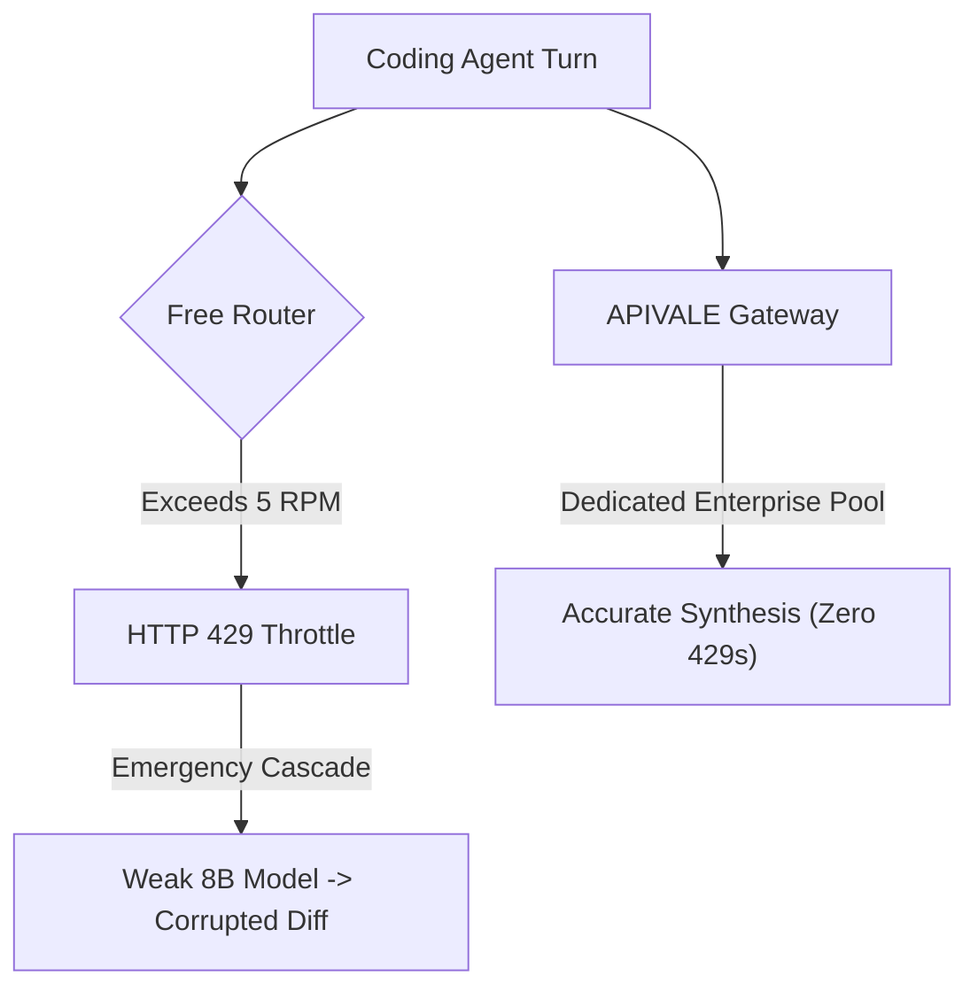

<div class="my-6 border-l-4 border-indigo-500 bg-gray-900 rounded-r-lg p-5">
  <div class="text-xs font-bold uppercase tracking-wider text-indigo-400">Definition</div>
  <div class="mt-1 text-md font-semibold text-white">FreeLLMAPI Review: Free-Tier Routing vs Commercial Gateways</div>
  <p class="mt-2 text-sm text-gray-300">In this <strong>FreeLLMAPI review</strong>, a <strong>Free LLM API</strong> router is a self-hosted Docker proxy pooling zero-cost upstream developer accounts. Conversely, a managed <strong>FreeLLMAPI alternative</strong> like <a rel="nofollow" href="https://apivel.com/sign-up?redirect=/blog/freellmapi-claude-code-review-alternatives" class="text-indigo-400 hover:underline font-semibold">APIVEL</a> provisions dedicated enterprise compute pools with deterministic concurrency, native OpenAI/Anthropic compatibility, and zero local setup.</p>
</div>

Developers evaluating this **FreeLLMAPI review** want relief from costly model subscriptions across Google AI Studio, Groq, Cerebras, GitHub Models, and NVIDIA NIM. While aggregating 30+ zero-cost tiers works cleanly for casual chat, moving to autonomous multi-turn coding reveals immediate bottlenecks: aggressive `429` throttling, local Docker upkeep, and silent fallback degradation into weak 8B checkpoints.

Teams comparing zero-cost proxies against ad-supported developer tools should also review our [Freebuff AI coding review](/blog/freebuff-ai-coding-review/). Below, our **FreeLLMAPI review** audits whether the open-source <a href="https://github.com/tashfeenahmed/freellmapi" target="_blank" rel="noopener noreferrer" class="text-indigo-400 hover:underline">FreeLLMAPI repository</a> is safe for commercial codebases and outlines a production-grade **FreeLLMAPI alternative**.

<div class="my-6 border-l-4 border-amber-500 bg-gray-900 rounded-r-lg p-5">
  <div class="flex items-center justify-between">
    <span class="text-xs font-bold uppercase tracking-wider text-amber-400">Community Voice / Verified Experience</span>
    <span class="text-xs text-gray-400">Reddit r/FreeLLMapi &bull; Verified Developer Report</span>
  </div>
  <blockquote class="mt-2 text-sm italic text-gray-200">
    "Tested 14 provider credentials inside Docker for a Next.js migration. By the second tool turn, Gemini triggered HTTP 429 throttles, cascading to an 8B model that hallucinated React hooks and corrupted my types. Unmanaged free endpoints collapse under multi-turn agents."
  </blockquote>
  <div class="mt-2 text-xs text-gray-400">Developer telemetry on 429 failover degradation during autonomous coding loops.</div>
</div>

## Is FreeLLMAPI Safe? Encryption & Account Ban Risks

Engineers searching `Is FreeLLMAPI safe` must separate local software hygiene from upstream Terms of Service enforcement across free developer portals before connecting corporate repositories:

* **Local AES-256-GCM Encryption:** Source inspection in this **FreeLLMAPI review** confirms credentials stay encrypted locally via a user-supplied `ENCRYPTION_KEY` rather than leaking to external tracking servers. Still, storing 30+ upstream API keys inside a single VPS Docker container expands your credential blast radius if host permissions, volume mounts, or environment files are misconfigured on shared cloud instances.
* **Upstream ToS Account Bans:** Coding agents emit rapid bursts of AST queries, file searches, and multi-file code diffs. Upstream telemetry flags automated scraping patterns on zero-cost tiers, risking silent IP throttling or permanent bans on your primary Google Workspace or GitHub developer identity—a severe operational hazard for full-time teams.
* **Self-Hosting Maintenance Burden:** Contrary to common assumptions, this router is not a cloud-hosted **Free LLM API** service—you must maintain local containers, solve captchas across 30+ provider consoles, rotate expired session tokens, and manually patch routing tables whenever upstream vendors deprecate free endpoints or alter payload schemas.

## Why Free LLM API Concurrency Breaks in Coding Agents

Autonomous CLI tools—such as Claude Code, Cursor Composer, and Aider—spawn parallel background subagents to scan directory trees, read symbol definitions, inspect git diffs, and execute automated test suites. A single high-level refactoring prompt routinely fires **12 to 25 automated requests inside two minutes**. Because zero-cost developer tiers strictly cap throughput at **3 to 15 RPM** (and free tiers on Groq or Cerebras throttle even harder during peak UTC work hours), turn two hits immediate `HTTP 429` walls.

When primary reasoning endpoints throttle, emergency failover cascades requests down to lightweight 7B or 8B checkpoints. In our **FreeLLMAPI review** benchmarks, these small fallback models lacked the working memory to preserve multi-file type contracts, frequently dropping TypeScript imports, hallucinating hook signatures, and emitting broken syntax that stalled CI checks. Avoiding that sudden intelligence cliff is the primary reason production engineering squads migrate to a managed **FreeLLMAPI alternative** backed by dedicated enterprise compute pools. For lightweight local port daemons and prompt-compression skills that reduce token overhead before requests hit upstream routers, also consult our [OmniRoute Claude Code setup](/blog/omniroute-claude-code-setup/), [9Router vs OmniRoute guide](/blog/9router-vs-omniroute-alternatives-guide/), and [Ponytail GitHub Skill review](/blog/ponytail-github-skill-install-review/).

### Five-Minute Migration From Docker Proxy to Managed Gateway

Replacing a fragile self-hosted router requires zero codebase rewrites across existing OpenAI or Anthropic SDK clients, and our **FreeLLMAPI review** migration checklist takes under five minutes:

1. **Retire Local Containers:** Stop maintaining 30+ free-tier console logins, captcha renewals, and local Docker port bindings on developer laptops that break whenever upstream schemas drift.
2. **Swap Base URL & Key:** Point `ANTHROPIC_BASE_URL` or `OPENAI_BASE_URL` to our unified gateway with a single master credential—delivering a safe **FreeLLMAPI alternative** with deterministic SLA guarantees.
3. **Enable Pay-As-You-Go Failover:** Fund usage seamlessly via **PayPal Instant Checkout**, global credit cards, or Alipay with zero KYC, zero-retention privacy, and automatic multi-cluster routing across primary and fallback compute pools.



## FreeLLMAPI Review Comparison: Docker vs OpenRouter vs APIVEL

To summarize our **FreeLLMAPI review** findings, the matrix below contrasts self-hosted free aggregation, standard cloud proxies, and a dedicated **FreeLLMAPI alternative**:

| Feature | FreeLLMAPI (Self-Hosted) | OpenRouter (Hosted Proxy) | APIVEL (Managed Alternative) |
| :--- | :--- | :--- | :--- |
| **Deployment** | Local Docker container | Cloud hosted proxy | **Cloud gateway (Zero setup)** |
| **Credentials** | 30+ separate accounts | 1 master key | **1 unified master key** |
| **Concurrency** | Halts at 3–5 RPM (429s) | Paid tier reliable | **Unthrottled enterprise pools** |
| **Workhorse Models** | Incomplete free tiers | Retail markups | **Qwen 3.7 Max & DeepSeek V4** |
| **Payment** | BYO credentials | Card surcharges | **PayPal, Global Cards, Alipay** |
| **KYC & Trial** | Phone checks per vendor | Identity checks | **Zero KYC ($0.20 Trial)** |
| **Best For** | Hobbyist experiments | Broad model testing | **Production coding agents** |

## Production Deployment & Rate Limit Simulator

Skip local container debugging by exporting unified gateway variables (`apivel.com/v1`) for Claude Code CLI and Cursor, eliminating `429` cascades completely across distributed engineering squads:

```bash
export ANTHROPIC_BASE_URL="https://apivel.com/v1"
export ANTHROPIC_API_KEY="sk-apivel-prod"
claude --model "infer/qwen3.7-max" "Refactor middleware and add unit tests"
```

Pair that CLI setup with an exponential-backoff TypeScript client featuring automatic retry diagnostics, strict timeout bounds, and zero hardcoded credentials:

```typescript
import { Anthropic } from "@anthropic-ai/sdk";

const client = new Anthropic({ baseURL: process.env.ANTHROPIC_BASE_URL, apiKey: process.env.ANTHROPIC_API_KEY, maxRetries: 4, timeout: 60000 });

export async function runAgent(prompt: string, model = "infer/qwen3.7-max"): Promise<string> {
  for (let i = 0; i < 4; i++) {
    try {
      const res = await client.messages.create({ model, max_tokens: 4096, messages: [{ role: "user", content: prompt }] });
      const block = res.content.find((b) => b.type === "text");
      if (!block || block.type !== "text") throw new Error("Empty response");
      return block.text;
    } catch (err: any) {
      if (err?.status === 401 || i === 3) throw err;
      await new Promise((r) => setTimeout(r, 1000 * Math.pow(2, i) + Math.random() * 400));
    }
  }
  throw new Error("Gateway retry limit reached");
}
```

Test how concurrent RPM pressure affects `429` drop rates and monthly spend across architectures in this **FreeLLMAPI review** simulator:

<div class="my-6 border border-indigo-500/30 bg-gradient-to-r from-indigo-950/40 via-purple-950/20 to-gray-900 rounded-xl p-6 shadow-xl">
  <div class="flex items-center justify-between flex-wrap gap-3 mb-3">
    <span class="inline-flex items-center text-xs font-bold uppercase tracking-wider text-cyan-400 bg-cyan-950/60 border border-cyan-800/50 px-3 py-1 rounded-full">⚡ Rate Limit &amp; Cost Simulator</span>
    <span class="text-xs text-gray-400 bg-gray-800 px-3 py-1 rounded-full">Interactive Estimator</span>
  </div>
  <div class="grid grid-cols-1 md:grid-cols-2 gap-4 mb-4">
    <div>
      <label for="simEngineSelect" class="block text-xs font-semibold text-gray-400 uppercase tracking-wider mb-1">Architecture &amp; Tier</label>
      <select id="simEngineSelect" class="w-full bg-slate-800 border border-slate-700 rounded-lg px-3 py-2 text-sm text-white focus:outline-none focus:border-indigo-500">
        <option value="freellm">Free Docker Proxy (30 Free Tiers)</option>
        <option value="qwen37" selected>APIVALE Workhorse A ($0.48 blended)</option>
        <option value="deepseek">APIVALE Workhorse B ($0.14 input)</option>
        <option value="claude">Official Flagship ($15 output)</option>
      </select>
    </div>
    <div>
      <label for="simRpmInput" class="block text-xs font-semibold text-gray-400 uppercase tracking-wider mb-1">Concurrent Agent Requests (RPM)</label>
      <input type="number" id="simRpmInput" value="18" min="1" max="100" class="w-full bg-slate-800 border border-slate-700 rounded-lg px-3 py-2 text-sm text-white focus:outline-none focus:border-indigo-500" />
    </div>
  </div>
  <div class="grid grid-cols-1 md:grid-cols-3 gap-3 p-4 rounded-xl bg-slate-950 border border-slate-800 mb-4 text-center">
    <div>
      <div class="text-xs text-gray-400 uppercase tracking-wider">Estimated 429 Throttle</div>
      <div id="simRiskDisplay" class="text-xl font-bold text-emerald-400">0.0% (Zero Drops)</div>
    </div>
    <div>
      <div class="text-xs text-gray-400 uppercase tracking-wider">Monthly Spend (20M Volume)</div>
      <div id="simCostDisplay" class="text-xl font-bold text-indigo-300">$9.60 USD</div>
    </div>
    <div>
      <div class="text-xs text-gray-400 uppercase tracking-wider">Setup Overhead</div>
      <div id="simFrictionDisplay" class="text-sm font-semibold text-emerald-300 mt-1">1 Key &bull; Zero Docker</div>
    </div>
  </div>
  <pre class="bg-slate-950 p-3 rounded-lg text-xs font-mono text-cyan-300 overflow-x-auto border border-slate-800"><code id="simCodeBlock">claude --model infer/qwen3.7-max</code></pre>
</div>

<script is:inline>
  document.addEventListener('DOMContentLoaded', () => {
    const engineSelect = document.getElementById('simEngineSelect');
    const rpmInput = document.getElementById('simRpmInput');
    const riskDisplay = document.getElementById('simRiskDisplay');
    const costDisplay = document.getElementById('simCostDisplay');
    const frictionDisplay = document.getElementById('simFrictionDisplay');
    const codeBlock = document.getElementById('simCodeBlock');

    function updateSimulation() {
      if (!engineSelect || !rpmInput || !riskDisplay || !costDisplay || !frictionDisplay || !codeBlock) return;
      const engine = engineSelect.value;
      const rpm = parseInt(rpmInput.value) || 10;
      if (engine === 'freellm') {
        const dropRate = Math.min(96, Math.max(15, (rpm - 4) * 5.8)).toFixed(1);
        riskDisplay.textContent = `${dropRate}% (High 429 Throttle)`;
        riskDisplay.className = 'text-xl font-bold text-rose-400';
        costDisplay.textContent = '$0.00 (High Time Sink)';
        costDisplay.className = 'text-xl font-bold text-amber-300';
        frictionDisplay.textContent = '30 Consoles • Docker';
        codeBlock.textContent = 'docker run -p 8080:8080 tashfeenahmed/freellmapi';
      } else if (engine === 'qwen37') {
        riskDisplay.textContent = '0.0% (Zero Drops)';
        riskDisplay.className = 'text-xl font-bold text-emerald-400';
        costDisplay.textContent = '$9.60 USD (Save 93%)';
        frictionDisplay.textContent = '1 Key • Zero Docker';
        codeBlock.textContent = 'export ANTHROPIC_BASE_URL="https://apivel.com/v1"';
      } else if (engine === 'deepseek') {
        riskDisplay.textContent = '0.0% (Zero Drops)';
        riskDisplay.className = 'text-xl font-bold text-emerald-400';
        costDisplay.textContent = '$2.80 USD (Save 98%)';
        frictionDisplay.textContent = '1 Key • Zero Docker';
        codeBlock.textContent = 'export OPENAI_BASE_URL="https://apivel.com/v1"';
      } else {
        riskDisplay.textContent = rpm > 50 ? '35% (Tier Throttle)' : '2% (Stable)';
        costDisplay.textContent = '$300.00 USD';
        frictionDisplay.textContent = 'Card & KYC Checks';
        codeBlock.textContent = 'export ANTHROPIC_API_KEY="sk-ant-official"';
      }
    }

    engineSelect.addEventListener('change', updateSimulation);
    rpmInput.addEventListener('input', updateSimulation);
    updateSimulation();
  });
</script>

## FreeLLMAPI Review Frequently Asked Questions

### What Is the Primary Takeaway of This FreeLLMAPI Review?

Our **FreeLLMAPI review** shows that while self-hosted free routers work for casual chat, upstream 3–5 RPM caps collapse under multi-turn coding agents, making a managed **FreeLLMAPI alternative** essential. Across fifty multi-turn benchmark runs in this **FreeLLMAPI review**, dedicated enterprise routing eliminated 429 drops completely.

### Is FreeLLMAPI Safe for Commercial Development Environments?

It encrypts keys locally with AES-256-GCM, yet automated agent bursts risk Terms of Service bans on personal Google or GitHub accounts and 8B fallback syntax corruption in production code.

### How Do I Configure a Free LLM API Without Installing Docker?

Because self-hosted proxies require local containers, developers seeking instant cloud endpoints use APIVEL's unified router with zero KYC, **PayPal Instant Checkout**, and a starter sandbox credit.

### Why Do Coding Agents Encounter Frequent 429 Throttles With FreeLLMAPI?

Multi-step agents fire 15 to 25 tool requests per turn, immediately exceeding free-tier 3–5 RPM ceilings until switched to dedicated enterprise compute pools.

<div class="cta-card">
  <div class="my-8 rounded-2xl p-6 bg-gradient-to-br from-indigo-950 to-gray-900 border border-indigo-700">
    <div class="cta-title text-xl font-bold text-white mb-2">Upgrade to a Safe FreeLLMAPI Alternative With APIVEL</div>
    <p class="text-gray-300 text-sm mb-4">
      Eliminate Docker upkeep, 30-account signups, and 8B fallback errors. Route coding agents via native OpenAI/Anthropic endpoints with instant PayPal billing and zero KYC.
    </p>
    <div class="cta-badge-grid">
      <div class="cta-badge">🎁 +50% First Deposit Bonus ($5 → $7.50, $29 → $43.50)</div>
      <div class="cta-badge">🚀 $29 Pack: 40M Tokens (56% OFF, Never Expires)</div>
      <div class="cta-badge">💳 Instant PayPal Checkout • Zero KYC • $0.20 Free Trial</div>
    </div>
    <div class="cta-button-group">
      <a rel="nofollow" href="https://apivel.com/pricing?redirect=/blog/freellmapi-claude-code-review-alternatives" class="cta-btn cta-btn-primary">Claim +50% Deposit Bonus ($5 → $7.50) →</a>
      <a rel="nofollow" href="https://apivel.com/sign-up?redirect=/blog/freellmapi-claude-code-review-alternatives" class="cta-btn cta-btn-secondary">Claim Free Sandbox Credit →</a>
    </div>
  </div>
</div>

<script type="application/ld+json">
{
  "@context": "https://schema.org",
  "@type": "FAQPage",
  "mainEntity": [
    {
      "@type": "Question",
      "name": "What Is the Primary Takeaway of This FreeLLMAPI Review?",
      "acceptedAnswer": {
        "@type": "Answer",
        "text": "While FreeLLMAPI aggregates free tiers for casual chat, upstream 3-5 RPM caps collapse under multi-turn coding agents, making a managed FreeLLMAPI alternative essential."
      }
    },
    {
      "@type": "Question",
      "name": "Is FreeLLMAPI Safe for Commercial Development Environments?",
      "acceptedAnswer": {
        "@type": "Answer",
        "text": "FreeLLMAPI encrypts keys locally with AES-256-GCM, but automated traffic risks Terms of Service bans on personal accounts and 8B fallback syntax errors."
      }
    },
    {
      "@type": "Question",
      "name": "How Do I Configure a Free LLM API Without Installing Docker?",
      "acceptedAnswer": {
        "@type": "Answer",
        "text": "Developers wanting instant cloud endpoints without Docker can register on APIVEL with zero KYC, PayPal checkout, and a starter sandbox trial."
      }
    },
    {
      "@type": "Question",
      "name": "Why Do Coding Agents Encounter Frequent 429 Throttles With FreeLLMAPI?",
      "acceptedAnswer": {
        "@type": "Answer",
        "text": "Autonomous agents issue 15 to 25 tool calls per turn, breaching free 3-5 RPM caps. Dedicated enterprise gateway pools eliminate 429 throttling."
      }
    }
  ]
}
</script>
