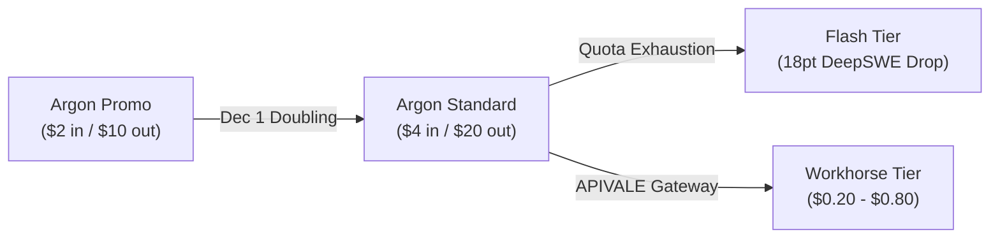

<div class="my-6 border-l-4 border-indigo-500 bg-gray-900 rounded-r-lg p-5">
  <div class="text-xs font-bold uppercase tracking-wider text-indigo-400">Definition</div>
  <div class="mt-1 text-md font-semibold text-white">Gemini 4 Argon (gemini-4-argon)</div>
  <p class="mt-2 text-sm text-gray-300">
    <strong>Gemini 4 Argon</strong> is Google's frontier reasoning model engineered for long-horizon software engineering in Google Antigravity. While leading DeepSWE benchmarks (77.9%), aggressive thinking-token burn and a scheduled price doubling drive engineering teams toward two-tier routing gateways like <a rel="nofollow" href="https://apivel.com/?redirect=/blog/gemini-4-argon-coding-test-review" class="text-indigo-400 hover:underline font-semibold">APIVALE</a>.
  </p>
</div>

The **Gemini 4 Argon coding test** benchmarks have sparked intense engineering debate across Reddit and GitHub. Built for monorepo-scale migrations, Google's preview reasoning model pairs a 1,048,576-token context window with deep tree-search planning across multi-service codebases.

Yet real-world coding test runs expose sharp operational trade-offs: internal reasoning tokens rapidly drain five-hour quotas, introductory API pricing doubles on December 1, and raw terminal bash execution trails specialized competitors. Pairing top-level architectural planning with fast workhorse routing eliminates both quota freezes and runaway token invoices.

## Gemini 4 Argon Coding Test Benchmarks: DeepSWE vs Terminal-Bench

Independent **Gemini 4 Argon coding test** evaluations highlight elite multi-file architectural synthesis alongside clear command-line execution bottlenecks:

| Model | DeepSWE v1.1 | Terminal-Bench 4.0 | API Pricing (1M Tokens) | Best For (Objective Fit) |
| :--- | :--- | :--- | :--- | :--- |
| **Gemini 4 Argon** | **77.9%** | 57.4% | $2/$10 ($4/$20 Dec 1) | **Monorepo migrations & design** |
| **Claude Opus 5.5** | 75.2% | **66.4%** | $4 / $20 | **CLI debugging & tool loops** |
| **Qwen 3.7 Max** | 73.6% | 63.1% | **$0.25 / $0.80** | **High-speed daily coding** |
| **DeepSeek V4** | 74.8% | 62.8% | **$0.20 / $0.60** | **Unit tests & failover loops** |

* **Architectural Strength (77.9% DeepSWE v1.1):** During large GitHub repository tests—such as translating legacy C and X11 codebases (`xboard`) into memory-safe Rust—Google's reasoning tier builds accurate module dependency graphs and preserves cross-file invariants without losing track of upstream type definitions. Complex asynchronous state machines, recursive parser refactors, and multi-module database schema migrations complete with noticeably fewer broken imports than lightweight single-pass models.
* **Terminal Execution Weakness (57.4% Terminal-Bench 4.0):** In raw Linux bash environments, Docker container orchestration, and live runtime debugging, it trails [Claude Opus 5.5](/blog/claude-opus-5-5-vs-claude-sonnet-5-5-benchmarks/) by 9.0 percentage points. The model frequently over-reasons on routine shell flags, hesitates before executing destructive cleanup commands, and spends excessive turns verifying read-only directory trees instead of patching failing integration tests directly.

## Real-World Coding Test Results: Reddit & Antigravity Limits

Developers running autonomous coding agents in Google Antigravity document recurring quota depletion and workflow friction across `r/google_antigravity`:

<div class="my-6 border-l-4 border-amber-500 bg-gray-900/90 rounded-r-lg p-5 shadow-md">
  <div class="flex items-center justify-between text-xs font-semibold text-amber-400 uppercase tracking-wider mb-2">
    <span>Verified Community Voice &bull; Reddit r/google_antigravity</span>
    <a href="https://ai.google.dev/gemini-api/docs/pricing" target="_blank" rel="noopener noreferrer" class="hover:underline text-gray-400">Official Gemini Pricing &rarr;</a>
  </div>
  <blockquote class="text-sm italic text-gray-200 border-l-2 border-gray-700 pl-3 my-2">
    "Complex workflows, tool-calling loops, or using 'High' thinking mode burn through quota in a handful of prompts. Argon drains 60–70% of a quota bundle much quicker than expected. I reserve it strictly as a top-level orchestrator and delegate boilerplate generation to lighter models."
  </blockquote>
  <div class="text-xs text-gray-400 mt-2 font-mono">&mdash; Far_Management_7991 (Antigravity Pro Developer)</div>
</div>

Three specific failure modes surface repeatedly during multi-turn **Gemini 4 Argon coding test** sessions:

1. **Reasoning Context Drain:** Internal tree-search deliberation traces share the million-token context budget, causing unexpected early chat compaction. When refactoring multi-service TypeScript or Rust workspaces, developers encounter context truncation mid-migration, forcing costly full-repository re-indexing turns.
2. **Rule Over-Compliance:** The reasoning engine frequently fixates on deprecated inline library comments or rigid `.cursorrules` constraints, second-guessing valid architectural edits and triggering repetitive revert-and-retry loops.
3. **5-Hour Quota Freezes:** Because Google Cloud and Antigravity count hidden internal thinking tokens as full output tokens against rolling caps, heavy multi-file refactoring passes exhaust five-hour subscription limits in just 3 to 5 cycles—halting sprints right before pull request validation.

### Migrating From Argon to Gemini 4 Neon & Hybrid Routing

Following Google's phased transition from Canary Argon to [Gemini 4 Neon](/blog/gemini-4-neon-benchmarks-pricing-api/), engineering teams discovered that even balanced mid-tier models expose pipelines to rolling quota caps when left unguarded. Separating high-level architectural planning from routine execution solves this permanently across daily sprint cycles:

* **Reserve Frontier Reasoning for Invariants:** Restrict expensive thinking passes strictly to database schema migrations, distributed concurrency reviews, cross-service contract verification, and security boundary audits where single-line regressions risk production downtime.
* **Offload Boilerplate Without Cooldowns:** Route unit test scaffolding, ESLint remediation, docstring formatting, mock fixture generation, and routine diff generation to secondary workhorse tiers that never enforce five-hour cooldown lockouts during peak afternoon releases.
* **Lock In Predictable Per-Token Billing:** Eliminate sudden thinking-token budget shocks, unexpected session freezes, and regional card declines using wholesale pay-as-you-go routing via **PayPal Instant Checkout**, global credit cards, and Alipay with zero KYC friction and transparent per-request cost accounting.

## Gemini 4 Argon Price Shock: December Doubling & Two-Tier Fix

Running autonomous agents against Google's preview tier faces immediate budget cliffs. Promotional introductory rates ($2 input / $10 output per million tokens) expire November 30, doubling to **$4 input and $20 output** on December 1, 2026. Under standard rates, a 10-turn debugging loop ingesting 150,000 repository tokens easily exceeds $1.20 per single pass.

Downgrading wholesale to Flash tiers triggers an 18-point drop on DeepSWE benchmarks, introducing TypeScript syntax hallucinations and broken module imports. Instead, deploying a two-tier gateway architecture preserves 77.9% reasoning quality while cutting monthly token bills by over 80%.



Teams route top-level architecture to Google's reasoning engine, [Carbon](/blog/gemini-4-carbon-price-benchmarks-api/), or [GPT 6.2 Astra](/blog/gpt-6-2-astra-benchmarks-price-reddit/), while delegating 80% of daily implementation, boilerplate CRUD, and integration fixture maintenance to fast workhorse endpoints—directly resolving the [AI coding impact senior engineers](/blog/ai-coding-impact-senior-engineers/) face in overloaded pull-request review queues without sacrificing correctness or sprint velocity.

<div class="my-6 border border-indigo-500/30 bg-gradient-to-r from-gray-900 via-indigo-950/20 to-gray-900 rounded-xl p-6 shadow-xl">
  <div class="flex items-center justify-between flex-wrap gap-2 mb-3">
    <span class="text-xs font-bold uppercase tracking-wider text-indigo-400 bg-indigo-950/60 border border-indigo-800/50 px-3 py-1 rounded-full">⚡ Interactive Coding Cost Calculator</span>
    <span class="text-xs text-emerald-400 bg-emerald-950/60 border border-emerald-800/50 px-3 py-1 rounded-full">Instant Estimate</span>
  </div>
  <p class="text-sm text-gray-300 mb-4">Estimate monthly spend comparing pure frontier usage against APIVALE's Two-Tier Gateway (80% workhorse offload):</p>
  <div class="grid grid-cols-1 md:grid-cols-2 gap-4 mb-4">
    <div>
      <label for="monthly-tokens" class="block text-xs font-medium text-gray-400 mb-1">Monthly Agent Volume (Million Tokens)</label>
      <input type="number" id="monthly-tokens" value="12" min="1" max="500" class="w-full bg-gray-800 border border-gray-700 rounded-lg px-3 py-2 text-sm text-white focus:outline-none focus:border-indigo-500" oninput="calculateSavings()" />
    </div>
    <div>
      <label for="tier-select" class="block text-xs font-medium text-gray-400 mb-1">Workhorse Engine</label>
      <select id="tier-select" class="w-full bg-gray-800 border border-gray-700 rounded-lg px-3 py-2 text-sm text-white focus:outline-none focus:border-indigo-500" onchange="calculateSavings()">
        <option value="qwen37">Alibaba Workhorse ($0.25 in / $0.80 out)</option>
        <option value="deepseek4">DeepSeek Workhorse ($0.20 in / $0.60 out)</option>
      </select>
    </div>
  </div>
  <div class="p-4 bg-gray-950/70 rounded-lg border border-gray-800">
    <div class="flex justify-between items-center flex-wrap gap-2">
      <div>
        <span class="text-xs text-gray-400">Pure Frontier (Dec 1):</span>
        <div id="argon-cost" class="text-base font-bold text-red-400">$86.40 / mo</div>
      </div>
      <div>
        <span class="text-xs text-gray-400">Two-Tier (APIVALE):</span>
        <div id="apivale-cost" class="text-base font-bold text-emerald-400">$20.74 / mo</div>
      </div>
      <div>
        <span class="text-xs text-gray-400">Net Squad Savings:</span>
        <div id="savings-percent" class="text-base font-bold text-cyan-400">76.0% SAVED</div>
      </div>
    </div>
  </div>
</div>

<script>
function calculateSavings() {
  const volInput = document.getElementById('monthly-tokens');
  const tierSelect = document.getElementById('tier-select');
  const argonCostEl = document.getElementById('argon-cost');
  const apivaleCostEl = document.getElementById('apivale-cost');
  const savingsEl = document.getElementById('savings-percent');
  if (!volInput || !tierSelect || !argonCostEl || !apivaleCostEl || !savingsEl) return;

  const totalM = parseFloat(volInput.value) || 12;
  const inputM = totalM * 0.8;
  const outputM = totalM * 0.2;
  const argonCost = (inputM * 4.00) + (outputM * 20.00);
  const argonShare = argonCost * 0.2;

  let execRateIn = tierSelect.value === 'deepseek4' ? 0.20 : 0.25;
  let execRateOut = tierSelect.value === 'deepseek4' ? 0.60 : 0.80;
  const execCost = (inputM * 0.8 * execRateIn) + (outputM * 0.8 * execRateOut);
  const totalGatewayCost = argonShare + execCost;
  const savings = Math.max(0, ((argonCost - totalGatewayCost) / argonCost) * 100);

  argonCostEl.textContent = '$' + argonCost.toFixed(2) + ' / mo';
  apivaleCostEl.textContent = '$' + totalGatewayCost.toFixed(2) + ' / mo';
  savingsEl.textContent = savings.toFixed(1) + '% SAVED';
}
</script>

## Production Setup: Failover Client & CLI Integration

Before deploying multi-model agents into CI/CD runners, enforce explicit 60–90 second timeouts, low deterministic temperature (`0.2`), and automated HTTP `429` or `503` failover across OpenAI- and Anthropic-compatible endpoints:

```python
import os, httpx
from openai import OpenAI

client = OpenAI(base_url="https://apivel.com/v1", api_key=os.environ.get("APIVALE_API_KEY"))

def run_coding_task(prompt: str, is_arch: bool = False) -> str:
    models = ["gemini-4-argon", "infer/qwen3.7-max"] if is_arch else ["infer/qwen3.7-max", "infer/deepseek-v4"]
    for model in models:
        try:
            res = client.chat.completions.create(model=model, messages=[{"role": "user", "content": prompt}], temperature=0.2, timeout=75.0)
            return res.choices[0].message.content
        except (httpx.TimeoutException, httpx.HTTPStatusError):
            continue
    raise RuntimeError("All gateway endpoints unavailable.")
```

For Claude Code CLI or Cursor, export unified gateway environment variables in your shell profile:

```bash
export ANTHROPIC_BASE_URL="https://apivel.com/anthropic"
export ANTHROPIC_API_KEY="sk-apivel-prod-key"
export CLAUDE_CODE_MODEL="infer/qwen3.7-max"
```

## Gemini 4 Argon Frequently Asked Questions

### Why Does Gemini 4 Argon Exhaust Quotas So Rapidly in Coding Tests?

Google's internal tree-search reasoning traces are billed as full output tokens and deducted directly from rolling limits, causing 3 to 5 multi-file refactoring passes to deplete Pro and Team session allowances prematurely across active workspaces.

### What Is the Official API Pricing for Gemini 4 Argon After December 2026?

Promotional rates ($2 input and $10 output per million tokens) expire November 30, 2026, doubling to **$4 input and $20 output** on December 1 across Vertex AI and Google AI Studio.

### What Is the Best Cost-Effective Alternative to Gemini 4 Argon for Coding?

Deploy a two-tier routing strategy via APIVALE: keep architectural planning on Google's reasoning tier or [Gemini 4 Neon](/blog/gemini-4-neon-benchmarks-pricing-api/), and offload 80% of routine diffs to workhorse endpoints with **PayPal Instant Checkout**, global credit cards, zero KYC verification, and a starter trial credit so sprints never stall behind billing blocks.

<script type="application/ld+json">
{
  "@context": "https://schema.org",
  "@type": "FAQPage",
  "mainEntity": [
    {
      "@type": "Question",
      "name": "Why Does Gemini 4 Argon Exhaust Quotas So Rapidly in Coding Tests?",
      "acceptedAnswer": {
        "@type": "Answer",
        "text": "Gemini 4 Argon internal tree-search reasoning traces are billed as full output tokens, exhausting rolling quotas within 3 to 5 multi-file refactoring runs."
      }
    },
    {
      "@type": "Question",
      "name": "What Is the Official API Pricing for Gemini 4 Argon After December 2026?",
      "acceptedAnswer": {
        "@type": "Answer",
        "text": "Introductory pricing ($2/$10) ends Nov 30, 2026, doubling to $4 input and $20 output on Dec 1, 2026."
      }
    },
    {
      "@type": "Question",
      "name": "What Is the Best Cost-Effective Alternative to Gemini 4 Argon for Coding?",
      "acceptedAnswer": {
        "@type": "Answer",
        "text": "A Two-Tier Routing Strategy pairing Argon planning with Gemini 4 Neon, Qwen 3.7 Max, and DeepSeek V4 via APIVALE saves up to 85% with PayPal checkout and zero KYC."
      }
    }
  ]
}
</script>

<div class="cta-card">
  <div class="my-8 border border-indigo-500/40 bg-gradient-to-br from-gray-900 via-indigo-950/30 to-purple-950/20 rounded-2xl p-6 shadow-2xl text-center">
    <div class="inline-flex items-center text-xs font-bold uppercase tracking-wider text-emerald-400 bg-emerald-950/60 border border-emerald-800/50 px-3 py-1 rounded-full mb-3">
      🚀 Instant Setup &bull; Global Zero-KYC Billing
    </div>
    <div class="text-xl md:text-2xl font-bold text-white mb-2">Build Better Code Without Rate-Limit Anxiety</div>
    <p class="text-sm text-gray-300 max-w-2xl mx-auto mb-6 leading-relaxed">
      Scale autonomous development with <strong>APIVALE's unified gateway</strong>. Access Gemini, DeepSeek, and workhorse endpoints with native OpenAI/Anthropic compatibility, zero KYC, and instant PayPal checkout.
    </p>
    <div class="grid grid-cols-1 sm:grid-cols-3 gap-3 max-w-xl mx-auto mb-6 text-left text-xs text-gray-300">
      <div class="bg-gray-800/70 border border-gray-700/60 rounded-lg p-3 text-center">
        <div class="text-emerald-400 font-bold text-sm">+50% Deposit Bonus</div>
        <div class="text-gray-400 mt-0.5">$5 &rarr; $7.50 | $29 &rarr; $43.50</div>
      </div>
      <div class="bg-gray-800/70 border border-gray-700/60 rounded-lg p-3 text-center">
        <div class="text-indigo-400 font-bold text-sm">$29 Developer Pack</div>
        <div class="text-gray-400 mt-0.5">56% OFF &bull; 40M Tokens &bull; Never Expires</div>
      </div>
      <div class="bg-gray-800/70 border border-gray-700/60 rounded-lg p-3 text-center">
        <div class="text-cyan-400 font-bold text-sm">$0.20 Free Trial</div>
        <div class="text-gray-400 mt-0.5">No Credit Card Required</div>
      </div>
    </div>
    <div class="flex items-center justify-center gap-4 flex-wrap">
      <a rel="nofollow" href="https://apivel.com/sign-up?redirect=/blog/gemini-4-argon-coding-test-review" class="bg-indigo-600 hover:bg-indigo-500 text-white font-semibold text-sm px-6 py-3 rounded-xl shadow-lg transition-all">Claim $0.20 Free Starter Credit &rarr;</a>
      <a rel="nofollow" href="https://apivel.com/pricing?redirect=/blog/gemini-4-argon-coding-test-review" class="bg-gray-800 hover:bg-gray-700 text-gray-200 border border-gray-700 font-semibold text-sm px-6 py-3 rounded-xl transition-all">Explore Transparent Pricing</a>
    </div>
  </div>
</div>
