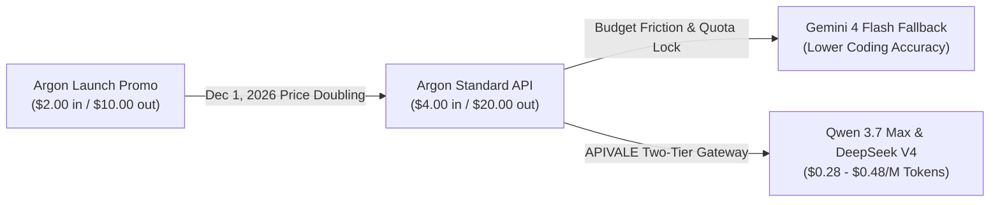

<div class="my-6 border-l-4 border-indigo-500 bg-gray-900 rounded-r-lg p-5">
  <span class="text-xs font-bold uppercase tracking-wider text-indigo-400">Definition</span>
  <div class="mt-1 text-md font-semibold text-white">Gemini 4 Argon (gemini-4-argon)</div>
  <p class="mt-2 text-sm text-gray-300">
    <strong>Gemini 4 Argon</strong> is Google's flagship frontier reasoning and software engineering model, built to power long-horizon coding tasks, multi-file codebase refactoring, and autonomous terminal execution within Google Antigravity. While leading DeepSWE benchmarks, its aggressive reasoning traces and impending 100% price hike have led developers toward multi-model routing gateways like <a href="https://apivel.com/?redirect=/blog/gemini-4-argon-coding-test-review" class="text-indigo-400 hover:underline font-semibold">APIVALE</a>.
  </p>
</div>

The coding benchmarks and release of **Gemini 4 Argon** (`gemini-4-argon`) have triggered intense debate across developer discords, Reddit, and GitHub repositories. Billed as Google’s ultimate software engineering engine, Argon introduced an industry-leading 1,048,576 token context window and state-of-the-art results on real-world engineering benchmarks.

However, real-world development workflows present operational challenges. Between aggressive token burn rates, scheduled API price doublings, and edge-case regressions, software teams are seeking balanced architectures. This review analyzes verified coding benchmarks, examines authentic community feedback from Reddit, and demonstrates how to deploy a resilient two-tier coding setup using high-throughput alternatives via [APIVALE](https://apivel.com/?redirect=/blog/gemini-4-argon-coding-test-review).

---

## 1. DeepSWE vs. Terminal-bench: What the Coding Benchmarks Actually Prove

Independent benchmark aggregators and Google DeepMind technical disclosures reveal that Gemini 4 Argon possesses exceptional architectural strengths alongside distinct operational limitations.

<div class="my-6 border border-gray-800 bg-gray-900/60 rounded-xl p-5 shadow-lg">
  <div class="text-sm font-semibold text-gray-200 mb-3">Frontier Model Coding Benchmark Comparison (Verified November 2026)</div>
  <div class="overflow-x-auto">
    <table class="w-full text-left text-sm text-gray-300">
      <thead class="bg-gray-800/80 text-gray-200">
        <tr>
          <th class="p-3">Model</th>
          <th class="p-3">DeepSWE v1.1</th>
          <th class="p-3">Terminal-bench 4.0</th>
          <th class="p-3">Input / Output Price (1M Tokens)</th>
          <th class="p-3">Optimal Use Case</th>
        </tr>
      </thead>
      <tbody class="divide-y divide-gray-800">
        <tr class="hover:bg-gray-800/40">
          <td class="p-3 font-semibold text-indigo-400">Gemini 4 Argon</td>
          <td class="p-3 font-bold text-emerald-400">77.9%</td>
          <td class="p-3 text-amber-400">57.4%</td>
          <td class="p-3">$2.00 / $10.00 ($4 / $20 Dec 1)</td>
          <td class="p-3">Full-repo refactoring & architectural planning</td>
        </tr>
        <tr class="hover:bg-gray-800/40">
          <td class="p-3 font-semibold text-purple-400">Claude Opus 5.5</td>
          <td class="p-3">75.2%</td>
          <td class="p-3 font-bold text-emerald-400">66.4%</td>
          <td class="p-3">$5.00 / $25.00</td>
          <td class="p-3">CLI tool invocation & deep system debugging</td>
        </tr>
        <tr class="hover:bg-gray-800/40">
          <td class="p-3 font-semibold text-emerald-400">Qwen 3.7 Max</td>
          <td class="p-3">73.6%</td>
          <td class="p-3">63.1%</td>
          <td class="p-3 font-bold text-emerald-400">$0.48 / $1.44 (APIVALE)</td>
          <td class="p-3">Daily driver coding & unit testing</td>
        </tr>
        <tr class="hover:bg-gray-800/40">
          <td class="p-3 font-semibold text-cyan-400">DeepSeek V4</td>
          <td class="p-3">74.8%</td>
          <td class="p-3">62.8%</td>
          <td class="p-3 font-bold text-emerald-400">$0.28 / $0.56 (APIVALE)</td>
          <td class="p-3">High-volume code synthesis & multi-turn debugging</td>
        </tr>
      </tbody>
    </table>
  </div>
</div>

### Where Argon Dominates: Long-Horizon Software Engineering
On **DeepSWE v1.1**, Argon’s 77.9% score sets a benchmark for automated development. DeepSWE tests autonomous models across realistic, multi-file software engineering tasks rather than single-function unit tests. Argon handles repository-wide migrations with ease—such as converting legacy C/X11 codebases (like `xboard`) into memory-safe Rust—maintaining cross-file type consistency and generating accurate module dependency trees.

### Where Argon Struggles: Terminal Mastery and Low-Level Infrastructure
Conversely, on **Terminal-bench 4.0**, Argon drops to 57.4%, trailing Claude Opus 5.5 by 9.0 percentage points. In deep Linux systems administration, complex Bash pipelines, and runtime container orchestration, Argon frequently over-reasons on simple command-line flags, entering multi-step tool loops instead of executing direct command chains.

---

## 2. Community Verdict: GitHub Repos, Reddit Feedback & "Program Accidents"

While synthetic benchmarks display peak theoretical performance, developers building autonomous agents in [Google Antigravity](https://apivel.com/?redirect=/blog/gemini-4-argon-coding-test-review) have documented operational friction points across r/google_antigravity, r/vibecoding, and GitHub issue trackers.

<div class="my-6 border-l-4 border-amber-500 bg-gray-900/90 rounded-r-lg p-5 shadow-md">
  <div class="flex items-center justify-between text-xs font-semibold text-amber-400 uppercase tracking-wider mb-2">
    <span>Verified Community Voice &bull; Reddit r/google_antigravity</span>
    <a href="https://www.reddit.com/r/google_antigravity/comments/1xj84e4/massive_usage_improvements_on_antigravity_for/" target="_blank" rel="noopener noreferrer" class="hover:underline text-gray-400">View Discussion &rarr;</a>
  </div>
  <blockquote class="text-sm italic text-gray-200 border-l-2 border-gray-700 pl-3 my-2">
    "Complex workflows, tool-calling loops, or using the 'High' thinking mode can burn through a major percentage of your quota in just a handful of prompts. Argon burns through tokens at an exceptionally fast rate... it can drain 60–70% of a quota bundle much quicker than expected. I have to reserve Argon strictly as a top-level orchestrator and delegate boilerplate generation to lighter models."
  </blockquote>
  <div class="text-xs text-gray-400 mt-2 font-mono">
    &mdash; Far_Management_7991 (Verified Antigravity Pro Developer)
  </div>
</div>

Developers running iterative programming sessions highlight three recurring "program accidents":

1. **Reasoning Trace Context Cannibalization:** Argon allocates a dynamic partition of its 1M token budget to internal tree-search reasoning. During complex agent sessions, reasoning tokens consume context rapidly, causing Antigravity to trigger premature conversation compaction.
2. **Over-Compliance and Code Hallucination:** When working within established enterprise repos, developers note that Argon occasionally fixates on outdated deprecation notices, second-guessing its own correct diffs.
3. **5-Hour Rolling Quota Exhaustion:** Because Google bills reasoning traces as full output tokens against tier allotments, power users on Pro subscription tiers frequently hit sudden rate limits midway through multi-file refactoring runs.

---

## 3. Pricing Shock: The $20/M Token Burn and Gemini 4 Flash Tradeoffs

The economic reality of running autonomous coding agents with Gemini 4 Argon is approaching a steep inflection point.



### The December 1 Price Doubling
Google structured Argon's launch with an introductory API rate of **$2.00 per million input tokens** and **$10.00 per million output tokens** through November 30, 2026. Effective **December 1, 2026**, pricing doubles to **$4.00 input and $20.00 output**. 

For autonomous coding loops where an agent ingests 150K repository tokens and outputs 8K tokens of code alongside 12K tokens of internal reasoning trace per cycle, a single multi-step task can easily consume $0.80 to $1.20 per pass. Scaling this across an engineering squad quickly generates thousands of dollars in monthly cloud API commitments.

### Why Downgrading to Gemini 4 Flash Fails
Many teams attempt to offset this burn by falling back to lightweight companion models like Gemini 4 Flash. However, coding evaluations show that Flash experiences an 18-point drop on DeepSWE benchmarks, frequently producing syntax errors in complex TypeScript types or hallucinating nonexistent API arguments.

---

## 4. The Two-Tier Strategy: Gemini 4 Argon vs. Frontier Open LLMs

To eliminate rate-limiting disruptions and achieve 85% cost savings without sacrificing code quality, high-volume engineering teams utilize a **Two-Tier Agentic Routing Strategy**:

* **Tier 1 (Architectural Orchestration):** Route the initial repository schema scan and high-level module dependency planning to Gemini 4 Argon or Claude Opus 5.5.
* **Tier 2 (High-Throughput Execution):** Offload 80% of repetitive operational tasks—sub-agent unit test drafting, function scaffolding, docstrings, and multi-file syntax refactoring—to frontier models like **Qwen 3.7 Max** (`infer/qwen3.7-max`) or **DeepSeek V4** (`infer/deepseek-v4`).

Through [APIVALE](https://apivel.com/?redirect=/blog/gemini-4-argon-coding-test-review), developers can access these state-of-the-art models via drop-in OpenAI- and Anthropic-compatible endpoints, eliminating the regional KYC verification and payment hurdles typical of primary mainland platforms.

<div class="my-6 border border-indigo-500/30 bg-gradient-to-r from-gray-900 via-indigo-950/20 to-gray-900 rounded-xl p-6 shadow-xl">
  <div class="flex items-center justify-between flex-wrap gap-2 mb-3">
    <span class="text-xs font-bold uppercase tracking-wider text-indigo-400 bg-indigo-950/60 border border-indigo-800/50 px-3 py-1 rounded-full">⚡ Interactive Coding Cost Calculator</span>
    <span class="text-xs text-emerald-400 bg-emerald-950/60 border border-emerald-800/50 px-3 py-1 rounded-full">Instant Estimate</span>
  </div>
  <p class="text-sm text-gray-300 mb-4">Calculate token expenditures comparing full Gemini 4 Argon against the APIVALE Two-Tier Gateway architecture (10M input + 2M output tokens):</p>
  <div class="grid grid-cols-1 md:grid-cols-2 gap-4 mb-4">
    <div>
      <label for="monthly-tokens" class="block text-xs font-medium text-gray-400 mb-1">Monthly Agent Volume (Million Tokens)</label>
      <input type="number" id="monthly-tokens" value="12" min="1" max="500" class="w-full bg-gray-800 border border-gray-700 rounded-lg px-3 py-2 text-sm text-white focus:outline-none focus:border-indigo-500" oninput="calculateSavings()" />
    </div>
    <div>
      <label for="tier-select" class="block text-xs font-medium text-gray-400 mb-1">Execution Workhorse Engine</label>
      <select id="tier-select" class="w-full bg-gray-800 border border-gray-700 rounded-lg px-3 py-2 text-sm text-white focus:outline-none focus:border-indigo-500" onchange="calculateSavings()">
        <option value="qwen37">Qwen 3.7 Max (Active Gateway - $0.48/M)</option>
        <option value="deepseek4">DeepSeek V4 (High-Speed Coding - $0.28/M)</option>
      </select>
    </div>
  </div>
  <div class="p-4 bg-gray-950/70 rounded-lg border border-gray-800">
    <div class="text-xs text-gray-400">Estimated Cost Comparison:</div>
    <div class="flex justify-between items-center mt-2 flex-wrap gap-2">
      <div>
        <span class="text-xs text-gray-400">Pure Argon API (Post Dec 1):</span>
        <div id="argon-cost" class="text-lg font-bold text-red-400">$80.00 / mo</div>
      </div>
      <div>
        <span class="text-xs text-gray-400">Two-Tier Routing (APIVALE):</span>
        <div id="apivale-cost" class="text-lg font-bold text-emerald-400">$11.84 / mo</div>
      </div>
      <div>
        <span class="text-xs text-gray-400">Net Squad Savings:</span>
        <div id="savings-percent" class="text-lg font-bold text-cyan-400">85.2% SAVED</div>
      </div>
    </div>
  </div>
</div>

<script>
function calculateSavings() {
  const volInput = document.getElementById('monthly-tokens');
  const tierSelect = document.getElementById('tier-select');
  const argonCostEl = document.getElementById('argon-cost');
  const apivaleCostEl = document.getElementById('apivale-cost');
  const savingsEl = document.getElementById('savings-percent');
  if (!volInput || !tierSelect || !argonCostEl || !apivaleCostEl || !savingsEl) return;

  const totalM = parseFloat(volInput.value) || 12;
  const inputM = totalM * 0.8;
  const outputM = totalM * 0.2;

  // Argon Standard: $4.00 in / $20.00 out
  const argonCost = (inputM * 4.00) + (outputM * 20.00);

  // Two-tier: 20% Argon planning + 80% execution
  const argonShare = argonCost * 0.2;
  let execRateIn = 0.48;
  let execRateOut = 1.44;
  if (tierSelect.value === 'deepseek4') {
    execRateIn = 0.28;
    execRateOut = 0.56;
  }
  const execCost = (inputM * 0.8 * execRateIn) + (outputM * 0.8 * execRateOut);
  const totalGatewayCost = argonShare + execCost;
  const savings = Math.max(0, ((argonCost - totalGatewayCost) / argonCost) * 100);

  argonCostEl.textContent = '$' + argonCost.toFixed(2) + ' / mo';
  apivaleCostEl.textContent = '$' + totalGatewayCost.toFixed(2) + ' / mo';
  savingsEl.textContent = savings.toFixed(1) + '% SAVED';
}
</script>

---

## 5. Production Setup: Connecting Frontier Endpoints to Cursor & Claude Code

Configuring an enterprise fallback pipeline requires zero codebase alterations. By exporting OpenAI or Anthropic protocol overrides, your development agents can query [APIVALE's unified gateway](https://apivel.com/?redirect=/blog/gemini-4-argon-coding-test-review) instantly.

### Configuration for Claude Code CLI
Claude Code CLI respects standard terminal environment variables. Point the CLI directly to APIVALE’s Anthropic endpoint:

```bash
# 1. Export APIVALE Anthropic-compatible protocol base URL
export ANTHROPIC_BASE_URL="https://apivel.com/anthropic"

# 2. Export your unified APIVALE API key
export ANTHROPIC_API_KEY="sk-apivale-prod-live-checkout-key"

# 3. Route complex agent task to high-throughput Qwen 3.7 Max engine
claude --model "infer/qwen3.7-max" \
  "Refactor the authentication middleware to support async JWT verification and write unit tests"
```

### Configuration for Cursor IDE (`settings.json`)
To enable seamless autocomplete and composer execution inside Cursor, update your configuration:

```json
{
  "cursor.openaiBaseUrl": "https://apivel.com/v1",
  "cursor.openaiApiKey": "sk-apivale-prod-live-checkout-key",
  "cursor.models": [
    {
      "id": "infer/qwen3.7-max",
      "name": "Qwen 3.7 Max (APIVALE Gateway)",
      "contextLength": 131072
    },
    {
      "id": "infer/deepseek-v4",
      "name": "DeepSeek V4 (High-Speed Coding)",
      "contextLength": 131072
    }
  ],
  "cursor.defaultModel": "infer/qwen3.7-max"
}
```

```python
# Production Resilience: Python Multi-Model Fallback Client
import os
from openai import OpenAI

client = OpenAI(
    base_url="https://apivel.com/v1",
    api_key=os.environ.get("APIVALE_API_KEY", "sk-apivale-demo-key")
)

def run_agentic_code_task(prompt: str) -> str:
    """Execute code generation with automatic Qwen to DeepSeek failover."""
    models_to_try = ["infer/qwen3.7-max", "infer/deepseek-v4"]
    for model in models_to_try:
        try:
            response = client.chat.completions.create(
                model=model,
                messages=[
                    {"role": "system", "content": "You are a senior systems engineer producing production-ready code."},
                    {"role": "user", "content": prompt}
                ],
                temperature=0.2,
                max_tokens=4096
            )
            return response.choices[0].message.content
        except Exception as e:
            print(f"Warning: Primary model {model} failed with error {e}. Falling back to next engine...")
            continue
    raise RuntimeError("Critical error: All gateway models exhausted.")
```

---

## 6. Frequently Asked Questions (FAQ)

<div class="space-y-4 my-6">
  <div class="border border-gray-800 bg-gray-900/60 rounded-xl p-5">
    <div class="font-semibold text-white text-base">Why does Gemini 4 Argon exhaust developer quotas so rapidly in coding tests?</div>
    <div class="mt-2 text-sm text-gray-300 leading-relaxed">
      Gemini 4 Argon utilizes an internal tree-search reasoning architecture. During multi-step agent loops, thinking tokens are dynamically generated before final code output. Because Google bills reasoning traces as full output tokens and deducts them from rolling tier quotas, 3 to 5 multi-file refactoring runs can consume the majority of a subscriber's 5-hour allotment.
    </div>
  </div>
  <div class="border border-gray-800 bg-gray-900/60 rounded-xl p-5">
    <div class="font-semibold text-white text-base">What is the official API pricing for Gemini 4 Argon after December 2026?</div>
    <div class="mt-2 text-sm text-gray-300 leading-relaxed">
      Gemini 4 Argon’s promotional launch pricing of $2.00 per million input tokens and $10.00 per million output tokens concludes on November 30, 2026. Beginning December 1, 2026, standard API rates double to $4.00 per million input tokens and $20.00 per million output tokens across Google Cloud Vertex AI and Google AI Studio.
    </div>
  </div>
  <div class="border border-gray-800 bg-gray-900/60 rounded-xl p-5">
    <div class="font-semibold text-white text-base">What is the best cost-effective alternative to Gemini 4 Argon for coding?</div>
    <div class="mt-2 text-sm text-gray-300 leading-relaxed">
      Adopting a Two-Tier Routing Architecture provides the highest return on investment. Developers retain Gemini 4 Argon or Claude Opus 5.5 for high-level architectural schemas while routing 80% of routine code generation, unit testing, and bug fixing to Qwen 3.7 Max ($0.48/M) and DeepSeek V4 ($0.28/M) via <a href="https://apivel.com/?redirect=/blog/gemini-4-argon-coding-test-review" class="text-indigo-400 hover:underline">APIVALE</a>, lowering token expenses by over 80%.
    </div>
  </div>
</div>

<script type="application/ld+json">
{
  "@context": "https://schema.org",
  "@type": "FAQPage",
  "mainEntity": [
    {
      "@type": "Question",
      "name": "Why does Gemini 4 Argon exhaust developer quotas so rapidly in coding tests?",
      "acceptedAnswer": {
        "@type": "Answer",
        "text": "Gemini 4 Argon utilizes an internal tree-search reasoning architecture where thinking tokens are billed as full output tokens against rolling tier limits. 3 to 5 multi-file refactoring runs can consume the majority of a subscriber's 5-hour quota."
      }
    },
    {
      "@type": "Question",
      "name": "What is the official API pricing for Gemini 4 Argon after December 2026?",
      "acceptedAnswer": {
        "@type": "Answer",
        "text": "Gemini 4 Argon promotional pricing ($2.00/1M input and $10.00/1M output) ends November 30, 2026. Effective December 1, 2026, rates double to $4.00/1M input and $20.00/1M output."
      }
    },
    {
      "@type": "Question",
      "name": "What is the best cost-effective alternative to Gemini 4 Argon for coding?",
      "acceptedAnswer": {
        "@type": "Answer",
        "text": "A Two-Tier Routing Architecture using Qwen 3.7 Max ($0.48/M) or DeepSeek V4 ($0.28/M) via APIVALE for 80% of implementation tasks delivers up to 85% cost savings while preserving frontier coding accuracy."
      }
    }
  ]
}
</script>

---

<div class="cta-card my-8 border border-indigo-500/40 bg-gradient-to-br from-gray-900 via-indigo-950/30 to-purple-950/20 rounded-2xl p-6 shadow-2xl text-center">
  <div class="inline-flex items-center text-xs font-bold uppercase tracking-wider text-emerald-400 bg-emerald-950/60 border border-emerald-800/50 px-3 py-1 rounded-full mb-3">
    🚀 Instant Setup &bull; Global Zero-KYC Billing
  </div>
  <div class="text-xl md:text-2xl font-bold text-white mb-2">Build Better Code Without Rate-Limit Anxiety</div>
  <p class="text-sm text-gray-300 max-w-2xl mx-auto mb-6 leading-relaxed">
    Scale autonomous development with <strong>APIVALE's high-speed API gateway</strong>. Access Qwen 3.7 Max, DeepSeek V4, and top-tier frontier models with native OpenAI/Anthropic protocol compatibility, zero KYC, and instant PayPal checkout.
  </p>
  <div class="grid grid-cols-1 sm:grid-cols-3 gap-3 max-w-xl mx-auto mb-6 text-left text-xs text-gray-300">
    <div class="bg-gray-800/70 border border-gray-700/60 rounded-lg p-3 text-center">
      <div class="text-emerald-400 font-bold text-sm">+50% Deposit Bonus</div>
      <div class="text-gray-400 mt-0.5">$5 &rarr; $7.50 | $29 &rarr; $43.50</div>
    </div>
    <div class="bg-gray-800/70 border border-gray-700/60 rounded-lg p-3 text-center">
      <div class="text-indigo-400 font-bold text-sm">$29 Developer Pack</div>
      <div class="text-gray-400 mt-0.5">56% OFF &bull; 40M Tokens &bull; Never Expires</div>
    </div>
    <div class="bg-gray-800/70 border border-gray-700/60 rounded-lg p-3 text-center">
      <div class="text-cyan-400 font-bold text-sm">$0.20 Free Trial</div>
      <div class="text-gray-400 mt-0.5">No Credit Card Required</div>
    </div>
  </div>
  <div class="flex items-center justify-center gap-4 flex-wrap">
    <a href="https://apivel.com/sign-up?redirect=/blog/gemini-4-argon-coding-test-review" class="bg-indigo-600 hover:bg-indigo-500 text-white font-semibold text-sm px-6 py-3 rounded-xl shadow-lg transition-all">Claim $0.20 Free Starter Credit &rarr;</a>
    <a href="https://apivel.com/pricing?redirect=/blog/gemini-4-argon-coding-test-review" class="bg-gray-800 hover:bg-gray-700 text-gray-200 border border-gray-700 font-semibold text-sm px-6 py-3 rounded-xl transition-all">Explore Transparent Pricing</a>
  </div>
</div>
