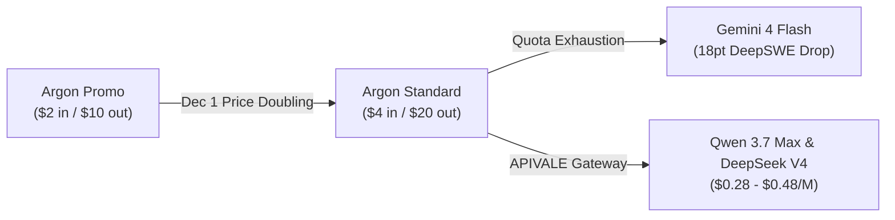

<div class="my-6 border-l-4 border-indigo-500 bg-gray-900 rounded-r-lg p-5">
  <span class="text-xs font-bold uppercase tracking-wider text-indigo-400">Definition</span>
  <div class="mt-1 text-md font-semibold text-white">Gemini 4 Argon (gemini-4-argon)</div>
  <p class="mt-2 text-sm text-gray-300">
    <strong>Gemini 4 Argon</strong> is Google's frontier reasoning model for long-horizon software engineering in Google Antigravity. While leading DeepSWE benchmarks, its aggressive token burn and scheduled price hike lead developers toward multi-model routing gateways like <a href="https://apivel.com/?redirect=/blog/gemini-4-argon-coding-test-review" class="text-indigo-400 hover:underline font-semibold">APIVALE</a>.
  </p>
</div>

The **Gemini 4 Argon coding test** benchmark results have sparked widespread debate across Reddit and GitHub. Positioned as Google’s flagship software engineering engine, Argon features a 1,048,576 token context window and frontier benchmark scores.

However, real-world development workflows highlight operational challenges. Between aggressive token consumption that exhausts rolling quotas, scheduled API price doublings, and edge-case regressions, software teams are adopting resilient two-tier architectures via [APIVALE](https://apivel.com/?redirect=/blog/gemini-4-argon-coding-test-review).

---

## 1. Gemini 4 Argon Coding Test Benchmarks: DeepSWE vs. Terminal-bench

Independent benchmarks show Gemini 4 Argon delivers strong architecture capabilities alongside clear operational bottlenecks:

<div class="my-6 border border-gray-800 bg-gray-900/60 rounded-xl p-5 shadow-lg">
  <div class="text-sm font-semibold text-gray-200 mb-3">Frontier Model Coding Benchmark Comparison (November 2026)</div>
  <div class="overflow-x-auto">
    <table class="w-full text-left text-sm text-gray-300">
      <thead class="bg-gray-800/80 text-gray-200">
        <tr>
          <th class="p-3">Model</th>
          <th class="p-3">DeepSWE v1.1</th>
          <th class="p-3">Terminal-bench 4.0</th>
          <th class="p-3">API Pricing (1M Tokens)</th>
          <th class="p-3">Optimal Use Case</th>
        </tr>
      </thead>
      <tbody class="divide-y divide-gray-800">
        <tr class="hover:bg-gray-800/40">
          <td class="p-3 font-semibold text-indigo-400">Gemini 4 Argon</td>
          <td class="p-3 font-bold text-emerald-400">77.9%</td>
          <td class="p-3 text-amber-400">57.4%</td>
          <td class="p-3">$2.00 in / $10.00 out ($4/$20 Dec 1)</td>
          <td class="p-3">Monorepo migrations & architecture design</td>
        </tr>
        <tr class="hover:bg-gray-800/40">
          <td class="p-3 font-semibold text-purple-400">Claude Opus 5.5</td>
          <td class="p-3">75.2%</td>
          <td class="p-3 font-bold text-emerald-400">66.4%</td>
          <td class="p-3">$5.00 in / $25.00 out</td>
          <td class="p-3">Nuanced debugging & CLI tool invocation</td>
        </tr>
        <tr class="hover:bg-gray-800/40">
          <td class="p-3 font-semibold text-emerald-400">Qwen 3.7 Max</td>
          <td class="p-3">73.6%</td>
          <td class="p-3">63.1%</td>
          <td class="p-3 font-bold text-emerald-400">$0.48 in / $1.44 out (APIVALE)</td>
          <td class="p-3">High-speed daily coding & automated tests</td>
        </tr>
        <tr class="hover:bg-gray-800/40">
          <td class="p-3 font-semibold text-cyan-400">DeepSeek V4</td>
          <td class="p-3">74.8%</td>
          <td class="p-3">62.8%</td>
          <td class="p-3 font-bold text-emerald-400">$0.28 in / $0.56 out (APIVALE)</td>
          <td class="p-3">High-volume code synthesis & failover loops</td>
        </tr>
      </tbody>
    </table>
  </div>
</div>

* **Strengths (77.9% DeepSWE v1.1):** Argon leads in autonomous multi-file refactoring, such as translating legacy C/X11 codebases (`xboard`) into memory-safe Rust with accurate module graphs.
* **Weaknesses (57.4% Terminal-bench 4.0):** In raw Linux bash execution, container orchestration, and runtime debugging, Argon trails Claude Opus 5.5 by 9.0 percentage points, frequently over-reasoning on routine flags.

---

## 2. Real-World Coding Test Results: GitHub Repos, Reddit & Accidents

Developers building autonomous agents in [Google Antigravity](https://apivel.com/?redirect=/blog/gemini-4-argon-coding-test-review) document key operational hurdles across r/google_antigravity:

<div class="my-6 border-l-4 border-amber-500 bg-gray-900/90 rounded-r-lg p-5 shadow-md">
  <div class="flex items-center justify-between text-xs font-semibold text-amber-400 uppercase tracking-wider mb-2">
    <span>Verified Community Voice &bull; Reddit r/google_antigravity</span>
    <a href="https://www.reddit.com/r/google_antigravity/comments/1xj84e4/massive_usage_improvements_on_antigravity_for/" target="_blank" rel="noopener noreferrer" class="hover:underline text-gray-400">View Discussion &rarr;</a>
  </div>
  <blockquote class="text-sm italic text-gray-200 border-l-2 border-gray-700 pl-3 my-2">
    "Complex workflows, tool-calling loops, or using 'High' thinking mode burn through quota in a handful of prompts. Argon drains 60–70% of a quota bundle much quicker than expected. I reserve Argon strictly as a top-level orchestrator and delegate boilerplate generation to lighter models."
  </blockquote>
  <div class="text-xs text-gray-400 mt-2 font-mono">&mdash; Far_Management_7991 (Antigravity Pro Developer)</div>
</div>

Three primary "program accidents" emerge during complex agent sessions:

1. **Reasoning Context Drain:** Internal tree-search traces share the 1M token budget, causing unexpected early chat compaction.
2. **Rule Over-Compliance:** Argon often fixates on deprecated library comments, second-guessing correct code changes.
3. **5-Hour Quota Freezes:** Billed as full output tokens, reasoning steps exhaust subscription tiers in 3–5 multi-file cycles.

---

## 3. Gemini 4 Argon Price Shock: $20/M Token Burn & Flash Tradeoffs

Running autonomous agents with Gemini 4 Argon faces immediate budget constraints:



* **December 1 Price Doubling:** Promotional rates of **$2.00 input / $10.00 output per 1M tokens** end November 30, doubling to **$4.00 / $20.00** on December 1, 2026. A 10-turn debugging task ingesting 150K repository tokens can exceed $1.20 per pass.
* **Why Gemini 4 Flash Fails:** Downgrading to Flash creates an 18-point drop on DeepSWE, triggering TypeScript syntax hallucinations and broken imports.

---

## 4. Two-Tier Coding Strategy: Gemini 4 Argon vs. Frontier Open LLMs

High-volume engineering squads solve this through a **Two-Tier Agentic Routing Strategy**:

* **Tier 1 (High-Level Planning):** Route repository scans and architectural schema planning to Gemini 4 Argon or Claude Opus 5.5.
* **Tier 2 (Bulk Execution):** Offload 80% of operational tasks—scaffolding, unit tests, docstrings, and diffs—to **Qwen 3.7 Max** (`infer/qwen3.7-max`) or **DeepSeek V4** (`infer/deepseek-v4`).

Through [APIVALE](https://apivel.com/?redirect=/blog/gemini-4-argon-coding-test-review), developers access these models via OpenAI and Anthropic compatible endpoints with instant PayPal checkout and zero KYC.

<div class="my-6 border border-indigo-500/30 bg-gradient-to-r from-gray-900 via-indigo-950/20 to-gray-900 rounded-xl p-6 shadow-xl">
  <div class="flex items-center justify-between flex-wrap gap-2 mb-3">
    <span class="text-xs font-bold uppercase tracking-wider text-indigo-400 bg-indigo-950/60 border border-indigo-800/50 px-3 py-1 rounded-full">⚡ Interactive Coding Cost Calculator</span>
    <span class="text-xs text-emerald-400 bg-emerald-950/60 border border-emerald-800/50 px-3 py-1 rounded-full">Instant Estimate</span>
  </div>
  <p class="text-sm text-gray-300 mb-4">Calculate savings comparing pure Gemini 4 Argon against the APIVALE Two-Tier Gateway:</p>
  <div class="grid grid-cols-1 md:grid-cols-2 gap-4 mb-4">
    <div>
      <label for="monthly-tokens" class="block text-xs font-medium text-gray-400 mb-1">Monthly Agent Volume (M Tokens)</label>
      <input type="number" id="monthly-tokens" value="12" min="1" max="500" class="w-full bg-gray-800 border border-gray-700 rounded-lg px-3 py-2 text-sm text-white focus:outline-none focus:border-indigo-500" oninput="calculateSavings()" />
    </div>
    <div>
      <label for="tier-select" class="block text-xs font-medium text-gray-400 mb-1">Workhorse Engine</label>
      <select id="tier-select" class="w-full bg-gray-800 border border-gray-700 rounded-lg px-3 py-2 text-sm text-white focus:outline-none focus:border-indigo-500" onchange="calculateSavings()">
        <option value="qwen37">Qwen 3.7 Max ($0.48/M - APIVALE)</option>
        <option value="deepseek4">DeepSeek V4 ($0.28/M - APIVALE)</option>
      </select>
    </div>
  </div>
  <div class="p-4 bg-gray-950/70 rounded-lg border border-gray-800">
    <div class="flex justify-between items-center flex-wrap gap-2">
      <div>
        <span class="text-xs text-gray-400">Pure Argon (Dec 1):</span>
        <div id="argon-cost" class="text-base font-bold text-red-400">$80.00 / mo</div>
      </div>
      <div>
        <span class="text-xs text-gray-400">Two-Tier (APIVALE):</span>
        <div id="apivale-cost" class="text-base font-bold text-emerald-400">$11.84 / mo</div>
      </div>
      <div>
        <span class="text-xs text-gray-400">Net Squad Savings:</span>
        <div id="savings-percent" class="text-base font-bold text-cyan-400">85.2% SAVED</div>
      </div>
    </div>
  </div>
</div>

<script>
function calculateSavings() {
  const volInput = document.getElementById('monthly-tokens');
  const tierSelect = document.getElementById('tier-select');
  const argonCostEl = document.getElementById('argon-cost');
  const apivaleCostEl = document.getElementById('apivale-cost');
  const savingsEl = document.getElementById('savings-percent');
  if (!volInput || !tierSelect || !argonCostEl || !apivaleCostEl || !savingsEl) return;

  const totalM = parseFloat(volInput.value) || 12;
  const inputM = totalM * 0.8;
  const outputM = totalM * 0.2;
  const argonCost = (inputM * 4.00) + (outputM * 20.00);
  const argonShare = argonCost * 0.2;

  let execRateIn = tierSelect.value === 'deepseek4' ? 0.28 : 0.48;
  let execRateOut = tierSelect.value === 'deepseek4' ? 0.56 : 1.44;
  const execCost = (inputM * 0.8 * execRateIn) + (outputM * 0.8 * execRateOut);
  const totalGatewayCost = argonShare + execCost;
  const savings = Math.max(0, ((argonCost - totalGatewayCost) / argonCost) * 100);

  argonCostEl.textContent = '$' + argonCost.toFixed(2) + ' / mo';
  apivaleCostEl.textContent = '$' + totalGatewayCost.toFixed(2) + ' / mo';
  savingsEl.textContent = savings.toFixed(1) + '% SAVED';
}
</script>

---

## 5. Production Setup: Connecting Qwen & DeepSeek Endpoints to Cursor

Configure production agent pipelines with zero friction using standard terminal environment variables:

### Claude Code CLI Setup
```bash
# 1. Export APIVALE Anthropic-compatible protocol base URL
export ANTHROPIC_BASE_URL="https://apivel.com/anthropic"
export ANTHROPIC_API_KEY="sk-apivale-prod-live-checkout-key"

# 2. Route coding tasks to Qwen 3.7 Max workhorse engine
claude --model "infer/qwen3.7-max" "Refactor auth middleware and generate unit tests"
```

### Cursor IDE Configuration (`settings.json`)
```json
{
  "cursor.openaiBaseUrl": "https://apivel.com/v1",
  "cursor.openaiApiKey": "sk-apivale-prod-live-checkout-key",
  "cursor.models": [
    { "id": "infer/qwen3.7-max", "name": "Qwen 3.7 Max (APIVALE)" },
    { "id": "infer/deepseek-v4", "name": "DeepSeek V4 (APIVALE)" }
  ],
  "cursor.defaultModel": "infer/qwen3.7-max"
}
```

```python
# Production Multi-Model Fallback Client
import os
from openai import OpenAI

client = OpenAI(base_url="https://apivel.com/v1", api_key=os.environ.get("APIVALE_API_KEY", "sk-apivale-key"))

def run_coding_task(prompt: str) -> str:
    """Execute code task with automatic Qwen to DeepSeek failover."""
    for model in ["infer/qwen3.7-max", "infer/deepseek-v4"]:
        try:
            res = client.chat.completions.create(
                model=model,
                messages=[{"role": "user", "content": prompt}],
                temperature=0.2
            )
            return res.choices[0].message.content
        except Exception:
            continue
    raise RuntimeError("All models failed.")
```

---

## 6. Frequently Asked Questions (FAQ)

<div class="space-y-4 my-6">
  <div class="border border-gray-800 bg-gray-900/60 rounded-xl p-5">
    <div class="font-semibold text-white text-base">Why does Gemini 4 Argon exhaust quotas so rapidly in coding tests?</div>
    <div class="mt-2 text-sm text-gray-300 leading-relaxed">
      Gemini 4 Argon utilizes internal tree-search reasoning. Google bills thinking tokens as full output tokens and deducts them from rolling limits, causing 3 to 5 multi-file refactoring passes to deplete tier quotas.
    </div>
  </div>
  <div class="border border-gray-800 bg-gray-900/60 rounded-xl p-5">
    <div class="font-semibold text-white text-base">What is the official API pricing for Gemini 4 Argon after December 2026?</div>
    <div class="mt-2 text-sm text-gray-300 leading-relaxed">
      Introductory pricing ($2.00/1M input and $10.00/1M output) ends November 30, 2026. On December 1, 2026, standard rates double to $4.00/1M input and $20.00/1M output across Google Cloud Vertex AI and AI Studio.
    </div>
  </div>
  <div class="border border-gray-800 bg-gray-900/60 rounded-xl p-5">
    <div class="font-semibold text-white text-base">What is the best cost-effective alternative to Gemini 4 Argon for coding?</div>
    <div class="mt-2 text-sm text-gray-300 leading-relaxed">
      A Two-Tier Routing Strategy delivers optimal balance: keep Argon for root architecture while offloading 80% of routine coding to Qwen 3.7 Max ($0.48/M) and DeepSeek V4 ($0.28/M) via <a href="https://apivel.com/?redirect=/blog/gemini-4-argon-coding-test-review" class="text-indigo-400 hover:underline">APIVALE</a>, saving up to 85% with zero KYC.
    </div>
  </div>
</div>

<script type="application/ld+json">
{
  "@context": "https://schema.org",
  "@type": "FAQPage",
  "mainEntity": [
    {
      "@type": "Question",
      "name": "Why does Gemini 4 Argon exhaust quotas so rapidly in coding tests?",
      "acceptedAnswer": {
        "@type": "Answer",
        "text": "Gemini 4 Argon internal tree-search reasoning traces are billed as full output tokens, exhausting rolling quotas within 3 to 5 multi-file refactoring runs."
      }
    },
    {
      "@type": "Question",
      "name": "What is the official API pricing for Gemini 4 Argon after December 2026?",
      "acceptedAnswer": {
        "@type": "Answer",
        "text": "Introductory pricing ($2/$10) ends Nov 30, 2026, doubling to $4.00 input and $20.00 output on Dec 1, 2026."
      }
    },
    {
      "@type": "Question",
      "name": "What is the best cost-effective alternative to Gemini 4 Argon for coding?",
      "acceptedAnswer": {
        "@type": "Answer",
        "text": "A Two-Tier Routing Strategy pairing Argon planning with Qwen 3.7 Max ($0.48/M) and DeepSeek V4 ($0.28/M) via APIVALE saves over 80% in token spend."
      }
    }
  ]
}
</script>

---

<div class="cta-card my-8 border border-indigo-500/40 bg-gradient-to-br from-gray-900 via-indigo-950/30 to-purple-950/20 rounded-2xl p-6 shadow-2xl text-center">
  <div class="inline-flex items-center text-xs font-bold uppercase tracking-wider text-emerald-400 bg-emerald-950/60 border border-emerald-800/50 px-3 py-1 rounded-full mb-3">
    🚀 Instant Setup &bull; Global Zero-KYC Billing
  </div>
  <div class="text-xl md:text-2xl font-bold text-white mb-2">Build Better Code Without Rate-Limit Anxiety</div>
  <p class="text-sm text-gray-300 max-w-2xl mx-auto mb-6 leading-relaxed">
    Scale autonomous development with <strong>APIVALE's high-speed API gateway</strong>. Access Qwen 3.7 Max, DeepSeek V4, and top-tier frontier models with native OpenAI/Anthropic protocol compatibility, zero KYC, and instant PayPal checkout.
  </p>
  <div class="grid grid-cols-1 sm:grid-cols-3 gap-3 max-w-xl mx-auto mb-6 text-left text-xs text-gray-300">
    <div class="bg-gray-800/70 border border-gray-700/60 rounded-lg p-3 text-center">
      <div class="text-emerald-400 font-bold text-sm">+50% Deposit Bonus</div>
      <div class="text-gray-400 mt-0.5">$5 &rarr; $7.50 | $29 &rarr; $43.50</div>
    </div>
    <div class="bg-gray-800/70 border border-gray-700/60 rounded-lg p-3 text-center">
      <div class="text-indigo-400 font-bold text-sm">$29 Developer Pack</div>
      <div class="text-gray-400 mt-0.5">56% OFF &bull; 40M Tokens &bull; Never Expires</div>
    </div>
    <div class="bg-gray-800/70 border border-gray-700/60 rounded-lg p-3 text-center">
      <div class="text-cyan-400 font-bold text-sm">$0.20 Free Trial</div>
      <div class="text-gray-400 mt-0.5">No Credit Card Required</div>
    </div>
  </div>
  <div class="flex items-center justify-center gap-4 flex-wrap">
    <a href="https://apivel.com/sign-up?redirect=/blog/gemini-4-argon-coding-test-review" class="bg-indigo-600 hover:bg-indigo-500 text-white font-semibold text-sm px-6 py-3 rounded-xl shadow-lg transition-all">Claim $0.20 Free Starter Credit &rarr;</a>
    <a href="https://apivel.com/pricing?redirect=/blog/gemini-4-argon-coding-test-review" class="bg-gray-800 hover:bg-gray-700 text-gray-200 border border-gray-700 font-semibold text-sm px-6 py-3 rounded-xl transition-all">Explore Transparent Pricing</a>
  </div>
</div>
