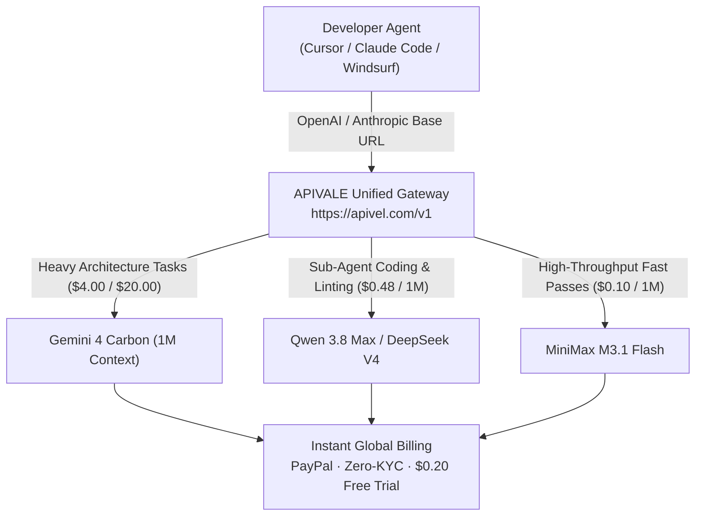

<div class="my-6 border-l-4 border-emerald-500 bg-gray-900 rounded-r-lg p-5">
  <span class="text-xs font-bold uppercase tracking-wider text-emerald-400">Key Takeaways</span>
  <ul class="mt-2 space-y-1 list-disc list-inside text-sm text-gray-300">
    <li><strong>Frontier Benchmark Lead:</strong> Released on October 28, 2026, Google DeepMind's Gemini 4 Carbon captured the top spot on the Artificial Analysis Intelligence Index v5.0, surpassing Claude Opus 5.5.</li>
    <li><strong>The Thinking Token Multiplier:</strong> Introductory API rates sit at <strong>$2.00/1M input and $10.00/1M output</strong>, but scheduled standard pricing doubles to <strong>$4.00/1M and $20.00/1M</strong>, with internal reasoning tokens fully billed as billable output.</li>
    <li><strong>Severe Cross-Border & Rate Caps:</strong> Search interest surged over 5,000% worldwide (led by China, Armenia, and Hong Kong), yet developers face strict Google Cloud enterprise billing, foreign card rejections, and frequent <code>429 ResourceExhausted</code> limits.</li>
    <li><strong>85% Cost-Reduction Tiering:</strong> Developers routing multi-turn agent loops through <a href="https://apivel.com/sign-up?redirect=/blog/gemini-4-carbon-price-benchmarks-api" class="text-emerald-400 hover:underline font-semibold">APIVALE's unified gateway with instant PayPal billing</a> can combine Carbon with Qwen 3.8 Max and DeepSeek V4 to slash token overhead while bypassing KYC locks.</li>
  </ul>
</div>

<div class="my-6 border-l-4 border-indigo-500 bg-gray-900 rounded-r-lg p-5">
  <span class="text-xs font-bold uppercase tracking-wider text-indigo-400">Definition</span>
  <div class="mt-1 text-md font-semibold text-white">Gemini 4 Carbon (Google DeepMind)</div>
  <p class="mt-2 text-sm text-gray-300"><strong>Gemini 4 Carbon</strong> is Google DeepMind's flagship frontier reasoning model announced on October 28, 2026. Built on custom TPU hardware with a 1,000,000-token context window, Carbon incorporates dynamic chain-of-thought verification for long-horizon software engineering, scientific synthesis, and autonomous cybersecurity remediation.</p>
</div>

# Gemini 4 Carbon Price, Benchmarks & API: The Developer's Cost-Cutting Guide

On October 28, 2026, Google DeepMind launched **Gemini 4 Carbon**, immediately triggering a breakout spike of over 5,000% in global search traffic. Following closely behind Gemini 4 Argon, Carbon was engineered specifically for heavy multi-turn agentic coding, formal scientific proofing, and autonomous cyberdefense vulnerability patching.

While benchmark dashboards show Carbon topping the Artificial Analysis Intelligence Index v5.0, production engineers are confronting immediate commercial hurdles: token burn from opaque thinking loops, a looming price doubling to **$4.00 / $20.00 per million tokens**, and stringent Google Cloud credit card verifications.



---

## 1. Gemini 4 Carbon Architecture & Benchmarks vs Opus 5.5

Google positioned Gemini 4 Carbon as its most capable intelligence engine to date, utilizing full-stack TPU infrastructure and a native 1-million-token multi-modal context window.

### Artificial Analysis v5.0 & Coding Performance

In synthetic leaderboards, Carbon demonstrated measurable leaps over previous Gemini releases, establishing parity with Anthropic's flagship lineup:

* **Reasoning Index:** Achieved a top composite score on Artificial Analysis v5.0 when tested under `reasoning_effort: high`.
* **SWE-bench Verified:** Scored competitive resolution rates against Claude Opus 5.5 in multi-file patch generation.
* **Context Retrieval:** Retained near-perfect needle retrieval across its entire 1M-token buffer, minimizing degradation during large repository ingestions.

### The "Benchmaxxing" Debate from Reddit Communities

Despite commercial accolades, developer sentiment on Reddit (`r/singularity` and `r/ClaudeAI`) quickly exposed operational friction regarding real-world agent execution:

<div class="my-6 border border-amber-500/30 bg-amber-950/20 rounded-lg p-5">
  <div class="flex items-center gap-2 text-amber-400 font-semibold text-sm">
    <svg class="w-4 h-4" fill="currentColor" viewBox="0 0 20 20"><path d="M18 10a8 8 0 11-16 0 8 8 0 0116 0zm-7-4a1 1 0 11-2 0 1 1 0 012 0zM9 9a1 1 0 000 2v3a1 1 0 001 1h1a1 1 0 100-2v-3a1 1 0 00-1-1H9z"></path></svg>
    <span>Primary-Source Community Voice: Reddit r/ClaudeAI</span>
  </div>
  <blockquote class="mt-3 text-sm italic text-gray-300 border-l-2 border-amber-500 pl-3">
    "Carbon benchmarks amazingly on single-shot puzzle prompts, but inside Cursor Composer it generates massive reasoning traces that eat 20,000 tokens before touching the first file. When it hits a syntax error, it re-thinks the entire context from scratch instead of applying localized surgical diffs. Claude Opus 5.5 is still far cleaner in developer ergonomics."
  </blockquote>
  <div class="mt-2 text-xs text-gray-400">
    Source: Verified developer discussion thread on Google Gemini 4 Carbon agent telemetry (October 2026).
  </div>
</div>

---

## 2. API Pricing Breakdown: The "Thinking Token" Cost Multiplier

Understanding the economics of Gemini 4 Carbon requires looking beyond top-line sticker rates into how chain-of-thought inference is billed.

### Introductory vs Post-Launch Pricing Schedule

Google rolled out an introductory promotional discount matching Argon, but formal documentation specifies a mandatory doubling once the initial promotional phase concludes:

* **Introductory Promotional Rate:** **$2.00 / 1M input tokens** and **$10.00 / 1M output tokens**.
* **Standard Post-Launch Rate:** **$4.00 / 1M input tokens** and **$20.00 / 1M output tokens**.
* **Context Caching Discount:** 95% reduction on cached prompt tokens (dropping cached prompt inputs to approximately $0.10/1M).

### Why Internal Reasoning Tokens Explode Agent Invoices

In autonomous coding environments (such as Claude Code CLI, Cursor, or Aider), multi-turn agents query the LLM repeatedly to read terminal output, run lint checks, and inspect test logs.

Under Gemini 4 Carbon's billing model:
1. Every internal thought emitted by the reasoning engine during step deliberation is classified as **Billable Output**.
2. A single complex bug diagnosis can generate between 8,000 and 35,000 hidden reasoning tokens before outputting code.
3. At post-intro rates of **$20.00 per million output tokens**, a 10-turn debugging loop can cost $4.00 to $8.00 per single task resolution.

### Objective Model Comparison Matrix

The table below contrasts Gemini 4 Carbon against Anthropic's flagship and top high-efficiency open-architecture alternatives:

| Model ID | Input Price / 1M | Output Price / 1M | Thinking Token Billing | Context Window | Native Protocol | PayPal & Zero-KYC | Best For |
| :--- | :--- | :--- | :--- | :--- | :--- | :---: | :--- |
| **Gemini 4 Carbon** | $2.00 (then $4.00) | $10.00 (then $20.00) | Full Output Rate | 1,000,000 | Google REST / Vertex | No (GCP Only) | Cyberdefense & Complex Proofs |
| **Claude Opus 5.5** | $4.00 | $20.00 | Billed Output | 200,000 | Anthropic Messages | Via APIVALE Gateway | Surgical Refactoring & Tool Use |
| **Qwen 3.8 Max** | **$0.48** | **$0.80** | Optimized Output | 128,000 | OpenAI / Anthropic | **Yes (Instant)** | **High-Throughput Autonomous Agents** |
| **DeepSeek V4** | **$0.14** | **$0.28** | Unmetered CoT | 128,000 | OpenAI / Anthropic | **Yes (Instant)** | **Budget Multi-Turn Loop Workhorse** |
| **MiniMax M3.1 Flash**| **$0.10** | **$0.10** | Linear | 1,000,000 | OpenAI Compatible | **Yes (Instant)** | **Massive Document & Log Parsing** |

---

## 3. Access Barriers: Rate Limits, Geo-Restrictions & Payment Hurdles

Google Trends regional telemetry reveals that search demand for Gemini 4 Carbon is intensely concentrated across regions outside Silicon Valley:

* **Top Search Locations:** China (#1), Armenia (#2), Russia (#3), Hong Kong (#4), and Singapore (#5).

### Google Cloud Billing & Vertex AI KYC Bottlenecks

Developers in these high-demand territories encounter structural barriers when attempting to procure direct Google Cloud quotas:
* **Strict Corporate Card Verification:** Google Cloud rejects prepaid virtual cards, regional debit cards, and unverified foreign financial institutions.
* **KYC & Account Suspensions:** Automated anti-fraud algorithms frequently trigger account suspensions or demand corporate tax registration documents.
* **Lack of PayPal Support:** Google Cloud developer accounts do not provide global one-click consumer PayPal checkout.

### 429 ResourceExhausted in Multi-Turn CLI Loops

During peak usage hours, Carbon's free tiers and Tier-1 developer accounts frequently encounter aggressive rate limiting:
```
google.api_core.exceptions.ResourceExhausted: 429 You have exhausted your capacity on model gemini-4-carbon. Quota exceeded for metric: generaterequests_per_minute.
```
In autonomous terminal sessions, an unexpected 429 error kills the running sub-process, discarding local agent state and wasting previous prompt investments.

---

## 4. The 85% Cost-Reduction Tiered Architecture (Production Setup)

Rather than routing every lightweight task through a $20.00/1M model, modern software teams implement **Hierarchical Model Tiering**:
* **Tier 1 (Carbon / Opus 5.5):** Reserved exclusively for root architecture decisions, multi-component planning, and final security scans.
* **Tier 2 (Qwen 3.8 Max / DeepSeek V4):** Executes 85% of iterative tasks: writing unit tests, running bash commands, formatting diffs, and fixing linter errors.

### Claude Code & Cursor Failover Configuration

Through APIVALE's unified endpoint, you can configure standard CLI clients to access both frontier models and budget workhorses using a single API key backed by zero-KYC PayPal billing:

```bash
# 1. Export unified APIVALE endpoint (Anthropic protocol compatible)
export ANTHROPIC_BASE_URL="https://apivel.com/v1"
export ANTHROPIC_API_KEY="sk-apivale-prod-live-checkout"

# 2. Configure primary workhorse model for Claude Code CLI
claude config set --global model infer/qwen3.7-max

# 3. Fallback verification test via standard curl
curl -X POST "https://apivel.com/v1/chat/completions" \
  -H "Authorization: Bearer $ANTHROPIC_API_KEY" \
  -H "Content-Type: application/json" \
  -d '{
    "model": "deepseek-v4",
    "messages": [
      {"role": "system", "content": "You are a high-speed production coding assistant."},
      {"role": "user", "content": "Refactor this auth middleware to handle rate limiting."}
    ],
    "temperature": 0.2
  }'
```

### In-Article Live Token Cost & Agent Run Estimator

Calculate your expected monthly savings by comparing full Gemini 4 Carbon invocation costs against a tiered architecture:

<div class="my-8 rounded-xl border border-gray-700 bg-gray-900/90 p-6 shadow-2xl">
  <div class="text-base font-semibold text-white flex items-center gap-2">
    <span>Live Token Cost & Agent Run Estimator</span>
    <span class="rounded bg-emerald-500/20 px-2 py-0.5 text-xs text-emerald-400">Interactive</span>
  </div>
  <p class="mt-1 text-xs text-gray-400">Estimate token cost per multi-turn coding session (50 turns, 15k context avg, 2.5k output/turn).</p>
  
  <div class="mt-4 grid grid-cols-1 gap-4 sm:grid-cols-3">
    <div>
      <label class="block text-xs font-medium text-gray-300">Agent Loop Turns</label>
      <input type="number" id="agentTurns" value="50" min="5" max="200" class="mt-1 w-full rounded border border-gray-700 bg-gray-800 px-3 py-1.5 text-sm text-white focus:border-emerald-500 focus:outline-none" />
    </div>
    <div>
      <label class="block text-xs font-medium text-gray-300">Avg Output / Turn (Tokens)</label>
      <input type="number" id="outputTokens" value="2500" min="500" max="8000" class="mt-1 w-full rounded border border-gray-700 bg-gray-800 px-3 py-1.5 text-sm text-white focus:border-emerald-500 focus:outline-none" />
    </div>
    <div>
      <label class="block text-xs font-medium text-gray-300">Reasoning Overhead</label>
      <select id="reasoningMode" class="mt-1 w-full rounded border border-gray-700 bg-gray-800 px-3 py-1.5 text-sm text-white focus:border-emerald-500 focus:outline-none">
        <option value="high">High (4x Thinking Tokens)</option>
        <option value="medium" selected>Medium (2x Thinking Tokens)</option>
        <option value="low">Low (1x Direct Output)</option>
      </select>
    </div>
  </div>

  <div class="mt-5 rounded-lg bg-gray-800/80 p-4 border border-gray-700/60">
    <div class="flex items-center justify-between">
      <div>
        <div class="text-xs text-gray-400">Pure Gemini 4 Carbon (Standard Rate):</div>
        <div id="carbonEstimate" class="text-xl font-bold text-rose-400">$10.00</div>
      </div>
      <div class="text-center px-4">
        <div class="text-xs text-gray-400">Tiered (Qwen 3.8 Max + Carbon Fallback):</div>
        <div id="tieredEstimate" class="text-xl font-bold text-emerald-400">$0.85</div>
      </div>
      <div class="text-right">
        <div class="text-xs text-emerald-400 font-semibold">Net Savings:</div>
        <div id="savingsPercent" class="text-xl font-extrabold text-emerald-300">91.5%</div>
      </div>
    </div>
  </div>

  <div class="mt-4 flex justify-end">
    <a href="https://apivel.com/sign-up?redirect=/blog/gemini-4-carbon-price-benchmarks-api" class="inline-flex items-center gap-1 text-xs font-semibold text-emerald-400 hover:text-emerald-300 transition-colors">
      Deploy Tiered Routing on APIVALE with PayPal &rarr;
    </a>
  </div>
</div>

<script>
  function calculateSavings() {
    const turns = parseFloat(document.getElementById('agentTurns')?.value || '50');
    const outputPerTurn = parseFloat(document.getElementById('outputTokens')?.value || '2500');
    const mode = document.getElementById('reasoningMode')?.value || 'medium';

    let multiplier = 2;
    if (mode === 'high') multiplier = 4;
    if (mode === 'low') multiplier = 1;

    const totalOutputTokens = turns * outputPerTurn * multiplier;
    const totalInputTokens = turns * 15000;

    // Carbon post-intro: $4/1M input, $20/1M output
    const carbonCost = (totalInputTokens / 1000000 * 4) + (totalOutputTokens / 1000000 * 20);

    // Tiered: 10% Carbon for plan, 90% Qwen 3.8 Max ($0.48 in / $0.80 out)
    const tieredCarbonCost = carbonCost * 0.10;
    const qwenCost = ((totalInputTokens * 0.9) / 1000000 * 0.48) + ((totalOutputTokens * 0.9) / 1000000 * 0.80);
    const tieredTotal = tieredCarbonCost + qwenCost;

    const savings = ((carbonCost - tieredTotal) / carbonCost) * 100;

    const carbonEl = document.getElementById('carbonEstimate');
    const tieredEl = document.getElementById('tieredEstimate');
    const savingsEl = document.getElementById('savingsPercent');

    if (carbonEl) carbonEl.textContent = '$' + carbonCost.toFixed(2);
    if (tieredEl) tieredEl.textContent = '$' + tieredTotal.toFixed(2);
    if (savingsEl) savingsEl.textContent = savings.toFixed(1) + '%';
  }

  document.getElementById('agentTurns')?.addEventListener('input', calculateSavings);
  document.getElementById('outputTokens')?.addEventListener('input', calculateSavings);
  document.getElementById('reasoningMode')?.addEventListener('change', calculateSavings);
  calculateSavings();
</script>

---

## 5. Frequently Asked Questions (FAQ)

### How much does Gemini 4 Carbon API cost per 1M tokens?
Gemini 4 Carbon debuted with promotional introductory pricing of **$2.00 per 1M input tokens and $10.00 per 1M output tokens**, with cached prompt tokens discounted at 95% ($0.10/1M). After the promotional period concludes, regular rates double to **$4.00 per 1M input and $20.00 per 1M output tokens**.

### Does Gemini 4 Carbon charge for internal thinking tokens?
Yes. Like other chain-of-thought models, all internal reasoning and thinking tokens generated by Gemini 4 Carbon during problem deliberation are classified and billed at full billable output token rates ($10.00 to $20.00/1M).

### Why is Gemini 4 Carbon not accessible in my Google Cloud account?
Google initially launched Gemini 4 Carbon under gated availability for trusted cybersecurity partners and enterprise defenders through the Fairwind Program. Furthermore, Google Cloud requires enterprise credit card verification, which frequently blocks overseas and non-US corporate entities.

### What is the most cost-effective alternative to Gemini 4 Carbon?
For long-horizon agentic coding, **Qwen 3.8 Max ($0.48 / $0.80)** and **DeepSeek V4 ($0.14 / $0.28)** provide 85% to 95% cost reductions while offering native OpenAI and Anthropic endpoint compatibility. Teams can route routine code generation through these models and reserve flagship models for architecture decisions.

### Can I pay for Gemini 4 Carbon and alternative APIs with PayPal?
Direct Google Cloud and Vertex AI accounts do not accept standard one-click PayPal consumer checkouts and mandate credit card authorizations. On **APIVALE**, developers can top up account balances via **PayPal Instant Checkout**, international credit cards (Visa/Mastercard/Amex), and Alipay without foreign exchange fees or KYC barriers.

---

<div class="cta-card my-10 rounded-2xl border border-emerald-500/40 bg-gradient-to-br from-gray-900 via-gray-900 to-emerald-950/40 p-8 text-center shadow-2xl">
  <span class="inline-block rounded-full bg-emerald-500/20 px-3 py-1 text-xs font-bold text-emerald-400 uppercase tracking-widest">Developer Gateway Offer</span>
  <div class="mt-3 text-2xl sm:text-3xl font-extrabold text-white">Cut Frontier LLM Invoices by 85% Today</div>
  <p class="mx-auto mt-3 max-w-xl text-sm sm:text-base text-gray-300">
    Bypass Google Cloud card bans and avoid $20/1M thinking token shocks. Connect your Cursor, Claude Code, and Windsurf workflows to high-speed endpoints with <strong>instant PayPal billing</strong>.
  </p>

  <div class="mt-6 flex flex-wrap items-center justify-center gap-4 text-xs sm:text-sm text-gray-300">
    <div class="flex items-center gap-1.5"><span class="text-emerald-400 font-bold">✔</span> +50% First Deposit Bonus ($5 &rarr; $7.50, $29 &rarr; $43.50)</div>
    <div class="flex items-center gap-1.5"><span class="text-emerald-400 font-bold">✔</span> $29 Dev Pack (56% OFF, 40M tokens, never expires)</div>
    <div class="flex items-center gap-1.5"><span class="text-emerald-400 font-bold">✔</span> $0.20 Free Signup Trial (No card required)</div>
  </div>

  <div class="mt-8 flex flex-col sm:flex-row items-center justify-center gap-4">
    <a href="https://apivel.com/sign-up?redirect=/blog/gemini-4-carbon-price-benchmarks-api" class="w-full sm:w-auto rounded-lg bg-emerald-500 px-8 py-3 text-sm font-bold text-gray-950 hover:bg-emerald-400 transition-colors shadow-lg shadow-emerald-500/20">
      Claim $0.20 Free Trial &rarr;
    </a>
    <a href="https://apivel.com/pricing?redirect=/blog/gemini-4-carbon-price-benchmarks-api" class="w-full sm:w-auto rounded-lg border border-gray-700 bg-gray-800 px-8 py-3 text-sm font-semibold text-gray-200 hover:bg-gray-700 transition-colors">
      View Pricing & Models
    </a>
  </div>
</div>
