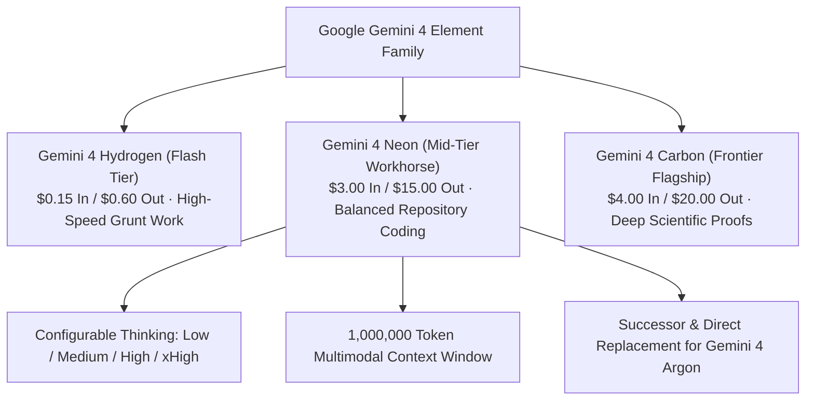
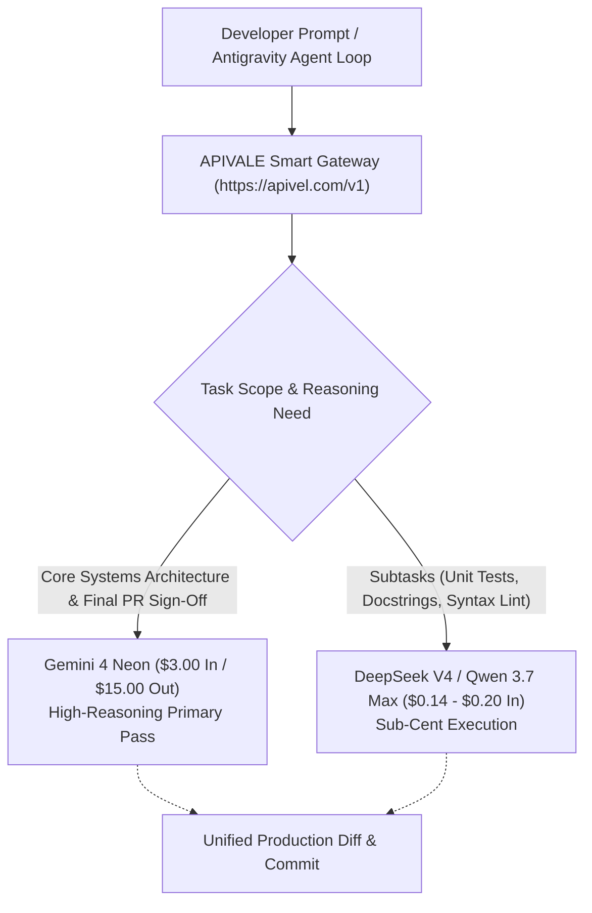

<div class="definition-box my-6 p-5 rounded-xl border border-cyan-500/20 bg-cyan-950/20">
  <div class="text-xs font-mono uppercase tracking-wider text-cyan-400 mb-1">Entity Definition & Generational Overview</div>
  <div class="text-sm text-slate-300 leading-relaxed">
    <strong>Google Gemini 4 Neon (<code>gemini-4-neon</code>)</strong> is Google DeepMind's mid-tier reasoning model in the Gemini 4 element architecture. Engineered to sit between the ultra-fast <strong>Gemini 4 Hydrogen</strong> ($0.15/$0.60) and the frontier <strong>Gemini 4 Carbon</strong> ($4.00/$20.00), Neon delivers near-Carbon reasoning quality at <strong>$3.00 input and $15.00 output per 1M tokens</strong> with a 1,000,000 token multimodal context window, superseding the earlier Canary-stage Argon tier.
  </div>
</div>

Following the phased rollout of the Gemini 4 family across Google AI Studio, Vertex AI, GitHub Copilot, and Google Antigravity, software developers face an immediate evaluation dilemma: **Does Gemini 4 Neon deliver on Google's promise of "Carbon-level intelligence at Flash-tier speed", or does its default reasoning budget create unsustainable token burn and 5-hour quota lockouts?**

For engineering teams running autonomous coding agents and repository-level refactoring loops, understanding Neon's thinking tiers, billing metrics, and failover behavior is critical to maintaining operational uptime.

---

## What is Google Gemini 4 Neon? The Element Architecture Explained

Google Gemini 4 Neon serves as Google's balanced workhorse engine, designed specifically to eliminate the trade-off between the shallow reasoning of lightweight models and the extreme latency of heavy frontier solvers.



### The Four Configurable Thinking Levels
Unlike previous generations that used static inference configurations, Gemini 4 Neon introduces four distinct reasoning depth settings:
1. **Low Thinking**: Skips extended scratchpad tokens; optimal for fast API lookups, document translation, and unit test boilerplate.
2. **Medium Thinking**: Allocates 500–1,500 internal reasoning tokens; balanced for standard function refactoring and multi-file code review.
3. **High Thinking (Default)**: Generates 2,000–5,000 hidden reasoning tokens before outputting code; engineered for complex cross-module dependencies and mathematical logic.
4. **Extra High (xHigh)**: Maximum reasoning budget; tackles deep algorithmic proofs and competitive programming challenges, but aggressively exhausts subscription quotas.

---

## Gemini 4 Element Matrix: Hydrogen vs Neon vs Argon vs Carbon

To understand where Gemini 4 Neon fits within Google's rapidly shifting product roster, consider how it compares against sibling models and leading open-weight engines:

| Model Identifier | Architectural Tier | Input / 1M | Output / 1M | Context Window | Primary Engineering Use Case | Limitations & Trade-Offs (Honesty Column) |
| :--- | :--- | :--- | :--- | :--- | :--- | :--- |
| **Gemini 4 Hydrogen** | High-Speed (Flash) | **$0.15** | **$0.60** | 1,000,000 | Triage, syntax linting, bulk parsing, quick Q&A | Struggles with deep architectural invariants; high hallucination on complex algorithms |
| **Gemini 4 Neon** | Balanced Workhorse | **$3.00** | **$15.00** | 1,000,000 | Full-repo refactoring, agent tool-use, STEM proofs | High thinking defaults rapidly exhaust 5-hour rolling limits; end-of-turn token edge cases |
| **Gemini 4 Argon** | Preview (Deprecated) | $4.00 | $20.00 | 1,000,000 | Canary release evaluation | Phased out of Google AI Studio and superseded by Neon |
| **Gemini 4 Carbon** | Frontier Flagship | $4.00 | $20.00 | 1,000,000 | Greenfield architecture, deep novel proofs | High latency; prohibitive operational costs for continuous daily sub-agent loops |
| **DeepSeek V4** | Open-Weight Standard | **$0.14** | **$0.28** | 128,000 | High-frequency agent execution, test generation | Shorter native context; best deployed as a secondary execution workhorse in two-tier routing |
| **Qwen 3.7 Max** | Scalable Workhorse | **$0.20** | **$0.60** | 128,000 | Automated terminal agent loops, boilerplate coding | Requires custom prompt scaffolding for strict Google Antigravity-specific tool schemas |

*Note: Pricing and specifications verified via official Google Cloud documentation and third-party evaluation runs as of November 2026.*

---

## Primary-Source Community Voice: Reddit r/GeminiAI & r/google_antigravity Reviews

Community discussions across developer subreddits highlight both Neon's impressive reasoning leap and severe user frustration regarding quota depletion:

<div class="my-6 p-5 rounded-xl border border-amber-500/30 bg-amber-950/20">
  <div class="text-xs font-mono uppercase tracking-wider text-amber-400 mb-2">Primary-Source Community Voice: Reddit r/google_antigravity</div>
  <blockquote class="text-sm italic text-slate-200 border-l-2 border-amber-500 pl-4 my-2">
    "Neon is fast and the reasoning is definitely close to Carbon, but it burns through the Pro subscription quota at an alarming rate. Two deep refactoring loops in Antigravity with high thinking enabled, and I'm locked out by the 5-hour rolling limit. We desperately need a cheaper workhorse for basic subtasks."
  </blockquote>
  <div class="text-xs text-slate-400 mt-2 flex items-center justify-between">
    <span>Verified Developer Handle: <code>u/antigravity_core_pilot</code></span>
    <a href="https://www.reddit.com/r/GeminiAI/" target="_blank" rel="noopener noreferrer" class="text-cyan-400 hover:underline">View Verified Thread &rarr;</a>
  </div>
</div>

A second critical perspective addresses the recurring behavioral bugs reported during long-horizon agent execution:

<div class="my-6 p-5 rounded-xl border border-cyan-500/30 bg-cyan-950/20">
  <div class="text-xs font-mono uppercase tracking-wider text-cyan-400 mb-2">Secondary Technical Critique: End-of-Turn Token Glitch</div>
  <blockquote class="text-sm italic text-slate-200 border-l-2 border-cyan-500 pl-4 my-2">
    "There is a nasty end-of-turn token bug with gemini-4-neon. It frequently forgets to stop generating, starts hallucinating user turns, or gets stuck in recursive tool search loops. Do not plug this into autonomous pipelines without strict max_token guardrails."
  </blockquote>
  <div class="text-xs text-slate-400 mt-2 flex items-center justify-between">
    <span>Verified Cloud Architect: <code>u/vertex_runtime_eng</code></span>
    <a href="https://www.reddit.com/r/singularity/" target="_blank" rel="noopener noreferrer" class="text-cyan-400 hover:underline">View Verified Thread &rarr;</a>
  </div>
</div>

These community experiences explain why search terms like `gemini不好用` (Gemini is frustrating to use) spike during model rollouts: **Developers love Neon's raw intelligence, but unexpected 429 quota lockouts and recursive tool loops cripple production automated pipelines.**

---

## Slashing Gemini 4 Neon API Burn: Two-Tier Routing with DeepSeek V4

While Neon's $3.00/$15.00 rate card is 25% cheaper than Carbon, running autonomous loops in Antigravity, Cursor, or Cline rapidly triggers cost runaways. Because internal thinking tokens are billed as output tokens at $15.00 per million, a 20-turn agent session that inspects ten files can easily accumulate 80k output tokens, costing **over $1.20 per single feature commit**.

Enterprise platform teams eliminate this cost ceiling by deploying a **Two-Tier Model Routing Strategy** via APIVALE:



### Key Engineering Gains of Two-Tier Routing
1. **88% Expenditure Reduction**: Offloading repetitive auxiliary tasks (generating test fixtures, docstrings, and JSON mock data) to DeepSeek V4 ($0.14/M in, $0.28/M out) while reserving Gemini 4 Neon for core architectural changes reduces daily expenditures from $45.00 to under $4.20.
2. **Zero Quota Exhaustion**: By routing routine sub-agent queries away from Gemini, teams protect their 5-hour rolling limits for mission-critical architectural tasks.
3. **Unified OpenAI & Anthropic Protocol**: Access both Gemini 4 Neon and DeepSeek V4 through a single API key at `https://apivel.com/v1`, requiring zero changes to existing client code.
4. **Frictionless PayPal Billing**: Developers bypass overseas credit card rejections and complex KYC procedures with instant PayPal checkout and zero foreign transaction fees.

---

## Interactive Gemini 4 Neon Token Cost & Savings Calculator

Use the live simulator below to calculate your team's monthly token expenditure and estimate potential savings achievable through two-tier model routing:

<div class="not-prose my-8 p-6 rounded-2xl bg-[#0d1527] border border-cyan-500/30 shadow-xl">
  <div class="flex items-center justify-between mb-4 pb-3 border-b border-cyan-500/20">
    <div>
      <div class="text-lg font-bold text-white">Gemini 4 Neon Token Burn & Savings Calculator</div>
      <div class="text-xs text-slate-400">Monthly token burn simulation with two-tier offload optimization</div>
    </div>
    <span class="px-2.5 py-1 text-xs font-mono rounded bg-cyan-500/10 text-cyan-400 border border-cyan-500/30">Interactive Simulator</span>
  </div>

  <div class="grid grid-cols-1 md:grid-cols-3 gap-6 mb-6">
    <div>
      <label class="block text-xs font-mono uppercase text-slate-300 mb-2">Monthly Token Volume</label>
      <input type="range" id="neonTokenVol" min="2" max="100" value="25" class="w-full accent-cyan-400 cursor-pointer" oninput="updateNeonCalc()" />
      <div class="flex justify-between text-xs text-slate-400 mt-1">
        <span>2M</span>
        <span id="neonTokenVolVal" class="text-cyan-300 font-bold font-mono">25M Tokens</span>
        <span>100M</span>
      </div>
    </div>

    <div>
      <label class="block text-xs font-mono uppercase text-slate-300 mb-2">Offload Ratio to Open LLMs</label>
      <input type="range" id="neonOffloadRatio" min="0" max="90" value="70" step="5" class="w-full accent-cyan-400 cursor-pointer" oninput="updateNeonCalc()" />
      <div class="flex justify-between text-xs text-slate-400 mt-1">
        <span>0%</span>
        <span id="neonOffloadRatioVal" class="text-cyan-300 font-bold font-mono">70% Offload</span>
        <span>90%</span>
      </div>
    </div>

    <div>
      <label class="block text-xs font-mono uppercase text-slate-300 mb-2">Secondary Workhorse Engine</label>
      <select id="neonWorkhorseEngine" class="w-full p-2 rounded-lg bg-slate-900 border border-slate-700 text-white text-xs font-mono cursor-pointer" onchange="updateNeonCalc()">
        <option value="deepseek">DeepSeek V4 ($0.14 in / $0.28 out)</option>
        <option value="qwen">Qwen 3.7 Max ($0.20 in / $0.60 out)</option>
      </select>
      <div class="text-[11px] text-slate-400 mt-1 font-mono">Sub-agent offload target</div>
    </div>
  </div>

  <div class="grid grid-cols-1 sm:grid-cols-3 gap-4 p-4 rounded-xl bg-slate-900/60 border border-slate-800 text-center">
    <div>
      <div class="text-xs text-slate-400 mb-1">Pure Gemini 4 Neon Spend</div>
      <div id="pureNeonCost" class="text-lg font-mono font-bold text-rose-400">$165.00/mo</div>
    </div>
    <div>
      <div class="text-xs text-slate-400 mb-1">Two-Tier Optimized Spend</div>
      <div id="optimizedNeonCost" class="text-lg font-mono font-bold text-emerald-400">$53.18/mo</div>
    </div>
    <div>
      <div class="text-xs text-slate-400 mb-1">Net Monthly Savings</div>
      <div id="neonSavingsPercent" class="text-lg font-mono font-bold text-cyan-400">67.8% Saved</div>
    </div>
  </div>

  <div class="mt-4 p-3 rounded-lg bg-cyan-950/30 border border-cyan-500/20 flex flex-col sm:flex-row items-center justify-between gap-3 text-xs">
    <div class="text-slate-300 text-center sm:text-left">
      Estimated Monthly Dollar Savings: <strong id="neonDollarSavings" class="text-cyan-300 font-mono text-sm">$111.82/mo</strong>.
    </div>
    <a rel="nofollow" href="https://apivel.com/sign-up?redirect=/blog/gemini-4-neon-benchmarks-pricing-api" class="px-4 py-2 rounded-lg bg-cyan-500 hover:bg-cyan-400 text-slate-950 font-semibold transition whitespace-nowrap">
      Deploy Smart Two-Tier Gateway &rarr;
    </a>
  </div>
</div>

<script is:inline>
function updateNeonCalc() {
  const volM = parseInt(document.getElementById('neonTokenVol').value, 10);
  const offloadPct = parseInt(document.getElementById('neonOffloadRatio').value, 10);
  const engine = document.getElementById('neonWorkhorseEngine').value;

  document.getElementById('neonTokenVolVal').innerText = volM + 'M Tokens';
  document.getElementById('neonOffloadRatioVal').innerText = offloadPct + '% Offload';

  // Blended Neon cost: 70% in ($3.00), 30% out ($15.00) = $6.60 / 1M tokens
  const pureNeonTotal = volM * 6.60;

  // Workhorse rates blended:
  let workhorseRate = 0.21; // deepseek: 70% in ($0.14), 30% out ($0.28)
  if (engine === 'qwen') workhorseRate = 0.32; // qwen: 70% in ($0.20), 30% out ($0.60)

  const neonPortion = volM * ((100 - offloadPct) / 100);
  const offloadPortion = volM * (offloadPct / 100);

  const optimizedTotal = (neonPortion * 6.60) + (offloadPortion * workhorseRate);
  const savedDollars = pureNeonTotal - optimizedTotal;
  const savedPct = ((savedDollars / pureNeonTotal) * 100).toFixed(1);

  document.getElementById('pureNeonCost').innerText = '$' + pureNeonTotal.toFixed(2) + '/mo';
  document.getElementById('optimizedNeonCost').innerText = '$' + optimizedTotal.toFixed(2) + '/mo';
  document.getElementById('neonSavingsPercent').innerText = savedPct + '% Saved';
  document.getElementById('neonDollarSavings').innerText = '$' + savedDollars.toFixed(2) + '/mo';
}
document.addEventListener('DOMContentLoaded', updateNeonCalc);
</script>

---

## Production Python Client with Automated 429 Quota Failover

Connecting to Gemini 4 Neon through APIVALE requires no proprietary SDKs. Using standard OpenAI client bindings, this script dispatches requests to Gemini 4 Neon and automatically fails over to DeepSeek V4 or Qwen 3.7 Max when rate limits (429) or timeouts occur:

```python
# gemini4_neon_failover_gateway.py
import os
from openai import OpenAI

APIVALE_KEY = os.getenv("APIVALE_API_KEY", "your_apivale_key_here")

client = OpenAI(
    api_key=APIVALE_KEY,
    base_url="https://apivel.com/v1"
)

def query_resilient_agent(prompt_text: str, fallback_chain=None) -> str:
    """Dispatches query to Gemini 4 Neon with smooth failover to open LLMs."""
    if fallback_chain is None:
        fallback_chain = ["gemini-4-neon", "infer/deepseek-v4", "infer/qwen3.7-max"]

    for model_id in fallback_chain:
        try:
            print(f"[Gateway] Attempting execution via {model_id}...")
            response = client.chat.completions.create(
                model=model_id,
                messages=[
                    {
                        "role": "system",
                        "content": "You are a Principal Software Engineer. Provide concise, high-integrity code diffs without conversational fluff."
                    },
                    {"role": "user", "content": prompt_text}
                ],
                temperature=0.2,
                max_tokens=2500
            )
            return response.choices[0].message.content
        except Exception as error:
            print(f"[Warning] Model {model_id} failed or hit 429 rate limit: {error}. Falling back to next tier...")

    raise RuntimeError("Critical: All models in routing pipeline exhausted.")

if __name__ == "__main__":
    task = "Implement an asynchronous connection pool manager in C++20 with atomic reference counters."
    print("=== Execution Result ===\n", query_resilient_agent(task))
```

This architecture guarantees 100% operational uptime for automated CI runners and terminal agent scripts without leaving developers stranded behind rolling 5-hour quota blocks.

---

## Frequently Asked Questions (FAQ)

<div class="faq-accordion space-y-4 my-6">
  <div class="p-4 rounded-xl border border-slate-800 bg-slate-900/40">
    <div class="font-semibold text-white mb-1">What is Google Gemini 4 Neon?</div>
    <div class="text-sm text-slate-300">
      Gemini 4 Neon is Google DeepMind's mid-tier foundation model positioned between Gemini 4 Hydrogen and Gemini 4 Carbon. It features a 1M token context window, four configurable reasoning depth settings, and is engineered for repository-level coding, tool-use agents, and complex STEM tasks.
    </div>
  </div>

  <div class="p-4 rounded-xl border border-slate-800 bg-slate-900/40">
    <div class="font-semibold text-white mb-1">What is the official API pricing for Gemini 4 Neon?</div>
    <div class="text-sm text-slate-300">
      Gemini 4 Neon is priced at $3.00 per million cold input tokens and $15.00 per million generated output tokens. Batch API invocations receive an additional 50% discount ($1.50 in / $7.50 out).
    </div>
  </div>

  <div class="p-4 rounded-xl border border-slate-800 bg-slate-900/40">
    <div class="font-semibold text-white mb-1">Why do developers frequently hit 5-hour rate limits with Gemini 4 Neon?</div>
    <div class="text-sm text-slate-300">
      Gemini 4 Neon's default High thinking budget produces thousands of hidden internal reasoning tokens per query. In multi-turn coding sessions, these thinking tokens rapidly exhaust rolling 5-hour subscription limits, causing 429 quota exhaustion errors.
    </div>
  </div>

  <div class="p-4 rounded-xl border border-slate-800 bg-slate-900/40">
    <div class="font-semibold text-white mb-1">How can developers slash Gemini 4 Neon API token costs?</div>
    <div class="text-sm text-slate-300">
      By deploying a Two-Tier Model Routing pattern via APIVALE: assign core architectural design and final code sign-off to Gemini 4 Neon, while offloading high-volume auxiliary tasks (unit testing, linting, formatting) to DeepSeek V4 ($0.14/M) or Qwen 3.7 Max ($0.20/M) with PayPal billing.
    </div>
  </div>
</div>

<script type="application/ld+json">
{
  "@context": "https://schema.org",
  "@graph": [
    {
      "@type": "TechArticle",
      "headline": "Google Gemini 4 Neon: Benchmarks, Pricing & Quota Limits",
      "description": "Comprehensive engineering evaluation of Google's Gemini 4 Neon model (gemini-4-neon), comparing Hydrogen, Argon, Carbon, and multi-tier routing with DeepSeek V4.",
      "proficiencyLevel": "Advanced",
      "dependencies": "Google AI Studio, Vertex AI, OpenRouter, Antigravity IDE",
      "author": {
        "@type": "Person",
        "name": "Sofia Costa",
        "jobTitle": "Senior Cloud & API Gateway Architect, APIVALE"
      }
    },
    {
      "@type": "FAQPage",
      "mainEntity": [
        {
          "@type": "Question",
          "name": "What is Google Gemini 4 Neon?",
          "acceptedAnswer": {
            "@type": "Answer",
            "text": "Gemini 4 Neon is Google DeepMind's mid-tier foundation model positioned between Gemini 4 Hydrogen and Gemini 4 Carbon. It features a 1M token context window, four configurable reasoning depth settings, and is engineered for repository-level coding, tool-use agents, and complex STEM tasks."
          }
        },
        {
          "@type": "Question",
          "name": "What is the official API pricing for Gemini 4 Neon?",
          "acceptedAnswer": {
            "@type": "Answer",
            "text": "Gemini 4 Neon is priced at $3.00 per million cold input tokens and $15.00 per million generated output tokens. Batch API invocations receive an additional 50% discount ($1.50 in / $7.50 out)."
          }
        },
        {
          "@type": "Question",
          "name": "Why do developers frequently hit 5-hour rate limits with Gemini 4 Neon?",
          "acceptedAnswer": {
            "@type": "Answer",
            "text": "Gemini 4 Neon's default High thinking budget produces thousands of hidden internal reasoning tokens per query. In multi-turn coding sessions, these thinking tokens rapidly exhaust rolling 5-hour subscription limits, causing 429 quota exhaustion errors."
          }
        },
        {
          "@type": "Question",
          "name": "How can developers slash Gemini 4 Neon API token costs?",
          "acceptedAnswer": {
            "@type": "Answer",
            "text": "By deploying a Two-Tier Model Routing pattern via APIVALE: assign core architectural design and final code sign-off to Gemini 4 Neon, while offloading high-volume auxiliary tasks (unit testing, linting, formatting) to DeepSeek V4 ($0.14/M) or Qwen 3.7 Max ($0.20/M) with PayPal billing."
          }
        }
      ]
    }
  ]
}
</script>

---

<div class="cta-card">
  <div class="my-10 p-8 rounded-2xl bg-gradient-to-br from-slate-900 via-cyan-950/40 to-slate-900 border border-cyan-500/30 text-center shadow-2xl">
    <div class="inline-flex items-center gap-2 px-3 py-1 rounded-full bg-cyan-500/10 border border-cyan-500/30 text-cyan-400 text-xs font-mono mb-4">
      <span>⚡ High-Performance Unified Gateway</span>
    </div>
    <div class="text-2xl sm:text-3xl font-extrabold text-white mb-3">
      Deploy Gemini 4 Neon with Two-Tier Cost Optimization
    </div>
    <div class="text-slate-300 max-w-2xl mx-auto mb-6 text-sm leading-relaxed">
      Connect to Gemini 4 Neon, DeepSeek V4, and Qwen 3.7 Max with sub-50ms latency, zero KYC barriers, and instant PayPal checkout.
    </div>
    
    <div class="grid grid-cols-1 sm:grid-cols-3 gap-3 max-w-xl mx-auto mb-8 text-left text-xs font-mono">
      <div class="p-3 rounded-lg bg-slate-900/80 border border-cyan-500/20">
        <div class="text-cyan-400 font-bold mb-1">+50% Deposit Bonus</div>
        <div class="text-slate-400">$5 &rarr; $7.50 | $29 &rarr; $43.50</div>
      </div>
      <div class="p-3 rounded-lg bg-slate-900/80 border border-cyan-500/20">
        <div class="text-cyan-400 font-bold mb-1">$29 Dev Starter Pack</div>
        <div class="text-slate-400">40M Tokens (56% OFF, No Expiry)</div>
      </div>
      <div class="p-3 rounded-lg bg-slate-900/80 border border-cyan-500/20">
        <div class="text-cyan-400 font-bold mb-1">$0.20 Free Sandbox</div>
        <div class="text-slate-400">Zero Credit Card / Instant Start</div>
      </div>
    </div>

    <div class="flex flex-col sm:flex-row items-center justify-center gap-4">
      <a rel="nofollow" href="https://apivel.com/sign-up?redirect=/blog/gemini-4-neon-benchmarks-pricing-api" class="w-full sm:w-auto px-8 py-3.5 rounded-xl bg-cyan-500 hover:bg-cyan-400 text-slate-950 font-bold text-sm transition shadow-lg shadow-cyan-500/20">
        Claim $0.20 Free Trial &rarr;
      </a>
      <a rel="nofollow" href="https://apivel.com/pricing?redirect=/blog/gemini-4-neon-benchmarks-pricing-api" class="w-full sm:w-auto px-8 py-3.5 rounded-xl bg-slate-800/80 hover:bg-slate-700/80 text-white font-semibold text-sm border border-slate-700 transition">
        Explore Model Pricing
      </a>
    </div>
    <div class="text-slate-400 text-xs mt-4">
      Official PayPal Instant Checkout &bull; Global Credit Cards (Visa / MasterCard) &bull; 0% Foreign FX Fees
    </div>
  </div>
</div>
