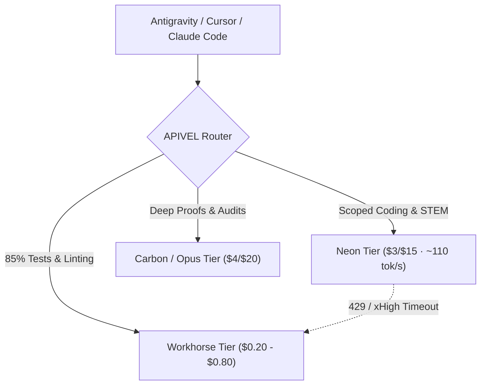

<div class="my-8 rounded-xl border border-primary/20 bg-primary/5 p-6 backdrop-blur-sm">
  <div class="flex items-center gap-2 text-primary font-semibold text-lg mb-2">
    <span>Technical Summary: Google's Balanced Mid-Tier AI Model</span>
  </div>
  <p class="text-base text-gray-200 leading-relaxed m-0">
    <strong>Gemini 4 Neon</strong> (<code>gemini-4-neon</code>) is Google DeepMind's November 2026 mid-tier reasoning model positioned between fast Hydrogen ($0.15/$0.60) and heavyweight Carbon ($4/$20), directly superseding preview-stage Argon. Priced at $3 input and $15 output per million tokens ($0.15 cached reads), this balanced checkpoint combines a 1,000,000-token context window, four thinking levels (<code>low</code> to <code>xhigh</code>), and roughly double Carbon's generation speed—trading blows with Anthropic's flagship on coding benchmarks. Because high-thinking loops burn Antigravity quotas quickly, routing 85% of routine tasks to workhorse endpoints via APIVEL cuts monthly spend by up to 88% with PayPal Instant Checkout and zero KYC.
  </p>
</div>

Evaluating **Gemini 4 Neon** across Google AI Studio, Vertex AI, and Antigravity comes down to a practical question: does this mid-tier AI model deliver near-flagship coding intelligence at half the wait time, or do hidden thinking tokens still exhaust five-hour limits?

Positioned cleanly across Google's element lineup, the Neon tier pairs 1M-token context retention with configurable reasoning depth so engineering teams stop overpaying for slow flagship passes on everyday repository sprints.



## Element Architecture: Hydrogen vs Neon vs Argon vs Carbon

Google structured its late-2026 element roster to separate high-frequency execution from deep formal reasoning:

* **Hydrogen Tier (Entry Flash Rate)**: Built for rapid triage, syntax linting, and lightweight Q&A, though prone to logic slips on multi-file invariants.
* **Gemini 4 Neon Tier ($3/$15)**: Adapted from Carbon's reasoning spine with double the generation throughput (~110 tokens/second vs ~55). Replacing canary-stage [Argon](/blog/gemini-4-argon-coding-test-review/), this mid-tier engine exposes four configurable thinking depths across a million-token window: `low` skips scratchpad overhead for boilerplate, `medium` balances multi-file reviews, `high` resolves complex module dependencies, and `xhigh` tackles deep algorithmic proofs.
* **Carbon Flagship ($4/$20)**: Detailed in our [Carbon API Pricing Guide](/blog/gemini-4-carbon-price-benchmarks-api/), Google's heaviest solver targets novel security proofs and greenfield systems at roughly half the token speed.

## Gemini 4 Neon Benchmarks: Coding Speed, Carbon & Opus 5.5

The matrix below compares **Gemini 4 Neon benchmarks** and **Gemini 4 Neon API pricing** against Google's lineup, Anthropic's flagship, and secondary workhorse endpoints:

| Model / Tier | Speed | Input / Million | Output / Million | Context | Best For (Objective Fit) |
| :--- | :--- | :--- | :--- | :--- | :--- |
| **Neon Tier** (`gemini-4-neon`) | **~110 tok/s** | **$3** *(Cached $0.15)* | **$15** *(Batch $7.50)* | 1,000K | **Fast agentic coding & STEM** |
| **Hydrogen Tier** | >200 tok/s | **$0.15** | **$0.60** | 1,000K | **Bulk parsing & lint triage** |
| **Carbon Flagship** | ~55 tok/s | $4 *(Cached $0.20)* | $20 *(Batch $10)* | 1,000K | **Formal proofs & security** |
| **Claude Opus 5.5** | ~105 tok/s | $4 *(Cached $0.20)* | $20 *(Batch $10)* | 1,000K | **Ambiguous repo refactors** |
| **Qwen 3.7 Max** | ~210 tok/s | **$0.25 (92% OFF)** | **$0.80 (95% OFF)** | 1,000K | **High-volume PR execution** |
| **DeepSeek V4** | ~430 tok/s | **$0.20 (93% OFF)** | **$0.60 (96% OFF)** | 1,000K | **Unit tests & failover loops** |

*Note: Metrics compiled from [Google Gemini API pricing](https://ai.google.dev/gemini-api/docs/pricing), [DeepMind model docs](https://deepmind.google/models/gemini/), and Artificial Analysis evaluations (November 2026).*

### Coding Agent Index, AutoBaxBench & Opus 5.5 Trade-Offs

At `xhigh` thinking, **Gemini 4 Neon** scores ~61–62 on the Artificial Analysis Intelligence Index, leads AutoBaxBench secure code synthesis, and finishes average coding loops in ~3.8 minutes—outpacing Carbon and Argon on agentic coding efficiency. Compared against [Claude Opus 5.5 benchmarks](/blog/claude-opus-5-5-vs-claude-sonnet-5-5-benchmarks/), Google's mid-tier model cuts raw input and output sticker rates by 25% ($3/$15 vs $4/$20), whereas Anthropic's flagship retains a slight edge on sprawling, poorly specified multi-file migrations.

However, billing thinking tokens at the full $15 output rate changes unit economics during long agent loops. A 20-turn Antigravity session inspecting ten source files easily generates 80,000 combined completion and reasoning tokens, pushing a single feature commit past $1.20 unless teams separate architectural passes from routine test scaffolding.

## Gemini 4 Neon Reddit Consensus: Antigravity & Quota Limits

Developer threads across `r/google_antigravity` and `r/GeminiAI`—alongside technical updates on the [Google Developers Blog](https://blog.google/technology/developers/) and [Google Gemini GitHub](https://github.com/google-gemini)—highlight both speed gains and quota pitfalls:

<div class="my-8 rounded-xl border border-amber-500/30 bg-amber-500/5 p-6 backdrop-blur-sm">
  <div class="flex items-center gap-2 text-amber-400 font-semibold text-lg mb-3">
    <span>Verified Developer Voices: r/google_antigravity &amp; r/GeminiAI Telemetry</span>
  </div>
  <blockquote class="border-l-4 border-amber-400 pl-4 my-3 italic text-gray-300">
    "Running this mid-tier checkpoint at Medium effort inside Antigravity hits near-Carbon reasoning at double the speed—finally practical for multi-file agent swarms without waiting three minutes per diff."
  </blockquote>
  <blockquote class="border-l-4 border-amber-400 pl-4 my-3 italic text-gray-300">
    "Default High thinking quietly generates thousands of hidden output tokens billed at $15 per million. Two heavy refactoring loops without max-token guardrails still trigger five-hour quota lockouts."
  </blockquote>
  <div class="text-xs text-gray-400 mt-2">
    — Compiled from r/google_antigravity, r/GeminiAI, and <a href="https://ai.google.dev/gemini-api/docs/pricing" target="_blank" rel="noopener noreferrer" class="text-amber-300 hover:underline">official Gemini pricing documentation</a> (November 2026).
  </div>
</div>

Capping routine turns at `medium` thinking and enforcing strict `max_tokens` boundaries eliminates runaway output bills, premature socket stalls, and recursive tool loops across unattended CI/CD runners and local terminal workflows.

## Global API Access & Billing: Google Cloud vs APIVEL

Google Cloud and Vertex AI enforce strict card verification, regional fraud locks, and zero PayPal checkout, while direct consumer tiers impose rolling five-hour caps. **Gemini 4 Neon API** routing through APIVEL pairs Google's mid-tier model with workhorse endpoints behind one OpenAI- and Anthropic-compatible gateway (`apivel.com/v1`) supporting **PayPal Instant Checkout**, Visa/MasterCard/Amex, and Alipay at **0% FX fees**, zero KYC, and a **$0.20 free trial**.

## Interactive Cost Calculator: Gemini 4 Neon Pricing & Hybrid Savings

Simulate monthly spend for **Gemini 4 Neon pricing** versus a two-tier APIVEL pipeline offloading 85% of routine tasks:

<div class="my-8 rounded-xl border border-primary/20 bg-card p-6 shadow-lg">
  <div class="flex items-center justify-between border-b border-border pb-4 mb-6">
    <div>
      <div class="font-bold text-lg text-white">Mid-Tier &amp; Hybrid Token Cost Calculator</div>
      <div class="text-xs text-gray-400">75% input / 25% output mix with 85% workhorse offloading</div>
    </div>
    <span class="rounded bg-primary/20 px-2.5 py-1 text-xs font-semibold text-primary">Live Estimator</span>
  </div>

  <div class="grid grid-cols-1 md:grid-cols-2 gap-6 mb-6">
    <div>
      <label for="gn-tokens" class="block text-sm font-medium text-gray-300 mb-2">
        Monthly Volume: <span id="gn-token-val" class="text-primary font-bold">25M Tokens</span>
      </label>
      <input type="range" id="gn-tokens" min="5" max="100" step="5" value="25" class="w-full h-2 bg-gray-700 rounded-lg appearance-none cursor-pointer accent-primary" />
    </div>

    <div>
      <label for="gn-model" class="block text-sm font-medium text-gray-300 mb-2">Primary Reasoning Tier</label>
      <select id="gn-model" class="w-full rounded-lg border border-border bg-gray-800 px-3 py-2 text-sm text-gray-200 focus:border-primary focus:outline-none">
        <option value="neon" selected>Neon Standard ($3 in / $15 out)</option>
        <option value="neon-batch">Neon Batch 50% Off ($1.50 in / $7.50 out)</option>
        <option value="carbon">Carbon / Opus ($4 in / $20 out)</option>
      </select>
    </div>
  </div>

  <div class="grid grid-cols-1 md:grid-cols-3 gap-4 pt-4 border-t border-border">
    <div class="rounded-lg bg-gray-900/60 p-4 text-center border border-gray-800">
      <div class="text-xs text-gray-400 mb-1">Single-Tier Spend</div>
      <div id="gn-pure-cost" class="text-2xl font-bold text-red-400">$150.00</div>
    </div>
    <div class="rounded-lg bg-gray-900/60 p-4 text-center border border-gray-800">
      <div class="text-xs text-gray-400 mb-1">APIVEL Hybrid Spend</div>
      <div id="gn-hybrid-cost" class="text-2xl font-bold text-green-400">$30.74</div>
    </div>
    <div class="rounded-lg bg-primary/10 p-4 text-center border border-primary/30">
      <div class="text-xs text-primary mb-1">Monthly Savings</div>
      <div id="gn-savings-pct" class="text-2xl font-extrabold text-primary">79.5%</div>
      <div id="gn-savings-amt" class="text-xs text-gray-300 mt-1">Save $119.26 / Month</div>
    </div>
  </div>

  <div class="mt-6 flex justify-end">
    <button type="button" id="gn-calc-btn" class="rounded-lg bg-primary px-4 py-2 text-xs font-semibold text-white shadow-md hover:bg-primary/90 transition-colors">
      Recalculate Savings
    </button>
  </div>
</div>

<script>
  (function() {
    const slider = document.getElementById('gn-tokens');
    const valEl = document.getElementById('gn-token-val');
    const selectEl = document.getElementById('gn-model');
    const pureEl = document.getElementById('gn-pure-cost');
    const hybridEl = document.getElementById('gn-hybrid-cost');
    const pctEl = document.getElementById('gn-savings-pct');
    const amtEl = document.getElementById('gn-savings-amt');
    const btn = document.getElementById('gn-calc-btn');

    function updateCalc() {
      const vol = parseFloat(slider.value);
      valEl.textContent = vol + 'M Tokens';
      const inM = vol * 0.75;
      const outM = vol * 0.25;

      let rateIn = 3.0, rateOut = 15.0;
      if (selectEl.value === 'neon-batch') { rateIn = 1.5; rateOut = 7.5; }
      else if (selectEl.value === 'carbon') { rateIn = 4.0; rateOut = 20.0; }

      const pure = (inM * rateIn) + (outM * rateOut);
      const hybridFrontier = ((inM * 0.15) * rateIn) + ((outM * 0.15) * rateOut);
      const hybridWork = ((inM * 0.85) * 0.25) + ((outM * 0.85) * 0.80);
      const totalHybrid = hybridFrontier + hybridWork;
      const saved = pure - totalHybrid;

      pureEl.textContent = '$' + pure.toFixed(2);
      hybridEl.textContent = '$' + totalHybrid.toFixed(2);
      pctEl.textContent = ((saved / pure) * 100).toFixed(1) + '%';
      amtEl.textContent = 'Save $' + saved.toFixed(2) + ' / Month';
    }

    slider.addEventListener('input', updateCalc);
    selectEl.addEventListener('change', updateCalc);
    btn.addEventListener('click', updateCalc);
    updateCalc();
  })();
</script>

## Production Setup: Failover Client & CLI Configuration

Route complex refactoring to `gemini-4-neon` with automated 429 failover to workhorse endpoints:

```python
import os, httpx
from openai import OpenAI

client = OpenAI(api_key=os.environ.get("APIVALE_API_KEY"), base_url="https://apivel.com/v1")

def run_agent(prompt: str, tier: str = "neon") -> str:
    routes = {
        "neon": ("gemini-4-neon", "infer/qwen3.7-max"),
        "routine": ("infer/qwen3.7-max", "infer/deepseek-v4"),
    }
    primary, fallback = routes.get(tier, routes["routine"])
    try:
        res = client.chat.completions.create(model=primary, messages=[{"role":"user","content":prompt}], max_tokens=4096, timeout=90.0)
        return res.choices[0].message.content
    except (httpx.TimeoutException, httpx.HTTPStatusError):
        res = client.chat.completions.create(model=fallback, messages=[{"role":"user","content":prompt}], max_tokens=4096, timeout=60.0)
        return res.choices[0].message.content
```

For Cursor or OpenCode CLI, export unified gateway variables:

```bash
export OPENAI_BASE_URL="https://apivel.com/v1"
export OPENAI_API_KEY="sk-apivel-key"
export OPENCODE_MODEL="gemini-4-neon"
```

## Gemini 4 Neon Frequently Asked Questions

### What Is Gemini 4 Neon and Where Does It Fit?

**Gemini 4 Neon** (`gemini-4-neon`) is Google DeepMind's mid-tier reasoning model placed between lightweight Hydrogen and flagship Carbon ($4/$20), succeeding preview-stage Argon with a 1M context window and four thinking depths.

### Is Gemini 4 Neon Better Than Carbon or Opus 5.5 for Coding?

For daily agentic coding and fast iteration, yes—it runs roughly double Carbon's speed and leads AutoBaxBench secure code synthesis. Carbon retains an edge on formal proofs, while Anthropic's flagship excels at highly ambiguous multi-repo migrations.

### How Much Does Gemini 4 Neon API Cost?

Standard **Gemini 4 Neon pricing** is $3 per million input tokens and $15 per million output tokens (including thinking tokens), with $0.15 cached input reads (95% off) and 50% Batch API discounts ($1.50/$7.50).

### How Fast Is Gemini 4 Neon and How Do I Avoid 5-Hour Limits?

It generates roughly 110 tokens per second and finishes average coding tasks in ~3.8 minutes. Setting thinking depth to `medium` and routing 85% of routine edits through APIVEL with PayPal Instant Checkout and a free sandbox credit prevents quota lockouts.

<script type="application/ld+json">
{
  "@context": "https://schema.org",
  "@type": "TechArticle",
  "headline": "Gemini 4 Neon: Benchmarks, API Pricing & Carbon vs Opus 5.5",
  "description": "Explore Gemini 4 Neon AI model: benchmarks vs Carbon & Opus 5.5, $3/$15 API pricing, Hydrogen vs Argon tiers, Antigravity reviews, and APIVEL routing.",
  "author": {
    "@type": "Person",
    "name": "Sofia Costa",
    "jobTitle": "Senior Cloud & API Gateway Architect",
    "worksFor": {
      "@type": "Organization",
      "name": "APIVEL"
    }
  },
  "publisher": {
    "@type": "Organization",
    "name": "APIVEL",
    "url": "https://apivel.com"
  },
  "datePublished": "2026-11-26",
  "mainEntityOfPage": "https://apivel.com/blog/gemini-4-neon-benchmarks-pricing-api/"
}
</script>

<script type="application/ld+json">
{
  "@context": "https://schema.org",
  "@type": "FAQPage",
  "mainEntity": [
    {
      "@type": "Question",
      "name": "What Is Gemini 4 Neon and Where Does It Fit?",
      "acceptedAnswer": {
        "@type": "Answer",
        "text": "Gemini 4 Neon (gemini-4-neon) is Google DeepMind's mid-tier reasoning model placed between Hydrogen ($0.15/$0.60) and Carbon ($4/$20), superseding Argon with a 1,000,000-token context window and four configurable thinking levels."
      }
    },
    {
      "@type": "Question",
      "name": "Is Gemini 4 Neon Better Than Carbon or Opus 5.5 for Coding?",
      "acceptedAnswer": {
        "@type": "Answer",
        "text": "Gemini 4 Neon runs ~110 tok/s (twice Carbon's speed) and leads AutoBaxBench secure code synthesis, making it more practical for daily agentic coding. Carbon leads formal proofs, while Claude Opus 5.5 leads ambiguous multi-repo migrations."
      }
    },
    {
      "@type": "Question",
      "name": "How Much Does Gemini 4 Neon API Cost?",
      "acceptedAnswer": {
        "@type": "Answer",
        "text": "Gemini 4 Neon costs $3 per million input tokens and $15 per million output tokens (including thinking tokens), with $0.15 cached input reads (95% discount) and 50% Batch API discounts ($1.50/$7.50)."
      }
    },
    {
      "@type": "Question",
      "name": "How Fast Is Gemini 4 Neon and How Do I Avoid 5-Hour Limits?",
      "acceptedAnswer": {
        "@type": "Answer",
        "text": "Gemini 4 Neon averages ~110 tok/s and ~3.8-minute task completion. Setting thinking to medium and routing 85% of routine tasks via APIVEL (https://apivel.com/v1) with PayPal Instant Checkout and a $0.20 free trial eliminates 5-hour quota lockouts."
      }
    }
  ]
}
</script>

<div class="cta-card">
  <div class="my-10 p-8 rounded-2xl bg-gradient-to-br from-slate-900 via-primary/10 to-slate-900 border border-primary/30 text-center shadow-2xl backdrop-blur-md">
    <div class="inline-flex items-center gap-2 px-3 py-1 rounded-full bg-primary/10 border border-primary/30 text-primary text-xs font-mono mb-4">
      <span>⚡ Unified AI Gateway</span>
    </div>
    <div class="text-2xl font-extrabold text-white tracking-tight mb-3">Deploy Google's Mid-Tier Reasoning Engine With Zero KYC</div>
    <p class="text-sm text-gray-300 max-w-xl mx-auto leading-relaxed mb-6">
      Skip GCP card rejections and five-hour Antigravity quota caps. Route Cursor, OpenCode, and Claude Code with automatic workhorse failover.
    </p>
    <div class="flex flex-wrap justify-center gap-4 text-xs text-gray-400 mb-6">
      <span><strong class="text-white">+50% First Deposit Bonus:</strong> $5→$7.50, $29→$43.50, $99→$148.50</span>
      <span><strong class="text-white">$29 Developer Pack:</strong> 56% OFF, 40M Tokens, Never Expires</span>
      <span><strong class="text-white">$0.20 Free Trial:</strong> Zero KYC</span>
    </div>
    <div class="flex flex-col sm:flex-row justify-center gap-4 mb-6">
      <a rel="nofollow" href="/pricing?from_blog=gemini-4-neon-benchmarks-pricing-api" class="inline-flex items-center justify-center rounded-xl bg-primary px-6 py-3 text-sm font-semibold text-white shadow-lg shadow-primary/25 hover:bg-primary/90 transition-all text-center">
        View Gateway Pricing
      </a>
      <a rel="nofollow" href="/sign-up?redirect=%2Fdashboard%3Fquickstart%3Dtrue&from_blog=gemini-4-neon-benchmarks-pricing-api" class="inline-flex items-center justify-center rounded-xl border border-border bg-gray-800/80 px-6 py-3 text-sm font-semibold text-gray-200 hover:bg-gray-700/80 transition-all text-center">
        Claim $0.20 Free Credit
      </a>
    </div>
    <div class="pt-4 border-t border-gray-800/80 flex flex-wrap items-center justify-center gap-4 text-xs text-gray-400">
      <div><strong>PayPal Instant Checkout</strong> • Global Cards • Alipay • 0% FX Fees</div>
    </div>
  </div>
</div>
