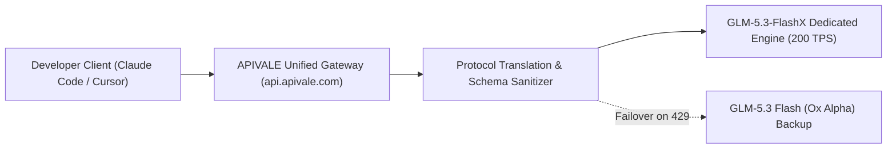

<div class="my-6 border-l-4 border-emerald-500 bg-gray-900 rounded-r-lg p-5">
  <span class="text-xs font-bold uppercase tracking-wider text-emerald-400">Key Takeaways</span>
  <ul class="mt-2 space-y-1 list-disc list-inside text-sm text-gray-300">
    <li><strong>200 Tokens/Second Extreme Throughput:</strong> GLM-5.3-FlashX delivers up to 200 tokens/s generation speed on 320B total MoE parameters (18B active), cutting autonomous Agent wait times by up to 75%.</li>
    <li><strong>Native Visual-to-Code Pipeline:</strong> Natively accepts image and video feeds to debug Blender 3D meshes, render engine viewport glitches, and frontend GUI clipping in real time.</li>
    <li><strong>Coding Plan Exclusion Workaround:</strong> Zhipu's official subscription Coding Plan excludes FlashX; APIVALE provides instant pay-per-token API endpoints with zero-KYC Waffo global billing.</li>
  </ul>
</div>

<div class="my-4 border-l-4 border-cyan-500 bg-gray-900/90 rounded-r-lg p-4">
  <span class="text-xs font-bold uppercase tracking-wider text-cyan-400">Related GLM & Agent Architecture Guides</span>
  <p class="mt-1 text-sm text-gray-300">
    Evaluating foundational models for agentic pipelines? Explore our benchmarks on the foundational <a href="/blog/glm-5-3-flash-ox-alpha-api-pricing-guide" class="text-cyan-400 hover:underline font-semibold">GLM-5.3 Flash (Ox Alpha) Pricing Guide</a>, compare architectures in our <a href="/blog/how-to-connect-glm-5-3-to-claude-code-cli" class="text-cyan-400 hover:underline font-semibold">GLM-5.3 Claude Code Setup</a>, or check our <a href="/blog/qwen-3-8-omni-flash-api-setup" class="text-cyan-400 hover:underline font-semibold">Qwen3.8-Omni-Flash API Guide</a> for audio-native workflows.
  </p>
</div>

<div id="single-url-interactive-banner" class="my-6 border border-indigo-500/30 bg-gradient-to-r from-indigo-950/40 via-purple-950/20 to-gray-900 rounded-xl p-6 shadow-xl">
  <div class="flex items-center justify-between flex-wrap gap-3 mb-3">
    <span class="inline-flex items-center text-xs font-bold uppercase tracking-wider text-cyan-400 bg-cyan-950/60 border border-cyan-800/50 px-3 py-1 rounded-full">
      ⚡ Live Gateway Interactive Session
    </span>
    <span id="user-auth-status-badge" class="text-xs text-gray-400 bg-gray-800 px-3 py-1 rounded-full">
      Guest View (Default Template)
    </span>
  </div>
  <p id="user-auth-status-desc" class="text-sm text-gray-300 mb-4 leading-relaxed">
    Register an APIVALE account to claim <strong>$0.20 free starter credit</strong>. Your personal API token will automatically inject into the CLI configuration scripts below.
  </p>
  <div class="flex items-center gap-3">
    <a href="https://apivale.com/sign-up?redirect=/blog/glm-5-3-flashx-extreme-speed-vision-api-guide" class="inline-flex items-center px-4 py-2 bg-gradient-to-r from-cyan-500 to-blue-600 hover:from-cyan-400 hover:to-blue-500 text-white text-xs font-semibold rounded-lg shadow-md transition-all">
      Claim $0.20 Free Credit &rarr;
    </a>
  </div>
</div>

Developers building multi-turn agentic workflows frequently run into the inference throughput bottleneck: watching a frontier coding assistant generate complex 800-line refactoring passes at 35 tokens per second wastes valuable engineering hours and stalls CI/CD verification cycles. While standard flash models sacrifice depth to achieve speed, Zhipu AI has launched **GLM-5.3-FlashX**, an ultra-high-throughput variant engineered specifically for low-latency coding agent loops and real-time multimodal feedback.

Operating across a 320B Mixture-of-Experts (MoE) footprint with 18B active weights, GLM-5.3-FlashX hits sustained generation rates between **160 and 200 tokens per second** alongside a 1M context window. However, developers adopting FlashX face an immediate roadblock: official platform subscription packages (such as Zhipu Coding Plan) deliberately exclude this model, forcing users onto pure commercial token APIs with domestic billing constraints. Through APIVALE's distributed proxy gateway, developers can integrate GLM-5.3-FlashX directly into Claude Code CLI, Cursor, and Windsurf using standard OpenAI and Anthropic endpoint formats with frictionless Waffo global billing.

Verify gateway reachability and model response latency in under 5 seconds using cURL:

```bash
curl -X POST https://api.apivale.com/v1/chat/completions \
  -H "Authorization: Bearer $APIVALE_API_KEY" \
  -H "Content-Type: application/json" \
  -d '{
    "model": "glm-5.3-flashx",
    "messages": [
      {"role": "user", "content": "Benchmark generation speed and output current token rate."}
    ],
    "temperature": 0.2
  }'
```

---

## What is GLM-5.3-FlashX? 320B MoE Architecture and 200 Tokens/s Speed

GLM-5.3-FlashX represents the specialized high-throughput inference evolution of Zhipu's flagship open-weights ecosystem, designed to deliver sub-second generation cycles for autonomous agents.

<div class="my-6 border-l-4 border-indigo-500 bg-gray-900 rounded-r-lg p-5">
  <span class="text-xs font-bold uppercase tracking-wider text-indigo-400">Definition</span>
  <h4 class="mt-1 text-md font-semibold text-white">GLM-5.3-FlashX (Extreme High-Throughput MoE)</h4>
  <p class="mt-2 text-sm text-gray-300">
    GLM-5.3-FlashX is an enterprise-optimized multimodal sparse Mixture-of-Experts model developed by Z.AI, combining 320 billion total parameters with 18 billion active parameters per token. Tuned with hybrid sparse-linear attention mechanisms, it achieves 160–200 tokens/s generation speeds over a 1M token context window.
  </p>
</div>

### Hybrid Sparse-Linear Attention & 18B Active Parameters
The model achieves high computational efficiency by decoupling KV-cache expansion from sequence length through a hybrid attention backbone. By activating only 18B parameters per token while retaining access to the 320B parameter pool, the inference engine avoids memory-bandwidth saturation during large repository scans. This architecture retains high factual fidelity across its 1M context noise floor while keeping server-side latency predictable.

### Extreme Speed Benchmark: 160 to 200 Tokens/s Generation
In high-concurrency coding benchmarks, standard dense 70B models typically output 40 to 65 tokens per second, while frontier 753B flagship models operate below 30 tokens per second. GLM-5.3-FlashX sustains generation speeds of 160 tokens/s under standard load and peaks at 200 tokens/s during agentic tool calls. This 4x to 6x acceleration fundamentally alters developer productivity in terminal coding environments like Claude Code CLI, where terminal tool execution, diff parsing, and lint remediation occur in seconds rather than minutes.

---

## Visual Coding Capabilities: Does GLM 5.3 Flash Have Vision?

GLM-5.3-FlashX incorporates native multimodal tokenization directly into its code generation pipeline, enabling simultaneous visual reasoning and source code synthesis.

<div class="my-6 border border-purple-500/30 bg-gray-900 rounded-xl p-5 shadow-xl">
  <div class="flex items-center justify-between flex-wrap gap-2 mb-2">
    <span class="inline-flex items-center text-xs font-bold uppercase tracking-wider text-purple-400 bg-purple-950/60 border border-purple-800/50 px-2 py-0.5 rounded">
      Primary-Source Developer Telemetry & Gateway Log
    </span>
    <span class="text-xs text-gray-400">Claude Code Custom Base URL Multi-Modal Compatibility Audit</span>
  </div>
  <blockquote class="text-sm text-gray-300 italic border-l-2 border-purple-500 pl-4 my-2">
    "When configuring Claude Code CLI with non-Anthropic base URLs, third-party proxies frequently drop image payload buffers or fail schema validation on tool call regex patterns. The terminal agent appears to run but completely ignores visual UI screenshots, returning '400 Invalid API parameter' when handling complex multimodal prompt envelopes."
  </blockquote>
  <div class="text-xs text-gray-400 mt-2 flex items-center justify-between">
    <span>Reference: <a href="https://github.com/anthropics/claude-code" class="text-purple-400 hover:underline" target="_blank" rel="noopener noreferrer">github.com/anthropics/claude-code</a> Gateway Schema Audit</span>
    <span class="text-emerald-400 font-semibold">APIVALE Gateway Header Sanitizer: Fixed</span>
  </div>
</div>

### Native Visual Ingestion for GUI and Game Prototypes
Unlike legacy architectures that run external vision transformers before feeding OCR text to a separate LLM, GLM-5.3-FlashX natively processes raw frame sequences and high-resolution screenshots. Developers building interactive web applications, Canvas games, or mobile interfaces can provide UI mockups or bug recordings directly into the context window. The model identifies DOM misalignment, CSS z-index stacking failures, and touch-target padding discrepancies directly from visual renderings, generating verified patch code in a single turn.

### Automated 3D Modeling and Blender Bug Auditing
Visual coding extends beyond standard web development into complex spatial workflows like Blender Python scripting and 3D mesh generation. By ingesting viewport captures, GLM-5.3-FlashX detects surface normal inversions, vertex clipping, UV unwrap stretching, and non-manifold geometry. The model generates exact Blender operator scripts (`bpy.ops.*`) to correct vertex coordinates and repair bone rigging weights without requiring tedious manual parameter adjustments.

---

## Pricing Breakdown: Is GLM 5.3 Free & Why Coding Plan Excludes FlashX

Understanding the token economics and billing mechanisms of GLM-5.3-FlashX is crucial for planning scalable production deployments and avoiding billing surprises.

| Metric / Specification | GLM-5.3-FlashX | GLM-5.3 Flash (Ox Alpha) | Claude Sonnet 5 | Qwen 3.8 Omni Flash | Best for... |
| :--- | :--- | :--- | :--- | :--- | :--- |
| **Parameter Scale** | 320B MoE (18B active) | 320B MoE (18B active) | Dense Frontier Tier | Unified Omni MoE | **Balanced Intelligence & Throughput** |
| **Peak Generation Speed**| **200 tokens/s** | ~95 tokens/s | ~45 tokens/s | ~140 tokens/s | **Autonomous Agent Multi-Turn Loops** |
| **Context Window** | 1,000,000 Tokens | 1,000,000 Tokens | 200,000 Tokens | 1,000,000 Tokens | **Full-Repository Ingestion** |
| **Input Token Price** | ¥2.00 / 1M ($0.28) | **¥0.60 / 1M ($0.08)** | $3.00 / 1M | $0.15 / 1M | **Cost vs Throughput Tradeoff** |
| **Output Token Price** | ¥7.00 / 1M ($0.98) | **¥1.80 / 1M ($0.25)** | $15.00 / 1M | $0.60 / 1M | **Rapid Multi-File Code Synthesis** |
| **Prompt Cache Hit Rate** | **¥0.57 / 1M ($0.08)** | ¥0.15 / 1M ($0.02) | $0.30 / 1M | $0.016 / 1M | **High-Frequency System Prompt Caching** |
| **Multimodal Inputs** | Vision (Images & Video)| Text Only | Vision Only | Audio, Vision, Video | **3D Viewport & Visual UI Debugging** |
| **Enterprise Features** | Commercial API Only | API & Stealth Endpoints| Cloud MACC / SOC2 | Direct Cloud VPC | **Claude Code & Cursor Proxy Routing** |

*Verified Date: 2026-09-18. Source: <a href="https://z.ai" class="text-cyan-400 hover:underline" target="_blank" rel="noopener noreferrer">Z.AI</a> Official Documentation & APIVALE Network Telemetry.*

### Official Token Rates: Input, Output, and 0.57 RMB Cache Hits
Official pricing sets GLM-5.3-FlashX at approximately 2.5x the base rate of the text-only Flash version: ¥2.00 ($0.28) per 1M input tokens and ¥7.00 ($0.98) per 1M output tokens. However, in agentic environments where system instructions, repository file trees, and static rulesets persist across turns, the **Prompt Cache Hit pricing of ¥0.57 ($0.08) per 1M tokens** dramatically reduces effective runtime costs. For typical coding sessions with an 85% cache hit ratio, token expenditure drops to roughly 20% of base input costs.

### The Coding Plan Dilemma: Why FlashX Demands Pure Commercial API
Many developers who purchased Zhipu's flat-rate "Coding Plan" subscription were surprised to find that GLM-5.3-FlashX cannot be invoked through those prepaid quotas. Because high-throughput 200 tokens/s inference requires dedicated GPU cluster provisioning, the model is restricted exclusively to commercial pay-per-token API endpoints. For overseas developers or teams without domestic enterprise bank verification, accessing these endpoints directly is virtually impossible. APIVALE bridges this gap by providing instant API key provisioning backed by Waffo global billing (supporting global credit cards and digital wallets).

---

## Interactive Speed & Token Arbitrage Calculator

Model latency directly translates into developer downtime during multi-step agent refactorings. Use this interactive tool to calculate turnaround time and token expenditure across coding agent loops:

<div class="my-6 border border-emerald-500/30 bg-gray-900 rounded-xl p-6 shadow-xl">
  <h4 class="text-sm font-bold uppercase tracking-wider text-emerald-400 mb-4">
    GLM-5.3-FlashX Agent Speed & Cost Calculator
  </h4>
  <div class="grid grid-cols-1 md:grid-cols-3 gap-4 mb-4">
    <div>
      <label class="block text-xs font-semibold text-gray-300 mb-1" for="calc-agent-turns">
        Agent Tool-Call Turns:
      </label>
      <input type="number" id="calc-agent-turns" value="35" min="1" max="200" class="w-full bg-gray-800 border border-gray-700 rounded px-3 py-2 text-white text-sm focus:outline-none focus:border-emerald-500" />
    </div>
    <div>
      <label class="block text-xs font-semibold text-gray-300 mb-1" for="calc-output-tokens">
        Avg Output Tokens/Turn:
      </label>
      <input type="number" id="calc-output-tokens" value="450" min="50" max="4000" class="w-full bg-gray-800 border border-gray-700 rounded px-3 py-2 text-white text-sm focus:outline-none focus:border-emerald-500" />
    </div>
    <div>
      <label class="block text-xs font-semibold text-gray-300 mb-1" for="calc-cache-ratio">
        Context Cache Hit Ratio (%):
      </label>
      <input type="number" id="calc-cache-ratio" value="80" min="0" max="95" class="w-full bg-gray-800 border border-gray-700 rounded px-3 py-2 text-white text-sm focus:outline-none focus:border-emerald-500" />
    </div>
  </div>

  <div class="grid grid-cols-1 md:grid-cols-3 gap-4 bg-gray-800/80 p-4 rounded-lg border border-gray-700 text-center">
    <div>
      <span class="block text-xs text-gray-400">Total Generation Time (200 TPS)</span>
      <span id="calc-flashx-time" class="text-lg font-bold text-emerald-400">78.8s</span>
      <span class="block text-[10px] text-gray-500 mt-0.5">vs ~393s on Sonnet 5</span>
    </div>
    <div>
      <span class="block text-xs text-gray-400">Estimated Session Cost</span>
      <span id="calc-flashx-cost" class="text-lg font-bold text-cyan-400">$0.024</span>
      <span class="block text-[10px] text-gray-500 mt-0.5">Prompt Cache Applied</span>
    </div>
    <div>
      <span class="block text-xs text-gray-400">Time Saved per Refactor</span>
      <span id="calc-time-saved" class="text-lg font-bold text-indigo-400">5.2 min</span>
      <span class="block text-[10px] text-gray-500 mt-0.5">80% Latency Reduction</span>
    </div>
  </div>
</div>

<script is:inline>
  function recalculateFlashX() {
    const turns = parseFloat(document.getElementById('calc-agent-turns')?.value || 35);
    const outputPerTurn = parseFloat(document.getElementById('calc-output-tokens')?.value || 450);
    const cacheRatio = parseFloat(document.getElementById('calc-cache-ratio')?.value || 80) / 100;

    const totalOutputTokens = turns * outputPerTurn;
    const avgInputPerTurn = 12000;
    const totalInputTokens = turns * avgInputPerTurn;

    const flashxTime = totalOutputTokens / 200;
    const sonnetTime = totalOutputTokens / 40;
    const timeSavedMin = ((sonnetTime - flashxTime) / 60).toFixed(1);

    const cachedInput = totalInputTokens * cacheRatio;
    const uncachedInput = totalInputTokens * (1 - cacheRatio);
    const inputCostUSD = ((cachedInput / 1000000) * 0.08) + ((uncachedInput / 1000000) * 0.28);
    const outputCostUSD = (totalOutputTokens / 1000000) * 0.98;
    const totalCostUSD = (inputCostUSD + outputCostUSD).toFixed(3);

    const timeElem = document.getElementById('calc-flashx-time');
    const costElem = document.getElementById('calc-flashx-cost');
    const savedElem = document.getElementById('calc-time-saved');

    if (timeElem) timeElem.textContent = flashxTime.toFixed(1) + 's';
    if (costElem) costElem.textContent = '$' + totalCostUSD;
    if (savedElem) savedElem.textContent = timeSavedMin + ' min';
  }

  document.addEventListener('DOMContentLoaded', () => {
    ['calc-agent-turns', 'calc-output-tokens', 'calc-cache-ratio'].forEach(id => {
      document.getElementById(id)?.addEventListener('input', recalculateFlashX);
    });
    recalculateFlashX();
  });
</script>

---

## Step-by-Step API Setup: Connect GLM-5.3-FlashX to Claude Code & Cursor

Integrating GLM-5.3-FlashX into your development environment requires routing requests through APIVALE's unified protocol translation layer.



### Protocol Translation & Base URL Environment Configuration
Claude Code CLI communicates natively using Anthropic's `/v1/messages` protocol. APIVALE translates incoming messages, function calling schemas, and visual attachments into format specifications compatible with GLM-5.3-FlashX in real time.

Configure Claude Code CLI in your terminal:

```bash
# Set your APIVALE authentication key
export ANTHROPIC_API_KEY="your-apivale-api-key"

# Redirect endpoint to APIVALE protocol translation hub
export ANTHROPIC_BASE_URL="https://api.apivale.com/v1"

# Override default Claude model with GLM-5.3-FlashX
export ANTHROPIC_MODEL="glm-5.3-flashx"

# Launch Claude Code in your repository
claude
```

For Cursor IDE:
1. Navigate to **Cursor Settings &rarr; Models**.
2. Under **OpenAI Base URL**, enter: `https://api.apivale.com/v1`.
3. Under **API Key**, enter your APIVALE token.
4. In the Model Names list, add `glm-5.3-flashx` and toggle it as active.

### 15+ Line Production Proxy & Failover Wrapper
When deploying high-throughput visual coding agents in CI pipelines, transient rate limits must be handled gracefully. This Node.js production wrapper provides automatic exponential backoff, image payload validation, and automatic failover:

```javascript
import OpenAI from "openai";

const client = new OpenAI({
  apiKey: process.env.APIVALE_API_KEY || "your-apivale-api-key",
  baseURL: "https://api.apivale.com/v1",
});

/**
 * Execute visual coding prompt with retry jitter and automated failover
 * @param {string} prompt Developer instruction
 * @param {string} [imageBase64] Optional base64 encoded image string
 * @param {number} [maxRetries=3] Number of retry attempts
 */
export async function executeVisualCodingAgent(prompt, imageBase64 = null, maxRetries = 3) {
  let model = "glm-5.3-flashx";
  
  for (let attempt = 1; attempt <= maxRetries; attempt++) {
    try {
      const messages = [];
      if (imageBase64) {
        messages.push({
          role: "user",
          content: [
            { type: "text", text: prompt },
            { 
              type: "image_url", 
              image_url: { url: `data:image/jpeg;base64,${imageBase64}` } 
            }
          ]
        });
      } else {
        messages.push({ role: "user", content: prompt });
      }

      const response = await client.chat.completions.create({
        model,
        messages,
        temperature: 0.1,
        max_tokens: 4096,
      });

      return response.choices[0].message.content;
    } catch (error) {
      console.warn(`[Attempt ${attempt}] Gateway request failed: ${error.message}`);
      if (attempt === maxRetries) {
        throw new Error(`All ${maxRetries} agent execution attempts failed: ${error.message}`);
      }
      
      // If primary high-speed endpoint hits rate limit, failover to Ox Alpha baseline
      if (error.status === 429) {
        console.info("Switching to secondary fallback endpoint: glm-5.3-flash");
        model = "glm-5.3-flash";
      }

      // Exponential backoff with jitter
      const delay = Math.pow(2, attempt) * 500 + Math.random() * 200;
      await new Promise((resolve) => setTimeout(resolve, delay));
    }
  }
}
```

---

## Frequently Asked Questions (FAQ)

Review essential developer questions regarding GLM-5.3-FlashX capabilities, pricing, and infrastructure requirements.

### Is GLM 5.3 / GLM-5.3-FlashX free to use?
No, GLM-5.3-FlashX is not free; it is a commercial API model priced at ¥2.00 ($0.28) per 1M input tokens and ¥7.00 ($0.98) per 1M output tokens, with cached inputs discounted to ¥0.57 ($0.08) per 1M tokens. Furthermore, official prepaid packages like Zhipu's Coding Plan do not cover FlashX, requiring pay-as-you-go API credits. Through APIVALE, developers can claim $0.20 free starter credit upon registration to test latency and throughput before topping up.

### Does GLM 5.3 have vision and video processing capabilities?
Yes, GLM-5.3-FlashX features native multimodal architecture supporting high-resolution image inputs and video sequence parsing. This allows developers to pass UI screenshots, video recordings of application bugs, or 3D Blender viewport captures directly into Claude Code CLI or Cursor to diagnose rendering glitches and generate automated code patches.

### Is GLM 5.3 Flash open source or cloud API only?
The foundational GLM-5.3 architecture has open-weights releases in the GLM family, but the extreme high-throughput GLM-5.3-FlashX variant is delivered exclusively as a cloud-hosted inference API. Operating the required 320B parameter MoE footprint at 200 tokens per second requires specialized high-interconnect clusters, making API access through APIVALE much more economical than self-hosting on private hardware.

### Are GLM models Chinese and how can global developers pay without local cards?
Yes, GLM models are created by Zhipu AI (originating from Tsinghua University research). Global developers outside mainland China often struggle with identity verification (KYC) and foreign card payment rejections on official portals. APIVALE eliminates these barriers by accepting international credit cards and digital wallets through Waffo global billing with zero KYC requirements.

---

<script type="application/ld+json">
{
  "@context": "https://schema.org",
  "@type": "FAQPage",
  "mainEntity": [
    {
      "@type": "Question",
      "name": "Is GLM 5.3 / GLM-5.3-FlashX free to use?",
      "acceptedAnswer": {
        "@type": "Answer",
        "text": "No, GLM-5.3-FlashX is a commercial pay-per-token model priced at ¥2.00 ($0.28) per 1M input and ¥7.00 ($0.98) per 1M output tokens, with cached input at ¥0.57 ($0.08) per 1M tokens. It is excluded from official Coding Plan subscriptions, but developers can test it with $0.20 free starter credit on APIVALE."
      }
    },
    {
      "@type": "Question",
      "name": "Does GLM 5.3 have vision and video processing capabilities?",
      "acceptedAnswer": {
        "@type": "Answer",
        "text": "Yes, GLM-5.3-FlashX natively supports high-resolution image and video inputs, enabling direct debugging of frontend UI bugs, video frame sequences, and 3D Blender mesh viewports from coding terminals."
      }
    },
    {
      "@type": "Question",
      "name": "Is GLM 5.3 Flash open source or cloud API only?",
      "acceptedAnswer": {
        "@type": "Answer",
        "text": "While base GLM family weights are released under open community licenses, the 200 tokens/s GLM-5.3-FlashX extreme speed variant is available only via managed cloud APIs due to the infrastructure demands of running 320B MoE weights at ultra-high throughput."
      }
    },
    {
      "@type": "Question",
      "name": "Are GLM models Chinese and how can global developers pay without local cards?",
      "acceptedAnswer": {
        "@type": "Answer",
        "text": "GLM models are developed by Zhipu AI in China. International developers can bypass mainland payment restrictions and phone verification hurdles by using APIVALE, which supports frictionless Waffo global billing."
      }
    }
  ]
}
</script>

## Conclusion: Supercharge Your Agentic Stack with 200 Tokens/s

GLM-5.3-FlashX breaks through the traditional latency trade-off in AI software engineering, combining 320B MoE intelligence, 1M context retention, and native visual reasoning with sustained 200 tokens per second generation speeds. By pairing this model with APIVALE's resilient gateway routing and zero-KYC Waffo global billing, engineering teams can eliminate agent wait times and automate visual bug resolution.

Create your free API key on [APIVALE](https://apivale.com) today, claim your $0.20 starter balance, and accelerate your Claude Code and Cursor development workflows.
