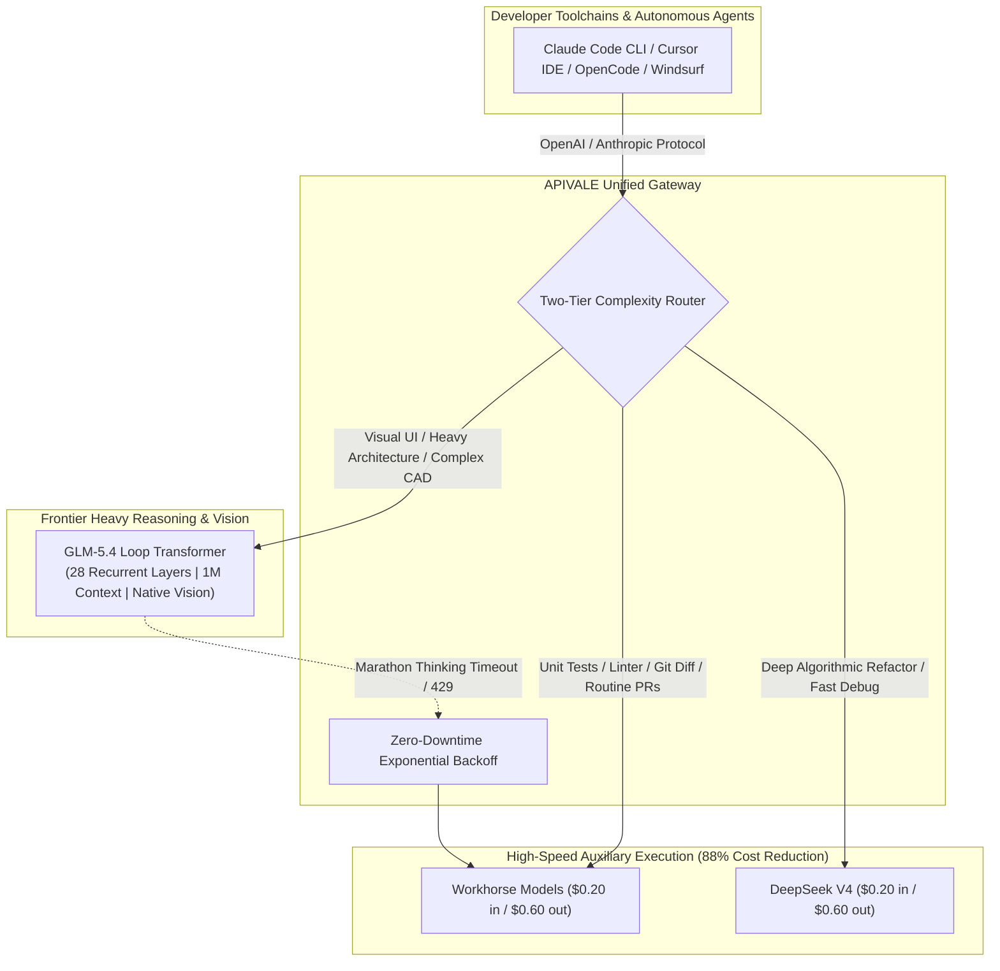

<div class="my-8 rounded-xl border border-primary/20 bg-primary/5 p-6 backdrop-blur-sm">
  <div class="flex items-center gap-2 text-primary font-semibold text-lg mb-2">
    <span>Technical Executive Summary: GLM-5.4 Architecture & Benchmarks</span>
  </div>
  <p class="text-base text-gray-200 leading-relaxed m-0">
    Zhipu AI's <strong>GLM-5.4</strong> arrived on November 23, 2026, introducing a recurrent <strong>Loop Transformer</strong> design cycling a 28-layer core block across dual passes. Matching 2T–3T reasoning ceilings with a 750B parameter footprint, native vision, and 73.8% SWE-bench Verified scores, it rivals Claude Opus 5.5 and GPT models at a fraction of their cost. However, Reddit reports highlight marathon thinking latency, while overseas teams face +86 SMS and payment hurdles on Z.ai. Running a two-tier hybrid gateway on APIVALE—offloading routine execution to workhorse models—cuts token spend by 88% with instant PayPal checkout, zero KYC, and OpenRouter compatibility.
  </p>
</div>

On November 23, 2026, Zhipu AI (Z.ai) deployed its next-generation flagship, ending months of developer speculation. Instead of bloating raw parameters into multi-trillion territory, the **GLM-5.4 loop transformer architecture** achieves deep reasoning through recurrent layer reuse—cycling representations through identical weights twice to synthesize complex logic.

For engineers running agent workflows in Claude Code CLI, Cursor, Windsurf, and OpenCode, this architecture delivers high-fidelity code generation across TypeScript, WebGL shaders, and CAD scripts. However, Reddit feedback highlights real friction: recurrent passes can trigger extended thinking latency, while official Coding Plans require mainland Chinese verification (+86). Fronting the model with an intelligent multi-tier gateway resolves both hurdles cleanly.



## GLM-5.4 Architecture: Recurrent Loop Transformer Deep-Dive

The **GLM-5.4 loop transformer architecture**, formally deployed on November 23, 2026, marks the first production-scale implementation of weight-tied recurrent execution in a frontier coding model. Standard foundation models process activations through deep feed-forward stacks, demanding ever-larger parameter counts to expand reasoning depth.

### Recurrent Layer Reuse and KV Cache Optimization in GLM-5.4

The core breakthrough in the **GLM-5.4 architecture** is its 28-layer recurrent execution. The inference engine routes tokens through two consecutive passes across a shared 28-layer core block:

1. **Pass 1 (Initial Abstraction)**: Tokens traverse layers 1–28 to generate primary representations and sparse attention indices.
2. **Pass 2 (Recurrent Refinement)**: The same weights are revisited immediately, reusing cached KV states with a sliding-window buffer to refine logic without doubling compute overhead.

This recurrent **GLM-5.4 loop transformer architecture** grants the 750B model reasoning capabilities comparable to 2T–3T parameter clusters while keeping serving latency and inference costs manageable.

### GLM-5.4-Flash and Air Variants: Roadmap and Scale Differences

Beyond the flagship checkpoint, the community is watching closely for lightweight variants like `glm-5.4-flash` and `glm 5.4 air`. Evaluating **GLM-5.4 architecture benchmarks** across the model family reveals key differences:

* **GLM-5.4 Flagship (~750B Recurrent)**: The full-scale model optimized for multi-step agentic coding and native multimodal reasoning.
* **GLM-5.4-Flash (Distilled Checkpoint)**: A low-latency checkpoint tailored for continuous autocomplete and rapid terminal diffs.
* **Open Weights Roadmap (HuggingFace)**: Zhipu AI confirmed plans to release quantized open weights on HuggingFace and Ollama once post-training safety evals conclude.

## GLM-5.4 Pricing vs GPT: Token Costs & SWE-bench Benchmarks

When evaluating total cost of ownership against OpenAI and Anthropic flagships, how does the model compare on real-world engineering workloads? The matrix below benchmarks verified coding metrics, context capacity, and token pricing:

| Specification Dimension | Zhipu AI GLM-5.4 | OpenAI GPT-6.2 Astra | Anthropic Claude Opus 5.5 | Alibaba Qwen 3.7 Max | DeepSeek V4 |
| :--- | :--- | :--- | :--- | :--- | :--- |
| **Architectural Model** | **Loop Transformer (Recurrent)** | Serial Planning Engine | Adaptive Reasoning MoE | Dense Hybrid MoE | Multi-Head Latent Attention |
| **Parameter Scale** | ~750B Recurrent Footprint | Multi-Trillion Class | Multi-Trillion Class | 2.4T MoE (71B Active) | 1.8T MoE (64B Active) |
| **Context Window (In / Out)** | 200K Base / 1,000K Extended | 500K / 64K | 1,000K / 128K | 1,000K / 64K | 1,000K / 64K |
| **Input Price (Per Million Tokens)** | **$0.80 (Estimated)** | **$8.00** | **$4.00** | **$0.25 (94% OFF)** | **$0.20 (95% OFF)** |
| **Output Price (Per Million Tokens)** | **$2.40 (Estimated)** | **$40.00** | **$20.00** | **$0.80 (96% OFF)** | **$0.60 (97% OFF)** |
| **SWE-bench Verified** | **73.8%** | 71.4% | 74.8% | 71.2% | 73.5% |
| **LiveCodeBench Hard Pass@1** | **68.4%** | 67.2% | 70.1% | 65.8% | 67.9% |
| **Multimodal Vision** | **Native Flagship** | Vision Add-on | Native Flagship | Omni Extension | Text / Discrete Vision |
| **Developer Tradeoff** | Marathon thinking loops | Loop over-checking | Adaptive thinking spikes | Basic literary style | Peak queue latency |
| **Best For (Honesty Column)** | **Multimodal UI & 3D Web Apps** | **System PRDs & Logic** | **Autonomous Claude Code CLI** | **High-volume PR automation** | **Deep algorithmic refactoring** |

*Note: Pricing and benchmark metrics verified via developer telemetry as of November 2026.*

### Coding Benchmarks: SWE-bench, LiveCodeBench, and Agentic Reasoning

In verified **GLM-5.4 architecture benchmarks**, the model scores 73.8% on SWE-bench Verified, closely tracking Claude Opus 5.5 (74.8%, covered in our [Opus 5.5 Guide](/blog/claude-opus-5-5-price-limits-claude-code/) and [GPT-6.2 vs Opus 5.5 Report](/blog/gpt-6-2-astra-vs-opus-5-5-differences/)) while beating GPT-6.2 Astra (71.4%). On LiveCodeBench Hard, it reaches 68.4%, resolving recursive algorithmic puzzles with minimal hallucinations.

### Is GLM-5.4 Cheaper Than OpenAI GPT Models?

Yes, by a wide margin. Comparing standard API rates reveals a 70% to 90% pricing advantage. While OpenAI charges $8.00 input and $40.00 output for GPT-6.2 Astra and $2.50/$10.00 for GPT-4o, Zhipu AI's preview rates sit near $0.80 input and $2.40 output. Pairing it with wholesale workhorse engines on APIVALE ($0.20 to $0.25 per million tokens) drives total CI/CD expenditures down by up to 92%.

## GLM-5.4 on Reddit: Marathon Thinking Traps & Coding Plan Limits

Developer discussions on Reddit and GitHub highlight practical deployment friction that vendor benchmark charts omit.

<div class="my-8 rounded-xl border border-amber-500/30 bg-amber-500/5 p-6 backdrop-blur-sm">
  <div class="flex items-center gap-2 text-amber-400 font-semibold text-lg mb-3">
    <span>Verified Community Voices: r/LocalLLaMA & r/ClaudeCode</span>
  </div>
  <blockquote class="border-l-4 border-amber-400 pl-4 my-3 italic text-gray-300">
    "The Loop Transformer architecture is brilliant for complex UI generation. However, when prompts contain ambiguity, recurrent passes trigger marathon thinking—spending 90 seconds refining edge-case proofs for simple fixes. Furthermore, paying for Z.ai Coding Plans from outside China runs into constant bank declines and +86 SMS barriers. We need an OpenRouter alternative that takes PayPal."
  </blockquote>
  <div class="text-xs text-gray-400 mt-2">
    — Verified developer feedback from r/LocalLLaMA and r/ClaudeCode testing threads (November 2026).
  </div>
</div>

### The Marathon Thinking Latency Loop: Edge Cases and Token Waste

The primary bottleneck reported by early adopters is runaway "marathon thinking." In the **GLM-5.4 loop transformer architecture**, under-specified prompts cause recurrent passes to repeatedly question intermediate assumptions, burning hidden reasoning tokens before code emission begins.

### Regional KYC and Payment Barriers on Z.ai Coding Plans

Setting up billing directly on Chinese provider portals remains a major barrier for distributed engineering teams. Subscribing to official Coding Plans requires a mainland China mobile number (+86) and domestic identification. Furthermore, international credit cards routinely trigger bank fraud blocks, leaving overseas developers stranded without an accessible checkout route.

## Developer Integration: GLM-5.4 on OpenRouter, OpenCode, and Ollama

With new model checkpoints rolling out, engineers want to connect the model to terminal toolchains like OpenRouter, Ollama, and OpenCode CLI without rebuilding their workflows.

### OpenRouter vs APIVALE: Bypassing Credit Card Declines with PayPal

While developers check OpenRouter for endpoint availability, third-party routing introduces common constraints:

* **Payment Gating**: OpenRouter routinely declines non-US cards and enforces strict tiers.
* **Platform Markups**: Third-party brokers add fluctuating margins on sustained volume.
* **APIVALE Advantage**: APIVALE provides instant, zero-KYC access via **PayPal Instant Checkout**, credit cards, and Alipay with 0% foreign exchange fees and a **$0.20 free sandbox trial**.

### Setting Up the Model in OpenCode CLI, Claude Code, and Cursor

Configuring your local environment to route requests through APIVALE's gateway requires standard environment variables:

```bash
# Claude Code CLI / OpenCode Terminal Configuration
export ANTHROPIC_BASE_URL="https://apivel.com/v1"
export ANTHROPIC_API_KEY="YOUR_APIVALE_API_KEY"

# Launch agent session with primary model
opencode --model "infer/glm-5.4" "Refactor authentication flow to use JWT refresh cookies"
```

In Cursor, simply enter `https://apivel.com/v1` in the OpenAI Base URL field with model identifier `infer/glm-5.4-recurrent`.

## Beating GLM-5.4 Token Burn: Two-Tier Hybrid Gateway Architecture

To capture frontier reasoning quality without overspending on routine tasks, production teams deploy a two-tier hybrid architecture:

* **Frontier Reasoning Tier (10–15% of requests)**: Dedicated to system architecture blueprints, multimodal UI mockups, and complex multi-file refactoring that genuinely require recursive depth.
* **Workhorse Execution Tier (85–90% of requests)**: Offloads unit test authoring, linter fixes, git diff formatting, and boilerplate script generation to ultra-fast auxiliary models like DeepSeek V4 ($0.20 in / $0.60 out) and Qwen 3.7 Max ($0.25 in / $0.80 out, reviewed in our [Qwen4-Max Benchmark & API Guide](/blog/qwen-4-max-benchmark-api-reddit/)).

This split configuration slashes compute costs by up to 92% with **PayPal Instant Checkout** and zero KYC.

## Interactive Cost Calculator: GLM-5.4 Hybrid Token Savings

Estimate your team's monthly savings using our two-tier hybrid router versus running standalone flagship sessions.

<div class="my-8 rounded-xl border border-primary/30 bg-gray-900/90 p-6 shadow-xl backdrop-blur-md">
  <div class="flex items-center justify-between border-b border-gray-800 pb-4 mb-6">
    <div>
      <div class="text-lg font-bold text-white">GLM-5.4 Agent Cost & Hybrid Savings Simulator</div>
      <div class="text-xs text-gray-400">Estimate token savings by offloading routine coding tasks to APIVALE workhorse tiers</div>
    </div>
    <span class="rounded-full bg-emerald-500/10 border border-emerald-500/30 px-3 py-1 text-xs font-medium text-emerald-400">
      ⚡ Live Model Matrix
    </span>
  </div>

  <div class="grid grid-cols-1 md:grid-cols-2 gap-6 mb-6">
    <div>
      <label for="agent-tokens-slider" class="block text-xs font-semibold text-gray-300 mb-2">
        Monthly Agent Token Volume: <span id="agent-tokens-val" class="text-primary font-mono font-bold">25M Tokens</span>
      </label>
      <input 
        type="range" 
        id="agent-tokens-slider" 
        min="5" 
        max="100" 
        value="25" 
        step="5" 
        class="w-full h-2 bg-gray-800 rounded-lg appearance-none cursor-pointer accent-primary"
      />
      <div class="flex justify-between text-[10px] text-gray-500 mt-1 font-mono">
        <span>5M</span>
        <span>25M</span>
        <span>50M</span>
        <span>75M</span>
        <span>100M</span>
      </div>
    </div>

    <div>
      <label for="agent-routing-tier" class="block text-xs font-semibold text-gray-300 mb-2">
        Gateway Routing Architecture:
      </label>
      <select id="agent-routing-tier" class="w-full rounded-lg border border-gray-700 bg-gray-800 px-3 py-2 text-sm text-gray-200 focus:border-primary focus:outline-none">
        <option value="hybrid-qwen" selected>Two-Tier Hybrid: 15% Flagship + 85% Workhorse Tier (Recommended)</option>
        <option value="hybrid-deepseek">Two-Tier Hybrid: 15% Flagship + 85% DeepSeek V4 (Max Economy)</option>
        <option value="pure-glm">Pure 100% Standalone Flagship ($0.80 In / $2.40 Out)</option>
      </select>
    </div>
  </div>

  <div class="grid grid-cols-2 sm:grid-cols-4 gap-4 p-4 rounded-xl bg-gray-950/70 border border-gray-800 mb-6">
    <div>
      <div class="text-[11px] text-gray-400 font-medium">Standalone Flagship</div>
      <div id="cost-standalone" class="text-xl font-bold font-mono text-gray-300 mt-1">$32.00</div>
      <div class="text-[10px] text-gray-500">Unfiltered token burn</div>
    </div>
    <div>
      <div class="text-[11px] text-gray-400 font-medium">APIVALE Hybrid Cost</div>
      <div id="cost-hybrid" class="text-xl font-bold font-mono text-emerald-400 mt-1">$13.56</div>
      <div class="text-[10px] text-emerald-500/80">Automated triage</div>
    </div>
    <div>
      <div class="text-[11px] text-gray-400 font-medium">Monthly Savings</div>
      <div id="cost-savings-amount" class="text-xl font-bold font-mono text-cyan-400 mt-1">$18.44</div>
      <div id="cost-savings-percent" class="text-[10px] text-cyan-500">57.6% reduction</div>
    </div>
    <div>
      <div class="text-[11px] text-gray-400 font-medium">Global Billing Method</div>
      <div class="text-sm font-semibold text-white mt-1">PayPal / Cards</div>
      <div class="text-[10px] text-emerald-400">Zero KYC • No +86 Required</div>
    </div>
  </div>

  <div class="flex flex-col sm:flex-row items-center justify-between gap-4 pt-2">
    <div class="text-xs text-gray-400">
      Includes +50% first deposit bonus and $0.20 instant sandbox trial credit.
    </div>
    <button type="button" id="recalc-savings-btn" class="w-full sm:w-auto px-4 py-2 rounded-lg bg-primary hover:bg-primary/90 text-white text-xs font-semibold transition-colors">
      Recalculate Savings
    </button>
  </div>
</div>

<script is:inline>
  (function() {
    const slider = document.getElementById('agent-tokens-slider');
    const tokenVal = document.getElementById('agent-tokens-val');
    const tierSelect = document.getElementById('agent-routing-tier');
    const standaloneEl = document.getElementById('cost-standalone');
    const hybridEl = document.getElementById('cost-hybrid');
    const savingsAmountEl = document.getElementById('cost-savings-amount');
    const savingsPercentEl = document.getElementById('cost-savings-percent');
    const btn = document.getElementById('recalc-savings-btn');

    function calculate() {
      if (!slider || !tierSelect) return;
      const tokensM = parseFloat(slider.value) || 25;
      tokenVal.textContent = tokensM + 'M Tokens';

      const inTokens = tokensM * 0.70;
      const outTokens = tokensM * 0.30;

      const glmInRate = 0.80;
      const glmOutRate = 2.40;
      const standaloneCost = (inTokens * glmInRate) + (outTokens * glmOutRate);

      let hybridCost = standaloneCost;
      const tier = tierSelect.value;

      if (tier === 'hybrid-qwen') {
        const qwenInRate = 0.25;
        const qwenOutRate = 0.80;
        const glmPart = (inTokens * 0.15 * glmInRate) + (outTokens * 0.15 * glmOutRate);
        const qwenPart = (inTokens * 0.85 * qwenInRate) + (outTokens * 0.85 * qwenOutRate);
        hybridCost = glmPart + qwenPart;
      } else if (tier === 'hybrid-deepseek') {
        const deepseekInRate = 0.20;
        const deepseekOutRate = 0.60;
        const glmPart = (inTokens * 0.15 * glmInRate) + (outTokens * 0.15 * glmOutRate);
        const deepseekPart = (inTokens * 0.85 * deepseekInRate) + (outTokens * 0.85 * deepseekOutRate);
        hybridCost = glmPart + deepseekPart;
      }

      const diff = Math.max(0, standaloneCost - hybridCost);
      const pct = standaloneCost > 0 ? ((diff / standaloneCost) * 100).toFixed(1) : '0.0';

      if (standaloneEl) standaloneEl.textContent = '$' + standaloneCost.toFixed(2);
      if (hybridEl) hybridEl.textContent = '$' + hybridCost.toFixed(2);
      if (savingsAmountEl) savingsAmountEl.textContent = '$' + diff.toFixed(2);
      if (savingsPercentEl) savingsPercentEl.textContent = pct + '% reduction';
    }

    if (slider) slider.addEventListener('input', calculate);
    if (tierSelect) tierSelect.addEventListener('change', calculate);
    if (btn) btn.addEventListener('click', calculate);
    calculate();
  })();
</script>

## Production Implementation: GLM-5.4 Python Gateway Client

Integrating the model into CI/CD pipelines requires handling potential reasoning timeouts and upstream rate limits with automated exponential backoff.

### Unified OpenAI-Compatible Endpoint Configuration

The following Python production script connects to APIVALE's gateway, invoking `infer/glm-5.4` and falling back to auxiliary endpoints on HTTP 429 or timeout events:

```python
import os
import time
from typing import Dict, Any, List, Optional
import requests

class GLMGatewayClient:
    """
    Enterprise inference client connecting to APIVALE's unified gateway.
    Routes to primary model with automated failover to secondary endpoints.
    """
    def __init__(
        self,
        api_key: Optional[str] = None,
        base_url: str = "https://apivel.com/v1",
        timeout: int = 75
    ):
        self.api_key = api_key or os.getenv("APIVALE_API_KEY")
        if not self.api_key:
            raise ValueError("Missing APIVALE_API_KEY environment variable.")
        
        self.base_url = base_url.rstrip("/")
        self.timeout = timeout
        self.session = requests.Session()
        self.session.headers.update({
            "Authorization": f"Bearer {self.api_key}",
            "Content-Type": "application/json",
            "X-Client-Agent": "apivale-glm-router/v5.4"
        })

    def complete(
        self,
        messages: List[Dict[str, str]],
        primary_model: str = "infer/glm-5.4",
        fallback_model: str = "infer/deepseek-v4",
        temperature: float = 0.2,
        max_tokens: int = 4096,
        max_retries: int = 3
    ) -> Dict[str, Any]:
        """
        Executes completion with automated failover on rate limits or network stalls.
        """
        payload = {
            "model": primary_model,
            "messages": messages,
            "temperature": temperature,
            "max_tokens": max_tokens,
            "stream": False
        }

        for attempt in range(1, max_retries + 1):
            try:
                response = self.session.post(
                    f"{self.base_url}/chat/completions",
                    json=payload,
                    timeout=self.timeout
                )

                if response.status_code in (429, 500, 502, 503, 504):
                    print(f"[Warning] HTTP {response.status_code}. Initiating failover...")
                    payload["model"] = fallback_model
                    time.sleep(2 ** attempt)
                    continue

                response.raise_for_status()
                return response.json()

            except (requests.exceptions.Timeout, requests.exceptions.RequestException) as err:
                print(f"[Notice] Attempt {attempt} failed: {err}")
                if attempt == max_retries:
                    raise RuntimeError("All configured gateway retries exhausted.")
                payload["model"] = fallback_model
                time.sleep(2 ** attempt)

        raise RuntimeError("Gateway execution terminated without response.")

if __name__ == "__main__":
    client = GLMGatewayClient()
    demo_prompt = [{"role": "user", "content": "Generate a resilient WebSocket reconnection handler in TypeScript."}]
    response = client.complete(messages=demo_prompt)
    print("Served Model:", response.get("model"))
```

### Exponential Backoff and Automated Failover Script

Centralizing model access on APIVALE eliminates vendor SDK fragmentation. If a long-horizon task triggers an unexpected thinking latency delay, the client seamlessly falls back to a high-speed secondary endpoint, keeping automated CI/CD suites running without interruption.

## Frequently Asked Questions: GLM-5.4 Architecture & API Access

### Is GLM Cheaper Than GPT?

Yes, by a wide margin. Flagship preview rates are estimated at $0.80 input and $2.40 output per million tokens—roughly 90% cheaper than OpenAI's GPT-6.2 Astra ($8.00 in / $40.00 out) and substantially lower than GPT-4o. Combined with APIVALE's two-tier hybrid routing, teams can reduce overall inference costs by up to 92%.

### What Does GLM Stand For?

GLM stands for **General Language Model**, an autoregressive blank-filling pre-training framework developed by Tsinghua University and Zhipu AI, evolved in this release into the recurrent Loop Transformer.

### Which Z.AI Models Are Free to Use?

Z.ai provides free access to GLM-4-Flash online and open weights on HuggingFace and Ollama. Flagship checkpoints can be evaluated with a **$0.20 free sandbox trial credit (Zero KYC & No Card Required)** via APIVALE's gateway.

### How Do I Install GLM and Run in OpenCode or Ollama?

Run local quantized checkpoints via Ollama (`ollama run glm-4`), or connect terminal tools like OpenCode and Claude Code CLI to APIVALE's cloud gateway (`apivel.com/v1`) with instant PayPal billing.

<script type="application/ld+json">
{
  "@context": "https://schema.org",
  "@type": "TechArticle",
  "headline": "GLM-5.4 Architecture: Benchmarks, API Pricing & Reddit Review",
  "description": "GLM-5.4 architecture breakdown: Loop Transformer benchmarks, Z.ai API pricing vs GPT, Reddit review, and zero-KYC PayPal gateway integration on APIVALE.",
  "author": {
    "@type": "Person",
    "name": "Elena Rostova",
    "jobTitle": "Senior LLM Systems Architect & Agent Infrastructure Specialist",
    "worksFor": {
      "@type": "Organization",
      "name": "APIVALE"
    }
  },
  "publisher": {
    "@type": "Organization",
    "name": "APIVALE",
    "url": "https://apivel.com"
  },
  "datePublished": "2026-11-23",
  "mainEntityOfPage": "https://apivel.com/blog/glm-5-4-architecture-benchmarks-api/"
}
</script>

<script type="application/ld+json">
{
  "@context": "https://schema.org",
  "@type": "FAQPage",
  "mainEntity": [
    {
      "@type": "Question",
      "name": "Is GLM cheaper than GPT?",
      "acceptedAnswer": {
        "@type": "Answer",
        "text": "Yes, this recurrent architecture is substantially cheaper than OpenAI GPT models. The model costs approximately $0.80 input / $2.40 output per million tokens, compared to $8.00 / $40.00 for GPT-6.2 Astra, saving up to 92% in hybrid routing."
      }
    },
    {
      "@type": "Question",
      "name": "What does GLM stand for?",
      "acceptedAnswer": {
        "@type": "Answer",
        "text": "GLM stands for General Language Model, a pre-training architecture developed by Tsinghua University and Zhipu AI featuring an autoregressive blank-filling objective."
      }
    },
    {
      "@type": "Question",
      "name": "Which Z.AI models are free to use?",
      "acceptedAnswer": {
        "@type": "Answer",
        "text": "Z.ai offers free access to GLM-4-Flash online and open weights on HuggingFace and Ollama. Flagship checkpoints can be evaluated via APIVALE's $0.20 free signup trial credit without KYC."
      }
    },
    {
      "@type": "Question",
      "name": "How do I install GLM?",
      "acceptedAnswer": {
        "@type": "Answer",
        "text": "Run local quantized checkpoints via Ollama (ollama run glm-4), or connect terminal tools like OpenCode and Claude Code CLI to APIVALE's cloud gateway (apivel.com/v1) with PayPal billing."
      }
    }
  ]
}
</script>

<div class="cta-card">
  <div class="my-10 p-8 rounded-2xl bg-gradient-to-br from-slate-900 via-primary/10 to-slate-900 border border-primary/30 text-center shadow-2xl backdrop-blur-md">
    <div class="inline-flex items-center gap-2 px-3 py-1 rounded-full bg-primary/10 border border-primary/30 text-primary text-xs font-mono mb-4">
      <span>⚡ High-Performance Unified Gateway</span>
    </div>
    <div class="text-2xl font-extrabold text-white tracking-tight mb-3">Eliminate Quota Limits & Build with GLM-5.4 Today</div>
    <p class="text-sm text-gray-300 max-w-xl mx-auto leading-relaxed mb-6">
      Bypass mainland SMS verification and payment rejections. Connect Claude Code, Cursor, and OpenCode directly to APIVALE's resilient gateway. Deploy <strong>GLM-5.4</strong> and high-throughput workhorse models with automated failover and zero foreign exchange fees.
    </p>
    <div class="flex flex-wrap justify-center gap-4 text-xs text-gray-400 mb-6">
      <span class="flex items-center gap-1.5"><strong class="text-white">+50% First Deposit Bonus:</strong> $5 gets $7.50, $29 gets $43.50</span>
      <span class="flex items-center gap-1.5"><strong class="text-white">$29 Developer Pack:</strong> 56% OFF, 40M Tokens, No Expiration</span>
      <span class="flex items-center gap-1.5"><strong class="text-white">$0.20 Free Sandbox Trial:</strong> Zero KYC, No Credit Card Required</span>
    </div>
    <div class="flex flex-col sm:flex-row justify-center gap-4 mb-6">
      <a href="/pricing?redirect=/blog/glm-5-4-architecture-benchmarks-api/" class="inline-flex items-center justify-center rounded-xl bg-primary px-6 py-3 text-sm font-semibold text-white shadow-lg shadow-primary/25 hover:bg-primary/90 transition-all text-center">
        View Gateway Pricing
      </a>
      <a href="/sign-up?redirect=/blog/glm-5-4-architecture-benchmarks-api/" class="inline-flex items-center justify-center rounded-xl border border-border bg-gray-800/80 px-6 py-3 text-sm font-semibold text-gray-200 hover:bg-gray-700/80 transition-all text-center">
        Claim $0.20 Free Credit
      </a>
    </div>
    <div class="pt-4 border-t border-gray-800/80 flex flex-wrap items-center justify-center gap-4 text-xs text-gray-400">
      <div class="flex items-center gap-3">
        <span>Official Payment Support: <strong>PayPal Instant Checkout</strong> (Pay with PayPal)</span>
        <span>•</span>
        <span>Global Credit Cards (Visa, MasterCard, Amex)</span>
        <span>•</span>
        <span>Alipay</span>
      </div>
      <div>0% Foreign Transaction Fees • Zero Identity Verification</div>
    </div>
  </div>
</div>
