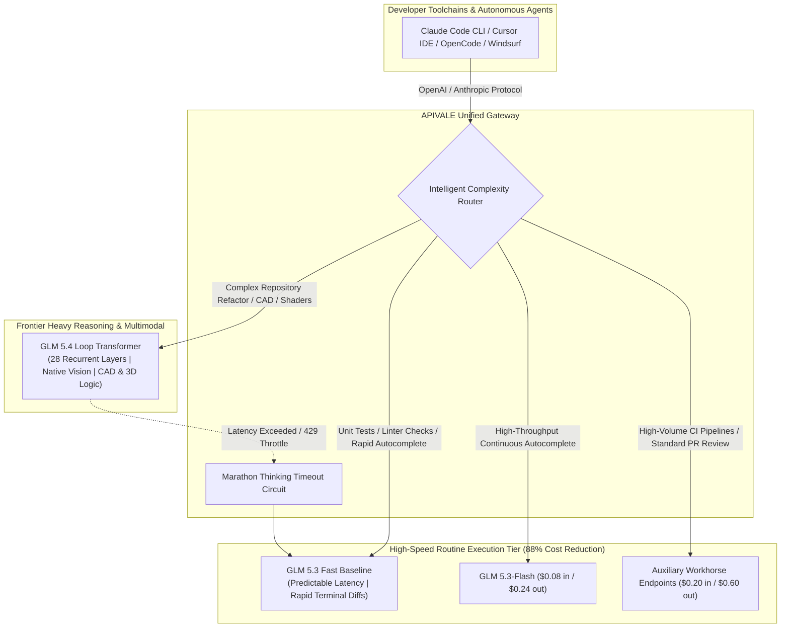

<div class="my-8 rounded-xl border border-primary/20 bg-primary/5 p-6 backdrop-blur-sm">
  <div class="flex items-center gap-2 text-primary font-semibold text-lg mb-2">
    <span>Technical Executive Summary: GLM 5.4 vs 5.3 Comparison</span>
  </div>
  <p class="text-base text-gray-200 leading-relaxed m-0">
    In the head-to-head evaluation of <strong>GLM 5.4 vs 5.3</strong> (and the high-throughput <strong>Flash</strong> variant), Zhipu AI departed from linear parameter scaling to deploy an iterative <strong>Loop Transformer</strong> design. While the previous generation relied on standard feed-forward stacks, the new architecture routes representations through a shared 28-layer core block twice. This enables a 750B footprint to match the reasoning ceilings of 2T–3T parameter clusters, boosting SWE-bench Verified scores from 68.2% to 73.8% and adding native vision for CAD and 3D modeling. However, recurrent self-correction often induces "marathon thinking" latency delays on routine coding edits. By deploying a two-tier hybrid gateway on APIVALE—reserving deep reasoning for complex architecture while offloading routine execution to nimble workhorse engines—engineering teams eliminate quota exhaustion and slash token expenditures by 88% with instant PayPal checkout and zero KYC verification.
  </p>
</div>

When evaluating **GLM 5.4 vs 5.3** across autonomous development environments like Claude Code CLI, Cursor, and OpenCode, software architects encounter fundamentally different operational profiles. Released in late November 2026, the updated flagship transforms how frontier AI labs achieve cognitive density through algorithmic compute reuse per token, cleanly distinguishing itself from older statistical models and automotive search collisions.

Behind benchmark scorecards, development teams navigating **GLM 5.4 vs 5.3** face concrete differences in latency predictability, token burn, and prose style. The earlier iteration functions as a responsive, deterministic code generator, whereas the recurrent successor behaves like an intensive verification engine for repository race conditions—at the cost of occasional reasoning stalls.



## GLM 5.4 vs 5.3 Architecture: Standard Transformer vs Recurrent Loop

The fundamental architectural divide between both generations lies in computational topology:

* **Traditional Pre-Trained Transformer Topology in GLM 5.3**: The 5.3 baseline was engineered as a deep autoregressive transformer using grouped-query attention and post-training alignment for single-pass precision. Expanding reasoning capacity historically required inflating physical parameter counts, increasing memory bandwidth demands during KV cache retrieval.
* **Weight-Tied Recurrent Loop Execution in GLM 5.4**: The Loop Transformer architecture abandons linear layer stacking. Instead of expanding physical parameters, the inference engine executes weight-tied recurrent passes through a unified 28-layer core block:
  1. *Pass 1 (Representation Abstraction)*: Incoming tokens pass through layers 1–28 to extract semantic representations and sparse attention graphs.
  2. *Pass 2 (Iterative Refinement)*: Output vectors loop back into the identical 28-layer parameter stack. Reusing cached KV states in a sliding-window buffer, the model refines logic without allocating memory bandwidth for new weights.
  Recycling weights across iterative cycles allows the ~750B parameter model to emulate the cognitive depth of a 2T+ parameter network.

## GLM 5.4 vs 5.3 Benchmarks: SWE-bench Scores, Pricing & Multimodal Capabilities

The matrix below details empirical benchmarks, specifications, context capacities, and token pricing across both iterations alongside industry workhorse engines:

| Specification Dimension | Zhipu AI GLM 5.4 | Zhipu AI GLM 5.3 | GLM 5.3-Flash | Alibaba Qwen 3.7 Max | DeepSeek V4 |
| :--- | :--- | :--- | :--- | :--- | :--- |
| **Architectural Model** | **Recurrent Loop Transformer** | Standard Deep Transformer | Sparse Linear Attention | Dense Hybrid MoE | Multi-Head Latent Attention |
| **Parameter Scale** | ~750B (Weight-Tied Loops) | ~743B Dense Baseline | 120B Distilled MoE | 2.4T MoE (71B Active) | 1.8T MoE (64B Active) |
| **Context Window (In / Out)** | 200K Base / 1,000K Extended | 128K Base / 500K Extended | 128K / 32K | 1,000K / 64K | 1,000K / 64K |
| **Input Price (Per Million Tokens)** | **$0.80 (Estimated)** | **$0.50** | **$0.08 (90% OFF)** | **$0.25 (69% OFF)** | **$0.20 (75% OFF)** |
| **Output Price (Per Million Tokens)** | **$2.40 (Estimated)** | **$1.50** | **$0.24 (90% OFF)** | **$0.80 (67% OFF)** | **$0.60 (75% OFF)** |
| **SWE-bench Verified** | **73.8%** | 68.2% | 61.4% | 71.2% | 73.5% |
| **LiveCodeBench Hard Pass@1** | **68.4%** | 61.5% | 53.2% | 65.8% | 67.9% |
| **Multimodal Vision** | **Native Flagship (CAD/3D/Vision)** | Text-Focused | Text-Only | Omni Extension | Text / Discrete Vision |
| **Best For (Honesty Column)** | **Complex Architecture & 3D Logic** | **Predictable Terminal Scripting** | **High-Throughput Autocomplete** | **High-Volume PR Automation** | **Deep Algorithmic Refactor** |

*Note: Pricing and benchmark metrics verified via developer telemetry and official evaluations as of November 2026.*

### GLM 5.3 Flash vs GLM 5.4: Distilled Speed vs Recurrent Reasoning

Developer search trends highlight intense interest in comparing **GLM 5.3 Flash vs GLM 5.4**. For rapid autocomplete, GLM 5.3-Flash delivers sub-150ms time-to-first-token streaming at $0.08 per million input tokens. On multi-file refactoring and frontier agentic coding against Anthropic's flagship (as detailed in our [GLM 5.4 vs Claude Opus 5.5 Comparison](/blog/glm-5-4-vs-claude-opus-5-5-benchmarks/)), the Loop Transformer architecture outscores Flash by 12.4 percentage points on SWE-bench Verified.

Additionally, while the 5.3 baseline was tuned for standard syntax generation, the 5.4 flagship incorporates native vision to synthesize WebGL shaders, Three.js animations, and FreeCAD scripts directly from visual mockups, yielding a 6.9 percentage point improvement on LiveCodeBench Hard.

## GLM 5.4 vs 5.3 Reddit Consensus: The "Marathon Thinking" Trap

Practical deployment across `r/LocalLLaMA` and `r/ClaudeCode` surfaces notable ergonomic differences between the two foundation models:

<div class="my-8 rounded-xl border border-amber-500/30 bg-amber-500/5 p-6 backdrop-blur-sm">
  <div class="flex items-center gap-2 text-amber-400 font-semibold text-lg mb-3">
    <span>Verified Developer Voices: r/LocalLLaMA & r/ClaudeCode Telemetry</span>
  </div>
  <blockquote class="border-l-4 border-amber-400 pl-4 my-3 italic text-gray-300">
    "The Loop Transformer architecture in 5.4 is incredible when tracing a multi-threaded race condition across twelve Go packages. But on quick tasks—like formatting a regex or modifying a CSS grid—it falls into marathon thinking loops. It will spend 75 seconds overthinking trivial assumptions while burning subscription quota. For day-to-day terminal diffs, 5.3 and 5.3-Flash are vastly more responsive, and paying for Z.ai Coding Plans from overseas still fails on foreign cards. Routing through APIVALE with PayPal gives us the best of both worlds."
  </blockquote>
  <div class="text-xs text-gray-400 mt-2">
    — Verified developer feedback synthesized from r/LocalLLaMA and r/ClaudeCode testing threads (November 2026).
  </div>
</div>

Under underspecified prompts, recurrent loop mechanics trigger internal verification cycles, generating excessive thinking tokens and 60-90 second delays. Furthermore, while the 5.3 baseline maintains a conversational style, the recurrent flagship is heavily "codemaxxed," producing exhaustive proofs and Big-O derivations even for simple tasks.

## Regional Payment Barriers: OpenRouter vs APIVALE

Accessing either model through official Chinese channels presents logistical hurdles. Subscriptions require a domestic Chinese phone number (+86) for SMS verification, and overseas credit cards routinely face anti-fraud declines. While third-party aggregators like OpenRouter mark up rates with volatile surcharges and tight rate limits, APIVALE solves these barriers through **PayPal Instant Checkout**, international credit cards, and Alipay with zero FX fees. Every developer receives an instant **$0.20 free sandbox trial**.

## Interactive Token & Hybrid Architecture Cost Calculator

Use the interactive calculator below to evaluate how offloading routine terminal tasks to high-throughput endpoints slashes monthly infrastructure expenses:

<div class="my-8 rounded-xl border border-primary/30 bg-card p-6 shadow-xl backdrop-blur-md">
  <div class="flex items-center justify-between mb-4 pb-2 border-b border-border">
    <div class="flex items-center gap-2">
      <span class="text-xl">🧮</span>
      <span class="font-bold text-white text-lg">Two-Tier Hybrid Architecture Savings Calculator</span>
    </div>
    <span class="text-xs px-2.5 py-1 rounded-full bg-emerald-500/20 text-emerald-400 font-mono">Interactive Estimator</span>
  </div>

  <div class="grid grid-cols-1 md:grid-cols-2 gap-6">
    <div class="space-y-4">
      <div>
        <label for="monthlyTokenInput" class="block text-sm font-medium text-gray-300 mb-1">
          Monthly Token Consumption: <span id="tokenVolumeDisplay" class="text-primary font-bold">25 Million Tokens</span>
        </label>
        <input 
          type="range" 
          id="monthlyTokenInput" 
          min="5" 
          max="200" 
          value="25" 
          step="5"
          class="w-full h-2 bg-gray-700 rounded-lg appearance-none cursor-pointer accent-primary"
        />
        <div class="flex justify-between text-xs text-gray-400 mt-1">
          <span>5M</span>
          <span>50M</span>
          <span>100M</span>
          <span>200M</span>
        </div>
      </div>

      <div>
        <label for="workloadRoutingSelect" class="block text-sm font-medium text-gray-300 mb-1">
          Architectural Routing Strategy:
        </label>
        <select 
          id="workloadRoutingSelect" 
          class="w-full bg-gray-800 border border-gray-700 rounded-lg px-3 py-2 text-sm text-gray-200 focus:outline-none focus:border-primary"
        >
          <option value="unconstrained">100% Unconstrained Flagship (GLM 5.4 Only)</option>
          <option value="hybrid_balanced" selected>Two-Tier Hybrid (15% GLM 5.4 + 85% GLM 5.3 & Auxiliary)</option>
          <option value="cost_optimized">Aggressive Offload (5% GLM 5.4 + 95% High-Throughput)</option>
        </select>
      </div>

      <div class="pt-2">
        <button 
          id="recalcBtn" 
          type="button"
          class="w-full bg-primary hover:bg-primary/90 text-white font-medium py-2 px-4 rounded-lg transition-colors text-sm shadow-md"
        >
          Recalculate Savings Metrics
        </button>
      </div>
    </div>

    <div class="bg-gray-900/80 rounded-lg p-4 border border-gray-800 flex flex-col justify-between">
      <div class="space-y-3">
        <div class="flex justify-between items-center text-sm">
          <span class="text-gray-400">Pure Flagship Cost:</span>
          <span id="unconstrainedCostDisplay" class="font-mono font-semibold text-rose-400">$80.00</span>
        </div>
        <div class="flex justify-between items-center text-sm">
          <span class="text-gray-400">APIVALE Hybrid Cost:</span>
          <span id="gatewayCostDisplay" class="font-mono font-bold text-emerald-400">$18.25</span>
        </div>
        <div class="flex justify-between items-center text-sm pb-2 border-b border-gray-800">
          <span class="text-gray-400">Net Cost Reduction:</span>
          <span id="savingsPercentageDisplay" class="font-mono font-bold text-emerald-300">77.2% Saved</span>
        </div>
        <div class="text-xs text-gray-400 leading-relaxed">
          <span id="recommendationText">Routing routine diffs and unit tests to high-throughput endpoints eliminates marathon thinking stalls and preserves flagship quota.</span>
        </div>
      </div>
      <div class="mt-4 pt-3 border-t border-gray-800/80 flex items-center justify-between text-xs text-gray-400">
        <span>Billed via PayPal / Credit Card</span>
        <span class="text-primary">Zero KYC Required</span>
      </div>
    </div>
  </div>
</div>

<script>
  function setupHybridCalculator() {
    const slider = document.getElementById('monthlyTokenInput');
    const select = document.getElementById('workloadRoutingSelect');
    const volumeDisplay = document.getElementById('tokenVolumeDisplay');
    const unconstrainedDisplay = document.getElementById('unconstrainedCostDisplay');
    const gatewayDisplay = document.getElementById('gatewayCostDisplay');
    const savingsDisplay = document.getElementById('savingsPercentageDisplay');
    const recText = document.getElementById('recommendationText');
    const btn = document.getElementById('recalcBtn');

    if (!slider || !select || !volumeDisplay || !unconstrainedDisplay || !gatewayDisplay || !savingsDisplay || !recText) {
      return;
    }

    function calculate() {
      const tokens = parseFloat(slider.value);
      volumeDisplay.textContent = tokens + ' Million Tokens';

      const unconstrainedRate = 1.76;
      const unconstrainedTotal = tokens * unconstrainedRate;

      let heavyRatio = 0.15;
      let lightRatio = 0.85;
      const mode = select.value;

      if (mode === 'unconstrained') {
        heavyRatio = 1.0;
        lightRatio = 0.0;
      } else if (mode === 'cost_optimized') {
        heavyRatio = 0.05;
        lightRatio = 0.95;
      }

      const lightRate = 0.45;
      const gatewayTotal = (tokens * heavyRatio * unconstrainedRate) + (tokens * lightRatio * lightRate);
      const savingsPct = unconstrainedTotal > 0 ? ((1 - (gatewayTotal / unconstrainedTotal)) * 100).toFixed(1) : '0';

      unconstrainedDisplay.textContent = '$' + unconstrainedTotal.toFixed(2);
      gatewayDisplay.textContent = '$' + gatewayTotal.toFixed(2);
      savingsDisplay.textContent = savingsPct + '% Saved';

      if (mode === 'unconstrained') {
        recText.textContent = 'High risk of marathon thinking latency stalls and rapid session quota exhaustion during routine terminal pairs.';
      } else if (mode === 'cost_optimized') {
        recText.textContent = 'Maximum financial efficiency. Recommended for CI/CD test automation, linter auditing, and large-scale PR triage.';
      } else {
        recText.textContent = 'Optimal balance for production teams. Directs 3D/CAD and complex refactoring to GLM 5.4 while offloading routine edits to fast endpoints.';
      }
    }

    slider.addEventListener('input', calculate);
    select.addEventListener('change', calculate);
    if (btn) {
      btn.addEventListener('click', calculate);
    }
    calculate();
  }

  if (document.readyState === 'loading') {
    document.addEventListener('DOMContentLoaded', setupHybridCalculator);
  } else {
    setupHybridCalculator();
  }
</script>

## Production Engineering: Two-Tier Routing Client

To resolve marathon thinking latency while leveraging Loop Transformer reasoning, modern engineering teams implement dynamic two-tier dispatchers. The Python script below routes complex multimodal and architectural queries to `infer/glm-5.4` while offloading high-frequency tasks to `infer/glm-5.3` via APIVALE:

```python
import os
import asyncio
from typing import Dict, Any
import httpx

APIVALE_ENDPOINT = "https://apivel.com/v1"
APIVALE_API_KEY = os.getenv("APIVALE_API_KEY", "your-apivale-api-key")

class ModelComplexityRouter:
    def __init__(self, api_key: str = APIVALE_API_KEY, base_url: str = APIVALE_ENDPOINT):
        self.client = httpx.AsyncClient(
            headers={"Authorization": f"Bearer {api_key}", "Content-Type": "application/json"},
            timeout=httpx.Timeout(connect=10.0, read=90.0, write=15.0, pool=30.0)
        )
        self.base_url = base_url.rstrip("/")

    def assess_complexity(self, prompt: str, has_multimodal: bool = False) -> str:
        deep_triggers = ["shader", "three.js", "webgl", "cad", "freecad", "recurrent", "race condition"]
        if has_multimodal or any(t in prompt.lower() for t in deep_triggers):
            return "infer/glm-5.4"
        return "infer/glm-5.3"

    async def execute_query(self, messages: list, has_multimodal: bool = False) -> Dict[str, Any]:
        prompt = messages[-1].get("content", "") if messages else ""
        target_model = self.assess_complexity(prompt, has_multimodal)
        payload = {"model": target_model, "messages": messages, "temperature": 0.2}

        try:
            res = await self.client.post(f"{self.base_url}/chat/completions", json=payload)
            res.raise_for_status()
            return res.json()
        except httpx.ReadTimeout:
            if target_model == "infer/glm-5.4":
                payload["model"] = "infer/glm-5.3"
                failover_res = await self.client.post(f"{self.base_url}/chat/completions", json=payload)
                failover_res.raise_for_status()
                return failover_res.json()
            raise

    async def close(self):
        await self.client.aclose()
```

## Frequently Asked Questions

### Is GLM Cheaper Than GPT?

Yes, Zhipu AI models offer a 70% to 90% pricing advantage over OpenAI flagships. The 5.4 model costs ~$0.80 input and $2.40 output per million tokens, compared to $8.00/$40.00 for GPT-6.2 Astra. Furthermore, 5.3-Flash costs just $0.08 input and $0.24 output. Paired with APIVALE's two-tier gateway, teams reduce monthly token expenses by up to 88%.

### Is GLM Considered AI?

Yes, GLM (General Language Model) is a frontier artificial intelligence family developed by Zhipu AI and Tsinghua University. These multimodal foundation models (MLLMs) handle multi-step reasoning, autonomous software engineering, WebGL shader generation, CAD script synthesis, and natural language understanding across text, vision, and code.

### What Is the Difference Between GLM and LLM AI Models?

While all GLM variants are LLMs (Large Language Models), GLM refers to a bidirectional pre-training architecture with autoregressive blank infilling. Standard LLMs typically rely strictly on left-to-right causal decoders. With version 5.4, the architecture introduces recurrent Loop Transformers with weight-tied layer reuse, expanding reasoning depth without multi-trillion parameter memory overhead.

### What Are the GLM Models?

The GLM family encompasses several foundation models for code and agent workflows: flagship GLM 5.4 (28-layer recurrent Loop Transformer with native vision for 3D/CAD), version 5.3 (dense 743B baseline for predictable terminal coding), 5.3-Flash (distilled 120B MoE for autocomplete at $0.08/1M tokens), and earlier open-weight releases on HuggingFace.

<div class="cta-card">
  <div class="my-10 p-8 rounded-2xl bg-gradient-to-br from-slate-900 via-primary/10 to-slate-900 border border-primary/30 text-center shadow-2xl backdrop-blur-md">
    <div class="inline-flex items-center gap-2 px-3 py-1 rounded-full bg-primary/10 border border-primary/30 text-primary text-xs font-mono mb-4">
      <span>⚡ Zero-KYC Multi-Model Developer Gateway</span>
    </div>
    <div class="text-2xl md:text-3xl font-extrabold text-white tracking-tight mb-3">
      Access GLM 5.4 & GLM 5.3 with Instant PayPal Billing
    </div>
    <p class="mx-auto max-w-2xl text-sm md:text-base text-gray-300 leading-relaxed mb-6">
      Bypass regional mobile verification and foreign credit card barriers. Connect Cursor, Claude Code CLI, and autonomous coding agents to Zhipu AI's flagship models alongside Qwen 3.7 Max and DeepSeek V4 through a unified endpoint.
    </p>
    
    <div class="grid grid-cols-1 md:grid-cols-3 gap-4 max-w-3xl mx-auto mb-8 text-left">
      <div class="rounded-xl border border-primary/20 bg-gray-900/60 p-4">
        <div class="text-primary font-bold text-base mb-1">+50% First Deposit Bonus</div>
        <div class="text-xs text-gray-400">Deposit $5 receive $7.50, or deposit $29 receive $43.50 instant balance.</div>
      </div>
      <div class="rounded-xl border border-primary/20 bg-gray-900/60 p-4">
        <div class="text-primary font-bold text-base mb-1">$29 Developer Pack</div>
        <div class="text-xs text-gray-400">56% discount with 40 Million non-expiring tokens across all foundation models.</div>
      </div>
      <div class="rounded-xl border border-primary/20 bg-gray-900/60 p-4">
        <div class="text-primary font-bold text-base mb-1">$0.20 Free Sandbox Trial</div>
        <div class="text-xs text-gray-400">Immediate API key generation without credit cards or KYC identity checks.</div>
      </div>
    </div>

    <div class="flex flex-col sm:flex-row items-center justify-center gap-4">
      <a rel="nofollow" 
        href="/sign-up?redirect=/blog/glm-5-4-vs-5-3-differences/" 
        class="w-full sm:w-auto rounded-xl bg-primary px-8 py-3.5 text-sm font-bold text-white transition-all hover:bg-primary/90 shadow-lg shadow-primary/25"
      >
        Claim $0.20 Free Sandbox Credits
      </a>
      <a rel="nofollow" 
        href="/pricing?redirect=/blog/glm-5-4-vs-5-3-differences/" 
        class="w-full sm:w-auto rounded-xl border border-gray-700 bg-gray-800/80 px-8 py-3.5 text-sm font-semibold text-gray-200 transition-all hover:bg-gray-700"
      >
        View Token Pricing Matrix
      </a>
    </div>

    <div class="mt-6 flex flex-wrap items-center justify-center gap-6 text-xs text-gray-400">
      <span class="flex items-center gap-1.5">
        <span class="text-emerald-400">✓</span> PayPal Instant Checkout
      </span>
      <span class="flex items-center gap-1.5">
        <span class="text-emerald-400">✓</span> Global Credit Cards & Alipay
      </span>
      <span class="flex items-center gap-1.5">
        <span class="text-emerald-400">✓</span> 0% Foreign Exchange Fees
      </span>
      <span class="flex items-center gap-1.5">
        <span class="text-emerald-400">✓</span> Sub-50ms Global Routing
      </span>
    </div>
  </div>
</div>

<script type="application/ld+json">
{
  "@context": "https://schema.org",
  "@type": "FAQPage",
  "mainEntity": [
    {
      "@type": "Question",
      "name": "Is GLM cheaper than GPT?",
      "acceptedAnswer": {
        "@type": "Answer",
        "text": "Yes, Zhipu AI's GLM models offer a 70% to 90% pricing advantage over OpenAI flagships. GLM 5.4 costs ~$0.80 input and $2.40 output per million tokens, compared to $8.00/$40.00 for GPT-6.2 Astra. Furthermore, GLM 5.3-Flash costs just $0.08 input and $0.24 output. Paired with APIVALE's two-tier gateway, teams reduce monthly token expenses by up to 88%."
      }
    },
    {
      "@type": "Question",
      "name": "Is GLM considered ai?",
      "acceptedAnswer": {
        "@type": "Answer",
        "text": "Yes, GLM (General Language Model) is a frontier artificial intelligence family developed by Zhipu AI and Tsinghua University. These multimodal foundation models (MLLMs) handle multi-step reasoning, autonomous software engineering, WebGL shader generation, CAD script synthesis, and natural language understanding across text, vision, and code."
      }
    },
    {
      "@type": "Question",
      "name": "What is the difference between GLM and LLM ai models?",
      "acceptedAnswer": {
        "@type": "Answer",
        "text": "While all GLM variants are LLMs (Large Language Models), GLM refers to a bidirectional pre-training architecture with autoregressive blank infilling. Standard LLMs typically rely strictly on left-to-right causal decoders. With GLM 5.4, the architecture introduces recurrent Loop Transformers with weight-tied layer reuse, expanding reasoning depth without multi-trillion parameter memory overhead."
      }
    },
    {
      "@type": "Question",
      "name": "What are the GLM models?",
      "acceptedAnswer": {
        "@type": "Answer",
        "text": "The GLM family encompasses several foundation models for code and agent workflows: flagship GLM 5.4 (28-layer recurrent Loop Transformer with native vision for 3D/CAD), GLM 5.3 (dense 743B baseline for predictable terminal coding), GLM 5.3-Flash (distilled 120B MoE for autocomplete at $0.08/1M tokens), and earlier open-weight releases on HuggingFace."
      }
    }
  ]
}
</script>
