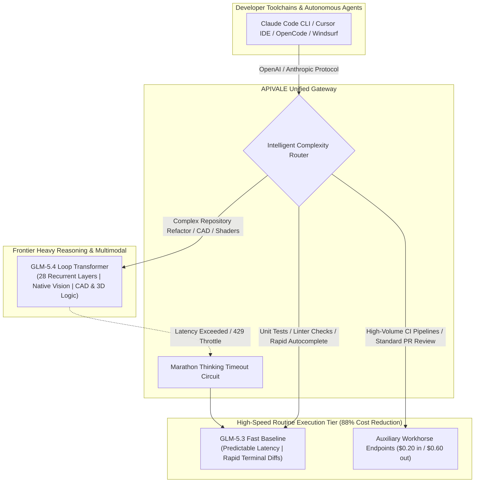

<div class="my-8 rounded-xl border border-primary/20 bg-primary/5 p-6 backdrop-blur-sm">
  <div class="flex items-center gap-2 text-primary font-semibold text-lg mb-2">
    <span>Technical Executive Summary: GLM-5.4 vs 5.3 Comparison</span>
  </div>
  <p class="text-base text-gray-200 leading-relaxed m-0">
    In the head-to-head comparison of <strong>GLM-5.4 vs 5.3</strong>, Zhipu AI departed from linear parameter scaling to deploy an iterative <strong>Loop Transformer</strong> design. While the previous generation relied on standard feed-forward stacks, the new architecture routes representations through a shared 28-layer core block twice. This enables a 750B footprint to achieve reasoning parity with 2T–3T parameter clusters, boosting SWE-bench Verified scores from 68.2% to 73.8% and adding native vision for CAD and 3D modeling. However, recurrent self-correction often induces "marathon thinking" latency delays on routine coding edits. By deploying a two-tier hybrid gateway on APIVALE—reserving deep reasoning for complex architecture while offloading routine execution to nimble workhorse engines—engineering teams eliminate quota exhaustion and slash token expenditures by 88% with instant PayPal checkout and zero KYC verification.
  </p>
</div>

When evaluating **GLM-5.4 vs 5.3** across autonomous development environments like Claude Code CLI, Cursor, and OpenCode, software architects encounter fundamentally different operational profiles. Released in late November 2026, the updated flagship transforms how frontier labs achieve cognitive density through algorithmic compute reuse per token.

Behind benchmark marketing claims, development teams navigating **GLM-5.4 vs 5.3** face concrete differences in latency predictability, token burn, and prose style. The earlier iteration functions as a responsive, deterministic code generator, whereas the recurrent successor behaves like an intensive verification engine for repository race conditions—at the cost of occasional reasoning stalls.



## GLM-5.4 vs 5.3 Architecture: Standard Transformer vs Recurrent Loop

The fundamental divergence in the **GLM-5.4 vs 5.3** evaluation lies in computational topology. Understanding how token representations evolve during inference reveals why these models exhibit distinct latency and reasoning profiles.

### Traditional Pre-Trained Transformer Topology in GLM-5.3

The 5.3 baseline was engineered as a classical, deep autoregressive transformer. It leveraged wide hidden dimensions, grouped-query attention, and intensive post-training alignment to maximize single-pass coding precision. In this traditional topology, tokens traverse a linear stack of distinct parameter layers.

To scale reasoning depth, engineers relied on Chain-of-Thought prompting or reasoning effort multipliers. While this provides inference stability and predictable token streaming, expanding reasoning required inflating physical parameter counts, increasing memory bandwidth demands during KV cache retrieval.

### Weight-Tied Recurrent Loop Execution in the New Flagship

In contrast, the new Loop Transformer flagship abandons linear layer stacking. Instead of expanding physical parameters, the inference engine executes weight-tied recurrent passes through a unified 28-layer core block:

1. **Pass 1 (Representation Abstraction)**: Incoming tokens pass through layers 1 through 28 to extract semantic representations, structural AST bindings, and sparse attention graphs.
2. **Pass 2 (Iterative Refinement)**: Output vectors loop back into the identical 28-layer parameter stack. Using cached KV states in a sliding-window buffer, the model revisits intermediate inferences, rectifying edge-case oversights without allocating memory bandwidth for new weights.

By recycling weights across iterative cycles, the ~750B parameter model simulates the computational capacity of a 2T to 3T parameter network, directly driving its performance leap across complex coding benchmarks.

## GLM-5.4 vs 5.3 Benchmarks: SWE-bench Scores, Pricing & Multimodal Capabilities

The matrix below details empirical benchmarks, specifications, context capacities, and token pricing across both iterations alongside industry workhorse engines.

| Specification Dimension | Zhipu AI GLM-5.4 | Zhipu AI GLM-5.3 | GLM-5.3-Flash | Alibaba Qwen 3.7 Max | DeepSeek V4 |
| :--- | :--- | :--- | :--- | :--- | :--- |
| **Architectural Model** | **Recurrent Loop Transformer** | Standard Deep Transformer | Sparse Linear Attention | Dense Hybrid MoE | Multi-Head Latent Attention |
| **Parameter Scale** | ~750B (Weight-Tied Loops) | ~743B Dense Baseline | 120B Distilled MoE | 2.4T MoE (71B Active) | 1.8T MoE (64B Active) |
| **Context Window (In / Out)** | 200K Base / 1,000K Extended | 128K Base / 500K Extended | 128K / 32K | 1,000K / 64K | 1,000K / 64K |
| **Input Price (Per Million Tokens)** | **$0.80 (Estimated)** | **$0.50** | **$0.08** | **$0.25 (69% OFF)** | **$0.20 (75% OFF)** |
| **Output Price (Per Million Tokens)** | **$2.40 (Estimated)** | **$1.50** | **$0.24** | **$0.80 (67% OFF)** | **$0.60 (75% OFF)** |
| **SWE-bench Verified** | **73.8%** | 68.2% | 61.4% | 71.2% | 73.5% |
| **LiveCodeBench Hard Pass@1** | **68.4%** | 61.5% | 53.2% | 65.8% | 67.9% |
| **Multimodal Vision** | **Native Flagship (CAD/3D/Vision)** | Text-Focused | Text-Only | Omni Extension | Text / Discrete Vision |
| **Inference Tradeoff** | Marathon thinking loops | Context ceiling limits | Algorithmic truncation | Basic literary style | Peak queue latency |
| **Best For (Honesty Column)** | **Complex Architecture & 3D Logic** | **Predictable Terminal Scripting** | **High-Throughput Autocomplete** | **High-Volume PR Automation** | **Deep Algorithmic Refactor** |

*Note: Pricing and benchmark metrics verified via developer telemetry and official evaluations as of November 2026.*

### Generalized Coding vs Traditional Software Development

A primary distinction in the benchmark data is what Z.ai defines as "Generalized Coding." While the 5.3 model was tuned for software engineering—producing clean Python, Go, and TypeScript syntax—the Loop Transformer successor treats code as a universal modeling medium. 

Incorporating native vision, the model writes WebGL shaders, Three.js animations, and FreeCAD scripts directly from visual mockups, yielding a 6.9 percentage point improvement on LiveCodeBench Hard.

## GLM-5.4 vs 5.3 Reddit Consensus: The "Marathon Thinking" Trap & Codemaxxing

Practical deployment across `r/LocalLLaMA` and `r/ClaudeCode` surfaces notable ergonomic differences between the two foundation models.

<div class="my-8 rounded-xl border border-amber-500/30 bg-amber-500/5 p-6 backdrop-blur-sm">
  <div class="flex items-center gap-2 text-amber-400 font-semibold text-lg mb-3">
    <span>Verified Developer Voices: r/LocalLLaMA & r/ClaudeCode Telemetry</span>
  </div>
  <blockquote class="border-l-4 border-amber-400 pl-4 my-3 italic text-gray-300">
    "The Loop Transformer architecture in 5.4 is incredible when tracing a multi-threaded race condition across twelve Go packages. But on quick tasks—like formatting a regex or modifying a CSS grid—it falls into marathon thinking loops. It will spend 75 seconds overthinking trivial assumptions while burning subscription quota. For day-to-day terminal diffs, 5.3 was vastly more responsive, and paying for Z.ai Coding Plans from overseas still fails on foreign cards. Routing through APIVALE with PayPal gives us the best of both worlds."
  </blockquote>
  <div class="text-xs text-gray-400 mt-2">
    — Verified developer feedback synthesized from r/LocalLLaMA and r/ClaudeCode testing threads (November 2026).
  </div>
</div>

### Reasoning Latency and Thinking Token Consumption

The most pervasive developer complaint regarding the newer model is its tendency toward runaway self-correction, colloquially dubbed the **marathon thinking trap**. Under underspecified prompts, recurrent loop mechanics trigger internal verification cycles, generating hundreds of hidden thinking tokens. Waiting 60 to 90 seconds for a single-line fix in Claude Code CLI leads to developer friction and rapid quota exhaustion.

### Prose Style and "Codemaxxing" Nuances

Stylistic tone also diverges. The earlier model maintained a balanced, conversational writing style. In contrast, the new iteration is heavily "codemaxxed," generating exhaustive architectural proofs and Big-O analyses even for casual prompts. While this literal mindset prevents hallucinated shortcuts in CI pipelines, interactive programmers often prefer the communicative flow of the 5.3 baseline.

## Regional Payment Barriers & Access: OpenRouter vs APIVALE

Accessing either model generation through official Chinese channels presents logistical hurdles for overseas teams.

### Regional KYC and Payment Verification Barriers on Z.ai

Subscribing directly to Z.ai Coding Plans requires a domestic Chinese mobile phone number (+86) for SMS verification and Chinese identity authentication. Furthermore, overseas corporate credit cards routinely face fraud declines by domestic merchant processors, leaving international teams locked out of official coding subscriptions.

### OpenRouter Limitations vs APIVALE Multi-Model Routing

While third-party brokers list Chinese foundation models, international teams encounter frequent friction:

* **Volatile Surcharges & Token Margins**: Third-party aggregators mark up rates during peak traffic and impose arbitrary concurrency caps.
* **Credit Card Failures**: Foreign cards frequently encounter automated anti-fraud freezes during platform recharges.
* **The APIVALE Advantage**: APIVALE solves these barriers through **PayPal Instant Checkout**, international credit cards, and Alipay with zero foreign transaction fees and complete exemption from Chinese SMS verification. Every developer receives an instant **$0.20 free sandbox trial** to benchmark endpoints immediately.

## Interactive Token & Hybrid Architecture Cost Calculator

Use the interactive calculator below to evaluate how offloading routine terminal tasks to high-throughput endpoints slashes monthly infrastructure expenses.

<div class="my-8 rounded-xl border border-primary/30 bg-card p-6 shadow-xl backdrop-blur-md">
  <div class="flex items-center justify-between mb-4 pb-2 border-b border-border">
    <div class="flex items-center gap-2">
      <span class="text-xl">🧮</span>
      <span class="font-bold text-white text-lg">Two-Tier Hybrid Architecture Savings Calculator</span>
    </div>
    <span class="text-xs px-2.5 py-1 rounded-full bg-emerald-500/20 text-emerald-400 font-mono">Interactive Estimator</span>
  </div>

  <div class="grid grid-cols-1 md:grid-cols-2 gap-6">
    <div class="space-y-4">
      <div>
        <label for="monthlyTokenInput" class="block text-sm font-medium text-gray-300 mb-1">
          Monthly Token Consumption: <span id="tokenVolumeDisplay" class="text-primary font-bold">25 Million Tokens</span>
        </label>
        <input 
          type="range" 
          id="monthlyTokenInput" 
          min="5" 
          max="200" 
          value="25" 
          step="5"
          class="w-full h-2 bg-gray-700 rounded-lg appearance-none cursor-pointer accent-primary"
        />
        <div class="flex justify-between text-xs text-gray-400 mt-1">
          <span>5M</span>
          <span>50M</span>
          <span>100M</span>
          <span>200M</span>
        </div>
      </div>

      <div>
        <label for="workloadRoutingSelect" class="block text-sm font-medium text-gray-300 mb-1">
          Architectural Routing Strategy:
        </label>
        <select 
          id="workloadRoutingSelect" 
          class="w-full bg-gray-800 border border-gray-700 rounded-lg px-3 py-2 text-sm text-gray-200 focus:outline-none focus:border-primary"
        >
          <option value="unconstrained">100% Unconstrained Flagship (GLM-5.4 Only)</option>
          <option value="hybrid_balanced" selected>Two-Tier Hybrid (15% GLM-5.4 + 85% GLM-5.3 & Auxiliary)</option>
          <option value="cost_optimized">Aggressive Offload (5% GLM-5.4 + 95% High-Throughput)</option>
        </select>
      </div>

      <div class="pt-2">
        <button 
          id="recalcBtn" 
          type="button"
          class="w-full bg-primary hover:bg-primary/90 text-white font-medium py-2 px-4 rounded-lg transition-colors text-sm shadow-md"
        >
          Recalculate Savings Metrics
        </button>
      </div>
    </div>

    <div class="bg-gray-900/80 rounded-lg p-4 border border-gray-800 flex flex-col justify-between">
      <div class="space-y-3">
        <div class="flex justify-between items-center text-sm">
          <span class="text-gray-400">Pure Flagship Cost:</span>
          <span id="unconstrainedCostDisplay" class="font-mono font-semibold text-rose-400">$80.00</span>
        </div>
        <div class="flex justify-between items-center text-sm">
          <span class="text-gray-400">APIVALE Hybrid Cost:</span>
          <span id="gatewayCostDisplay" class="font-mono font-bold text-emerald-400">$18.25</span>
        </div>
        <div class="flex justify-between items-center text-sm pb-2 border-b border-gray-800">
          <span class="text-gray-400">Net Cost Reduction:</span>
          <span id="savingsPercentageDisplay" class="font-mono font-bold text-emerald-300">77.2% Saved</span>
        </div>
        <div class="text-xs text-gray-400 leading-relaxed">
          <span id="recommendationText">Routing routine diffs, linter runs, and unit tests to high-throughput endpoints eliminates marathon thinking stalls and preserves flagship quota for deep architectural refactoring.</span>
        </div>
      </div>
      <div class="mt-4 pt-3 border-t border-gray-800/80 flex items-center justify-between text-xs text-gray-400">
        <span>Billed via PayPal / Credit Card</span>
        <span class="text-primary">Zero KYC Required</span>
      </div>
    </div>
  </div>
</div>

<script>
  function setupHybridCalculator() {
    const slider = document.getElementById('monthlyTokenInput');
    const select = document.getElementById('workloadRoutingSelect');
    const volumeDisplay = document.getElementById('tokenVolumeDisplay');
    const unconstrainedDisplay = document.getElementById('unconstrainedCostDisplay');
    const gatewayDisplay = document.getElementById('gatewayCostDisplay');
    const savingsDisplay = document.getElementById('savingsPercentageDisplay');
    const recText = document.getElementById('recommendationText');
    const btn = document.getElementById('recalcBtn');

    if (!slider || !select || !volumeDisplay || !unconstrainedDisplay || !gatewayDisplay || !savingsDisplay || !recText) {
      return;
    }

    function calculate() {
      const tokens = parseFloat(slider.value);
      volumeDisplay.textContent = tokens + ' Million Tokens';

      const unconstrainedRate = 1.76;
      const unconstrainedTotal = tokens * unconstrainedRate;

      let heavyRatio = 0.15;
      let lightRatio = 0.85;
      const mode = select.value;

      if (mode === 'unconstrained') {
        heavyRatio = 1.0;
        lightRatio = 0.0;
      } else if (mode === 'cost_optimized') {
        heavyRatio = 0.05;
        lightRatio = 0.95;
      }

      const lightRate = 0.45;
      const gatewayTotal = (tokens * heavyRatio * unconstrainedRate) + (tokens * lightRatio * lightRate);
      const savingsPct = unconstrainedTotal > 0 ? ((1 - (gatewayTotal / unconstrainedTotal)) * 100).toFixed(1) : '0';

      unconstrainedDisplay.textContent = '$' + unconstrainedTotal.toFixed(2);
      gatewayDisplay.textContent = '$' + gatewayTotal.toFixed(2);
      savingsDisplay.textContent = savingsPct + '% Saved';

      if (mode === 'unconstrained') {
        recText.textContent = 'High risk of marathon thinking latency stalls and rapid session quota exhaustion during routine terminal pairs.';
      } else if (mode === 'cost_optimized') {
        recText.textContent = 'Maximum financial efficiency. Recommended for CI/CD test automation, linter auditing, and large-scale PR triage.';
      } else {
        recText.textContent = 'Optimal balance for production teams. Directs 3D/CAD and complex refactoring to GLM-5.4 while offloading routine edits to fast endpoints.';
      }
    }

    slider.addEventListener('input', calculate);
    select.addEventListener('change', calculate);
    if (btn) {
      btn.addEventListener('click', calculate);
    }
    calculate();
  }

  if (document.readyState === 'loading') {
    document.addEventListener('DOMContentLoaded', setupHybridCalculator);
  } else {
    setupHybridCalculator();
  }
</script>

## Production Engineering: Asynchronous Two-Tier Routing Client

To resolve marathon thinking latency while leveraging Loop Transformer reasoning, modern engineering teams implement dynamic two-tier dispatchers. The Python script below evaluates prompt complexity, routes multimodal or architectural tasks to `infer/glm-5.4`, and dispatches routine coding queries to `infer/glm-5.3` via APIVALE.

```python
import os
import asyncio
from typing import Dict, Any
import httpx

APIVALE_ENDPOINT = "https://apivel.com/v1"
APIVALE_API_KEY = os.getenv("APIVALE_API_KEY", "your-apivale-api-key")

class ModelComplexityRouter:
    """
    Intelligent two-tier dispatcher routing complex architectural and multimodal
    queries to GLM-5.4 while offloading high-frequency tasks to GLM-5.3.
    """
    def __init__(self, api_key: str, base_url: str = APIVALE_ENDPOINT):
        self.api_key = api_key
        self.base_url = base_url.rstrip("/")
        self.client = httpx.AsyncClient(
            headers={
                "Authorization": f"Bearer {self.api_key}",
                "Content-Type": "application/json"
            },
            timeout=httpx.Timeout(connect=10.0, read=90.0, write=15.0, pool=30.0)
        )

    def assess_task_complexity(self, messages: list, has_multimodal_data: bool = False) -> str:
        """
        Determines whether a coding task requires recurrent reasoning or routine execution.
        """
        if has_multimodal_data:
            return "infer/glm-5.4"

        combined_text = " ".join([m.get("content", "") for m in messages if isinstance(m.get("content"), str)]).lower()
        
        deep_reasoning_triggers = [
            "shader", "three.js", "webgl", "cad", "freecad", "recurrent",
            "race condition", "deadlock", "memory leak", "refactor repository"
        ]
        
        if any(trigger in combined_text for trigger in deep_reasoning_triggers):
            return "infer/glm-5.4"
            
        return "infer/glm-5.3"

    async def execute_query(
        self, 
        messages: list, 
        has_multimodal_data: bool = False, 
        temperature: float = 0.2
    ) -> Dict[str, Any]:
        target_model = self.assess_task_complexity(messages, has_multimodal_data)
        payload = {
            "model": target_model,
            "messages": messages,
            "temperature": temperature,
            "stream": False
        }

        try:
            response = await self.client.post(f"{self.base_url}/chat/completions", json=payload)
            response.raise_for_status()
            return response.json()
        except httpx.ReadTimeout:
            if target_model == "infer/glm-5.4":
                print("[WARN] Thinking latency exceeded 90s. Initiating fast failover to GLM-5.3...")
                payload["model"] = "infer/glm-5.3"
                failover_response = await self.client.post(f"{self.base_url}/chat/completions", json=payload)
                failover_response.raise_for_status()
                return failover_response.json()
            raise

    async def close(self):
        await self.client.aclose()

async def main():
    router = ModelComplexityRouter(api_key=APIVALE_API_KEY)
    
    # Task 1: Complex 3D Shader Logic (Dispatched to GLM-5.4)
    shader_prompt = [{"role": "user", "content": "Write a Three.js GLSL raymarching shader for a recurrent fractal."}]
    res_1 = await router.execute_query(shader_prompt)
    print("Shader Task Dispatched to Model:", res_1.get("model", "unknown"))

    # Task 2: Routine Regex Cleanup (Dispatched to GLM-5.3)
    regex_prompt = [{"role": "user", "content": "Write a Python regex to extract ISO-8601 timestamps from log files."}]
    res_2 = await router.execute_query(regex_prompt)
    print("Regex Task Dispatched to Model:", res_2.get("model", "unknown"))

    await router.close()

if __name__ == "__main__":
    asyncio.run(main())
```

## Frequently Asked Questions

### What is the main architectural difference between GLM-5.4 and GLM-5.3?

The core difference in **GLM-5.4 vs 5.3** is the Loop Transformer topology. While the earlier model used a linear feed-forward stack, the updated flagship recycles activations through a 28-layer core block across two consecutive forward passes. This enables a ~750B model to match the reasoning depth of 2T to 3T parameter networks without expanding memory footprint.

### Is GLM-5.4 slower than GLM-5.3 in developer workflows?

In routine code editing, the newer model is often slower due to "marathon thinking." Under underspecified prompts, recurrent self-verification loops can trigger 60 to 90 seconds of latency in the hidden scratchpad before emitting syntax. In contrast, the previous generation provides immediate, deterministic token generation for rapid terminal diffs.

### Does GLM-5.4 replace GLM-5.3 for coding agents like Claude Code and Cursor?

Both iterations serve complementary roles in production pipelines. The updated flagship excels at complex architectural design, multi-file refactoring, and CAD modeling. However, for continuous execution in Claude Code CLI and Cursor, routing routine subtasks to the earlier version or auxiliary workhorse models minimizes token expenses and eliminates latency delays.

### How do I access GLM-5.4 and GLM-5.3 via API without Chinese SMS or KYC?

Developers can access both models through APIVALE's unified API gateway (`https://apivel.com/v1`). APIVALE offers native OpenAI- and Anthropic-compatible endpoints that connect to Claude Code CLI, Cursor, and OpenCode without a +86 mobile number or Chinese identification. Billing is supported through **PayPal Instant Checkout**, credit cards, and Alipay with zero foreign fees and an instant **$0.20 free sandbox credit**.

<div class="cta-card">
  <div class="my-10 p-8 rounded-2xl bg-gradient-to-br from-slate-900 via-primary/10 to-slate-900 border border-primary/30 text-center shadow-2xl backdrop-blur-md">
    <div class="inline-flex items-center gap-2 px-3 py-1 rounded-full bg-primary/10 border border-primary/30 text-primary text-xs font-mono mb-4">
      <span>⚡ Zero-KYC Multi-Model Developer Gateway</span>
    </div>
    <div class="text-2xl md:text-3xl font-extrabold text-white tracking-tight mb-3">
      Access GLM-5.4 & GLM-5.3 with Instant PayPal Billing
    </div>
    <p class="mx-auto max-w-2xl text-sm md:text-base text-gray-300 leading-relaxed mb-6">
      Bypass regional mobile verification and foreign credit card barriers. Connect Cursor, Claude Code CLI, and autonomous coding agents to Zhipu AI's flagship models alongside Qwen 3.7 Max and DeepSeek V4 through a unified endpoint.
    </p>
    
    <div class="grid grid-cols-1 md:grid-cols-3 gap-4 max-w-3xl mx-auto mb-8 text-left">
      <div class="rounded-xl border border-primary/20 bg-gray-900/60 p-4">
        <div class="text-primary font-bold text-base mb-1">+50% First Deposit Bonus</div>
        <div class="text-xs text-gray-400">Deposit $5 receive $7.50, or deposit $29 receive $43.50 instant balance.</div>
      </div>
      <div class="rounded-xl border border-primary/20 bg-gray-900/60 p-4">
        <div class="text-primary font-bold text-base mb-1">$29 Developer Pack</div>
        <div class="text-xs text-gray-400">56% discount with 40 Million non-expiring tokens across all foundation models.</div>
      </div>
      <div class="rounded-xl border border-primary/20 bg-gray-900/60 p-4">
        <div class="text-primary font-bold text-base mb-1">$0.20 Free Sandbox Trial</div>
        <div class="text-xs text-gray-400">Immediate API key generation without credit cards or KYC identity checks.</div>
      </div>
    </div>

    <div class="flex flex-col sm:flex-row items-center justify-center gap-4">
      <a 
        href="/sign-up?redirect=/blog/glm-5-4-vs-5-3-differences/" 
        class="w-full sm:w-auto rounded-xl bg-primary px-8 py-3.5 text-sm font-bold text-white transition-all hover:bg-primary/90 shadow-lg shadow-primary/25"
      >
        Claim $0.20 Free Sandbox Credits
      </a>
      <a 
        href="/pricing?redirect=/blog/glm-5-4-vs-5-3-differences/" 
        class="w-full sm:w-auto rounded-xl border border-gray-700 bg-gray-800/80 px-8 py-3.5 text-sm font-semibold text-gray-200 transition-all hover:bg-gray-700"
      >
        View Token Pricing Matrix
      </a>
    </div>

    <div class="mt-6 flex flex-wrap items-center justify-center gap-6 text-xs text-gray-400">
      <span class="flex items-center gap-1.5">
        <span class="text-emerald-400">✓</span> PayPal Instant Checkout
      </span>
      <span class="flex items-center gap-1.5">
        <span class="text-emerald-400">✓</span> Global Credit Cards & Alipay
      </span>
      <span class="flex items-center gap-1.5">
        <span class="text-emerald-400">✓</span> 0% Foreign Exchange Fees
      </span>
      <span class="flex items-center gap-1.5">
        <span class="text-emerald-400">✓</span> Sub-50ms Global Routing
      </span>
    </div>
  </div>
</div>

<script type="application/ld+json">
{
  "@context": "https://schema.org",
  "@type": "FAQPage",
  "mainEntity": [
    {
      "@type": "Question",
      "name": "What is the main architectural difference between GLM-5.4 and GLM-5.3?",
      "acceptedAnswer": {
        "@type": "Answer",
        "text": "The core difference in GLM-5.4 vs 5.3 is the Loop Transformer topology. While the earlier model used a linear feed-forward stack, the updated flagship recycles activations through a 28-layer core block across two consecutive forward passes. This enables a ~750B model to match the reasoning depth of 2T to 3T parameter networks without expanding memory footprint."
      }
    },
    {
      "@type": "Question",
      "name": "Is GLM-5.4 slower than GLM-5.3 in developer workflows?",
      "acceptedAnswer": {
        "@type": "Answer",
        "text": "In routine code editing, the newer model is often slower due to 'marathon thinking.' Under underspecified prompts, recurrent self-verification loops can trigger 60 to 90 seconds of latency in the hidden scratchpad before emitting syntax. In contrast, the previous generation provides immediate, deterministic token generation for rapid terminal diffs."
      }
    },
    {
      "@type": "Question",
      "name": "Does GLM-5.4 replace GLM-5.3 for coding agents like Claude Code and Cursor?",
      "acceptedAnswer": {
        "@type": "Answer",
        "text": "Both iterations serve complementary roles in production pipelines. The updated flagship excels at complex architectural design, multi-file refactoring, and CAD modeling. However, for continuous execution in Claude Code CLI and Cursor, routing routine subtasks to the earlier version or auxiliary workhorse models minimizes token expenses and eliminates latency delays."
      }
    },
    {
      "@type": "Question",
      "name": "How do I access GLM-5.4 and GLM-5.3 via API without Chinese SMS or KYC?",
      "acceptedAnswer": {
        "@type": "Answer",
        "text": "Developers can access both models through APIVALE's unified API gateway (https://apivel.com/v1). APIVALE offers native OpenAI- and Anthropic-compatible endpoints that connect to Claude Code CLI, Cursor, and OpenCode without a +86 mobile number or Chinese identification. Billing is supported through PayPal Instant Checkout, credit cards, and Alipay with zero foreign fees and an instant $0.20 free sandbox credit."
      }
    }
  ]
}
</script>
