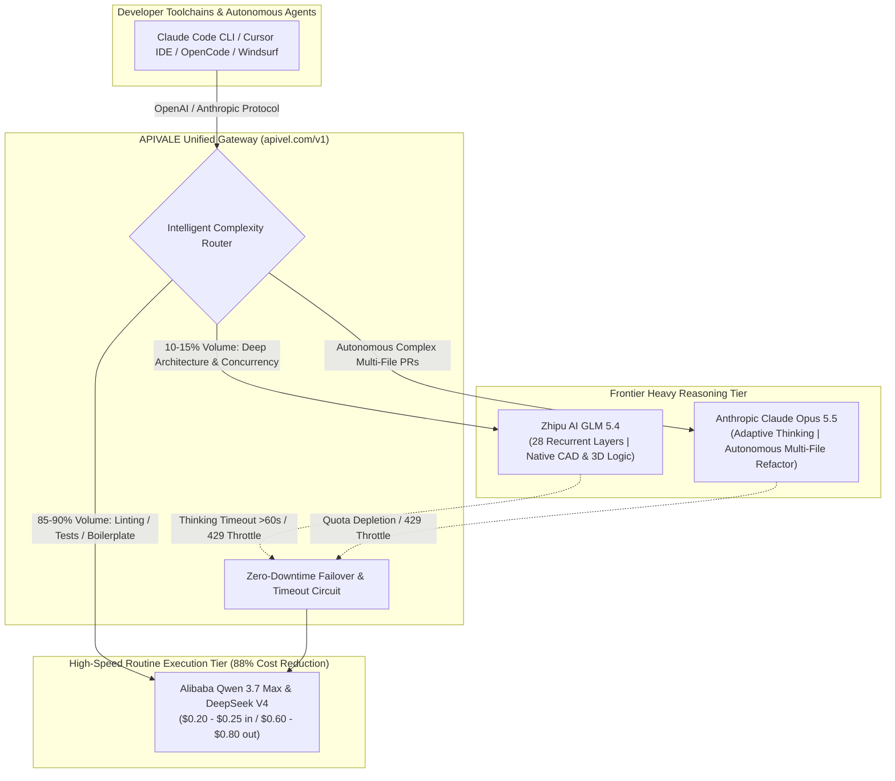

<div class="my-8 rounded-xl border border-primary/20 bg-primary/5 p-6 backdrop-blur-sm">
  <div class="flex items-center gap-2 text-primary font-semibold text-lg mb-2">
    <span>Technical Executive Summary: GLM 5.4 vs Claude Opus 5.5</span>
  </div>
  <p class="text-base text-gray-200 leading-relaxed m-0">
    In the head-to-head comparison of <strong>GLM 5.4 vs Claude Opus 5.5</strong>, engineering teams evaluate a strategic trade-off between recurrent compute density and autonomous agency. Zhipu AI's flagship employs a 28-layer <strong>Loop Transformer</strong> that recycles representations twice per forward pass, achieving 73.8% on SWE-bench from a 750B footprint at an estimated 75% cost reduction. Meanwhile, Anthropic's flagship delivers 74.8% SWE-bench with adaptive thinking at $4 input and $20 output per million tokens. Both introduce operational hurdles: recurrent passes risk marathon thinking latency stalls, while Anthropic's mandatory reasoning tokens burn five-hour quotas. Deploying a two-tier hybrid gateway on APIVALE—routing 85% to 90% of routine CI/CD tasks to agile workhorses while reserving frontier calls for complex architectural logic—eliminates rate limits and reduces token spend by 88% via instant PayPal checkout and zero KYC.
  </p>
</div>

The developer evaluation of **GLM 5.4 vs Claude Opus 5.5** escalated following late November 2026 releases. As software teams integrate autonomous CLI tools like Claude Code CLI, Cursor, and Windsurf, choosing between these two intelligence tiers directly affects build throughput, CI stability, and cloud API expenses.

Rather than competing strictly on parameter volume, **GLM 5.4 vs Claude Opus 5.5** highlights contrasting AI design philosophies. Anthropic scales massive parameters and adaptive thinking budgets for multi-file independence. Zhipu AI challenges linear scaling by executing recurrent depth through shared weights. Analyzing their architectural profiles, benchmark results, and failure modes is essential for architects building reliable agentic toolchains.



## GLM 5.4 vs Claude Opus 5.5 Architecture: Loop Transformer vs Adaptive Thinking

The fundamental architectural divergence between both flagships lies in how internal reasoning is computed and executed:

* **Weight-Tied Recurrent Loop Execution in GLM 5.4**: Detailed in our [GLM-5.4 Loop Architecture Breakdown](/blog/glm-5-4-architecture-benchmarks-api/) and [GLM 5.4 vs 5.3 Differences Report](/blog/glm-5-4-vs-5-3-differences/), Zhipu AI's foundation model replaces single-pass scaling with a 28-layer Loop Transformer. Representations circulate through shared attention blocks twice before token emission begins. This gives an active 750B parameter model the reasoning depth of multi-trillion parameter networks while natively parsing CAD and 3D diagrams. However, recurrent cycles increase sequential latency.
* **Autonomous Adaptive Thinking in Claude Opus 5.5**: As analyzed in our [Claude Opus 5.5 Pricing & Rate Limits Guide](/blog/claude-opus-5-5-price-limits-claude-code/) and [GPT-6.2 Astra vs Opus 5.5 Differences](/blog/gpt-6-2-astra-vs-opus-5-5-differences/), Anthropic enforces non-disableable adaptive thinking across a 1-million-token context window. Controlled via effort parameters (`low`, `medium`, `high`, `max`), the model autonomously inspects git histories, creates test suites, and iterates on failing builds with minimal human supervision.

## GLM 5.4 vs Claude Opus 5.5 Benchmarks: SWE-bench Scores & API Pricing

The matrix below compares verified engineering benchmarks, context capacities, token pricing, and operational trade-offs across frontier and workhorse models:

| Specification Dimension | Zhipu AI GLM 5.4 | Anthropic Claude Opus 5.5 | Alibaba Qwen 3.7 Max | DeepSeek V4 |
| :--- | :--- | :--- | :--- | :--- |
| **Architectural Model** | 28-Layer Loop Transformer | Dense Frontier + Adaptive Thinking | Hybrid MoE Foundation | Multi-Head Latent MoE |
| **Context Window (In / Out)** | 1,000K / 64K | 1,000K / 128K | 1,000K / 64K | 1,000K / 64K |
| **Input Price (Per Million Tokens)** | **~$0.80** *(Coding Plan)* | **$4.00** *(Standard API)* | **$0.25 (94% OFF)** | **$0.20 (95% OFF)** |
| **Output Price (Per Million Tokens)** | **~$2.40** *(Coding Plan)* | **$20.00** *(Standard API)* | **$0.80 (96% OFF)** | **$0.60 (97% OFF)** |
| **Cache Read Price (Per 1M)** | $0.20 (Estimated) | $0.20 (95% discount) | $0.05 (Wholesale) | $0.04 (Wholesale) |
| **SWE-bench Verified** | 73.8% | 74.8% | 71.2% | 73.5% |
| **CursorBench Agent Score** | 72.4% | 76.5% | 70.8% | 72.9% |
| **Developer Consensus Tradeoff** | Marathon thinking latency on loops | Thinking token bloat & quota exhaustion | Literary English phrasing is basic | High-concurrency queue wait spikes |
| **Best For (Honesty Column)** | **Heavy iterative debugging & CAD** | **Autonomous multi-file refactoring** | **High-volume PR review & boilerplate** | **Deep algorithmic unit testing** |

*Note: Pricing and benchmark metrics verified via vendor technical documents and independent evaluations as of November 2026.*

### SWE-bench Verified and Token Pricing Realities

On SWE-bench Verified, Anthropic leads at 74.8% versus 73.8% for Zhipu AI's recurrent model. Anthropic's flagship shows higher persistence when modifying multiple files in CursorBench (76.5% vs 72.4%). However, GLM 5.4 matches closed models when tracing race conditions in distributed microservices.

Pricing highlights substantial divergence: Anthropic charges $4.00 input and $20.00 output per million tokens ($0.20 cache reads), whereas Zhipu AI's developer coding plans offer an effective rate of ~$0.80 input and ~$2.40 output—slashing token costs by roughly 75% to 88%.

## GLM 5.4 vs Claude Opus 5.5 Reddit Consensus: Thinking Traps & Rate Limits

Practical deployment reports across `r/ClaudeCode` and `r/LocalLLaMA` surface key trade-offs between both architectures:

<div class="my-8 rounded-xl border border-amber-500/30 bg-amber-500/5 p-6 backdrop-blur-sm">
  <div class="flex items-center gap-2 text-amber-400 font-semibold text-lg mb-3">
    <span>Verified Developer Voices: r/ClaudeCode & r/LocalLLaMA Telemetry</span>
  </div>
  <blockquote class="border-l-4 border-amber-400 pl-4 my-3 italic text-gray-300">
    "Anthropic's flagship in Claude Code handles repository refactoring flawlessly, but thinking mode cannot be toggled off. At high effort, the model consumes 15,000 hidden reasoning tokens before outputting a concise diff. You easily exhaust 5-hour session quotas during morning sprints."
  </blockquote>
  <blockquote class="border-l-4 border-amber-400 pl-4 my-3 italic text-gray-300">
    "The Loop Transformer architecture solves complex concurrency bugs cleanly, rivaling Western flagships. However, on recursive logic, it enters marathon thinking loops for 60 to 90 seconds. If your gateway timeout is set to 30 seconds, your agent fails prematurely."
  </blockquote>
  <div class="text-xs text-gray-400 mt-2">
    — Developer discussions synthesized from r/ClaudeCode and r/LocalLLaMA communities (November 2026).
  </div>
</div>

Under unconstrained prompts, adaptive thinking tokens multiply, triggering rate limits or billing alerts. Conversely, GLM 5.4's recurrent layers can trigger sequential latency stalls, requiring client timeouts above 60 seconds to avoid false failure alerts.

## Regional Payment Barriers: OpenRouter vs APIVALE

Accessing either model through official single-vendor portals creates administrative friction. Subscribing to Chinese developer plans requires a domestic phone number (+86) and frequently triggers foreign card rejections. Similarly, direct Anthropic subscriptions hit strict tier rate limits. While aggregators like OpenRouter add volatile surcharges, APIVALE resolves payment barriers via **PayPal Instant Checkout**, global credit cards, and Alipay with zero foreign exchange fees. Every new account receives a **$0.20 free sandbox trial**.

## Interactive Cost Calculator: Hybrid Architecture Savings

Estimate monthly token expenditures under pure frontier deployments versus an optimized two-tier hybrid gateway architecture using this interactive tool:

<div class="my-8 rounded-xl border border-primary/20 bg-card p-6 shadow-lg">
  <div class="flex items-center justify-between border-b border-border pb-4 mb-6">
    <div>
      <div class="font-bold text-lg text-white">GLM 5.4 vs Opus 5.5 Cost & Savings Calculator</div>
      <div class="text-xs text-gray-400">Estimate monthly budget reduction when offloading 85% routine coding tasks to Qwen 3.7 Max / DeepSeek V4</div>
    </div>
    <span class="rounded bg-primary/20 px-2.5 py-1 text-xs font-semibold text-primary">Interactive Estimator</span>
  </div>

  <div class="grid grid-cols-1 md:grid-cols-2 gap-6 mb-6">
    <div>
      <label for="monthly-tokens" class="block text-sm font-medium text-gray-300 mb-2">
        Monthly Total Token Volume: <span id="token-val" class="text-primary font-bold">25M Tokens</span>
      </label>
      <input type="range" id="monthly-tokens" min="5" max="100" step="5" value="25" class="w-full h-2 bg-gray-700 rounded-lg appearance-none cursor-pointer accent-primary" />
    </div>

    <div>
      <label for="frontier-model" class="block text-sm font-medium text-gray-300 mb-2">Primary Frontier Target Model</label>
      <select id="frontier-model" class="w-full rounded-lg border border-border bg-gray-800 px-3 py-2 text-sm text-gray-200 focus:border-primary focus:outline-none">
        <option value="opus" selected>Anthropic Claude Opus 5.5 ($4.00 in / $20.00 out)</option>
        <option value="glm">Zhipu AI GLM 5.4 Coding Plan (~$0.80 in / $2.40 out)</option>
      </select>
    </div>
  </div>

  <div class="grid grid-cols-1 md:grid-cols-3 gap-4 pt-4 border-t border-border">
    <div class="rounded-lg bg-gray-900/60 p-4 text-center border border-gray-800">
      <div class="text-xs text-gray-400 mb-1">Pure Frontier Spending</div>
      <div id="pure-cost" class="text-2xl font-bold text-red-400">$200.00</div>
    </div>
    <div class="rounded-lg bg-gray-900/60 p-4 text-center border border-gray-800">
      <div class="text-xs text-gray-400 mb-1">Two-Tier Hybrid Spending</div>
      <div id="hybrid-cost" class="text-2xl font-bold text-green-400">$37.25</div>
    </div>
    <div class="rounded-lg bg-primary/10 p-4 text-center border border-primary/30">
      <div class="text-xs text-primary mb-1">Monthly Cost Reduction</div>
      <div id="savings-pct" class="text-2xl font-extrabold text-primary">81.4%</div>
      <div id="savings-amount" class="text-xs text-gray-300 mt-1">Save $162.75 / Month</div>
    </div>
  </div>

  <div class="mt-6 flex justify-end">
    <button type="button" id="recalc-btn" class="rounded-lg bg-primary px-4 py-2 text-xs font-semibold text-white shadow-md hover:bg-primary/90 transition-colors">
      Recalculate Savings
    </button>
  </div>
</div>

<script>
  (function() {
    const slider = document.getElementById('monthly-tokens');
    const tokenVal = document.getElementById('token-val');
    const modelSelect = document.getElementById('frontier-model');
    const pureCostEl = document.getElementById('pure-cost');
    const hybridCostEl = document.getElementById('hybrid-cost');
    const savingsPctEl = document.getElementById('savings-pct');
    const savingsAmountEl = document.getElementById('savings-amount');
    const btn = document.getElementById('recalc-btn');

    function calculate() {
      const tokensM = parseFloat(slider.value);
      tokenVal.textContent = tokensM + 'M Tokens';

      const inTokens = tokensM * 0.75;
      const outTokens = tokensM * 0.25;

      let frontierIn = 4.0;
      let frontierOut = 20.0;
      if (modelSelect.value === 'glm') {
        frontierIn = 0.80;
        frontierOut = 2.40;
      }

      const pureCost = (inTokens * frontierIn) + (outTokens * frontierOut);
      const workhorseIn = 0.25;
      const workhorseOut = 0.80;

      const hybridFrontier = ((inTokens * 0.15) * frontierIn) + ((outTokens * 0.15) * frontierOut);
      const hybridWorkhorse = ((inTokens * 0.85) * workhorseIn) + ((outTokens * 0.85) * workhorseOut);
      const totalHybrid = hybridFrontier + hybridWorkhorse;

      const savedVal = pureCost - totalHybrid;
      const savedRatio = ((savedVal / pureCost) * 100).toFixed(1);

      pureCostEl.textContent = '$' + pureCost.toFixed(2);
      hybridCostEl.textContent = '$' + totalHybrid.toFixed(2);
      savingsPctEl.textContent = savedRatio + '%';
      savingsAmountEl.textContent = 'Save $' + savedVal.toFixed(2) + ' / Month';
    }

    slider.addEventListener('input', calculate);
    modelSelect.addEventListener('change', calculate);
    btn.addEventListener('click', calculate);
    calculate();
  })();
</script>

## Production Engineering: Two-Tier Unified Routing Client

The following Python script illustrates how to configure an asynchronous dual-model routing layer with timeout safeguards and automated failover:

```python
import os
import httpx
from openai import OpenAI

# Initialize unified APIVALE client (OpenAI & Anthropic Compatible)
client = OpenAI(
    api_key=os.environ.get("APIVALE_API_KEY"),
    base_url="https://apivel.com/v1"
)

def route_coding_task(prompt: str, is_deep_architecture: bool = False) -> str:
    """
    Routes engineering tasks between Frontier specialists and workhorses
    with automated failover circuits.
    """
    primary_model = "infer/glm-5.4" if is_deep_architecture else "infer/qwen3.7-max"
    fallback_model = "claude-opus-5-5" if is_deep_architecture else "infer/deepseek-v4"

    try:
        response = client.chat.completions.create(
            model=primary_model,
            messages=[
                {"role": "system", "content": "You are a principal software engineer."},
                {"role": "user", "content": prompt}
            ],
            timeout=75.0  # Protects against marathon thinking stalls
        )
        return response.choices[0].message.content

    except (httpx.TimeoutException, httpx.HTTPStatusError):
        fallback_resp = client.chat.completions.create(
            model=fallback_model,
            messages=[
                {"role": "system", "content": "You are a principal software engineer."},
                {"role": "user", "content": prompt}
            ],
            timeout=45.0
        )
        return fallback_resp.choices[0].message.content
```

### Terminal CLI Configuration for Claude Code and OpenCode

Developers can route terminal commands through APIVALE's unified proxy by setting environment variables:

```bash
# Claude Code CLI unified routing setup
export ANTHROPIC_BASE_URL="https://apivel.com/v1"
export ANTHROPIC_API_KEY="your-apivale-key"

# OpenCode / Cursor endpoint configuration
export OPENAI_BASE_URL="https://apivel.com/v1"
export OPENAI_API_KEY="your-apivale-key"
```

## Frequently Asked Questions

### Is GLM-5.4 Better Than Claude Opus 5.5 for Coding?

Both models serve distinct roles. Anthropic's flagship scores 74.8% on SWE-bench Verified versus 73.8% for Zhipu AI's recurrent model, leading in autonomous multi-file refactoring and tool precision. However, GLM 5.4 matches closed models on concurrency debugging and CAD visual logic at roughly 75% to 88% lower token costs.

### How Does GLM-5.4 Pricing Compare to Claude Opus 5.5?

Claude Opus 5.5 costs $4.00 input and $20.00 output per million tokens ($0.20 cache reads). GLM 5.4 operates at an effective rate of ~$0.80 input and ~$2.40 output via developer coding plans, providing significant cost advantages for continuous integration workflows.

### Can You Disable Thinking Mode in Claude Opus 5.5 or GLM-5.4?

No, thinking mode cannot be disabled in the Anthropic model; passing disabled parameters returns an API error. Reasoning depth must be adjusted via the `effort` parameter. In GLM 5.4, recurrent layer cycling is an intrinsic architectural property of the Loop Transformer and cannot be turned off, though gateway timeouts prevent pipeline stalling.

### How to Route GLM-5.4 and Claude Opus 5.5 on APIVALE Gateway?

APIVALE provides a unified gateway endpoint (`https://apivel.com/v1`) supporting OpenAI and Anthropic SDK protocols. Developers can invoke `infer/glm-5.4`, `claude-opus-5-5`, `infer/qwen3.7-max`, and `infer/deepseek-v4` using a single API key, supported by automated failover, PayPal Instant Checkout, and zero KYC verification.

<script type="application/ld+json">
{
  "@context": "https://schema.org",
  "@type": "TechArticle",
  "headline": "GLM 5.4 vs Claude Opus 5.5: Loop Architecture, SWE Benchmarks & API Pricing",
  "description": "Comprehensive engineering evaluation of GLM 5.4 vs Claude Opus 5.5: comparing Loop Transformer architecture, SWE benchmarks, token pricing, Reddit rate limits, and two-tier hybrid gateway routing.",
  "author": {
    "@type": "Person",
    "name": "Sofia Costa",
    "jobTitle": "Senior Cloud & API Gateway Architect",
    "worksFor": {
      "@type": "Organization",
      "name": "APIVALE"
    }
  },
  "publisher": {
    "@type": "Organization",
    "name": "APIVALE",
    "url": "https://apivel.com"
  },
  "datePublished": "2026-11-24",
  "mainEntityOfPage": "https://apivel.com/blog/glm-5-4-vs-claude-opus-5-5-benchmarks/"
}
</script>

<script type="application/ld+json">
{
  "@context": "https://schema.org",
  "@type": "FAQPage",
  "mainEntity": [
    {
      "@type": "Question",
      "name": "Is GLM-5.4 Better Than Claude Opus 5.5 for Coding?",
      "acceptedAnswer": {
        "@type": "Answer",
        "text": "Claude Opus 5.5 leads SWE-bench Verified at 74.8% vs 73.8% for GLM-5.4, excelling at autonomous multi-file terminal workflows. However, GLM-5.4 matches Opus on complex iterative logic and CAD visual reasoning at an 75% to 88% token cost reduction."
      }
    },
    {
      "@type": "Question",
      "name": "How Does GLM-5.4 Pricing Compare to Claude Opus 5.5?",
      "acceptedAnswer": {
        "@type": "Answer",
        "text": "Claude Opus 5.5 costs $4.00 input and $20.00 output per million tokens ($0.20 cache reads). GLM-5.4 operates at an effective rate of ~$0.80 input and ~$2.40 output via developer coding plans, providing significant cost advantages for high-volume pipelines."
      }
    },
    {
      "@type": "Question",
      "name": "Can You Disable Thinking Mode in Claude Opus 5.5 or GLM-5.4?",
      "acceptedAnswer": {
        "@type": "Answer",
        "text": "Neither model permits disabling reasoning loops. Opus 5.5 requires managing adaptive thinking via effort levels (low to max), while GLM-5.4's recurrent execution is hardcoded into its 28-layer Loop Transformer backbone."
      }
    },
    {
      "@type": "Question",
      "name": "How to Route GLM-5.4 and Claude Opus 5.5 on APIVALE Gateway?",
      "acceptedAnswer": {
        "@type": "Answer",
        "text": "APIVALE offers a unified gateway endpoint (https://apivel.com/v1) supporting OpenAI and Anthropic schemas with automated failover across GLM 5.4, Claude Opus 5.5, Qwen 3.7 Max, and DeepSeek V4, backed by PayPal instant checkout and zero KYC."
      }
    }
  ]
}
</script>

<div class="cta-card">
  <div class="my-10 p-8 rounded-2xl bg-gradient-to-br from-slate-900 via-primary/10 to-slate-900 border border-primary/30 text-center shadow-2xl backdrop-blur-md">
    <div class="inline-flex items-center gap-2 px-3 py-1 rounded-full bg-primary/10 border border-primary/30 text-primary text-xs font-mono mb-4">
      <span>⚡ High-Performance Unified Gateway</span>
    </div>
    <div class="text-2xl font-extrabold text-white tracking-tight mb-3">Stop Burning $50/Day on Single-Vendor Rate Limits</div>
    <p class="text-sm text-gray-300 max-w-xl mx-auto leading-relaxed mb-6">
      Eliminate five-hour quota locks and marathon thinking stalls. Connect Claude Code, Cursor, and Windsurf to APIVALE's unified gateway. Access <strong>GLM 5.4</strong>, <strong>Claude Opus 5.5</strong>, <strong>Qwen 3.7 Max</strong>, and <strong>DeepSeek V4</strong> with automated failover and zero foreign exchange fees.
    </p>
    <div class="flex flex-wrap justify-center gap-4 text-xs text-gray-400 mb-6">
      <span class="flex items-center gap-1.5"><strong class="text-white">+50% First Deposit Bonus:</strong> $5 gets $7.50, $29 gets $43.50</span>
      <span class="flex items-center gap-1.5"><strong class="text-white">$29 Developer Pack:</strong> 56% OFF, 40M Tokens, No Expiration</span>
      <span class="flex items-center gap-1.5"><strong class="text-white">$0.20 Free Sandbox Trial:</strong> Zero KYC, No Credit Card Required</span>
    </div>
    <div class="flex flex-col sm:flex-row justify-center gap-4 mb-6">
      <a rel="nofollow" href="/pricing?redirect=/blog/glm-5-4-vs-claude-opus-5-5-benchmarks" class="inline-flex items-center justify-center rounded-xl bg-primary px-6 py-3 text-sm font-semibold text-white shadow-lg shadow-primary/25 hover:bg-primary/90 transition-all text-center">
        View Gateway Pricing
      </a>
      <a rel="nofollow" href="/sign-up?redirect=/blog/glm-5-4-vs-claude-opus-5-5-benchmarks" class="inline-flex items-center justify-center rounded-xl border border-border bg-gray-800/80 px-6 py-3 text-sm font-semibold text-gray-200 hover:bg-gray-700/80 transition-all text-center">
        Claim $0.20 Free Credit
      </a>
    </div>
    <div class="pt-4 border-t border-gray-800/80 flex flex-wrap items-center justify-center gap-4 text-xs text-gray-400">
      <div class="flex items-center gap-3">
        <span>Official Payment Support: <strong>PayPal Instant Checkout</strong> (Pay with PayPal)</span>
        <span>•</span>
        <span>Global Credit Cards (Visa, MasterCard, Amex)</span>
        <span>•</span>
        <span>Alipay</span>
      </div>
      <div>0% Foreign Transaction Fees • Zero Identity Verification</div>
    </div>
  </div>
</div>
