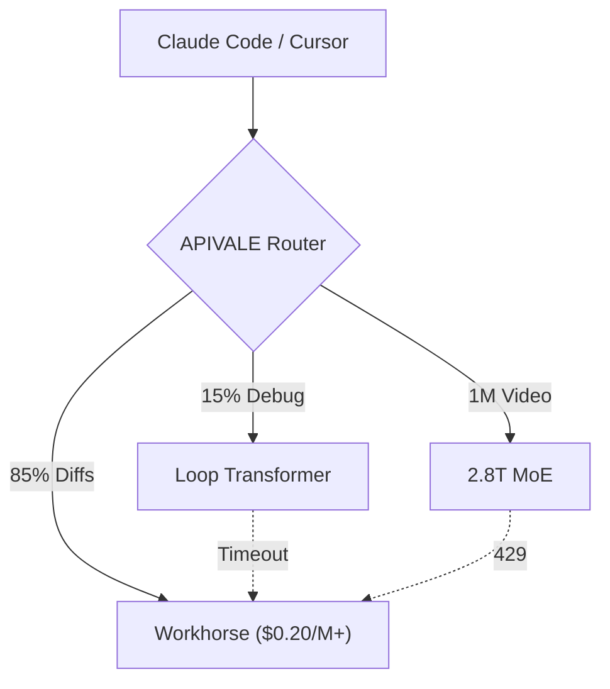

<div class="my-8 rounded-xl border border-primary/20 bg-primary/5 p-6 backdrop-blur-sm">
  <div class="flex items-center gap-2 text-primary font-semibold text-lg mb-2">
    <span>Technical Summary: GLM 5.4 vs Kimi K3 AI Models</span>
  </div>
  <p class="text-base text-gray-200 leading-relaxed m-0">
    Comparing <strong>GLM 5.4 vs Kimi K3</strong> pits Zhipu AI's recurrent <strong>Loop Transformer</strong> against Moonshot AI's 2.8-trillion-parameter sparse MoE model. Released late November 2026, Zhipu's 750B checkpoint cycles a 28-layer block twice per pass, scoring 33.2/60 on King Bench 4 (vs 32.2/60) at an effective ~$0.80/$2.40 Coding Plan rate—though weights remain plan-gated and prone to 60–90s thinking stalls. Moonshot's K3.1 Pro ships public MXFP4 weights on Hugging Face, native video input, and 65.7% Terminal-Bench 4.0 precision at $2.00/$10.00. Routing both through APIVALE's two-tier gateway—offloading 85% of routine diffs to workhorse endpoints—eliminates +86 phone locks and cuts token spend up to 86% via instant PayPal checkout.
  </p>
</div>

Evaluating **GLM 5.4 vs Kimi K3** directly determines whether terminal agents in Claude Code CLI, Cursor, and Windsurf ship clean PRs or burn budgets on stalled loops. Both Chinese frontier AI models (distinct from automotive trim queries) target million-token repositories yet diverge in compute topology, weights, and billing.

Deployed November 23, 2026, Zhipu's flagship prioritizes generalized coding and CAD vision via recurrent depth. One month earlier, Moonshot introduced its 2.8T MoE series with Kimi Delta Attention, trading weight looping for sparse capacity and open weights.



## GLM 5.4 vs Kimi K3 Architecture: Loop Transformer vs 2.8T MoE

The structural divide between **GLM 5.4 vs Kimi K3** lies in how each lab scales reasoning depth:

* **Weight-Tied Loop Execution (Zhipu AI)**: Detailed in our [GLM-5.4 Loop Architecture Deep-Dive](/blog/glm-5-4-architecture-benchmarks-api/) and [GLM 5.4 vs 5.3 Differences Report](/blog/glm-5-4-vs-5-3-differences/), Zhipu's flagship routes tokens through two sequential passes across a shared 28-layer block. Reusing sliding-window KV states grants a ~750B footprint multi-trillion reasoning parity while adding native vision for Three.js, WebGL, and CAD schematics.
* **2.8T Sparse MoE & KDA Attention (Moonshot AI)**: Covered in our [Kimi K3.1 Pro Pricing & API Guide](/blog/kimi-k3-1-pro-pricing-benchmarks-api-access/), Moonshot scales to 2.8T total weights while activating 16 of 896 experts (~104B active) per token. Kimi Delta Attention (KDA) and Attention Residuals (AttnRes) shrink KV cache memory by ~70% across a 1,048,576-token window while handling text, images, and video natively.

## GLM 5.4 vs Kimi K3 Benchmarks: Coding Scores, Open Weights & API Pricing

The matrix below compares verified benchmarks, open-weight status, context capacity, and token pricing alongside secondary execution tiers:

| Specification | Zhipu Flagship | Moonshot Flagship | Alibaba Qwen 3.7 Max | DeepSeek V4 |
| :--- | :--- | :--- | :--- | :--- |
| **Architecture** | 28-Layer Loop Transformer | 2.8T MoE (104B Active, KDA) | Hybrid MoE Foundation | Multi-Head Latent MoE |
| **Weights** | Plan-gated *(Pending)* | **Open Weights** (1.56 TB MXFP4) | Cloud / API Tier | Open Weights |
| **Context** | 1,000K *(200K Base)* | **1,048,576** *(No Surcharge)* | 1,000K Tokens | 1,000K Tokens |
| **Modalities** | Text + Image Vision | **Text + Image + Video** | Omni / Text | Text / Vision |
| **Input / 1M** | **~$0.80** *(Coding Plan)* | **$2.00** *(Standard API)* | **$0.25 (88% OFF)** | **$0.20 (90% OFF)** |
| **Output / 1M** | **~$2.40** *(Coding Plan)* | **$10.00** *($20 Highspeed)* | **$0.80 (92% OFF)** | **$0.60 (94% OFF)** |
| **King Bench 4** | **33.2 / 60 (55.3%)** | 32.2 / 60 (53.7%) | — | — |
| **Best For** | **Iterative debug & CAD** | **Open weights, video & 1M docs** | **High-volume PR reviews** | **Fast unit testing** |

*Note: Metrics compiled from King Bench 4, Terminal-Bench 4.0, and vendor docs (November 2026).*

### King Bench 4, Terminal-Bench & Flash Cost Realities

On King Bench 4, Zhipu's recurrent model hits **33.2/60 (55.3%)** at max effort, narrowly beating Moonshot's **32.2/60** and competing with closed flagships (see our [GLM 5.4 vs Claude Opus 5.5 Benchmarks](/blog/glm-5-4-vs-claude-opus-5-5-benchmarks/)). Moonshot's engine leads on **Terminal-Bench 4.0 (65.7%)** and **OfficeQA Pro v2 (64.4 SoTA)** with zero long-context surcharges.

Economically, Zhipu's Coding Plans ($18 / $80 / $168 monthly) yield ~$0.80/$2.40 effective rates—60% to 75% below Moonshot's $2.00/$10.00 API. Teams needing sub-150ms autocomplete can offload trivial edits to Flash endpoints ($0.08/$0.24) before escalating complex diffs.

## GLM 5.4 vs Kimi K3 Reddit Consensus: Marathon Thinking & Token Burn

Developer telemetry on `r/LocalLLaMA` and `r/ClaudeCode` surfaces real production trade-offs:

<div class="my-8 rounded-xl border border-amber-500/30 bg-amber-500/5 p-6 backdrop-blur-sm">
  <div class="flex items-center gap-2 text-amber-400 font-semibold text-lg mb-3">
    <span>Verified Developer Voices: r/LocalLLaMA & r/ClaudeCode Telemetry</span>
  </div>
  <blockquote class="border-l-4 border-amber-400 pl-4 my-3 italic text-gray-300">
    "Zhipu's Loop Transformer is completely codemaxxed—great for Go concurrency bugs, stiff for prose. On vague prompts, marathon thinking loops run 60–90 seconds before emitting a token, breaking IDEs with 30s timeouts."
  </blockquote>
  <blockquote class="border-l-4 border-amber-400 pl-4 my-3 italic text-gray-300">
    "Moonshot dropped K3.1 Pro weights on Hugging Face, but a 1.56 TB MXFP4 checkpoint needs >1.4 TB VRAM. Hosted accounts burn through 5-hour rolling quotas fast because multi-turn loops are verbose token hogs."
  </blockquote>
  <div class="text-xs text-gray-400 mt-2">
    — Synthesized from r/LocalLLaMA and r/ClaudeCode developer reports (November 2026).
  </div>
</div>

Recurrent loops demand client timeouts above 75 seconds, while Moonshot's sparse MoE benefits from prompt caching ($0.20–$0.50 per million cached input) and strict `max_tokens` caps.

## Global API Access & Billing: OpenRouter vs APIVALE

Mainland portals create immediate onboarding friction: Zhipu Coding Plans require a `+86` phone number and routinely decline foreign cards, while OpenRouter adds regional card blocks and variable markups. APIVALE unifies both engines behind one OpenAI/Anthropic gateway (`apivel.com/v1`) with **PayPal Instant Checkout**, global Visa/MasterCard/Amex, Alipay, **0% FX fees**, zero KYC, and a **$0.20 free trial**.

## Interactive GLM 5.4 vs Kimi K3 Cost Simulator

Estimate monthly token spend under 100% frontier usage versus a two-tier hybrid gateway offloading 85% of routine tasks:

<div class="my-8 rounded-xl border border-primary/20 bg-card p-6 shadow-lg">
  <div class="flex items-center justify-between border-b border-border pb-4 mb-6">
    <div>
      <div class="font-bold text-lg text-white">Hybrid Token Cost Calculator</div>
      <div class="text-xs text-gray-400">75% input / 25% output split with 85% workhorse offloading</div>
    </div>
    <span class="rounded bg-primary/20 px-2.5 py-1 text-xs font-semibold text-primary">Live Estimator</span>
  </div>

  <div class="grid grid-cols-1 md:grid-cols-2 gap-6 mb-6">
    <div>
      <label for="dual-tokens" class="block text-sm font-medium text-gray-300 mb-2">
        Monthly Volume: <span id="dual-token-val" class="text-primary font-bold">25M Tokens</span>
      </label>
      <input type="range" id="dual-tokens" min="5" max="100" step="5" value="25" class="w-full h-2 bg-gray-700 rounded-lg appearance-none cursor-pointer accent-primary" />
    </div>

    <div>
      <label for="dual-model" class="block text-sm font-medium text-gray-300 mb-2">Primary Frontier Model</label>
      <select id="dual-model" class="w-full rounded-lg border border-border bg-gray-800 px-3 py-2 text-sm text-gray-200 focus:border-primary focus:outline-none">
        <option value="kimi" selected>Kimi K3.1 Pro ($2.00 in / $10.00 out)</option>
        <option value="kimi-fast">Kimi K3.1 Highspeed ($2.00 in / $20.00 out)</option>
        <option value="glm">GLM 5.4 Plan Rate (~$0.80 in / $2.40 out)</option>
      </select>
    </div>
  </div>

  <div class="grid grid-cols-1 md:grid-cols-3 gap-4 pt-4 border-t border-border">
    <div class="rounded-lg bg-gray-900/60 p-4 text-center border border-gray-800">
      <div class="text-xs text-gray-400 mb-1">100% Frontier Spend</div>
      <div id="dual-pure-cost" class="text-2xl font-bold text-red-400">$100.00</div>
    </div>
    <div class="rounded-lg bg-gray-900/60 p-4 text-center border border-gray-800">
      <div class="text-xs text-gray-400 mb-1">Two-Tier Spend</div>
      <div id="dual-hybrid-cost" class="text-2xl font-bold text-green-400">$23.24</div>
    </div>
    <div class="rounded-lg bg-primary/10 p-4 text-center border border-primary/30">
      <div class="text-xs text-primary mb-1">Monthly Savings</div>
      <div id="dual-savings-pct" class="text-2xl font-extrabold text-primary">76.8%</div>
      <div id="dual-savings-amt" class="text-xs text-gray-300 mt-1">Save $76.76 / Month</div>
    </div>
  </div>

  <div class="mt-6 flex justify-end">
    <button type="button" id="dual-calc-btn" class="rounded-lg bg-primary px-4 py-2 text-xs font-semibold text-white shadow-md hover:bg-primary/90 transition-colors">
      Recalculate Savings
    </button>
  </div>
</div>

<script>
  (function() {
    const slider = document.getElementById('dual-tokens');
    const valEl = document.getElementById('dual-token-val');
    const selectEl = document.getElementById('dual-model');
    const pureEl = document.getElementById('dual-pure-cost');
    const hybridEl = document.getElementById('dual-hybrid-cost');
    const pctEl = document.getElementById('dual-savings-pct');
    const amtEl = document.getElementById('dual-savings-amt');
    const btn = document.getElementById('dual-calc-btn');

    function updateCalc() {
      const vol = parseFloat(slider.value);
      valEl.textContent = vol + 'M Tokens';
      const inM = vol * 0.75;
      const outM = vol * 0.25;

      let rateIn = 2.0, rateOut = 10.0;
      if (selectEl.value === 'kimi-fast') { rateIn = 2.0; rateOut = 20.0; }
      else if (selectEl.value === 'glm') { rateIn = 0.80; rateOut = 2.40; }

      const pure = (inM * rateIn) + (outM * rateOut);
      const hybridFrontier = ((inM * 0.15) * rateIn) + ((outM * 0.15) * rateOut);
      const hybridWork = ((inM * 0.85) * 0.25) + ((outM * 0.85) * 0.80);
      const totalHybrid = hybridFrontier + hybridWork;
      const saved = pure - totalHybrid;

      pureEl.textContent = '$' + pure.toFixed(2);
      hybridEl.textContent = '$' + totalHybrid.toFixed(2);
      pctEl.textContent = ((saved / pure) * 100).toFixed(1) + '%';
      amtEl.textContent = 'Save $' + saved.toFixed(2) + ' / Month';
    }

    slider.addEventListener('input', updateCalc);
    selectEl.addEventListener('change', updateCalc);
    btn.addEventListener('click', updateCalc);
    updateCalc();
  })();
</script>

## Production Engineering: GLM 5.4 vs Kimi K3 Hybrid Routing Client

This Python client routes tasks across both frontier engines with automatic workhorse failover:

```python
import os, httpx
from openai import OpenAI

client = OpenAI(
    api_key=os.environ.get("APIVALE_API_KEY"),
    base_url="https://apivel.com/v1",
)

def route_agent(prompt: str, mode: str = "coding") -> str:
    routes = {
        "coding": ("infer/glm-5.4", "infer/kimi-k3.1-pro"),
        "long_doc": ("infer/kimi-k3.1-pro", "infer/glm-5.4"),
        "routine": ("infer/qwen3.7-max", "infer/deepseek-v4"),
    }
    primary, fallback = routes.get(mode, routes["routine"])
    try:
        r = client.chat.completions.create(model=primary, messages=[{"role":"user","content":prompt}], timeout=90.0)
        return r.choices[0].message.content
    except (httpx.TimeoutException, httpx.HTTPStatusError):
        r = client.chat.completions.create(model=fallback, messages=[{"role":"user","content":prompt}], timeout=60.0)
        return r.choices[0].message.content
```

For Claude Code or Cursor, export gateway variables:

```bash
export ANTHROPIC_BASE_URL="https://apivel.com/v1"
export ANTHROPIC_API_KEY="sk-apivel-key"
export CLAUDE_CODE_MODEL="infer/glm-5.4"
```

## GLM 5.4 vs Kimi K3 Frequently Asked Questions

### Is GLM 5.4 or Kimi K3 Open Source on Hugging Face?

Moonshot AI published downloadable open weights for K3.1 Pro on Hugging Face (~1.56 TB MXFP4), though self-hosting demands >1.4 TB VRAM. Zhipu's 750B Loop Transformer debuted inside subscription plans with public weights pending safety hardening.

### Which Is Better for Coding: GLM 5.4 or Kimi K3?

Zhipu's recurrent model leads slightly on King Bench 4 (33.2/60 vs 32.2/60) for concurrency debugging and visual CAD tasks. Moonshot's 2.8T MoE model excels at native video input and million-token repository retrieval (65.7% Terminal-Bench 4.0).

### Is GLM 5.4 Cheaper Than Kimi K3 API Pricing?

Yes. Zhipu's Coding Plans deliver an effective ~$0.80 input and ~$2.40 output per million tokens, versus Moonshot's $2.00 input and $10.00 output ($20.00 Highspeed). Hybrid routing cuts monthly bills by 76% to 86%.

### How Do I Access GLM 5.4 and Kimi K3 API Without a Chinese Phone Number?

Global engineers bypass `+86` SMS verification and card declines via APIVALE's unified gateway (`apivel.com/v1`), supporting OpenAI/Anthropic SDKs, **PayPal Instant Checkout**, global cards, Alipay, zero KYC, and a **$0.20 free trial**.

<script type="application/ld+json">
{
  "@context": "https://schema.org",
  "@type": "TechArticle",
  "headline": "GLM 5.4 vs Kimi K3: Loop Architecture, Benchmarks & API Pricing",
  "description": "Compare GLM 5.4 vs Kimi K3 AI models: Loop Transformer vs 2.8T MoE, King Bench coding scores, open weights, API pricing, and two-tier routing on APIVALE.",
  "author": {
    "@type": "Person",
    "name": "Alex Rivera",
    "jobTitle": "Lead AI Systems Architect",
    "worksFor": {
      "@type": "Organization",
      "name": "APIVALE"
    }
  },
  "publisher": {
    "@type": "Organization",
    "name": "APIVALE",
    "url": "https://apivel.com"
  },
  "datePublished": "2026-11-25",
  "mainEntityOfPage": "https://apivel.com/blog/glm-5-4-vs-kimi-k3-benchmarks/"
}
</script>

<script type="application/ld+json">
{
  "@context": "https://schema.org",
  "@type": "FAQPage",
  "mainEntity": [
    {
      "@type": "Question",
      "name": "Is GLM 5.4 or Kimi K3 Open Source on Hugging Face?",
      "acceptedAnswer": {
        "@type": "Answer",
        "text": "Moonshot AI released open weights for Kimi K3.1 Pro on Hugging Face (~1.56 TB in MXFP4 format), requiring >1.4 TB VRAM for local self-hosting. Zhipu AI's GLM 5.4 debuted inside subscription plans with open weights pending safety hardening."
      }
    },
    {
      "@type": "Question",
      "name": "Which Is Better for Coding: GLM 5.4 or Kimi K3?",
      "acceptedAnswer": {
        "@type": "Answer",
        "text": "GLM 5.4 edges ahead on King Bench 4 (33.2/60 vs 32.2/60) for iterative debugging and visual CAD tasks, while Kimi K3.1 Pro delivers 65.7% Terminal-Bench 4.0 precision with native video input and 1,048,576-token repository recall."
      }
    },
    {
      "@type": "Question",
      "name": "Is GLM 5.4 Cheaper Than Kimi K3 API Pricing?",
      "acceptedAnswer": {
        "@type": "Answer",
        "text": "Yes. GLM 5.4 runs at an effective ~$0.80 input and ~$2.40 output per million tokens via Coding Plans, compared to $2.00 input and $10.00 output for Kimi K3.1 Pro ($20.00 Highspeed). Hybrid two-tier routing reduces spend by up to 86%."
      }
    },
    {
      "@type": "Question",
      "name": "How Do I Access GLM 5.4 and Kimi K3 API Without a Chinese Phone Number?",
      "acceptedAnswer": {
        "@type": "Answer",
        "text": "Developers bypass mainland +86 SMS verification and card declines using APIVALE's OpenAI- and Anthropic-compatible gateway (https://apivel.com/v1) with PayPal Instant Checkout, global credit cards, zero KYC, and a $0.20 free signup trial."
      }
    }
  ]
}
</script>

<div class="cta-card">
  <div class="my-10 p-8 rounded-2xl bg-gradient-to-br from-slate-900 via-primary/10 to-slate-900 border border-primary/30 text-center shadow-2xl backdrop-blur-md">
    <div class="inline-flex items-center gap-2 px-3 py-1 rounded-full bg-primary/10 border border-primary/30 text-primary text-xs font-mono mb-4">
      <span>⚡ Unified AI Gateway</span>
    </div>
    <div class="text-2xl font-extrabold text-white tracking-tight mb-3">Route Frontier Coding Models With Zero KYC</div>
    <p class="text-sm text-gray-300 max-w-xl mx-auto leading-relaxed mb-6">
      Skip +86 phone locks and 5-hour quota walls. Connect Claude Code and Cursor with automated failover across Zhipu's Loop Transformer, Moonshot's 2.8T MoE, <strong>Qwen 3.7 Max</strong>, and <strong>DeepSeek V4</strong>.
    </p>
    <div class="flex flex-wrap justify-center gap-4 text-xs text-gray-400 mb-6">
      <span><strong class="text-white">+50% First Deposit Bonus:</strong> $5→$7.50, $29→$43.50, $99→$148.50</span>
      <span><strong class="text-white">$29 Developer Pack:</strong> 56% OFF, 40M Tokens, Never Expires</span>
      <span><strong class="text-white">$0.20 Free Trial:</strong> Zero KYC</span>
    </div>
    <div class="flex flex-col sm:flex-row justify-center gap-4 mb-6">
      <a rel="nofollow" href="/pricing?redirect=/blog/glm-5-4-vs-kimi-k3-benchmarks" class="inline-flex items-center justify-center rounded-xl bg-primary px-6 py-3 text-sm font-semibold text-white shadow-lg shadow-primary/25 hover:bg-primary/90 transition-all text-center">
        View Gateway Pricing
      </a>
      <a rel="nofollow" href="/sign-up?redirect=/blog/glm-5-4-vs-kimi-k3-benchmarks" class="inline-flex items-center justify-center rounded-xl border border-border bg-gray-800/80 px-6 py-3 text-sm font-semibold text-gray-200 hover:bg-gray-700/80 transition-all text-center">
        Claim $0.20 Free Credit
      </a>
    </div>
    <div class="pt-4 border-t border-gray-800/80 flex flex-wrap items-center justify-center gap-4 text-xs text-gray-400">
      <div><strong>PayPal Instant Checkout</strong> • Global Cards • Alipay • 0% FX Fees</div>
    </div>
  </div>
</div>
