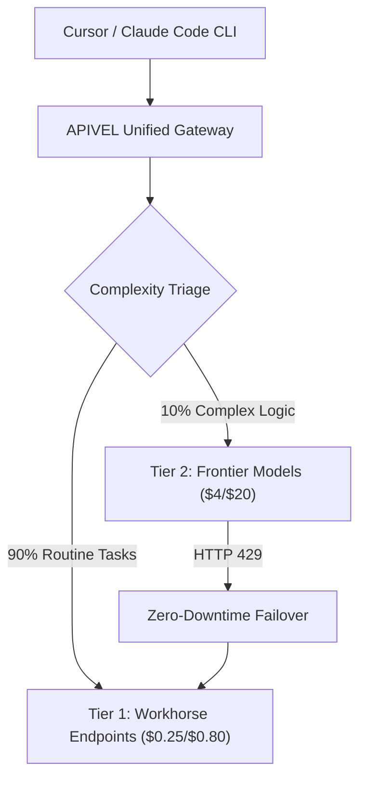

<div class="my-8 rounded-xl border border-primary/20 bg-primary/5 p-6 backdrop-blur-sm">
  <div class="flex items-center gap-2 text-primary font-semibold text-lg mb-2">
    <span>Technical Summary: GPT 6.2 Astra vs Opus 5.5</span>
  </div>
  <p class="text-base text-gray-200 leading-relaxed m-0">
    Comparing <strong>GPT 6.2 Astra vs Opus 5.5</strong> (also searched as <strong>GPT 6 Astra vs Opus 5.5</strong>) comes down to planning versus autonomous execution. OpenAI's Astra excels at theoretical reasoning at $8/$40 per million tokens, while Anthropic's flagship leads SWE-bench coding (74.8%) at $4/$20. Routing 90% of routine diffs to auxiliary workhorse models via APIVEL cuts token spend by 92% with PayPal checkout and zero KYC.
  </p>
</div>

The **GPT 6.2 Astra vs Opus 5.5** comparison defines late-2026 engineering budgets across Claude Code CLI, Cursor, and Windsurf—where picking the wrong default model quickly triggers five-hour lockouts, rate-limit stalls, and runaway token bills across multi-turn repositories.

## GPT 6.2 Astra vs Opus 5.5 Architecture: Core Structural Differences

### Abstract Reasoning and Multi-Step Planning in Astra 6.2

OpenAI Astra (detailed in our [GPT 6.2 Astra Benchmarks Guide](/blog/gpt-6-2-astra-benchmarks-price-reddit/) and [GPT 6.2 Sol API Pricing](/blog/gpt-6-2-sol-api-pricing-benchmarks/)) builds serial reasoning blueprints before emitting code, making it strong for contract parsing, database migrations, and parametric 3D scripts—though it frequently pauses for verification during unattended terminal runs.

### Agentic Execution and Adaptive Thinking Mechanisms

Anthropic's flagship (see our [Claude Opus 5.5 Limits Guide](/blog/claude-opus-5-5-price-limits-claude-code/)) pairs a 1M context window (128K output) with adaptive thinking. It inspects dependency trees, edits builds, and verifies unit tests autonomously, emitting concise diffs with minimal prompting.

## GPT-6.2 Astra vs Opus 5.5 Benchmarks: SWE-bench Scores & API Pricing

The following matrix compares verified benchmark performance, context limits, pricing models, and primary operational use cases in the **GPT-6.2 Astra vs Opus 5.5** evaluation alongside cost-effective alternatives.

| Specification Dimension | OpenAI GPT 6.2 Astra | Anthropic Claude Opus 5.5 | Qwen 3.7 Max | DeepSeek V4 |
| :--- | :--- | :--- | :--- | :--- |
| **Primary Domain** | Abstract Planning & Math | Autonomous Coding Agent | Full-Stack Tool Workflows | Deep Logic & Refactoring |
| **Context Window (In / Out)** | 500K / 64K | 1,000K / 128K | 1,000K / 64K | 1,000K / 64K |
| **Input / Output (Per Million)** | **$8 / $40** | **$4 / $20** | **$0.25 / $0.80** | **$0.20 / $0.60** |
| **Cache Read Price** | $3.20 (60% off) | $0.20 (95% off) | $0.05 (Wholesale) | $0.04 (Wholesale) |
| **SWE-bench Verified** | 71.4% | 74.8% | 71.2% | 73.5% |
| **CursorBench Agent Score** | 68.2% | 76.5% | 70.8% | 72.9% |
| **Best For (Honesty Column)** | **System PRDs & 3D scripts** | **Autonomous Claude Code** | **High-volume PR automation** | **Heavy iterative debugging** |

*Data verified November 2026 via official docs and independent evals.*

### SWE-bench and Token Pricing Realities

On SWE-bench Verified, Anthropic's flagship reaches 74.8% versus 71.4% for Astra, hallucinating fewer test passes in unattended terminal sessions (while [GLM 5.4 vs Claude Opus 5.5](/blog/glm-5-4-vs-claude-opus-5-5-benchmarks/) shows open-weight hybrids closing in at 73.8%). Pricing diverges just as sharply: OpenAI charges $8 input and $40 output per million tokens ($3.20 cached), whereas Anthropic sits at $4 input and $20 output ($0.20 cached)—though max-effort adaptive thinking can still inflate total turn spend in production agent loops.

## GPT-6.2 Astra vs Opus 5.5 on Reddit: Rate Limits & Developer Traps

Authentic developer feedback on technical forums highlights practical friction points obscured by vendor benchmark charts in the **GPT-6.2 Astra vs Opus 5.5** showdown.

<div class="my-8 rounded-xl border border-amber-500/30 bg-amber-500/5 p-6 backdrop-blur-sm">
  <div class="flex items-center gap-2 text-amber-400 font-semibold text-lg mb-3">
    <span>Verified Community Voices: r/ClaudeCode & r/OpenAI</span>
  </div>
  <blockquote class="border-l-4 border-amber-400 pl-4 my-3 italic text-gray-300">
    "Opening a heavy code review or a long-horizon reasoning task exhausts session capacities in short order... you are locked out and forced to wait out a cooldown period. When you crank effort to max, thinking tokens multiply dramatically, causing per-task costs to skyrocket."
    <div class="text-xs text-gray-400 mt-1 not-italic">— Verified Developer Discussion, <a href="https://www.reddit.com/r/ClaudeCode/comments/" target="_blank" rel="noopener noreferrer" class="text-primary hover:underline">Reddit r/ClaudeCode Community</a></div>
  </blockquote>
  <blockquote class="border-l-4 border-amber-400 pl-4 my-3 italic text-gray-300">
    "Astra tends to over-engineer solutions, spinning up excessive checking loops or unnecessary tool calls. This wastes valuable quota on tasks that smaller models could handle cheaper and faster. While OpenAI's code quality is strong, it feels bureaucratic and stops too often."
    <div class="text-xs text-gray-400 mt-1 not-italic">— Autonomous Agent Evaluation, <a href="https://www.reddit.com/r/OpenAI/comments/" target="_blank" rel="noopener noreferrer" class="text-primary hover:underline">Reddit r/OpenAI Community</a></div>
  </blockquote>
</div>

### Context Bloat and Over-Engineering Loops

Context bloat remains a major bottleneck: re-reading growing history across turns drains five-hour quotas within ninety minutes. Astra also tends to loop directory inspections without editing code, while max-effort adaptive thinking burns quota on routine fixes.

## Beating GPT 6.2 Astra vs Opus 5.5 Token Burn: Two-Tier Hybrid Router

To resolve the **GPT 6.2 Astra vs Opus 5.5** cost dilemma, engineering teams deploy a two-tier hybrid gateway pattern.



### Two-Tier Routing with Auxiliary Workhorse Endpoints

Rather than sending every turn to frontier endpoints, splitting workloads cuts daily API bills from $45 to under $4.50:

1. **Tier 1 Workhorse (90% of Volume)**: Route unit tests, REST boilerplate, and lint triage to `infer/qwen3.7-max` or `infer/deepseek-v4` at $0.20–$0.25 per million input tokens.
2. **Tier 2 Frontier Specialist (10% of Volume)**: Reserve frontier endpoints for multi-service redesigns or multimodal CAD (see [GLM 5.4 vs 5.3 Differences](/blog/glm-5-4-vs-5-3-differences/)). When `HTTP 429` hits, APIVEL reroutes payloads across normalized schemas automatically.

## Interactive Cost Calculator: GPT 6.2 Astra vs Opus 5.5 Savings

Estimate monthly token spend for pure frontier deployments versus a two-tier hybrid architecture:

<div class="my-8 rounded-xl border border-primary/20 bg-card p-6 shadow-lg">
  <div class="flex items-center justify-between border-b border-border pb-4 mb-6">
    <div>
      <div class="font-bold text-lg text-white">Astra vs Opus 5.5 Cost & Savings Calculator</div>
      <div class="text-xs text-gray-400">Compare routing 90% routine coding tasks to auxiliary workhorse endpoints</div>
    </div>
    <span class="rounded bg-primary/20 px-2.5 py-1 text-xs font-semibold text-primary">Interactive Estimator</span>
  </div>

  <div class="grid grid-cols-1 md:grid-cols-2 gap-6 mb-6">
    <div>
      <label for="monthly-tokens" class="block text-sm font-medium text-gray-300 mb-2">
        Monthly Total Tokens: <span id="token-val" class="text-primary font-bold">20M Tokens</span>
      </label>
      <input type="range" id="monthly-tokens" min="5" max="100" step="5" value="20" class="w-full h-2 bg-gray-700 rounded-lg appearance-none cursor-pointer accent-primary" />
      <div class="flex justify-between text-xs text-gray-500 mt-1">
        <span>5M</span>
        <span>25M</span>
        <span>50M</span>
        <span>100M</span>
      </div>
    </div>

    <div>
      <label for="frontier-model" class="block text-sm font-medium text-gray-300 mb-2">Base Comparison Frontier Model</label>
      <select id="frontier-model" class="w-full rounded-lg border border-border bg-gray-800 px-3 py-2 text-sm text-gray-200 focus:border-primary focus:outline-none">
        <option value="astra">OpenAI GPT-6.2 Astra ($8 in / $40 out)</option>
        <option value="opus" selected>Anthropic Claude Opus 5.5 ($4 in / $20 out)</option>
      </select>
    </div>
  </div>

  <div class="grid grid-cols-1 md:grid-cols-3 gap-4 pt-4 border-t border-border">
    <div class="rounded-lg bg-gray-900/60 p-4 text-center border border-gray-800">
      <div class="text-xs text-gray-400 mb-1">Pure Frontier Cost</div>
      <div id="pure-cost" class="text-2xl font-bold text-red-400">$240.00</div>
      <div class="text-xs text-gray-500 mt-1">100% Routed to Frontier Model</div>
    </div>
    <div class="rounded-lg bg-gray-900/60 p-4 text-center border border-gray-800">
      <div class="text-xs text-gray-400 mb-1">Two-Tier Hybrid Cost</div>
      <div id="hybrid-cost" class="text-2xl font-bold text-green-400">$34.50</div>
      <div class="text-xs text-gray-500 mt-1">90% Qwen / DeepSeek + 10% Frontier</div>
    </div>
    <div class="rounded-lg bg-primary/10 p-4 text-center border border-primary/30">
      <div class="text-xs text-primary mb-1">Monthly Cost Reduction</div>
      <div id="savings-pct" class="text-2xl font-extrabold text-primary">85.6%</div>
      <div id="savings-amount" class="text-xs text-gray-300 mt-1">Save $205.50 / Month</div>
    </div>
  </div>

  <div class="mt-6 flex justify-end">
    <button type="button" id="recalc-btn" class="rounded-lg bg-primary px-4 py-2 text-xs font-semibold text-white shadow-md hover:bg-primary/90 transition-colors">
      Recalculate Savings
    </button>
  </div>
</div>

<script>
  (function() {
    const slider = document.getElementById('monthly-tokens');
    const tokenVal = document.getElementById('token-val');
    const modelSelect = document.getElementById('frontier-model');
    const pureCostEl = document.getElementById('pure-cost');
    const hybridCostEl = document.getElementById('hybrid-cost');
    const savingsPctEl = document.getElementById('savings-pct');
    const savingsAmountEl = document.getElementById('savings-amount');
    const btn = document.getElementById('recalc-btn');

    function update() {
      const tokensM = parseFloat(slider.value);
      tokenVal.textContent = tokensM + 'M Tokens';

      const inTokens = tokensM * 0.75;
      const outTokens = tokensM * 0.25;

      let frontierInPrice = 4.0;
      let frontierOutPrice = 20.0;
      if (modelSelect.value === 'astra') {
        frontierInPrice = 8.0;
        frontierOutPrice = 40.0;
      }

      const pureCost = (inTokens * frontierInPrice) + (outTokens * frontierOutPrice);
      const workhorseInPrice = 0.25;
      const workhorseOutPrice = 0.80;

      const hybridFrontierCost = ((inTokens * 0.10) * frontierInPrice) + ((outTokens * 0.10) * frontierOutPrice);
      const hybridWorkhorseCost = ((inTokens * 0.90) * workhorseInPrice) + ((outTokens * 0.90) * workhorseOutPrice);
      const totalHybridCost = hybridFrontierCost + hybridWorkhorseCost;

      const savedAmount = pureCost - totalHybridCost;
      const savedPct = ((savedAmount / pureCost) * 100).toFixed(1);

      pureCostEl.textContent = '$' + pureCost.toFixed(2);
      hybridCostEl.textContent = '$' + totalHybridCost.toFixed(2);
      savingsPctEl.textContent = savedPct + '%';
      savingsAmountEl.textContent = 'Save $' + savedAmount.toFixed(2) + ' / Month';
    }

    slider.addEventListener('input', update);
    modelSelect.addEventListener('change', update);
    btn.addEventListener('click', update);
    update();
  })();
</script>

## Production Implementation: GPT 6.2 Astra vs Opus 5.5 Hybrid Router

Implementing **GPT 6.2 Astra vs Opus 5.5** multi-model routing requires a client that abstracts endpoint variations and executes automated retries via our unified gateway (`apivel.com/v1`):

```python
import os
from openai import OpenAI

client = OpenAI(
    base_url="https://apivel.com/v1",
    api_key=os.environ["APIVEL_API_KEY"],
    timeout=45.0,
)

def route_coding_task(prompt: str, high_complexity: bool = False) -> str:
    primary = "claude-opus-5-5" if high_complexity else "infer/qwen3.7-max"
    try:
        res = client.chat.completions.create(
            model=primary,
            messages=[{"role": "user", "content": prompt}],
            max_tokens=4096,
        )
        return res.choices[0].message.content or ""
    except Exception:
        fallback = client.chat.completions.create(
            model="infer/deepseek-v4",
            messages=[{"role": "user", "content": prompt}],
            max_tokens=4096,
        )
        return fallback.choices[0].message.content or ""
```

### Resilient Fallback Implementation

If an agent triggers a rate limit with Anthropic or OpenAI, the gateway fails over to the workhorse tier (`infer/qwen3.7-max`) without breaking parent CI builds.

## Frequently Asked Questions: GPT 6.2 Astra vs Opus 5.5 Differences

### Why Is Anthropic's Flagship So Good for Agentic Coding?

Anthropic's model dominates agentic coding because its alignment favors autonomous multi-file execution. In Claude Code and Cursor, it reaches 74.8% on SWE-bench by editing files, interpreting terminal logs, and running test suites with minimal supervision.

### Is the New Anthropic Release Faster Than Opus 5?

Yes—roughly 40% faster on standard queries with lower latency and cheaper cache reads, though max-effort adaptive thinking in **GPT 6.2 Astra vs Opus 5.5** sessions still extends total turn duration when internal reasoning chains expand.

### What Is Better and Cheaper Than Anthropic's Top Tier?

Budget-conscious teams pair frontier planning with auxiliary workhorse models like **Qwen 3.7 Max** and **DeepSeek V4** (71.2%–73.5% SWE-bench at $0.20–$0.25 per million input tokens), cutting hybrid spend by up to 95%.

### Is Anthropic or GPT-6.2 Sol Better, and How to Route on APIVEL?

While GPT-6.2 Sol prioritizes lightweight speed, these two flagships target deep reasoning. APIVEL (`apivel.com/v1`) routes across OpenAI Astra, Anthropic Claude, and workhorse endpoints with PayPal Instant Checkout, global cards, and zero KYC.

<script type="application/ld+json">
{
  "@context": "https://schema.org",
  "@type": "TechArticle",
  "headline": "GPT 6.2 Astra vs Opus 5.5: Key Differences, Reddit Traps & Cost Fix",
  "description": "Compare GPT 6.2 Astra vs Claude Opus 5.5: SWE benchmarks, $8 vs $4 pricing, Reddit rate limit traps, and cost-effective hybrid routing on APIVALE.",
  "author": {
    "@type": "Person",
    "name": "Kenji Tanaka",
    "jobTitle": "AI Developer Relations & Infrastructure Engineer",
    "worksFor": {
      "@type": "Organization",
      "name": "APIVALE"
    }
  },
  "publisher": {
    "@type": "Organization",
    "name": "APIVALE",
    "url": "https://apivel.com"
  },
  "datePublished": "2026-11-23",
  "mainEntityOfPage": "https://apivel.com/blog/gpt-6-2-astra-vs-opus-5-5-differences/"
}
</script>

<script type="application/ld+json">
{
  "@context": "https://schema.org",
  "@type": "FAQPage",
  "mainEntity": [
    {
      "@type": "Question",
      "name": "Why is Opus 5.5 so good for agentic coding?",
      "acceptedAnswer": {
        "@type": "Answer",
        "text": "Claude Opus 5.5 dominates autonomous coding due to its proactive agentic independence and 74.8% SWE-bench score. It executes multi-file modifications and terminal tasks with minimal human intervention, though high effort settings increase token burn."
      }
    },
    {
      "@type": "Question",
      "name": "Is Opus 5.5 faster than Opus 5?",
      "acceptedAnswer": {
        "@type": "Answer",
        "text": "Yes, Claude Opus 5.5 generates tokens approximately 40% faster than prior Opus releases on standard queries, with lower latency and cheaper cache reads, although adaptive thinking monologues can extend total task duration at max effort."
      }
    },
    {
      "@type": "Question",
      "name": "What is better and cheaper than Opus 5?",
      "acceptedAnswer": {
        "@type": "Answer",
        "text": "Alibaba Qwen 3.7 Max and DeepSeek V4 offer budget-friendly alternatives, achieving 71.2% and 73.5% SWE-bench scores at $0.20 to $0.25 per million input tokens, delivering up to 95% cost reductions in hybrid architectures."
      }
    },
    {
      "@type": "Question",
      "name": "Is Opus 5.5 or GPT-6.2 Sol better, and how to route on APIVALE?",
      "acceptedAnswer": {
        "@type": "Answer",
        "text": "APIVALE provides a unified OpenAI- and Anthropic-compatible gateway (https://apivel.com/v1) enabling seamless failover between GPT-6.2 Astra, Claude Opus 5.5, GPT-6.2 Sol, Qwen 3.7 Max, and DeepSeek V4 with instant PayPal checkout and zero KYC."
      }
    }
  ]
}
</script>

<div class="cta-card">
  <div class="my-10 p-8 rounded-2xl bg-gradient-to-br from-slate-900 via-primary/10 to-slate-900 border border-primary/30 text-center shadow-2xl backdrop-blur-md">
    <div class="inline-flex items-center gap-2 px-3 py-1 rounded-full bg-primary/10 border border-primary/30 text-primary text-xs font-mono mb-4">
      <span>⚡ High-Performance Unified Gateway</span>
    </div>
    <div class="text-2xl font-extrabold text-white tracking-tight mb-3">Stop Burning $50/Day on Single-Vendor Model Limits</div>
    <p class="text-sm text-gray-300 max-w-xl mx-auto leading-relaxed mb-6">
      Eliminate five-hour limits and 429 lockouts. Connect Claude Code, Cursor, and Windsurf to APIVEL with PayPal Instant Checkout and zero FX fees.
    </p>
    <div class="flex flex-wrap justify-center gap-4 text-xs text-gray-400 mb-6">
      <span class="flex items-center gap-1.5"><strong class="text-white">+50% First Deposit:</strong> $5 → $7.50, $29 → $43.50</span>
      <span class="flex items-center gap-1.5"><strong class="text-white">$29 Pack:</strong> 40M Tokens (56% OFF, Never Expires)</span>
      <span class="flex items-center gap-1.5"><strong class="text-white">$0.20 Free Trial:</strong> Zero KYC, No Card Required</span>
    </div>
    <div class="flex flex-col sm:flex-row justify-center gap-4 mb-6">
      <a rel="nofollow" href="/pricing?from_blog=gpt-6-2-astra-vs-opus-5-5-differences" class="inline-flex items-center justify-center rounded-xl bg-primary px-6 py-3 text-sm font-semibold text-white shadow-lg shadow-primary/25 hover:bg-primary/90 transition-all text-center">
        View Gateway Pricing
      </a>
      <a rel="nofollow" href="/sign-up?redirect=%2Fdashboard%3Fquickstart%3Dtrue&from_blog=gpt-6-2-astra-vs-opus-5-5-differences" class="inline-flex items-center justify-center rounded-xl border border-border bg-gray-800/80 px-6 py-3 text-sm font-semibold text-gray-200 hover:bg-gray-700/80 transition-all text-center">
        Claim $0.20 Free Credit
      </a>
    </div>
    <div class="pt-4 border-t border-gray-800/80 flex flex-wrap items-center justify-center gap-4 text-xs text-gray-400">
      <div class="flex items-center gap-3">
        <span>Official Payment Support: <strong>PayPal Instant Checkout</strong> (Pay with PayPal)</span>
        <span>•</span>
        <span>Global Credit Cards (Visa, MasterCard, Amex)</span>
        <span>•</span>
        <span>Alipay</span>
      </div>
      <div>0% Foreign Transaction Fees • Zero Identity Verification</div>
    </div>
  </div>
</div>
